<!-- source_sha: 3aeccb10a78f -->

<div align="center">

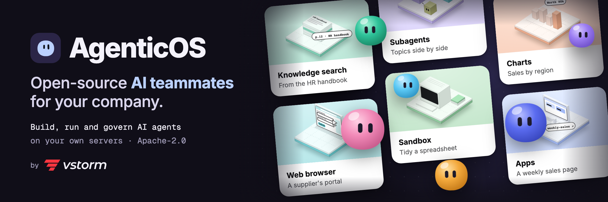

<p>
  <b>Plataforma de agentes de IA de código abierto y autoalojada para los compañeros de IA de tu empresa.</b><br>
  Crea, ejecuta y gobierna agentes en tus propios servidores y modelos: chat compartido, RAG, skills, navegador real, MCP, presupuestos, aprobaciones y registro de auditoría.<br>
  <sub>Apache-2.0 &middot; construido sobre Pydantic AI</sub>
</p>

<p>
  🏆 <b>Desarrollado por Vstorm — galardonada con el Open Agentic AI Innovation Award 2026.</b><br>La Agentic AI Foundation reconoce el uso de AGENTS.md y la integración de MCP en su framework de código abierto.<br><a href="https://aaif.io/blog/winners-of-the-first-aaif-annual-technical-excellence-awards">Anuncio de AAIF</a> &middot; <a href="https://vstorm.co/agentic-ai/open-agentic-ai-standards-aaif-award/">El trabajo detrás del premio</a>
</p>

<p>
  <a href="#-míralo-en-acción">Míralo</a> &middot;
  <a href="#-lo-más-destacado">Lo más destacado</a> &middot;
  <a href="#-qué-es-agenticos">¿Qué es?</a> &middot;
  <a href="#-inicio-rápido">Inicio rápido</a> &middot;
  <a href="#en-tu-servidor-en-cualquier-dispositivo">Server · Desktop · Mobile</a> &middot;
  <a href="#-conecta-las-aplicaciones-que-tu-equipo-ya-usa">Integraciones</a> &middot;
  <a href="#-crea-comparte-y-opera">Recorrido por el producto</a> &middot;
  <a href="#-encuentra-tu-camino">Encuentra tu camino</a> &middot;
  <a href="#-qué-incluye-hoy">Qué incluye</a> &middot;
  <a href="#-preguntas-frecuentes">Preguntas frecuentes</a> &middot;
  <a href="https://vstorm-co.github.io/vstormos-landing/">Sitio web</a> &middot;
  <a href="https://vstorm-co.github.io/agenticos/presentation/">Presentación introductoria</a> &middot;
  <a href="https://vstorm-co.github.io/agenticos/es/">Documentación</a>
</p>

<p>
  <a href="https://github.com/vstorm-co/agenticos/actions/workflows/ci.yml"></a>
  <a href="https://github.com/vstorm-co/agenticos/releases"></a>
  <a href="LICENSE"></a>
  <a href="https://ai.pydantic.dev"></a>
</p>

<p>
  <a href="README.md">English</a> &middot;
  <a href="README.pl.md">Polski</a> &middot;
  <a href="README.de.md">Deutsch</a> &middot;
  <b>Español</b>
</p>

</div>

<a href="docs/assets/readme/highlight-hero.webp">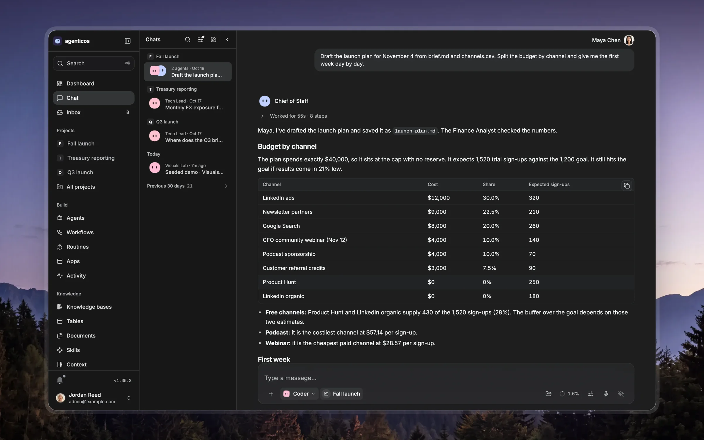</a>

*Conversación preparada con datos comerciales ficticios en el renderer real de Visuals. Sin CRM conectado ni nueva ejecución de generación por un modelo.*

AgenticOS da a cada equipo compañeros de IA: agentes que trabajan con archivos, ejecutan código, navegan por la web y usan las herramientas y el conocimiento de tu empresa. Tus compañeros y tus agentes trabajan en el mismo chat en vivo, y cualquier agente puede pasar código a Claude Code o Codex, con la suscripción de ChatGPT o Claude que ya pagas. Es de código abierto (Apache-2.0) y autoalojado, una capa que ejecutas en tu propia infraestructura. Crea y publica agentes en el navegador, compártelos con tus compañeros y gestiona su acceso, coste y resultados en un solo lugar.

**¿Primera vez aquí?** Recorre la [introducción en 17 diapositivas](https://vstorm-co.github.io/agenticos/presentation/) (en inglés): el problema, la idea, el producto en pantallas reales, sus controles y sus límites, y cómo empezar. Para ver cada pantalla en detalle, abre el [recorrido del producto en 47 diapositivas](https://vstorm-co.github.io/agenticos/presentation/tour/). Las flechas avanzan paso a paso en ambas; `O` muestra todas las diapositivas.

## Novedades de las últimas versiones

- **Claude Code o Codex local en el chat de escritorio.** Elige un agente por conversación, autoriza una carpeta local, reanuda sesiones y corrige la tarea mientras trabaja. Inicia sesión mediante el terminal del propio agente.
- **Tus skills e instrucciones del proyecto.** Comparte opcionalmente skills locales y `AGENTS.md` / `CLAUDE.md` con una conversación. Los chats nuevos empiezan con esta opción desactivada.
- **Discord se suma a Slack, Teams, Telegram y Mattermost.** Responde a menciones, mensajes directos y `/ask`, con aprobaciones y preguntas en el canal. [Configurar un canal](https://vstorm-co.github.io/agenticos/es/channels/).
- **Más posibilidades para Visuals y Apps.** Países, puntos y rutas con `AOWorldMap`, presentaciones como App con los skills incluidos y seguimiento de la salida de comandos de larga duración, como pruebas o logs.

[Notas de versiones](https://github.com/vstorm-co/agenticos/releases) · [Guía de escritorio](https://vstorm-co.github.io/agenticos/es/desktop/)

## ⚡ Lo más destacado

### Tu equipo y tus agentes, en una sala en vivo

Un proyecto da a todos los mismos archivos, instrucciones y un ordenador para los agentes. Invita a tus compañeros y trabajad como un equipo: ves quién está, sigues la respuesta del agente de un compañero mientras se escribe y llamas a cualquier agente, herramienta o documento con una `@`.

<a href="docs/assets/readme/highlight-projects.webp">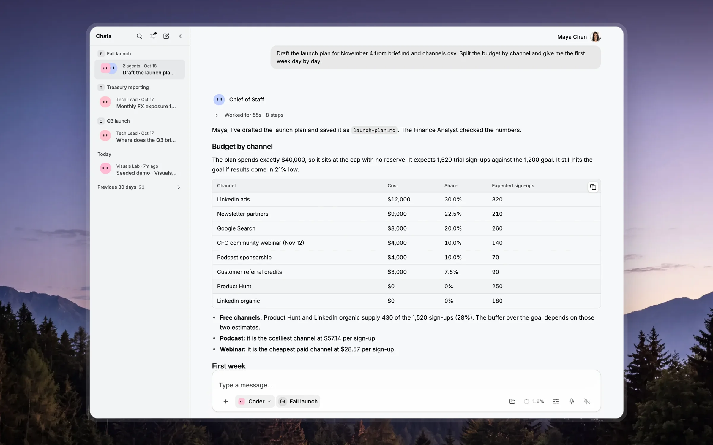</a>

### Responde a cualquiera, y el agente sabe quién dijo qué

Responde al mensaje de una persona o de un agente, y el agente aplica el cambio y dice de quién era. Cada mensaje lleva un nombre, así que cada decisión tiene dueño.

<a href="docs/assets/readme/highlight-reply.webp">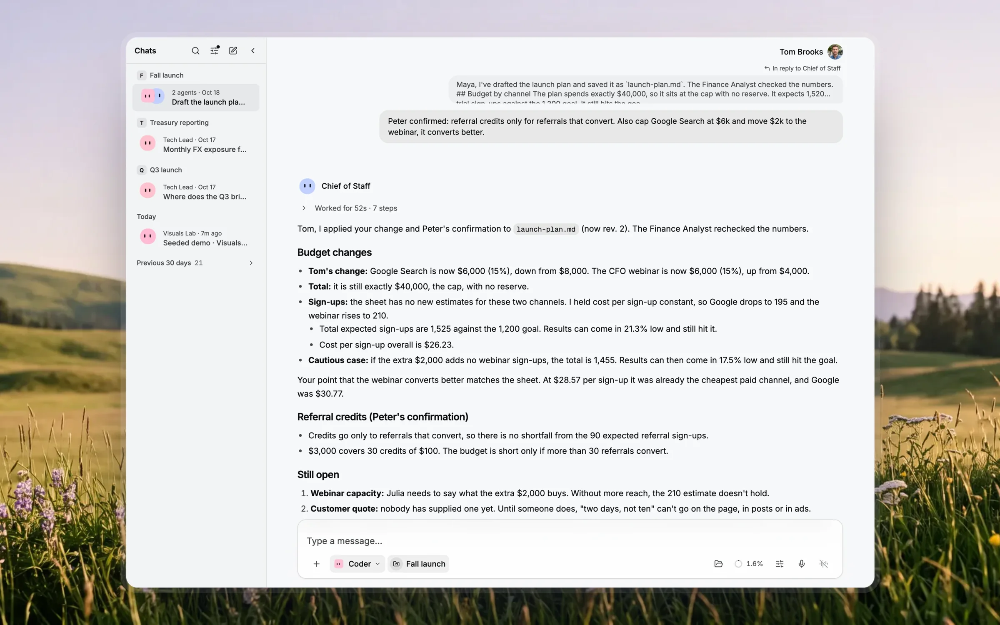</a>

### Claude Code y Codex, en tu equipo

Cualquier agente puede pasar trabajo de software a Claude Code o Codex. Construyen en el ordenador propio del agente, con tu suscripción de ChatGPT o Claude, e informan de lo que cambiaron, lo que comprobaron y lo que necesitan de ti.

<a href="docs/assets/readme/highlight-coding.webp">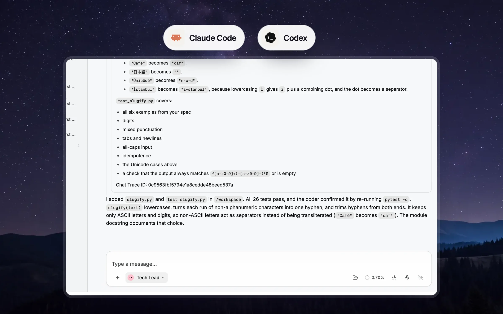</a>

*Ejemplo preparado de la interfaz: Claude Code implementa un portal de proveedores y Codex lo revisa en modo de solo lectura. Delegaciones ficticias; sin ejecución de CLI.*

### Pregunta cómo funciona y recibe un dibujo que puedes usar

Un agente dibuja mientras escribe: un diagrama a partir de tus documentos, una calculadora con controles deslizantes, un gráfico o una escena 3D, en vivo bajo su mensaje. Un clic lo guarda como una app que tu equipo abre con un enlace.

<a href="docs/assets/readme/highlight-visuals.webp">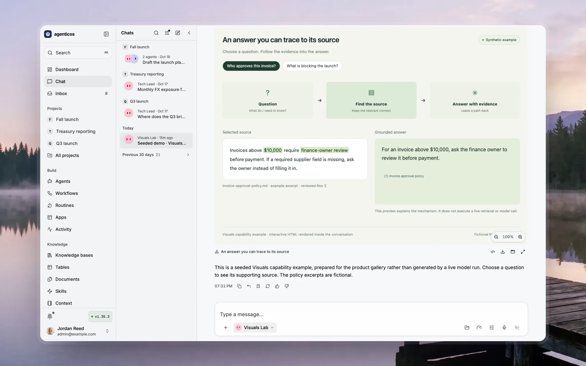</a>

*Visual de fabricación preparado dentro del chat: red de suministro, incidencias de entregas y ventanas de montaje. Datos ficticios interactivos; sin ERP, conexión a máquinas ni llamada al modelo.*

### Escribe a un agente y vete

Pide una investigación que lleva tiempo y cierra la pestaña. El agente sigue trabajando, la respuesta llega a la conversación y la campana te avisa cuando termina.

<a href="docs/assets/readme/highlight-research.webp">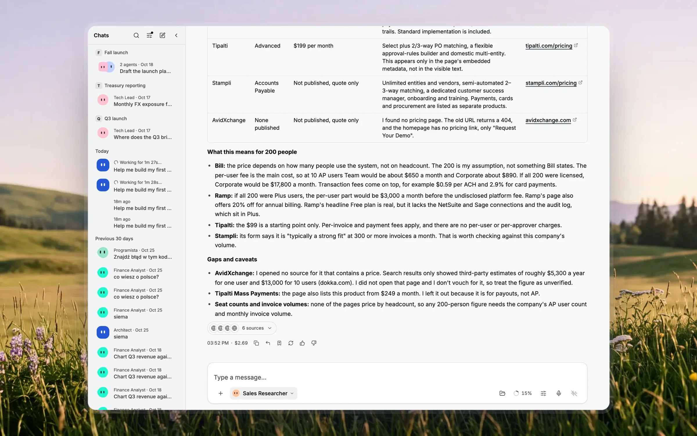</a>

### Tu día, en una pantalla

La consola se abre con lo que hicieron tus agents, las decisiones que te esperan y las conversaciones para retomar - con un recorrido por lo que es fácil pasar por alto.

<a href="docs/assets/readme/highlight-dashboard.webp">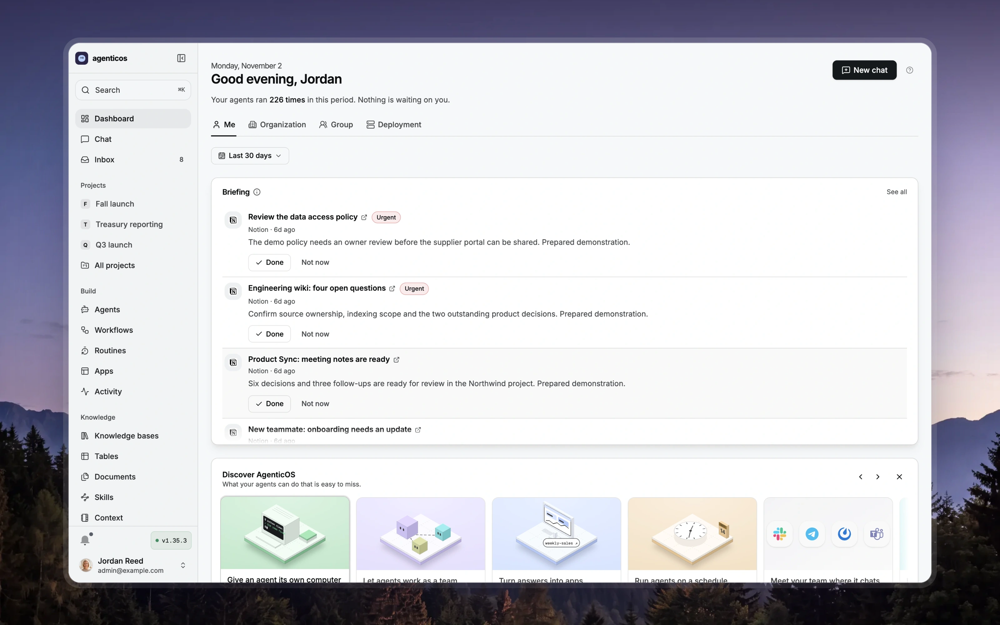</a>

### Agentes que trabajan en equipo

Un agente principal reparte partes de una tarea entre compañeros y redacta lo que encontraron - ves a quién preguntó y qué dijo cada uno.

<a href="docs/assets/readme/highlight-subagents.webp">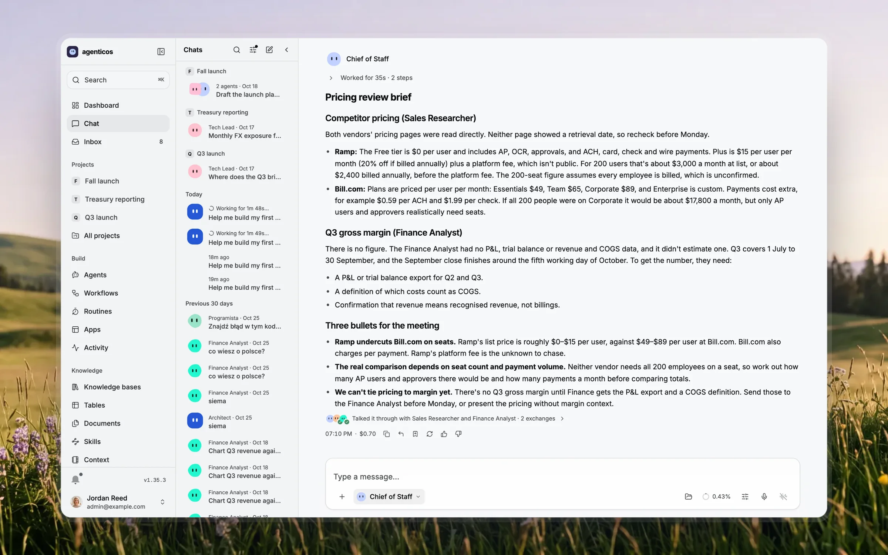</a>

### Un navegador real, dentro del chat

Míralo hacer clic por los sitios, toma el control cuando un inicio de sesión te necesita, señala un punto para comentarlo.

<a href="docs/assets/readme/highlight-browser.webp">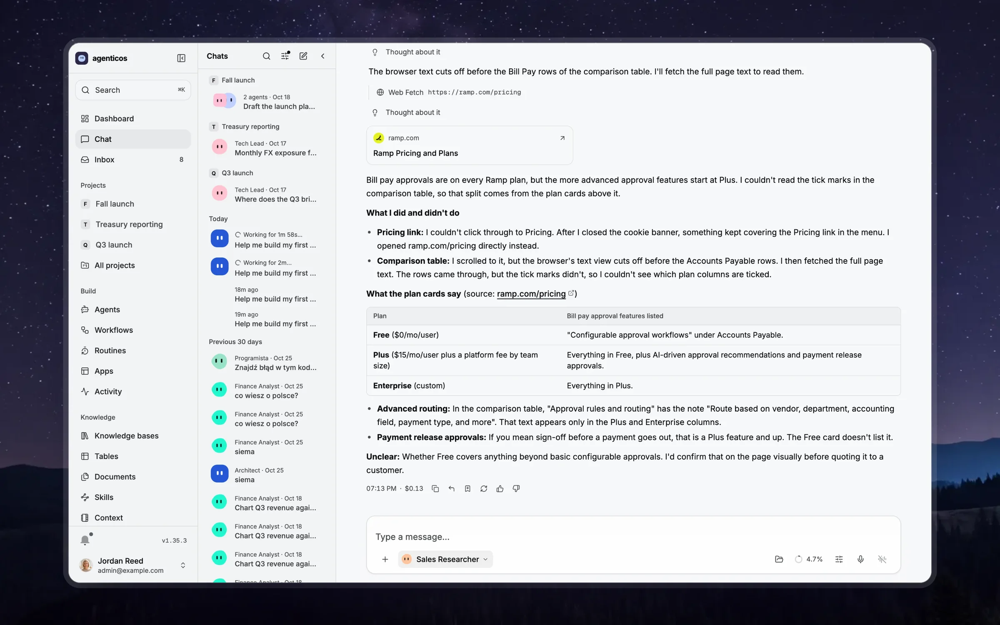</a>

### Construye, equipa y prueba en una ventana

Activa herramientas y prueba una tarea real en el panel de pruebas del borrador antes de publicar el agente para el equipo.

<a href="docs/assets/readme/highlight-builder-test.webp">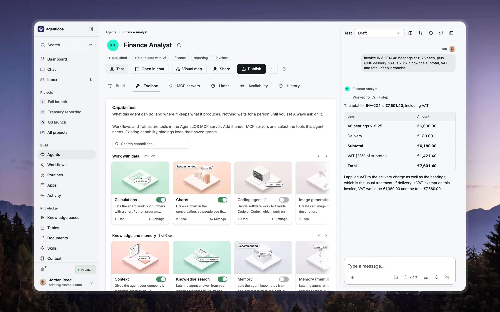</a>

### Apps, no solo respuestas

Un agente publica un dashboard o un informe como página con enlace estable y versiones.

<a href="docs/assets/readme/highlight-app.webp">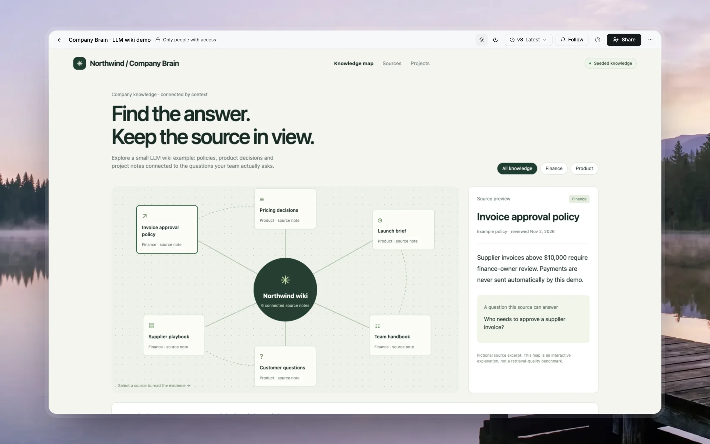</a>

*Northline: App preparada para planificar suministros y producción con envíos ficticios, simulación local de retrasos y ventanas de montaje.*

<details>
<summary>Más Apps preparadas: montaje de motores e inteligencia comercial</summary>

Demostraciones locales con datos ficticios. Motor Atlas permite explorar un conjunto conceptual y sus componentes; Revenue Pulse recalcula las métricas por región y período. Sin conexión a equipos, ERP ni CRM.

<a href="docs/assets/readme/highlight-revenue.webp">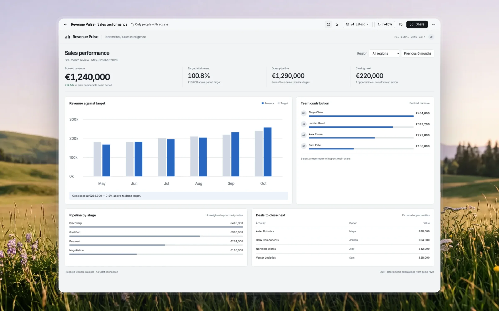</a>

</details>

### Un widget en tu propio sitio web

El widget real de AgenticOS ejecuta un agent publicado de solo lectura en el sitio ficticio Trail Supply. En la prueba local registrada respondió usando el catálogo de sus instrucciones. No están conectados inventario real, compras ni pagos.

<a href="docs/assets/readme/highlight-widget.webp">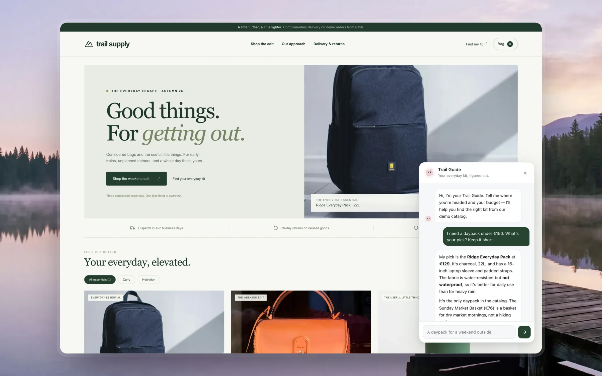</a>

[Crea y publica un widget web](https://vstorm-co.github.io/agenticos/es/howto/support-widget/)

### Más de 4.700 servidores MCP

Conecta Notion, GitHub, Jira o tu propio servidor y elige qué herramientas puede usar cada agente.

<a href="docs/assets/readme/highlight-mcp-servers.webp">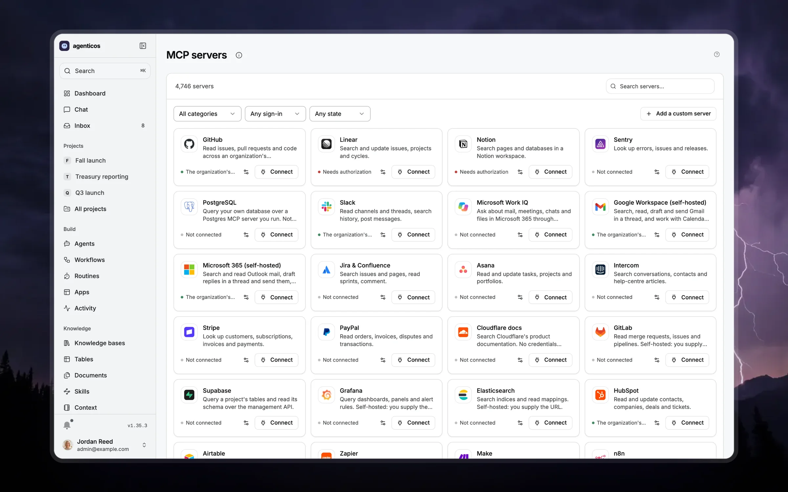</a>

### Trabaja en AgenticOS desde Claude Code, Codex o Cursor

AgenticOS es un servidor MCP. Añádelo con un comando e inicia sesión en el navegador: tu asistente de código puede listar y ejecutar agentes, leer runs y lo que cuestan, y buscar y alimentar bases de conocimiento, dentro de lo que hayas permitido.

<a href="docs/assets/readme/highlight-mcp-server.webp">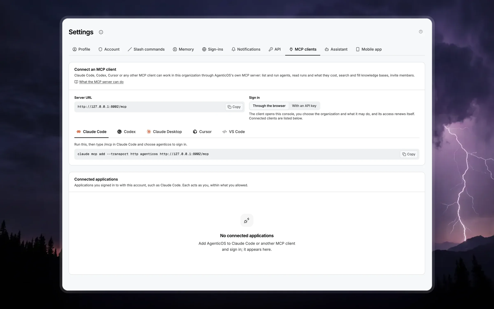</a>

## 📸 Míralo en acción

Consulta la [galería actual del producto](https://vstorm-co.github.io/agenticos/es/screens/). Motor Atlas es un explorador interactivo preparado con componentes y telemetría ficticios; no es un plano CAD.

<a href="docs/assets/readme/highlight-motor.webp">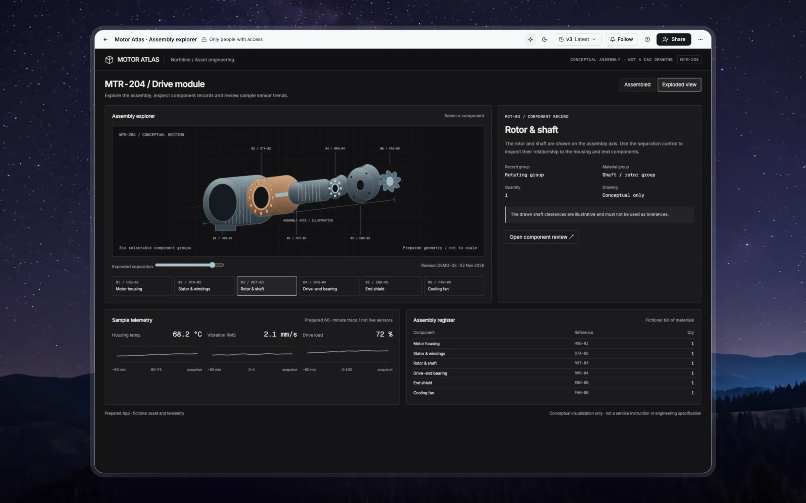</a>

## 🧩 Crea procesos útiles con tus agentes

Conecta pasos tipados, llamadas a agentes y herramientas MCP en el editor visual de [Workflows](https://vstorm-co.github.io/agenticos/es/workflows/). Guarda resultados estructurados en [Virtual Tables](https://vstorm-co.github.io/agenticos/es/virtual-tables/), inicia trabajo con [Routines](https://vstorm-co.github.io/agenticos/es/triggers/) y revisa runs y aprobaciones. Las [llamadas de voz](https://vstorm-co.github.io/agenticos/es/voice/) y la [app de escritorio](https://vstorm-co.github.io/agenticos/es/desktop/) permiten usar los mismos agentes publicados.

**Workflows visuales: desde un nuevo lead hasta una entrega revisada por una persona.**

<a href="docs/assets/readme/highlight-workflows.webp">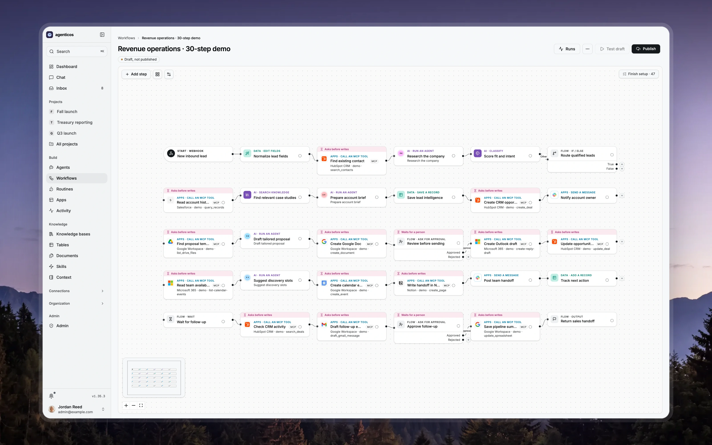</a>

Borrador ilustrativo de 30 pasos con Google Workspace, Microsoft 365, HubSpot, Salesforce, Notion, Slack, agentes y aprobaciones. Las conexiones son marcadores de demo; la integración no se ha ejecutado.

**Trabajo estructurado que pueden consultar tus agentes y tu equipo.**

<a href="docs/assets/readme/highlight-tables.webp">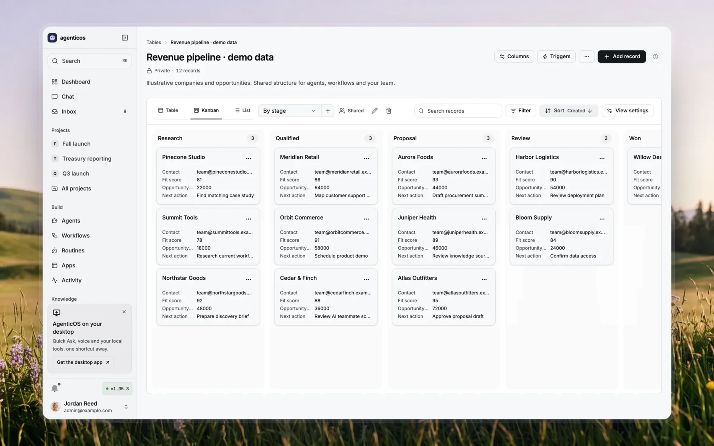</a>

Virtual Tables con empresas ficticias, campos tipados, etapas y próximas acciones. Los mismos registros en una tabla o un tablero kanban.

Empieza por una tarea concreta: una [LLM wiki en un Project](https://vstorm-co.github.io/agenticos/es/projects/), un [widget de agente en una web](https://vstorm-co.github.io/agenticos/es/channels/) o un equipo que comparte archivos e instrucciones del proyecto. El widget ofrece la conversación; las recomendaciones y acciones del carrito necesitan tu catálogo, integración de herramientas y comprobaciones de permisos.

## 💡 ¿Qué es AgenticOS?

**AgenticOS es una capa de código abierto (Apache-2.0) y autoalojada para crear, compartir y gobernar agentes de IA en toda la empresa.** Los equipos configuran un agente en el navegador: escriben sus instrucciones, eligen un modelo y activan herramientas. Lo conectan a los documentos y las aplicaciones de la empresa y lo publican en el chat web, Slack, Mattermost, Telegram, un widget para sitios web o una API. Los administradores controlan quién puede usar cada agente, cuánto puede gastar y qué acciones necesitan la aprobación de una persona. Cada run queda registrado.

La mayoría de los frameworks de agentes te dan una biblioteca, así que cada cambio en el comportamiento de un agente es un pull request, una revisión y una release. Esa forma no encaja con los agentes pequeños que una empresa quiere de verdad, porque quien sabe qué debe decir el agente no es quien tiene acceso al repositorio. **El código define, la configuración compone:** los ingenieros amplían lo que se puede ensamblar, y la configuración solo llega a lo que el código ha registrado.

Funciona en tu propia infraestructura con Docker Compose y es compatible con 28 providers de modelos, incluida tu suscripción de ChatGPT y modelos locales mediante Ollama y vLLM. Los agentes se ejecutan sobre [Pydantic AI](https://ai.pydantic.dev) y [pydantic-ai-harness](https://pydantic.dev/docs/ai/harness/); la capa que los rodea usa FastAPI, PostgreSQL con pgvector y Next.js. Lo mantiene [Vstorm](https://vstorm.co).

**Para quién es:**

- Empresas que quieren **una capa interna de agentes de IA** propia, en lugar de asistentes por usuario en la nube de un proveedor.
- Equipos con **trabajo repetitivo sobre documentos y herramientas**, como informes, respuestas de soporte, revisión de contratos y análisis de datos.
- Equipos de TI y seguridad que necesitan **soberanía de datos, inicio de sesión de empresa, budgets, aprobaciones y un registro de auditoría** para los agentes de IA.
- Ingenieros que quieren **puntos de extensión en Python tipado** y una consola que sus compañeros no técnicos puedan usar.

<a href="docs/assets/readme/company-architecture-diagram.webp">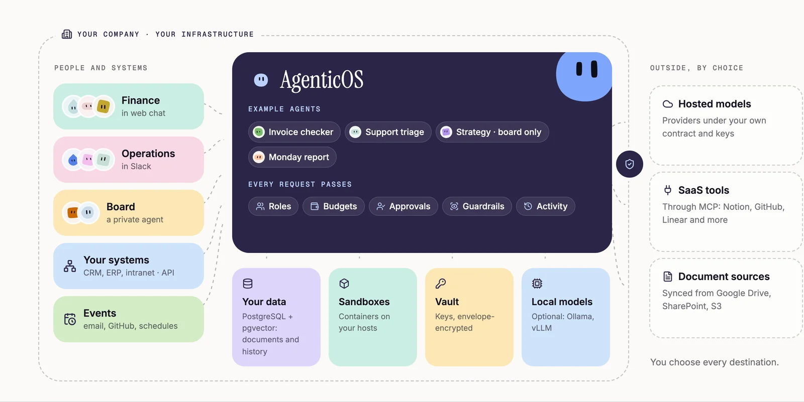</a>

<p align="center"><sub><b>Cómo encaja en tu empresa.</b> Personas ilustradas; los agentes son ejemplos.</sub></p>

**Cómo encaja AgenticOS en una empresa:** departamentos como finanzas, operaciones o la dirección usan agentes compartidos en el chat web, Slack o un workspace privado. Tus sistemas llaman a los agentes mediante la API, y los eventos o las programaciones los inician automáticamente. Cada solicitud pasa por los mismos controles: roles, budgets, aprobaciones, guardrails y un run registrado. Tus datos, vectores, sandboxes de código, el vault de credenciales y los modelos locales opcionales permanecen en tu infraestructura. Los modelos alojados, las herramientas SaaS y las fuentes de documentos externas solo se usan cuando las configuras.

28 proveedores de modelos · más de 4700 entradas en la galería MCP · chat y Projects compartidos · workflows visuales y virtual tables · web, escritorio, API y mensajería. Configura la disponibilidad y herramientas de cada agente publicado.

## ✨ Qué puedes hacer

| Para tu equipo | Qué ofrece AgenticOS |
|---|---|
| [Archivos y código](#-trabaja-con-archivos-y-código) | Analiza CSV, genera gráficos y documentos, trabaja en repositorios |
| [Agentes reutilizables](#-crea-agentes-que-tu-equipo-pueda-reutilizar) | Elige modelos y herramientas, publica versiones, comparte agentes con tus compañeros |
| [Conocimiento de la empresa](#-enseña-a-los-agentes-cómo-trabaja-tu-equipo) | Reutiliza skills, contexto y documentos consultables en distintos agentes |
| [Resultados compartidos](#-publica-resultados-como-páginas-interactivas) | Publica páginas interactivas con enlaces estables e historial de versiones |
| [Ejecución y supervisión](#-supervisa-runs-costes-y-aprobaciones) | Personaliza dashboards, revisa runs, programa tareas y fija budgets |
| [Acceso en la empresa](#-organiza-equipos-con-roles-y-grupos) | Combina roles, grupos de departamentos e inicio de sesión de empresa |

## 🚀 Inicio rápido

### Elige cómo empezar

**Un workspace de empresa, varias formas de acceder.** El servidor ejecuta AgenticOS; la aplicación de escritorio se conecta a él. Para acceder a un workspace existente no necesitas Docker ni herramientas de desarrollo.

| Tu situación | Siguiente paso |
|---|---|
| Tu empresa ya utiliza AgenticOS | Pide la URL del workspace y entra desde el navegador o [instala la aplicación](#instalar-la-aplicación-de-escritorio). |
| Tu empresa necesita un workspace | Pide a TI que [despliegue un servidor](#desplegar-un-servidor-de-empresa) o [habla con Vstorm](https://vstorm.co/contact-us/). |
| Quieres probarlo en tu equipo sin usar la terminal | [Instala la aplicación de escritorio](#instalar-la-aplicación-de-escritorio), elige **En este equipo** y sigue la configuración. Revisa antes los [requisitos](https://vstorm-co.github.io/agenticos/es/desktop/#running-it); la IA necesita un modelo configurado, pero los ejemplos grabados no. |
| Eres desarrollador y quieres probar en local | [Ejecuta el quickstart con Docker](#pruébalo-en-local). |

### Pruébalo en local

<details id="local-quickstart">
<summary>Para desarrolladores: probar AgenticOS en local con Docker</summary>

Necesitas Docker Compose y acceso a un provider de modelos. En macOS o Linux, ejecuta:

```bash
curl -fsSL https://raw.githubusercontent.com/vstorm-co/agenticos/main/scripts/quickstart.sh | bash
```

En Windows, ejecuta el mismo comando dentro de WSL2 con la integración de WSL2 de Docker Desktop activada. El instalador pregunta por el provider de modelos y su clave, tu usuario y el nombre de la organización, descarga las imágenes publicadas y arranca un despliegue con un agente que ya funciona. Basta con un host de 4 vCPU y 8 GB de RAM. Después abre **http://localhost:3000** e inicia sesión con el usuario que elegiste durante la instalación.

**Tu primer agente:** sigue la [guía del asistente de documentos](https://vstorm-co.github.io/agenticos/es/howto/first-document-agent/) para subir un manual, hacer preguntas y comprobar las respuestas con las fuentes citadas. Luego elige la siguiente tarea entre [30 tutoriales](https://vstorm-co.github.io/agenticos/es/use-cases/), cada uno con una entrada de ejemplo y una comprobación que puedes ejecutar.

<details>
<summary>Revisa el instalador o elige otro método de despliegue</summary>

Lee el [instalador](scripts/quickstart.sh) antes de ejecutarlo. Para comprobar los requisitos sin instalar:

```bash
curl -fsSL https://raw.githubusercontent.com/vstorm-co/agenticos/main/scripts/quickstart.sh | bash -s -- --check
```

La [guía de instalación](https://vstorm-co.github.io/agenticos/es/install/) explica la configuración manual con Docker Compose, las versiones fijas y la resolución de problemas. Para desarrollar a partir del código fuente, consulta [Contribuir](https://vstorm-co.github.io/agenticos/es/help/).

</details>

</details>

## En tu servidor. En cualquier dispositivo.

El servidor conserva el workspace. El navegador, la aplicación de escritorio y el teléfono se conectan al mismo despliegue, con sus cuentas, agentes y permisos.

<a id="server-setup"></a>

### Desplegar un servidor de empresa

TI configura el workspace una vez y te facilita una dirección HTTPS y una cuenta. Usa esa dirección en el navegador o en la aplicación de escritorio. Si necesitas ayuda con el despliegue, [habla con Vstorm](https://vstorm.co/contact-us/).

<details>
<summary>Configuración del servidor para TI y desarrolladores</summary>

Usa un host Linux con **4 vCPU y 8 GB de RAM**, Docker Engine 24+, Compose 2.24+ y `make`. Apunta dos nombres DNS, como `app.example.com` y `api.example.com`, al host y configura HTTPS mediante un proxy inverso. La opción soportada es Docker Compose en un solo host.

```bash
# On the server. Start from a released version so code and images stay aligned.
git clone --branch v1.38.2 --depth 1 https://github.com/vstorm-co/agenticos.git
cd agenticos
bash scripts/server-init.sh
```

El asistente pide los nombres del sitio y la API y el correo del certificado, y genera `backend/.env`. Establece `AGENTICOS_VERSION=1.38.2` para fijar esta versión. En un host nuevo con el Traefik incluido:

```bash
docker network create traefik_webgateway
docker compose --env-file backend/.env -f docker-compose-traefik.yml up -d
make prod PROXY=traefik
make prod-frontend PROXY=traefik
```

Después [crea la primera organización, el propietario y el agente](https://vstorm-co.github.io/agenticos/es/deploy/#start-it-and-create-the-first-account), abre la dirección HTTPS y añade las credenciales del proveedor de modelos. La guía cubre un proxy existente, Nginx, actualizaciones y copias de seguridad. Conserva la base de datos **y la clave del vault de `backend/.env`**.

```bash
docker compose --env-file backend/.env -f docker-compose-prod.yml \
  exec -T app agenticos cmd bootstrap \
  --email you@example.com --password '<your-password>' \
  --org 'Your Company' --provider anthropic --api-key '<your-api-key>'
```

[Guía completa del servidor](https://vstorm-co.github.io/agenticos/es/deploy/) · [Lista de producción](https://vstorm-co.github.io/agenticos/es/configuration/#production-checklist)

</details>

<a id="desktop-install"></a>

### Instalar la aplicación de escritorio

Descarga el instalador de [la última versión](https://github.com/vstorm-co/agenticos/releases/tag/v1.38.2):

| Sistema | Descargar v1.38.2 | Instalación |
|---|---|---|
|  **macOS** | [Apple silicon · DMG](https://github.com/vstorm-co/agenticos/releases/download/v1.38.2/AgenticOS_1.38.2_aarch64.dmg) · [Intel · DMG](https://github.com/vstorm-co/agenticos/releases/download/v1.38.2/AgenticOS_1.38.2_x64.dmg) | Abre el DMG y arrastra AgenticOS a Applications. |
|  **Windows x64** | [EXE](https://github.com/vstorm-co/agenticos/releases/download/v1.38.2/AgenticOS_1.38.2_x64-setup.exe) · [MSI](https://github.com/vstorm-co/agenticos/releases/download/v1.38.2/AgenticOS_1.38.2_x64_en-US.msi) | Abre el EXE y sigue el instalador. MSI es para despliegues gestionados por TI. |
|  **Linux x64** | [DEB](https://github.com/vstorm-co/agenticos/releases/download/v1.38.2/AgenticOS_1.38.2_amd64.deb) · [RPM](https://github.com/vstorm-co/agenticos/releases/download/v1.38.2/AgenticOS-1.38.2-1.x86_64.rpm) · [AppImage](https://github.com/vstorm-co/agenticos/releases/download/v1.38.2/AgenticOS_1.38.2_amd64.AppImage) | Abre DEB/RPM en el instalador de software. Para AppImage, permite su ejecución en las propiedades del archivo. |

En Mac: **menú Apple → Acerca de este Mac**. «Chip» indica Apple silicon; «Procesador: Intel» indica un Mac Intel.

**¿Prefieres Homebrew en macOS?**

El [tap Homebrew del proyecto](https://github.com/vstorm-co/homebrew-agenticos) elige el instalador adecuado para tu Mac. El cask elimina la marca de cuarentena de AgenticOS; esto no sustituye la notarización de Apple:

```bash
brew install --cask vstorm-co/agenticos/agenticos
```

**Después de instalar:** abre AgenticOS, introduce la dirección HTTPS del workspace de tu empresa e inicia sesión. Conectarte a un servidor existente no requiere Docker local. Para crear una instancia local, usa el asistente; esa opción sí necesita Docker.

Los builds de macOS no están notarizados por Apple. Un DMG descargado en el navegador puede requerir **System Settings → Privacy & Security → Open Anyway**. Consulta la [guía de instalación](https://vstorm-co.github.io/agenticos/es/desktop/#installing-the-app).

Escritorio añade Quick Ask, archivos locales y acceso al ordenador con tu consentimiento, además de Claude Code / Codex local. En **Settings → Desktop app**, revisa los agentes detectados e inicia sesión en su terminal. Elige uno en **Chat controls**, concede acceso completo a una carpeta de trabajo y confirma la tarea en el diálogo nativo. **My skills and instructions** es una opción independiente por chat.

[Configurar escritorio y agentes locales](https://vstorm-co.github.io/agenticos/es/desktop/)

### AgenticOS en el teléfono

**Disponible ahora sin compilar:** abre la dirección HTTPS en el navegador móvil e inicia sesión. Usa la opción de instalación; en iPhone, **Compartir → Añadir a la pantalla de inicio**. Chat, archivos y aprobaciones se adaptan al teléfono.

**iOS y Android nativos:** el código de `mobile/` incluye bloqueo biométrico, compartir, widgets e integración con notificaciones nativas. Son **builds de desarrollo**, sin distribución pública en App Store, Google Play o TestFlight ni descarga de una versión soportada. Instala Rust y Xcode en macOS (iOS), o Android SDK/NDK y JDK (Android), y después:

```bash
cd mobile
bun install --frozen-lockfile
bun run ios        # iOS development on macOS
# or: bun run android
```

La instalación en un dispositivo puede requerir firma y aprovisionamiento propios. Introduce un servidor accesible desde el teléfono o escanea el QR de un solo uso en **Settings → Mobile app** y confirma la cuenta. `localhost` se refiere al teléfono. El push nativo requiere configuración del despliegue; la [guía móvil](https://vstorm-co.github.io/agenticos/es/mobile/) cubre compilación, emparejamiento y notificaciones.

## 🔌 Conecta las aplicaciones que tu equipo ya usa

AgenticOS conecta los agentes con los modelos, las herramientas de chat, las aplicaciones de negocio y los almacenes de documentos que la empresa ya usa, de modo que un agente puede leer un brief de Notion, buscar en documentos de SharePoint o responder en Slack con las mismas reglas de acceso y el mismo budget.

<a href="docs/assets/readme/integrations-hub.webp">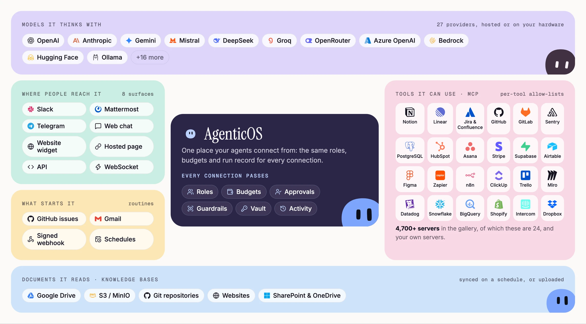</a>

| Conectar | Cómo | Más información |
|---|---|---|
| **Herramientas de chat** | Publica un agente en Slack, Mattermost o Telegram, un widget para sitios web, una página alojada, la API o un WebSocket | [Canales](https://vstorm-co.github.io/agenticos/es/channels/) |
| **Herramientas de negocio** | **más de 4700 servidores MCP** en la galería (Notion, GitHub, Jira, HubSpot, Stripe…) y tus propios servidores; elige qué herramientas puede llamar cada agente | [MCP](https://vstorm-co.github.io/agenticos/es/mcp/) |
| **Documentos** | Sincroniza Google Drive, S3/MinIO, repositorios Git, sitios web, SharePoint y OneDrive en bases de conocimiento | [Fuentes de sincronización](https://vstorm-co.github.io/agenticos/es/howto/configure-sync-sources/) |
| **Eventos** | Inicia agentes según un horario, una nueva issue de GitHub, un mensaje de Gmail o un webhook firmado | [Rutinas](https://vstorm-co.github.io/agenticos/es/triggers/) |
| **Modelos** | 28 providers, tu suscripción de ChatGPT, tu contrato en la nube (Azure, Bedrock, Vertex) o modelos locales (Ollama, vLLM) | [Modelos](https://vstorm-co.github.io/agenticos/es/models/) |

<sub>Las entradas del registro son metadatos proporcionados por sus publicadores; cada conexión requiere su propia configuración y revisión de acceso. El correo y el calendario de Outlook se conectan mediante un servicio MCP de terceros. Los logotipos identifican opciones de conexión y no implican ninguna colaboración.</sub>

## 🧩 Crea, comparte y opera

### 🤖 Crea agentes que tu equipo pueda reutilizar

Elige el modelo, las instrucciones y las herramientas de un agente en el navegador. Publica una versión para tus compañeros; consulta versiones anteriores y restáuralas cuando sea necesario. Mantén agentes especializados en investigación, informes, programación u operaciones en un mismo catálogo.

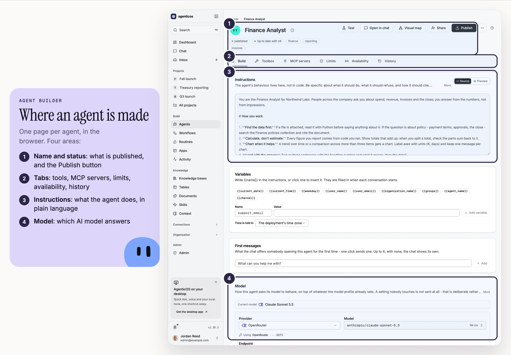

El builder de agentes tiene cuatro zonas: **(1)** el nombre y el estado de publicación, donde un borrador sigue siendo privado hasta que publicas una versión; **(2)** pestañas para la caja de herramientas, los servidores MCP, los límites, la disponibilidad y el historial de versiones; **(3)** las instrucciones, escritas en lenguaje llano, como un encargo para un compañero nuevo; y **(4)** el modelo, elegido por agente entre tus providers configurados.

Tus compañeros pueden usar un agente publicado en **chat web, Slack, Mattermost o Telegram** cuando esos canales estén configurados, en un **widget para sitios web** o una **página alojada**, o mediante la **API** y el **WebSocket**. [Crear un agente](https://vstorm-co.github.io/agenticos/es/first-agent/) · [Conectar un canal](https://vstorm-co.github.io/agenticos/es/channels/)

### 📂 Trabaja con archivos y código

Pide a un agente que analice una hoja de cálculo, genere un gráfico, prepare un documento o trabaje en un repositorio. Con una sandbox basada en contenedores configurada y la ejecución de comandos habilitada, puede **leer y editar archivos, ejecutar comandos de shell y ejecutar código Python o JavaScript**. El entorno workbench incluido contiene herramientas para datos, gráficos y documentos, entre ellas LibreOffice.

Si usas [Claude Code](https://code.claude.com/docs/en/overview) o [Codex](https://developers.openai.com/codex/cli/), el trabajo con archivos y comandos te resultará familiar. AgenticOS lleva esa forma de trabajar a una capa compartida y autoalojada, con conocimiento de la empresa, agentes reutilizables y controles de acceso de la organización. Lo que un agente puede lograr depende de su modelo, sus herramientas habilitadas y sus instrucciones. [Configuración de sandboxes](https://vstorm-co.github.io/agenticos/es/sandbox/)

### 🧠 Enseña a los agentes cómo trabaja tu equipo

- **Skills** contienen procedimientos reutilizables: cómo revisar código, escribir un informe o investigar un mercado. Mantenlos una vez y reutilízalos en distintos agentes.
- **Contexto** contiene conocimiento permanente, como un glosario, una política o la voz de la marca. Inclúyelo en el prompt o permite que el agente lo lea cuando lo necesite.
- **Bases de conocimiento (RAG)** permiten buscar en documentos subidos. Elige opciones de análisis, revisa el estado del procesamiento y los fragmentos, o sincronízalos desde una de las fuentes que se indican a continuación.

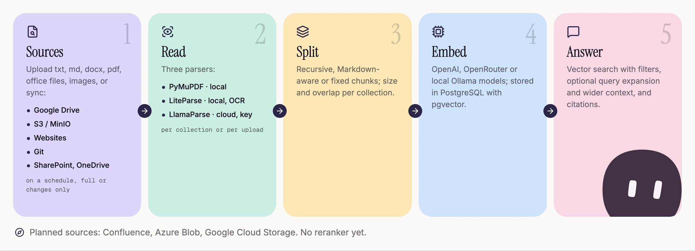

**Cómo funciona la generación aumentada por recuperación (RAG) en AgenticOS:** los documentos se suben o se sincronizan desde Google Drive, S3/MinIO, Git, sitios web, SharePoint u OneDrive. Los lee un parser: PyMuPDF y LiteParse se ejecutan en local, con OCR para documentos escaneados, mientras que LlamaParse es un servicio en la nube. Después los documentos se dividen en fragmentos, se convierten en embeddings con un modelo de OpenAI, OpenRouter u Ollama local y se guardan en PostgreSQL con pgvector. Al recibir una pregunta, el agente busca en los vectores con filtros y responde con citas.

[Skills](https://vstorm-co.github.io/agenticos/es/skills/) · [Contexto](https://vstorm-co.github.io/agenticos/es/context/) · [Procesamiento de documentos](https://vstorm-co.github.io/agenticos/es/file-processing/) · [Fuentes de sincronización](https://vstorm-co.github.io/agenticos/es/howto/configure-sync-sources/)

### 🎨 Publica resultados como páginas interactivas

Los agentes pueden publicar informes, comparaciones interactivas y pequeños paneles como **aplicaciones**. Elige quién puede abrirlos; las actualizaciones conservan el mismo enlace y las versiones anteriores siguen disponibles. Los enlaces públicos pueden caducar, pedir una contraseña o limitar qué sitios pueden incrustarlos. [Compartir una aplicación](https://vstorm-co.github.io/agenticos/es/artifacts/)

### 📊 Supervisa runs, costes y aprobaciones

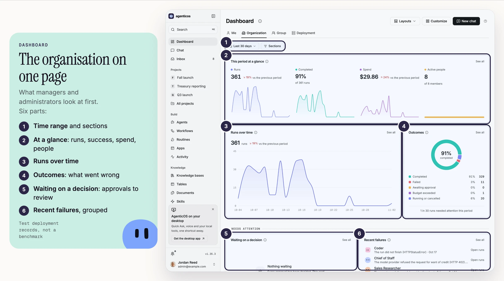

El dashboard responde a seis preguntas para el periodo elegido: cuántos runs hubo, cuántos terminaron, cuánto costaron y cuántas personas usaron agentes; cómo cambiaron los runs a lo largo del tiempo; qué falló, esperó una aprobación o se detuvo por un budget; de dónde vinieron los runs; y qué agentes usa realmente la gente.

Personaliza el **dashboard** según tu trabajo. **Activity** permite revisar runs y llamadas a herramientas, comparar versiones de agentes y exportar registros. Los **budgets** por agente y por organización se comprueban antes de cada solicitud al modelo. Las **políticas de aprobación** hacen que las herramientas sensibles esperen a una persona, y las **rutinas** repiten tareas según un horario o eventos como una nueva issue de GitHub, un mensaje de Gmail o un webhook firmado. [Historial de runs, budgets y aprobaciones](https://vstorm-co.github.io/agenticos/es/governance/) · [Rutinas](https://vstorm-co.github.io/agenticos/es/triggers/)

### 👥 Organiza equipos con roles y grupos

**Los roles definen qué pueden hacer las personas. Los grupos definen con quién compartes.** Usa roles como Builder, Operator, Member y Viewer y crea departamentos o grupos de trabajo como Operations, Engineering, Finance y Research. Comparte un agente, skill, colección, archivo de contexto o aplicación con un grupo en un solo paso, o limítalo a los departamentos que elijas al crearlo. [Departamentos y grupos](https://vstorm-co.github.io/agenticos/es/departments/)

Usa las cuentas existentes de la empresa mediante **inicio de sesión único con OIDC** (Entra ID, Okta, Keycloak y otros), **acceso al directorio con LDAP** o **inicio de sesión integrado de Windows con Kerberos**. Las **asignaciones de directorio** vinculan grupos del directorio con un rol y un grupo al iniciar sesión. [Roles y permisos](https://vstorm-co.github.io/agenticos/es/permissions/) · [Inicio de sesión con directorio](https://vstorm-co.github.io/agenticos/es/directory/)

## 🧭 Encuentra tu camino

¿Vas a construir sobre él? Ve a [Para desarrolladores y operadores](#-para-desarrolladores-y-operadores).

<details>
<summary><b>Si estás decidiendo si adoptarlo</b>: el problema que resuelve, qué requiere, cómo empezar</summary>

<br>

| La pregunta que tus equipos no pueden responder hoy | Cómo la responde AgenticOS |
|---|---|
| ¿Quién puede usar qué datos? | Roles, grupos de departamentos y uso compartido por recurso, con inicio de sesión de empresa |
| ¿Cuánto cuesta? | Budgets mensuales por agente y por organización, comprobados antes de cada solicitud al modelo |
| ¿Quién aprobó esa acción? | Las herramientas sensibles esperan a una persona; cada decisión queda registrada |
| ¿Adónde van nuestros datos? | Tú operas AgenticOS y eliges cada modelo, parser y herramienta a los que puede acceder |

**Qué requiere:** un host (4 vCPU, 8 GB de RAM), alguien que opere el despliegue y expertos en la materia que mantengan las instrucciones y los documentos. Los costes son el uso de modelos, la infraestructura, los servicios externos y el tiempo de las personas; el software es Apache-2.0, uso comercial incluido.

**Cómo empezar:** elige una tarea repetitiva y a la persona que juzgará las respuestas, configúrala con el modelo y las reglas de acceso que elijas y compruébala con criterios acordados de antemano. [Planifica el despliegue](https://vstorm-co.github.io/agenticos/es/rollout/) · [Compara enfoques](https://vstorm-co.github.io/agenticos/es/about/comparison/)

</details>

<details>
<summary><b>Si estás revisando la seguridad</b>: flujos de datos, identidad, controles, qué queda en manos de tu TI</summary>

<br>

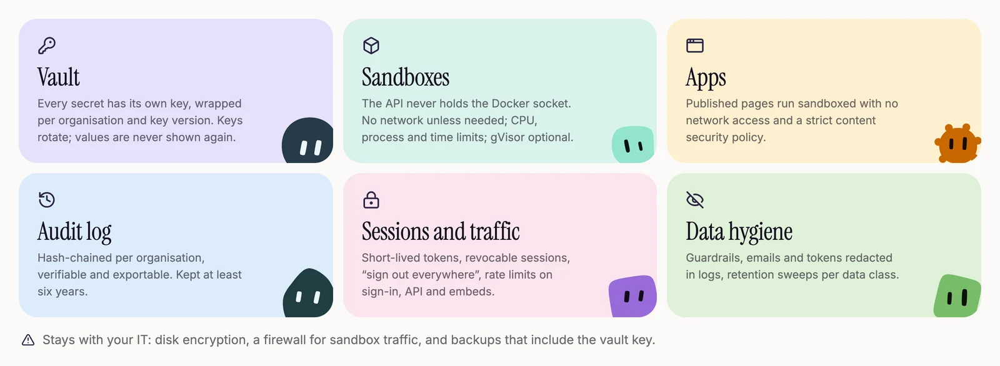

La seguridad funciona por capas. Las credenciales están en un vault con cifrado de sobre. El código se ejecuta en sandboxes aisladas. Las páginas publicadas están aisladas en una sandbox. Cada organización tiene un registro de auditoría encadenado por hashes. Las sesiones son de corta duración y revocables, y se aplican límites de frecuencia. Los registros se censuran y los datos se eliminan según un calendario de retención.

| Destino saliente | Se usa cuando | Alternativa local |
|---|---|---|
| Provider de modelos | En cada run de un agente | Ollama, vLLM o LM Studio en tu hardware |
| Provider de embeddings | Al indexar y buscar documentos | Modelos de embeddings locales de Ollama |
| LlamaParse | Colecciones configuradas con ese parser | PyMuPDF o LiteParse, ambos locales |
| Búsqueda web | Agentes con la búsqueda web activada | Desactiva la capability |
| Servidores MCP, canales de chat | Solo los que conectes | Servidores autoalojados, chat web |
| Trazas de Logfire | Solo cuando hay un token configurado | Historial de runs integrado |

- **Vault:** una clave de datos por secreto, envuelta por organización y versión de clave; las claves maestras rotan; los valores no vuelven a mostrarse.
- **Sandboxes:** la API no tiene socket de Docker; los contenedores no tienen red salvo que la necesiten, con límites de CPU, procesos y tiempo; gVisor es opcional.
- **Registro de auditoría:** encadenado por hashes por organización, verificable y exportable.
- **Perfil HIPAA:** [`deploy/profiles/hipaa/`](deploy/profiles/hipaa/) y `agenticos cmd doctor --profile hipaa` comprueban un despliegue en marcha frente a las salvaguardas técnicas del §164.312. Es una comprobación de configuración, no una certificación. [Lo que no afirma](https://vstorm-co.github.io/agenticos/es/security/#the-hipaa-profile-and-what-it-does-not-claim)
- **Queda en manos de tu TI:** el cifrado de disco en reposo, el cortafuegos de salida, la MFA mediante tu proveedor de identidad (sin MFA, SAML ni SCIM nativos) y las copias de seguridad que incluyan la clave del vault.

[Seguridad y flujos de datos](https://vstorm-co.github.io/agenticos/es/security/) · [Protección de datos](https://vstorm-co.github.io/agenticos/es/data-protection/) · [Secretos](https://vstorm-co.github.io/agenticos/es/secrets/) · [SECURITY.md](SECURITY.es.md)

</details>

<details>
<summary><b>Si buscas una primera tarea</b>: 30 tutoriales, cada uno con una comprobación que puedes ejecutar</summary>

<br>

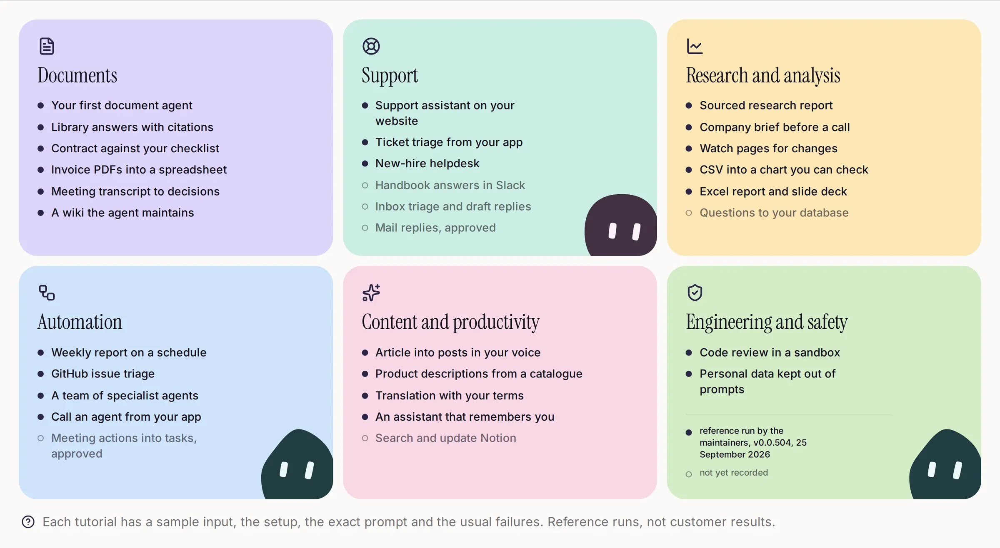

[Todos los tutoriales](https://vstorm-co.github.io/agenticos/es/use-cases/). 24 tienen un run de referencia hecho por los mantenedores; son puntos de partida, no resultados de clientes.

</details>

## 📦 Qué incluye hoy

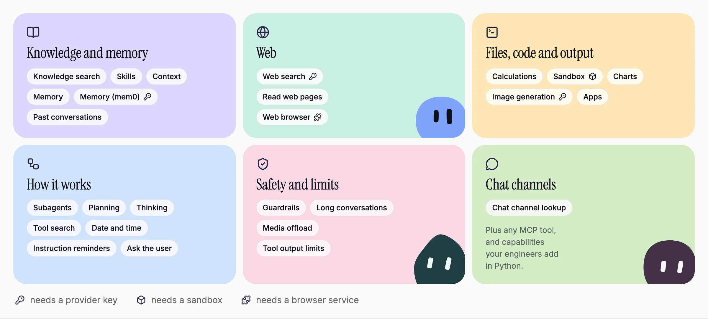

<details>
<summary>Las 37 capabilities integradas, en texto</summary>

- **Conocimiento y memoria:** búsqueda en el conocimiento con citas, skills, contexto, memoria, conversaciones anteriores.
- **Web:** búsqueda web (DuckDuckGo por defecto; Tavily, Brave o Exa con una clave), lectura de páginas web y un navegador web que el agente maneja y que puedes tomar tú, y uso del ordenador con tu permiso.
- **Archivos, código y resultados:** cálculos en Python, una sandbox con archivos y shell, un coding agent que pasa trabajo a Claude Code o Codex, gráficos, dibujos (diagramas, calculadoras, escenas 3D), generación de imágenes (OpenAI o Google), voz (OpenAI, ElevenLabs o Google), clips de vídeo (Google, BytePlus, xAI o Alibaba), seguimiento de comandos, Tables, Workflows y aplicaciones.
- **Cómo trabaja:** subagentes, planificación, razonamiento, trabajo mientras corren las herramientas, búsqueda de herramientas, fecha y hora, recordatorios de instrucciones, preguntas al usuario, borradores y sugerencias de próximos pasos.
- **Seguridad y límites:** guardrails que censuran secretos y datos personales, conversaciones largas, descarga de contenido multimedia, límites de salida de las herramientas.
- **Canales de chat:** consulta de canales de chat para bots de Slack, Telegram y Mattermost.

Además, cualquier herramienta de un servidor MCP conectado y las capabilities que tus ingenieros añadan en Python tipado. [Referencia de capabilities](https://vstorm-co.github.io/agenticos/es/reference/capabilities/)

</details>

<details>
<summary>Dónde responden los agentes y qué modelos usan</summary>

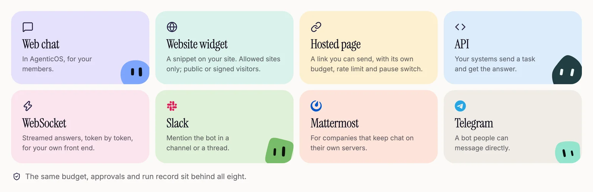
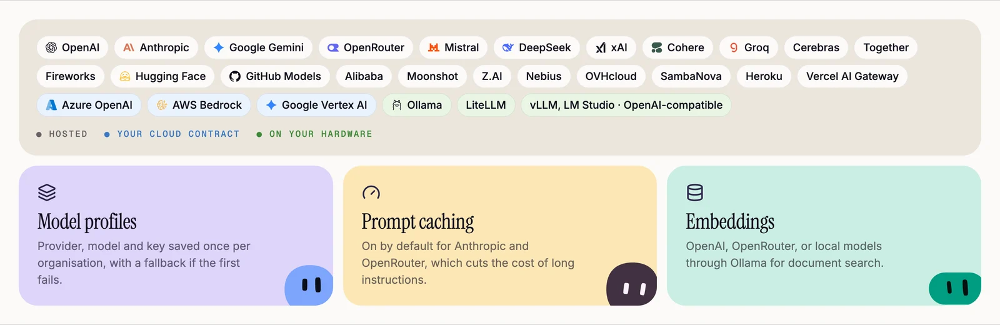

**Dónde responden los agentes:** chat web, un widget para sitios web, una página alojada, la API HTTP, un WebSocket con streaming, Slack, Teams, Discord, Mattermost y Telegram.

**Providers de modelos:**
- **Alojados (22):** OpenAI, Anthropic, Google Gemini, OpenRouter, Mistral, DeepSeek, xAI, Cohere, Groq, Cerebras, Together, Fireworks, Hugging Face, GitHub Models, Alibaba, Moonshot, Z.AI, Nebius, OVHcloud, SambaNova, Heroku y Vercel AI Gateway.
- **Tu suscripción:** ChatGPT a través de Codex, tras un inicio de sesión.
- **Con tu contrato en la nube:** Azure OpenAI, AWS Bedrock y Google Vertex AI.
- **Autoalojados:** Ollama y LiteLLM, además de vLLM y LM Studio mediante un endpoint compatible con OpenAI.

</details>

## 🆚 Cómo se compara

| | Dónde se ejecuta | Código | Modelos |
|---|---|---|---|
| **AgenticOS** | **Tu infraestructura** | **Apache-2.0** | **28 proveedores, también locales y tu plan de ChatGPT** |
| OpenAI dots | La nube de OpenAI | Propietario | Solo OpenAI |
| Grok Bot | La nube de xAI | Propietario | Solo Grok |
| Viktor | La nube de Viktor | Propietario | OpenAI, Anthropic, Google, Kimi |
| n8n | Autoalojado o n8n Cloud | Sustainable Use License | Muchos, también Ollama |

Los compañeros de IA llegan a la nube de cada proveedor. AgenticOS es el que ejecutas tú mismo, con cualquier modelo y con el código abierto. [Todas las comparaciones, en detalle](https://vstorm-co.github.io/agenticos/es/about/comparison/).

## 🎯 ¿Encaja AgenticOS con tu equipo?

Elígelo si el equipo tiene tareas recurrentes con documentos o herramientas, expertos que mantengan las instrucciones y una persona responsable de operar un despliegue autoalojado. Ten claro dónde se detiene hoy:

Los permisos del sistema de origen no se reflejan automáticamente; un agente puede compartir su conocimiento vinculado con sus usuarios. El autoalojamiento necesita un operador y los resultados dependen del modelo, las herramientas y la tarea. Consulta los [límites y compromisos](https://vstorm-co.github.io/agenticos/es/about/comparison/#what-agenticos-does-not-do-yet) actuales.

## 🔐 Controla tu despliegue, modelos y acceso

**Sovereign significa controlar el despliegue, los providers de modelos, los flujos de datos y el acceso a los agentes.** AgenticOS es software Apache-2.0 que puedes inspeccionar, modificar y operar.

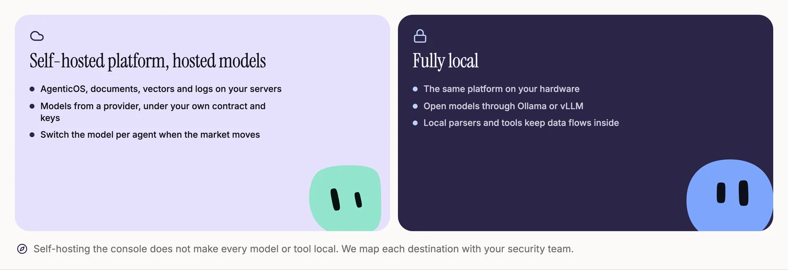

Hay dos configuraciones habituales. **Autoalojado, con modelos alojados:** AgenticOS, los documentos, los vectores y los registros se ejecutan en tus servidores, y los modelos llegan de un provider con tu propio contrato y tus claves. **Totalmente local:** la misma capa con modelos abiertos mediante Ollama o vLLM en tu hardware, además de parsers y herramientas locales. Autoalojar la consola no hace que todos los modelos, parsers o herramientas sean locales, así que revisa cada destino que configures. [Configura los modelos](https://vstorm-co.github.io/agenticos/es/models/) · [Seguridad y flujos de datos](https://vstorm-co.github.io/agenticos/es/security/)

## 🛠️ Para desarrolladores y operadores

AgenticOS está construido con FastAPI, Pydantic AI, PostgreSQL con pgvector, Redis y Next.js. Los ingenieros añaden capabilities, conectores de sincronización y entradas del catálogo MCP en Python tipado; los equipos componen agentes con las capabilities registradas en la consola.

| Capa | Qué se ejecuta allí |
|---|---|
| Consola | Next.js |
| API | FastAPI |
| Runtime de agentes | [Pydantic AI](https://ai.pydantic.dev) y [pydantic-ai-harness](https://pydantic.dev/docs/ai/harness/), un único runner detrás de cada superficie |
| Trabajo en segundo plano | Una cola de jobs en PostgreSQL, atendida por `python -m app.worker` |
| Datos | PostgreSQL con pgvector |
| Ejecución de código | Contenedores iniciados por `sandboxd` |

Llama a un agente publicado con `POST /api/v1/agents/{id}/run` como miembro autenticado, o recibe los tokens en streaming por el WebSocket.

[Arquitectura](https://vstorm-co.github.io/agenticos/es/architecture/) · [API](https://vstorm-co.github.io/agenticos/es/api/) · [Añadir una capability](https://vstorm-co.github.io/agenticos/es/howto/add-capability/) · [Referencia de capabilities](https://vstorm-co.github.io/agenticos/es/reference/capabilities/) · [Contribuir](https://vstorm-co.github.io/agenticos/es/help/)

La [analogía del sistema operativo](https://vstorm-co.github.io/agenticos/es/about/) explica la arquitectura. La [aplicación de escritorio](https://vstorm-co.github.io/agenticos/es/desktop/) opcional añade una ventana propia, una mascota y un atajo de captura de pantalla en macOS. [Mobile](https://vstorm-co.github.io/agenticos/es/mobile/): consola en la pantalla de inicio y builds nativos de desarrollo.

## ❓ Preguntas frecuentes

<details>
<summary><b>¿AgenticOS es gratuito para uso comercial?</b></summary>

Sí. AgenticOS tiene licencia Apache-2.0, que permite el uso comercial, la modificación y el despliegue privado. Pagas la infraestructura en la que lo ejecutas y los providers de modelos y servicios externos que elijas. El nombre y el logotipo de AgenticOS no están cubiertos por la licencia.

</details>

<details>
<summary><b>¿Puede AgenticOS funcionar solo con modelos locales?</b></summary>

Sí. Configura como provider de modelos Ollama, LiteLLM o un servidor compatible con OpenAI, como vLLM o LM Studio; usa modelos de embeddings locales mediante Ollama y analiza los documentos con PyMuPDF o LiteParse. Autoalojar solo la consola no hace que todos los modelos, parsers o herramientas sean locales: comprueba cada destino que configures. [Modelos](https://vstorm-co.github.io/agenticos/es/models/) · [Flujos de datos](https://vstorm-co.github.io/agenticos/es/security/)

</details>

<details>
<summary><b>¿Qué métodos de inicio de sesión y qué roles admite?</b></summary>

Correo y contraseña con enlaces mágicos, Google, inicio de sesión único genérico con OIDC (Entra ID, Okta, Keycloak, Auth0, Authentik, Google Workspace), LDAP y Kerberos. Seis roles integrados (Owner, Admin, Builder, Operator, Member, Viewer) se combinan con grupos de departamentos y uso compartido por recurso. La autenticación multifactor la aporta tu proveedor de identidad; todavía no hay MFA, SAML ni SCIM nativos. [Permisos](https://vstorm-co.github.io/agenticos/es/permissions/)

</details>

<details>
<summary><b>¿Cómo mantiene AgenticOS a los agentes bajo control?</b></summary>

Los budgets mensuales por agente y por organización se comprueban antes de cada solicitud al modelo. Las herramientas sensibles esperan la aprobación de una persona. Los guardrails opcionales censuran secretos y datos personales, y cada run queda registrado con su versión del agente, sus herramientas, sus tokens y su coste. [Gobernanza](https://vstorm-co.github.io/agenticos/es/governance/)

</details>

<details>
<summary><b>¿En qué se diferencia de ChatGPT Enterprise, Copilot Studio o n8n?</b></summary>

AgenticOS se ejecuta en tu infraestructura con cualquiera de 28 providers de modelos y no cobra por usuario ni por créditos. Crea agentes para la organización, publicados en chats, sitios web y API, en lugar de licencias de asistente para cada empleado. Frente a n8n, parte del agente en lugar de un lienzo de flujos de trabajo, y muchos equipos usan ambos. Las guías también tratan el builder autoalojado [Dify](https://vstorm-co.github.io/agenticos/es/about/dify/) y agentes de programación como Claude Code. [Comparativas](https://vstorm-co.github.io/agenticos/es/about/comparison/)

</details>

<details>
<summary><b>¿Qué hace falta para ejecutarlo?</b></summary>

Docker Compose en un solo host. Basta con una máquina de 4 vCPU y 8 GB de RAM, y dos workers de la API son suficientes para un equipo de diez personas. Alguien tiene que encargarse de las actualizaciones, las copias de seguridad (incluida la clave del vault), el acceso y los servicios externos que conectes. [Despliegue](https://vstorm-co.github.io/agenticos/es/deploy/) · [Puesta en marcha](https://vstorm-co.github.io/agenticos/es/rollout/)

</details>

## 💬 Comunidad

- **Preguntas e ideas:** [GitHub Discussions](https://github.com/vstorm-co/agenticos/discussions).
- **Errores y peticiones:** [issues](https://github.com/vstorm-co/agenticos/issues); el trabajo planificado se agrupa en [milestones](https://github.com/vstorm-co/agenticos/milestones).
- **Contribuir:** lee la [guía de contribución](CONTRIBUTING.es.md) y el [código de conducta](CODE_OF_CONDUCT.es.md). Informa de vulnerabilidades de forma privada como describe [SECURITY.md](SECURITY.es.md).
- **Versiones:** lee las [notas de la versión](https://vstorm-co.github.io/agenticos/es/release-notes/) o elige **Watch → Custom → Releases** en GitHub para recibir avisos.

## 📄 Licencia

[Apache License 2.0](LICENSE). Consulta [NOTICE](NOTICE) y los [avisos de terceros](THIRD_PARTY_NOTICES.md) para las atribuciones y los componentes incluidos.

## 🤝 ¿Necesitas ayuda para llevar agentes a producción?

Vstorm despliega AgenticOS en la infraestructura del cliente, escribe la documentación, define los procesos y construye capabilities a medida. El mantenimiento y el soporte se acuerdan en cada proyecto.

Construido con esmero por [**Vstorm**](https://vstorm.co) · [Vstorm on GitHub](https://github.com/vstorm-co)

## 👥 Colaboradores

Todas las personas que han ayudado a construir AgenticOS:

<a href="https://github.com/vstorm-co/agenticos/graphs/contributors"></a>
