<!-- source_sha: 3aeccb10a78f -->

<div align="center">

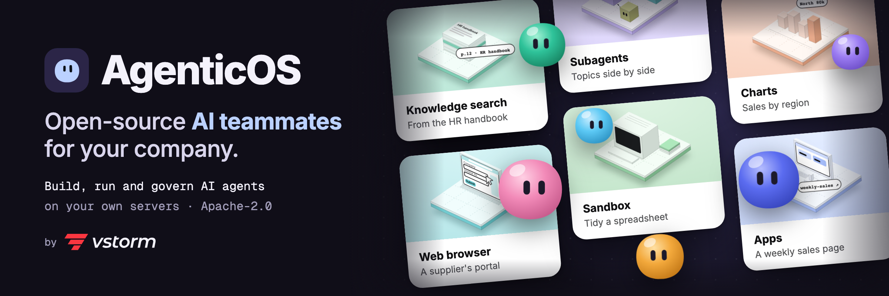

<p>
  <b>Otwarta platforma agentów AI na własnej infrastrukturze — dla współpracowników AI w Twojej firmie.</b><br>
  Twórz, uruchamiaj i nadzoruj agentów na własnych serwerach i modelach: wspólny czat, RAG, skills, prawdziwa przeglądarka, MCP, budżety, zatwierdzenia i ślad audytowy.<br>
  <sub>Apache-2.0 &middot; zbudowany na Pydantic AI</sub>
</p>

<p>
  🏆 <b>Projekt Vstorm — laureata Open Agentic AI Innovation Award 2026.</b><br>Agentic AI Foundation wyróżniła Vstorm za stosowanie AGENTS.md i integrację MCP w otwartym frameworku.<br><a href="https://aaif.io/blog/winners-of-the-first-aaif-annual-technical-excellence-awards">Ogłoszenie AAIF</a> &middot; <a href="https://vstorm.co/agentic-ai/open-agentic-ai-standards-aaif-award/">Praca stojąca za nagrodą</a>
</p>

<p>
  <a href="#-zobacz-jak-to-działa">Zobacz</a> &middot;
  <a href="#-najważniejsze">Najważniejsze</a> &middot;
  <a href="#-czym-jest-agenticos">Czym to jest?</a> &middot;
  <a href="#-szybki-start">Szybki start</a> &middot;
  <a href="#uruchom-na-swoim-serwerze-korzystaj-z-dowolnego-urządzenia">Server · Desktop · Mobile</a> &middot;
  <a href="#-podłącz-aplikacje-których-twój-zespół-już-używa">Integracje</a> &middot;
  <a href="#-twórz-udostępniaj-i-nadzoruj">Przegląd produktu</a> &middot;
  <a href="#-znajdź-swoją-ścieżkę">Twoja ścieżka</a> &middot;
  <a href="#-co-jest-dostępne-już-dziś">Co jest dostępne</a> &middot;
  <a href="#-najczęściej-zadawane-pytania">FAQ</a> &middot;
  <a href="https://vstorm-co.github.io/vstormos-landing/">Strona</a> &middot;
  <a href="https://vstorm-co.github.io/agenticos/presentation/">Prezentacja wprowadzająca</a> &middot;
  <a href="https://vstorm-co.github.io/agenticos/pl/">Dokumentacja</a>
</p>

<p>
  <a href="https://github.com/vstorm-co/agenticos/actions/workflows/ci.yml"></a>
  <a href="https://github.com/vstorm-co/agenticos/releases"></a>
  <a href="LICENSE"></a>
  <a href="https://ai.pydantic.dev"></a>
</p>

<p>
  <a href="README.md">English</a> &middot;
  <b>Polski</b> &middot;
  <a href="README.de.md">Deutsch</a> &middot;
  <a href="README.es.md">Español</a>
</p>

</div>

<a href="docs/assets/readme/highlight-hero.webp">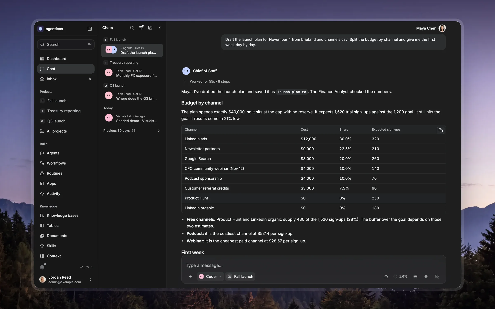</a>

*Przygotowana rozmowa z fikcyjnymi danymi sprzedaży w prawdziwym rendererze Visuals. Bez działającego CRM i nowego wykonania generowania przez model.*

AgenticOS daje każdemu zespołowi kolegów z AI: agentów, którzy pracują z plikami, wykonują kod, przeglądają internet i korzystają z firmowych narzędzi oraz wiedzy. Twoi współpracownicy i agenci pracują na tym samym czacie na żywo, a każdy agent może przekazać kod do Claude Code albo Codexa, w ramach subskrypcji ChatGPT albo Claude, którą już opłacasz. Jest open source (Apache-2.0) i działa na Twojej infrastrukturze jako warstwa, którą uruchamiasz sam. Twórz i publikuj agentów w przeglądarce, udostępniaj ich współpracownikom oraz zarządzaj ich dostępem, kosztami i wynikami w jednym miejscu.

**Pierwszy raz tutaj?** Przejdź przez [17-slajdowe wprowadzenie](https://vstorm-co.github.io/agenticos/presentation/) (po angielsku): problem, pomysł, produkt na prawdziwych ekranach, jego kontrole i ograniczenia oraz pierwsze kroki. Każdy ekran z bliska pokazuje [47-slajdowy przegląd produktu](https://vstorm-co.github.io/agenticos/presentation/tour/). Strzałki przełączają kroki w obu prezentacjach, `O` pokazuje listę slajdów.

## Nowości w ostatnich wydaniach

- **Lokalny Claude Code lub Codex w czacie desktopowym.** Wybierz agenta do danej rozmowy, przyznaj dostęp do lokalnego folderu, wznawiaj sesję i koryguj zadanie podczas pracy. Logowanie odbywa się we własnym terminalu agenta.
- **Twoje skills i instrukcje projektu.** Opcjonalnie udostępnij rozmowie lokalne skills oraz `AGENTS.md` / `CLAUDE.md`. Nowe rozmowy mają tę opcję wyłączoną.
- **Discord obok Slacka, Teams, Telegrama i Mattermosta.** Odpowiedzi na wzmianki, wiadomości prywatne i `/ask`, zatwierdzenia oraz pytania w kanale. [Skonfiguruj kanał](https://vstorm-co.github.io/agenticos/pl/channels/).
- **Nowe możliwości Visuals i Apps.** Mapy krajów, punkty i trasy w `AOWorldMap`, prezentacje jako App z dołączonymi skills oraz obserwowanie wyników długotrwałych poleceń, np. testów i logów.

[Informacje o wydaniach](https://github.com/vstorm-co/agenticos/releases) · [Przewodnik desktopowy](https://vstorm-co.github.io/agenticos/pl/desktop/)

## ⚡ Najważniejsze

### Twój zespół i Twoi agenci w jednym pokoju na żywo

Projekt daje wszystkim te same pliki, instrukcje i komputer dla agentów. Zaproś współpracowników i pracujcie jak zespół: widzisz, kto jest obecny, oglądasz odpowiedź agenta kolegi w trakcie pisania i wołasz dowolnego agenta, narzędzie albo dokument przez `@`.

<a href="docs/assets/readme/highlight-projects.webp">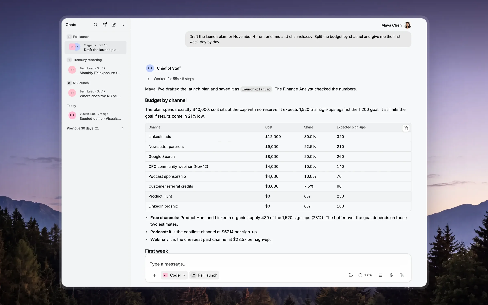</a>

### Odpowiadasz komukolwiek, a agent wie, kto co powiedział

Odpowiedz na wiadomość osoby albo agenta, a agent wprowadzi zmianę i powie, czyja była. Każda wiadomość jest podpisana, więc każda decyzja ma właściciela.

<a href="docs/assets/readme/highlight-reply.webp">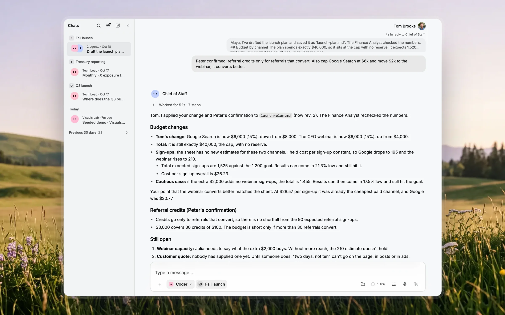</a>

### Claude Code i Codex w Twoim zespole

Każdy agent może przekazać pracę programistyczną do Claude Code albo Codexa. Budują na własnym komputerze agenta, w ramach Twojej subskrypcji ChatGPT albo Claude, i raportują, co zmienili, co sprawdzili i czego potrzebują od Ciebie.

<a href="docs/assets/readme/highlight-coding.webp">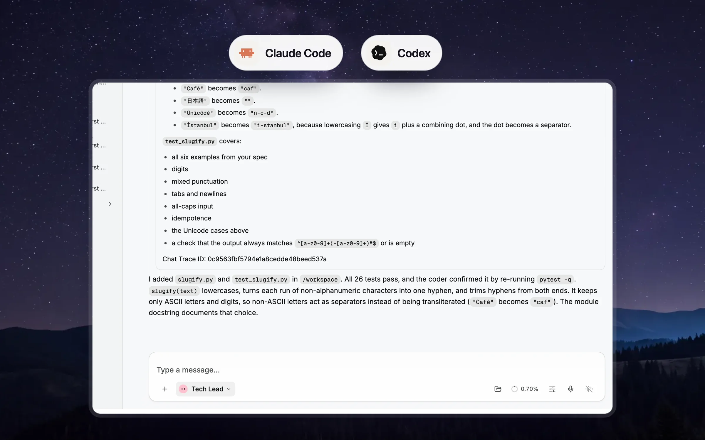</a>

*Przygotowany przykład interfejsu: Claude Code buduje portal dostawców, a Codex przegląda zmiany w trybie tylko do odczytu. Fikcyjne przekazania pracy; bez uruchomienia CLI.*

### Zapytaj, jak to działa, i dostań rysunek, którego możesz użyć

Agent rysuje w trakcie pisania: diagram z Twoich dokumentów, kalkulator z suwakami, wykres albo scenę 3D, na żywo pod wiadomością. Jedno kliknięcie zapisuje go jako aplikację, którą zespół otwiera z linku.

<a href="docs/assets/readme/highlight-visuals.webp">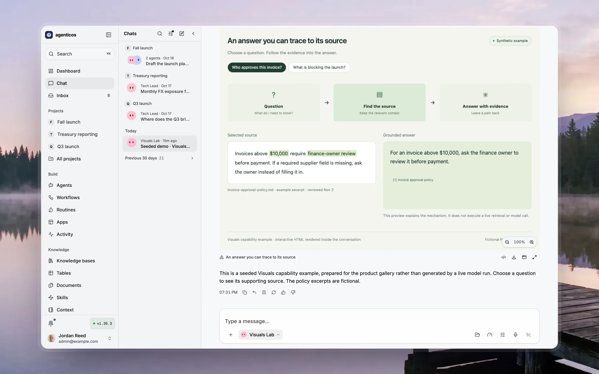</a>

*Przygotowany Visual produkcyjny wewnątrz chatu: sieć dostaw, wyjątki w dostawach i okna montażowe. Interaktywne, fikcyjne dane; bez połączenia z ERP, maszynami i bez wywołania modelu.*

### Napisz do agenta i wyjdź

Zleć research, który potrwa, i zamknij kartę. Agent pracuje dalej, odpowiedź trafia do rozmowy, a dzwonek mówi, że skończył.

<a href="docs/assets/readme/highlight-research.webp">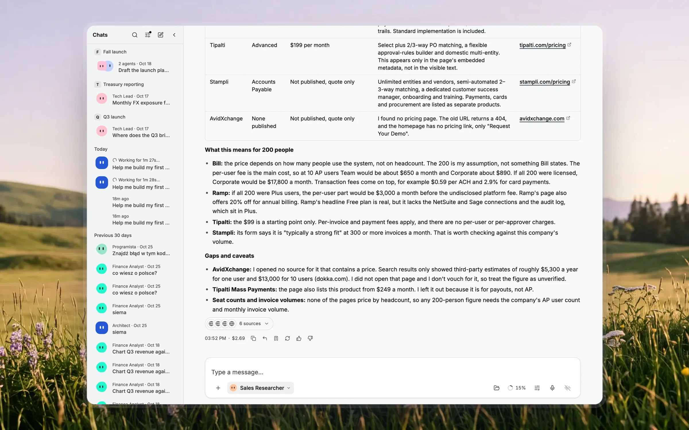</a>

### Twój dzień na jednym ekranie

Konsola otwiera się na tym, co zrobiły Twoje agenty, decyzjach czekających na Ciebie i rozmowach do podjęcia - z przeglądem funkcji, które łatwo przeoczyć.

<a href="docs/assets/readme/highlight-dashboard.webp">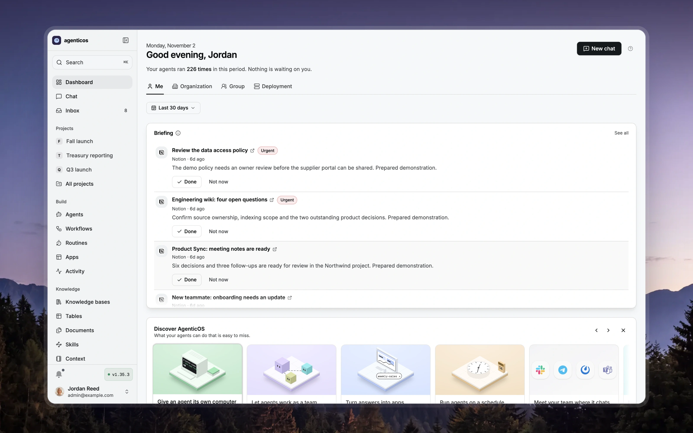</a>

### Agenci, którzy pracują jak zespół

Agent prowadzący przekazuje części zadania kolegom i spisuje, co znaleźli - widzisz, kogo zapytał i co każdy odpowiedział.

<a href="docs/assets/readme/highlight-subagents.webp">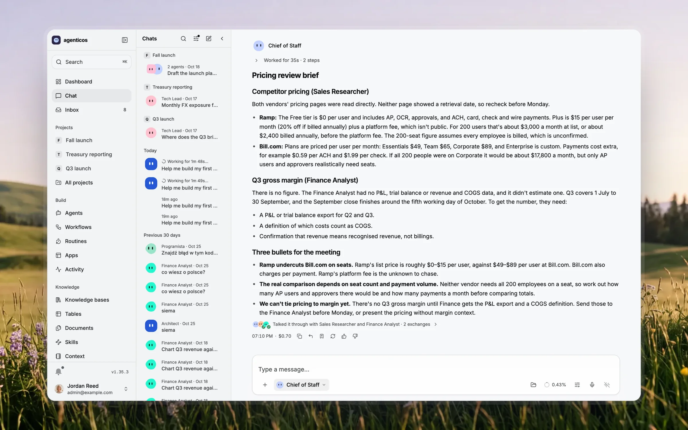</a>

### Prawdziwa przeglądarka, prosto w czacie

Patrz, jak klika po stronach, przejmij ją, gdy logowanie wymaga Ciebie, wskaż miejsce, żeby je skomentować.

<a href="docs/assets/readme/highlight-browser.webp">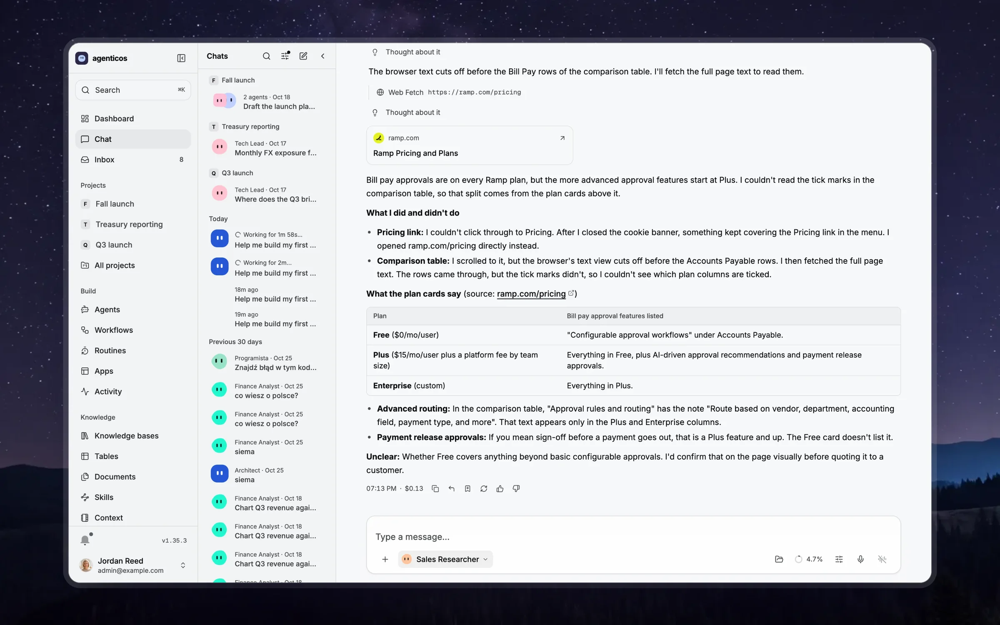</a>

### Buduj, wyposażaj i testuj w jednym oknie

Włącz narzędzia i wypróbuj rzeczywiste zadanie w panelu testowym szkicu, zanim opublikujesz agenta dla zespołu.

<a href="docs/assets/readme/highlight-builder-test.webp">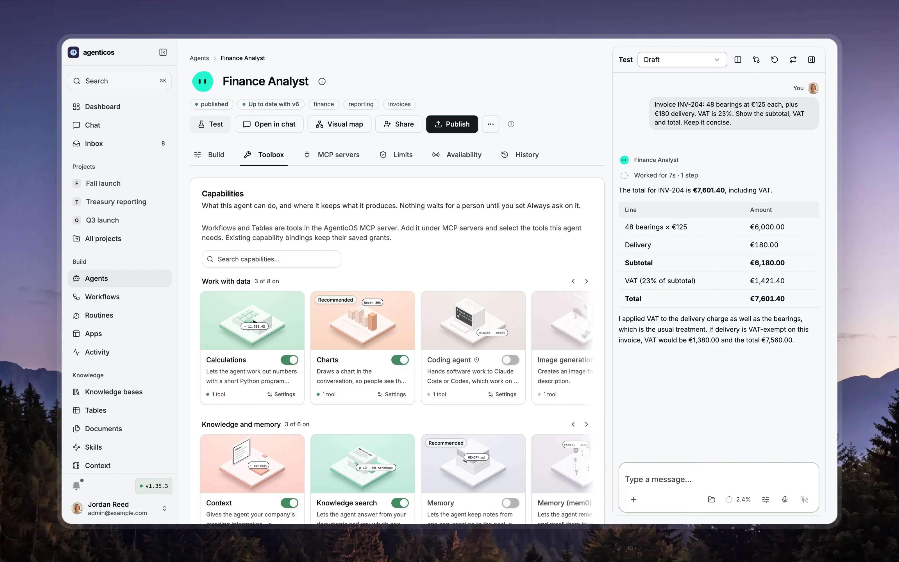</a>

### Aplikacje, nie tylko odpowiedzi

Agent publikuje dashboard albo raport jako stronę ze stałym linkiem i wersjami.

<a href="docs/assets/readme/highlight-app.webp">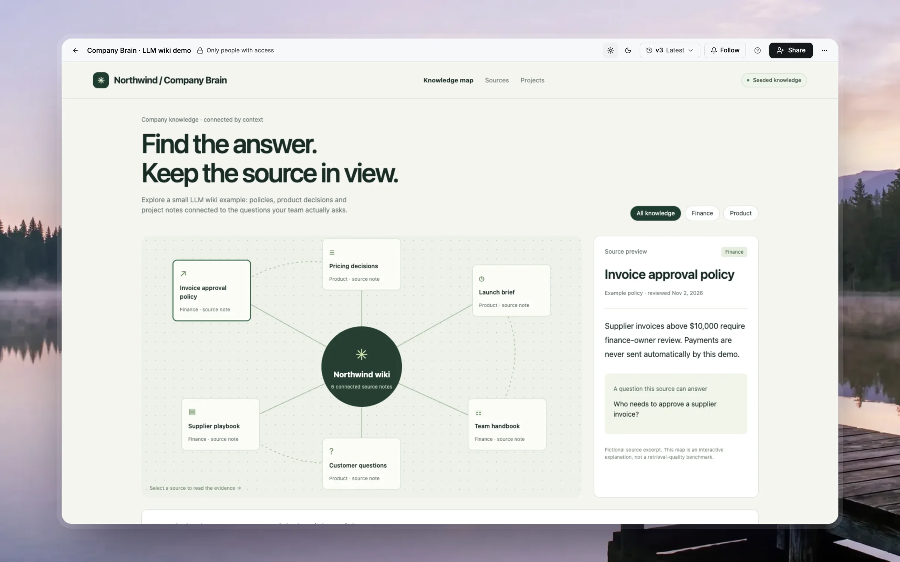</a>

*Northline: przygotowana aplikacja do planowania dostaw i produkcji z fikcyjnymi przesyłkami, lokalną symulacją opóźnienia i oknami montażowymi.*

<details>
<summary>Więcej przygotowanych Apps: budowa silnika i analiza sprzedaży</summary>

Działające lokalne demonstracje z fikcyjnymi danymi. Motor Atlas pozwala sprawdzać koncepcyjny zespół silnika i rekordy części; Revenue Pulse przelicza sprzedaż według regionu i okresu. Bez połączenia z urządzeniami, ERP i CRM.

<a href="docs/assets/readme/highlight-revenue.webp">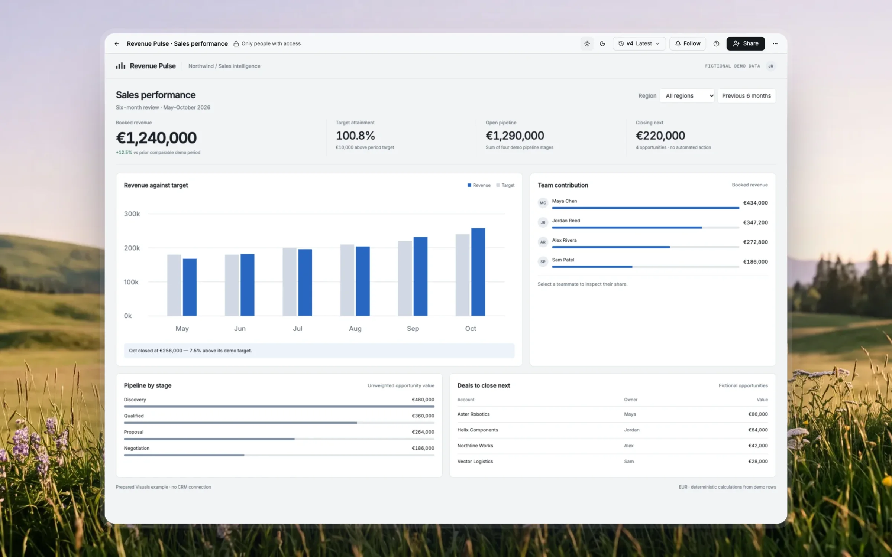</a>

</details>

### Widget agenta na własnej stronie

Prawdziwy widget AgenticOS uruchamia opublikowanego agenta tylko do odczytu na fikcyjnej stronie Trail Supply. W zapisanym lokalnym teście odpowiadał na podstawie katalogu w instrukcjach. Nie podłączono rzeczywistego magazynu, zakupów ani płatności.

<a href="docs/assets/readme/highlight-widget.webp">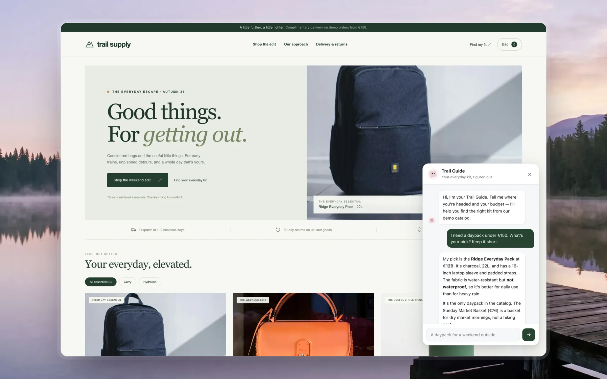</a>

[Zbuduj i opublikuj widget na stronie](https://vstorm-co.github.io/agenticos/pl/howto/support-widget/)

### Ponad 4700 serwerów MCP

Podłącz Notion, GitHub, Jirę albo własny serwer i wybierz, których narzędzi może używać każdy agent.

<a href="docs/assets/readme/highlight-mcp-servers.webp">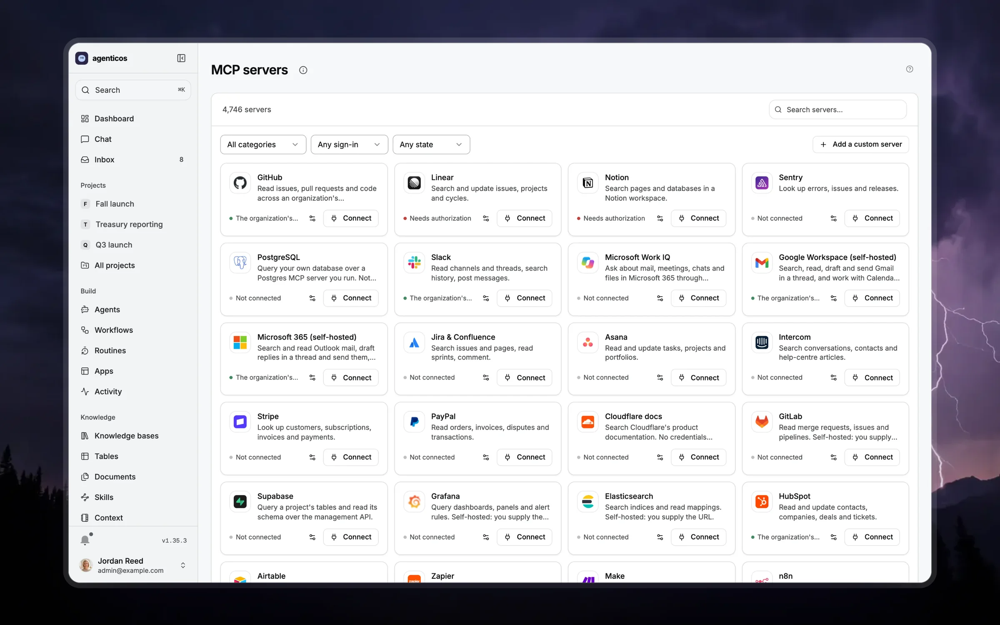</a>

### Pracuj w AgenticOS z Claude Code, Codex albo Cursora

AgenticOS jest serwerem MCP. Dodajesz go jednym poleceniem i logujesz się przez przeglądarkę: Twój asystent programisty może wyświetlać i uruchamiać agentów, czytać runy i ich koszty oraz przeszukiwać i zasilać bazy wiedzy, w granicach tego, na co pozwoliłeś.

<a href="docs/assets/readme/highlight-mcp-server.webp">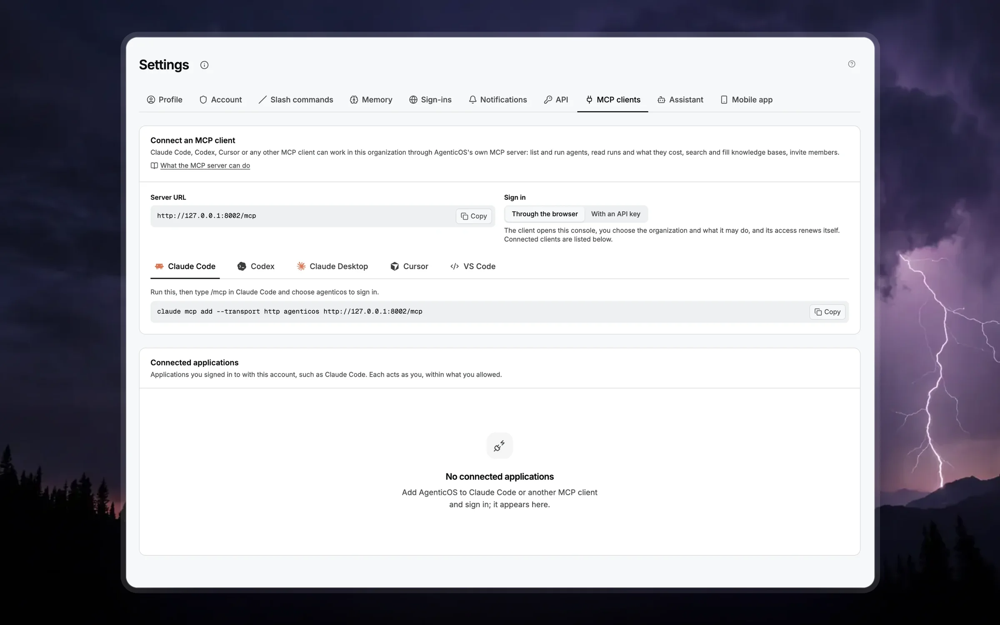</a>

## 📸 Zobacz, jak to działa

Zobacz [aktualną galerię produktu](https://vstorm-co.github.io/agenticos/pl/screens/). Motor Atlas poniżej to przygotowany interaktywny widok zespołu z fikcyjnymi rekordami części i telemetrią; nie jest rysunkiem CAD.

<a href="docs/assets/readme/highlight-motor.webp">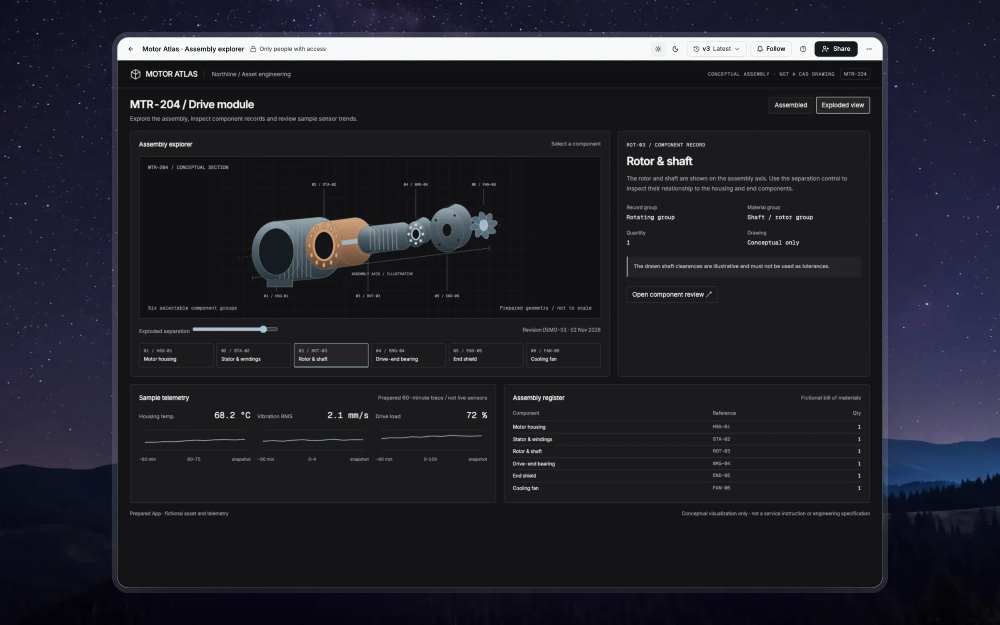</a>

## 🧩 Buduj użyteczne procesy wokół agentów

Połącz typowane kroki, wywołania agentów i narzędzia MCP na wizualnej kanwie [Workflows](https://vstorm-co.github.io/agenticos/pl/workflows/). Zapisuj ustrukturyzowane wyniki w [Virtual Tables](https://vstorm-co.github.io/agenticos/pl/virtual-tables/), uruchamiaj pracę przez [Routines](https://vstorm-co.github.io/agenticos/pl/triggers/) i przeglądaj runy oraz zatwierdzenia. [Rozmowy głosowe](https://vstorm-co.github.io/agenticos/pl/voice/) i [aplikacja desktopowa](https://vstorm-co.github.io/agenticos/pl/desktop/) dają kolejne sposoby pracy z tymi samymi opublikowanymi agentami.

**Wizualne workflowy: od nowego leada po przekazanie pracy po weryfikacji człowieka.**

<a href="docs/assets/readme/highlight-workflows.webp">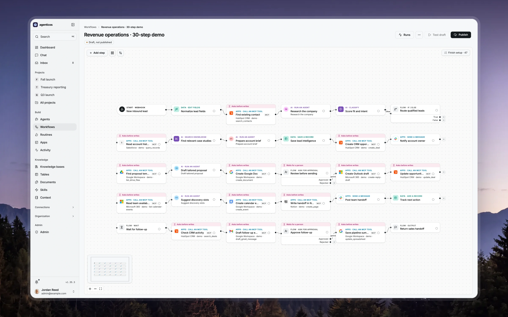</a>

Przykładowy szkic z 30 krokami: Google Workspace, Microsoft 365, HubSpot, Salesforce, Notion, Slack, agenci i zatwierdzenia. Połączenia to placeholdery demo; integracja nie została uruchomiona.

**Ustrukturyzowana praca dostępna dla agentów i zespołu.**

<a href="docs/assets/readme/highlight-tables.webp">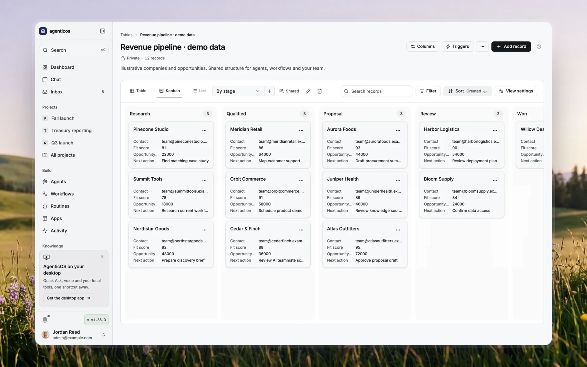</a>

Virtual Tables z fikcyjnymi firmami, typowanymi polami, etapami i następnymi działaniami. Te same rekordy można oglądać w tabeli lub na kanbanie.

Zacznij od konkretnego zadania: [LLM wiki w Project](https://vstorm-co.github.io/agenticos/pl/projects/), [widżetu agenta na stronie](https://vstorm-co.github.io/agenticos/pl/channels/) albo zespołu pracującego ze wspólnymi plikami i instrukcjami projektu. Widżet zapewnia rozmowę; rekomendacje i operacje na koszyku wymagają Twojego katalogu, integracji narzędzi i kontroli uprawnień.

## 💡 Czym jest AgenticOS?

**AgenticOS to otwarta (Apache-2.0) warstwa na własnej infrastrukturze do tworzenia, udostępniania i nadzorowania agentów AI w całej firmie.** Zespoły konfigurują agenta w przeglądarce: piszą jego instrukcje, wybierają model i włączają narzędzia. Łączą go z firmowymi dokumentami i aplikacjami, a potem publikują w czacie internetowym, Slacku, Mattermost, Telegramie, w widżecie na stronie lub przez API. Administratorzy decydują, kto może korzystać z każdego agenta, ile może wydać i które działania wymagają zatwierdzenia przez człowieka. Każdy run jest zapisywany.

Większość frameworków agentowych daje bibliotekę, więc każda zmiana zachowania agenta oznacza pull request, review i wydanie. To zły kształt dla małych agentów, których firma naprawdę potrzebuje, bo osoba, która wie, co agent powinien odpowiadać, zwykle nie ma uprawnień do commitów. **Kod definiuje, konfiguracja składa:** inżynierowie poszerzają zestaw elementów do złożenia, a konfiguracja może sięgnąć wyłącznie po to, co zarejestrował kod.

Działa na Twojej infrastrukturze z Docker Compose i współpracuje z 28 dostawcami modeli, w tym z Twoją subskrypcją ChatGPT i modelami lokalnymi przez Ollama i vLLM. Agenci działają na [Pydantic AI](https://ai.pydantic.dev) i [pydantic-ai-harness](https://pydantic.dev/docs/ai/harness/); warstwa wokół nich korzysta z FastAPI, PostgreSQL z pgvector i Next.js. Projekt utrzymuje [Vstorm](https://vstorm.co).

**Dla kogo:**

- Firmy, które chcą mieć **własną wewnętrzną warstwę agentów AI** zamiast asystentów licencjonowanych per stanowisko w chmurze dostawcy.
- Zespoły z **powtarzalną pracą na dokumentach i narzędziach**, taką jak raporty, odpowiedzi dla klientów, weryfikacja umów i analiza danych.
- Działy IT i bezpieczeństwa, które potrzebują dla agentów AI **suwerenności danych, logowania firmowego, budżetów, zatwierdzeń i ścieżki audytu**.
- Inżynierowie, którzy chcą **typowanych punktów rozszerzeń w Pythonie** i konsoli, z której skorzystają ich nietechniczni współpracownicy.

<a href="docs/assets/readme/company-architecture-diagram.webp">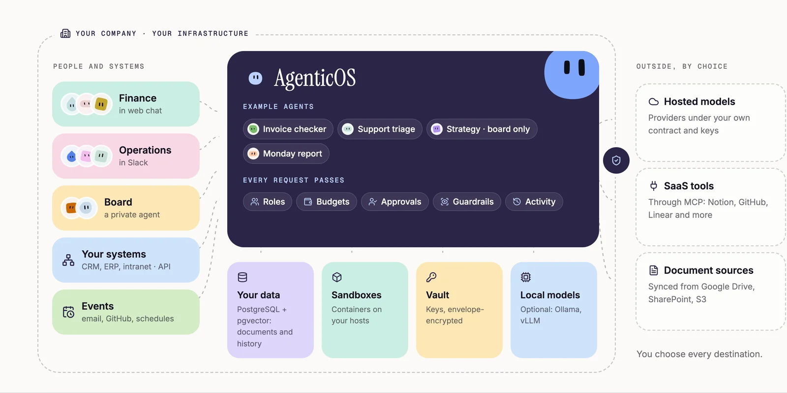</a>

<p align="center"><sub><b>Jak to pasuje do Twojej firmy.</b> Postacie są ilustracjami; agenci to przykłady.</sub></p>

**Jak AgenticOS wpisuje się w firmę:** działy takie jak finanse, operacje czy zarząd korzystają ze wspólnych agentów w czacie internetowym, Slacku lub prywatnym workspace. Twoje systemy wywołują agentów przez API, a zdarzenia lub harmonogramy uruchamiają ich automatycznie. Każde żądanie przechodzi przez te same kontrole: role, budżety, zatwierdzenia, guardraile i zapis runa. Twoje dane, wektory, sandboxy kodu, vault z poświadczeniami i opcjonalne modele lokalne pozostają na Twojej infrastrukturze. Modele hostowane, narzędzia SaaS i zewnętrzne źródła dokumentów są używane tylko wtedy, gdy je skonfigurujesz.

28 dostawców modeli · ponad 4700 wpisów galerii MCP · wspólny czat i Projects · wizualne workflow i virtual tables · web, desktop, API i komunikatory. Dostępność i narzędzia konfigurujesz dla każdego publikowanego agenta.

## ✨ Co możesz zrobić

| Dla Twojego zespołu | Co zapewnia AgenticOS |
|---|---|
| [Praca z plikami i kodem](#-pracuj-z-plikami-i-kodem) | Analizuj CSV, twórz wykresy i dokumenty, pracuj nad repozytoriami |
| [Agenci wielokrotnego użytku](#-twórz-agentów-do-wspólnego-użytku) | Wybieraj modele i narzędzia, publikuj wersje, udostępniaj agentów zespołowi |
| [Wiedza firmowa](#-naucz-agentów-sposobu-pracy-zespołu) | Wykorzystuj skills, kontekst i przeszukiwalne dokumenty w wielu agentach |
| [Udostępnianie wyników](#-publikuj-wyniki-jako-interaktywne-strony) | Publikuj interaktywne strony ze stałymi linkami i historią wersji |
| [Uruchamianie i nadzór](#-śledź-runy-koszty-i-zatwierdzenia) | Dostosuj dashboardy, sprawdzaj runy, planuj zadania i ustalaj budżety |
| [Dostęp w firmie](#-organizuj-zespoły-za-pomocą-ról-i-grup) | Łącz role, grupy działów i logowanie firmowe |

## 🚀 Szybki start

### Wybierz, od czego zacząć

**Jeden firmowy workspace, wiele sposobów dostępu.** Serwer uruchamia AgenticOS, a aplikacja desktopowa łączy się z nim. Dołączenie do istniejącego workspace nie wymaga Dockera ani narzędzi programistycznych.

| Twoja sytuacja | Następny krok |
|---|---|
| Firma ma już AgenticOS | Poproś o adres workspace i zaloguj się w przeglądarce lub [zainstaluj aplikację](#instalacja-aplikacji-desktopowej). |
| Chcesz uruchomić workspace w firmie | Poproś IT o [wdrożenie serwera](#wdrożenie-serwera-firmowego) albo [skorzystaj z pomocy Vstorm](https://vstorm.co/contact-us/). |
| Chcesz spróbować na swoim komputerze bez terminala | [Zainstaluj aplikację desktopową](#instalacja-aplikacji-desktopowej), wybierz **Na tym komputerze** i przejdź konfigurację. Najpierw sprawdź [wymagania](https://vstorm-co.github.io/agenticos/pl/desktop/#running-it); AI wymaga modelu, a zapisane przykłady są dostępne bez niego. |
| Jesteś deweloperem i chcesz sprawdzić lokalnie | [Uruchom quickstart Docker](#wypróbuj-lokalnie). |

### Wypróbuj lokalnie

<details id="local-quickstart">
<summary>Dla deweloperów: wypróbuj AgenticOS lokalnie z Dockerem</summary>

Na początek potrzebujesz Dockera z Compose i dostępu do dostawcy modelu. Na macOS lub Linuksie uruchom:

```bash
curl -fsSL https://raw.githubusercontent.com/vstorm-co/agenticos/main/scripts/quickstart.sh | bash
```

Na Windows uruchom tę samą komendę w WSL2 z włączoną integracją WSL2 w Docker Desktop. Instalator pyta o dostawcę modelu i klucz, login oraz nazwę organizacji, pobiera opublikowane obrazy i uruchamia wdrożenie z działającym agentem. Wystarczy host z 4 vCPU i 8 GB RAM. Następnie otwórz **http://localhost:3000** i zaloguj się loginem wybranym podczas instalacji.

**Twój pierwszy agent:** przejdź [poradnik asystenta dokumentów](https://vstorm-co.github.io/agenticos/pl/howto/first-document-agent/), aby wgrać regulamin, zadawać pytania i sprawdzać odpowiedzi w przywołanych źródłach. Potem wybierz kolejne zadanie spośród [30 poradników](https://vstorm-co.github.io/agenticos/pl/use-cases/), z których każdy ma przykładowe dane wejściowe i sprawdzian do uruchomienia.

<details>
<summary>Sprawdź instalator lub wybierz inny sposób wdrożenia</summary>

Przeczytaj [instalator](scripts/quickstart.sh) przed uruchomieniem. Aby sprawdzić wymagania bez instalowania:

```bash
curl -fsSL https://raw.githubusercontent.com/vstorm-co/agenticos/main/scripts/quickstart.sh | bash -s -- --check
```

Ręczną konfigurację Docker Compose, przypięte wersje i rozwiązywanie problemów opisuje [instrukcja instalacji](https://vstorm-co.github.io/agenticos/pl/install/). Pracę z kodem źródłowym opisuje [poradnik dla współtwórców](https://vstorm-co.github.io/agenticos/pl/help/).

</details>

</details>

## Uruchom na swoim serwerze. Korzystaj z dowolnego urządzenia.

Serwer przechowuje workspace. Przeglądarka, aplikacja desktopowa i telefon łączą się z tym samym wdrożeniem, kontami, agentami i uprawnieniami.

<a id="server-setup"></a>

### Wdrożenie serwera firmowego

Zespół IT uruchamia workspace raz, udostępnia jego adres HTTPS i zakłada Ci konto. Z tego adresu korzystasz w przeglądarce lub aplikacji desktopowej. Jeśli potrzebujesz pomocy we wdrożeniu, [porozmawiaj z Vstorm](https://vstorm.co/contact-us/).

<details>
<summary>Konfiguracja serwera dla IT i deweloperów</summary>

Przygotuj host Linux z **4 vCPU i 8 GB RAM**, Docker Engine 24+, Compose 2.24+ i `make`. Skieruj na niego dwie nazwy DNS, np. `app.example.com` i `api.example.com`, i skonfiguruj HTTPS przez reverse proxy. Wspierana ścieżka to Docker Compose na jednym hoście.

```bash
# On the server. Start from a released version so code and images stay aligned.
git clone --branch v1.38.2 --depth 1 https://github.com/vstorm-co/agenticos.git
cd agenticos
bash scripts/server-init.sh
```

Instalator pyta o nazwy strony i API oraz e-mail do certyfikatu, po czym generuje `backend/.env`. Ustaw w nim `AGENTICOS_VERSION=1.38.2`, aby przypiąć wydanie. Na nowym hoście z dołączonym Traefikiem:

```bash
docker network create traefik_webgateway
docker compose --env-file backend/.env -f docker-compose-traefik.yml up -d
make prod PROXY=traefik
make prod-frontend PROXY=traefik
```

Następnie [utwórz pierwszą organizację, właściciela i agenta](https://vstorm-co.github.io/agenticos/pl/deploy/#start-it-and-create-the-first-account), otwórz adres HTTPS strony i dodaj klucze dostawcy modeli. Przewodnik opisuje też istniejące proxy, Nginx, aktualizacje i backupy. Kopia musi obejmować bazę danych **oraz klucz vaulta z `backend/.env`**.

```bash
docker compose --env-file backend/.env -f docker-compose-prod.yml \
  exec -T app agenticos cmd bootstrap \
  --email you@example.com --password '<your-password>' \
  --org 'Your Company' --provider anthropic --api-key '<your-api-key>'
```

[Pełny przewodnik wdrożenia](https://vstorm-co.github.io/agenticos/pl/deploy/) · [Lista ustawień produkcyjnych](https://vstorm-co.github.io/agenticos/pl/configuration/#production-checklist)

</details>

<a id="desktop-install"></a>

### Instalacja aplikacji desktopowej

Pobierz instalator z [wydania v1.38.2](https://github.com/vstorm-co/agenticos/releases/tag/v1.38.2):

| System | Pobierz v1.38.2 | Co zrobić |
|---|---|---|
|  **macOS** | [Apple silicon · DMG](https://github.com/vstorm-co/agenticos/releases/download/v1.38.2/AgenticOS_1.38.2_aarch64.dmg) · [Intel · DMG](https://github.com/vstorm-co/agenticos/releases/download/v1.38.2/AgenticOS_1.38.2_x64.dmg) | Otwórz DMG i przeciągnij AgenticOS do Applications. |
|  **Windows x64** | [EXE](https://github.com/vstorm-co/agenticos/releases/download/v1.38.2/AgenticOS_1.38.2_x64-setup.exe) · [MSI](https://github.com/vstorm-co/agenticos/releases/download/v1.38.2/AgenticOS_1.38.2_x64_en-US.msi) | Otwórz EXE i przejdź przez instalator. MSI jest do wdrożeń zarządzanych przez IT. |
|  **Linux x64** | [DEB](https://github.com/vstorm-co/agenticos/releases/download/v1.38.2/AgenticOS_1.38.2_amd64.deb) · [RPM](https://github.com/vstorm-co/agenticos/releases/download/v1.38.2/AgenticOS-1.38.2-1.x86_64.rpm) · [AppImage](https://github.com/vstorm-co/agenticos/releases/download/v1.38.2/AgenticOS_1.38.2_amd64.AppImage) | Otwórz DEB/RPM w instalatorze oprogramowania. Dla AppImage włącz wykonywanie we właściwościach pliku. |

Na Macu wybierz **menu Apple → Ten Mac**: „Układ” oznacza Apple silicon, a „Procesor: Intel” — Maca z Intelem.

**Wolisz Homebrew na macOS?**

Projektowy [tap Homebrew](https://github.com/vstorm-co/homebrew-agenticos) wybiera właściwy instalator dla Twojego Maca. Cask usuwa flagę kwarantanny pobranego AgenticOS; nie zapewnia notaryzacji Apple:

```bash
brew install --cask vstorm-co/agenticos/agenticos
```

**Po instalacji:** otwórz AgenticOS, wpisz firmowy adres HTTPS workspace i zaloguj się. Połączenie z istniejącym serwerem nie wymaga lokalnego Dockera. Własny lokalny workspace utworzysz przez kreator — ta opcja wymaga Dockera.

Buildy macOS nie mają notaryzacji Apple. DMG pobrany w przeglądarce może wymagać **System Settings → Privacy & Security → Open Anyway**. Zobacz [instrukcję instalacji](https://vstorm-co.github.io/agenticos/pl/desktop/#installing-the-app).

Desktop dodaje Quick Ask, lokalne pliki i sterowanie komputerem za Twoją zgodą oraz lokalny Claude Code / Codex. W **Settings → Desktop app** sprawdź wykrytych agentów i zaloguj się w ich terminalu. Wybierz agenta w **Chat controls**, przyznaj pełny dostęp do folderu roboczego i potwierdź zadanie w natywnym oknie. **My skills and instructions** to osobna opcja dla każdej rozmowy.

[Konfiguracja desktopu i lokalnych agentów](https://vstorm-co.github.io/agenticos/pl/desktop/)

### AgenticOS na telefonie

**Dostępne teraz bez kompilacji:** otwórz adres HTTPS wdrożenia w mobilnej przeglądarce i zaloguj się. Użyj jej opcji instalacji; na iPhonie wybierz **Udostępnij → Do ekranu początkowego**. Konsola dostosowuje czat, pliki i zatwierdzenia do telefonu.

**Natywne iOS i Android:** kod w `mobile/` obejmuje blokadę biometryczną, udostępnianie, widżety i natywne powiadomienia. To obecnie **buildy deweloperskie** — bez publicznego App Store, Google Play, TestFlight ani wspieranego pliku do pobrania. Zainstaluj Rust i Xcode na macOS (iOS) albo Android SDK/NDK i JDK (Android), następnie:

```bash
cd mobile
bun install --frozen-lockfile
bun run ios        # iOS development on macOS
# or: bun run android
```

Instalacja na urządzeniu może wymagać własnego podpisywania i provisioning. Wpisz adres serwera osiągalny z telefonu lub sparuj konto jednorazowym kodem QR z **Settings → Mobile app** i potwierdź konto. `localhost` oznacza sam telefon. Natywny push wymaga konfiguracji wdrożenia; [przewodnik mobilny](https://vstorm-co.github.io/agenticos/pl/mobile/) opisuje kompilację, parowanie i powiadomienia.

## 🔌 Podłącz aplikacje, których Twój zespół już używa

AgenticOS łączy agentów z modelami, komunikatorami, aplikacjami biznesowymi i repozytoriami dokumentów, z których firma już korzysta. Dzięki temu agent może przeczytać brief w Notion, przeszukać dokumenty w SharePoint lub odpowiedzieć w Slacku na tych samych zasadach dostępu i w ramach tego samego budżetu.

<a href="docs/assets/readme/integrations-hub.webp">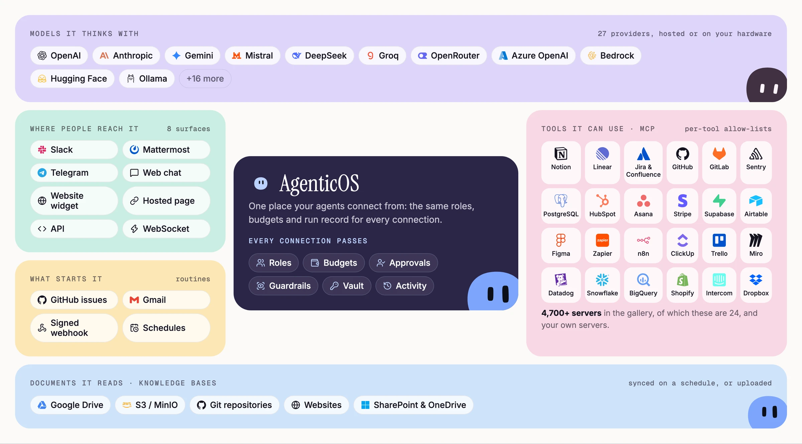</a>

| Połącz | Jak | Więcej |
|---|---|---|
| **Komunikatory** | Opublikuj agenta w Slacku, Mattermost lub Telegramie, w widżecie na stronie, na hostowanej stronie, przez API lub WebSocket | [Kanały](https://vstorm-co.github.io/agenticos/pl/channels/) |
| **Narzędzia biznesowe** | **ponad 4700 serwerów MCP** w galerii (Notion, GitHub, Jira, HubSpot, Stripe…) i Twoje własne serwery; wybierz, które narzędzia może wywoływać każdy agent | [MCP](https://vstorm-co.github.io/agenticos/pl/mcp/) |
| **Dokumenty** | Synchronizuj Google Drive, S3/MinIO, repozytoria Git, strony internetowe, SharePoint i OneDrive z bazami wiedzy | [Źródła synchronizacji](https://vstorm-co.github.io/agenticos/pl/howto/configure-sync-sources/) |
| **Zdarzenia** | Uruchamiaj agentów według harmonogramu, po nowym issue na GitHubie, wiadomości w Gmailu lub podpisanym webhooku | [Rutyny](https://vstorm-co.github.io/agenticos/pl/triggers/) |
| **Modele** | 28 dostawców, Twoja subskrypcja ChatGPT, Twoja umowa chmurowa (Azure, Bedrock, Vertex) lub modele lokalne (Ollama, vLLM) | [Modele](https://vstorm-co.github.io/agenticos/pl/models/) |

<sub>Wpisy z rejestru to metadane od wydawców; każde połączenie wymaga osobnej konfiguracji i sprawdzenia dostępu. Poczta i kalendarz Outlook łączą się przez zewnętrzną usługę MCP. Logotypy oznaczają opcje połączeń i nie sugerują partnerstwa.</sub>

## 🧩 Twórz, udostępniaj i nadzoruj

### 🤖 Twórz agentów do wspólnego użytku

Wybierz model, instrukcje i narzędzia agenta w przeglądarce. Opublikuj wersję dla współpracowników; przeglądaj wcześniejsze wersje i przywracaj je w razie potrzeby. Trzymaj wyspecjalizowanych agentów do researchu, raportowania, programowania i operacji w jednym katalogu.

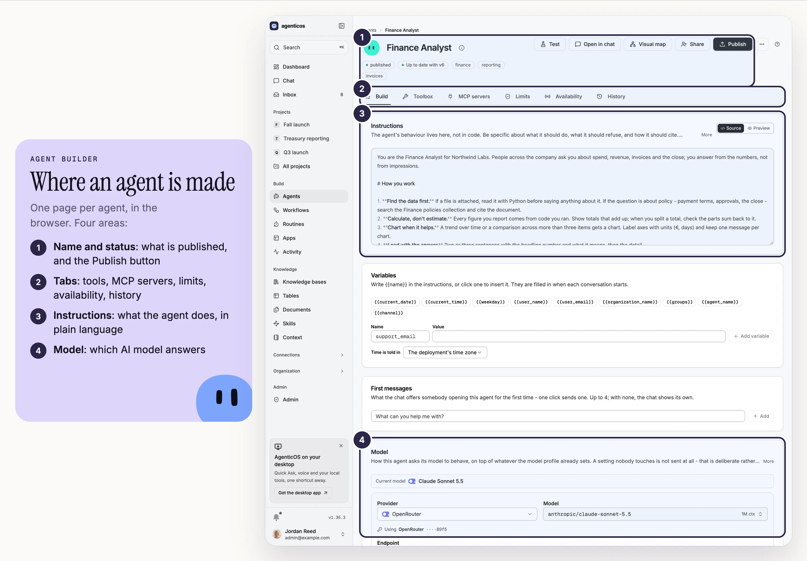

Builder agenta ma cztery obszary: **(1)** nazwę i status publikacji, przy czym szkic pozostaje prywatny, dopóki nie opublikujesz wersji; **(2)** zakładki z zestawem narzędzi, serwerami MCP, limitami, dostępnością i historią wersji; **(3)** instrukcje, pisane zwykłym językiem jak brief dla nowego współpracownika; oraz **(4)** model, wybierany dla każdego agenta spośród skonfigurowanych dostawców.

Współpracownicy mogą korzystać z opublikowanego agenta w **czacie internetowym, Slacku, Mattermost lub Telegramie**, gdy te kanały są skonfigurowane, w **widżecie na stronie** lub na **hostowanej stronie**, a także przez **API** i **WebSocket**. [Zbuduj agenta](https://vstorm-co.github.io/agenticos/pl/first-agent/) · [Podłącz kanał](https://vstorm-co.github.io/agenticos/pl/channels/)

### 📂 Pracuj z plikami i kodem

Poproś agenta o analizę arkusza, wykres, dokument lub pracę nad repozytorium. Po skonfigurowaniu sandboxa opartego na kontenerach i włączeniu wykonywania komend agent może **czytać i edytować pliki, uruchamiać polecenia powłoki oraz wykonywać kod Pythona i JavaScriptu**. Dołączony workbench zawiera narzędzia do danych, wykresów i dokumentów, w tym LibreOffice.

Jeśli używasz [Claude Code](https://code.claude.com/docs/en/overview) lub [Codex](https://developers.openai.com/codex/cli/), praca z plikami i komendami będzie znajoma. AgenticOS przenosi taki sposób pracy do wspólnej warstwy na własnej infrastrukturze, z wiedzą firmową, agentami wielokrotnego użytku i kontrolą dostępu w organizacji. Możliwości agenta zależą od modelu, włączonych narzędzi i instrukcji. [Konfiguracja sandboxów](https://vstorm-co.github.io/agenticos/pl/sandbox/)

### 🧠 Naucz agentów sposobu pracy zespołu

- **Skills** przechowują procedury wielokrotnego użytku: jak przeglądać kod, napisać raport lub zbadać rynek. Utrzymuj je w jednym miejscu i wykorzystuj w wielu agentach.
- **Kontekst** przechowuje stałą wiedzę, np. słownik pojęć, politykę firmy lub styl komunikacji marki. Dodaj go do promptu albo pozwól agentowi czytać go na żądanie.
- **Bazy wiedzy (RAG)** umożliwiają przeszukiwanie wgranych dokumentów. Wybieraj opcje parsowania, sprawdzaj status przetwarzania i fragmenty albo synchronizuj dokumenty z jednego ze źródeł wymienionych poniżej.

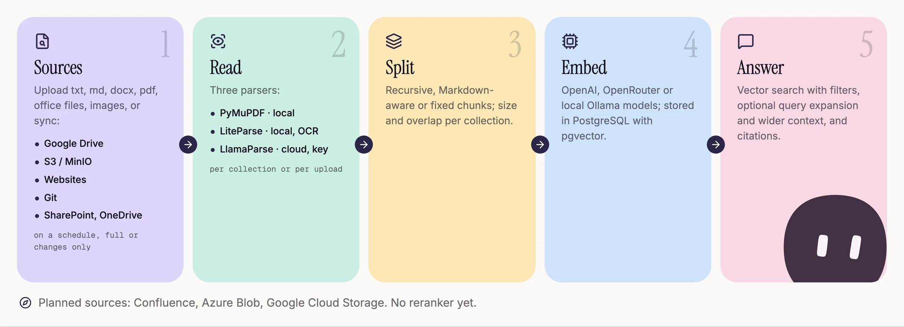

**Jak działa retrieval-augmented generation (RAG) w AgenticOS:** dokumenty są wgrywane lub synchronizowane z Google Drive, S3/MinIO, Git, stron internetowych, SharePoint lub OneDrive. Odczytuje je parser: PyMuPDF i LiteParse działają lokalnie, z OCR dla skanów, a LlamaParse jest usługą chmurową. Następnie dokumenty są dzielone na fragmenty, zamieniane na embeddingi modelem OpenAI, OpenRouter lub lokalnym modelem Ollama i zapisywane w PostgreSQL z pgvector. W chwili pytania agent przeszukuje wektory z filtrami i odpowiada z cytatami.

[Skills](https://vstorm-co.github.io/agenticos/pl/skills/) · [Kontekst](https://vstorm-co.github.io/agenticos/pl/context/) · [Przetwarzanie dokumentów](https://vstorm-co.github.io/agenticos/pl/file-processing/) · [Źródła synchronizacji](https://vstorm-co.github.io/agenticos/pl/howto/configure-sync-sources/)

### 🎨 Publikuj wyniki jako interaktywne strony

Agenci mogą publikować raporty, interaktywne porównania i małe dashboardy jako **aplikacje**. Wybierz, kto może je otwierać; aktualizacje zachowują ten sam link, a wcześniejsze wersje pozostają dostępne. Linki publiczne mogą wygasać, wymagać hasła lub ograniczać, na których stronach można je osadzić. [Udostępnij aplikację](https://vstorm-co.github.io/agenticos/pl/artifacts/)

### 📊 Śledź runy, koszty i zatwierdzenia

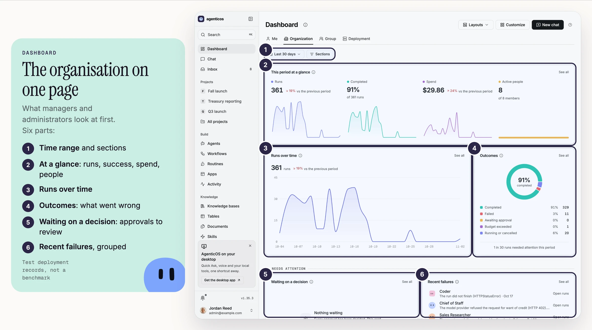

Dashboard odpowiada na sześć pytań dla wybranego okresu: ile było runów, ile się zakończyło, ile kosztowały i ile osób korzystało z agentów; jak runy zmieniały się w czasie; co się nie powiodło, czekało na zatwierdzenie lub zostało zatrzymane przez budżet; skąd pochodziły runy; oraz z których agentów ludzie faktycznie korzystają.

Dostosuj **dashboard** do swojej pracy. **Activity** pozwala sprawdzać runy i wywołania narzędzi, porównywać wersje agentów i eksportować dane. **Budżety** agentów i organizacji są sprawdzane przed każdym żądaniem do modelu. **Zasady zatwierdzania** sprawiają, że wrażliwe narzędzia czekają na decyzję człowieka, a **rutyny** powtarzają pracę według harmonogramu lub po zdarzeniach, takich jak nowe issue na GitHubie, wiadomość w Gmailu lub podpisany webhook. [Historia runów, budżety i zatwierdzenia](https://vstorm-co.github.io/agenticos/pl/governance/) · [Rutyny](https://vstorm-co.github.io/agenticos/pl/triggers/)

### 👥 Organizuj zespoły za pomocą ról i grup

**Role określają, co ludzie mogą robić. Grupy określają, komu udostępniasz zasoby.** Korzystaj z ról takich jak Builder, Operator, Member i Viewer, a następnie utwórz działy lub grupy robocze, np. Operations, Engineering, Finance i Research. Udostępnij grupie agenta, skill, kolekcję, plik kontekstu lub aplikację w jednym kroku albo ogranicz je do wybranych działów już przy tworzeniu. [Działy i grupy](https://vstorm-co.github.io/agenticos/pl/departments/)

Wykorzystaj istniejące konta firmowe przez **SSO z OIDC** (Entra ID, Okta, Keycloak i inne), **logowanie katalogowe LDAP** lub **zintegrowane logowanie Windows przez Kerberos**. **Mapowania grup katalogowych** łączą grupy z katalogu z rolą i grupą AgenticOS przy logowaniu. [Role i uprawnienia](https://vstorm-co.github.io/agenticos/pl/permissions/) · [Logowanie katalogowe](https://vstorm-co.github.io/agenticos/pl/directory/)

## 🧭 Znajdź swoją ścieżkę

Budujesz na AgenticOS? Przejdź do sekcji [Dla programistów i administratorów](#-dla-programistów-i-administratorów).

<details>
<summary><b>Decydujesz o wdrożeniu</b>: jaki problem rozwiązuje, czego wymaga, jak zacząć</summary>

<br>

| Pytanie, na które Twoje zespoły dziś nie umieją odpowiedzieć | Jak odpowiada AgenticOS |
|---|---|
| Kto może korzystać z jakich danych? | Role, grupy działów i udostępnianie poszczególnych zasobów, z logowaniem firmowym |
| Ile to kosztuje? | Miesięczne budżety agentów i organizacji, sprawdzane przed każdym żądaniem do modelu |
| Kto zatwierdził to działanie? | Wrażliwe narzędzia czekają na człowieka; każda decyzja jest zapisywana |
| Dokąd trafiają nasze dane? | To Ty uruchamiasz AgenticOS i wybierasz każdy model, parser i narzędzie, do którego może sięgnąć |

**Czego wymaga:** hosta (4 vCPU, 8 GB RAM), osoby, która utrzymuje wdrożenie, oraz ekspertów merytorycznych, którzy dbają o instrukcje i dokumenty. Koszty to zużycie modeli, infrastruktura, usługi zewnętrzne i czas ludzi; oprogramowanie jest na licencji Apache-2.0, także do użytku komercyjnego.

**Jak zacząć:** wybierz jedno powtarzalne zadanie i osobę, która oceni odpowiedzi, skonfiguruj je z wybranym modelem i zasadami dostępu, a potem sprawdź wyniki według miar uzgodnionych z góry. [Zaplanuj wdrożenie](https://vstorm-co.github.io/agenticos/pl/rollout/) · [Porównaj podejścia](https://vstorm-co.github.io/agenticos/pl/about/comparison/)

</details>

<details>
<summary><b>Oceniasz bezpieczeństwo</b>: przepływy danych, tożsamość, mechanizmy kontroli, co zostaje po stronie Twojego IT</summary>

<br>

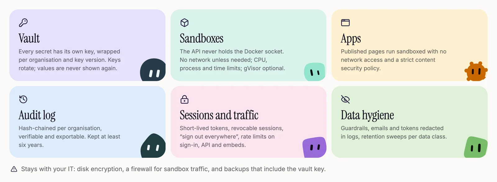

Bezpieczeństwo jest warstwowe. Poświadczenia są przechowywane w vaulcie z szyfrowaniem kopertowym. Kod działa w izolowanych sandboxach. Opublikowane strony też działają w sandboxie. Każda organizacja ma dziennik audytu z łańcuchem skrótów. Sesje są krótkotrwałe i można je unieważnić, a ruch podlega limitom. Logi są redagowane, a dane usuwane zgodnie z harmonogramem retencji.

| Wychodzący ruch do | Kiedy | Lokalna alternatywa |
|---|---|---|
| Dostawca modelu | Przy każdym runie agenta | Ollama, vLLM lub LM Studio na Twoim sprzęcie |
| Dostawca embeddingów | Indeksowanie i przeszukiwanie dokumentów | Lokalne modele embeddingów w Ollama |
| LlamaParse | Kolekcje ustawione na ten parser | PyMuPDF lub LiteParse, oba lokalne |
| Wyszukiwanie w sieci | Agenci z włączonym wyszukiwaniem w sieci | Wyłącz tę capability |
| Serwery MCP, kanały czatu | Tylko te, które podłączysz | Serwery na własnej infrastrukturze, czat internetowy |
| Tracing Logfire | Tylko gdy skonfigurowano token | Wbudowana historia runów |

- **Vault:** osobny klucz danych dla każdego sekretu, opakowany kluczem organizacji w danej wersji; klucze główne podlegają rotacji; wartości nigdy nie są ponownie wyświetlane.
- **Sandboxy:** API nie ma dostępu do gniazda Dockera; kontenery nie dostają sieci, chyba że jest potrzebna, i działają z limitami CPU, procesów i czasu; gVisor opcjonalnie.
- **Dziennik audytu:** łańcuch skrótów dla każdej organizacji, z możliwością weryfikacji i eksportu.
- **Profil HIPAA:** [`deploy/profiles/hipaa/`](deploy/profiles/hipaa/) i `agenticos cmd doctor --profile hipaa` sprawdzają działające wdrożenie pod kątem zabezpieczeń technicznych z §164.312. To kontrola konfiguracji, nie certyfikacja. [Czego profil nie deklaruje](https://vstorm-co.github.io/agenticos/pl/security/#the-hipaa-profile-and-what-it-does-not-claim)
- **Zostaje po stronie Twojego IT:** szyfrowanie danych na dyskach, firewall dla ruchu wychodzącego, MFA przez dostawcę tożsamości (bez natywnego MFA, SAML i SCIM) oraz kopie zapasowe obejmujące klucz vaulta.

[Bezpieczeństwo i przepływy danych](https://vstorm-co.github.io/agenticos/pl/security/) · [Ochrona danych](https://vstorm-co.github.io/agenticos/pl/data-protection/) · [Sekrety](https://vstorm-co.github.io/agenticos/pl/secrets/) · [Polityka bezpieczeństwa](SECURITY.pl.md)

</details>

<details>
<summary><b>Szukasz pierwszego zadania</b>: 30 poradników, każdy ze sprawdzianem do uruchomienia</summary>

<br>

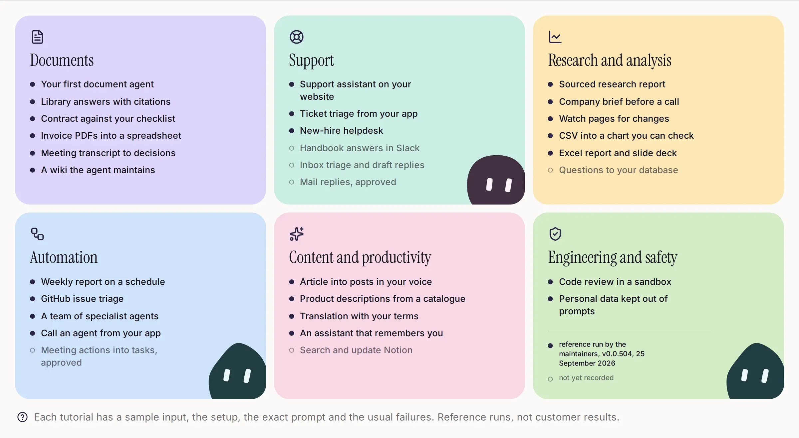

[Wszystkie poradniki](https://vstorm-co.github.io/agenticos/pl/use-cases/). 24 z nich mają referencyjny run przygotowany przez opiekunów projektu; to punkty wyjścia, nie wyniki klientów.

</details>

## 📦 Co jest dostępne już dziś

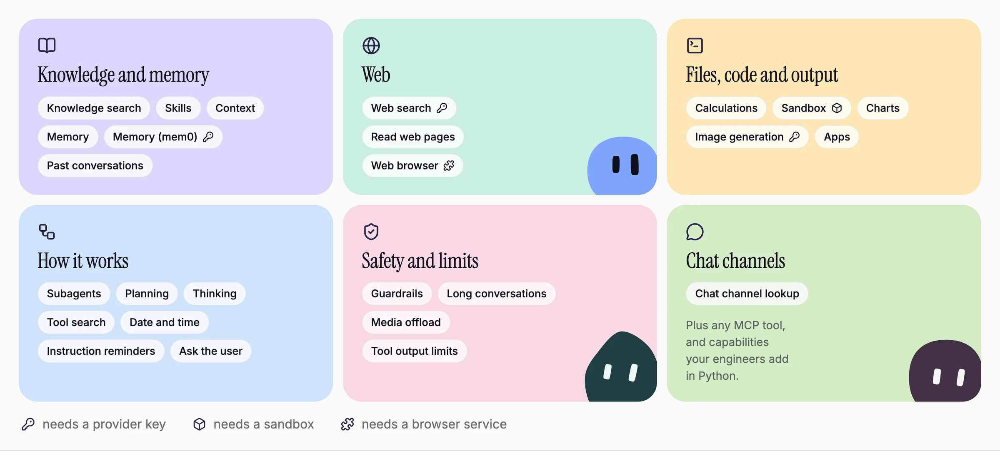

<details>
<summary>Wszystkie 37 wbudowanych capabilities w formie tekstu</summary>

- **Wiedza i pamięć:** wyszukiwanie w wiedzy z cytatami, skills, kontekst, pamięć, dawne rozmowy.
- **Sieć:** wyszukiwanie w sieci (domyślnie DuckDuckGo; Tavily, Brave lub Exa z kluczem), czytanie stron oraz przeglądarka, którą prowadzi agent, a Ty możesz ją przejąć, oraz obsługa komputera za Twoją zgodą.
- **Pliki, kod i wyniki:** obliczenia w Pythonie, sandbox z plikami i powłoką, coding agent, który przekazuje pracę do Claude Code albo Codexa, wykresy, rysunki (diagramy, kalkulatory, sceny 3D), generowanie obrazów (OpenAI lub Google), mowa (OpenAI, ElevenLabs lub Google), klipy wideo (Google, BytePlus, xAI lub Alibaba), monitorowanie komend, Tables, Workflows i aplikacje.
- **Sposób działania:** subagenci, planowanie, myślenie, praca w trakcie działania narzędzi, wyszukiwanie narzędzi, data i godzina, przypomnienia instrukcji, pytania do użytkownika, wersje robocze i propozycje kolejnych kroków.
- **Bezpieczeństwo i limity:** guardraile redagujące sekrety i dane osobowe, długie rozmowy, odciążanie mediów, limity wyników narzędzi.
- **Kanały czatu:** wyszukiwanie kanałów czatu dla botów Slack, Telegram i Mattermost.

Do tego dowolne narzędzie z podłączonego serwera MCP oraz capabilities, które Twoi inżynierowie dodadzą w typowanym Pythonie. [Referencja capabilities](https://vstorm-co.github.io/agenticos/pl/reference/capabilities/)

</details>

<details>
<summary>Gdzie agenci odpowiadają i jakich modeli używają</summary>

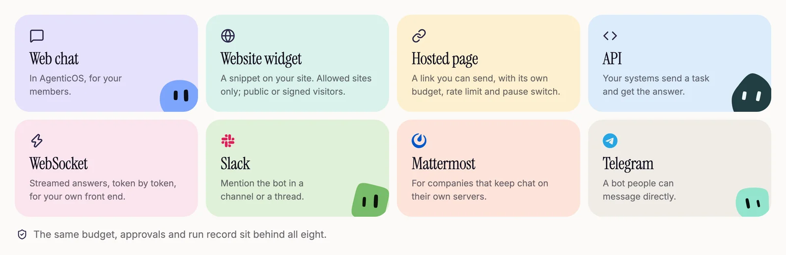
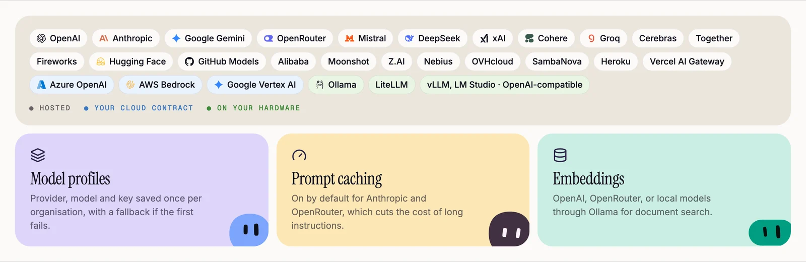

**Gdzie agenci odpowiadają:** czat internetowy, widżet na stronie, hostowana strona, HTTP API, strumieniowy WebSocket, Slack, Teams, Discord, Mattermost i Telegram.

**Dostawcy modeli:**
- **Hostowani (22):** OpenAI, Anthropic, Google Gemini, OpenRouter, Mistral, DeepSeek, xAI, Cohere, Groq, Cerebras, Together, Fireworks, Hugging Face, GitHub Models, Alibaba, Moonshot, Z.AI, Nebius, OVHcloud, SambaNova, Heroku i Vercel AI Gateway.
- **Twoja subskrypcja:** ChatGPT przez Codexa, po jednym logowaniu.
- **W ramach Twojej umowy chmurowej:** Azure OpenAI, AWS Bedrock i Google Vertex AI.
- **Na własnej infrastrukturze:** Ollama i LiteLLM, a także vLLM i LM Studio przez endpoint kompatybilny z OpenAI.

</details>

## 🆚 Na tle innych

| | Gdzie działa | Kod | Modele |
|---|---|---|---|
| **AgenticOS** | **Twoja infrastruktura** | **Apache-2.0** | **28 dostawców, także lokalni** |
| OpenAI dots | Chmura OpenAI | Zamknięty | Tylko OpenAI |
| Grok Bot | Chmura xAI | Zamknięty | Tylko Grok |
| Viktor | Chmura Viktora | Zamknięty | OpenAI, Anthropic, Google, Kimi |
| n8n | Własny serwer albo n8n Cloud | Sustainable Use License | Wiele, także Ollama |

Koledzy z AI pojawiają się w chmurze każdego dostawcy. AgenticOS to ten, którego uruchamiasz sam, na dowolnym modelu, z otwartym kodem. [Wszystkie porównania, szczegółowo](https://vstorm-co.github.io/agenticos/pl/about/comparison/).

## 🎯 Czy AgenticOS pasuje do Twojego zespołu?

Wybierz go, gdy zespół ma powtarzalne zadania związane z dokumentami lub narzędziami, ekspertów utrzymujących instrukcje oraz osobę odpowiedzialną za działanie wdrożenia na własnej infrastrukturze. Zobacz, gdzie dziś kończą się jego możliwości:

Uprawnienia systemów źródłowych nie są odwzorowywane automatycznie; agent może udostępniać swoją podłączoną wiedzę użytkownikom. Własne wdrożenie wymaga operatora, a wyniki zależą od modelu, konfiguracji narzędzi i zadania. Sprawdź aktualne [ograniczenia i kompromisy](https://vstorm-co.github.io/agenticos/pl/about/comparison/#what-agenticos-does-not-do-yet).

## 🔐 Kontroluj wdrożenie, modele i dostęp

**Sovereign oznacza kontrolę nad wdrożeniem, dostawcami modeli, przepływami danych i dostępem do agentów.** AgenticOS jest oprogramowaniem na licencji Apache-2.0, które możesz sprawdzać, modyfikować i utrzymywać.

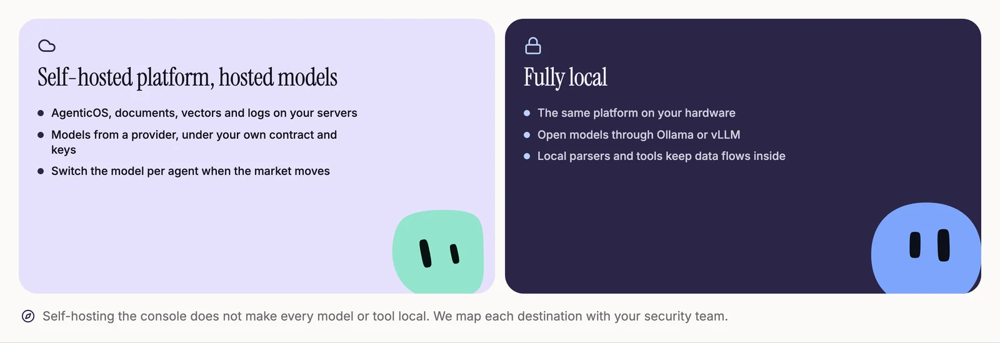

Są dwie typowe konfiguracje. **Na własnej infrastrukturze, z modelami hostowanymi:** AgenticOS, dokumenty, wektory i logi działają na Twoich serwerach, a modele pochodzą od dostawcy w ramach Twojej umowy i na Twoich kluczach. **W pełni lokalnie:** ta sama warstwa z otwartymi modelami przez Ollama lub vLLM na Twoim sprzęcie oraz z lokalnymi parserami i narzędziami. Uruchomienie konsoli na własnej infrastrukturze nie sprawia, że każdy model, parser i narzędzie działa lokalnie, więc sprawdź każde skonfigurowane miejsce docelowe. [Konfiguracja modeli](https://vstorm-co.github.io/agenticos/pl/models/) · [Bezpieczeństwo i przepływy danych](https://vstorm-co.github.io/agenticos/pl/security/)

## 🛠️ Dla programistów i administratorów

AgenticOS jest zbudowany z FastAPI, Pydantic AI, PostgreSQL z pgvector, Redis i Next.js. Inżynierowie dodają capabilities, konektory synchronizacji i wpisy katalogu MCP w typowanym Pythonie; zespoły składają w konsoli agentów z zarejestrowanych capabilities.

| Warstwa | Co tam działa |
|---|---|
| Konsola | Next.js |
| API | FastAPI |
| Środowisko wykonawcze agentów | [Pydantic AI](https://ai.pydantic.dev) i [pydantic-ai-harness](https://pydantic.dev/docs/ai/harness/), jeden runner za każdym kanałem dostępu |
| Praca w tle | Kolejka zadań w PostgreSQL, obsługiwana przez `python -m app.worker` |
| Dane | PostgreSQL z pgvector |
| Wykonywanie kodu | Kontenery uruchamiane przez `sandboxd` |

Wywołaj opublikowanego agenta przez `POST /api/v1/agents/{id}/run` jako uwierzytelniony członek organizacji albo strumieniuj tokeny przez WebSocket.

[Architektura](https://vstorm-co.github.io/agenticos/pl/architecture/) · [API](https://vstorm-co.github.io/agenticos/pl/api/) · [Dodaj capability](https://vstorm-co.github.io/agenticos/pl/howto/add-capability/) · [Referencja capabilities](https://vstorm-co.github.io/agenticos/pl/reference/capabilities/) · [Współtworzenie](https://vstorm-co.github.io/agenticos/pl/help/)

[Analogia systemu operacyjnego](https://vstorm-co.github.io/agenticos/pl/about/) wyjaśnia architekturę. Opcjonalna [aplikacja desktopowa](https://vstorm-co.github.io/agenticos/pl/desktop/) dodaje osobne okno, zwierzaka i skrót do zrzutów ekranu na macOS. [Mobile](https://vstorm-co.github.io/agenticos/pl/mobile/): konsola na ekranie głównym i natywne buildy deweloperskie.

## ❓ Najczęściej zadawane pytania

<details>
<summary><b>Czy AgenticOS można bezpłatnie używać komercyjnie?</b></summary>

Tak. AgenticOS jest udostępniany na licencji Apache-2.0, która pozwala na użytek komercyjny, modyfikacje i prywatne wdrożenia. Płacisz za infrastrukturę, na której go uruchamiasz, oraz za wybranych dostawców modeli i usługi zewnętrzne. Licencja nie obejmuje nazwy ani logo AgenticOS.

</details>

<details>
<summary><b>Czy AgenticOS może działać wyłącznie z modelami lokalnymi?</b></summary>

Tak. Skonfiguruj jako dostawcę modelu Ollama, LiteLLM lub serwer kompatybilny z OpenAI, taki jak vLLM czy LM Studio, używaj lokalnych modeli embeddingów przez Ollama i parsuj dokumenty za pomocą PyMuPDF lub LiteParse. Samo uruchomienie konsoli na własnej infrastrukturze nie sprawia, że każdy model, parser i narzędzie działa lokalnie: sprawdź każde skonfigurowane miejsce docelowe. [Modele](https://vstorm-co.github.io/agenticos/pl/models/) · [Przepływy danych](https://vstorm-co.github.io/agenticos/pl/security/)

</details>

<details>
<summary><b>Jakie metody logowania i role obsługuje?</b></summary>

E-mail i hasło z magic linkami, Google, ogólne SSO z OIDC (Entra ID, Okta, Keycloak, Auth0, Authentik, Google Workspace), LDAP i Kerberos. Sześć wbudowanych ról (Owner, Admin, Builder, Operator, Member, Viewer) łączy się z grupami działów i udostępnianiem poszczególnych zasobów. Uwierzytelnianie wieloskładnikowe zapewnia dostawca tożsamości; natywnego MFA, SAML ani SCIM jeszcze nie ma. [Uprawnienia](https://vstorm-co.github.io/agenticos/pl/permissions/)

</details>

<details>
<summary><b>Jak AgenticOS utrzymuje agentów pod kontrolą?</b></summary>

Miesięczne budżety agentów i organizacji są sprawdzane przed każdym żądaniem do modelu. Wrażliwe narzędzia czekają na zatwierdzenie przez człowieka. Opcjonalne guardraile redagują sekrety i dane osobowe, a każdy run jest zapisywany wraz z wersją agenta, narzędziami, tokenami i kosztem. [Nadzór](https://vstorm-co.github.io/agenticos/pl/governance/)

</details>

<details>
<summary><b>Czym różni się od ChatGPT Enterprise, Copilot Studio czy n8n?</b></summary>

AgenticOS działa na Twojej infrastrukturze z dowolnym z 28 dostawców modeli i nie pobiera własnych opłat za stanowiska ani kredyty. Tworzy agentów dla organizacji, publikowanych w czatach, na stronach i przez API, a nie stanowiska asystenta dla poszczególnych pracowników. W porównaniu z n8n zaczyna od agenta, a nie od kanwy workflow, i wiele zespołów używa obu. Poradniki omawiają też kreator [Dify](https://vstorm-co.github.io/agenticos/pl/about/dify/) uruchamiany na własnej infrastrukturze oraz agentów programistycznych, takich jak Claude Code. [Porównania](https://vstorm-co.github.io/agenticos/pl/about/comparison/)

</details>

<details>
<summary><b>Czego wymaga uruchomienie?</b></summary>

Docker Compose na jednym hoście. Wystarczy maszyna z 4 vCPU i 8 GB RAM, a dwa workery API obsłużą zespół dziesięciu osób. Ktoś musi odpowiadać za aktualizacje, kopie zapasowe (w tym klucza vaulta), dostęp i podłączone usługi zewnętrzne. [Wdrożenie](https://vstorm-co.github.io/agenticos/pl/deploy/) · [Plan wdrożenia](https://vstorm-co.github.io/agenticos/pl/rollout/)

</details>

## 💬 Społeczność

- **Pytania i pomysły:** [GitHub Discussions](https://github.com/vstorm-co/agenticos/discussions).
- **Błędy i prośby:** [issues](https://github.com/vstorm-co/agenticos/issues); planowane prace są pogrupowane w [kamienie milowe](https://github.com/vstorm-co/agenticos/milestones).
- **Współtworzenie:** przeczytaj [przewodnik dla współtwórców](CONTRIBUTING.pl.md) i [kodeks postępowania](CODE_OF_CONDUCT.pl.md). Podatności zgłaszaj prywatnie, tak jak opisuje to [polityka bezpieczeństwa](SECURITY.pl.md).
- **Wydania:** przeczytaj [informacje o wydaniach](https://vstorm-co.github.io/agenticos/pl/release-notes/) lub wybierz na GitHubie **Watch → Custom → Releases**, aby dostawać powiadomienia.

## 📄 Licencja

[Apache License 2.0](LICENSE). Zobacz [NOTICE](NOTICE) i [informacje o komponentach zewnętrznych](THIRD_PARTY_NOTICES.md), aby poznać atrybucje i skład dystrybucji.

## 🤝 Potrzebujesz pomocy we wdrożeniu agentów na produkcję?

Vstorm wdraża AgenticOS w infrastrukturze klienta, przygotowuje dokumentację, definiuje procesy i buduje capabilities na zamówienie. Zakres utrzymania i wsparcia ustalamy dla każdej współpracy.

Stworzone z dbałością przez [**Vstorm**](https://vstorm.co) · [Vstorm on GitHub](https://github.com/vstorm-co)

## 👥 Kontrybutorzy

Wszyscy, którzy pomogli zbudować AgenticOS:

<a href="https://github.com/vstorm-co/agenticos/graphs/contributors"></a>
