<!-- source_sha: f040fca930af -->

<div align="center">

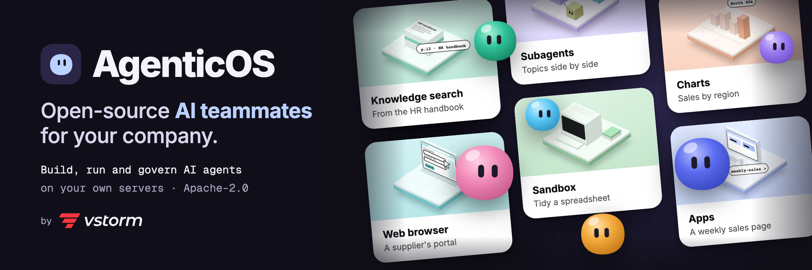

<p>
  <b>Şirketinizin yapay zeka ekip arkadaşları için açık kaynaklı, kendi sunucunuzda barındırabileceğiniz (self-hosted) yapay zeka agent platformu.</b><br>
  Agentları kendi sunucularınızda ve modellerinizde oluşturun, çalıştırın ve yönetin: paylaşımlı sohbet, RAG, skilller, gerçek bir tarayıcı, MCP, budgetler, onaylar ve denetim kaydı.<br>
  <sub>Apache-2.0 &middot; Pydantic AI üzerine inşa edildi</sub>
</p>

<p>
  🏆 <b>Vstorm tarafından geliştirildi — 2026 Açık Ajanik Yapay Zeka İnovasyon Ödülü (Open Agentic AI Innovation Award) sahibi.</b><br>Açık kaynaklı çatısında AGENTS.md'yi benimsediği ve MCP'yi entegre ettiği için Agentic AI Foundation tarafından takdir edildi.<br><a href="https://aaif.io/blog/winners-of-the-first-aaif-annual-technical-excellence-awards">AAIF duyurusunu okuyun</a> &middot; <a href="https://vstorm.co/agentic-ai/open-agentic-ai-standards-aaif-award/">Ödülün arkasındaki çalışma</a>
</p>

<p>
  <a href="#-i̇ş-başında-görün">Görün</a> &middot;
  <a href="#-öne-çıkanlar">Öne çıkanlar</a> &middot;
  <a href="#-agenticos-nedir">Nedir?</a> &middot;
  <a href="#-hızlı-başlangıç">Hızlı başlangıç</a> &middot;
  <a href="#sunucunuzda-çalıştırın-her-yerden-açın">Sunucu, masaüstü ve mobil</a> &middot;
  <a href="#-ekibinizin-zaten-kullandığı-uygulamaları-bağlayın">Entegrasyonlar</a> &middot;
  <a href="#-oluşturun-paylaşın-ve-işletin">Ürün turu</a> &middot;
  <a href="#-yolunuzu-bulun">Yolunuzu bulun</a> &middot;
  <a href="#-bugün-neler-sunuluyor">Neler sunuluyor</a> &middot;
  <a href="#-sıkça-sorulan-sorular">SSS</a> &middot;
  <a href="https://vstorm-co.github.io/vstormos-landing/">Web sitesi</a> &middot;
  <a href="https://vstorm-co.github.io/agenticos/presentation/">Tanıtım sunumu</a> &middot;
  <a href="https://vstorm-co.github.io/agenticos/">Dokümantasyon</a>
</p>

<p>
  <a href="https://github.com/vstorm-co/agenticos/actions/workflows/ci.yml"></a>
  <a href="https://github.com/vstorm-co/agenticos/releases"></a>
  <a href="LICENSE"></a>
  <a href="https://ai.pydantic.dev"></a>
</p>

<p>
  <a href="https://trendshift.io/repositories/220030?utm_source=repository-badge&amp;utm_medium=badge&amp;utm_campaign=badge-repository-220030" target="_blank" rel="noopener noreferrer"></a>
  <a href="https://trendshift.io/repositories/220030?utm_source=trendshift-badge&amp;utm_medium=badge&amp;utm_campaign=badge-trendshift-220030" target="_blank" rel="noopener noreferrer"></a>
</p>

<p>
  <a href="README.md">English</a> &middot;
  <a href="README.pl.md">Polski</a> &middot;
  <a href="README.de.md">Deutsch</a> &middot;
  <a href="README.es.md">Español</a> &middot;
  <b>Türkçe</b>
</p>

<p><sub>Bu README Türkçedir. Türkçe çevirisi bulunmayan dokümantasyon bağlantıları İngilizce sayfalara gider.</sub></p>

</div>

<a href="docs/assets/readme/highlight-hero.webp">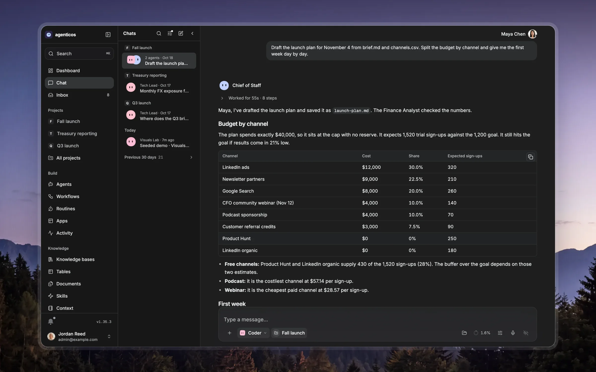</a>

*Gerçek Visuals oluşturucusunda kurgusal satış verileriyle hazırlanmış sohbet. Canlı bir CRM veya yeni bir model çalıştırması temsil edilmemektedir.*

AgenticOS her ekibe yapay zeka ekip arkadaşları kazandırır: dosyalarla çalışan, kod çalıştıran, web'de gezinen ve şirketinizin araçlarını ve bilgisini kullanan agentlar. İş arkadaşlarınız ve agentlarınız aynı canlı sohbette çalışır ve herhangi bir agent, halihazırda ödediğiniz ChatGPT veya Claude aboneliğiniz üzerinden kodu Claude Code'a veya Codex'e devredebilir. Açık kaynaklıdır (Apache-2.0) ve kendi altyapınızda çalıştırdığınız bir katman olarak kendi sunucunuzda barındırılır (self-hosted). Tarayıcıda agentlar oluşturup yayınlayın, iş arkadaşlarınızla paylaşın ve erişimlerini, maliyetlerini ve sonuçlarını tek bir yerden yönetin.

**Burada yeni misiniz?** [17 slaytlık tanıtıma](https://vstorm-co.github.io/agenticos/presentation/) göz atın: sorun, fikir, gerçek ekranlarda ürün, kontrolleri ve sınırları ile nasıl başlanacağı. Her ekranı ayrıntılı görmek için [47 slaytlık ürün turunu](https://vstorm-co.github.io/agenticos/presentation/tour/) açın. Ok tuşlarıyla her iki sunumda da gezinebilirsiniz; `O` tuşu tüm slaytları listeler.

## Son sürümlerdeki yenilikler

- **Masaüstü sohbetinin içinde yerel Claude Code veya Codex'iniz.** Sohbet başına bir kodlama agentı seçin, onaylı bir yerel klasörde çalışın, oturumunu sürdürün ve o çalışırken düzeltmeler uygulayın. Kodlama agentının kendi terminal akışı üzerinden oturum açın.
- **Skillleriniz ve proje talimatlarınız.** Bir masaüstü sohbetini, bilgisayarınızdan okunan yerel skilllere ve `AGENTS.md` / `CLAUDE.md` dosyalarına dahil edin. Her yeni sohbet bu paylaşım kapalı olarak başlar.
- **Discord; Slack, Teams, Telegram ve Mattermost'a katıldı.** Bahsetmeleri, doğrudan mesajları ve `/ask` komutlarını yanıtlayın; onayları ve soruları kanal içinde inceleyin. [Bir kanal kurun](https://vstorm-co.github.io/agenticos/channels/).
- **Daha kullanışlı Visuals ve Apps.** Birlikte gelen `AOWorldMap` ile ülke haritaları, pinler ve rotalar çizin veya sunum skilllerini kullanarak bir App olarak sunum oluşturun. Bir komut izleyici, agent çalışırken test veya günlük çıktısını takip edebilir.

[Sürüm notları](https://github.com/vstorm-co/agenticos/releases) · [Masaüstü kılavuzu](https://vstorm-co.github.io/agenticos/desktop/)

## ⚡ Öne çıkanlar

### Ekibiniz ve agentlarınız, tek bir canlı odada

Bir proje herkese aynı dosyaları, talimatları ve agentlar için bir bilgisayarı sunar. İş arkadaşlarınızı davet edin ve bir ekibin çalıştığı gibi çalışın: kimin burada olduğunu görün, bir ekip arkadaşınızın agentının yazılırken yanıt vermesini izleyin ve `@` ile herhangi bir agentı, aracı veya belgeyi dahil edin.

<a href="docs/assets/readme/highlight-projects.webp">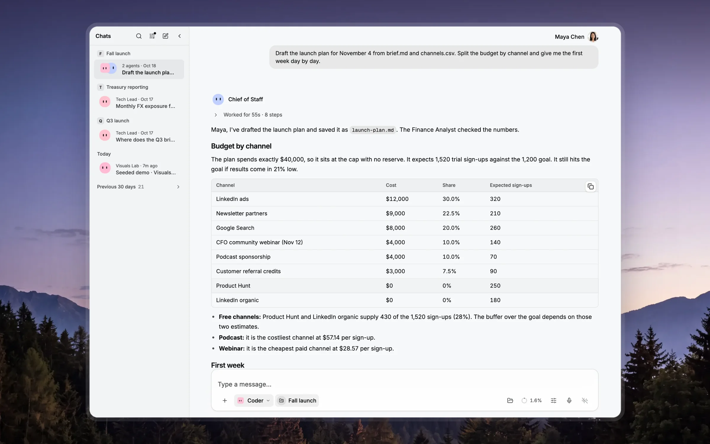</a>

### Herkese yanıt verin, agent kimin ne dediğini bilsin

Bir kişiye veya bir agentın yanıtına yanıt verin; agent değişikliği uygular ve kime ait olduğunu belirtir. Her mesaj bir ad taşır, böylece bir kararın sahibi belli olur.

<a href="docs/assets/readme/highlight-reply.webp">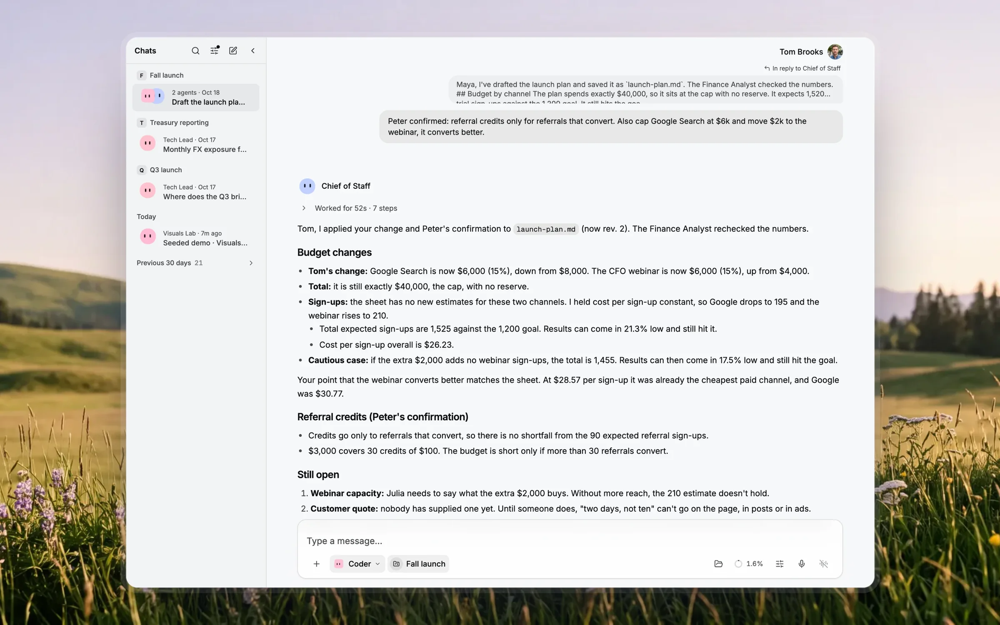</a>

### Ekibinizde Claude Code ve Codex

Herhangi bir agent, yazılım işlerini Claude Code veya Codex'e devredebilir. Agentın kendi bilgisayarında, ChatGPT veya Claude aboneliğiniz üzerinden geliştirme yaparlar ve neyi değiştirdiklerini, neyi kontrol ettiklerini ve sizden neye ihtiyaç duyduklarını raporlarlar.

<a href="docs/assets/readme/highlight-coding.webp">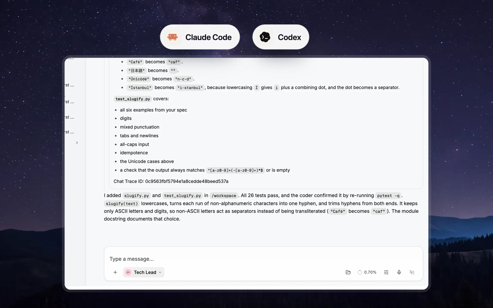</a>

*Hazırlanmış arayüz örneği: Claude Code bir tedarikçi portalı uygular ve Codex bunu salt okunur modda inceler. Kurgusal devirler; gerçek bir kodlama CLI yürütmesi temsil edilmemektedir.*

### Nasıl çalıştığını sorun, kullanabileceğiniz bir çizim alın

Bir agent yazarken çizer: belgelerinizden bir diyagram, kaydırıcılı bir hesap makinesi, bir grafik veya 3B bir sahne, doğrudan mesajının altında canlı olarak görünür. Tek tıklamayla bunu ekibinizin bağlantıyla açabileceği bir uygulama (app) olarak kaydedebilirsiniz.

<a href="docs/assets/readme/highlight-visuals.webp">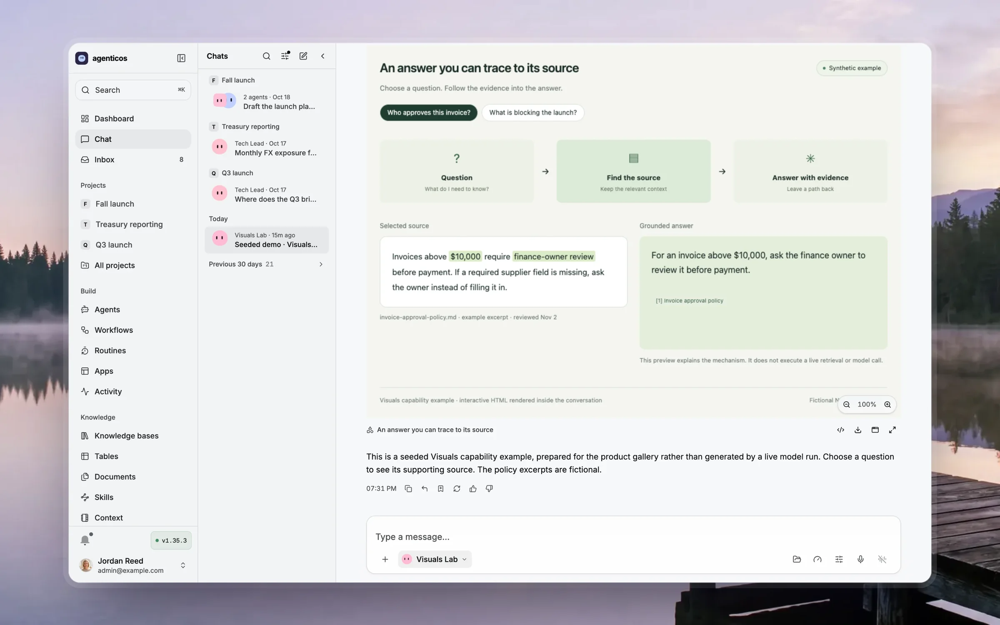</a>

*Sohbet içinde hazırlanmış bir üretim Visual'ı: tedarik ağı, gelen teslimat istisnaları ve montaj pencereleri. Etkileşimli kurgusal veriler; ERP, makine bağlantısı veya canlı model çağrısı temsil edilmemektedir.*

### Bir agenta yazın ve çıkın

Biraz zaman alan bir araştırma isteyin ve sekmeyi kapatın. Agent çalışmaya devam eder, yanıt sohbete düşer ve zil simgesi işin bittiğini haber verir.

<a href="docs/assets/readme/highlight-research.webp">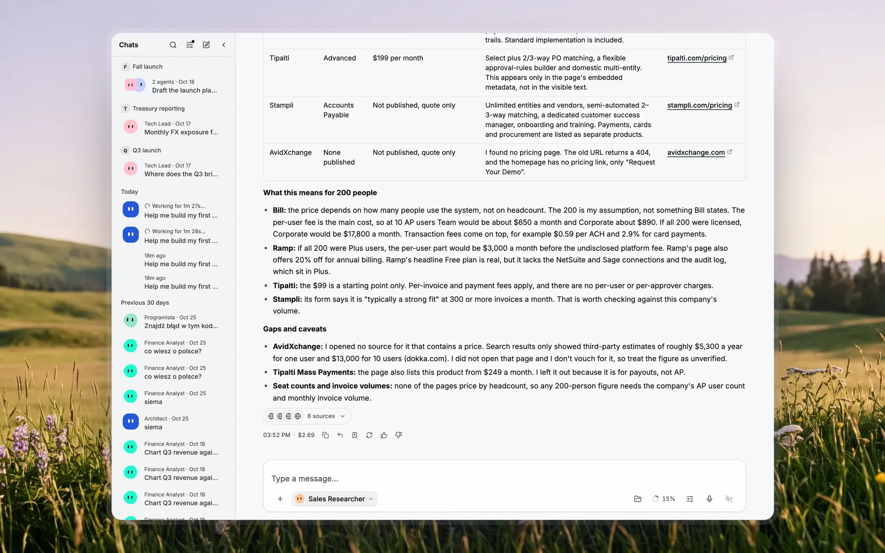</a>

### Gününüz, tek ekranda

Agentlarınızın ne yaptığını, sizden onay bekleyen çağrıları ve devam edilecek sohbetleri görmek için konsolu açın — gözden kaçırması kolay yeteneklerin bir turuyla birlikte.

<a href="docs/assets/readme/highlight-dashboard.webp">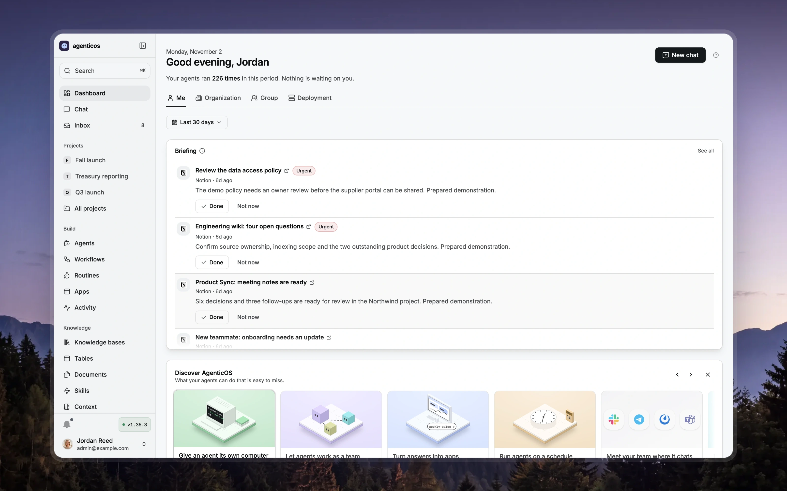</a>

### Ekip olarak çalışan agentlar

Bir lider agent, görevin parçalarını iş arkadaşlarına devreder ve bulduklarını özetler — kime sorduğunu ve her birinin ne dediğini görürsünüz.

<a href="docs/assets/readme/highlight-subagents.webp">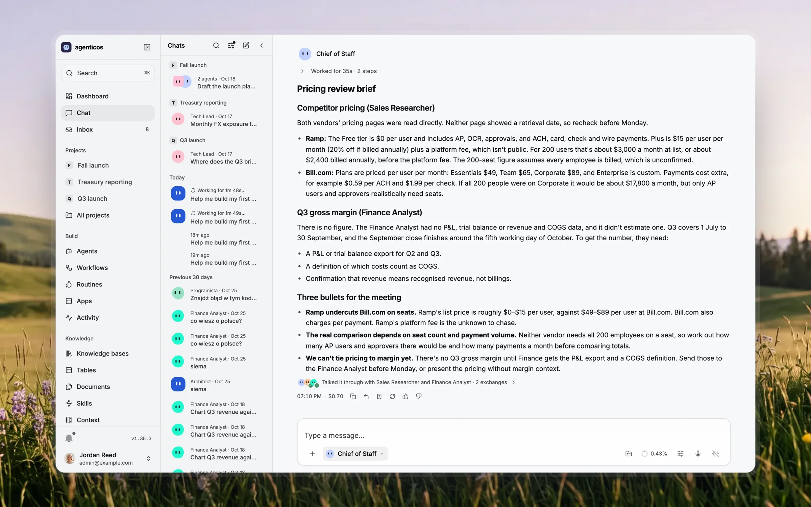</a>

### Doğrudan sohbetin içinde gerçek bir tarayıcı

Sitelerde tıklayarak gezinmesini izleyin, oturum açma gerektiğinde kontrolü devralın, yorum yapmak için bir noktayı işaretleyin.

<a href="docs/assets/readme/highlight-browser.webp">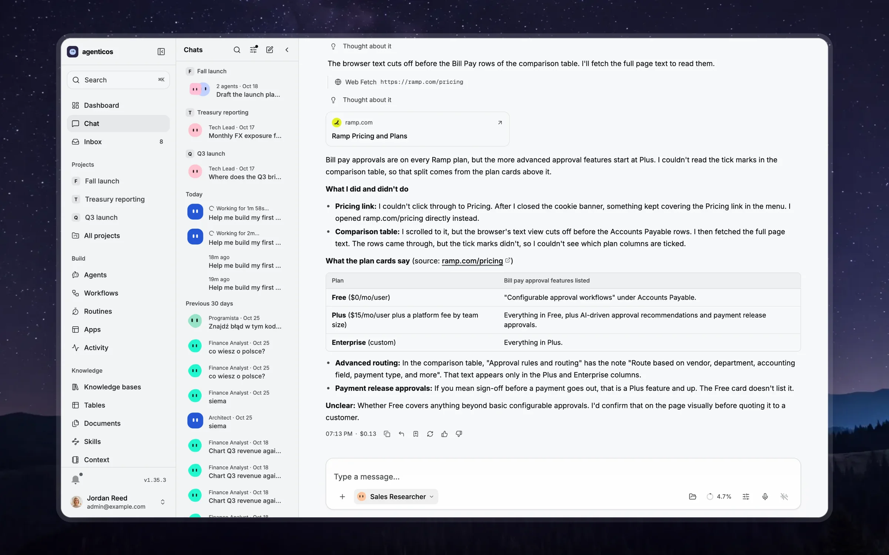</a>

### Tek pencerede oluşturun, donatın ve test edin

Agentı iş arkadaşlarınız için yayınlamadan önce araçları etkinleştirin ve taslak test panelinde gerçek bir görevi deneyin.

<a href="docs/assets/readme/highlight-builder-test.webp">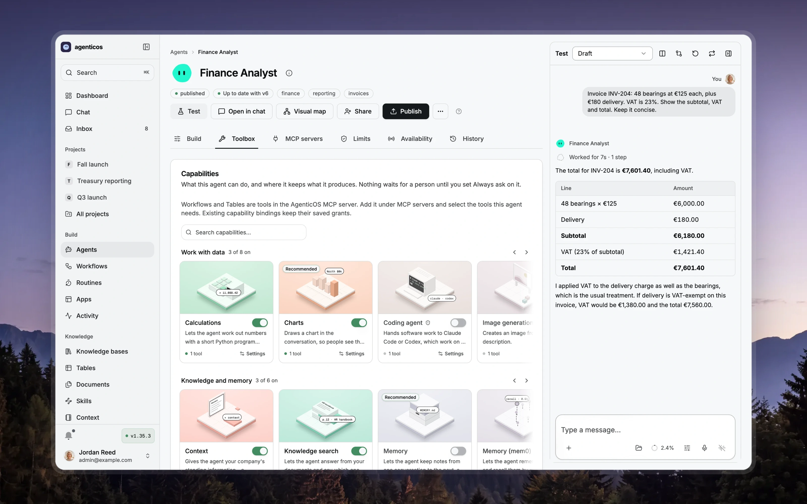</a>

### Yalnızca yanıtlar değil, uygulamalar (Apps)

Bir agent bir panoyu veya raporu kararlı bir bağlantıya ve sürümlere sahip bir sayfa olarak yayınlar.

<a href="docs/assets/readme/highlight-app.webp">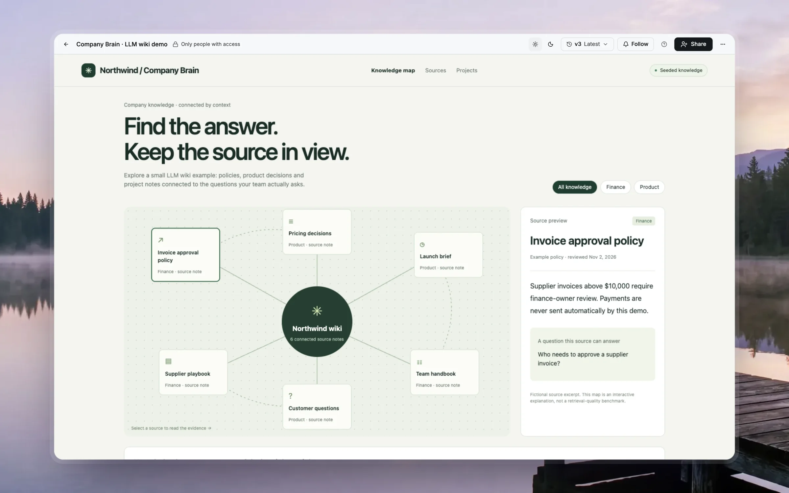</a>

*Northline: kurgusal sevkiyatlar, yerel gecikme simülasyonu ve montaj pencereleriyle hazırlanmış bir tedarik ve üretim planlama App'i.*

<details>
<summary>Daha fazla hazırlanmış App: motor montajı ve satış zekası</summary>

Kurgusal verilerle çalışan yerel gösterimler. Motor Atlas kavramsal bir montajı ve bileşen kayıtlarını incelemenizi sağlar; Revenue Pulse satış metriklerini bölgeye ve döneme göre yeniden hesaplar. Hiçbir ekipman, ERP veya CRM bağlı değildir.

<a href="docs/assets/readme/highlight-revenue.webp">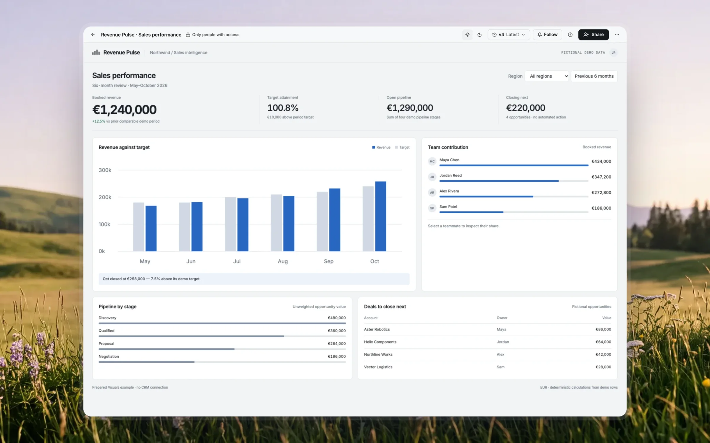</a>

</details>

### Kendi sitenizde bir web sitesi widget'ı

Gerçek AgenticOS widget'ı, kurgusal Trail Supply web sitesinde yayınlanmış, salt okunur bir agentı çalıştırır. Kaydedilen yerel testte, talimatlarındaki başlangıç kataloğunu kullanarak yanıt vermiştir. Canlı envanter, satın alma ve ödemeler bağlı değildir.

<a href="docs/assets/readme/highlight-widget.webp">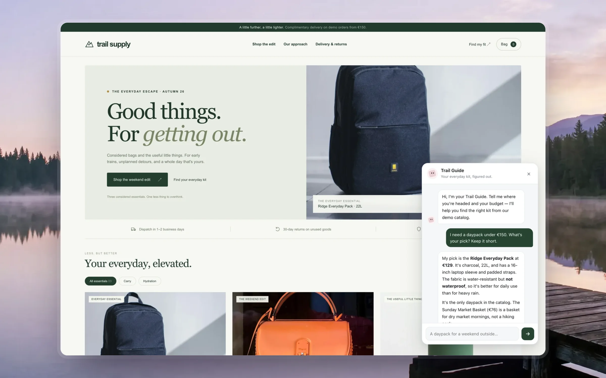</a>

[Bir web sitesi widget'ı oluşturun ve yayınlayın](https://vstorm-co.github.io/agenticos/howto/support-widget/)

### 4.700+ MCP sunucusu

Notion, GitHub, Jira veya kendi sunucunuzu bağlayın ve her agentın hangi araçları çağırabileceğini seçin.

<a href="docs/assets/readme/highlight-mcp-servers.webp">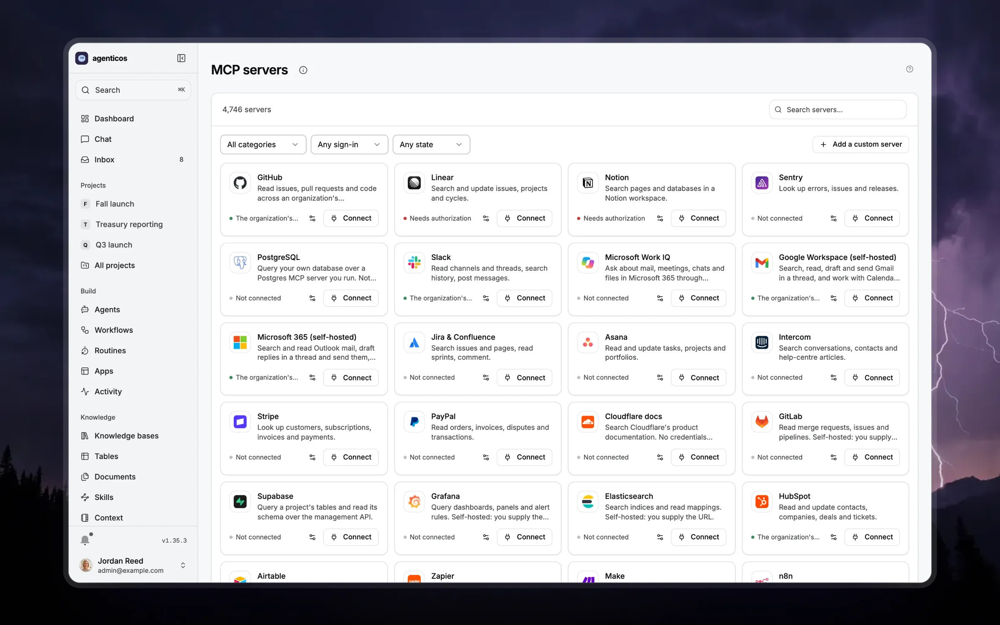</a>

### Claude Code, Codex veya Cursor'dan AgenticOS içinde çalışın

AgenticOS bir MCP sunucusudur. Tek komutla ekleyin ve tarayıcı üzerinden oturum açın: kodlama asistanınız izin verdiğiniz sınırlar dahilinde agentları listeleyebilir ve çalıştırabilir, çalıştırmaları ve maliyetlerini okuyabilir, bilgi tabanlarında arama yapabilir ve bilgi ekleyebilir.

<a href="docs/assets/readme/highlight-mcp-server.webp">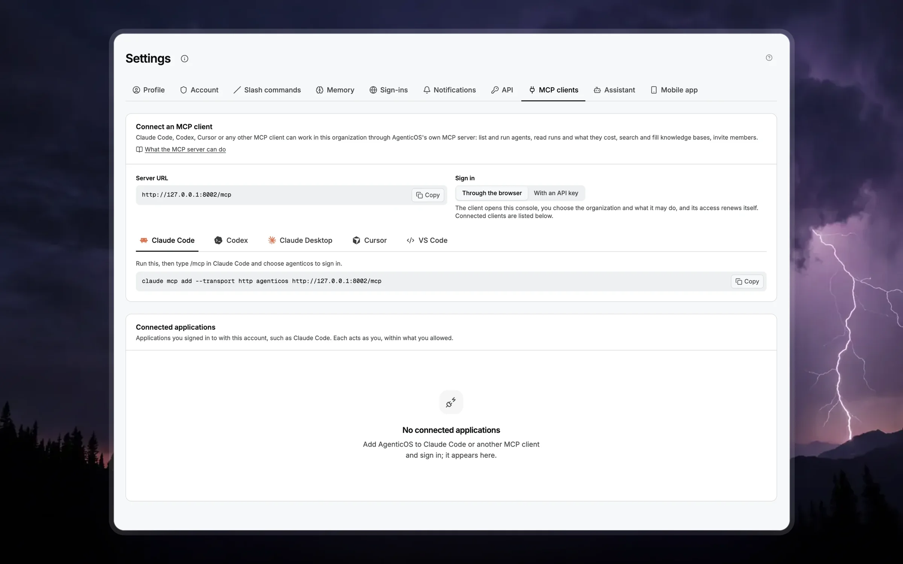</a>

## 📸 İş başında görün

[Güncel ürün galerisine](https://vstorm-co.github.io/agenticos/screens/) göz atın. Aşağıdaki Motor Atlas, kurgusal bileşen kayıtları ve telemetri ile hazırlanmış etkileşimli bir montaj gezginidir; bir CAD çizimi değildir.

<a href="docs/assets/readme/highlight-motor.webp">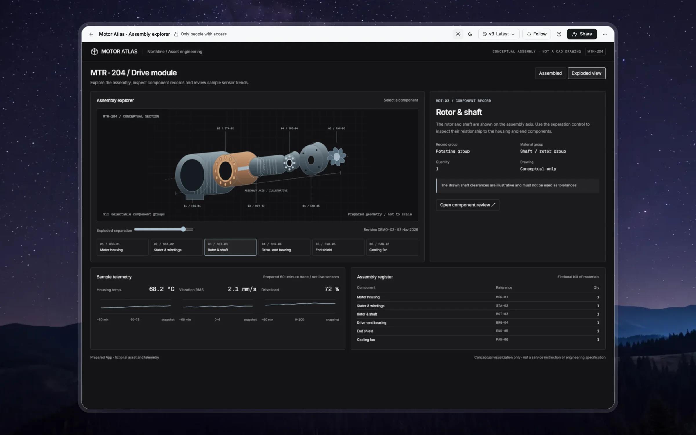</a>

## 🧩 Agentlarınızın etrafında faydalı işler kurun

Görsel bir tuval üzerinde tipli adımları, agent çağrılarını ve MCP araçlarını bağlamak için [İş Akışlarını (Workflows)](https://vstorm-co.github.io/agenticos/workflows/) kullanın. Yapılandırılmış sonuçları [Sanal Tablolarda (Virtual Tables)](https://vstorm-co.github.io/agenticos/virtual-tables/) saklayın, işleri [Rutinlerle (Routines)](https://vstorm-co.github.io/agenticos/triggers/) başlatın ve çalıştırmalarla onayları inceleyin. [Sesli aramalar](https://vstorm-co.github.io/agenticos/voice/) ve [masaüstü uygulaması](https://vstorm-co.github.io/agenticos/desktop/), aynı yayınlanmış agentlarla çalışmanın diğer yollarını sunar.

**Potansiyel müşteri alımından insan onaylı devire kadar görsel iş akışları.**

<a href="docs/assets/readme/highlight-workflows.webp">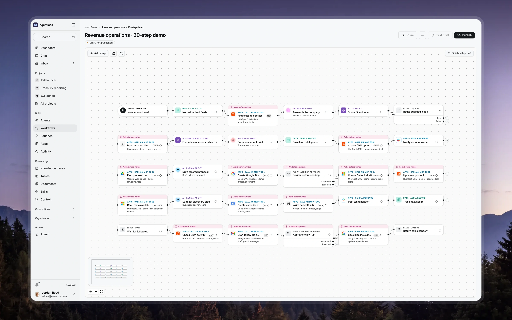</a>

Google Workspace, Microsoft 365, HubSpot, Salesforce, Notion, Slack, agentlar ve onaylar içeren örnek 30 adımlı taslak. Bağlantılar demo yer tutucularıdır; yürütülmüş bir entegrasyon değildir.

**Agentlarınızın ve ekibinizin birlikte okuyabileceği yapılandırılmış işler.**

<a href="docs/assets/readme/highlight-tables.webp">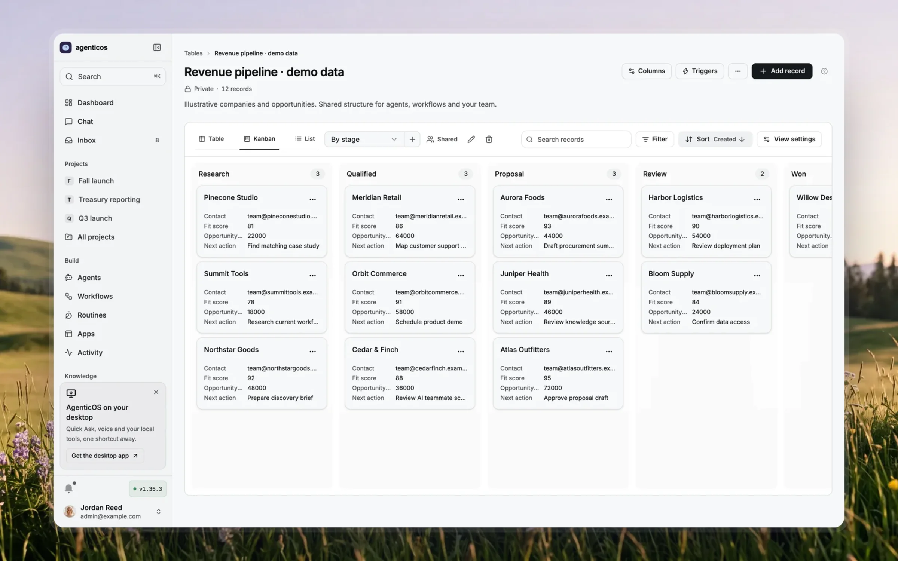</a>

Kurgusal şirketler, tipli alanlar, aşamalar ve sonraki eylemler içeren Sanal Tablolar. Izgara (grid) ve kanban panosu arasında geçiş yapın.

Tanıdık bir görevle başlayın: bir [Projede LLM wiki'si](https://vstorm-co.github.io/agenticos/projects/), bir [web sitesi agent widget'ı](https://vstorm-co.github.io/agenticos/channels/) veya paylaşımlı proje dosyalarından ve talimatlarından çalışan bir ekip. Widget konuşma yüzeyini sağlar; öneriler ve sepet işlemleri için yine kataloğunuza, araç entegrasyonunuza ve izin kontrollerinize ihtiyaç vardır.

## 💡 AgenticOS nedir?

**AgenticOS, bir şirket genelinde yapay zeka agentları oluşturmak, paylaşmak ve yönetmek için açık kaynaklı (Apache-2.0), kendi sunucunuzda barındırabileceğiniz bir katmandır.** Ekipler, tarayıcıda talimatlarını yazarak, bir model seçerek ve araçları açarak bir agentı yapılandırır. Onu şirket belgelerine ve uygulamalarına bağlar; web sohbeti, Slack, Teams, Discord, Mattermost, Telegram, bir web sitesi widget'ı veya bir API'ye yayınlarlar. Yöneticiler her agentı kimin kullanabileceğini, ne kadar harcayabileceğini ve hangi eylemlerin bir kişinin onayını gerektirdiğini kontrol eder. Her çalıştırma kaydedilir.

Çoğu agent çatısı size bir kütüphane verir; bu nedenle bir agentın davranışındaki her değişiklik bir pull request, bir inceleme ve bir sürüm yayını demektir. Bu, bir şirketin gerçekten istediği küçük agentlar için yanlış bir şekildir, çünkü agentın ne söylemesi gerektiğini bilen kişi commit erişimi olan kişi değildir. **Kod tanımlar, yapılandırma birleştirir:** mühendisler birleştirilebilecek olanı genişletir ve yapılandırma yalnızca kodun kaydettiklerine ulaşabilir.

Docker Compose ile kendi altyapınızda çalışır ve ChatGPT aboneliğiniz ile Ollama ve vLLM üzerinden yerel modeller dahil 28 model sağlayıcısıyla çalışır. Agentlar [Pydantic AI](https://ai.pydantic.dev) ve [pydantic-ai-harness](https://pydantic.dev/docs/ai/harness/) üzerinde çalışır; etraflarındaki katman FastAPI, pgvector ile PostgreSQL ve Next.js kullanır. [Vstorm](https://vstorm.co) tarafından sürdürülmektedir.

**Kimin içindir:**

- Satıcı bulutundaki koltuk başı asistanlar yerine kendi sahip oldukları **dahili bir yapay zeka agent katmanı** isteyen şirketler.
- Raporlar, destek yanıtları, sözleşme kontrolleri ve veri analizi gibi **belgeler ve araçlar üzerinde tekrarlanan işlere** sahip ekipler.
- Yapay zeka agentları için **veri egemenliği, şirket oturum açma, budgetler, onaylar ve denetim kaydı** gerektiren BT ve güvenlik ekipleri.
- **Tipli Python genişletme noktaları** ve teknik olmayan iş arkadaşlarının kullanabileceği bir konsol isteyen mühendisler.

<a href="docs/assets/readme/company-architecture-diagram.webp">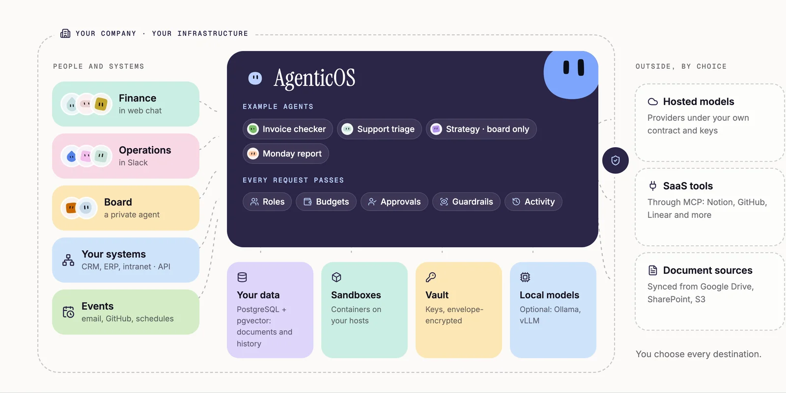</a>

<p align="center"><sub><b>Şirketinize nasıl uyum sağlar.</b> Kişiler illüstrasyondur; agentlar örnektir.</sub></p>

**AgenticOS bir şirkete nasıl uyum sağlar:** finans, operasyonlar veya yönetim kurulu gibi departmanlar web sohbeti, Slack veya özel bir çalışma alanında paylaşımlı agentları kullanır. Sistemleriniz agentları API üzerinden çağırır ve olaylar veya zamanlamalar onları otomatik olarak başlatır. Her istek aynı kontrollerden geçer: roller, budgetler, onaylar, guardrails ve kaydedilmiş bir çalıştırma. Verileriniz, vektörler, kod korumalı alanları, kimlik bilgisi vault ve isteğe bağlı yerel modeller kendi altyapınızda kalır. Barındırılan modeller, SaaS araçları ve dışarıdaki belge kaynakları yalnızca siz yapılandırdığınızda kullanılır.

28 model sağlayıcısı · 4.700+ MCP galeri girişi · paylaşımlı sohbet ve Projeler · görsel iş akışları ve sanal tablolar · web, masaüstü, API ve mesajlaşma kanalları. Yayınlanan her agent için kullanılabilirliği ve araçları yapılandırın.

## ✨ Neler yapabilirsiniz

| Ekibiniz için | AgenticOS'un sundukları |
|---|---|
| [Dosyalar ve kodla çalışın](#-dosyalar-ve-kodla-çalışın) | CSV'leri analiz edin, grafikler ve belgeler üretin, depolar üzerinde çalışın |
| [Yeniden kullanılabilir agentlar oluşturun](#-ekibinizin-yeniden-kullanabileceği-agentlar-oluşturun) | Modelleri ve araçları seçin, sürümler yayınlayın, agentları iş arkadaşlarınızla paylaşın |
| [Şirket bilgisini bağlayın](#-agentlara-ekibinizin-nasıl-çalıştığını-öğretin) | Skillleri, bağlamı ve aranabilir belgeleri agentlar arasında yeniden kullanın |
| [Sonuçları paylaşın](#-sonuçları-etkileşimli-sayfalar-olarak-yayınlayın) | Kararlı bağlantılara ve sürüm geçmişine sahip etkileşimli sayfalar yayınlayın |
| [Çalıştırın ve izleyin](#-çalıştırmaları-maliyetleri-ve-onayları-takip-edin) | Panoları özelleştirin, çalıştırmaları inceleyin, görevleri zamanlayın ve budget belirleyin |
| [Şirket erişimini düzenleyin](#-ekipleri-roller-ve-gruplarla-düzenleyin) | Rolleri, departman gruplarını ve şirket oturum açmayı birleştirin |

## 🚀 Hızlı başlangıç

### Nasıl başlamak istediğinizi seçin

**Tek şirket çalışma alanı, bağlanmanın birçok yolu.** Sunucu AgenticOS'u çalıştırır; masaüstü uygulaması ona bağlanır. Mevcut bir çalışma alanına katılmak için Docker veya geliştirici araçları gerekmez.

| Durumunuz | Sonraki adım |
|---|---|
| Şirketinizde zaten AgenticOS var | Çalışma alanı URL'sini isteyin ve tarayıcınızdan oturum açın veya [masaüstü uygulamasını yükleyin](#masaüstü-uygulamasını-yükleyin). |
| Şirketiniz için bir çalışma alanı istiyorsunuz | BT ekibinizin [bir sunucu dağıtmasını](#bir-şirket-sunucusu-dağıtın) sağlayın veya [Vstorm'dan yardım isteyin](https://vstorm.co/contact-us/). |
| Terminal komutları olmadan bilgisayarınızda denemek istiyorsunuz | [Masaüstü uygulamasını yükleyin](#masaüstü-uygulamasını-yükleyin), **On this computer** seçeneğini seçin ve kurulumu izleyin. Önce [gereksinimleri](https://vstorm-co.github.io/agenticos/desktop/#running-it) inceleyin; yapay zeka yapılandırılmış bir model gerektirirken, kaydedilmiş örnekler gerektirmez. |
| Yerel olarak keşfeden bir geliştiricisiniz | [Docker hızlı başlangıcını çalıştırın](#yerel-olarak-deneyin). |

### Yerel olarak deneyin

<details id="local-quickstart">
<summary>Geliştiriciler için: AgenticOS'u Docker ile yerel olarak deneyin</summary>

Docker Compose ve bir model sağlayıcısına erişim ile başlayın. macOS veya Linux'ta şunu çalıştırın:

```bash
curl -fsSL https://raw.githubusercontent.com/vstorm-co/agenticos/main/scripts/quickstart.sh | bash
```

Windows'ta aynı komutu, Docker Desktop'ın WSL2 entegrasyonu açıkken WSL2 içinde çalıştırın. Kurulum sihirbazı bir model sağlayıcısı ve anahtarı, oturum açma bilginizi ve bir kuruluş adı ister, yayınlanan imajları çeker ve içinde çalışan bir agent bulunan bir dağıtım başlatır. 4 vCPU ve 8 GB RAM'e sahip bir ana bilgisayar bunu çalıştırır. Ardından **http://localhost:3000** adresini açın ve kurulum sırasında seçtiğiniz oturum açma bilgileriyle giriş yapın.

**İlk agentınız:** bir el kitabı yüklemek, sorular sormak ve yanıtları alıntılanan kaynaklara göre kontrol etmek için [belge asistanı adım adım kılavuzunu](https://vstorm-co.github.io/agenticos/howto/first-document-agent/) izleyin. Ardından her biri örnek bir girdi ve çalıştırabileceğiniz bir kontrol içeren [30 öğreticiden](https://vstorm-co.github.io/agenticos/use-cases/) bir sonraki görevi seçin.

<details>
<summary>Kurulum betiğini inceleyin veya başka bir şekilde dağıtın</summary>

Çalıştırmadan önce [kurulum betiğini](scripts/quickstart.sh) okuyun. Kurulum yapmadan ön koşulları kontrol etmek için:

```bash
curl -fsSL https://raw.githubusercontent.com/vstorm-co/agenticos/main/scripts/quickstart.sh | bash -s -- --check
```

Elle Docker Compose kurulumu, sabitlenmiş sürümler ve sorun giderme için [kurulum kılavuzunu](https://vstorm-co.github.io/agenticos/install/) izleyin. Kaynaktan geliştirme için [Katkıda Bulunma](https://vstorm-co.github.io/agenticos/help/) sayfasına bakın.

</details>

</details>

## ☁️ Tek tıkla dağıtım

<a href="https://repocloud.io/details/Agenticos/"></a>
<a href="https://railway.com/deploy/agenticos"></a>

Dağıtımdan önce sağlayıcının talimatlarını, imaj sürümlerini ve dahil edilen servisleri inceleyin. Bu barındırma şablonları bu depodan ayrı olarak sürdürülmektedir. Railway şablonu şu anda daha eski bir AgenticOS sürümünü sabitlemektedir ve yerel kod korumalı alanını (sandbox) içermez.

## Sunucunuzda çalıştırın. Her yerden açın.

Çalışma alanını sunucu tutar. Tarayıcı, masaüstü uygulaması ve telefon; hesapları, agentları ve erişim kontrolleriyle o dağıtıma bağlanır.

<a id="server-setup"></a>

### Bir şirket sunucusu dağıtın

BT ekibiniz çalışma alanını bir kez kurar, ardından bir HTTPS adresi paylaşır ve hesabınızı oluşturur. Bu adresi bir tarayıcıda veya masaüstü uygulamasında kullanabilirsiniz. Destekli bir kurulum için [Vstorm ile görüşün](https://vstorm.co/contact-us/).

<details>
<summary>BT ve geliştiriciler için sunucu kurulumu</summary>

**4 vCPU ve 8 GB RAM**'e sahip bir Linux ana bilgisayarı, Docker Engine 24+, Compose 2.24+ ve `make` kullanın. İki DNS adını ona yönlendirin — örneğin `app.example.com` ve `api.example.com` — ve bir ters proxy üzerinden HTTPS'e izin verin. Desteklenen dağıtım, tek bir ana bilgisayarda Docker Compose'dur.

```bash
# Sunucuda. Kod ve imajların uyumlu kalması için yayınlanmış bir sürümden başlayın.
git clone --branch v1.38.2 --depth 1 https://github.com/vstorm-co/agenticos.git
cd agenticos
bash scripts/server-init.sh
```

Kurulum site/API ana bilgisayar adlarını ve sertifika e-postasını sorar, ardından `backend/.env` dosyasını oluşturur. Bu sürümü sabitlemek için orada `AGENTICOS_VERSION=1.38.2` ayarını yapın. Birlikte gelen Traefik proxy'sini kullanan yeni bir ana bilgisayar için:

```bash
docker network create traefik_webgateway
docker compose --env-file backend/.env -f docker-compose-traefik.yml up -d
make prod PROXY=traefik
make prod-frontend PROXY=traefik
```

Ardından [ilk kuruluşu, sahibini ve agentı başlatın](https://vstorm-co.github.io/agenticos/deploy/#start-it-and-create-the-first-account), sitenizin HTTPS adresini açın ve kuruluşunuzun model kimlik bilgilerini ekleyin. Kılavuz ayrıca mevcut bir proxy, Nginx, güncellemeler ve yedeklemeleri de kapsar. Veritabanının **ve `backend/.env` içindeki vault anahtarının (vault key)** bir yedeğini saklayın.

```bash
docker compose --env-file backend/.env -f docker-compose-prod.yml \
  exec -T app agenticos cmd bootstrap \
  --email you@example.com --password '<your-password>' \
  --org 'Your Company' --provider anthropic --api-key '<your-api-key>'
```

[Tam sunucu dağıtım kılavuzu](https://vstorm-co.github.io/agenticos/deploy/) · [Yapılandırma kontrol listesi](https://vstorm-co.github.io/agenticos/configuration/#production-checklist)

</details>

<a id="desktop-install"></a>

### Masaüstü uygulamasını yükleyin

[v1.38.2 sürümünden](https://github.com/vstorm-co/agenticos/releases/tag/v1.38.2) bir yükleyici indirin:

| Sistem | v1.38.2 İndir | Ne yapmalı |
|---|---|---|
|  **macOS** | [Apple silicon · DMG](https://github.com/vstorm-co/agenticos/releases/download/v1.38.2/AgenticOS_1.38.2_aarch64.dmg) · [Intel · DMG](https://github.com/vstorm-co/agenticos/releases/download/v1.38.2/AgenticOS_1.38.2_x64.dmg) | DMG'yi açın ve AgenticOS'u Uygulamalar'a sürükleyin. |
|  **Windows x64** | [EXE](https://github.com/vstorm-co/agenticos/releases/download/v1.38.2/AgenticOS_1.38.2_x64-setup.exe) · [MSI](https://github.com/vstorm-co/agenticos/releases/download/v1.38.2/AgenticOS_1.38.2_x64_en-US.msi) | EXE'yi açın ve yükleyiciyi izleyin. MSI, yönetilen BT dağıtımı içindir. |
|  **Linux x64** | [DEB](https://github.com/vstorm-co/agenticos/releases/download/v1.38.2/AgenticOS_1.38.2_amd64.deb) · [RPM](https://github.com/vstorm-co/agenticos/releases/download/v1.38.2/AgenticOS-1.38.2-1.x86_64.rpm) · [AppImage](https://github.com/vstorm-co/agenticos/releases/download/v1.38.2/AgenticOS_1.38.2_amd64.AppImage) | DEB/RPM'yi yazılım yükleyicinizde açın. AppImage için dosya özelliklerinden çalıştırmaya izin verin. |

Mac'te **Apple menüsü → Bu Mac Hakkında**'yı seçin: "Çip" Apple silicon'u; "İşlemci: Intel" bir Intel Mac'i belirtir.

**macOS'ta Homebrew'ı mı tercih edersiniz?**

Projenin [Homebrew tap'i](https://github.com/vstorm-co/homebrew-agenticos) doğru Mac yükleyicisini seçer. Cask'ı AgenticOS için indirme karantina bayrağını temizler; Apple noter onayı (notarization) sağlamaz:

```bash
brew install --cask vstorm-co/agenticos/agenticos
```

**Kurulumdan sonra:** AgenticOS'u açın, ekibinizin size verdiği HTTPS çalışma alanı adresini girin ve oturum açın. Mevcut bir sunucuya bağlanmak yerel Docker gerektirmez. Bunun yerine yerel bir çalışma alanı oluşturmak için sihirbazda yerel örnek seçeneğini seçin; bu Docker gerektirir.

macOS'ta derlemeler Apple onaylı değildir; tarayıcıdan indirilen bir DMG için **Sistem Ayarları → Gizlilik ve Güvenlik → Yine de Aç** gerekebilir. [Kurulum kılavuzuna](https://vstorm-co.github.io/agenticos/desktop/#installing-the-app) bakın.

Konsolun ötesinde, masaüstü uygulaması Quick Ask'ı, izninizle yerel dosya ve bilgisayar erişimini ve yerel Claude Code / Codex'i ekler. **Settings → Desktop app** altında kurulu kodlama agentlarını kontrol edin ve terminalleri üzerinden oturum açın. **Chat controls** içinde birini seçin, bir çalışma klasörüne tam erişim verin ve yerel iletişim kutusunda görevi onaylayın. **My skills and instructions**, her sohbet için ayrı, isteğe bağlı bir seçimdir.

[Masaüstü kurulumu ve yerel agentlar](https://vstorm-co.github.io/agenticos/desktop/)

### AgenticOS'u telefonunuzda kullanın

**Derleme yapmadan hemen kullanılabilir:** dağıtımınızın HTTPS adresini bir mobil tarayıcıda açın ve oturum açın. Desteklenen bir tarayıcıda yükleme istemini kullanın; iPhone'da **Paylaş → Ana Ekrana Ekle**'yi seçin. Konsol; sohbet, dosyalar ve onaylar dahil olmak üzere bir telefona uyum sağlar.

**Yerel iOS ve Android:** kaynak kodu biyometrik kilitleme, paylaşım, widget'lar ve yerel bildirim entegrasyonlarıyla `mobile/` içinde yer alır. Bunlar şu anda herkese açık App Store, Google Play, TestFlight veya desteklenen sürüm indirmesi olmayan **geliştirme derlemeleridir**. Yerel uygulamayı denemek için macOS'ta (iOS) Rust ve Xcode'u ya da Android SDK/NDK ve JDK'yı (Android) kurun, ardından:

```bash
cd mobile
bun install --frozen-lockfile
bun run ios        # macOS üzerinde iOS geliştirme
# veya: bun run android
```

Gerektiğinde kendi platform imzalama/sağlama işlemlerinizle kurun. Telefondan erişilebilen bir sunucu adresi girin veya tek seferlik QR kodunu kullanarak **Settings → Mobile app** üzerinden eşleştirin ve hesabı onaylayın. Telefonda `localhost` telefonun kendisini ifade eder. Yerel anlık bildirimler dağıtımın platforma özgü yapılandırmasını gerektirir; [mobil kılavuz](https://vstorm-co.github.io/agenticos/mobile/) derleme ön koşullarını, eşleştirmeyi ve bildirimleri kapsar.

## 🔌 Ekibinizin zaten kullandığı uygulamaları bağlayın

AgenticOS agentları bir şirketin halihazırda kullandığı modellere, sohbet araçlarına, iş uygulamalarına ve belge depolarına bağlar; böylece bir agent aynı erişim kuralları ve budget altında bir Notion özetini okuyabilir, SharePoint belgelerinde arama yapabilir veya Slack'te yanıt verebilir.

<a href="docs/assets/readme/integrations-hub.webp">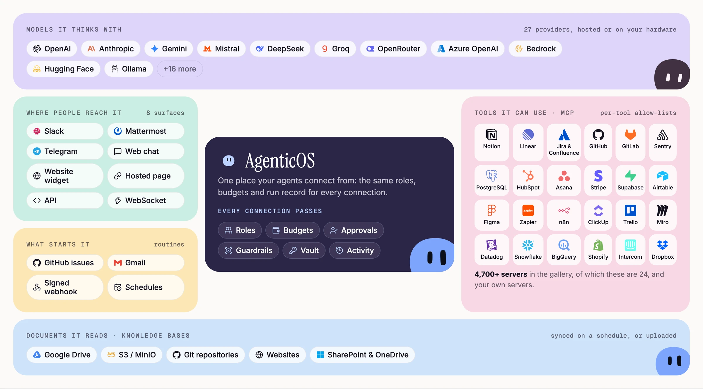</a>

| Bağlan | Nasıl | Oku |
|---|---|---|
| **Sohbet araçları** | Bir agentı Slack, Mattermost veya Telegram'a, bir web sitesi widget'ına, barındırılan bir sayfaya, API'ye veya bir WebSocket'e yayınlayın | [Kanallar](https://vstorm-co.github.io/agenticos/channels/) |
| **İş araçları** | Galeride **4.700+ MCP sunucusu** (Notion, GitHub, Jira, HubSpot, Stripe…) ve kendi sunucularınız; her agentın hangi araçları çağırabileceğini seçin | [MCP](https://vstorm-co.github.io/agenticos/mcp/) |
| **Belgeler** | Google Drive, S3/MinIO, Git depoları, web siteleri, SharePoint ve OneDrive'ı bilgi tabanlarına senkronize edin | [Senkronizasyon kaynakları](https://vstorm-co.github.io/agenticos/howto/configure-sync-sources/) |
| **Olaylar** | Agentları bir zamanlamada, yeni bir GitHub issue'sunda, bir Gmail mesajında veya imzalı bir webhook'ta başlatın | [Rutinler](https://vstorm-co.github.io/agenticos/triggers/) |
| **Modeller** | 28 sağlayıcı, ChatGPT aboneliğiniz, bulut sözleşmeniz (Azure, Bedrock, Vertex) veya yerel modeller (Ollama, vLLM) | [Modeller](https://vstorm-co.github.io/agenticos/models/) |

<sub>Kayıt defteri listeleri yayıncı tarafından sağlanan meta verilerdir; her bağlantının kendi kurulumuna ve erişim incelemesine ihtiyacı vardır. Outlook e-posta ve takvimi üçüncü taraf bir MCP servisi üzerinden bağlanır. Logolar bağlantı seçeneklerini tanımlar ve bir ortaklık ima etmez.</sub>

## 🧩 Oluşturun, paylaşın ve işletin

### 🤖 Ekibinizin yeniden kullanabileceği agentlar oluşturun

Tarayıcıda bir agentın modelini, talimatlarını ve araçlarını seçin. İş arkadaşlarınızın kullanması için bir sürüm yayınlayın; önceki sürümleri inceleyin ve gerektiğinde geri alın. Araştırma, raporlama, kodlama veya operasyonlar için uzmanlaşmış agentları tek bir katalogda tutun.

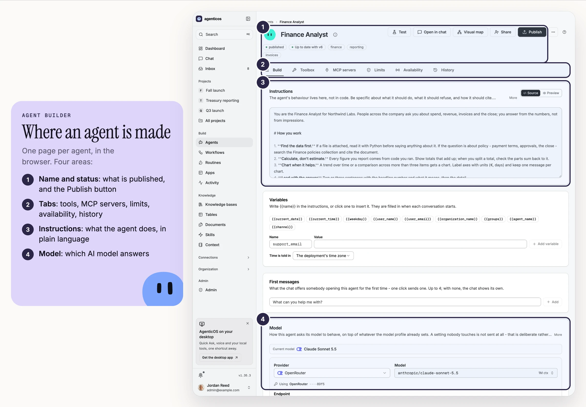

Agent oluşturucunun dört alanı vardır: **(1)** bir taslağın siz bir sürüm yayınlayana kadar gizli kaldığı ad ve yayınlama durumu; **(2)** araç kutusu, MCP sunucuları, sınırlar, kullanılabilirlik ve sürüm geçmişi sekmeleri; **(3)** yeni bir iş arkadaşı için bir brifing gibi sade bir dille yazılmış talimatlar; ve **(4)** yapılandırılmış sağlayıcılarınızdan agent başına seçilen model.

İş arkadaşları yayınlanan bir agentı, bu kanallar yapılandırıldığında **web sohbeti, Slack, Mattermost veya Telegram**'da, bir **web sitesi widget'ı** veya **barındırılan bir sayfa** üzerinde ya da **API** ve **WebSocket** aracılığıyla kullanabilir. [Bir agent oluşturun](https://vstorm-co.github.io/agenticos/first-agent/) · [Bir kanal bağlayın](https://vstorm-co.github.io/agenticos/channels/)

### 📂 Dosyalar ve kodla çalışın

Bir agentdan bir elektronik tabloyu analiz etmesini, bir grafik üretmesini, bir belge hazırlamasını veya bir depo üzerinde çalışmasını isteyin. Konteyner destekli bir korumalı alan (sandbox) yapılandırıldığında ve komut yürütme etkinleştirildiğinde **dosyaları okuyabilir ve düzenleyebilir, kabuk komutları çalıştırabilir ve Python veya JavaScript yürütebilir**. Birlikte gelen çalışma tezgahı LibreOffice dahil veri, grafik ve belge araçlarını içerir.

[Claude Code](https://code.claude.com/docs/en/overview) veya [Codex](https://developers.openai.com/codex/cli/) kullanıyorsanız, dosya ve komut iş akışı tanıdık gelecektir. AgenticOS bu tür bir çalışmayı şirket bilgisi, yeniden kullanılabilir agentlar ve kuruluş erişim kontrolleriyle paylaşımlı, kendi sunucunuzda barındırabileceğiniz bir katmana taşır. Bir agentın neler başarabileceği modeline, etkin araçlarına ve talimatlarına bağlıdır. [Korumalı alan yapılandırması](https://vstorm-co.github.io/agenticos/sandbox/)

### 🧠 Agentlara ekibinizin nasıl çalıştığını öğretin

- **Skilller (Skills)** yeniden kullanılabilir prosedürleri tutar: kodun nasıl inceleneceği, bir raporun nasıl yazılacağı veya bir pazarın nasıl araştırılacağı. Bunları bir kez koruyun ve agentlar arasında yeniden kullanın.
- **Bağlam (Context)** sözlük, politika veya marka sesi gibi kalıcı bilgileri tutar. İstemde (prompt) yer verin veya agentın isteğe bağlı olarak okumasını sağlayın.
- **Bilgi tabanları (RAG)** yüklenen belgeleri aranabilir hale getirir. Ayrıştırma seçeneklerini seçin, işleme durumunu ve parçaları inceleyin veya aşağıda listelenen bir kaynaktan senkronize edin.

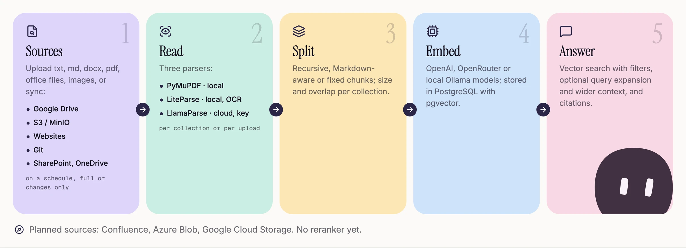

**AgenticOS'ta getirme-destekli üretimin (RAG) çalışma şekli:** belgeler Google Drive, S3/MinIO, Git, web siteleri, SharePoint veya OneDrive'dan yüklenir veya senkronize edilir. Bir ayrıştırıcı tarafından okunurlar: PyMuPDF ve LiteParse taramalar için OCR ile yerel olarak çalışırken, LlamaParse bir bulut servisidir. Belgeler daha sonra parçalara bölünür, bir OpenAI, OpenRouter veya yerel Ollama modeliyle gömülür (embedded) ve pgvector ile PostgreSQL'de saklanır. Soru zamanında agent vektörleri filtrelerle arar ve alıntılarla yanıt verir.

[Skilller](https://vstorm-co.github.io/agenticos/skills/) · [Bağlam](https://vstorm-co.github.io/agenticos/context/) · [Belge işleme](https://vstorm-co.github.io/agenticos/file-processing/) · [Senkronizasyon kaynakları](https://vstorm-co.github.io/agenticos/howto/configure-sync-sources/)

### 🎨 Sonuçları etkileşimli sayfalar olarak yayınlayın

Agentlar raporları, etkileşimli karşılaştırmaları ve küçük panoları **uygulamalar (apps)** olarak yayınlayabilir. Kimlerin açabileceğini seçin; güncellemeler aynı bağlantıyı korur ve önceki sürümler okunabilir kalır. Herkese açık bağlantılar süreli olabilir, parola gerektirebilir veya hangi sitelerin onları gömebileceğini kısıtlayabilir. [Bir uygulama paylaşın](https://vstorm-co.github.io/agenticos/artifacts/)

### 📊 Çalıştırmaları, maliyetleri ve onayları takip edin

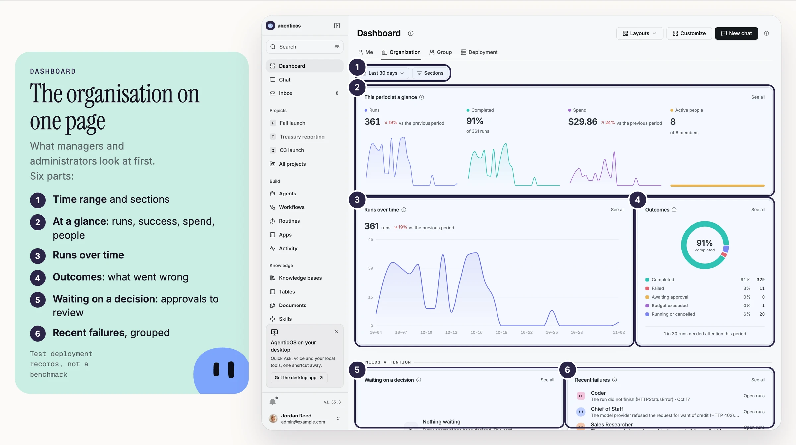

Pano, seçilen bir dönem için altı soruyu yanıtlar: kaç çalıştırma olduğu, kaçının tamamlandığı, maliyetlerinin ne olduğu ve kaç kişinin agentları kullandığı; çalıştırmaların zaman içinde nasıl değiştiği; nelerin başarısız olduğu, onay beklediği veya bir budget tarafından durdurulduğu; çalıştırmaların nereden geldiği; ve insanların gerçekte hangi agentları kullandığı.

**Panoyu** işinizin etrafında özelleştirin. **Activity** çalıştırmaları ve araç çağrılarını incelemenizi, agent sürümlerini karşılaştırmanızı ve kayıtları dışa aktarmanızı sağlar. Agent ve kuruluş başına **budgetler**, her model isteğinden önce kontrol edilir. **Onay politikaları** hassas araçların bir kişiyi beklemesini sağlar ve **rutinler** işi zamanlamalara veya yeni bir GitHub issue'su, bir Gmail mesajı ya da imzalı bir webhook gibi olaylara göre tekrarlar. [Çalıştırma geçmişi, budgetler ve onaylar](https://vstorm-co.github.io/agenticos/governance/) · [Rutinler](https://vstorm-co.github.io/agenticos/triggers/)

### 👥 Ekipleri roller ve gruplarla düzenleyin

**Roller insanların ne yapabileceğini tanımlar. Gruplar kiminle paylaştığınızı tanımlar.** Builder, Operator, Member ve Viewer gibi rolleri kullanın, ardından Operations, Engineering, Finance ve Research gibi departmanlar veya çalışma grupları oluşturun. Bir agentı, skillyi, koleksiyonu, bağlam dosyasını veya uygulamayı tek adımda bir grupla paylaşın ya da oluşturduğunuzda seçilen departmanlarla sınırlayın. [Departmanlar ve gruplar](https://vstorm-co.github.io/agenticos/departments/)

**OIDC tek oturum açma** (Entra ID, Okta, Keycloak ve diğerleri), **LDAP dizin oturum açma** veya **Kerberos tümleşik Windows oturum açma** aracılığıyla mevcut şirket hesaplarını getirin. **Dizin eşlemeleri** oturum açma sırasında dizin gruplarını bir role ve bir gruba bağlar. [Roller ve izinler](https://vstorm-co.github.io/agenticos/permissions/) · [Dizin oturum açma](https://vstorm-co.github.io/agenticos/directory/)

## 🧭 Yolunuzu bulun

Üzerine mi geliştiriyorsunuz? [Geliştiriciler ve işletmeciler için](#geliştiriciler-ve-işletmeciler-için) bölümüne gidin.

<details>
<summary><b>Kullanmaya karar verirken</b>: çözdüğü sorun, ne gerektiği, nasıl başlanacağı</summary>

<br>

| Ekiplerinizin bugün yanıtlayamadığı soru | AgenticOS bunu nasıl yanıtlar |
|---|---|
| Kim hangi veriyi kullanabilir? | Şirket oturum açma ile roller, departman grupları ve kaynak bazında paylaşım |
| Maliyeti nedir? | Her model isteğinden önce kontrol edilen, agent ve kuruluş başına aylık budgetler |
| Bu eylemi kim onayladı? | Hassas araçlar bir kişiyi bekler; her karar kaydedilir |
| Verilerimiz nereye gidiyor? | AgenticOS'u siz çalıştırırsınız ve ulaşabileceği her modeli, ayrıştırıcıyı ve aracı siz seçersiniz |

**Neler gerekir:** bir ana bilgisayar (4 vCPU, 8 GB RAM), dağıtımı işletecek bir kişi ve talimatları ve belgeleri güncel tutacak konu uzmanları. Maliyetler model kullanımı, altyapı, harici servisler ve insanların zamanıdır; yazılım Apache-2.0 lisanslıdır, ticari kullanım dahildir.

**Nasıl başlanır:** tekrarlanan bir görev ve yanıtları değerlendirecek kişiyi seçin, bunu seçtiğiniz model ve erişim kurallarıyla kurun ve önceden kararlaştırılan ölçütlere göre kontrol edin. [Bir yaygınlaştırma planlayın](https://vstorm-co.github.io/agenticos/rollout/) · [Yaklaşımları karşılaştırın](https://vstorm-co.github.io/agenticos/about/comparison/)

</details>

<details>
<summary><b>Güvenliği incelerken</b>: veri akışları, kimlik, kontroller, BT'nizde kalanlar</summary>

<br>

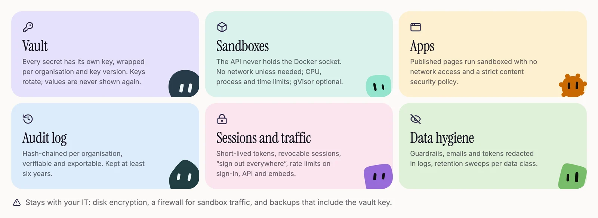

Güvenlik katmanlıdır. Kimlik bilgileri zarf şifreli bir vault içinde saklanır. Kod yalıtılmış korumalı alanlarda (sandbox) çalışır. Yayınlanan sayfalar korumalı alandadır. Her kuruluşun karma zincirli (hash-chained) bir denetim günlüğü vardır. Oturumlar kısa ömürlüdür ve iptal edilebilir; hız sınırları uygulanır. Günlükler sansürlenir ve veriler bir saklama takvimine göre temizlenir.

| Giden hedef | Ne zaman kullanılır | Yerel alternatif |
|---|---|---|
| Model sağlayıcısı | Her agent çalıştırmasında | Donanımınızda Ollama, vLLM veya LM Studio |
| Gömme (Embedding) sağlayıcısı | Belgeleri dizinlerken ve ararken | Yerel Ollama gömme modelleri |
| LlamaParse | Bu ayrıştırıcıya ayarlı koleksiyonlar | İkisi de yerel olan PyMuPDF veya LiteParse |
| Web araması | Web araması etkin agentlar | Yeteneği kapatın |
| MCP sunucuları, sohbet kanalları | Yalnızca bağladıklarınız | Kendi barındırdığınız sunucular, web sohbeti |
| Logfire izleme | Yalnızca bir belirteç yapılandırıldığında | Yerleşik çalıştırma geçmişi |

- **Vault (Vault):** sır başına bir veri anahtarı, kuruluş ve anahtar sürümü başına sarmalanmış; ana anahtarlar döner; değerler bir daha asla gösterilmez.
- **Korumalı alanlar (Sandboxes):** API hiçbir Docker soketi tutmaz; konteynerler gerekmedikçe ağ erişimi almaz, CPU, süreç ve süre sınırları vardır; gVisor isteğe bağlıdır.
- **Denetim günlüğü:** kuruluş başına karma zincirli, doğrulanabilir ve dışa aktarılabilir.
- **HIPAA profili:** [`deploy/profiles/hipaa/`](deploy/profiles/hipaa/) ve `agenticos cmd doctor --profile hipaa` çalışan bir dağıtımı §164.312 teknik güvenlik önlemlerine göre kontrol eder. Bu bir yapılandırma kontrolüdür, sertifika değildir. [Neyi iddia etmediği](https://vstorm-co.github.io/agenticos/security/#the-hipaa-profile-and-what-it-does-not-claim)
- **BT'nizde kalanlar:** beklemede disk şifreleme, çıkış güvenlik duvarı, kimlik sağlayıcınız üzerinden MFA (yerel MFA, SAML veya SCIM yoktur) ve vault anahtarını içeren yedeklemeler.

[Güvenlik ve veri akışları](https://vstorm-co.github.io/agenticos/security/) · [Veri koruma](https://vstorm-co.github.io/agenticos/data-protection/) · [Sırlar](https://vstorm-co.github.io/agenticos/secrets/) · [SECURITY.md](SECURITY.md)

</details>

<details>
<summary><b>İlk görev ararken</b>: her biri çalıştırabileceğiniz bir kontrol içeren 30 öğretici</summary>

<br>

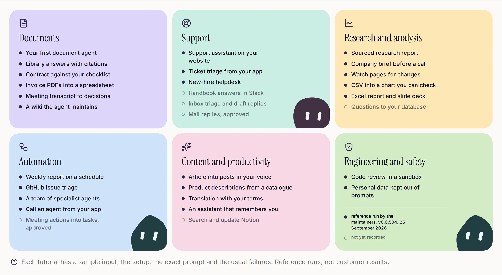

[Tüm öğreticiler](https://vstorm-co.github.io/agenticos/use-cases/). 24 tanesinde geliştiriciler tarafından yapılmış bir referans çalıştırması bulunur; bunlar başlangıç noktalarıdır, müşteri sonuçları değildir.

</details>

## 📦 Bugün neler sunuluyor

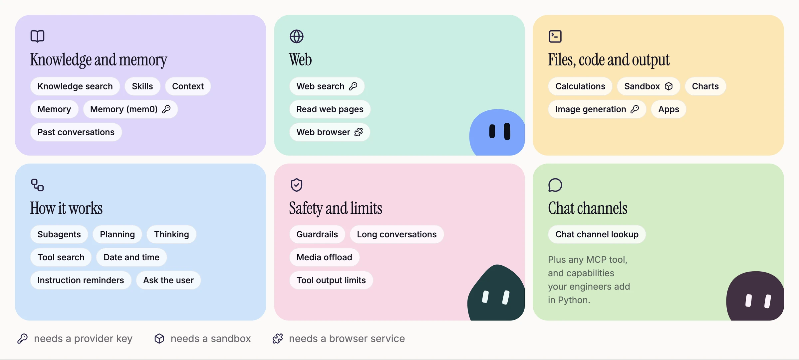

<details>
<summary>Metin olarak tüm 37 yerleşik yetenek</summary>

- **Bilgi ve bellek:** alıntılarla bilgi arama, skilller, bağlam, bellek, geçmiş sohbetler.
- **Web:** web araması (varsayılan olarak DuckDuckGo; anahtarla Tavily, Brave veya Exa), web sayfalarını okuma, agentın yönlendirdiği ve sizin devralabileceğiniz bir web tarayıcısı ve izninizle bilgisayar kullanımı.
- **Dosyalar, kod ve çıktı:** Python'da hesaplamalar, dosyalar ve bir kabuk içeren korumalı alan, işi Claude Code veya Codex'e devreden bir kodlama agentı, grafikler, çizimler (diyagramlar, hesap makineleri, 3B sahneler), görsel üretimi (OpenAI veya Google), konuşma (OpenAI, ElevenLabs veya Google), video klipler (Google, BytePlus, xAI veya Alibaba), komut izlemeleri, Tablolar, İş Akışları ve uygulamalar.
- **Nasıl çalışır:** alt agentlar, planlama, düşünme, araçlar çalışırken çalışma, araç arama, tarih ve saat, talimat hatırlatıcıları, kullanıcıya sorma, taslaklar ve takip önerileri.
- **Güvenlik ve sınırlar:** sırları ve kişisel verileri sansürleyen guardrails, uzun sohbetler, medya aktarımı, araç çıktı sınırları.
- **Sohbet kanalları:** Slack, Telegram ve Mattermost botları için sohbet kanalı arama.

Ayrıca bağlı bir MCP sunucusundan herhangi bir araç ve mühendislerinizin tipli Python ile eklediği yetenekler. [Yetenek referansı](https://vstorm-co.github.io/agenticos/reference/capabilities/)

</details>

<details>
<summary>Agentların nerede yanıt verdiği ve hangi modelleri kullandığı</summary>

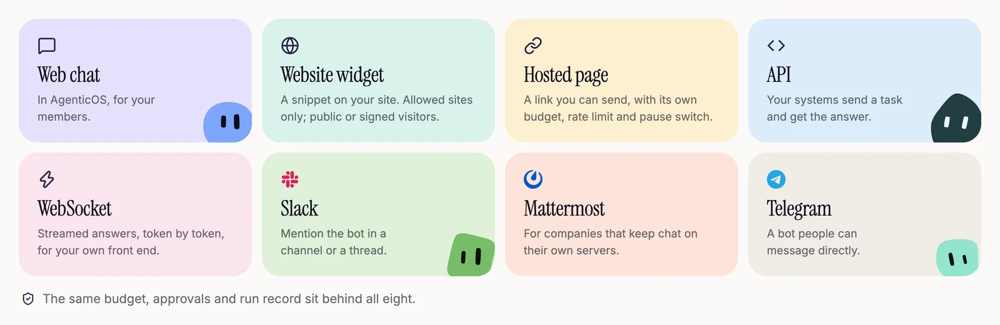
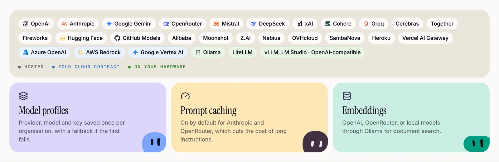

**Agentların yanıt verdiği yerler:** web sohbeti, bir web sitesi widget'ı, barındırılan bir sayfa, HTTP API, akışlı WebSocket, Slack, Teams, Discord, Mattermost ve Telegram.

**Model sağlayıcıları:**
- **Barındırılan (22):** OpenAI, Anthropic, Google Gemini, OpenRouter, Mistral, DeepSeek, xAI, Cohere, Groq, Cerebras, Together, Fireworks, Hugging Face, GitHub Models, Alibaba, Moonshot, Z.AI, Nebius, OVHcloud, SambaNova, Heroku ve Vercel AI Gateway.
- **Aboneliğiniz:** Tek bir oturum açmanın ardından Codex üzerinden ChatGPT.
- **Bulut sözleşmeniz üzerinden:** Azure OpenAI, AWS Bedrock ve Google Vertex AI.
- **Kendi barındırdığınız:** Ollama ve LiteLLM, ayrıca OpenAI uyumlu bir uç nokta üzerinden vLLM ve LM Studio.

</details>

## 🆚 Nasıl karşılaştırılır

| | Nerede çalışır | Kaynak | Modeller |
|---|---|---|---|
| **AgenticOS** | **Sizin altyapınızda** | **Apache-2.0** | **Yerel olanlar ve ChatGPT planınız dahil 28 sağlayıcı** |
| OpenAI dots | OpenAI bulutu | Tescilli | Yalnızca OpenAI |
| Grok Bot | xAI bulutu | Tescilli | Yalnızca Grok |
| Viktor | Viktor bulutu | Tescilli | OpenAI, Anthropic, Google, Kimi |
| n8n | Kendi sunucunuzda veya n8n Cloud | Sustainable Use License | Ollama dahil birçoğu |

Yapay zeka ekip arkadaşları her satıcının bulutuna geliyor. AgenticOS kendi çalıştırdığınız, herhangi bir modelle çalışan ve kaynağı açık olan platformdur. [Ayrıntılı tüm karşılaştırmalar](https://vstorm-co.github.io/agenticos/about/comparison/).

## 🎯 AgenticOS doğru seçim mi?

Bir ekibin tekrarlanan belge veya araç tabanlı işleri, talimatları güncel tutabilecek konu uzmanları ve kendi sunucusunda barındırılan bir dağıtımı işletmekten sorumlu birisi olduğunda onu seçin. Bugün nerede durduğunu bilin:

Kaynak sistem izinleri otomatik olarak yansıtılmaz; bir agent bağlı bilgisini kullanıcılarına ödünç verebilir. Kendi sunucunuzda barındırma da bir işletmeci gerektirir ve sonuçları model kalitesi, araç yapılandırması ve iş yükü belirler. Güncel [sınırları ve ödünleşimleri](https://vstorm-co.github.io/agenticos/about/comparison/#what-agenticos-does-not-do-yet) okuyun.

## 🔐 Dağıtımınıza, modellerinize ve erişiminize sahip olun

**Egemenlik; dağıtım, model sağlayıcıları, veri akışları ve agent erişimi üzerinde kontrol anlamına gelir.** AgenticOS inceleyebileceğiniz, değiştirebileceğiniz ve işletebileceğiniz Apache-2.0 lisanslı bir yazılımdır.

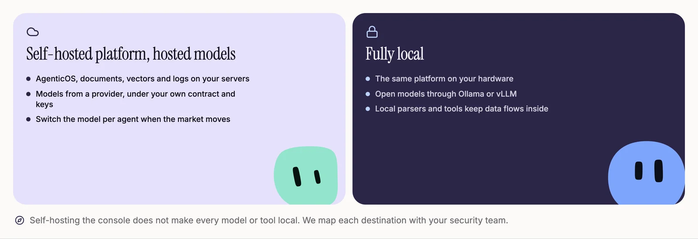

İki yaygın kurulum vardır. **Barındırılan modellerle kendi sunucunuzda:** AgenticOS, belgeler, vektörler ve günlükler sunucularınızda çalışır ve modeller kendi sözleşmeniz ve anahtarlarınız altında bir sağlayıcıdan gelir. **Tamamen yerel:** donanımınızda Ollama veya vLLM aracılığıyla açık modeller, ayrıca yerel ayrıştırıcılar ve araçlarla aynı katman. Konsolu kendi sunucunuzda barındırmak her modeli, ayrıştırıcıyı veya aracı yerel yapmaz; bu nedenle yapılandırdığınız her hedefi inceleyin. [Modelleri yapılandırın](https://vstorm-co.github.io/agenticos/models/) · [Güvenlik ve veri akışları](https://vstorm-co.github.io/agenticos/security/)

## Geliştiriciler ve işletmeciler için

AgenticOS; FastAPI, Pydantic AI, pgvector ile PostgreSQL, Redis ve Next.js ile oluşturulmuştur. Mühendisler tipli Python'da yetenekler, senkronizasyon bağlayıcıları ve MCP katalog girişleri ekler; ekipler konsolda kayıtlı yeteneklerden agentlar oluşturur.

| Katman | Orada ne çalışır |
|---|---|
| Konsol | Next.js |
| API | FastAPI |
| Agent çalışma zamanı | [Pydantic AI](https://ai.pydantic.dev) ve [pydantic-ai-harness](https://pydantic.dev/docs/ai/harness/), her yüzeyin arkasında tek bir çalıştırıcı |
| Arka plan işi | `python -m app.worker` tarafından sunulan, PostgreSQL'de bir iş kuyruğu |
| Veri | pgvector ile PostgreSQL |
| Kod yürütme | `sandboxd` tarafından başlatılan konteynerler |

Yayınlanmış bir agentı kimliği doğrulanmış bir üye olarak `POST /api/v1/agents/{id}/run` ile çağırın veya WebSocket üzerinden token akışı alın.

[Mimari](https://vstorm-co.github.io/agenticos/architecture/) · [API](https://vstorm-co.github.io/agenticos/api/) · [Bir yetenek ekleyin](https://vstorm-co.github.io/agenticos/howto/add-capability/) · [Yetenek referansı](https://vstorm-co.github.io/agenticos/reference/capabilities/) · [Katkıda Bulunma](https://vstorm-co.github.io/agenticos/help/)

[İşletim sistemi benzetmesi](https://vstorm-co.github.io/agenticos/about/) mimariyi açıklar. İsteğe bağlı [masaüstü uygulaması](https://vstorm-co.github.io/agenticos/desktop/) Quick Ask, onaylı yerel dosyalar ve bilgisayar erişimi ile yerel Claude Code veya Codex ekler. [Mobil kılavuz](https://vstorm-co.github.io/agenticos/mobile/) ana ekran konsolunu ve yerel geliştirme derlemelerini kapsar.

## ❓ Sıkça sorulan sorular

<details>
<summary><b>AgenticOS ticari kullanım için ücretsiz mi?</b></summary>

Evet. AgenticOS ticari kullanıma, değiştirmeye ve özel dağıtıma izin veren Apache-2.0 altında lisanslanmıştır. Üzerinde çalıştırdığınız altyapı ve seçtiğiniz model sağlayıcıları ile harici servisler için ödeme yaparsınız. AgenticOS adı ve logosu lisans kapsamında değildir.

</details>

<details>
<summary><b>AgenticOS yalnızca yerel modellerle çalışabilir mi?</b></summary>

Evet. Model sağlayıcısı olarak Ollama, LiteLLM veya vLLM ya da LM Studio gibi OpenAI uyumlu bir sunucu yapılandırın, Ollama aracılığıyla yerel gömme modelleri kullanın ve belgeleri PyMuPDF veya LiteParse ile ayrıştırın. Konsolu tek başına kendi sunucunuzda barındırmak her modeli, ayrıştırıcıyı veya aracı yerel yapmaz: yapılandırdığınız her hedefi kontrol edin. [Modeller](https://vstorm-co.github.io/agenticos/models/) · [Veri akışları](https://vstorm-co.github.io/agenticos/security/)

</details>

<details>
<summary><b>Hangi oturum açma yöntemlerini ve rolleri destekliyor?</b></summary>

Sihirli bağlantılarla (magic links) e-posta ve parola, Google, genel OIDC tek oturum açma (Entra ID, Okta, Keycloak, Auth0, Authentik, Google Workspace), LDAP ve Kerberos. Altı yerleşik rol (Owner, Admin, Builder, Operator, Member, Viewer) departman grupları ve kaynak bazında paylaşımla birleşir. Çok faktörlü kimlik doğrulama kimlik sağlayıcınızdan gelir; henüz yerel MFA, SAML veya SCIM yoktur. [İzinler](https://vstorm-co.github.io/agenticos/permissions/)

</details>

<details>
<summary><b>AgenticOS agentları nasıl kontrol altında tutuyor?</b></summary>

Agent başına ve kuruluş başına aylık budgetler her model isteğinden önce kontrol edilir. Hassas araçlar bir kişinin onayını bekler. İsteğe bağlı guardrails sırları ve kişisel verileri sansürler ve her çalıştırma agent sürümü, araçları, tokenları ve maliyetiyle kaydedilir. [Yönetişim](https://vstorm-co.github.io/agenticos/governance/)

</details>

<details>
<summary><b>ChatGPT Enterprise, Copilot Studio veya n8n'den farkı nedir?</b></summary>

AgenticOS 28 model sağlayıcısından herhangi biriyle kendi altyapınızda çalışır ve kendi koltuk veya kredi ücreti yoktur. Bireysel çalışanlar için asistan koltukları yerine kuruluş için sohbete, web sitelerine ve API'lere yayınlanan agentlar oluşturur. n8n ile karşılaştırıldığında bir iş akışı tuvalinden ziyade agentdan başlar ve birçok ekip ikisini birden kullanır. Kılavuzlar ayrıca kendi sunucunuzda barındırabileceğiniz oluşturucu [Dify](https://vstorm-co.github.io/agenticos/about/dify/) ve Claude Code gibi kodlama agentlarını da kapsar. [Karşılaştırmalar](https://vstorm-co.github.io/agenticos/about/comparison/)

</details>

<details>
<summary><b>Çalıştırmak için ne gerekiyor?</b></summary>

Tek bir ana bilgisayarda Docker Compose. 4 vCPU ve 8 GB RAM'e sahip bir makine bunu çalıştırır ve iki API işçisi on kişilik bir ekibe yeter. Birisinin güncellemeleri, yedeklemeleri (vault anahtarı dahil), erişimi ve bağladığınız harici servisleri sahiplenmesi gerekir. [Dağıtım](https://vstorm-co.github.io/agenticos/deploy/) · [Yaygınlaştırma](https://vstorm-co.github.io/agenticos/rollout/)

</details>

## 💬 Topluluk

- **Sorular ve fikirler:** [GitHub Discussions](https://github.com/vstorm-co/agenticos/discussions).
- **Hatalar ve istekler:** [issues](https://github.com/vstorm-co/agenticos/issues); planlanan işler [kilometre taşlarında (milestones)](https://github.com/vstorm-co/agenticos/milestones) gruplanmıştır.
- **Katkıda bulunma:** [katkı kılavuzunu](CONTRIBUTING.md) ve [davranış kurallarını](CODE_OF_CONDUCT.md) okuyun. Güvenlik açıklarını [SECURITY.md](SECURITY.md) dosyasında açıklandığı şekilde gizlice bildirin.
- **Sürümler:** [sürüm notlarını](https://vstorm-co.github.io/agenticos/release-notes/) okuyun veya bildirim almak için GitHub'da **Watch → Custom → Releases** seçeneğini seçin.

## 📄 Lisans

[Apache License 2.0](LICENSE). Atıflar ve birlikte gelen bileşenler için [NOTICE](NOTICE) ve [üçüncü taraf bildirimlerine](THIRD_PARTY_NOTICES.md) bakın.

## 🤝 Agentları üretime almada yardıma mı ihtiyacınız var?

Vstorm, AgenticOS'u müşteri altyapısına kurar, dokümantasyonu yazar, süreçleri tanımlar ve özel yetenekler geliştirir. Bakım ve destek sözleşme bazında kararlaştırılır.

[**Vstorm**](https://vstorm.co) tarafından özenle geliştirildi · [GitHub'da Vstorm](https://github.com/vstorm-co)

## 👥 Katkıda Bulunanlar

AgenticOS'u oluşturmaya yardımcı olan herkes:

<a href="https://github.com/vstorm-co/agenticos/graphs/contributors"></a>

## Yıldız Geçmişi

<a href="https://www.star-history.com/?repos=vstorm-co%2Fagenticos&type=date&legend=bottom-right">
 <picture>
   <source media="(prefers-color-scheme: dark)" srcset="https://api.star-history.com/chart?repos=vstorm-co/agenticos&type=date&theme=dark&legend=bottom-right" />
   <source media="(prefers-color-scheme: light)" srcset="https://api.star-history.com/chart?repos=vstorm-co/agenticos&type=date&legend=bottom-right" />
   
 </picture>
</a>
