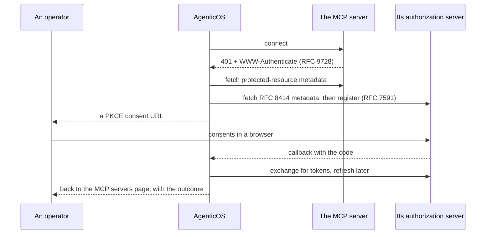

# MCP — the tools nobody here has to write

[Model Context Protocol](https://modelcontextprotocol.io) servers are this
platform's answer to "you cannot write a connector for everything".

An organization points at a server, its tools appear in the Builder, and no code
changes on our side.

Everything in the [capability catalog](reference/capabilities.md) is code we wrote
and hold to 100% coverage. Everything here is a URL somebody pasted.

!!! info "The two are not alternatives"

    A **capability** is the right shape for something the platform must guarantee
    — a budget guard, a sandbox, retrieval that cites its sources.

    **MCP** is the right shape for the dozens of SaaS products a company happens to
    use, where the guarantee that matters is only "the tools are the ones the
    vendor published".

## A connection

One row pointing at a remote server. The transport — streamable HTTP or
server-sent events — is inferred from the URL, so an SSE-only server like
Atlassian works alongside a streamable-HTTP one with nothing to configure.

| | |
|---|---|
| `name` | Also the tool prefix. See [Name collisions](#name-collisions) |
| `url` | SSRF-validated before we ever request it |
| `auth_token` | Sealed in the [vault](secrets.md), never returned by any endpoint |
| `allowed_tools` | An allowlist, or null for "everything the server offers". A binding narrows within it — see below |
| `is_enabled` | Off without losing the credential |
| `include_instructions` | Add the server's own `initialize` instructions to the agent's. Off by default - they are the server operator's text, read as the agent's own - and switched on in the connection's Edit dialog |
| `last_status` | What the last probe found, and when |

!!! warning "An address this deployment must not reach is refused, and the refusal says so"

    A URL that resolves to a loopback, private, link-local or shared-CGNAT
    address, one that does not resolve at all, one carrying credentials in its
    userinfo, one on a scheme other than `http`/`https`, or one that is simply
    malformed, comes back as a **400** naming `url` as the field at fault — on
    create, on edit, and on starting an OAuth flow, personal and organization-wide
    alike.

    What it names beyond that is the **host**, never the URL: a URL carries a key
    in its query string, and the sentence explaining the refusal is one written in
    this repository rather than whatever the URL parser had to say about the text
    you sent.

    It used to be a 500 with no details and a traceback in the log, which reads as
    the platform breaking rather than as an address to correct
    ([#861](https://github.com/vstorm-co/agenticos/issues/861)) — self-hosting and
    pasting a `localhost` URL is the ordinary case, not the exotic one.

### Personal or organization-wide

Two kinds, and the difference is the point. The connect dialog asks it as one
choice in plain words: **One shared account** - set up once, usually by an
admin with a service account, and used by every agent - or **My own account**,
used by you and by agents set up to act as each person. A catalog server people
sign in to (Notion, Linear, Gmail) recommends each person's own account; one that
takes a key recommends the shared one.

**Personal** (MCP servers → You) is scoped to one member and reached by their own
assistant, and by an agent bound to each person's own account when they are the
one talking to it.

Its credential is sealed to the *member*, not to an organization — a personal
connection has none, and its owner may belong to several, so binding it to
whichever was active when they added it would make the token unreadable the moment
they switched.

**Organization** is scoped to the organization, gated on `mcp:manage`, and is the
only kind a published agent's spec may name *by id*.

An organization server can belong to a department. Under **Who can use it** the
connect dialog offers **Everyone**, the default, or **Some people**,
found by typing; the server is then private and shared with each of them at
`use`. They and whoever connected it see it and bind it; owners and admins see
every server. Its **Who can use it** button changes that later. An agent already
bound to it keeps working for everyone who may run the agent: the choice decides
who may pick the server, not who is answered through it, so the Builder marks it
under [where an agent's knowledge comes from](departments.md#where-an-agents-knowledge-comes-from).

A published agent that reached different tools depending on whose session built
it could not be reviewed or reasoned about, which is the whole reason for the
restriction. A personal connection still reaches an agent, one way: a binding to
[each person's own account](#whose-account-a-binding-speaks-through) names the
service, and whoever is talking to the agent supplies their own connection to it.

```
GET  /api/v1/me/mcp-connections     personal
GET  /api/v1/mcp-connections        organization, requires mcp:manage; each server
                                    narrowed to groups only for them
POST /api/v1/mcp-connections/{id}/test   probe it, list its tools, store the status
GET  /api/v1/mcp-connections/{id}/sharing   who it is narrowed to, and the same
                                            grant routes as an agent's
```

### Two names, and they answer different questions

A connection carries a **name** and a **tool prefix**, and only the second is
constrained. The prefix is lowercase letters, digits and hyphens, unique among
the organization's servers, because that is what a tool name can carry and what
the model reads before it calls one. The name is free text, optional, and is
what a person sees.

The distinction earns its place the moment an organization connects one service
twice. Two Notion accounts have to be `notion` and `notion-2`, and neither says
which workspace either one reaches; `Marketing workspace` and `Engineering
handbook` do.

!!! info "The prefix never disappears"

    Wherever a name is shown, the prefix is shown beside it. A run's tool calls
    are recorded under the prefix, so a name that replaced it would leave "why
    did this call `notion-2_search`" unanswerable from the page that names the
    account. Clear the name and the connection reads as its prefix again, which
    is what it did before you set one.

A spec names organization connections in `mcp_servers`, one entry per binding.
Deleting a connection an agent still names loses that server for the agent, not
the run.

### Which tools, and who decides

Two allowlists, and neither overrides the other.

**On the connection**, `allowed_tools` is one administrator's decision for
everybody bound to it — the tools this organization is willing to reach on that
server at all. **On the binding**, it narrows within that, per agent. So one
server can serve a read-only agent and an editing one without connecting it
twice.

They intersect at run time. An agent cannot reach a tool the connection
excludes, including one excluded after the agent was published — the binding
loses that tool rather than the agent losing the server. Null on either side
means no narrowing from there, so a binding that names nothing gets whatever the
connection allows, which is what every binding did before this existed.

The Builder lists a server's tools from its **last successful probe**, recorded
on the connection. Probing dials out to a third party and is gated on
`connections:manage`; an agent author holds `agents:edit` and needs the list to
choose from, so the list is read rather than fetched.

A connection nothing has probed yet has no catalogue to offer, and the picker
says so and points at the servers page, which is where a connection is checked.
A binding that already names tools shows those, so what it is bound to stays
visible and can still be narrowed.

### Which calls wait for a person

Every binding has an `approval` policy for its server's tools. The default,
`none`, lets every call through, as a capability's tools run until somebody gates
them. `writes` holds every tool the server does not mark read-only (MCP's
`readOnlyHint`) until a person approves the call: the card shows the exact
arguments, and the approved ones are what runs. `all` holds every call. The
read-only hint is the server's own claim, so `writes` is only as strict as the
server is honest — choose `all` for a server you do not control.

The Architect's own template asks `writes` of the platform's server, so it drafts nothing without
the person it acts for. Any agent's binding to that server is held to at least
`writes`, `none` included: its tools act with the authority of whoever is asking,
an Admin's too.

In the Builder, a server's settings say this
per group: its **Reads** and the tools that **Change things** each run freely
or ask first.

### Whose account a binding speaks through

A binding is one of two kinds, and the Builder asks which in the server's
settings, which also list your own accounts on the service.

**The organization's account** (`account: organization`) names one of the
organization's connections and answers for everybody, on every surface. It is
the default and the answer an agent is reviewed against.

**Each person's own account** (`account: personal`) names the catalog service
instead — `catalog_key: notion` — and no connection at all. Whoever talks to
the agent connects their own Notion, in MCP servers → You, and the agent speaks
to Notion as them: in the dashboard, in a direct message and in a channel
alike. The audit trail at Notion then says who did what, which a shared service
account never can.

The account is the author of *this message*, never the thread's. Ania asks in
`#ops` and gets an answer from her Notion; Bartek asks the same question in the
same thread and gets his, or is told to connect one. A thread is not a boundary
anybody's credentials should cross — were the first person to connect to answer
for everybody after them, linking a Notion in a channel would hand it to the
channel.

!!! info "Where nobody is talking, the tools are absent — and the agent says so"

    An API key, the embedded widget, a schedule, a trigger and a channel sender
    who has not linked their chat account have no account to speak through. The
    run proceeds without that server, every other binding intact, and one line
    is added to its instructions saying which service is missing and why — so
    when somebody asks for Notion the agent answers with the link that connects
    it (`/mcp-servers?connect=notion`), or with "send `/link` to this bot
    first" where the chat account is the missing piece.

    The dashboard chat asks when the agent needs the service, not before. A
    service the person has not connected or must authorize again is offered to
    the model as `connect_account` instead: when a question
    needs Notion the run pauses on a card with the connect button, and once the
    account is connected the same run carries on with the Notion tools. Skipped,
    it carries on without them. The chat's controls also list the agent's
    personal services with their status, so a new member sees what to connect
    before asking. See [the console page](console.md#chat).

The tool prefix of a personal binding is the catalog key, whatever each person
called their connection, so the agent presents `notion_search` to everyone.
`allowed_tools` on the binding is the administrator's ceiling; the person's own
connection may narrow further, and the two intersect.

!!! warning "Three things publish refuses"

    A personal binding to a key the catalog does not hold — nothing could ever
    match a member's connection to it. Two personal bindings to one service —
    the same tools twice under one name. And a personal binding whose key is
    also the name of an organization connection bound to the same agent, which
    would put two servers under one prefix; Pydantic AI refuses the duplicate
    tool names and the turn aborts.

!!! note "A collision that reaches a run is narrowed, not lost"

    Publish is a point in time and a connection's name is editable afterwards, so
    an agent published before this check or one whose connection was renamed to a
    colliding name can still reach a run with two servers under one prefix. That
    run keeps the first of them that answers its probe, drops the rest, and
    tells the model which server is unavailable this turn - and, when both carry
    one name, which binding it is speaking through - rather than losing it to a
    log line nobody reads. Renaming one of the two connections is the author's
    fix.

An agent may bind a service both ways - the organization's handbook Notion
*and* each person's own - as long as the organization's connection is not named
after the catalog key, which is the prefix each person's own account takes.

### Several accounts of one server

One agent can read the company mailbox and `info@` at once. A person holding
several of their own accounts on a service is reached through **every one of
them**: the one they mark as their main account in MCP servers → You (else the
one they connected first) keeps the plain prefix, `outlook_send`, and each
other account adds its label, `outlook_info_send` (two labels that read alike
as a tool name, `Sales US` and `Sales-US`, are told apart by the account's short
id on the second). Which accounts those are is
the person's choice, made by what they connect - the binding does not narrow
it.

The organization's accounts bind side by side the same way: each of its
connections to a server is its own binding under its own name, with its own
tools. In the Builder, a server's settings list its bound accounts with **Add
another account**. Wherever a run reaches one service through more than one
account, one line of its instructions names each account beside its prefix
and tells the model to ask when it is unclear which one the person means.

A second account on a service has to be named: its label is what tells the two
apart in every picker and approval, so the form asks for one before it connects,
and the API refuses an unnamed second account on `label`.

The approval then says which account is acting. A call through a labelled
connection, or through one of several accounts on one service, carries that
account's name: the chat, Activity and the dashboard show it beside the action,
a Slack or Telegram message asks "to *send in Gmail* as *Work*", and the
approval email lists it after the tool. A single unlabelled account has nothing
to tell apart, so nothing is added.

## Authentication

Three modes, which is the only thing that really varies between servers.

=== "None"

    Public documentation servers, mostly — Cloudflare's docs server needs no
    credential at all.

=== "Token"

    A bearer token pasted once and sealed.

    Each catalog entry carries its own hint about where to get one, because
    generic instructions are the main reason token setup fails.

    `PATCH` with `auth_token: ""` clears it.

=== "OAuth 2.1"

    Most business servers — Notion, Linear, Atlassian, Asana — return `401` with a
    `WWW-Authenticate` header pointing at RFC 9728 protected-resource metadata,
    and the flow runs from there.

    1. **Discover** — probe the server, resolve its authorization server, fetch
       RFC 8414 metadata.
    2. **Register** — RFC 7591 dynamic client registration. A server that
       publishes no registration endpoint — HubSpot's is one — refuses here, and
       the only way past is a client you registered at the provider by hand:
       the connect dialog takes its client ID and secret under *Your own
       client*, and shows the redirect URL the provider has to hold exactly.
    3. **Consent** — a PKCE authorization URL with `state` and an RFC 8707
       resource indicator; the browser goes there.
    4. **Exchange** — the callback swaps the code for tokens, then redirects the
       browser back to the MCP servers page, which says whether it worked. That is
       the only place the outcome can be told: the person is looking at a page
       they did not navigate to themselves.
    5. **Refresh** — when the access token expires.



### Every URL in that flow is checked, not just the one you typed

!!! danger "Discovery means the remote server chooses most of the addresses we call"

    Connecting a single hostile server used to be enough: a name could answer a
    public address to the check and a private one to the request that followed
    ([#860](https://github.com/vstorm-co/agenticos/issues/860)).

    The address that passed the check is now the address connected to.

The request goes to the resolved IP with the original host in the `Host` header and
in TLS SNI, so the certificate is still verified against the name and nothing
resolves it a second time.

That second half matters here more than anywhere else in the product. The address
an operator types is only the first hop — the authorization server, the token
endpoint, the registration endpoint and every redirect after them are named by the
remote server's own discovery documents. Nobody in your organization had to be the
attacker.

Redirects are followed one hop at a time, bounded at five, each with its own check.
A `302` to a new host is re-resolved, not trusted.

Where a name answers with several addresses, every one of them is checked and kept,
and an address that refuses the connection is followed by the next — what an
ordinary client gets from the resolver, without asking DNS a second time. A name
answering with one public address and one private one is refused **whole** rather
than narrowed to its public half.

Two edges remain, both narrow and both deliberate:

- The **consent URL** is checked and then handed to somebody's browser, which
  resolves it itself. There is no pinning to do.
- The **connection's own URL** is checked at save and resolved again when an agent
  runs — operator-typed, so rebinding it means being the operator.

Nothing a *model* chooses reaches this check at all, and nothing should: a URL an
agent picked wants Pydantic AI's `safe_download`.

!!! info "Behind an egress proxy, the proxy does the connecting"

    `HTTP_PROXY` and `HTTPS_PROXY` are honoured, because a deployment that mandates
    an egress proxy would otherwise lose MCP OAuth entirely — and that proxy is an
    egress control in its own right.

    On that path the pinned address is what the proxy is *asked* to reach
    (`CONNECT 93.184.216.34:443`, or an absolute-form request line for plain HTTP)
    rather than what this process connects to, so the guarantee ends at the proxy.
    TLS is still end to end, so the certificate is still verified against the
    original name.

    A policy proxy that refuses a bare address will refuse these requests; the log
    line written when a proxy is configured is there so that failure is readable.

### When a step fails

A step that fails says **which step gave up and what class of thing raised**, never
what the upstream client wrote.

`httpx2` puts the failing request in its message, and the two requests here are a
client registration and a token grant — so quoting it would carry a token endpoint,
reached with credentials, into the browser. A pydantic error over an unreadable
token response echoes the payload it rejected, which is the tokens. Both stay in
the server log, which is where an operator already looks.

**A discovery document naming a URL that cannot be requested at all is the same
kind of answer**: a **400** saying which endpoint was unusable, and that it is
malformed.

That is a distinct refusal from "this server pointed the flow at a blocked
address". One says the server aimed us somewhere this deployment will not go, the
other that it wrote an address nothing can dial, and reporting either as the other
would be a confident claim about whose fault a failure was.

An unusable `WWW-Authenticate` hint ends that discovery *candidate* rather than the
flow, because the well-known URIs after it are derived from the URL an operator
typed and may well answer.

This was a 500 with an empty body until
[#889](https://github.com/vstorm-co/agenticos/issues/889): `httpx2.InvalidURL` does
not derive from `httpx2.HTTPError`, so none of the flow's catches saw it — and no
check here could have, because the URL is refused while the request is being built,
above both the SSRF check and the pinned client. What the parser could not read
(`Invalid port: 'client_secret=…'`) is the remote server's own text and stays in
the log with everything else.

!!! warning "An organization's OAuth connection is still someone's grant"

    `POST /mcp-connections/oauth/start` produces a connection the organization
    owns, which is what a shared service account is for. But the grant remains the
    *consenting person's* at the provider: revoking their access there stops the
    organization's server working until it is authorized again.

    Consent with an account the organization controls.

### Three rules about tokens

**A token never follows a moved URL.** Editing a connection's URL drops its OAuth
payload, pending flow and mirrored scopes — personal and organization connections
alike — so the connection reads "needs re-authorization" rather than sending a
token issued for one host to a different one.

On an organization row this is also a boundary between administrators: one
`mcp:manage` holder repointing a connection another authorized must not have the
platform deliver that token to the new host.

**A disabled connection hands out no tokens anywhere.** The agent tool path skips
it, and the trigger portals do too — a caller who kept a trigger's `connection_id`
cannot keep enumerating repositories or registering hooks with a credential an
administrator switched off.

**Deleting a connection releases what was registered through it.** Any
[event trigger](triggers.md) whose provider webhook was auto-registered with this
account's token has that hook deregistered — best-effort, while the token still
exists — and falls back to manual delivery. The trigger's URL and secret still
stand, so re-pointing a provider at it by hand keeps working.

The GitHub portal's connect flow is also upgrade-aware in the other direction: an
organization that connected the GitHub catalog entry as a plain bearer connection
before the OAuth flow existed has that same row re-authorized in place — found by
its catalog key, whatever it was named — rather than refused or duplicated, and the
bearer token keeps working until the new consent lands.

## What happens on a turn

Each server is probed with a short `tools/list` round-trip — 3 seconds — before the
turn starts, and the probes run concurrently. A server that answered its probe in
the last two minutes, with the same credential, is not probed again: a
conversation's next turn attaches it straight away. If it has gone down in the
meantime, that turn goes on without its tools and the next one probes it again.

A tool's name reaches the model as the prefix and the server's own name joined -
and providers refuse a name over 64 characters, or one with anything but letters,
digits, `_` and `-`, by refusing the whole request. Such a name is fitted: the
refused characters replaced, the end cut and eight hex digits of a hash added, so
two long names stay two tools. The server is still called by its real name.

!!! warning "An unreachable server is skipped with a warning, not raised"

    Pydantic AI enters every toolset when a run starts, so a dead server would
    otherwise abort the whole turn: one expired token on one connection would take
    down every agent that names it, including the ones that never needed it.

    The model then answers **without** those tools — right for a chat turn, wrong
    if you assumed a tool was always there.

That is a deliberate trade. The `/test` endpoint and `last_status` are how you find
out, and the [audit trail](governance.md#audit) records what actually ran.

### Connecting one from the Builder

An agent's **MCP servers** tab lists the whole catalog, not only what has
credentials. A server with none is not a checkbox — there is no connection id
for the spec to hold — so the card opens the connect dialog **in place**.

A token or credential-free server is connected without leaving the page, and the
new connection is ticked for the agent as soon as it exists. Connecting checks the
server, and its tools come up straight away from that check, so picking a server,
connecting it and choosing what the agent may call is one path. A check that
fails says why in the toast, and the connection is kept to fix.

!!! info "OAuth opens a tab"

    The consent screen is the provider's, so there is nowhere to stay — but
    there is a way not to lose the agent you were editing. Finish in the tab
    that opens and come back; the server appears in the list once it is
    authorised.

### One server, connected several times

An organization may connect the same server more than once — a Notion with
read-only access to one workspace, another scoped to a single database, a third
holding an admin credential. That is a supported shape, not a workaround: names
are unique per organization rather than per catalog entry, and the name is the
tool prefix, so the model sees `notion_readonly_search` and
`notion_admin_search` as different tools.

Bind whichever the agent should have, or several side by side - see
[several accounts of one server](#several-accounts-of-one-server). The Builder
keeps one card per server and lists its accounts in the server's settings,
each under its label and its name.

!!! tip "The name is the whole distinction"

    `notion` and `notion-2` tell nobody anything. Name a connection after what
    it may reach — `notion-handbook`, `notion-admin` — because that string is
    what the model reads when it decides which tool to call.

### Name collisions

!!! note "Tools are prefixed with the connection name"

    `github-work` becomes `github_work_*`, because two servers exposing the same
    tool name make Pydantic AI raise on duplicates, which aborts the turn.

    An allowlist filters *before* prefixing, so it compares against the unprefixed
    names picked in the UI.

Two connections whose names reduce to the same prefix are deduplicated — first one
wins, with a warning naming the loser. Deployment-managed servers are ordered first,
so they win over a user connection that happens to pick the same name.

### Health, users and calls

A server's card on the MCP servers page says when one of its accounts did not
answer its last check, and its accounts list says which and what it said;
whoever manages MCP servers can check it again there.
An OAuth account whose sign-in could not be renewed is shown as needing
authorization rather than as unreachable, with **Authorize** to sign in again.

Every fifteen minutes the deployment checks each of the organization's servers,
and each run checks the servers its agent is bound to before the turn. When a
server stops answering, the administrators and the owners of agents bound to it
get one **MCP server not answering** notification for that outage, however many
checks or runs find it down, and **MCP server answering again** when it is back.
The next outage alerts again. Both are in-app and email, and each person can
turn either off under **Settings → Notifications**. A member's own connection
sends neither, and a sign-in that needs renewing is not counted as an outage.

On the MCP page, each of the organization's accounts names the agents bound to
it, and **What agents asked it** lists the latest calls agents made to its
tools: which tool, which agent, how it went and the run it was part of. What was
asked and answered is not shown - it stays in the conversation. Each call records the connection that served it, so a
member's own connection with the same name is not listed, and calls from before
that was recorded are not listed at all. API: `used_by` on `GET /api/v1/mcp-connections`, and
`GET /api/v1/mcp-connections/{id}/calls`.

**Add to an agent** binds an account into a chosen agent's draft, and connecting
one with a key, or finishing its sign-in, offers the same.

## The catalog

A picker that starts empty and asks for a URL is a picker nobody uses, so the common
servers ship with the metadata needed to connect them: the URL, how it
authenticates, what to tell whoever is pasting a credential.

This is a hand-maintained list, **not** a mirror of the public registry. Each entry
is a small promise — that somebody looked at the server, that the auth flow works,
that the description is honest — and a mirrored registry cannot make that promise.

!!! info "What mirroring would actually add"

    The official registry was read in full in August 2026: 20,100 records, 7,127
    of them the current version of an active server, 5,824 carrying a hosted
    HTTPS endpoint, across 5,141 distinct hosts. So the "thousands of servers" a
    registry advertises is real.

    Cross-referenced against this catalog, **four** of those hosts belonged to a
    company most readers would recognise and were missing here — CircleCI, New
    Relic, Statsig and Lusha, all four now listed. The rest of the uncovered
    hosts are single-project servers, proxies on `workers.dev`, SEO tools and
    games: alphabetically the first few are a land-price lookup, a contractor
    bidding tool and a Hungarian window-quote service.

    Both facts are worth holding at once. The catalog is not short of entries
    because nobody looked; it is the length it is because a hand-checked list of
    things a company actually uses converges at about a hundred.

### The registry is in the same list, and in the database

So the mirror is shipped too, and **/mcp is one list of all of them** — the
curated catalog first, then the mirrored registry, paged: 4,700+ servers, the
count the gallery shows. Not a curated grid
with a search that reaches further: one list, one pager, one count.

That needed a table. `mcp_registry_servers` is deployment-wide and has no
`organization_id`, which is the whole reason it is a table rather than five
thousand rows per tenant — the skill gallery settled the neighbouring question
the other way, and the difference is that a catalog is not tenant data. It is
filled by `agenticos cmd mcp-registry-sync`, from the bundled snapshot or, with
`--fetch`, from the live registry.

Held in the database because a file cannot be paged. Thousands of entries in memory
could answer "servers matching 'linear'" and could not answer "the fourth page of
all of them" without loading the lot and slicing it. The ranking moved into SQL
with it, for the same reason: ranking a page is ranking whatever that page
happened to contain. Three bands — the server *called* Linear, then names merely
containing it, then descriptions that mention it — shorter name first inside a
band, so `Stripe` beats `Sweden Payments (Stripe)`.

It is one list with a fact on some rows rather than two lists. A registry row
carries a **Registry** badge where a curated one carries its auth kind, because
the difference is worth knowing before somebody pastes a credential: nobody here
reviewed it, the description is the publisher's, and there is no token hint —
the registry has no such field to mirror.

Three things follow from the size, and each is why it is a search rather than a
listing:

- **Paged by the server, not filtered by the browser.** Fifty to a page, and the
  query, the category and the page are all requests. A page boundary lands inside
  the join — 99 curated rows against a page size of 50 — so the arithmetic lives
  in `mcp_listing.page` with a test on the boundary, because an off-by-one there
  skips a server or shows it twice on a list where nobody would notice which.
- **A category reaches the mirror too.** The registry has no categories, so each
  listing is given one at sync from its own name and description, counting the
  words each category is known by; a listing that names none of them is filed
  under *other* rather than guessed into a heading. The **Sign-in** filter asks
  for what a server wants - OAuth, a token, nothing - which for a mirrored
  listing is what the catalog check found.
- **No baked logo.** The console inlines a favicon per curated host so a badge
  renders offline; at 1.9 KB each, doing that for the mirror would be 10.5 MB of
  base64 in a module the browser loads. Registry rows fall through to the
  runtime favicon service, which is what it was written for.
- **A snapshot, not a proxy.** An install must not stop working because somebody
  else's registry is down, and a name that resolved yesterday resolving to
  nothing today is worse than one that was never there.

    `make platform-bootstrap` loads it, so a new deployment has it without
    anybody reading this. `agenticos cmd mcp-registry-sync` refreshes it, and
    `--fetch` reads the live registry rather than the bundled snapshot. On a
    deployment that predates the table the list is the curated hundred until the
    sync runs — which is what it was before any of this, so nothing regresses
    while somebody gets round to it.

A server in neither list is still reachable: **Custom server** takes any URL and
needs no catalog entry at all.

!!! info "Four of these are gateways, and they are a different promise"

    Composio, Pipedream, Activepieces and Smithery are not one product's API -
    each is an endpoint onto hundreds or thousands of others, with the
    credentials held on their side. So the catalog entry vouches for the
    *gateway*, and what the agent can actually reach is decided in that
    gateway's own console, by whoever configured it there.

    Worth knowing before comparing catalog sizes with a vendor advertising
    thousands of integrations: that number is almost always one endpoint of this
    kind, not thousands of servers somebody reviewed. Both shapes are useful, and
    they are not the same claim.

### How the catalog is kept

The promise decays. The official Postgres reference server was archived out of
`modelcontextprotocol/servers` in 2025 and this catalog went on linking to it, so
the one thing the entry offered a reader was a 404. In October 2026 Linear had
moved off `/sse`, Pipedrive to a new host, and twelve curated entries had a hosted
server nobody had written down. So every listed server is now called, the way a
first connection calls it, by one command:

```bash
uv run agenticos cmd mcp-catalog-check --report catalog-check.md
```

It sends each server the MCP handshake without a credential and records what
happened: it answered and listed its tools (**open**, with how many only read),
it refused and publishes OAuth metadata (**sign in**), it refused without that
metadata (**token**), or it did not answer as an MCP server at all
(**unreachable**, **broken**, or **refused** for an address inside a network).
Two registry listings at one address are one server, and the shorter name is
kept. Nothing signs in anywhere: whether the tools work once connected is the
connection's own test.

What it found shows on the cards. A server that answered says **Checked** with
the date, and its tool counts where it listed them. A curated server that did not
answer says so in red and stays listed, because somebody chose it; a mirrored
listing that did not answer, or that repeats another, is no longer offered. A
curated entry that promises OAuth and did not publish the metadata for it is not
marked checked, because its **Connect** is the button that would fail.

The check runs before each release with `--snapshot`, which writes
`app/core/catalog/mcp_checks.json`; `make platform-bootstrap` seeds it, so a new
deployment starts from what the release was checked against. Run the command on
a deployment to check again; its own results are kept over the bundled ones.
`--source catalog` checks the curated list alone in about ten seconds; the whole
registry takes a few minutes. The report lists every curated entry with what it
declares, what was found and why one did not pass.

`(self-hosted)` below means the entry describes the server but you supply the URL:
either because it runs on your own infrastructure, or because the vendor issues a
per-account endpoint.

### Development

| Server | Auth | URL |
|---|---|---|
| GitHub | token | `https://api.githubcopilot.com/mcp/` |
| Cloudflare docs | none | `https://docs.mcp.cloudflare.com/mcp` |
| GitLab | token | self-hosted |
| Postman | token | `https://mcp.postman.com/mcp` |
| Vercel | oauth | `https://mcp.vercel.com/` |
| Netlify | oauth | `https://mcp.netlify.com/mcp` |
| Railway | token | `https://mcp.railway.app/mcp` |
| Replit | oauth | `https://mcp.replit.com/server/mcp` |
| Hugging Face | token | `https://huggingface.co/mcp` |
| Buildkite | oauth | `https://mcp.buildkite.com/mcp` |
| Semgrep | token | `https://mcp.semgrep.ai/mcp` |
| Clerk | oauth | `https://mcp.clerk.com/mcp` |
| WorkOS | oauth | `https://mcp.workos.com/mcp` |
| Render | token | `https://mcp.render.com/mcp` |
| CircleCI | oauth | `https://mcp.circleci.com/v1/mcp` |

### Project management

| Server | Auth | URL |
|---|---|---|
| Linear | oauth | `https://mcp.linear.app/mcp` |
| Jira & Confluence | oauth | `https://mcp.atlassian.com/v1/sse` |
| Asana | oauth | `https://mcp.asana.com/sse` |
| ClickUp | oauth | `https://mcp.clickup.com/mcp` |
| Trello | oauth | `https://mcp.trello.com/v1` |
| Todoist | oauth | `https://ai.todoist.net/mcp` |
| monday.com | oauth | `https://mcp.monday.com/mcp` |

### Data and analytics

| Server | Auth | URL |
|---|---|---|
| PostgreSQL | token | self-hosted |
| Supabase | token | `https://mcp.supabase.com/mcp` |
| Elasticsearch | token | self-hosted |
| Airtable | token | `https://mcp.airtable.com/mcp` |
| Snowflake | token | self-hosted |
| Databricks | token | self-hosted |
| Google BigQuery | oauth | self-hosted |
| PostHog | token | `https://mcp.posthog.com/mcp` |
| Mixpanel | token | `https://mcp.mixpanel.com/mcp` |
| Google Analytics 4 | token | self-hosted |
| Neon | oauth | `https://mcp.neon.tech/mcp` |
| Amplitude | token | `https://mcp.amplitude.com/mcp` |
| Firecrawl | token | `https://mcp.firecrawl.dev/mcp` |
| Exa | token | `https://mcp.exa.ai/mcp` |
| Tavily | token | `https://mcp.tavily.com/mcp` |
| Bright Data | token | `https://mcp.brightdata.com/mcp` |
| Qdrant | none | `https://mcp.qdrant.tech/mcp` |
| Statsig | token | `https://api.statsig.com/v1/mcp` |

### Communication, support, knowledge

| Server | Auth | URL |
|---|---|---|
| Slack | oauth | `https://mcp.slack.com/mcp` |
| Microsoft Work IQ | oauth | `https://workiq.svc.cloud.microsoft/mcp` |
| Outlook Mail (Work IQ) | oauth | `https://agent365.svc.cloud.microsoft/agents/servers/mcp_MailTools` |
| Microsoft Teams (Work IQ) | oauth | `https://agent365.svc.cloud.microsoft/agents/servers/mcp_TeamsServer` |
| Zoom | oauth | self-hosted |
| Intercom | oauth | `https://mcp.intercom.com/sse` |
| Notion | oauth | `https://mcp.notion.com/mcp` |
| GitBook | token | `https://mcp.gitbook.com/mcp` |
| Sanity | token | `https://mcp.sanity.io/mcp` |
| DeepWiki | none | `https://mcp.deepwiki.com/mcp` |
| Supermemory | token | `https://mcp.supermemory.ai/mcp` |
| Contentful | token | `https://mcp.contentful.com/mcp` |
| Storyblok | token | `https://mcp.storyblok.com/mcp` |
| Vapi | token | `https://mcp.vapi.ai/mcp` |

### Finance, sales, commerce

| Server | Auth | URL |
|---|---|---|
| Stripe | token | `https://mcp.stripe.com` |
| PayPal | oauth | `https://mcp.paypal.com/sse` |
| Xero | oauth | `https://mcp.xero.com/mcp` |
| HubSpot | oauth | `https://mcp.hubspot.com/` |
| Shopify | oauth | self-hosted |
| Attio | oauth | `https://mcp.attio.com/mcp` |
| Pipedrive | oauth | `https://mcp.pipedrive.ai/mcp` |
| Lusha | oauth | `https://mcp.lusha.com` |

### Observability

| Server | Auth | URL |
|---|---|---|
| Sentry | oauth | `https://mcp.sentry.dev/mcp` |
| Grafana | token | `https://mcp.grafana.com/mcp` |
| PagerDuty | oauth | `https://mcp.pagerduty.com/mcp` |
| Datadog | token | `https://mcp.datadoghq.com/api/unstable/mcp-server/mcp` |
| Pydantic Logfire | token | `https://logfire-us.pydantic.dev/mcp` |
| LangSmith | token | `https://api.smith.langchain.com/mcp` |
| Honeycomb | token | `https://mcp.honeycomb.io/mcp` |
| New Relic | token | `https://mcp.newrelic.com/mcp` |

### Marketing and design

| Server | Auth | URL |
|---|---|---|
| Mailchimp | oauth | `https://ai-inc.mailchimp.com/claude/mcp/v2` |
| Resend | token | `https://mcp.resend.com/mcp` |
| Webflow | oauth | `https://mcp.webflow.com/mcp` |
| Wix | oauth | `https://mcp.wix.com/mcp` |
| WordPress.com | oauth | `https://public-api.wordpress.com/wpcom/v2/mcp/v1` |
| Semrush | oauth | `https://mcp.semrush.com/v1/mcp` |
| Meta Ads | oauth | `https://mcp.facebook.com/ads` |
| Google Ads | token | self-hosted |
| Similarweb | token | `https://mcp.similarweb.com/mcp` |
| Figma | oauth | `https://mcp.figma.com/mcp` |
| Miro | oauth | `https://mcp.miro.com/mcp` |
| Lucid | oauth | `https://mcp.lucid.app/mcp` |
| Excalidraw | none | `https://mcp.excalidraw.com/mcp` |
| Canva | oauth | `https://mcp.canva.com/mcp` |
| Klaviyo | oauth | `https://mcp.klaviyo.com/mcp` |

### Automation, storage, productivity, media

| Server | Auth | URL |
|---|---|---|
| Zapier | oauth | `https://mcp.zapier.com/api/mcp/mcp` |
| Make | token | self-hosted |
| n8n | token | self-hosted |
| Box | oauth | `https://mcp.box.com/mcp` |
| Dropbox | oauth | `https://mcp.dropbox.com/mcp` |
| Calendly | oauth | `https://mcp.calendly.com/` |
| Typeform | oauth | `https://api.typeform.com/mcp` |
| SurveyMonkey | oauth | `https://mcp.surveymonkey.com/mcp` |
| DeepL | oauth | `https://mcp.deepl.com/v1/mcp` |
| ElevenLabs | oauth | `https://api.elevenlabs.io/v1/mcp` |
| Fireflies | token | `https://mcp.fireflies.ai/mcp` |
| Egnyte | oauth | `https://mcp-server.egnyte.com/mcp` |
| Apify | token | `https://mcp.apify.com` |
| Tally | token | `https://api.tally.so/mcp` |
| Pipedream | oauth | `https://mcp.pipedream.net/v2` |
| Composio | token | self-hosted |
| Activepieces | token | `https://mcp.activepieces.com/mcp` |
| Cal.com | token | `https://mcp.cal.com/mcp` |
| Outlook Calendar (Work IQ) | oauth | `https://agent365.svc.cloud.microsoft/agents/servers/mcp_CalendarTools` |
| Word (Work IQ) | oauth | `https://agent365.svc.cloud.microsoft/agents/servers/mcp_WordServer` |
| SharePoint (Work IQ) | oauth | `https://agent365.svc.cloud.microsoft/agents/servers/mcp_SharePointRemoteServer` |
| OneDrive (Work IQ) | oauth | `https://agent365.svc.cloud.microsoft/agents/servers/mcp_OneDriveRemoteServer` |

### Anything else

**Smithery** — token — `https://mcp.smithery.ai/mcp`. A registry gateway: the
servers reached through it are whatever that account has installed on Smithery,
so what the agent can do is decided there rather than here.

**Custom server** — any MCP server reachable by URL. Its tools are introspected on
connect, and nothing about it needs to be in the catalog first. The catalog saves
somebody a URL lookup; it is not a gate.

Typing a custom server's address asks it whether people can sign in: the same
discovery an OAuth flow runs (RFC 9728, then RFC 8414), registering nothing,
through `POST /api/v1/me/mcp-connections/probe`. When it can, **OAuth** is chosen
for you and Connect opens its sign-in; when it does not register apps itself, the
dialog asks for a client ID and secret made at the provider; when it publishes no
OAuth metadata, a token or no credential is left as the choice.

To add an entry to the list, see
[Add a server to the MCP catalog](howto/add-mcp-server.md).

<a id="outlook-setup"></a>

### Microsoft 365 and Outlook

Microsoft publishes its own MCP servers for Microsoft 365, and the catalog lists
them: **Work IQ** - one endpoint onto mail, meetings, chats and files - and the
per-application Mail, Calendar, Teams, SharePoint, OneDrive and Word servers.
Each needs a Microsoft 365 Copilot licence and an app registered in Microsoft
Entra: add the server's Work IQ permission (for mail, `WorkIQ-MailServer`) and
this console's redirect URL, which the connect dialog shows, then enter the app's
client ID when you connect.

Entra registers no client on the spot, so the client
ID is not optional. Microsoft marks the per-application servers as kept for
compatibility and points new work at Work IQ.

Outlook is also available through third-party MCP services. The bundled registry
includes MintMCP entries for email and calendar:

| Registry entry | Server URL |
|---|---|
| `com.mintmcp/outlook-email` | `https://outlook-email.mintmcp.com/mcp` |
| `com.mintmcp/outlook-calendar` | `https://outlook-calendar.mintmcp.com/mcp` |

Search the MCP catalog for the entry or add its URL as a custom server. Follow
the [provider's setup instructions](https://www.mintmcp.com/servers), configure
the account and authorization, then test the connection and select the tools
the agent may use. Availability, permissions and any service charges depend on
that provider. A registry listing is not an AgenticOS end-to-end test of the
service. Review the approval modes below before enabling write tools.

## AgenticOS as an MCP server

Everything above is the platform calling other servers. It is also one: **`/mcp`**
on the API's host speaks MCP over streamable HTTP, so Claude Code, Claude Desktop
or any MCP client can operate the organization — list and create agents, run them,
read runs and their cost, fill and search knowledge bases, invite members.

The server is built on [FastMCP](https://gofastmcp.com): it serves the protocol
and the OAuth 2.1 endpoints, and AgenticOS supplies the tools and every decision
behind a sign-in.

The client signs in through the browser: it registers itself, opens the
console's consent page, where you choose the organization and what it may do,
and receives a token that lasts an hour and renews itself. No key is pasted
anywhere.

Registration needs no credential, so it is limited per address like sign-in,
and a client nobody completed sign-in with is forgotten after a day.

In the console, **Settings → MCP clients** shows this server's URL and the exact command or configuration for Claude Code, Codex, Claude Desktop, Cursor and VS Code, for both ways of signing in.

```bash
claude mcp add --transport http agenticos https://<your-deployment>/mcp
```

Or connect with an [organization API key](api.md#organization-api-keys), for a
client that cannot open a browser:

```bash
claude mcp add --transport http agenticos https://<your-deployment>/mcp \
  --header "Authorization: Bearer $AGENTICOS_KEY"
```

The connection acts as the member who issued the key, within the key's
permissions. Each tool is a call to the [public API](api.md) made with that key,
so it is refused, rate limited and audited exactly as the same request over HTTP
would be; a refusal comes back as a tool error naming the missing permission.

| Tool | Needs |
|---|---|
| `whoami` | — |
| `list_agents`, `get_agent`, `list_capabilities` | `agents:view` |
| `create_agent_draft` | `agents:edit` |
| `discard_agent_draft` | `agents:edit`, on a draft you own that was never published |
| `run_agent` | `agents:run` |
| `list_runs`, `get_run`, `get_spend` | `runs:view` |
| `list_knowledge_bases`, `search_knowledge` | `collections:view` |
| `list_embedding_models` | — |
| `create_knowledge_base`, `add_document` | `collections:edit` |
| `list_skills` | `skills:view` |
| `list_members` | `members:view` |
| `invite_member` | `members:manage` and `roles:manage` |

Deliberately absent: publishing an agent, touching a credential, and deleting
anything but an agent draft its caller created and never published - the undo
for a draft made by mistake. A draft created here is published by a person in
the console.
Connected applications are listed under **Settings → MCP clients**, where
disconnecting one ends its access and every token it holds. Calls that change
something wait for approval, as [below](#which-calls-wait-for-a-person) explains.

### Giving it to an agent { #giving-it-to-an-agent }

The same server is also an MCP binding any agent can have, so an agent can answer
"what failed yesterday" or "which agents use this knowledge base" from the
platform's own records. In the Builder it is the first card under **MCP servers**,
named after this deployment; switching it on binds it as
`mcp_servers: [{account: platform, approval: writes}]`.

- **It acts as whoever the agent runs for.** A run mints a short-lived credential
  holding that person's permissions, so a Viewer's agent can read what the Viewer
  can read and create nothing. Nothing new is granted, and where nobody is behind
  the run - a public widget, a schedule acting for nobody - the binding is absent.
- **Changes wait for approval.** `writes`, the default, holds every tool that
  changes something (`create_agent_draft`, `run_agent`, `invite_member` and the
  rest) for the person to approve; `all` holds reading too. `none` is not offered:
  these tools act with a person's authority.
- **The tools can be narrowed** in the card's settings, which list every tool and
  mark the ones that change something.

The **Claude Code like** template binds it this way, so a fresh agent from it can
look the platform up out of the box.

## What MCP does not get you

- **A coverage guarantee.** Catalog entries are metadata. The tools are the
  vendor's, and they can change under you between one turn and the next.
- **Approval that knows what a tool does.** A binding's `writes` policy trusts
  the server to mark its read-only tools; a tool marked read-only that changes
  something runs unasked. Use `all` for a server you do not control, and
  narrow `allowed_tools`. See [which calls wait](#which-calls-wait-for-a-person).
- **Cost attribution.** What a server does on its own side is not in this
  platform's [budget](governance.md#budgets). Only the model tokens are.

## Recap

- An MCP server is **a URL somebody pasted**, and its tools appear without a
  deploy.
- **Personal** connections reach one member's assistant; only **organization**
  connections may be named by a published spec.
- Every address in an OAuth flow is **checked and pinned**, including the ones the
  remote server chose.
- A token never follows a moved URL, a disabled connection hands out none, and
  deleting one deregisters what it registered.
- An unreachable server is **skipped**, not raised — the turn answers without those
  tools.
