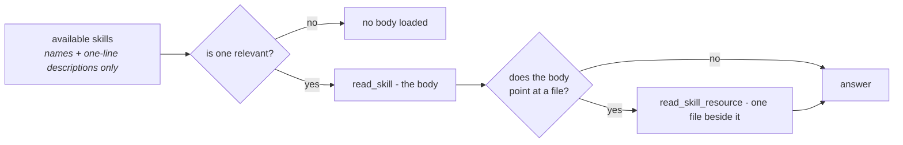

# Skills

A skill is know-how written once and attached to many agents: how refunds are
handled, what the house style is, which checks a report must pass before it goes
out.

The thing it replaces is an instructions field that grows.

Twenty procedures in one prompt means every run pays for all twenty, and the
twenty-first pushes the conversation out of the window. Skills invert that:



Twenty skills cost roughly twenty *descriptions* instead of twenty *procedures*.

!!! note "Discovery is cheap, not free"

    Every skill an agent is bound to sits in the catalog the model reads on every
    turn, as its name and its one-line description — so binding a skill does cost
    tokens whether or not the model ever opens it.

    It is a line per skill against a body per skill, which is why the numbers work.
    It is not grounds for binding an unbounded catalogue.

The other half of the point is **who writes them**. A skill is a row in the
database, editable in the UI, so a support lead can fix the refund policy on a
Tuesday afternoon. No deploy, no pull request, no engineer.

!!! info "Skill, context file or knowledge collection?"

    A **skill** is a procedure the model loads when it decides the task has
    arrived. A [context file](context.md) is standing knowledge — short, always
    relevant, injected or read on demand. A
    [knowledge collection](file-processing.md) is a corpus too large to read,
    reached by search.

In the Agent Builder, open **Skills → New skill** to write a skill without leaving the capability panel. Saving creates the library entry, attaches it to the current draft and enables the Skills capability. Publishing remains a separate step. The action requires permission to edit both the agent and skills.

## The shape

```markdown
---
name: refund-policy
description: When a refund is given without asking, when it needs approval, and how to say no.
category: support
---

# Refunds

Most refund questions are decided by the order date and one exception. Check
those before escalating anything.

The **Skills** page shows the opening of each body on its card — front matter
dropped, a few lines — with a sheet stacked behind it for each file the skill
carries. `GET /api/v1/skills` returns that opening as `excerpt`; the body itself
loads when a skill is opened.

## Decide without asking
...
```

!!! tip "`description` is the field that decides whether the skill is ever loaded"

    It is the only part the model sees for free. Write it as **when to reach for
    this**, not as a title.

A skill may carry **resources** — further files beside it, loaded on demand.
`refund-policy` ships an `exceptions.md`, and the body says when to consult it.

That is the same progressive disclosure one level down: detail only some
conversations need does not have to sit in the body every relevant conversation
loads.

`category` is one of twenty suggestions (`support`, `engineering`, `finance`,
`legal`, `security`, `marketing`, …) and drives the filter on the skills listing.
It has no effect on what the agent sees — the model chooses by `description`, never
by category.

Long text resources are paged to keep reference manuals out of every model request: the default page is 8,000 characters, with a maximum of 20,000. Pass `args` with `offset` and `limit` to `read_skill_resource`; its reply gives the next offset. Read only the relevant ranges and reuse material already loaded.

## How an agent reads one

Through the [`skills` capability](reference/capabilities.md#skills). Each skill
an agent is given becomes a **capability of its own**, listed for the model by
name and description and opened on demand:

| How | What it does |
|---|---|
| Available skills | Names and one-line descriptions of everything bound to this agent |
| `read_skill` | The full body of one skill, pulled into the conversation |
| `read_skill_resource` | One file beside a skill |

`read_skill` presents the framework's native deferred loader in skill-specific
terms. Approval policies retain the stable key `load_capability`, so existing
published specs and pending approvals keep working. The old `load_skill` approval
key still migrates to it. There is no separate listing tool. `read_skill_resource`
reads supporting files only after the skill has been opened.

A spec binds skills by id in `skill_ids`, so an agent sees the ones it was given
and nothing else.

**From the skill itself.** Each card on the Skills page has **Add to an agent**:
pick the agent and the skill is added to its draft, with the Skills capability
switched on, ready to publish in the Builder. The card also says which agents use
the skill - or that none does yet. Context files and knowledge bases offer the same.

**A skill's name is the id a model loads it by**, so it takes the form models
write ids in: lowercase letters and digits joined by single hyphens, such as
`refund-policy`. A name with spaces or capitals is refused when the skill is
created. A name the model has to reproduce exactly, like `Refund policy`, was
loaded as `refund-policy` instead, and two wrong guesses end the turn
([#1911](https://github.com/vstorm-co/agenticos/issues/1911)).

**A skill cannot be named after a capability.** Each one is filed under its own
name in the same namespace as `knowledge`, `planning` and the rest, so a skill
called `planning` on an agent that also has the planning capability is a duplicate
the framework refuses before the first token. Creating one is refused, and so is
publishing an agent bound to a skill named that way.

Enabling the capability with no skills bound is not useful — give the agent skills,
or leave the capability off.

## In a workspace, a skill is also files

An agent that has both skills and a
[workspace](reference/capabilities.md#files-shell) gets each skill written into it
as well:

```
/workspace/skills/<name>/SKILL.md      the body, with its name and description
/workspace/skills/<name>/<resource>    each resource, beside it
```

This is what makes a skill's script useful. A skill whose resource is
`reconcile.py` was previously handed to the model as text it could quote and not
run, while the same agent had `execute` one tool call away. On disk, it runs.

!!! note "There is no `run_skill_script`"

    The sandbox's own `execute` already carries the workspace's permission rules
    and the operator's ceilings. A second way to run things would be a second set
    of rules to get wrong.

## An agent can propose a change; a person makes it

Those files are writable, and what the agent writes is **not** applied.

A skill is instructions every agent bound to it follows on every run. An agent that
could edit one directly could rewrite what another agent does, inside a
conversation nobody is reviewing, and the next reader would have no way to tell a
considered improvement from a hallucinated one.

So a write becomes a **proposal**, and it appears above the list on the Skills page
for anyone who may edit that skill. A proposal for a new skill appears for anyone
holding `skills:edit`. Nobody else can list or open it:

- **Apply** rewrites the skill and bumps its version, which reaches every bound
  agent on its next run.
- **Discard** keeps the record. An agent proposing the same edit repeatedly is
  telling somebody something about the skill, and a deleted row makes that
  invisible.

!!! warning "A decision on a proposal is final"

    Applying twice would bump a version against a body already stored, and
    discarding something applied would tell a reader it never landed.

The proposal carries the **whole body** rather than a diff, so a reviewer weeks
later is comparing two complete versions instead of applying a patch somewhere it
was never meant to go.

Two things are refused rather than guessed at: a directory the agent created with
no `SKILL.md` in it, and one whose frontmatter it mangled. And a *deleted* resource
is deliberately not a change, because a file the model never touched and one it
meant to delete leave the same absence.

Three turns of one conversation refining the same skill leave **one** proposal, not
three. A reviewer asked the same question three times has been given more work
rather than more information.

Workspace proposals use the same metadata limits as stored skills: a name of
1–64 characters and a description up to 500 characters. A change outside these
limits is skipped with a warning; its original workspace files stay intact.
Proposal writes run in a savepoint, so a refused proposal cannot roll back the
turn or prevent its status and spend from being recorded.

## Getting skills into an organization

**Write one.** Skills → New, in the UI. This is the normal path.

**The bundled library arrives automatically.** New organizations receive the
whole library, including platform-building procedures, durable work, research,
visual design, Apps and presentation skills. The Skills page marks these copies
`built-in`. They are ordinary organization-owned skills, not remote registry links.

The `built-in` badge also identifies installed copies from the shipped skill gallery, including skills attached by the starter agents. It describes their shipped origin, not whether the organization installed them automatically. Gallery installation remains opt-in and existing customizations remain editable.

Existing installations receive new built-ins when their shipped agents refresh
on opening the console; creating an agent from the default starter also performs
this synchronization. No manual seed command is required. Untouched copies are
updated with their resources; edited or untracked differing copies stay unchanged.
Installation receipts preserve deliberate deletion, so automatic refresh does not
restore retired skills. The explicit seed command can restore them when requested.
The skills listing itself remains read-only.

AgenticOS, Architect and new default agents bind the platform skills by default:
`platform-agents`, `platform-workflows`, `platform-automation`, `durable-work`, `document-production`, `research-and-evidence`.

The optional `platform-tables`, `platform-context`, `platform-skills` and gallery API guides remain available in the library, but are no longer default bindings. Ordinary MCP reads and edits do not require loading a skill. Current tool descriptions own operation names, parameters and permissions; skills add design judgment and verification methods. Detailed visual recipes are resources loaded only when needed.

They also bind the App, visual and presentation procedures, including storyline
and review. Skills load progressively: names and descriptions first, bodies and
resources only when relevant. Skills teach methods; they do not grant tools,
accounts or a local compiler. Architect also ships with Apps and Charts tools.

Default-agent refresh preserves customized fields independently, including prompt,
tools and skill bindings. Changing only a model does not prevent the remaining
untouched defaults from updating. New defaults apply to newly created agents;
existing user-authored agents are not rewritten.

Platform MCP can discover/create/edit Context files, bind their `context_ids` to
an agent draft, and read/edit skills or add text resources. Context supports
`inject` for standing prompt material and `link` for on-demand reading. Editing a
bound file takes effect on the next run; changing a draft binding still requires
publication. Resource writes keep normal permissions and approval gates.

The document-production skill includes LaTeX starter sources and a build/render
procedure. HTML Apps and browser decks remain distinct from compiled PDF or
editable PPTX files. The agent must verify the actual compiler, generator and
renderer available, and report a missing build or visual check honestly.

The seed command does the same from a terminal, for scripted setups:

```bash
uv run agenticos cmd seed-skills                    # every organization
uv run agenticos cmd seed-skills --org <org-id>     # one
uv run agenticos cmd seed-skills --dry-run          # say what would happen, do nothing
uv run agenticos cmd seed-skills --replace          # also overwrite copies edited here
```

It installs what is missing and **refreshes what nobody has edited**. Every copy
records which bundled version it was written from, so when a release improves a
bundled skill, an organization's untouched copy is replaced with the new one —
files and all, with its version bumped and a `skill.refreshed` audit entry.

A copy edited here is left exactly as it is, so an edited refund policy survives a
reseed; `--replace` is the one way to take the bundled version over such edits,
and the audit entry says it did. A copy made before versions were recorded and
different from the bundled one is reported and left alone too, since nothing can
tell whether it was edited.

The command prints what it did with each skill, and `--dry-run` prints the same
plan without writing.

`e2e/seed.setup.ts` also creates one through the UI, which is what the E2E suite
asserts against.

### The gallery — seventy more, and none of them arrive uninvited

**Skills → Skill gallery** opens a catalog of ready-made skills grouped by
industry: healthcare, finance and insurance, e-commerce and print on demand,
software teams, public sector and utilities, legal and professional services,
manufacturing and logistics. Ten each.

Pick an industry, then install one skill or the whole shelf. From that moment it
is an ordinary skill the organization owns and edits, exactly like a bundled one.

!!! info "The gallery is opt-in, and that is the whole difference"

    The bundled library lives in `app/core/catalog/skills/` and are copied into
    **every** organization automatically. The gallery lives in
    `app/core/catalog/skill_gallery/` and is copied into **none** — it is read by
    the same parser, from a second directory, and never seeded.

    Seventy industry skills in the first directory would have been seventy rows
    nobody asked for, in every tenant, on the next deploy.

Installing a shelf where you already have one of its skills installs the rest and
leaves that one alone: an existing name is skipped rather than overwritten, and
the request answers with what it installed, what it skipped, and any key this
deployment does not ship.

Adding to the gallery is the same as adding a bundled skill — a folder with a
`SKILL.md`, under the industry it belongs to — with one extra rule: **its name
must not collide with a bundled skill or another gallery skill,** and it is the
folder's own name. Installing matches on name, so a collision would silently skip
forever. A test reads all seventy and fails on either.

### Seeding copies

A seeded skill is an ordinary skill owned by the organization, editable from the
moment the organization exists. It is a **copy**, not a link.

That is deliberate. The point of a skill is that a support lead can fix the refund
policy without a deploy, and a live link back to the repository's copy would take
exactly that away — the organization would be reading a file only an engineer can
change.

Editing and deleting are both final in the ordinary way. Disabling is still there
for a skill an organization wants to keep but not run — every agent respects it —
but it is no longer the only way to be rid of a built-in.

### Why the library is bundled and not fetched

Adding a skill to the shipped library or the gallery is a deploy.

The alternative — importing from a git URL — costs outbound network from the
backend, a parser pointed at somebody else's repository, and a promise about content
nobody here has read. Each folder in `app/core/catalog/skills/` and
`app/core/catalog/skill_gallery/` is the same small promise the
[MCP catalog](mcp.md#the-catalog) makes: somebody looked at it.

## Skills or knowledge?

They answer different questions, and the difference matters when an agent gets the
wrong one.

|  | Skills | [Knowledge](file-processing.md) |
|---|---|---|
| Contains | Procedure — how we do this | Documents — what we know |
| Written by | A person, deliberately | Ingested in bulk |
| Retrieved by | The model choosing a name | Semantic search over chunks |
| Cites | Nothing; it *is* the instruction | The passage and its source |
| Scale | Tens | Thousands of documents |

!!! example "Which is which"

    "Refunds over £500 need a manager" is a **skill**. The signed contract that
    says so is **knowledge**.

    An agent handling refunds usually wants both, and the two capabilities compose
    — `skills` for the procedure, `knowledge` for the evidence.

## Access

Skills are organization-scoped resources, governed like agents and collections:
visibility plus per-row grants on top of the role. See
[Permissions](permissions.md#layer-3-visibility-and-grants).

!!! important "Binding a skill lends it"

    Every run of the agent reads the body and the files, whoever ran it — so
    publishing requires the **publisher** to hold `skills:view` on that row.

That check goes through `resolve_access`, so a grant counts: a member who was
shared one skill can bind it without being promoted.

A skill they cannot reach is refused as `Skill not found: <id>`, worded identically
to an id that does not exist. Skills are bound by UUID from the API and from a
hand-edited draft, not only picked from the Builder's list, and a refusal that read
differently would map the organization's private skills one guess at a time.

The same check runs on an
[inline specialist's](concepts.md#delegate-vs-inline-specialist) `skill_ids`,
reported with the specialist's name.

At run time nothing is re-checked. The frozen spec's skills are resolved inside the
run's organization and handed to the agent — the rule collections and delegates
already follow, that
[the reference is checked once, at publish](permissions.md#delegation-is-not-a-privilege-boundary).

The alternative is worse in two specific ways:

- Every context with no subject — an API key, an embedded widget, a channel message
  — is refused by `resolve_access` by design, so a per-runner check would strip
  every skill from exactly those surfaces.
- Where there *is* a subject, one published version would give a member — whose
  role reaches shared skills only — thinner instructions than it gives a builder,
  with the difference visible nowhere.

Skills have no separate enabled switch: an agent can use the skills bound to it.
Remove a binding and publish the agent to stop using that skill. A skill deleted
after publish is skipped with a warning rather than failing the run.

## Recap

- A skill is **procedure**, written by a person, and loaded only when the model
  decides its *description* is relevant — discovery costs a line per skill, and
  the body costs nothing until it is opened.
- In a workspace a skill is also **files**, which is what makes its scripts runnable.
- An agent **proposes** an edit; a person applies it, once, and the decision is
  final.
- Binding a skill **lends** it, so the publisher must be able to see it — and
  nothing is re-checked at run time.
- The **gallery** is seventy ready-made skills by industry, installed on request —
  unlike the bundled library, which arrive on their own.
