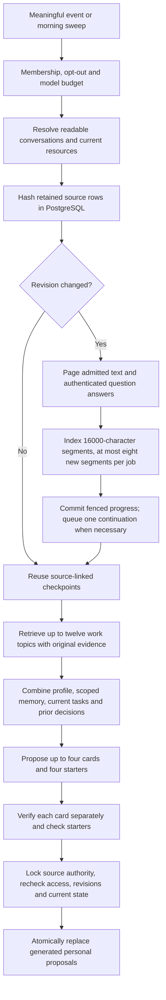

# Incremental personal context

This implementation keeps the personal work index separate from durable memory.
It proposes work; it does not create an agent, activate a schedule, publish a
message or spend a proposed run's budget.

## What reaches the reader

- Conversation text is paged rather than clipped to the last seven days or 400
  characters. Only admitted interactive web and channel runs are eligible;
  unattended execution, publisher fallback, delegated runs and test runs are not
  evidence of the person's own requests or feature adoption.
- Speakers use explicit authors, linked active channel identities or an admitted
  web caller. An unknown channel or project author stays unknown. Thread ownership
  does not assign colleagues' work to the owner.
- Native question answers have their own attribution and submission time. An
  answer after a memory erasure can survive even when the question's containing
  message predates it. Old message text remains excluded.
- Hidden external tool results, attachments and raw document contents are not
  loaded into the work index. Native question answers are the deliberate exception.
  A segment receives only its own answer receipts. Proposal retrieval receives
  cited receipts and at most eight related failed-operation receipts, not the
  person's entire answer history. Failure receipts carry native action/status
  metadata, not raw external result bodies.
- The current snapshot supplies profile, scoped memory, readable project and agent
  metadata, routine state, visible table metadata, typed private or assigned tasks,
  waiting questions, prior decisions and available features. Ordinary table records
  are not scanned. Partial resource lists carry completeness flags.
- A checkpoint retains original quoted fragments and their timestamps, not a second
  whole transcript. Fragment boundaries are preserved: joining two excerpts cannot
  manufacture a contiguous citation. Topic state follows source chronology rather
  than conversation listing order.

## Delivery and recovery

Source extraction and final reading use the configured proactive model and its
existing budget guard. A completed segment commits independently, with membership,
access, revision and erasure checks. A later refusal therefore loses neither paid
progress nor existing Inbox cards.

Events share one queued job per person. An event during an active scan may queue
one follow-up, under the same concurrency key as nightly work. A large initial
backfill continues after eight new segments; unchanged segments do not call a model.
An unchanged final snapshot does not call a model either.

Every proposed citation must match a supplied original fragment. Each card then
gets an independent semantic check restricted to its related work evidence, with
current resources still visible. Unconfirmed clock times cannot become a chosen
schedule merely because an assistant suggested them earlier. A failed model stage
preserves the existing Inbox instead of reporting successful silence.

Before delivery, shared row locks hold existing database source and access records
through the transaction. Fresh membership, visibility, source revisions and current
state checks run before replacing the captured open personal proposals. Source
edits or state changes cause a follow-up rather than stale delivery. External
channel membership retains the platform's existing confirmation/cache semantics;
a database transaction cannot lock an external service's membership.

Personal proposals have their own `personal` kind. Accepting or dismissing one
records that decision; it does not create or settle a watch Outcome. Generated
chat prompts carry the concrete next step. Execution and activation still use
the normal approval policy.

## Memory maintenance and limits

Memory maintenance still uses its bounded retained transcript and existing
fact-durability rules. The change prioritizes human text within the character
budget and merges authenticated question answers chronologically. It does not
turn temporary tasks into permanent profile facts or silently overwrite an
explicitly authored memory. The work index can retain temporary work context
without promoting it into personal memory.

This is not constant-time processing of arbitrary history. Warm reads still
resolve visibility and hash retained rows in PostgreSQL; changed conversations
are paged again, and their work summaries are bounded. Topic retrieval uses
source-linked identity and priority heuristics, not a universal semantic index.
The resource snapshot is bounded, with explicit incomplete lists. Not every
resource mutation has an event hook; the morning sweep remains a safety net.
Usage observed in retained runs cannot prove lifetime non-use of a feature.

Benchmark replays exercise the production reader and transcript preparation,
without writing product resources. Database authorization, checkpoint resumption,
coalescing, erasure and delivery races have separate integration tests. A model
judge is a diagnostic, not human acceptance. See
[the paired replay instructions](../../evals/personal/README.md#paired-context-replay)
and [the platform comparison](personal-assistance-platform-comparison.md).
