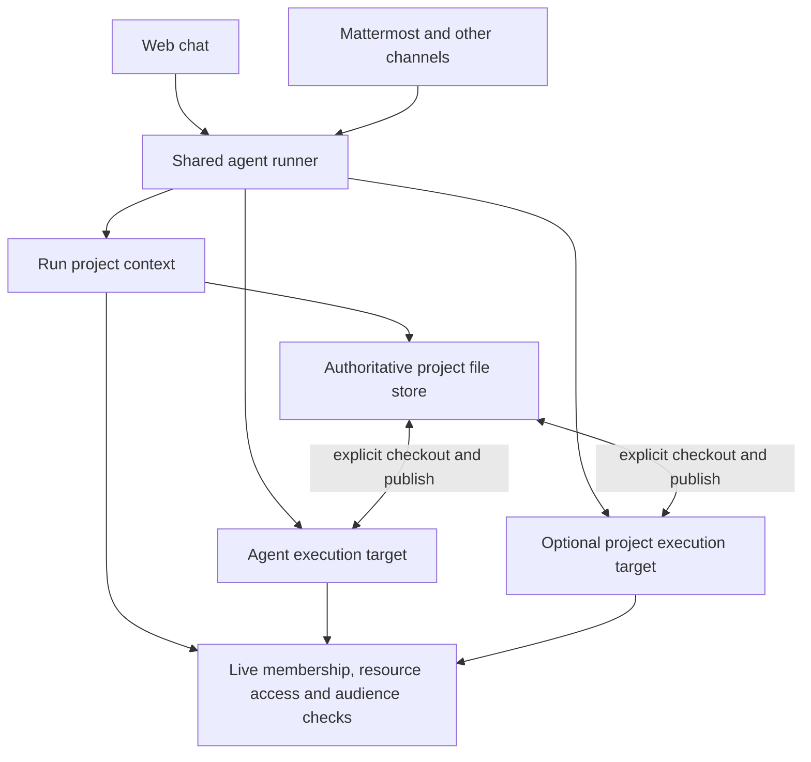

# Project workspaces and portable resource bundles

Status: architecture for discussions #3272 and #3265, accepted scope on
2026-11-24. This document describes the implementation target, not functionality
already delivered by PR #3299. The existing project-sandbox path works today.

## Observed starting point

`SandboxWorkspaceService.open` selects `project_sandbox(project)` for project
scope. `open_project` uses the same identity for the Files tab. Consequently the
project's storage backend also decides whether commands can run. Stored-file
projects have no command executor; sandbox-backed projects replace the agent's
normal toolchain. Native local targets have their own admission path.

`RunProjectWorkspace` already provides run-local project selection, per-operation
membership/grant checks, a transfer barrier and optimistic file-write checks.
`select_project_workspace` is sequential, restores the original workspace on a
null selection and does not move the conversation. These protections must remain.

Agent YAML export preserves bindings; its import replaces an existing draft.
Workflow export/import uses `WorkflowPortableService` and schema-declared
references, creates a new draft and removes deployment bindings. Neither is a
complete, selectable dependency bundle. Workflow portability currently removes
required-ID objects, which can also remove an embedded agent's MCP policies.

## Implementation status

The versioned manifest, bounded archive reader, exact reference mapper and
schema-owned agent reference inventory are implemented as internal contracts.
They have focused regression coverage. Storage now supports seekable streamed
uploads on local files and S3, including a real MinIO multipart round trip.
Agent YAML/JSON export now has a selectable dependency dialog and a reviewed
create/reuse/skip import. Context files, exact Skill main versions/forks and their
text files, model profiles and disabled private MCP configurations can be copied.
Reference-only dependencies are re-authorized in the destination. Supported
destinations are selected by name from paginated, authorized catalogs. Changing
a destination owner clears its dependent version selection. Export previews
omit linked bodies and Skill file contents; downloads load only selected content.
Imports are
transactional and replay an operation receipt after a retry; they never publish,
run or index anything. A local cross-organization import/export round trip has
been exercised through the real UI and database.

This is not yet the complete portability implementation. Binary/large bundles,
full knowledge-base content, advanced workflow bundles, durable transfer operations and the runtime separation below are still
implementation work. The PR remains a draft until that scope is complete.

## Invariants

1. Project files have one authoritative, versioned store independent of any
   container's lifetime. A container holds an explicit working copy.
2. The agent's own runtime and a project's shared runtime are separate handles.
   Selecting a project never silently replaces the agent's command target.
3. Surface adapters use the same runner, project context and access services.
   Mattermost receives no alternative project or command implementation.
4. Resource membership grants no access. A file read, command, transfer, export,
   import and resumed operation establish their own current authority.
5. A dependency bundle carries data and configuration, never a transferable
   authorization grant. Import publishes and executes nothing.
6. Plain exported YAML/JSON remains readable. Existing endpoint semantics and
   previously stored AgentSpec documents remain compatible.

## Project files and execution

`ProjectContext` identifies the selected project, its workspace generation and
instruction revision. `ExecutionTarget` identifies `agent` or `project`; project
execution also carries the project ID and generation. File paths alone never
choose an executor. The runner owns target lifetimes and cleanup; capabilities
consume narrow file/execution contracts, not provider clients.

- File tools address project files explicitly when a project is selected. The
  Files tab uses the same service and revisions.
- Normal shell tools keep the agent target. An explicit target selects the
  project environment for a command; absent or unavailable targets are refused.
- A files-only agent can work on project text without opening a container.
- A files-only project cannot become an executor merely because a command asks
  for it. Configuring its optional runtime is a separate authorized edit.
- Local computers retain native user consent. A channel turn cannot select a
  person's desktop or reuse a web chat's local authorization.
- Coding agents, Apps and background tasks receive the selected file namespace
  and command target explicitly; they must not infer both from one workspace.

### Canonical file boundary

Use project file metadata and immutable content objects through the existing
file-storage service. A project file row owns its normalized path, generation,
revision, media type, length and digest; the storage object is not a runtime path.
List directories with bounded queries rather than loading an entire StateBackend
JSON document. File revisions are activated transactionally after content is
written and verified; cancelled/failed writes own cleanup of staging objects.

Keep logical paths separate from storage keys and execution paths. The existing
project path rules and reserved platform namespace remain enforced at the service
boundary. A binary checkout copies exact bytes. Text preview is bounded and must
not silently start paid OCR or model calls for an unsupported source document.

### Tool ownership

Expose project discovery, selection and file operations independently of shell
availability through an explicit project capability. Built-in agents enable it;
custom agents retain author control. Platform MCP and console operations call
the same project services. Conversation-associated project context still follows
its existing access contract; adding a capability grants no additional resources.

Project instructions and linked-resource summaries are separate from the agent's
own immutable spec. A resource linked to a project still requires its own access
check. Selecting a project does not lend the default agent's private KBs, switch
the acting agent or turn every linked workflow into an executable tool.

### Working copies and concurrent edits

A checkout records project generation, file revisions and content digests. Only
selected paths are materialized. Untracked runtime files and dependencies stay in
the runtime; only explicitly published paths return to project storage.

Publishing compares base revisions under the existing project write barrier.
Conflicts return the changed paths and retain the working copy; they do not
silently overwrite newer files. A build can publish artifacts without returning
its dependency directory. Transfer/revocation invalidates stale checkout handles.
No background bidirectional directory synchronization is implied.

A checkout also checks the runtime's audience. An agent-scoped sandbox shared
by unrelated users cannot receive a private project's files merely because the
current sender can read them. Use an appropriately isolated runtime with the
agent's configured toolchain, or refuse the transfer with a clear target choice;
a directory prefix inside a shared sandbox is not isolation. Recheck managed
checkout authority before subsequent transfer/publish operations and clean up
platform-owned working copies when they are retired.

Commands may modify their sandbox. Checkout/upload success and command exit
status are separate outcomes. A timed-out command is not automatically replayed.
Shared project execution uses a project execution lease; it does not serialize
unrelated work in the agents' own runtimes.

### Mattermost example

1. A linked sender asks: "Use project XYZ and validate its network configuration."
2. The agent searches accessible projects using platform tools. Ambiguous names
   produce a choice; project names in prose confer no authority.
3. Selecting the returned ID establishes run-local project context. Project
   instructions are returned as scoped reference content, not interpolated into
   raw system authority. File tools use that project's authoritative files.
4. The agent checks out the needed configuration to its own network toolchain,
   runs the validation there and publishes a report back with revision checks.
5. A later build can explicitly choose the project runtime. The agent's runtime
   remains available. The channel conversation and project chats stay distinct.

Project selection must work even without an initially opened agent sandbox:
selection/file access is a project operation, not a side effect of constructing
an executable workspace. This closes the current coupling in runner setup.

Project selection and command-target selection are separate, structured tool
calls. Do not parse project names or execution targets out of user prose with
regular expressions; the model selects a returned project ID and the application
validates it. Missing capability/access/runtime is an explicit result.

The acting principal is the linked sender, not the bot owner or the previous
sender. Persist context in the run/checkpoint for approval continuation. A fresh
channel turn re-establishes the sender and project authority; it never inherits
another participant's private project selection. Thread-level persistence is an
explicit association with an audience contract, not a global bot preference.

Reading private project data and releasing it into a group are different
permissions. Reuse the channel audience policy when known; unknown or wider
room audiences must not acquire private project contents through selection.
Return a stable refusal or offer a private destination before releasing content.
Approval resumption rechecks the original sender, source and destination; the
approver does not become the source principal.

### Compatibility

Keep stored projects' execution behavior explicit as a legacy project target;
never change an existing routine's toolchain by deploying this architecture.
New projects use authoritative stored files and an optional separate runtime.
Moving a legacy project to the new file store uses the existing durable transfer
service: copy, verify, activate one new generation, then retire old storage.
Failed transfers keep the original active. Existing project workspace-selection
tools remain adapters with their old meaning; new explicit target tools do not
silently redefine old tool calls or approval checkpoints.

## Selectable dependency bundles

### User flow

Export opens a dependency tree rooted in the selected agent, workflow or project.
Each dependency shows type, name, effective version, inclusion mode, access and
estimated size. Shared dependencies appear once. Cycles are displayed and stored
as references, not recursively expanded forever.

Users choose reference only, definition, or definition plus content where the
resource supports it. "Include all accessible dependencies" selects supported
content; it does not silently bypass an inaccessible dependency or export every
unrelated resource in the organization.

Plain configuration remains YAML for agents and JSON for workflows. A full
bundle is a ZIP containing a versioned manifest, root YAML/JSON, resource
snapshots and assets. Binary attachments are not inserted as huge base64 fields
in an agent's spec. The downloadable filename makes the distinction clear.

| Resource | Definition | Optional content | Destination requirements |
| --- | --- | --- | --- |
| Agent | Spec, labels, referenced revisions | Selected dependencies, avatar | New private draft; explicit resource map |
| Workflow | Graph, settings, referenced resources | Selected dependencies, assets | New private draft; no triggers activated |
| Skill | Effective main/fork version, metadata | Body, resources and scripts | New skill/version; scripts never executed |
| Context | Metadata and use mode | Full text or original asset | New private context |
| Knowledge base | Description and ingestion policy | Selected original documents; parsed text or index snapshot when selected | Destination embedding configuration and explicit ingestion choice |
| MCP connection | Server definition, selected tool policy and instructions | Custom server/catalog definition where owned | New disconnected connection; new OAuth authorization or Vault binding |
| Model/embedding profile | Provider, model, endpoint and settings | None of its credentials | Bind an allowed destination Vault credential |
| Vault reference | Kind and non-secret descriptor | No plaintext secret values or transferable encrypted envelopes | Choose/create a destination secret through Vault |
| Sandbox connection | Provider/configuration descriptor | No active container state or provider credentials | Rebind or configure a destination connection |
| Table | Schema, views and supported trigger definitions | Selected rows and referenced files | Revalidate schema; leave automation disabled |
| App | Definition and selected version/assets | Included files | Draft/private; no public link or auto-consent |
| Delegates | Agent/workflow/external-agent definitions | Their selected dependencies | Re-pin imported versions; remote credentials reconnected |
| Project | Instructions, resource links and runtime descriptor | Selected project files | Private project; explicit runtime binding |

Channel bot bindings, public links, schedules and approvals are activation facts.
When included as configuration, they remain disabled/unbound. Native identities,
OAuth sessions, cookies, API keys, personal memories and chat histories are not
implicitly dependencies of an agent export. An organization's role/grant rows
must never be copied as target authority.

### KB contents and index compatibility

A large KB is a paginated/streamed export, not a single list loaded into memory.
Source documents, parsed text and index snapshots are separate selectable layers.
A bundle records document revisions, original availability and which layers were
actually included. Connector definitions omit credentials and never cause an
import-time network fetch.

Original documents are the normal portable choice. Missing originals are reported;
parsed text is an explicit alternative, never labeled as the original file.
An index snapshot records embedding model/provider, dimensions, normalization,
chunker/parser versions and per-document/chunk provenance. Reuse is offered only
when the destination configuration is demonstrably compatible. Otherwise retain
the imported sources and offer re-indexing with a cost estimate/confirmation.
Importing files alone must not start paid embedding, OCR or model calls.

### Format and mapping

Use a bundle-local typed resource key distinct from an organization UUID. Entries
record source ID, resource kind, effective version/content digest and dependencies.
References inside snapshots are declared by owned schemas/capability metadata,
not found by UUID-looking string replacement. Application text and cell UUIDs
remain data. All non-reference settings, including MCP allowlists, global/per-tool
approval policy and tool prefixes, survive remapping.

For each entry, the import plan offers reuse, create or skip:

1. The same ID is a reuse candidate only if its kind, destination organization and
   current access match. A matching ID with a changed version is shown as changed.
2. Name/content matches are suggestions, never silent bindings.
3. Missing or inaccessible entries are indistinguishable to the caller. Creation
   is offered only with bundled content and the appropriate destination permission.
4. KB creation without documents produces an explicitly empty KB, not a fake
   successful knowledge migration.
5. Skipping a required dependency disables/removes the dependent binding only
   after showing the effect. The report retains every unresolved/skipped binding;
   no MCP policy is lost merely because its connection is not selected yet.
6. Two-phase creation reserves destination identities first, then rewrites refs
   and validates snapshots, so cycles and shared resources map consistently.
7. Existing resources are reused without modification. Overwrite/merge is not
   inferred from matching IDs and is not the default import operation.

Old plain YAML/JSON goes through the same preview. Its IDs become source
references; the user can reuse destination matches, choose replacements, import
available bundled content or explicitly skip unavailable dependencies. The
existing endpoint replacing a draft remains separate and revision-protected.

### Boundaries, jobs and failure behavior

`PortabilityService` owns export planning, import preview and apply. Domain
adapters call the existing resource services for reads and creates; no import
route writes repositories or duplicates domain permissions. Pure schema walking,
manifest validation, mapping and dependency ordering are separately testable.
Routes adapt HTTP/files only. No dynamic module name from an archive is imported.

Large export/import operations are durable jobs, queued in the request's own
transaction. Jobs record the requesting principal, organization, immutable plan,
selected revisions and idempotency key. Re-establish active authority at execution
and download, and recheck grants before reading each selected resource. Assets
use the existing storage boundary with expiring staging handles and bounded
streaming; workers own cleanup and cancellation.

Manifest limits bound file count, dependency depth, total expanded bytes and
individual entries before extraction. Reject traversal, absolute paths, symlinks,
duplicate/conflicting paths and inconsistent checksums. A preview performs no
provider calls, activates nothing and makes no resource changes.

Apply validates the destination map and permissions again, then creates an
operation-owned resource set. Replays reuse that operation's map. Shared/reused
resources are never removed by rollback. Large file imports expose staging,
creating, failed/partial and ready states; partial content is never reported as
complete. Activation/publication remains a separate action after review.

Pinned delegate versions need a staged activation map: an imported delegate
starts as a draft, so it has no newly published version to substitute. Preserve
the pending binding and its policy until the user reviews/publishes that delegate
and selects the resulting version. Never invent a version UUID or silently
retarget the pin to a different live version. Skill main/fork snapshots likewise
record the exact effective source content and their destination version map.

The result lists reused, created, skipped, blocked and failed resources, plus
reconnection/re-indexing steps. Audit records use IDs, counts and digests, not
file bodies or credentials. A dependency revoked during export yields a failed
or explicitly partial bundle, never a silently complete archive.

## Delivery and acceptance

Implement and verify in these independently reviewable slices within the PR:

1. Versioned manifest, selection, schema-owned references and pure mapping tests.
2. Agent plain-file preview/import; resource reuse/replace/skip; MCP policy
   preservation; unchanged legacy YAML endpoint and spec round-trip.
3. Resource adapters and full-content bundles; KB streaming/jobs and explicit
   index compatibility; UI selection and detailed import report.
4. Independent project files/execution contracts, legacy compatibility and
   working-copy conflict behavior.
5. Shared runner/channel integration, including sender changes and resumptions.

Required tests include tenant/kind/grant refusal, revoked download access, ID
collisions, cycles, shared dependencies, corrupt/oversized archives, cancellation,
retry after partial apply, no secrets in output, no import-time execution,
complete skills/context/KB documents, optional index mismatch, exact MCP policy
round-trip, and existing plain-file compatibility. Exercise both themes and phone
layouts for the selection/preview UI.

Project tests must cover files-only agent/project combinations, both execution
targets, command refusal without a runtime, concurrent writes, transfer failure,
provider cleanup, Mattermost project search/ambiguity, linked/unlinked senders,
a second sender in one thread, private versus group destinations and approval
resumption after grant revocation. A green geometry or unit test is not evidence
that a channel/provider integration was exercised.
