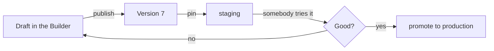

# Umgebungen { #environments }

Einen Agent zu veröffentlichen prägt eine [Version](concepts.md#version). Eine
**Umgebung** ist ein Name, der auf eine davon zeigt — `production`, `staging`,
`dev` —, sodass Sie eine neue Version irgendwo ausprobieren können, bevor alle
ihr begegnen.

Ohne Umgebungen sind Veröffentlichen und Ausliefern ein und dieselbe Handlung.
Mit ihnen sind es zwei Entscheidungen: die Version zu prägen, und sie irgendwohin
zu stellen.

## Was eine Umgebung ist { #what-an-environment-is }

Ein Name, eine Version, an die sie geheftet ist, und optional ein eigenes Ziel
für das Tracing. Jeder Agent hat eine **Standardumgebung**, und die bekommt eine
schlichte Oberfläche, wenn niemand etwas anderes gesagt hat.

| | |
|---|---|
| **Name** | Kleingeschrieben, mit Bindestrichen, bis zu 64 Zeichen — er taucht in URLs auf und wird zum Tracing-Tag, `Production (EU)` und `production-eu` dürfen also nicht zwei Dinge sein |
| **Version** | Welche veröffentlichte Version hier antwortet. Einen ungehefteten Zustand gibt es nicht |
| **Tracks latest** | Ob eine Veröffentlichung diese Umgebung von sich aus umhängt. Standardmäßig aus |
| **Tracing** | Ein Logfire-Write-Token aus dem Vault, damit die Runs dieser Umgebung in ihrem eigenen Projekt landen |
| **Testverbindungen** | MCP-Server und Vault-Schlüssel, die diese Umgebung durch Testversionen ersetzt — ein Sandbox-CRM, ein Testpostfach. Nur benannte Umgebungen |

!!! info "Es gibt keine Umgebung ohne Version"

    Eine ungeheftete Umgebung wäre ein Name, der mit nichts antwortet, und die
    erste dorthin geleitete Nachricht würde weit entfernt von dem Formular
    fehlschlagen, das sie angelegt hat. Legen Sie eine an, ohne eine Version zu
    nennen, startet sie bei dem, was die Standardumgebung ausliefert.

## Der Ablauf, für den sie da ist { #the-workflow-it-is-for }

1. Den Draft bearbeiten, veröffentlichen. Das prägt eine Version und ändert
   nichts, was irgendjemand gerade benutzt.
2. `staging` darauf zeigen lassen und Ihren Test-Slack-Bot oder einen privaten
   Link an `staging` binden.
3. Sie gegen echte Fragen ausprobieren.
4. `production` auf dieselbe Version promoten — eine Änderung, kein erneutes
   Veröffentlichen.

Ein Rollback ist derselbe Zug rückwärts: `production` wieder auf die Version
zeigen lassen, die funktioniert hat. Die alte Version ist noch da, noch lesbar,
noch ausführbar.

## `tracks_latest`, und warum es aus ist { #tracks_latest-and-why-it-is-off }

Eine Umgebung mit eingeschaltetem **tracks latest** wird von jeder
Veröffentlichung umgehängt. Das ist die richtige Einstellung für `dev` und fast
nie die richtige für `production`.

Aus ist absichtlich die Voreinstellung: Veröffentlichen prägt eine Version, und
zu entscheiden, wo diese Version läuft, ist eine eigene Handlung. Beides zu
koppeln heißt, dass eine unfertige Änderung einen Kunden erreicht, weil jemand
auf Publish geklickt hat, um seine Arbeit zu sichern.

Die eine Ausnahme ist das `production`, das die erste Veröffentlichung anlegt.
Solange es die einzige Umgebung des Agents ist, gibt es nichts, von dem aus man
heraufstufen könnte, also folgt es Veröffentlichungen; heften Sie es an, sobald ein
`dev` oder ein `staging` daneben steht.

## Eine Oberfläche an eine binden { #binding-a-surface-to-one }

Eine [Exposure](concepts.md#exposure) — ein Slack-Bot, ein Widget, eine gehostete
Seite, eine API-Zielgruppe — kann die Umgebung nennen, der sie dient. Lässt sie
das weg, bekommt sie die Standardumgebung.

Das macht die Trennung nützlich: ein Dev-Bot, der an `dev` gebunden ist, dient
dem, was `dev` heftet, während das Widget auf Ihrer Website auf `production`
bleibt, bis Sie es bewegen. Ein Agent, zwei Zielgruppen, zwei Versionen, eine
Buchführung.

Eine Seite, die der Agent veröffentlicht, folgt derselben Trennung. Ein Run in
einer benannten Umgebung veröffentlicht ein eigenes
[App](artifacts.md#one-name-one-link), sodass ein Versuch mit `dev` am
Wochenbericht nie die Seite neu veröffentlicht, die Leser in Produktion öffnen.
Eine Umgebung mit einem Run, der noch läuft oder auf eine Freigabe wartet, lässt
sich erst entfernen, wenn der Run endet: Das Löschen würde diesen Run der
Standardumgebung übergeben und seine Seiten denen von Produktion. Dasselbe gilt,
solange ein Eval-Run darin wartet oder läuft, der sonst gegen die Verbindungen
der Produktion weiterliefe.

## Testverbindungen { #test-connections }

Eine Version ist überall derselbe Spec, also würde `staging` sonst dasselbe CRM
und dasselbe Postfach erreichen wie `production`. Eine benannte Umgebung kann ein
Binding stattdessen mit einer **Testverbindung** beantworten: einen
organisationsweiten [MCP-Server](mcp.md) mit einem Sandbox-Server oder den
Vault-Schlüssel einer Capability mit einem Testschlüssel. Der Spec ändert sich
nicht, also nimmt das Heraufstufen einer Version kein Test-Credential mit.

| Binding | Ersetzt durch | Was das Modell sieht |
|---|---|---|
| Eine organisationsweite MCP-Verbindung | Eine andere organisationsweite MCP-Verbindung | Die Tool-Namen der Produktionsverbindung, sodass Staging und Produktion vergleichbar sind |
| Der Vault-Schlüssel einer Capability | Ein anderer Schlüssel derselben Art und desselben Zwecks | Nichts: Die Capability erfährt nie, welchen Schlüssel sie bekommen hat |

Jeder Run in der Umgebung nutzt sie: ein an `staging` gebundener Slack-Bot, ein
API-Aufruf, der sie nennt, ein Zeitplan und jeder Delegat, den diese Runs
aufrufen. Die Tools einer Testverbindung werden durch die Allowlist der
Produktionsverbindung, die eigene der Testverbindung und die des Bindings
eingeschränkt.

!!! warning "Aus, nie die Produktion"

    Ein Binding lässt sich in einer Umgebung abschalten statt ersetzen. Ebenso
    eines, dessen Testseite gelöscht, deaktiviert wurde oder ihre Credentials
    verloren hat: Das Binding bleibt dort dunkel, bis jemand eine andere
    Testverbindung wählt. Die Produktionsseite ist nie der Ersatz. Eine
    Capability, deren Testschlüssel gelöscht wurde, verweigert den Run, statt
    ohne ihren Schlüssel zu laufen.

Die Standardumgebung trägt keine Testverbindungen — sie ist das, was eine
Oberfläche ohne genannte Umgebung ausführt, also die Produktion. Beide Seiten
einer Ersetzung müssen der Organisation gehören, und ein Testschlüssel muss für
die Person sichtbar sein, die ihn einträgt. Gespeichert werden nur IDs; ein
Testschlüssel bleibt im [Vault](secrets.md), und der Audit-Eintrag hält fest,
wie viele Ersetzungen es gibt, nicht, was sie enthalten.

### In einem Eval { #in-an-eval }

Ein Eval führt den Agent wirklich aus, also würden seine Tools wirklich handeln:
Ein Agent, der E-Mails sendet, würde pro Fall eine senden. Ein **isoliert**
gestarteter Run — so läuft ein Eval — führt ein Tool nur aus, wenn das sicher ist:

| Das Tool | Was passiert |
|---|---|
| Erreicht eine Test-MCP-Verbindung der Umgebung | Läuft, gegen das Testsystem |
| Liest nur | Läuft auf der normalen Verbindung |
| Schreibt, mit einem Test-Schlüssel aus dem Vault | Läuft nur, wenn seine Capability erklärt, dass der Schlüssel allein das Ziel bestimmt; sonst **nicht ausgeführt** und aufgezeichnet |
| Schreibt, ohne Testverbindung | **Wird nicht ausgeführt.** Als beabsichtigter Aufruf mit seinen Argumenten aufgezeichnet |

Ein Testschlüssel ersetzt eine Anmeldeinformation, aber eine URL oder ein Host
in der Konfiguration der Capability kann die Schreibvorgänge weiterhin auf die
Produktion lenken. Deshalb lässt ein getauschter Schlüssel eine Capability in
einem Eval nur schreiben, wenn sie `test_key_isolates` erklärt, und der
[Katalog](reference/capabilities.md#what-an-eval-runs) führt auf, welche das tun.

Ein MCP-Tool gilt nur dann als lesend, wenn sein Server es mit `readOnlyHint`
markiert und die Verbindung dieser Markierung vertraut. Standardmäßig tut sie das
nicht, denn die Markierung ist die eigene Angabe des Servers. Das Tool einer
Capability erklärt es in der Registry, und der
[Katalog](reference/capabilities.md#what-an-eval-runs) führt auf, welche es tun.
**Ein Tool, das nichts erklärt, schreibt.** Das Modell erfährt, dass der Aufruf
nicht gesendet wurde, und der beabsichtigte Aufruf wird für die Bewertung mit
dem Run aufbewahrt.

Ein isolierter Run kann auch aus der Aufzeichnung des Runs beantwortet werden,
aus dem ein Fall stammt — aus den Aufrufen, die sein Transkript behalten hat. Ein
Aufruf wird über sein Tool, seine Argumente und seine Reihenfolge unter
identischen Aufrufen zugeordnet und bekommt das ursprüngliche Ergebnis; ein
Aufruf, den die Aufzeichnung nicht enthält, wird nicht ausgeführt und als
abweichend aufgezeichnet. Ein Run, dessen Transkript einen Aufruf verloren hat,
wird gar nicht wiedergegeben. Ein isolierter Run hat niemanden, den er um eine
Freigabe bitten kann, also wird ein gesperrter Aufruf ebenfalls nicht ausgeführt
und als freigabepflichtig aufgezeichnet.

## Aus dem Builder heraus ausprobieren { #trying-it-from-the-builder }

**Testen** im Kopf des Builders öffnet einen Chat neben dem Builder statt darüber -
denselben Chat wie `/chat`, mit Streaming, Tool-Schritten, Freigabekarten und
Rückfragen. Er antwortet als **Entwurf**, mit Ihren unveröffentlichten Änderungen,
oder als Version einer beliebigen Umgebung, und sagt, welche. Für einen Test des
Entwurfs wird nichts veröffentlicht: Er muss die Prüfungen einer Veröffentlichung
bestehen, und nur wer den Agent bearbeiten darf, kann ihn ausführen. Ein Run, der
auf eine Freigabe wartet, setzt auf dem Entwurf fort, wie er beim Start des Runs
war.

Jede Runde dort ist ein **Test-Run**: budgetiert und aufgezeichnet wie jeder
andere, in der Aktivität als `Test` markiert und dort filterbar (**Mit Test-Runs**,
**Ohne Test-Runs**, **Nur Test-Runs**; `?test=true` oder `false` an
`GET /api/v1/runs`). Der Bereich startet ein neues Gespräch, sendet nach einer
Änderung die letzte Nachricht erneut und behält ein paar angeheftete Prompts, die
sich mit einem Klick erneut ausführen lassen. Seine Breite, was antwortet, und die
angehefteten Prompts werden pro Agent im Browser gespeichert. Der Chat-Frame sendet
in jeder Runde `draft: true` oder `test: true` mit einer `environment_id`.

**Vergleichen** stellt zwei Chats nebeneinander - den Entwurf und die Produktion
oder zwei Umgebungen -, und das Feld darüber fragt beide gleichzeitig dasselbe,
sodass sich die Antworten nur darin unterscheiden, was antwortet. **Was der
Entwurf ändert** zeigt den Entwurf gegenüber der veröffentlichten Version, als
denselben Diff, den die Versionshistorie zeichnet. Ein Druck auf <kbd>T</kbd>
irgendwo im Builder, außerhalb eines Textfelds, öffnet oder schließt den Bereich.

## Tracing pro Umgebung { #tracing-per-environment }

Eine Umgebung kann ihr eigenes Logfire-Write-Token tragen, versiegelt
[im Vault](secrets.md), dazu einen Dienstnamen. Ihre Runs tracen in dieses
Projekt, getaggt mit dem Namen der Umgebung.

Das hält ein Staging-Experiment aus dem Dashboard heraus, das jemand auf
Produktionsvorfälle hin beobachtet — und es geht pro Umgebung statt pro
Deployment, weil die beiden wirklich verschiedene Projekte sind.

Wohin die Traces gehen, gehört der Umgebung; *wie viel sie tragen*, dem Agent.
Der [observability](reference/spec.md#observability)-Block eines Agents hat einen
`content`-Modus: `full` zeichnet die Nachricht, die Ausgabe des Modells und jedes
Tool-Argument auf, `none` nur Zeit, Tokens, Kosten und Tool-Namen. Bei einem
Projekt über Gesundheits-, Rechts- oder HR-Daten ist `none` das, was eine Kopie
der geschützten Inhalte davon abhält, die Maschine zu verlassen. Das Token der
Umgebung leitet den Run um, überschreibt diese Wahl aber nicht.

## Was die Standardumgebung nicht ist { #what-the-default-environment-is-not }

Die Standardumgebung wird **vom Veröffentlichen verwaltet**, nicht von dieser
API. Sie können sie nicht löschen, keine andere Umgebung auf sie umbenennen und
nicht von Hand umschalten, welche die Standardumgebung ist.

"Was bekommt eine schlichte Oberfläche" in zwei Hände zu legen heißt, dass die
beiden irgendwann uneins sind, und die Uneinigkeit zeigt sich darin, dass ein
Kunde einer Version begegnet, die niemand ausgeliefert hat.

## Zusammenfassung { #recap }

- Eine Umgebung ist ein **Name, der an eine Version geheftet ist**; jeder Agent
  hat eine Standardumgebung.
- Veröffentlichen prägt eine Version. **Sie irgendwohin zu stellen ist eine
  eigene Entscheidung** — deshalb ist `tracks_latest` bei einer Umgebung aus, die
  Sie hinzufügen; das `production` der ersten Veröffentlichung folgt, bis Sie es
  anheften.
- Eine **Oberfläche kann ihre Umgebung nennen**, sodass ein Dev-Bot und ein
  öffentliches Widget verschiedene Versionen eines Agents ausliefern können.
- **Ein Rollback ist ein Umhängen**, weil alte Versionen lesbar und ausführbar
  bleiben.
- Eine benannte Umgebung kann Bindings durch **Testverbindungen** ersetzen; ein
  Binding ohne eine ist dort aus, nie die Produktion. In einem Eval wird ein
  schreibendes Tool ohne Testverbindung **aufgezeichnet, nicht ausgeführt**.
- Die Standardumgebung wird vom Veröffentlichen verwaltet und ist hier bewusst
  nicht bearbeitbar.
