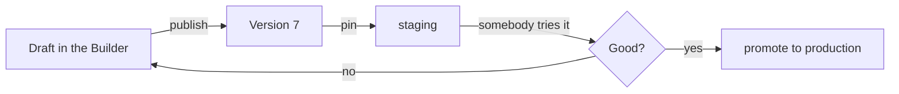

# Entornos { #environments }

Publicar un agent acuña una [versión](concepts.md#version). Un **entorno** es un
nombre que apunta a una de ellas — `production`, `staging`, `dev` — para que
puedas probar una versión nueva en algún sitio antes de que la conozca todo el
mundo.

Sin entornos, publicar y lanzar son el mismo acto. Con ellos son dos decisiones:
acuñar la versión, y ponerla en algún sitio.

## Qué es un entorno { #what-an-environment-is }

Un nombre, una versión a la que está fijado y, opcionalmente, su propio destino de
trazas. Todos los agents tienen un entorno **por defecto**, y eso es lo que recibe
una superficie corriente cuando nadie ha dicho otra cosa.

| | |
|---|---|
| **Nombre** | En minúsculas, con guiones, hasta 64 caracteres — aparece en las URL y se convierte en la etiqueta de trazas, así que `Production (EU)` y `production-eu` no pueden ser dos cosas |
| **Versión** | Qué versión publicada responde aquí. No existe un estado sin fijar |
| **Tracks latest** | Si publicar reapunta este entorno por su cuenta. Desactivado por defecto |
| **Trazas** | Un write token de Logfire sacado del vault, para que los runs de este entorno aterricen en su propio proyecto |
| **Conexiones de prueba** | Servidores MCP y claves del vault que este entorno sustituye por otros de prueba — un CRM sandbox, un buzón de prueba. Solo entornos con nombre |

!!! info "No hay entorno sin versión"

    Un entorno sin fijar sería un nombre que no responde con nada, y el primer
    mensaje enrutado a él fallaría muy lejos del formulario que lo creó. Créalo
    sin nombrar una versión y arranca con lo que sirva el entorno por defecto.

## El flujo de trabajo para el que existe { #the-workflow-it-is-for }

1. Edita el draft y publica. Eso acuña una versión y no cambia nada de lo que
   nadie esté usando.
2. Apunta `staging` a ella, y liga tu bot de Slack de pruebas o un enlace privado
   a `staging`.
3. Pruébala contra preguntas reales.
4. Promociona `production` a esa misma versión — una edición, sin volver a
   publicar.

Volver atrás es el mismo movimiento en sentido contrario: reapuntar `production` a
la versión que funcionaba. La versión antigua sigue ahí, sigue siendo legible y
sigue siendo ejecutable.

Una [suite de evals](evals.md#suites) configurada para ejecutarse en cada
promoción comprueba cada versión promocionada a su entorno frente a la que
sustituyó, y avisa a su propietario cuando el resultado no pasa. Por sí sola
solo informa; un entorno que la nombra como
[guardiana](#guarding-a-promotion-with-evals) espera a que pase.

## Guardar una promoción con evals { #guarding-a-promotion-with-evals }

Un entorno puede nombrar las [suites de evals](evals.md#suites) que lo
**guardan**. Entonces acepta una versión solo cuando cada guardiana ha pasado en
esa misma versión, sobre la versión del dataset y el scoring a los que la
guardiana está fijada, y con el umbral que tiene ahora: un aprobado de antes de
mover la fijación, o de antes de subir el listón, no cuenta. Una promoción que no lo cumple se rechaza (`409`,
`PROMOTION_BLOCKED`), y el rechazo nombra cada guardiana y en qué estado está:
no pasó, sin conclusión, no se ejecutó y por qué, comprobando todavía,
desactualizada, sin comprobar o en pausa.

Un aprobado cuenta para el entorno al lado del que se ejecutó: frente a la
versión que ese entorno sirve ahora, y puntuado con el scoring de su fijación;
uno al lado de la versión de staging no dice nada sobre sustituir la de
producción. Una guardiana en pausa detiene la versión sea lo que sea que
encontrara antes de la pausa.

Una suite que guarda un entorno queda **fijada** a la versión del dataset y al
scoring que tenía cuando se convirtió en guardiana. Editar el dataset - sus
casos, su puntuación, su juez - sigue abierto a quien pueda editarlo, y no
cambia lo que comprueba la guardiana.

El panel de la suite dice cuándo el dataset ha avanzado, y **Move the pin**
(`POST /api/v1/agents/{id}/eval-suites/{suite}/pin`) lleva la guardiana a la
última versión y al scoring actual; necesita `promotions:override` y se registra
como un cambio de las guardianas. Una suite que deja de guardar vuelve a leer la
última versión, y una cuyo dataset aún no tiene casos no puede ser guardiana. La versión del propio agente juez no forma parte de la fijación:
un juez publicado de nuevo puntúa la siguiente ejecución de la guardiana.

El diálogo de promoción muestra lo mismo y ejecuta las guardianas que no han
pasado en la versión, cada una al lado de la versión que el entorno sirve ahora
(`POST /api/v1/agents/{id}/environments/{env}/gate/run`;
`GET …/gate?version_id=` lee la puerta). Una guardiana que necesita el juez
mientras la [asistencia de IA](governance.md#ai-assistance) está desactivada lo
dice, en lugar de bloquear sin motivo.

Una **excepción** promociona igualmente, pasando por encima de las guardianas.
Necesita `promotions:override` - lo tienen owners y admins - y un motivo de al
menos diez caracteres, dado por una persona que ha iniciado sesión como ella
misma, no mediante una clave de API. La excepción, quién la hizo y el resultado
de cada guardiana quedan en el registro de auditoría y en la versión del
historial, y se avisa al propietario de cada guardiana que no pasó.

Cambiar qué suites guardan un entorno necesita el mismo permiso, porque quitar
una guardiana deja pasar lo que habría detenido, y también debilitar lo que
comprueba una guardiana: un umbral más bajo o quitado, otro dataset, otro entorno
o las conexiones de prueba de ese entorno. Un umbral más estricto no necesita
excepción; se registra igual, y un aprobado con el umbral anterior deja de
contar. Una suite que guarda, o un dataset que una comprueba, no se puede borrar
hasta quitarla.

Un entorno guardado con **tracks latest** no sigue una publicación enseguida:
la publicación ejecuta sus guardianas en la nueva versión, y el entorno avanza
cuando todas pasan, registrado como promocionado por la puerta. Uno cuyas
guardianas no pasan se queda donde está, y su fila dice que está esperando.

## `tracks_latest`, y por qué está desactivado { #tracks_latest-and-why-it-is-off }

Un entorno con **tracks latest** activado se reapunta con cada publicación. Ese es
el ajuste correcto para `dev` y casi nunca el correcto para `production`.

Que esté desactivado por defecto es deliberado: publicar acuña una versión, y
decidir dónde se ejecuta esa versión es un acto aparte. Acoplarlos significa que
una edición sin terminar llega a un cliente porque alguien pulsó Publish para
guardar su trabajo.

La única excepción es el `production` que crea la primera publicación. Mientras es
el único entorno del agent no hay desde dónde ascender, así que sigue las
publicaciones; fíjalo cuando haya un `dev` o un `staging` a su lado.

## Ligar una superficie a uno { #binding-a-surface-to-one }

Una [exposición](concepts.md#exposure) — un bot de Slack, un widget, una página
alojada, una audiencia de la API — puede nombrar el entorno al que sirve. Si se
omite, recibe el de por defecto.

Eso es lo que hace útil la separación: un bot de desarrollo ligado a `dev` sirve
lo que `dev` tenga fijado, mientras el widget de tu web se queda en `production`
hasta que tú lo muevas. Un agent, dos audiencias, dos versiones, una sola
contabilidad.

Una página que el agent publica sigue la misma separación. Un run en un entorno
con nombre publica una [aplicación](artifacts.md#one-name-one-link) propia, así
que probar `dev` con el informe semanal nunca vuelve a publicar la página que
abren los lectores de producción. Un entorno con un run todavía en marcha, o
esperando una aprobación, no se puede eliminar hasta que el run termine:
eliminarlo entregaría ese run al entorno por defecto, y sus páginas a las de
producción. Lo mismo vale mientras un eval run en él esté en cola o en marcha,
que si no seguiría contra las conexiones de producción.

## Conexiones de prueba { #test-connections }

Una versión es el mismo spec dondequiera que se ejecute, así que `staging`
llegaría al mismo CRM y al mismo buzón que `production`. Un entorno con nombre
puede responder a un binding con una **conexión de prueba**: un
[servidor MCP](mcp.md) de la organización con uno sandbox, o la clave del vault de
una capability con una clave de prueba. El spec no cambia, así que promover una
versión no se lleva ninguna credencial de prueba.

| Binding | Sustituido por | Lo que ve el modelo |
|---|---|---|
| Una conexión MCP de la organización | Otra conexión MCP de la organización | Los nombres de herramienta de la conexión de producción, para que staging y producción sean comparables |
| La clave del vault de una capability | Otra clave del mismo tipo y propósito | Nada: la capability nunca sabe qué clave recibió |

Las usa cada run del entorno: un bot de Slack ligado a `staging`, una llamada a
la API que lo nombra, una programación y cada delegado al que esos runs llaman.
Las herramientas que ofrece una conexión de prueba se reducen con la allowlist de
la conexión de producción, la propia de la conexión de prueba y la del binding.

!!! warning "Desactivado, nunca producción"

    Un binding puede desactivarse en un entorno en lugar de sustituirse. Lo mismo
    le pasa a uno cuya conexión de prueba se borró, se desactivó o perdió sus
    credenciales: el binding queda apagado allí hasta que alguien elige otra
    conexión de prueba. El lado de producción nunca es el respaldo. Una capability
    cuya clave de prueba se borró rechaza el run en lugar de ejecutarse sin clave.

El entorno por defecto no tiene conexiones de prueba — es lo que ejecuta una
superficie que no nombra entorno, es decir, producción. Ambos lados de una
sustitución deben ser de la organización, y una clave de prueba debe ser visible
para quien la configura. Solo se guardan identificadores; una clave de prueba se
queda en [el vault](secrets.md), y la entrada de auditoría registra cuántas
sustituciones hay, no qué contienen.

### En un eval { #in-an-eval }

Un eval ejecuta el agent de verdad, así que sus herramientas actuarían de verdad:
un agent que envía correos enviaría uno por caso. Un run iniciado **aislado** —
que es como se ejecuta un eval — ejecuta una herramienta solo cuando es seguro:

| La herramienta | Qué pasa |
|---|---|
| Llega a una conexión MCP de prueba del entorno | Se ejecuta, contra el sistema de prueba |
| Solo lee | Se ejecuta en la conexión normal |
| Escribe, con una clave de prueba del vault | Se ejecuta solo si su capability declara que la clave por sí sola elige el destino; si no, **no se ejecuta** y se registra |
| Escribe, sin conexión de prueba | **No se ejecuta.** Se registra como llamada prevista, con sus argumentos |

Una clave de prueba sustituye una credencial, pero una URL o un host en la
configuración de la capability todavía puede dirigir las escrituras a
producción. Por eso una clave sustituida solo deja escribir a una capability en
un eval cuando declara `test_key_isolates`, y el
[catálogo](reference/capabilities.md#what-an-eval-runs) indica cuáles lo hacen.

Una herramienta MCP cuenta como de lectura solo cuando su servidor la marca con
`readOnlyHint` y la conexión confía en esa marca. Por defecto no confía, porque
la marca es una afirmación del propio servidor. Una herramienta de una capability lo declara en el registro, y el
[catálogo](reference/capabilities.md#what-an-eval-runs) indica cuáles lo hacen.
**Una herramienta que no declara nada escribe.** Al modelo se le dice que la
llamada no se envió, y la llamada prevista se guarda con el run para puntuarla.

Un run aislado también puede responderse desde la grabación del run del que se
tomó un caso — las llamadas que guardó su transcripción. Una llamada se empareja
por su herramienta, sus argumentos y su orden entre llamadas idénticas, y recibe
el resultado original; una llamada que la grabación no contiene no se ejecuta y
se registra como divergente. Un run cuya transcripción perdió una llamada no se
reproduce en absoluto. Un run aislado no tiene a quién pedir una aprobación, así
que una llamada con aprobación tampoco se ejecuta, y se registra como una que
necesitaba aprobación.

## Probarlo desde el Builder { #trying-it-from-the-builder }

**Test**, en la cabecera del Builder, abre un chat al lado del Builder y no
encima: el mismo chat que `/chat`, con streaming, pasos de herramientas, tarjetas
de aprobación y preguntas. Responde como el **borrador**, con tus cambios sin
publicar, o como la versión de cualquier entorno, y dice cuál. No se publica nada
para probar el borrador: tiene que pasar las comprobaciones de una publicación y
solo puede ejecutarlo quien puede editar el agent. Un run detenido en una
aprobación continúa sobre el borrador tal como era al empezar el run.

Cada turno ahí es un **run de prueba**: presupuestado y registrado como cualquier
otro, marcado `test` en Activity y filtrable allí (**With test runs**, **Without
test runs**, **Only test runs**; `?test=true` o `false` en `GET /api/v1/runs`). El
panel empieza una conversación nueva, vuelve a enviar el último mensaje tras un
cambio y guarda unos prompts fijados para relanzarlos con un clic. Su anchura, qué
responde y los prompts fijados se recuerdan por agent en tu navegador. El marco del
chat envía `draft: true`, o `test: true` con un `environment_id`, en cada turno.

**Compare** pone dos chats lado a lado - el borrador y producción, o dos entornos -
y el cuadro de encima pregunta lo mismo a ambos a la vez, así que las respuestas
solo difieren en qué responde. **What the draft changes** muestra el borrador
frente a la versión publicada, con el mismo diff que dibuja el historial de
versiones. Pulsar <kbd>T</kbd> en cualquier parte del Builder, fuera de un campo de
texto, abre o cierra el panel.

## Trazas por entorno { #tracing-per-environment }

Un entorno puede llevar su propio write token de Logfire, sellado en
[el vault](secrets.md), más un nombre de servicio. Sus runs trazan en ese
proyecto, etiquetados con el nombre del entorno.

Esto es lo que mantiene un experimento de staging fuera del dashboard que alguien
vigila por los incidentes de producción — y es por entorno y no por despliegue
porque los dos son proyectos genuinamente distintos.

Adónde van las trazas es del entorno; *cuánto llevan* es del agent. El bloque
[observability](reference/spec.md#observability) de un agent tiene un modo
`content`: `full` registra el mensaje, la salida del modelo y cada argumento de
herramienta; `none` registra solo tiempo, tokens, coste y nombres de herramienta.
En un proyecto sobre datos de salud, legales o de RR. HH., `none` es lo que
impide que una copia del contenido protegido salga de la máquina. El token del
entorno redirige el run, pero no anula esa elección.

## Lo que el entorno por defecto no es { #what-the-default-environment-is-not }

El de por defecto lo **gestiona la publicación**, no esta API. No puedes borrarlo,
renombrar otro entorno encima de él ni cambiar a mano cuál es el de por defecto.

Poner "qué recibe una superficie corriente" en dos manos significa que tarde o
temprano no se pondrán de acuerdo, y ese desacuerdo aflora como un cliente que se
encuentra con una versión que nadie lanzó.

## Recapitulación { #recap }

- Un entorno es un **nombre fijado a una versión**; todos los agents tienen uno
  por defecto.
- Publicar acuña una versión. **Ponerla en algún sitio es una decisión aparte** —
  por eso `tracks_latest` está desactivado en un entorno que añades; el `production`
  que crea la primera publicación lo sigue hasta que lo fijas.
- Una **superficie puede nombrar su entorno**, así que un bot de desarrollo y un
  widget público pueden servir versiones distintas de un mismo agent.
- **Volver atrás es reapuntar**, porque las versiones antiguas siguen siendo
  legibles y ejecutables.
- Un entorno puede estar **guardado por suites de evals**: una versión entra en
  él solo cuando pasan en esa versión, o por encima de ellas con un motivo y
  `promotions:override`.
- Un entorno con nombre puede sustituir bindings por **conexiones de prueba**; un
  binding sin ella queda desactivado allí, nunca va a producción. En un eval, una
  herramienta que escribe sin conexión de prueba **se registra, no se ejecuta**.
- El entorno por defecto lo gestiona la publicación, y deliberadamente no se edita
  aquí.
