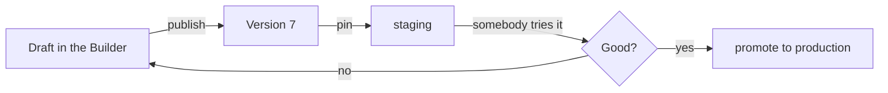

# Environments

Publishing an agent mints a [version](concepts.md#version). An **environment** is
a name that points at one of them — `production`, `staging`, `dev` — so you can
try a new version somewhere before everybody meets it.

Without environments, publish and release are the same act. With them, they are
two decisions: minting the version, and putting it somewhere.

## What an environment is

A name, a version it is pinned to, and optionally its own tracing destination.
Every agent has a **default** environment, and that is what a plain surface gets
when nobody said otherwise.

| | |
|---|---|
| **Name** | Lower-case, hyphenated, up to 64 characters — it appears in URLs and becomes the tracing tag, so `Production (EU)` and `production-eu` must not be two things |
| **Version** | Which published version answers here. There is no unpinned state |
| **Tracks latest** | Whether publishing repoints this environment on its own. Off by default |
| **Tracing** | A Logfire write token from the vault, so this environment's runs land in their own project |
| **Test connections** | MCP servers and vault keys this environment answers with test ones — a sandbox CRM, a test mailbox. Named environments only |

!!! info "There is no environment without a version"

    An unpinned environment would be a name that answers with nothing, and the
    first message routed to it would fail a long way from the form that created
    it. Create one without naming a version and it starts at whatever the
    default serves.

## The workflow it is for

1. Edit the draft, publish. That mints a version and changes nothing anybody is
   using.
2. Point `staging` at it, and bind your test Slack bot or a private link to
   `staging`.
3. Try it against real questions.
4. Promote `production` onto the same version — one edit, no republishing.

Rolling back is the same move backwards: repoint `production` at the version
that worked. The old version is still there, still readable, still runnable.

## `tracks_latest`, and why it is off

An environment with **tracks latest** on is repointed by every publish. That is
the right setting for `dev` and almost never right for `production`.

Off is the default deliberately: publishing mints a version, and deciding where
that version runs is a separate act. Coupling them means an unfinished edit
reaches a customer because somebody clicked Publish to save their work.

The one exception is the `production` a first publish creates. While it is the
agent's only environment there is nothing to promote from, so it follows
publishes; pin it once a `dev` or a `staging` sits beside it.

## Binding a surface to one

An [exposure](concepts.md#exposure) — a Slack bot, a widget, a hosted page, an
API audience — can name the environment it serves. Omitted, it gets the default.

That is what makes the split useful: a dev bot bound to `dev` serves whatever
`dev` pins, while the widget on your website stays on `production` until you
move it. One agent, two audiences, two versions, one set of books.

A page the agent publishes follows the same split. A run in a named environment
publishes an [artifact](artifacts.md#one-name-one-link) of its own, so trying
`dev` on the weekly report never republishes the page production readers open.
An environment with a run still working, or waiting for an approval, cannot be
removed until the run ends: deleting it would hand that run to the default, and
its pages to production's.

## Test connections

A version is the same spec wherever it runs, so `staging` would otherwise reach
the same CRM and the same mailbox as `production`. A named environment can
answer a binding with a **test connection** instead: an organization
[MCP server](mcp.md) with a sandbox one, or a capability's vault key with a test
key. The spec does not change, so promoting a version carries no test
credential with it.

| Binding | Replaced by | What the model sees |
|---|---|---|
| An organization MCP connection | Another organization MCP connection | The production connection's tool names, so staging and production are comparable |
| A capability's vault key | Another key of the same kind and purpose | Nothing: the capability never learns which key it was handed |

Every run in the environment uses them: a Slack bot bound to `staging`, an API
call naming it, a schedule, and every delegate those runs call. The tools a
test connection offers are narrowed by the production connection's allowlist,
the test connection's own and the binding's.

!!! warning "Off, never production"

    A binding can be switched off in an environment instead of replaced. So can
    one whose test side was deleted, disabled or lost its credentials: the
    binding goes dark there until somebody picks another test connection. The
    production side is never the fallback. A capability whose test key was
    deleted refuses the run rather than run without its key.

The default environment carries no test connections — it is what a surface
naming no environment runs, which is production. Both sides of an override must
be the organization's own, and a test key must be one the person setting it can
see. Only ids are stored; a test key stays in [the vault](secrets.md), and the
audit entry records how many overrides there are, not what they hold.

### In an eval

An eval runs the agent for real, so its tools would act for real: an agent that
sends e-mail would send one per case. A run started **isolated** — which is how
an eval runs — executes a tool only when that is safe:

| The tool | What happens |
|---|---|
| Reaches a test connection of the environment | Runs, against the test system |
| Only reads | Runs on the normal connection |
| Writes, with no test connection | **Not executed.** Recorded as an intended call, with its arguments |

An MCP tool reads only when its server says so with `readOnlyHint`. A
capability's tool declares it in the registry, and the
[catalog](reference/capabilities.md#what-an-eval-runs) lists which do. **A tool
that declares nothing writes.** The model is told the call was not sent, and
the intended call is kept with the run for scoring.

An isolated run can also be answered from the recording of the run a case was
taken from - the calls its transcript kept. A call is matched by its tool, its
arguments and its order among identical calls, and gets the original result; a
call the recording does not hold is not executed and is recorded as divergent. A
run whose transcript lost a call is not replayed at all. An isolated run has
nobody to ask for an approval, so a call the agent gates is not executed either,
and is recorded as one that needed an approval.

## Tracing per environment

An environment can carry its own Logfire write token, sealed in
[the vault](secrets.md), plus a service name. Its runs trace into that project,
tagged with the environment's name.

This is what keeps a staging experiment out of the dashboard somebody watches
for production incidents — and it is per environment rather than per deployment
because the two are genuinely different projects.

Where the traces go is the environment's; *how much they carry* is the agent's.
An agent's [observability](reference/spec.md#observability) block has a `content`
mode: `full` records the message, the model's output and every tool argument;
`none` records timing, tokens, cost and tool names only. For a project over
health, legal or HR data, `none` is what keeps a copy of the protected content
from leaving the machine. The environment's token redirects the run but does not
override that choice.

## What the default environment is not

The default is **managed by publishing**, not by this API. You cannot delete it,
rename another environment onto it, or hand-toggle which one is default.

Putting "what does a plain surface get" into two hands means they eventually
disagree, and the disagreement surfaces as a customer meeting a version nobody
released.

## Recap

- An environment is a **name pinned to a version**; every agent has a default.
- Publishing mints a version. **Putting it somewhere is a separate decision** —
  that is why `tracks_latest` is off for an environment you add; the `production`
  a first publish creates follows until you pin it.
- A **surface can name its environment**, so a dev bot and a public widget can
  serve different versions of one agent.
- **Rolling back is repointing**, because old versions stay readable and
  runnable.
- A named environment can answer bindings with **test connections**; a binding
  without one is off there, never production. In an eval, a tool that writes
  with no test connection is **recorded, not run**.
- The default environment is managed by publish, and deliberately not editable
  here.
