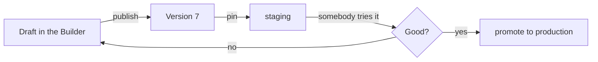

# Środowiska { #environments }

Publikacja agenta wybija [wersję](concepts.md#version). **Środowisko** to nazwa,
która wskazuje na jedną z nich — `production`, `staging`, `dev` — dzięki czemu
możesz wypróbować nową wersję gdzieś, zanim spotkają ją wszyscy.

Bez środowisk publikacja i wydanie to ten sam akt. Ze środowiskami to dwie
decyzje: wybicie wersji i umieszczenie jej gdzieś.

## Czym jest środowisko { #what-an-environment-is }

Nazwą, wersją, do której jest przypięte, i opcjonalnie własnym miejscem
docelowym śladów. Każdy agent ma środowisko **domyślne** i to właśnie ono
obsługuje zwykłą powierzchnię, gdy nikt nie powiedział inaczej.

| | |
|---|---|
| **Nazwa** | Małe litery, z myślnikami, do 64 znaków — pojawia się w URL-ach i staje się tagiem śladów, więc `Production (EU)` i `production-eu` nie mogą być dwiema rzeczami |
| **Wersja** | Która opublikowana wersja tu odpowiada. Nie ma stanu bez przypięcia |
| **Tracks latest** | Czy publikacja sama przekierowuje to środowisko. Domyślnie wyłączone |
| **Ślady** | Token zapisu Logfire z vaulta, żeby runy tego środowiska lądowały we własnym projekcie |
| **Połączenia testowe** | Serwery MCP i klucze z vault, które to środowisko zastępuje testowymi — sandboxowym CRM, testową skrzynką. Tylko środowiska nazwane |

!!! info "Nie ma środowiska bez wersji"

    Nieprzypięte środowisko byłoby nazwą, która odpowiada niczym, a pierwsza
    wiadomość do niego skierowana zawiodłaby daleko od formularza, który je
    utworzył. Utwórz jedno bez nazwania wersji, a zacznie od tego, co serwuje
    środowisko domyślne.

## Przepływ pracy, dla którego to jest { #the-workflow-it-is-for }

1. Edytuj wersję roboczą, opublikuj. To wybija wersję i nie zmienia niczego, z czego ktoś
   korzysta.
2. Wskaż nią `staging` i podepnij swojego testowego bota Slacka albo prywatny
   link do `staging`.
3. Wypróbuj go na prawdziwych pytaniach.
4. Wypromuj `production` na tę samą wersję — jedna edycja, bez ponownej
   publikacji.

Rollback to ten sam ruch wstecz: przekieruj `production` na wersję, która
działała. Stara wersja wciąż tam jest, wciąż da się ją odczytać i uruchomić.

[Suita ewaluacji](evals.md#suites) ustawiona na promocję sprawdza każdą wersję
wypromowaną na jej środowisko względem wersji, którą zastąpiła, i daje znać
właścicielowi, gdy wynik nie przechodzi. Sama tylko informuje; środowisko,
które wskazuje ją jako [strażnika](#guarding-a-promotion-with-evals), czeka, aż
przejdzie.

## Ewaluacja jako strażnik promocji { #guarding-a-promotion-with-evals }

Środowisko może wskazać [suity ewaluacji](evals.md#suites), które go **strzegą**.
Wtedy przyjmuje wersję dopiero, gdy każdy strażnik przeszedł na dokładnie tej
wersji, na wersji datasetu, przy scoringu i publikacji sędziego, do których
strażnik jest przypięty,
oraz przy progu, który ma teraz - zaliczenie sprzed przesunięcia przypięcia albo
sprzed podniesienia progu się nie liczy. Promocja, która tego nie spełnia, jest odrzucana (`409`,
`PROMOTION_BLOCKED`), a odmowa wymienia każdego strażnika i jego stan: nie
przeszedł, bez rozstrzygnięcia, nie uruchomił się i dlaczego, jeszcze sprawdza,
nieaktualny, niesprawdzony albo wstrzymany.

Zaliczenie liczy się dla środowiska, obok którego zostało uruchomione: względem
wersji, którą to środowisko serwuje teraz, i przy scoringu z jego przypięcia -
zaliczenie obok wersji stagingu nic nie mówi o zastąpieniu wersji produkcji.
Wstrzymany strażnik zatrzymuje wersję niezależnie od tego, co znalazł przed
wstrzymaniem.

Suita, która strzeże środowiska, jest **przypięta** do wersji datasetu,
scoringu i opublikowanej wersji sędziego, które miała, gdy została strażnikiem. Edycja datasetu - jego przypadków,
oceniania, sędziego - zostaje otwarta dla każdego, kto może go edytować, i nie
zmienia tego, co sprawdza strażnik.

Panel suity mówi, kiedy dataset albo jego sędzia poszedł
dalej, a **Move the pin** (`POST /api/v1/agents/{id}/eval-suites/{suite}/pin`)
przesuwa strażnika na najnowszą wersję, scoring i publikację sędziego; wymaga `promotions:override`
i jest zapisywane jako zmiana strażników. Suita, która przestaje strzec, znów
czyta najnowszą wersję, a suita, której dataset nie ma jeszcze przypadków, nie może
zostać strażnikiem. Strażnik ustawiony, zanim strażnicy byli przypinani, na
datasecie, który nie miał wtedy przypadków, nie jest przypięty: wstrzymuje każdą
wersję, dopóki nie przypnie go ktoś, kto może pomijać bramkę promocji.

Sędzia - własny sędzia datasetu albo Eval judge - zostaje przy publikacji, którą
miał, gdy strażnika przypięto. Ponownie opublikowany sędzia nie ocenia strażnika,
dopóki przypięcie się nie przesunie, a zaliczenie ocenione inną publikacją się nie
liczy. Strażnik przypięty, gdy jego sędzia nie miał publikacji, zostawia kryteria
sędziego bez oceny, dopóki przypięcie się nie przesunie.

Dialog promocji pokazuje to samo i uruchamia strażników, którzy nie przeszli na
tej wersji, każdego obok wersji, którą środowisko serwuje teraz
(`POST /api/v1/agents/{id}/environments/{env}/gate/run`;
`GET …/gate?version_id=` czyta bramkę). Strażnik, który potrzebuje sędziego,
gdy [wsparcie AI](governance.md#ai-assistance) jest wyłączone, mówi to wprost,
zamiast blokować bez powodu.

**Pominięcie** promuje mimo strażników. Wymaga uprawnienia
`promotions:override` - mają je owner i admin - oraz powodu o długości co
najmniej dziesięciu znaków, podanego przez osobę zalogowaną jako ona sama, nie
przez klucz API. Pominięcie, kto je zrobił i wynik każdego strażnika trafiają
do audit logu i na wersję w historii, a właściciel każdego strażnika, który nie
przeszedł, dostaje wiadomość.

Zmiana listy strażników wymaga tego samego uprawnienia, bo zdjęcie strażnika
przepuszcza to, co by zatrzymał, i tak samo osłabienie tego, co strażnik
sprawdza: niższy albo usunięty próg, inny dataset, inne środowisko albo połączenia
testowe tego środowiska. Ostrzejszy próg nie wymaga pominięcia; jest zapisywany
tak samo, a zaliczenie przy starym progu przestaje się liczyć. Suity, która
strzeże, ani datasetu, który taka suita sprawdza, nie da się usunąć, dopóki nie
zostanie zdjęta.

Strzeżone środowisko z włączonym **tracks latest** nie podąża za publikacją od
razu: publikacja uruchamia jego strażników na nowej wersji, a środowisko
przesuwa się, gdy wszyscy przejdą, zapisane jako promocja przez bramkę.
Środowisko, którego strażnicy nie przeszli, zostaje na miejscu, a jego wiersz
mówi, że czeka.

## `tracks_latest` i dlaczego jest wyłączone { #tracks_latest-and-why-it-is-off }

Środowisko z włączonym **tracks latest** jest przekierowywane przez każdą
publikację. To właściwe ustawienie dla `dev` i prawie nigdy właściwe dla
`production`.

Domyślne wyłączenie jest celowe: publikacja wybija wersję, a decyzja o tym, gdzie
ta wersja działa, jest osobnym aktem. Sprzęgnięcie ich oznacza, że niedokończona
edycja dociera do klienta, bo ktoś kliknął **Opublikuj** (Publish), żeby zapisać swoją pracę.

Jedynym wyjątkiem jest `production`, które tworzy pierwsza publikacja. Dopóki jest
jedynym środowiskiem agenta, nie ma skąd promować, więc podąża za publikacjami;
przypnij je, gdy obok pojawi się `dev` albo `staging`.

## Podpinanie powierzchni do środowiska { #binding-a-surface-to-one }

[Ekspozycja](concepts.md#exposure) — bot Slacka, widget, hostowana strona,
odbiorca API — może nazwać środowisko, które obsługuje. Pominięta, dostaje
domyślne.

To właśnie czyni ten podział użytecznym: bot deweloperski podpięty do `dev`
serwuje to, co przypina `dev`, podczas gdy widget na twojej stronie zostaje na
`production`, dopóki go nie przeniesiesz. Jeden agent, dwie publiczności, dwie
wersje, jeden komplet ksiąg.

Strona, którą agent publikuje, dzieli się tak samo. Run w nazwanym środowisku
publikuje własną [aplikację](artifacts.md#one-name-one-link), więc próba `dev` na
cotygodniowym raporcie nigdy nie publikuje ponownie strony, którą otwierają
czytelnicy produkcji. Środowiska z runem, który wciąż pracuje albo czeka na
akceptację, nie da się usunąć, dopóki run się nie skończy: usunięcie
przekazałoby ten run domyślnemu środowisku, a jego strony — produkcji. Tak samo
jest, dopóki run ewaluacji w tym środowisku czeka w kolejce albo działa: inaczej
szedłby dalej na połączeniach produkcji.

## Połączenia testowe { #test-connections }

Wersja to ten sam spec, gdziekolwiek działa, więc `staging` sięgałby inaczej do
tego samego CRM i tej samej skrzynki co `production`. Nazwane środowisko może
zamiast tego odpowiedzieć na binding **połączeniem testowym**: organizacyjny
[serwer MCP](mcp.md) — sandboxowym, a klucz capability z vault — kluczem
testowym. Spec się nie zmienia, więc promocja wersji nie przenosi żadnego
testowego poświadczenia.

| Binding | Zastępowany przez | Co widzi model |
|---|---|---|
| Organizacyjne połączenie MCP | Inne organizacyjne połączenie MCP | Nazwy narzędzi połączenia produkcyjnego, więc staging i produkcja są porównywalne |
| Klucz capability z vault | Inny klucz tego samego rodzaju i przeznaczenia | Nic: capability nigdy nie wie, jaki klucz dostała |

Używa ich każdy run w tym środowisku: bot Slack podpięty do `staging`, wywołanie
API, które je nazywa, harmonogram i każdy delegat, którego te runy wywołują.
Narzędzia, które oferuje połączenie testowe, są zawężane przez allowlistę
połączenia produkcyjnego, własną allowlistę połączenia testowego i allowlistę
bindingu.

!!! warning "Wyłączone, nigdy produkcja"

    Binding można w środowisku wyłączyć zamiast zastępować. Tak samo dzieje się
    z bindingiem, którego strona testowa została usunięta, wyłączona albo straciła
    poświadczenia: binding gaśnie tam, dopóki ktoś nie wybierze innego połączenia
    testowego. Strona produkcyjna nigdy nie jest awaryjnym zastępstwem. Capability,
    której testowy klucz usunięto, odmawia runu, zamiast działać bez klucza.

Środowisko domyślne nie ma połączeń testowych — to ono obsługuje powierzchnię,
która nie nazywa środowiska, czyli produkcję. Obie strony zastąpienia muszą
należeć do organizacji, a klucz testowy musi być widoczny dla osoby, która go
ustawia. Zapisywane są tylko identyfikatory; klucz testowy zostaje w
[vault](secrets.md), a wpis audytu zapisuje, ile jest zastąpień, nie to, co
zawierają.

### W ewaluacji { #in-an-eval }

Ewaluacja uruchamia agenta naprawdę, więc jego narzędzia działałyby naprawdę:
agent, który wysyła e-maile, wysłałby jeden na każdy przypadek. Run uruchomiony
w **izolacji** — a tak działa ewaluacja — wykonuje narzędzie tylko wtedy, gdy jest to
bezpieczne:

| Narzędzie | Co się dzieje |
|---|---|
| Sięga do testowego połączenia MCP środowiska | Działa, na systemie testowym |
| Tylko czyta | Działa na zwykłym połączeniu |
| Zapisuje, na testowym kluczu z vault | Działa tylko wtedy, gdy jego capability deklaruje, że sam klucz wyznacza cel; inaczej **nie jest wykonywane** i jest zapisywane |
| Zapisuje i nie ma połączenia testowego | **Nie jest wykonywane.** Zapisywane jako zamierzone wywołanie, z argumentami |

Klucz testowy zastępuje poświadczenie, ale URL albo host w konfiguracji
capability nadal może kierować zapisy na produkcję. Dlatego podmieniony klucz
pozwala capability zapisywać w ewaluacji tylko wtedy, gdy deklaruje ona
`test_key_isolates`, a [katalog](reference/capabilities.md#what-an-eval-runs)
wymienia, które to robią.

Narzędzie MCP liczy się jako czytające tylko wtedy, gdy serwer oznacza je
`readOnlyHint`, a połączenie ma włączone zaufanie do tego oznaczenia. Domyślnie
nie ma, bo oznaczenie to deklaracja samego serwera. Narzędzie capability deklaruje to w rejestrze, a
[katalog](reference/capabilities.md#what-an-eval-runs) wymienia, które to robią.
**Narzędzie, które niczego nie deklaruje, zapisuje.** Model dowiaduje się, że
wywołanie nie zostało wysłane, a zamierzone wywołanie zostaje zachowane z runem
do oceny.

Run w izolacji może też dostawać odpowiedzi z nagrania runu, z którego wzięto
przypadek — z wywołań, które zachował jego transkrypt. Wywołanie jest
dopasowywane po narzędziu, argumentach i kolejności wśród identycznych wywołań i
dostaje oryginalny wynik; wywołanie, którego nagranie nie zawiera, nie jest
wykonywane i zostaje zapisane jako rozbieżne. Run, którego transkrypt zgubił
wywołanie, nie jest odtwarzany wcale. Run w izolacji nie ma kogo zapytać o
zatwierdzenie, więc wywołanie objęte bramką też nie jest wykonywane i zostaje
zapisane jako wymagające zatwierdzenia.

## Testowanie z poziomu Buildera { #trying-it-from-the-builder }

**Testuj** w nagłówku Buildera otwiera czat obok Buildera, a nie nad nim - ten sam
czat co `/chat`, ze strumieniowaniem, krokami narzędzi, kartami zatwierdzeń i
pytaniami. Odpowiada jako **wersja robocza**, z nieopublikowanymi zmianami, albo
jako wersja dowolnego środowiska, i mówi która. Do testu wersji roboczej nic nie
trzeba publikować: wersja robocza musi przejść te same sprawdzenia co publikacja
i uruchomić ją może tylko osoba, która może edytować agenta. Run zatrzymany na
zatwierdzeniu kontynuuje na wersji roboczej takiej, jaka była na jego początku.

Każda tura jest tam **runem testowym**: liczonym w budżecie i zapisywanym jak każdy
inny, oznaczonym `test` w Aktywności i możliwym do odfiltrowania (**With test
runs**, **Without test runs**, **Only test runs**; `?test=true` albo `false` w
`GET /api/v1/runs`). Panel zaczyna nową rozmowę, wysyła ostatnią wiadomość ponownie
po zmianie i trzyma kilka przypiętych promptów do uruchomienia jednym kliknięciem.
Jego szerokość, to, co odpowiada, i przypięte prompty są zapamiętywane per agent w
przeglądarce. Ramka czatu wysyła w każdej turze `draft: true` albo `test: true` z
`environment_id`.

**Porównaj** stawia dwa czaty obok siebie - wersję roboczą i produkcję albo dwa
środowiska - a pole nad nimi pyta oba o to samo jednocześnie, więc odpowiedzi
różnią się tylko tym, co odpowiada. **Co zmienia wersja robocza** pokazuje wersję
roboczą na tle opublikowanej wersji, jako ten sam diff, który rysuje historia wersji. Naciśnięcie <kbd>T</kbd> w
dowolnym miejscu Buildera, poza polem tekstowym, otwiera albo zamyka panel.

## Ślady per środowisko { #tracing-per-environment }

Środowisko może nieść własny token zapisu Logfire, zapieczętowany w
[vaulcie](secrets.md), oraz nazwę usługi. Jego runy trafiają do śladów w tamtym
projekcie, otagowane nazwą środowiska.

To właśnie trzyma eksperyment ze stagingu z dala od dashboardu, który ktoś
obserwuje pod kątem incydentów produkcyjnych — i jest per środowisko, a nie per
deployment, bo te dwa to naprawdę różne projekty.

Gdzie trafiają trace'y, należy do środowiska; *ile niosą* — do agenta. Blok
[observability](reference/spec.md#observability) agenta ma tryb `content`: `full`
zapisuje wiadomość, wyjście modelu i każdy argument narzędzia, a `none` — tylko
czas, tokeny, koszt i nazwy narzędzi. Przy projekcie nad danymi medycznymi,
prawnymi albo kadrowymi to właśnie `none` powstrzymuje kopię chronionej treści
przed opuszczeniem maszyny. Token środowiska przekierowuje run, ale tego wyboru
nie nadpisuje.

## Czym domyślne środowisko nie jest { #what-the-default-environment-is-not }

Środowisko domyślne jest **zarządzane przez publikację**, a nie przez to API. Nie
możesz go usunąć, przemianować innego środowiska na nie ani ręcznie przełączyć,
które jest domyślne.

Oddanie odpowiedzi na pytanie "co dostaje zwykła powierzchnia" w dwie ręce
oznacza, że one w końcu się poróżnią, a ta różnica wychodzi na jaw jako klient
spotykający wersję, której nikt nie wydał.

## Podsumowanie { #recap }

- Środowisko to **nazwa przypięta do wersji**; każdy agent ma domyślne.
- Publikacja wybija wersję. **Umieszczenie jej gdzieś to osobna decyzja** —
  dlatego `tracks_latest` jest wyłączone w środowisku, które dodajesz; `production`
  utworzone przez pierwszą publikację podąża za nimi, dopóki go nie przypniesz.
- **Powierzchnia może nazwać swoje środowisko**, więc bot deweloperski i
  publiczny widget mogą serwować różne wersje jednego agenta.
- **Rollback to przekierowanie**, bo stare wersje pozostają czytelne i
  uruchamialne.
- Środowisko może być **strzeżone przez suity ewaluacji**: wersja trafia na nie
  dopiero, gdy przejdą na tej wersji, albo z ich pominięciem - z powodem i
  uprawnieniem `promotions:override`.
- Nazwane środowisko może zastąpić bindingi **połączeniami testowymi**; binding
  bez takiego połączenia jest tam wyłączony, nigdy nie trafia na produkcję. W
  ewaluacji narzędzie, które zapisuje i nie ma połączenia testowego, jest **zapisywane, a nie
  uruchamiane**.
- Środowisko domyślne jest zarządzane przez publikację i celowo nie da się go tu
  edytować.
