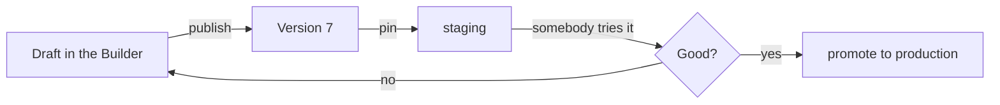

# Środowiska { #environments }

Publikacja agenta wybija [wersję](concepts.md#version). **Środowisko** to nazwa,
która wskazuje na jedną z nich — `production`, `staging`, `dev` — dzięki czemu
możesz wypróbować nową wersję gdzieś, zanim spotkają ją wszyscy.

Bez środowisk publikacja i wydanie to ten sam akt. Ze środowiskami to dwie
decyzje: wybicie wersji i umieszczenie jej gdzieś.

## Czym jest środowisko { #what-an-environment-is }

Nazwą, wersją, do której jest przypięte, i opcjonalnie własnym miejscem
docelowym śladów. Każdy agent ma środowisko **domyślne** i to właśnie ono
obsługuje zwykłą powierzchnię, gdy nikt nie powiedział inaczej.

| | |
|---|---|
| **Nazwa** | Małe litery, z myślnikami, do 64 znaków — pojawia się w URL-ach i staje się tagiem śladów, więc `Production (EU)` i `production-eu` nie mogą być dwiema rzeczami |
| **Wersja** | Która opublikowana wersja tu odpowiada. Nie ma stanu bez przypięcia |
| **Tracks latest** | Czy publikacja sama przekierowuje to środowisko. Domyślnie wyłączone |
| **Ślady** | Token zapisu Logfire z vaulta, żeby runy tego środowiska lądowały we własnym projekcie |
| **Połączenia testowe** | Serwery MCP i klucze z vault, które to środowisko zastępuje testowymi — sandboxowym CRM, testową skrzynką. Tylko środowiska nazwane |

!!! info "Nie ma środowiska bez wersji"

    Nieprzypięte środowisko byłoby nazwą, która odpowiada niczym, a pierwsza
    wiadomość do niego skierowana zawiodłaby daleko od formularza, który je
    utworzył. Utwórz jedno bez nazwania wersji, a zacznie od tego, co serwuje
    środowisko domyślne.

## Przepływ pracy, dla którego to jest { #the-workflow-it-is-for }

1. Edytuj draft, opublikuj. To wybija wersję i nie zmienia niczego, z czego ktoś
   korzysta.
2. Wskaż nią `staging` i podepnij swojego testowego bota Slacka albo prywatny
   link do `staging`.
3. Wypróbuj go na prawdziwych pytaniach.
4. Wypromuj `production` na tę samą wersję — jedna edycja, bez ponownej
   publikacji.

Rollback to ten sam ruch wstecz: przekieruj `production` na wersję, która
działała. Stara wersja wciąż tam jest, wciąż da się ją odczytać i uruchomić.

## `tracks_latest` i dlaczego jest wyłączone { #tracks_latest-and-why-it-is-off }

Środowisko z włączonym **tracks latest** jest przekierowywane przez każdą
publikację. To właściwe ustawienie dla `dev` i prawie nigdy właściwe dla
`production`.

Domyślne wyłączenie jest celowe: publikacja wybija wersję, a decyzja o tym, gdzie
ta wersja działa, jest osobnym aktem. Sprzęgnięcie ich oznacza, że niedokończona
edycja dociera do klienta, bo ktoś kliknął Publish, żeby zapisać swoją pracę.

Jedynym wyjątkiem jest `production`, które tworzy pierwsza publikacja. Dopóki jest
jedynym środowiskiem agenta, nie ma skąd promować, więc podąża za publikacjami;
przypnij je, gdy obok pojawi się `dev` albo `staging`.

## Podpinanie powierzchni do środowiska { #binding-a-surface-to-one }

[Ekspozycja](concepts.md#exposure) — bot Slacka, widget, hostowana strona,
odbiorca API — może nazwać środowisko, które obsługuje. Pominięta, dostaje
domyślne.

To właśnie czyni ten podział użytecznym: bot deweloperski podpięty do `dev`
serwuje to, co przypina `dev`, podczas gdy widget na twojej stronie zostaje na
`production`, dopóki go nie przeniesiesz. Jeden agent, dwie publiczności, dwie
wersje, jeden komplet ksiąg.

Strona, którą agent publikuje, dzieli się tak samo. Run w nazwanym środowisku
publikuje własny [artefakt](artifacts.md#one-name-one-link), więc próba `dev` na
cotygodniowym raporcie nigdy nie publikuje ponownie strony, którą otwierają
czytelnicy produkcji. Środowiska z runem, który wciąż pracuje albo czeka na
akceptację, nie da się usunąć, dopóki run się nie skończy: usunięcie przekazałoby ten run domyślnemu środowisku, a jego
strony — produkcji.

## Połączenia testowe { #test-connections }

Wersja to ten sam spec, gdziekolwiek działa, więc `staging` sięgałby inaczej do
tego samego CRM i tej samej skrzynki co `production`. Nazwane środowisko może
zamiast tego odpowiedzieć na binding **połączeniem testowym**: organizacyjny
[serwer MCP](mcp.md) — sandboxowym, a klucz capability z vault — kluczem
testowym. Spec się nie zmienia, więc promocja wersji nie przenosi żadnego
testowego poświadczenia.

| Binding | Zastępowany przez | Co widzi model |
|---|---|---|
| Organizacyjne połączenie MCP | Inne organizacyjne połączenie MCP | Nazwy narzędzi połączenia produkcyjnego, więc staging i produkcja są porównywalne |
| Klucz capability z vault | Inny klucz tego samego rodzaju i przeznaczenia | Nic: capability nigdy nie wie, jaki klucz dostała |

Używa ich każdy run w tym środowisku: bot Slack podpięty do `staging`, wywołanie
API, które je nazywa, harmonogram i każdy delegat, którego te runy wywołują.
Narzędzia, które oferuje połączenie testowe, są zawężane przez allowlistę
połączenia produkcyjnego, własną allowlistę połączenia testowego i allowlistę
bindingu.

!!! warning "Wyłączone, nigdy produkcja"

    Binding można w środowisku wyłączyć zamiast zastępować. Tak samo dzieje się
    z bindingiem, którego strona testowa została usunięta, wyłączona albo straciła
    poświadczenia: binding gaśnie tam, dopóki ktoś nie wybierze innego połączenia
    testowego. Strona produkcyjna nigdy nie jest awaryjnym zastępstwem. Capability,
    której testowy klucz usunięto, odmawia runu, zamiast działać bez klucza.

Środowisko domyślne nie ma połączeń testowych — to ono obsługuje powierzchnię,
która nie nazywa środowiska, czyli produkcję. Obie strony zastąpienia muszą
należeć do organizacji, a klucz testowy musi być widoczny dla osoby, która go
ustawia. Zapisywane są tylko identyfikatory; klucz testowy zostaje w
[vault](secrets.md), a wpis audytu zapisuje, ile jest zastąpień, nie to, co
zawierają.

### W evalu { #in-an-eval }

Eval uruchamia agenta naprawdę, więc jego narzędzia działałyby naprawdę: agent,
który wysyła e-maile, wysłałby jeden na każdy przypadek. Run uruchomiony w
**izolacji** — a tak działa eval — wykonuje narzędzie tylko wtedy, gdy jest to
bezpieczne:

| Narzędzie | Co się dzieje |
|---|---|
| Sięga do połączenia testowego środowiska | Działa, na systemie testowym |
| Tylko czyta | Działa na zwykłym połączeniu |
| Zapisuje i nie ma połączenia testowego | **Nie jest wykonywane.** Zapisywane jako zamierzone wywołanie, z argumentami |

Narzędzie MCP tylko czyta, gdy jego serwer mówi tak przez `readOnlyHint`.
Narzędzie capability deklaruje to w rejestrze, a
[katalog](reference/capabilities.md#what-an-eval-runs) wymienia, które to robią.
**Narzędzie, które niczego nie deklaruje, zapisuje.** Model dowiaduje się, że
wywołanie nie zostało wysłane, a zamierzone wywołanie zostaje zachowane z runem
do oceny.

Run w izolacji może też dostawać odpowiedzi z nagrania runu, z którego wzięto
przypadek. Wywołanie jest dopasowywane po narzędziu, argumentach i kolejności
wśród identycznych wywołań i dostaje oryginalny wynik; wywołanie, którego
nagranie nie zawiera, nie jest wykonywane i zostaje zapisane jako rozbieżne. Run
w izolacji nie ma kogo zapytać o zatwierdzenie, więc wywołanie objęte bramką
jest odrzucane, a nie wstrzymywane.

## Ślady per środowisko { #tracing-per-environment }

Środowisko może nieść własny token zapisu Logfire, zapieczętowany w
[vaulcie](secrets.md), oraz nazwę usługi. Jego runy trafiają do śladów w tamtym
projekcie, otagowane nazwą środowiska.

To właśnie trzyma eksperyment ze stagingu z dala od dashboardu, który ktoś
obserwuje pod kątem incydentów produkcyjnych — i jest per środowisko, a nie per
deployment, bo te dwa to naprawdę różne projekty.

Gdzie trafiają trace'y, należy do środowiska; *ile niosą* — do agenta. Blok
[observability](reference/spec.md#observability) agenta ma tryb `content`: `full`
zapisuje wiadomość, wyjście modelu i każdy argument narzędzia, a `none` — tylko
czas, tokeny, koszt i nazwy narzędzi. Przy projekcie nad danymi medycznymi,
prawnymi albo kadrowymi to właśnie `none` powstrzymuje kopię chronionej treści
przed opuszczeniem maszyny. Token środowiska przekierowuje run, ale tego wyboru
nie nadpisuje.

## Czym domyślne środowisko nie jest { #what-the-default-environment-is-not }

Środowisko domyślne jest **zarządzane przez publikację**, a nie przez to API. Nie
możesz go usunąć, przemianować innego środowiska na nie ani ręcznie przełączyć,
które jest domyślne.

Oddanie odpowiedzi na pytanie "co dostaje zwykła powierzchnia" w dwie ręce
oznacza, że one w końcu się poróżnią, a ta różnica wychodzi na jaw jako klient
spotykający wersję, której nikt nie wydał.

## Podsumowanie { #recap }

- Środowisko to **nazwa przypięta do wersji**; każdy agent ma domyślne.
- Publikacja wybija wersję. **Umieszczenie jej gdzieś to osobna decyzja** —
  dlatego `tracks_latest` jest wyłączone w środowisku, które dodajesz; `production`
  utworzone przez pierwszą publikację podąża za nimi, dopóki go nie przypniesz.
- **Powierzchnia może nazwać swoje środowisko**, więc bot deweloperski i
  publiczny widget mogą serwować różne wersje jednego agenta.
- **Rollback to przekierowanie**, bo stare wersje pozostają czytelne i
  uruchamialne.
- Nazwane środowisko może zastąpić bindingi **połączeniami testowymi**; binding
  bez takiego połączenia jest tam wyłączony, nigdy nie trafia na produkcję. W evalu
  narzędzie, które zapisuje i nie ma połączenia testowego, jest **zapisywane, a nie
  uruchamiane**.
- Środowisko domyślne jest zarządzane przez publikację i celowo nie da się go tu
  edytować.
