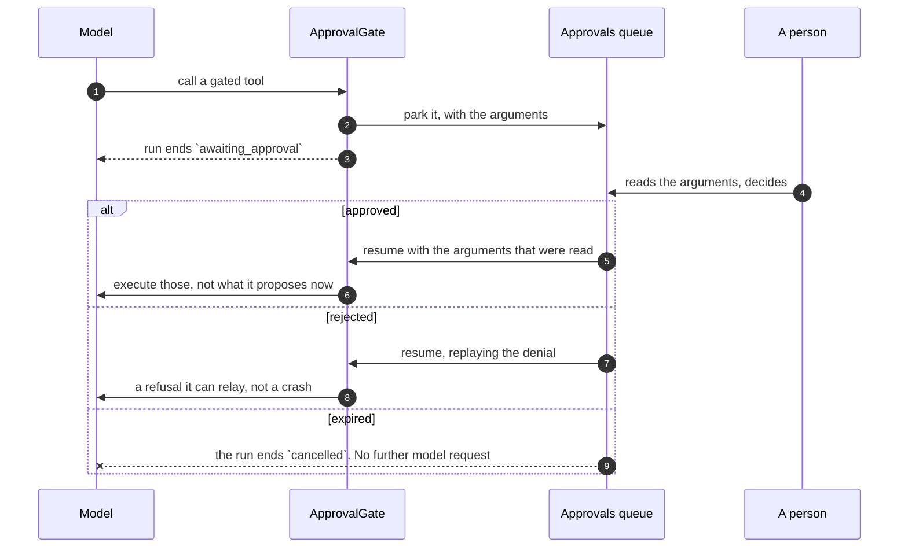

# Governance { #governance }

Budgets, aprobaciones, alertas y el registro de auditoría. Las cuatro cosas que
convierten una plataforma de agents en algo detrás de lo que puedes poner una
tarjeta de crédito.

Todas se aplican igual en cada superficie, porque cada superficie pasa por un
único runner.

La más reciente de esas superficies es un **trigger**: un agent que se ejecuta a
sí mismo según un horario o ante un evento entrante — una issue de GitHub, un
correo recibido (mira [Conceptos](concepts.md#trigger)).

Usa el mismo registro de gasto, cola de aprobaciones y auditoría. La
[política de acciones desatendidas](#routine-action-consent) refuerza qué llamadas
requieren aprobación; el consentimiento explícito identifica acciones y una versión.

El trabajo desatendido también define el resultado de un **rechazo**:

- Un run disparado que el budget detiene termina en `budget_exceeded` y **espera
  al siguiente disparo** en lugar de reintentarse.
- Un run disparado que quien lo creó ya no puede hacer — porque dejó la
  organización, o perdió su grant sobre el agent — **desactiva el trigger** y
  escribe una entrada de auditoría diciendo por qué.
- Un run disparado que falla en el modelo mismo — una caída del provider, una
  clave revocada — se registra como `failed` y se deja para el siguiente disparo,
  en vez de hacer que el heartbeat reintente contra el mismo muro. El
  `last_run_id` del trigger se queda apuntando a él, para que su historial siga
  siendo honesto.

Un rechazo que un heartbeat reintentara cada minuto sería una factura, o una
alerta, que no para nunca.

!!! warning "Lo que no se traga es un fallo que nunca llegó a ser un registro"

    Si el run alcanzó un estado terminal pero la escritura que lo registraba no
    hizo commit — una transcripción o una escritura del estado de la conversación
    que lanzó una excepción después de tener ya la respuesta —, el disparo **hace
    fallar el flow** en lugar de informar de un éxito. El run a medio escribir se
    revierte en vez de quedar confirmado como completo sin nada detrás.

Un trigger de evento añade un rechazo más en su borde: un webhook cuya firma no se
verifica contra el secreto propio del trigger es un 403 que nunca llega al runner.

## Entrega de rutinas { #routine-delivery }

Una rutina creada en un chat privado mediante el MCP de la plataforma responde en
ese chat, salvo que elijas otro destino. Su tarjeta muestra el estado actual, la
próxima activación y los controles existentes para editar, pausar y eliminar.
El registro de ejecuciones sigue disponible en Routines.

Antes de guardar una respuesta terminada, la plataforma vuelve a comprobar la membresía activa de la persona creadora y su permiso actual para escribir en el chat elegido. Un destino eliminado o inaccesible deja la respuesta en el registro de ejecución y muestra **Última respuesta no disponible en el chat** en la rutina. Un fallo de base de datos durante la entrega del mensaje queda aislado para no deshacer la ejecución terminada ni volver a ejecutar el agente.

El aviso de finalización enlaza el chat solo tras una entrega correcta.

`last_delivery_status` distingue entrega, solo registro, ausencia de respuesta y ejecución incompleta; los registros históricos siguen sin estado conocido hasta otra ejecución. La migración `0265_trigger_delivery_status.py` añade este estado sin inferir éxitos anteriores.

Define `ends_at` con un desplazamiento UTC para el trabajo con duración limitada y
`monthly_budget_usd` para un límite mensual más estricto. La herramienta MCP de
actualización permite quitar ambos ajustes. Una clave API ordinaria no puede
autorizar a una rutina a usar las cuentas personales de quien la emitió. Tampoco conceden esa autoridad los runs en segundo plano, las suplantaciones ni los turnos grupales o públicos reanudados.

Los barridos de cada minuto procesan los vencimientos independientemente de la siguiente activación, incluso para rutinas y seguimientos pausados. Desactivan el trabajo activo, resuelven sus bloqueos pendientes y cancelan las notificaciones aún no enviadas sin llamar a un modelo. Tras reiniciarse, el worker recupera los vencimientos; la limpieza puede esperar a un worker o a otro lote, mientras las comprobaciones previas a herramientas y entregas rechazan de inmediato el trabajo vencido.

La migración `0269_routine_end_cleanup.py` añade una marca del vencimiento procesado e índices parciales de finales pendientes. No crea rutinas, permisos ni hallazgos de reemplazo. Cambiar el final reactiva la limpieza; repetir el barrido no repite los efectos ya resueltos. El downgrade elimina solo estos datos auxiliares, conservando el final configurado y la identidad de la rutina.

Una conexión MCP observada también registra su generación de autorización. Completar un nuevo consentimiento OAuth o sustituir explícitamente el token o la dirección invalida el consentimiento de origen anterior aunque siga igual el ID de conexión. La renovación normal del token, las etiquetas y los cambios de cuenta predeterminada no reemplazan esta identidad. Un origen revisado sirve para ejecuciones posteriores; una ejecución antigua pausada no puede tomar prestado el nuevo consentimiento.

Tras la migración `0270_mcp_authorization_generation.py`, revisa explícitamente los orígenes de los seguimientos existentes (`review_sources=true`). Las políticas antiguas siguen siendo legibles, pero no adivinan la cuenta de una autorización histórica. No se leen credenciales del proveedor para resolver cuentas fuera de la generación admitida. Drena los workers antiguos y actualiza API y workers juntos. Pausa los seguimientos antes del downgrade; reanúdalos solo con código que compruebe la generación y orígenes revisados. Sustituir credenciales borra la lista de herramientas anterior hasta la siguiente comprobación correcta.

Las ejecuciones de rutinas conservan las cuentas MCP y los alias de herramientas admitidos para esa ejecución. Al reanudar una llamada se reutilizan esos alias: renombrar una cuenta o cambiar la predeterminada no redirige una aprobación existente. Los delegados permanecen dentro de las cuentas admitidas. Antes de llamar se comprueban de nuevo propietario, dirección, generación de autorización y herramientas permitidas; las cuentas nuevas o modificadas se filtran antes de resolver credenciales.

Una rutina pausada sin este estado de admisión no puede continuar llamadas MCP de cuentas gestionadas. Inicia una ejecución nueva tras revisar su acceso. No cambian los valores del agente interactivo ni las políticas explícitas de aprobación; las excepciones de aprobación por cuenta siguen siendo independientes de esta comprobación del origen.

La política de versiones permite seguir la versión publicada predeterminada o fijar una versión inmutable. Una publicación no cambia la versión fijada. Elimina la fijación para volver a seguir la predeterminada. Un entorno con nombre y una versión fijada se excluyen mutuamente; siguen vigentes los permisos, presupuestos y aprobaciones actuales.

El formulario de la rutina permite definir o quitar su fecha de fin. La fecha usa la zona horaria del dispositivo indicada junto al campo, independientemente de la zona del cron, y se envía a la API como un instante con desplazamiento UTC. Editar otro campo conserva el fin existente.

Una rutina vuelve a comprobar su creador, membresía activa, rol y permisos de ejecución antes de cada herramienta, también en delegaciones y después de una aprobación. Pausar, borrar, caducar, retirar el consentimiento personal o cambiar esa autoridad impide las siguientes llamadas. La comprobación no revierte efectos ya enviados a servicios externos. La migración `0260_routine_run_origin` conserva el origen tras borrar la rutina; los horarios antiguos aparcados cuyo origen ya se perdió se rechazan en lugar de usar la autoridad de quien aprueba.

El servidor MCP integrado de AgenticOS requiere **Actuar como creador**, también cuando lo vincula un delegado publicado. Sin una identidad de persona, la revisión de fuentes y la creación de la rutina rechazan esta configuración con una explicación concreta. Active la opción o quite la vinculación de plataforma del agente y sus delegados. La plataforma nunca adopta automáticamente la identidad del creador.

El historial de la rutina también muestra intentos bloqueados o fallidos anteriores a un run del agente. Cada uno incluye la hora, la etapa y una indicación para solucionarlo. No generan cargos de modelo ni contienen prompts, errores del proveedor o credenciales. Los registros permanecen hasta eliminar la rutina o la organización; un fallo en la entrega de notificaciones no los elimina. El job fire-trigger guarda un resultado separado bloqueado o fallido. Completar el job de la cola no significa que el agente se haya ejecutado correctamente.

## Budgets { #budgets }

!!! abstract "Tres niveles, y no son variaciones de un mismo número"

    El tope de un agent medido contra el total de la organización lo agotan los
    runs de sus vecinos; el de la organización medido contra un solo agent no es
    techo alguno. Mira [por qué no se pueden fundir](#why-they-cannot-be-collapsed).

| Nivel | Se fija en | Mide | Lo sube |
| --- | --- | --- | --- |
| **Agent, mensual** | el spec del agent | los runs de ese mismo agent | quien pueda editar el agent |
| **Departamento, mensual** | los ajustes del departamento | los runs que iniciaron sus miembros, en cualquier agent | quien tenga `members:manage` y `budgets:manage` |
| **Organización, mensual** | los ajustes de la organización | cada run _y_ cada ingesta de la organización | quien tenga `budgets:manage` |

Cada tope mensual cuenta el coste entero de un run en el mes en que empezó, igual que
los informes de gasto. Un run que cruza el límite de un mes - aparcado en una
aprobación la última tarde y aprobado el día uno - aparece entero en el mes anterior,
y al reanudarse se compara con el gasto de ese mes, no con el del nuevo.

Una **organización nueva empieza con el techo de la organización ya puesto** — el
`DEFAULT_ORG_MONTHLY_BUDGET_USD` del deployment ([configuración](configuration.md),
$100 de serie) —, así que un tenant recién creado no está a un agent desbocado de
una factura sorpresa. A partir de ahí es un tope corriente: editable en la fila de
la organización, y aplicado exactamente igual que uno puesto a mano. Un deployment
que prefiera arrancar sin tope deja ese ajuste vacío; en cualquier caso, el tope de
una organización existente nunca se cambia por ello.

### Por qué no se pueden fundir { #why-they-cannot-be-collapsed }

Antes lo estaban, con `min()`, y el resultado era erróneo. El tope de un agent
medido contra el total de la organización lo agotan los runs de sus vecinos, que
es precisamente lo que hace que no sea un tope. El tope de una organización medido
contra el gasto de un solo agent no ataría nunca.

Así que cada tope mide su propia magnitud, y la consulta viaja con el límite. Un
agent de $5 bajo un techo de $50 ata ahora cuando _él_ ha gastado $5, y el rechazo
nombra el tope que de verdad ató en vez de deducirlo de cuál de los dos números era
menor.

Un agent sigue sin poder aflojar el techo de la organización: la entrada de la
organización está presente con su propio número pida lo que pida el spec, y el
gasto de un agent forma parte del de la organización — así que un agent de $100
bajo una organización de $10 se detiene en $10.

Ambos topes se leen donde está su gasto: el de la organización en su propia fila
(`GET /orgs/{org_id}`), y el de cada agent como `budget_monthly_usd` en el listado
de agents — el número de la versión _publicada_, ya que es la que aplica el runner,
no lo que prometa el borrador en este momento. La tarjeta de margen del dashboard
cruza estos datos con `GET /spend`, de modo que se puede ver un tope acercándose
antes de que `budget_exceeded` empiece a aparecer en el historial de runs.

Ese número publicado se aplica a todos los runs del agent, también a un run de una
versión anterior: una rutina, un entorno o un paso de workflow fijados a ella,
o un run reanudado en la versión en la que quedó aparcado. Fijar una versión decide
cómo se comporta el agent, no cuánto puede gastar.

### El tope de un departamento { #a-departments-cap }

Un [departamento](departments.md#a-departments-budget) puede llevar su propio
tope mensual. Se sitúa entre los otros dos: un run se comprueba contra el tope
del agent, luego contra cada departamento con tope de la persona que lo inició y
por último contra el de la organización. Cada departamento mide el mes de sus
propios miembros, así que a una persona de Finanzas y Ventas la detiene el que
se agote primero, y el rechazo lo nombra - _Sales department monthly budget
exhausted_.

El responsable del departamento y los administradores reciben un aviso cuando
supera el 80% de su mes, y otro cuando su tope detiene un run. Un run que no
inició nadie - una programación, un visitante en un canal - no pertenece a
ningún departamento y no se cuenta.

### Se aplica antes de la petición { #enforcement-is-before-the-request }

!!! danger "Antes, no después"

    Comprobarlo después significa que la petición que rompió el budget ya estaba
    pagada — y un bucle puede pasarse por una llamada cara cada vez.

!!! important "Un run fallido registra igualmente lo que gastó"

    Un budget que ignora los fallos no es un budget. La contabilidad ocurre en un
    bloque `finally` en cada superficie, y el commit es explícito en lugar de
    dejarse al contexto de sesión — que revierte ante cualquier excepción y no se
    alcanza en absoluto si hay una cancelación.

!!! important "Una línea base es lo que han gastado los _demás_ runs"

    Ambas consultas dejan fuera la fila del propio run que pregunta. Un run
    reanudado conserva su fila, y para entonces `finish_run` ya ha confirmado lo
    que gastó — mientras el ledger se vuelve a sembrar con la misma cifra, cosa
    que tiene que pasar, o terminar la continuación sobrescribiría el coste con lo
    que costó solo la continuación. Contado en ambos sitios, un agent con tope de
    $10 que había gastado $6 y se aparcó volvió con `6 + 6 = 12` en su primera
    petición al modelo y fue rechazado con $4 de margen, diciéndole a su dueño que
    había alcanzado un tope del que estaba al 60%. El tope de la organización se
    contaba doble igual.

La guarda es una parada en seco para un run que _ve_ el gasto, y el coste propio de
un run solo aterriza en su fila cuando termina.

Así que la línea base que lee un run es la suma de los runs que ya han terminado, y
**los runs concurrentes son invisibles entre sí**. Cincuenta runs que arrancan
juntos contra una organización a una llamada de su tope leen todos la misma línea
base por debajo del tope, todos siguen adelante, y se pasan hasta por su coste
combinado.

Eso es una propiedad de un agregado sin una sola fila que bloquear — a diferencia
del exceso por run y por bucle de más arriba, que la comprobación previa a la
petición sí acota. Es la razón de que el tope sea un techo sobre el gasto
**confirmado** y no una puerta que serialice runs simultáneos.

Un deployment que necesite un tope estricto ejecuta sus agents por una sola cola en
vez de en paralelo.

### Los evals gastan de los mismos budgets { #evals-spend-from-the-same-budgets }

Un [eval run](evals.md) está hecho de runs normales, así que cada caso se
comprueba contra los límites del agent y de la organización antes de cada
petición al modelo, y lo que gasta cuenta contra ambos: no hay un budget aparte
para evals. Un dataset grande puede por tanto agotar el budget del mes que
necesita el tráfico de producción. Iniciar un run muestra lo que conserva cada
límite una vez gastada su estimación, y se rechaza antes de que nada se ejecute
cuando la estimación supera lo que queda en cualquiera de los dos; consulta
[El budget que deja](evals.md#the-budget-it-leaves).

### Un run cuesta más que sus peticiones al modelo { #a-run-costs-more-than-its-model-requests }

Una búsqueda en la base de conocimiento embebe la pregunta antes de poder
buscarla, y ese embedding se factura al run que lo pidió. El servicio de
embeddings es global al proceso — sirve a cada run y a cada trabajo de ingesta a la
vez — así que apunta contra el run que esté _medido en ese momento_ en lugar de
recibir un budget como argumento.

Lo que convierte al medidor en algo que una superficie puede olvidar, y olvidarlo
es silencioso: ninguna excepción y ningún aviso, solo un run que informa de menos
de lo que gastó y un mes de la organización que nunca lo ve. Por eso el medidor
pertenece al run preparado y no a la superficie. Abrir uno no es un paso que una
superficie nueva tenga que conocer, porque no hay forma de ejecutar un agent
preparado sin él.

La capability [Conversaciones largas](reference/capabilities.md#context-management) es el otro
caso. Su estrategia de resumen escribe el resumen a través de un agent que
construye ella misma, así que esa petición no pasa por ninguna guarda de budget; la
capability apunta lo que costó contra el mismo medidor. Estar _fuera_ de la guarda
tiene una consecuencia que conviene conocer: el gasto se registra en vez de
rechazarse, así que una compactación que cruza un tope detiene el run en la
petición siguiente.

### Un coste que no se pudo medir lo dice { #a-cost-that-could-not-be-measured-says-so }

El coste facturado por Stav prevalece sobre el catálogo: `usage.cost` con
`cost_currency`, o las cabeceras `x-stav-cost` y `x-stav-cost-currency`. Incluye
Chat Completions y Responses, también con streaming. USD se usa directamente;
NOK requiere `STAV_NOK_PER_USD` ([configuración](configuration.md)), mantenido
por el operador. Indica NOK por dólar: `10` dividiría NOK entre 10; no es una
recomendación de tipo actual. No se consulta ningún tipo automáticamente.
Usage conserva el importe, la moneda, el tipo y el coste en USD; el ledger
marca la fuente como informada por el proveedor. Los importes inválidos, las
monedas no admitidas o la conversión ausente mantienen el catálogo como respaldo.

Sin un coste utilizable informado por el proveedor, se usa `genai-prices`.
El paquete no conoce todos los modelos. Cuando un run llega a uno del que no
tiene entrada, esa petición se apunta a cero y el run se marca con
`cost_is_partial` — el total se queda corto exactamente por lo que costaron esas
peticiones, y la lectura honesta es la de un **suelo**.

Esa marca viaja ahora hasta el final. Está en la fila del run, en la fila del
mensaje que escribe un turno, y en el total que informa una conversación; cada
superficie que dibuja dinero dibuja un `≥` delante en vez de una cifra que se lea
como exacta. Un nulo en un mensaje escrito antes de que existiera la columna
significa _no registrado_, que no es la misma afirmación que "exacto" — un cliente
solo marca lo que sabe.

**Ahora lo registra cada superficie, y cada turno registra su propia parte.** Un
mensaje escrito por un canal, la API o el widget no llevaba coste alguno hasta hace
poco, así que un hilo de Slack no se podía totalizar. El número que se escribe es
la _diferencia_ respecto a lo que ya reclaman los turnos anteriores de ese run, no
la cifra de la fila del run: una fila de run es acumulativa, y un run que se aparcó
y fue reanudado escribe dos turnos de asistente — estampar ambos con la fila
contaría dos veces la mitad aparcada. Los mensajes de un run suman por tanto
exactamente lo que el run dice que gastó.

**Un turno que el run interrumpió a medias lo dice.** Un run cancelado deja lo que
el agent hubiera escrito cuando se cerró el socket o se pulsó `stop`, y eso se lee
igual que una respuesta terminada — así que quien lo lee toma una respuesta truncada
por todo lo que el agent tenía que decir, y el dinero gastado parece haber comprado
eso. La transcripción lleva el estado del run por turno, y el chat lo marca.

### Cómo de lleno está el context window { #how-full-the-context-window-is }

El tercer techo, y el que nadie ve venir. Un budget rechaza con un mensaje sobre el
que alguien puede actuar. Un workspace rechaza una escritura. Un **context window**
lo rechaza el provider, a media respuesta, y el run simplemente falla.

Por eso cada agent lleva un indicador — no solo el que tenga enlazada la
capability [Conversaciones largas](reference/capabilities.md#context-management), porque el aviso
importa más en el agent que _no_ va a compactar. Informa de cuántos tokens llevaba
la última petición de un turno, _después_ de cualquier compactación: la lectura baja
cuando la compactación funciona, porque mide lo que salió y no lo que guarda la
conversación.

El número es el `input_tokens` del propio provider, no una estimación del historial.
Un recuento de caracteres no puede ver las definiciones de las herramientas, y esas
se facturan en cada petición — miles de tokens en un agent con conocimiento, una
sandbox y delegación, que es un tercio de la cifra real faltando justo en el momento
en que la cifra importa.

**El recuento se guarda en el turno; la proporción no.**

Cuánto historial hay sobrevive a un cambio de modelo. Qué fracción de una ventana
es eso, no — y el chat permite cambiar de modelo entre turnos.

Un historial de 500.000 tokens es la mitad de un modelo con contexto de 1M y el
**390%** de uno de 128K, y lo segundo es una petición que el provider rechaza de
plano. Una proporción congelada con la lectura seguiría diciendo "50%".

Así que el denominador se resuelve allí donde se conoce la selección, a partir de
la ventana registrada en el perfil del modelo y del registro de precios detrás de
él. Donde ninguno puede decirlo, **no se dibuja proporción alguna** — un porcentaje
contra una ventana supuesta es una conjetura presentada como una medida.

Ese cambio es también para lo que sirve la compactación. Su disparador es una
**fracción resuelta por petición** contra el modelo al que va la petición, así que
un historial que cabía cómodamente en la ventana antigua se compacta en el turno
siguiente bajo la nueva — antes de que salga la petición, no después de que el
provider la haya rechazado. Un agent sin compactación enlazada tiene el indicador en
su lugar, y nada más.

**El disparador mide lo que midió el provider.** Se ancla en la respuesta más
reciente que lleve uso del provider — los `input_tokens` de esa petición contaron
las instrucciones, cada esquema de herramienta y cada mensaje anterior — y estima
solo lo que vino después. Por eso una conversación reproducida lleva lo que costó
cada respuesta: sin un ancla el disparador cuenta caracteres, y un agent real de
aquí leyó 9 tokens donde el provider había cobrado por 3.859. El indicador decía
77%; el disparador no vio nada que hacer.

**Un resumen se conserva.** La compactación reescribe los mensajes de un run; el
hilo entre turnos se reconstruye desde la transcripción, así que antes un resumen se
tiraba en la frontera del turno y el turno siguiente compraba otro sobre un
historial un turno más largo — dos turnos consecutivos de una conversación real de
aquí pagaron cada uno por un resumen de los mismos cinco mensajes, y el segundo se
anunció resumiendo nueve. Por eso el historial compactado se escribe en la
conversación, junto con hasta dónde llega, y el turno siguiente parte de él y
reproduce solo lo dicho desde entonces. Reabrir el hilo encuentra lo mismo que el
modelo.

Solo se conserva un resumen. Descartar los mensajes más antiguos y limpiar los
resultados de herramientas no cuesta nada rehacerlo, y escribirlo haría permanente
una pérdida que hoy se reconsidera contra la ventana en cada turno.

Un ajuste no puede funcionar, y lo dice en vez de ejecutarse. Cuando las
instrucciones y los esquemas de herramientas por sí solos ya pasan del disparador,
ningún resumen puede bajar de él — no están en el historial que se resume. Cada
petición compraría entonces un resumen que no cambia nada. La compactación se omite,
el chat dice por qué, y el arreglo es de quien escribe el agent: una ventana mayor,
o una fracción más alta.

Ese rechazo se apoya en un número que produce una _respuesta_, así que un turno no
puede medir el suyo antes de tener que decidir — y un turno de chat suele ser una
petición. La conversación lleva la última lectura, y un run parte de ella. El primer
turno de un hilo no tiene por tanto nada en que basarse y compacta según lo
configurado; desde el segundo, el rechazo está disponible. Solo se rechazan las
estrategias que compran algo: descartar los mensajes más antiguos y limpiar los
resultados de herramientas no llaman a ningún modelo, así que se ejecutan sea cual
sea la ventana.

### La delegación gasta el budget del padre { #delegation-spends-the-parents-budget }

Un run puede contener la conversación entera de otro agent — mira
[delegado frente a especialista inline](concepts.md#delegate-vs-inline-specialist).
Un run tiene **un solo ledger de gasto**, y cada delegado escribe en él. Eso es lo
que hace que el tope del padre vea el gasto de una delegación antes de su siguiente
petición al modelo, justo en el momento en que la delegación multiplica lo que
puede costar un turno. Cada entrada lleva estampada la delegación que la apuntó,
que es como un único ledger sigue respondiendo a "cuánto costó _este_ delegado" —
mira más abajo.

De ahí se sigue que **los topes que atan dentro de una delegación son los del
padre**. El `budget.monthly_usd` propio de un delegado no se aplica a mitad del run
del padre: dos guardas midiendo un mismo ledger contarían doble cada petición, y el
techo que importa es el del run que alguien inició. El tope propio del delegado
sigue gobernando los runs _del delegado mismo_.

Cada delegado, eso sí, pone precio a sus propias peticiones, porque una guarda pone
precio a lo que registra: un delegado en Anthropic medido por una guarda construida
para OpenAI se tarifaría contra el catálogo equivocado — en silencio, y normalmente
como no tarifado.

Existen tres techos más porque un budget es mala forma de parar un fan-out: solo se
entera cuando el dinero ya se ha ido. `max_depth` acota el anidamiento, `max_fanout`
acota cuántas delegaciones corren a la vez, y el `max_steps` propio de cada delegado
acota su bucle. Mira la
[capability `subagents`](reference/capabilities.md#delegation).

Dos de esos tres son del propio delegado, que es la línea que el budget no cruza:
`max_steps` se lee del spec del delegado, y su `max_depth` limita cuán profundo
puede ir _él_ por mucho margen que le quedara a quien lo llamó. Un tope sobre el
gasto es un tope sobre el run que alguien inició; un tope sobre el anidamiento es
una decisión que tomó quien escribió el delegado y que leen sus revisores, así que
quien llama no puede ensancharla.

### Cómo se registra un run delegado { #what-a-delegated-run-is-recorded-as }

Una delegación a un agent **publicado** obtiene su propia fila en `agent_runs`, con
`parent_run_id` y el id de tarea de la delegación. Un **especialista inline** no
obtiene ninguna: no tiene un agent al que atribuirla, así que su coste es el _del
run_ y la llamada a la herramienta en la transcripción es el registro.

Cuál es ese run, sin embargo, es la pregunta que respondió la
[#228](https://github.com/vstorm-co/agenticos/issues/228).

- Un especialista directamente bajo el agent propio del run se factura a la **fila
  de nivel superior**, que de todos modos es el ledger entero.
- Un especialista bajo un **delegado publicado** se factura a la fila _de ese
  delegado_, no a la de nivel superior — así el mes del delegado incluye lo que
  gastó su especialista, que es el único sitio donde podría aterrizar honestamente.

Cada entrada del ledger lleva por tanto dos atribuciones: la delegación que la hizo,
para el panel, y la fila de agent más cercana a la que se factura, para el mes.

Las dos coinciden en cada petición que un delegado publicado hace por su cuenta, y
divergen solo bajo un especialista inline — cuyo panel conserva su propia parte
mientras su gasto llega a la fila de su ancestro.

!!! important "La fila del padre es la autoridad; la de un hijo es su parte de ella"

    Un delegado gasta contra el ledger compartido, y **cada entrada de ese ledger
    lleva la delegación que la hizo**. El coste de una delegación es la suma de sus
    propias entradas — las peticiones que emitió su propio agent, tarifadas una
    vez, por la misma consulta que usa el total del run. Es exacto en ambos modos y
    a cualquier profundidad, y no depende de cuándo se liquidara la delegación.

    Antes dependía exactamente de eso, y eran dos defectos. El número era el
    *crecimiento* del total compartido a lo largo de la delegación, así que una
    delegación en segundo plano — liquidada cuando se vuelve a consultar, que puede
    ser después de que el padre haya respondido — absorbía todo lo que el padre
    gastara entretanto: un delegado que gastó $0,01 quedaba registrado en $0,51 si
    el padre gastaba luego $0,50. Y un delegado que delega a su vez tenía el gasto
    de sus propios delegados dentro de su ventana, que las filas de estos registran
    otra vez, así que su total mensual contaba a sus nietos.

    Partirlo con un ledger *por agent* sigue siendo el diseño a evitar — es lo que
    impide que el tope del padre ate en absoluto. Un solo ledger, atribuido,
    conserva ambas propiedades: el tope del padre ve cada petición antes de la
    siguiente, y cada fila delegada dice lo que gastó ese único agent, sus propios
    especialistas inline incluidos y sus delegados publicados excluidos.

    La fila del padre sigue siendo la autoridad para el run. Su `cost_usd` es el
    ledger entero, delegados incluidos, que es lo que se le factura a la
    organización; las filas hijas dividen ese mismo dinero por agent y nunca le
    suman. `cost_is_partial` es también por fila: un padre sobre un modelo que
    `genai-prices` no conoce convierte el total del padre en un suelo, y no dice
    nada sobre un delegado que corrió sobre uno tarifado.

    El `started_at` y el `ended_at` de una fila delegada son el lapso **propio** de
    la delegación, leído del manejador de tarea que la librería estampa cuando el
    delegado empieza y cuando acaba — no el momento en que se liquidó la fila.
    Desde la liquidación, una delegación en segundo plano se leía como un run de
    duración cero a la hora equivocada, ordenado después de trabajo que terminó
    antes que ella; dos que de verdad se solapaban quedaban registradas en el mismo
    instante sin nada que lo dijera. Un manejador terminal con final pero sin
    inicio — un delegado cancelado o fallido antes de empezar a ejecutarse —
    registra un lapso de longitud cero en ese final, nunca un nulo; y donde la
    librería rechaza antes de que exista siquiera un manejador — un `chat_trace_id`
    desconocido — no se escribe fila delegada alguna. Una delegación que se aparcó
    en una aprobación abarca cada turno en el que corrió: su inicio más temprano se
    arrastra a través del aparcamiento igual que su coste (abajo), así que la fila
    empieza cuando el delegado empezó por primera vez y acaba cuando por fin acabó
    — no en la reanudación que la liquidó. Los dos no se suman como sí se suma el
    coste; la respuesta honesta es el inicio del primer segmento y el final del
    último.

**Una delegación que se aparcó en una aprobación es más de una parte.** Sus turnos
corrieron en procesos distintos contra ledgers distintos, y el ledger de un turno
reanudado es un objeto nuevo que no guarda nada de antes del aparcamiento — así que
lo que registra la fila hija es cada segmento sumado: el estado aparcado conserva lo
que la delegación había costado al detenerse, y el turno que la termina añade su
parte. Se escribe una fila, una vez, en el turno donde la delegación acaba — un
delegado que se aparcó dos veces deja tres segmentos y una fila.

`cost_is_partial` se arrastra igual, y por un motivo que el dinero no comparte:
ahora es por fila y no por run, así que un delegado que hizo una petición no
tarifada _antes_ de la aprobación y se reanudó sobre un modelo tarifado tendría si
no una fila afirmando un coste exacto. La marca es verdadera si lo fue en cualquier
segmento.

Vale la pena decirlo porque el fallo al que sustituye era invisible. La fila
guardaba solo lo que el delegado gastó _después_ de la última reanudación, que en la
forma corriente — haz el trabajo, luego pide permiso para actuar sobre el resultado
— es la mitad pequeña. Nada dejaba de cuadrar, porque el dinero estaba en la fila
del padre desde el principio; lo que estaba mal era cada número que responde a
"cuánto costó este delegado".

La fila hija es lo que hace respondibles dos preguntas distintas, y quieren la
aritmética contraria:

| La pregunta | Filas hijas |
| --- | --- |
| **¿Qué debe la organización?** | **excluidas** — la fila del padre ya contiene esos tokens, así que contar ambas le factura a la organización dos veces una misma petición |
| **¿Cuánto costó _este agent_ este mes?** | **incluidas** — las filas de un delegado son el único sitio donde se registra su propio gasto, y cada una guarda las peticiones de ese agent y las de sus especialistas inline ([#228](https://github.com/vstorm-co/agenticos/issues/228)) pero no las de sus delegados publicados, que tienen filas propias |

La segunda es lo que hace respondible "el investigador costó $40 este mes", y es
sobre lo que se dispara un informe de uso por agent o una alerta de budget sobre ese
agent. El número mensual de la organización lleva además el gasto de ingesta, que el
número por agent no lleva: indexar una base de conocimiento compartida no es gasto
del agent de nadie.

Una fila hija fallida se somete también a la regla del padre sobre lo que puede
decir `error`. Lo que se lanza bajo un delegado es un cliente de modelo cuyo mensaje
puede llevar la URL de la petición fallida — clave incluida, en un endpoint propio —
así que la fila y el frame de cierre de la delegación guardan la misma frase
controlada que guarda la fila del padre, y el texto del provider va al log del
servidor. Un delegado detenido por su límite de uso o por un techo de budget
conserva entero el mensaje del límite: eso es un techo haciendo su trabajo, no un
fallo que diagnosticar.

La regla alcanza también la transcripción del _padre_. Cuando un agent delega en
segundo plano consulta `check_task` y `wait_tasks` por el resultado, y lo que esos
responden se convierte en una fila de llamada a herramienta en la conversación —
guardada entera, porque el retorno de una herramienta es la respuesta de la propia
herramienta y no algo que compusiera esta plataforma. Así que nombran la clase de la
excepción en lugar de repetir el mensaje del provider, que es
`subagents-pydantic-ai` 0.2.20 y la razón de que el suelo esté ahí.

**La cifra por ventana del dashboard también lo lleva.** `GET /stats/usage` responde
con un bloque `cost` para el periodo que eligiera el filtro, y ese bloque son los
runs _más_ la ingesta — la misma aritmética con la que se mide el tope mensual — con
`model_usd` e `ingestion_usd` al lado para que quien lo lea vea adónde fue el dinero
sin restar. Informaba solo de la mitad de modelo hasta la 0.0.152, lo que ponía dos
definiciones distintas de coste en una tarjeta: el titular se movía con el filtro de
periodo y contaba runs, mientras la línea de mes en curso debajo contaba la factura
entera, y nada decía que respondieran a preguntas distintas. En un deployment que
indexa documentos simplemente discrepaban.

Con `scope=own` la mitad de ingesta es cero y no una parte proporcional: un documento
lo indexa un worker y `ingestion_spend` no registra usuario, así que cargarle la
ventana de una persona por una colección que sincronizó otra sería inventarle gasto.

**Cada consulta tiene que decir a cuál de las dos responde**, y la primera columna es
la predeterminada. La cifra de mes en curso y el desglose por agent detrás de ella
excluyen las filas hijas, así que suman al total impreso encima — y el correo de uso
de la organización informa de ese mismo total y no de una suma de uno de ellos. Solo
una pregunta hecha _sobre un agent_ las incluye. Tres de estas cinco consultas se
entregaron sin la distinción y cada una informaba de $1,40 por $1,00 de trabajo; si
se añade otra, el valor por defecto es el seguro.

#### Las dos preguntas sobre el proveedor necesitan una tercera respuesta { #the-two-vendor-questions-need-a-third-answer }

**By provider** y **By key** no pueden usar ninguna de las dos columnas, y
equivocarse ahí es invisible en pantalla. Excluir las filas hijas totaliza bien y
luego atribuye el dinero del delegado al proveedor del _padre_, porque ese es el
provider de la fila que se suma: un orquestador en OpenAI que delegaba $0,40 de
trabajo a un agent en Anthropic informaba `openai $1.00`y ninguna fila de Anthropic.
Incluirlas informaba`openai $1.00` + `anthropic $0.40` — más que la factura.

Así que esas dos suman el gasto **propio** de cada run: su coste menos el de sus
delegaciones directas. `openai $0.60` + `anthropic $0.40`, que es a la vez la
atribución correcta y el total correcto. Anida — un delegado que delegó a su vez
tiene a sus nietos descontados por él, una vez — y sumado sobre cada fila sigue
dando la factura, porque el coste de cada hijo lo añade su propia fila y lo quita la
de su padre. Una clave funciona igual, e importa más: una clave es lo que alguien
rota cuando una factura parece mal.

### El budget de una llamada de voz { #a-voice-calls-budget }

Una [llamada de voz](voice.md) es un run, y su gasto cuenta contra los budgets
del agent y de la organización como cualquier otro. Tres cosas cambian, porque
una llamada no se puede comprobar antes de cada petición como un run de texto:

- **Antes de empezar**, la duración máxima posible de la llamada multiplicada por
  el precio por minuto del peor caso del modelo se comprueba contra el budget
  restante. Una llamada que no se podría pagar se rechaza, en vez de empezar y
  cortarse a medias.
- **Mientras dura**, cada respuesta se anota en el run cuando termina, y el gasto
  del mes se vuelve a leer cada 15 segundos, así que se ve lo que otros runs
  gastan entretanto. Un budget que se agota a mitad de llamada recibe una frase
  hablada y termina la llamada, registrada como `budget_exceeded`.
- **Su duración es la del agent.** Una llamada dura como mucho la llamada más
  larga del agent, 10 minutos por defecto y 50 como máximo; no hay una bolsa
  aparte de minutos de llamada, así que los budgets son el único límite de lo
  que gastan las llamadas.

Una llamada cuyo proceso murió la cierra el barrido de voz con el coste que
registró su último heartbeat, a diferencia de un run de texto, cuyo gasto muere
con su proceso.

### Trabajo por iniciativa propia { #proactive-work }

Los runs nocturnos de sugerencias y briefing se registran bajo el agent inicial **AgenticOS** publicado de
la organización (slug `agenticos`) para que cada uno tenga una fila, un coste y un
rastro, pero el agent inicial no se ejecuta ni elige el modelo: cada uno de esos
runs lleva el [rol de sistema](#system-agents) que hizo el trabajo. El modelo de
proactividad aparte y los límites se eligen en **Organizaciones → Miembros →
Proactividad**.

Actividad muestra el icono y el filtro **Proactivo**, las
peticiones al modelo y sus costes, y el intercambio registrado, con los
resultados de herramientas y la respuesta estructurada final. Las comprobaciones
fallidas conservan el intercambio disponible antes del fallo. Estos registros
requieren `runs:view`, como otros registros de Actividad, y no crean
conversaciones en el Chat. Los runs antiguos no pueden recuperar intercambios que
nunca se registraron; los registros demasiado grandes dicen expresamente que se
recortaron.

El modelo independiente y los límites se eligen en **Organizaciones →
Miembros → Proactividad**. Activity muestra el icono y filtro **Proactivo**, las
solicitudes al modelo y sus costes, y el intercambio registrado con resultados
de herramientas y respuesta estructurada final. Las comprobaciones fallidas
conservan el intercambio disponible antes del error. Como los demás registros
de Activity, requieren `runs:view` y no crean conversaciones en Chat. No se
pueden recuperar intercambios antiguos que nunca se registraron; los registros
demasiado grandes indican explícitamente que se recortaron.

El campo del modelo usa el mismo selector de proveedor, modelo y clave del
Vault que el Builder de agentes. Con `connections:manage`, una persona puede
crear un perfil de modelo allí; sin ese permiso, elige un perfil existente.
El perfil nuevo se guarda inmediatamente. **Guardar** aplica la selección a las
sugerencias nocturnas. El briefing enumera hallazgos existentes sin llamar al modelo. Las vigilancias del agente elegido comparten
el límite por persona.

La plataforma puede hacer un poco por iniciativa propia, y no hace nada de eso
hasta que una organización lo activa: la tarjeta **Proactividad** en su página de
miembros (`budgets:manage`). Activada, una tarea en segundo plano lee las
peticiones recientes de cada persona los días y a la hora que eligió la
organización - en la zona horaria de cada persona, o una hora antes del horario
laboral que indica su perfil - y propone una rutina para una petición que repite,
un perfil o los primeros mensajes que ofrece su chat vacío
([Consola](console.md#chat)).

Cada uno es una llamada al modelo, con el modelo
que la organización eligió al activarla (no hay uno por defecto:
`proactive_model_profile_id` es obligatorio), registrada en el historial de runs
como un run de la superficie **proactive** y contada contra el budget de la
organización como cualquier otra. Una persona puede excluirse en **Ajustes →
Asistente**.

Cada petición al modelo de un run así - la primera y cada reintento - se comprueba
contra el límite de gasto en proactividad de la persona, el budget mensual del
agent atribuido y el de la organización. Un run que alcanza uno a medio camino se
detiene ahí, termina como `budget_exceeded` y conserva lo que gastó. Estos runs no
cuentan para ningún departamento.

La mirada nocturna vence 20 horas después de su propio último intento. Las
vigilancias y el mantenimiento de memoria no cambian ese momento. Las
vigilancias siguen contando para el límite personal de gasto en proactividad.

Una mirada completada guarda la persona y un hash de cada prompt leído, sin
copiar el texto. Finalizar una pausa de aprobación o pregunta ya leída no
provoca otra llamada de pago al modelo. Un prompt aplazado sigue sin leer
hasta que una mirada posterior lo incluya; el texto modificado vuelve a ser
nuevo. Las llamadas fallidas al modelo no marcan prompts como leídos.

Tras actualizar, los runs antiguos de fondo sin rol no aplazan la siguiente
mirada. Los mensajes existentes no tienen comprobante de lectura, por lo que
los prompts recientes elegibles pueden incluirse una vez para ponerse al día,
con los interruptores y presupuestos habituales.

La tarea nocturna solo lee un prompt que pasó el
[guardrail](reference/capabilities.md#guardrails) de entrada del agent al que se
envió, porque el modelo de proactividad no tiene guardrails propios:

- Un prompt que un guardrail rechazó queda fuera.
- Un prompt que ningún run tomó queda fuera: uno enviado a un agent archivado,
  uno rechazado antes de abrirse su run y un prompt del chat que pasa a un
  workflow.
- Un prompt cuyo run sigue en marcha espera. La tarea lo lee una noche posterior,
  cuando el run ya ha terminado.
- Si un run se detuvo antes de su primera petición al modelo, por ejemplo por un
  budget, la tarea pasa el guardrail de entrada de ese run por el prompt y
  deja fuera lo que bloquea. Si la versión del agent ya no existe, el prompt queda
  fuera.
- Si la retención borró el run, la tarea lee el prompt solo cuando le sigue una
  respuesta de un modelo. Un prompt anterior a la versión 1.36.0 se lee igual, así
  que el rechazo de un guardrail de entrada, que no dejó respuesta, queda fuera.
  Un turno hablado no registra el modelo, así que queda fuera cuando ya no existe
  su run.

Los prompts de rutinas se comprueban con la versión fijada del agent, la versión
del entorno indicado o la versión actual del agent, como al ejecutar la rutina.
Se omiten los destinos ausentes y las specs ilegibles, así como una rutina cuya
última ejecución fue rechazada. También se omite una rutina ya ejecutada cuyo
último run eliminó la retención: un resultado desconocido no puede anular un rechazo.

Un prompt que un guardrail redactó pasa, y la tarea lo lee tal como está guardado,
sin redactar ([#2655](https://github.com/vstorm-co/agenticos/issues/2655)).

Además, los runs por iniciativa propia de cada persona en un mes natural los
limita el **límite de trabajo por iniciativa propia** de la organización - 1 $ por
defecto, que se fija en la misma tarjeta (`proactive_limit_usd`). Una persona a la
que no le pasó nada nuevo no cuesta nada: la tarea solo llama al modelo cuando hay
algo que leer.

**Las vigilancias** ejecutan el agente publicado que elige la persona,
con el mismo motor que el chat y las rutinas, sus propias instrucciones y modelo.
Se activan por separado (`proactive_watches_enabled`) y comparten el límite de
gasto proactivo por persona, no el modelo del briefing. Créala en **Rutinas**,
junto a los horarios del agente con **Vigilar e informar**, junto a una cuenta
personal o desde un chat privado. Elige agente, cuenta, intervalo y final
opcional. Puede seguir publicaciones, un entorno con nombre o una versión
inmutable. La organización conserva el intervalo mínimo
(`proactive_watch_min_minutes`).

La publicación ya debe vincular ese servicio personal del catálogo. La vigilancia
no activa vínculos ausentes ni sustituye al agente. Aquí no se admiten servidores
propios sin un vínculo personal del catálogo. Crear aprueba esa cuenta y su
endpoint concretos, la intersección de las listas de herramientas de cuenta y
agente, y las bases de conocimiento y archivos de contexto actualmente adjuntos.
Las publicaciones posteriores pueden quitar acceso, pero no añadir cuentas,
herramientas o fuentes. **Volver a aprobar las fuentes actuales** renueva
explícitamente el permiso. Una cuenta principal nueva no sustituye la aprobada.

Cada revisión es un run **proactive** normal atribuido al agente y versión reales.
Las herramientas de origen deben tener `readOnlyHint`, y una lectura ante la que
pregunta la vinculación MCP del agent queda fuera de la revisión. Se permiten la cuenta
aprobada, conocimiento/contexto, guardrails, planificación y recordatorios del
sistema; no están disponibles web, sandbox, skills ejecutables, escritura de
memoria ni delegación. Las aprobaciones interactivas obligatorias impiden la
configuración en vez de omitirse. Se comprueban otra vez la membresía, el permiso
de ejecución, el consentimiento de fuentes, la pausa y la caducidad antes de
herramientas y de guardar resultados.

Los hallazgos nuevos conservan su identidad estable de vigilancia/elemento en la
bandeja personal y regresan al chat de origen; fuera del chat se utiliza la
conversación principal. Solo un hallazgo urgente solicitado envía además una
notificación inmediata. En el modo predeterminado **Solo cuando hay cambios
relevantes**, sin cambios no hay mensaje ni aviso de finalización.
Sin acceso al chat, el hallazgo permanece en la bandeja y se registra
`delivery_unavailable`.

El último intento se distingue de la última lectura correcta. Una respuesta del
modelo sin lectura correcta de la fuente o con un error de lectura sin resolver
es `not_completed`. Las fuentes no disponibles y el acceso revocado son explícitos;
`budget_paused` indica presupuesto agotado. Estos errores no avanzan la fecha de
éxito. Los errores inesperados siguen haciendo fallar la tarea.

`0261_watch_attempt_status.py` inicia el historial sin inventar éxitos anteriores.
`0262_watch_agent_sources.py` conserva IDs, hallazgos, intervalo y activación,
pero no adivina qué agente asignar. Las vigilancias existentes muestran
`needs_agent` y no llaman al modelo hasta que su propietario seleccione un agente
publicado y apruebe sus fuentes. Eliminar la vigilancia no borra el origen ni la
aprobación guardados en un run activo o pendiente.

Crear o modificar requiere la sesión de la propia persona o un chat humano
privado de confianza. Las claves API ordinarias, el contexto sustituto del
publicador, las rutinas en segundo plano y la suplantación no pueden conceder
este acceso permanente. Las herramientas MCP de la plataforma `list_watches`,
`create_watch`, `update_watch` y `delete_watch` usan el mismo servicio e IDs.
Las peticiones privadas completas crean o modifican inmediatamente; publicar,
invitar, eliminar y ejecutar ahora conservan sus reglas de aprobación.

Una vigilancia puede elegir **Después de cada revisión, incluso sin cambios**
(`report_mode: every_check`). Cada lectura correcta entrega el informe acordado
en el chat de origen, aunque no haya hallazgos nuevos, y utiliza el sistema
compartido de notificaciones. Un error o una lectura no disponible nunca se
presenta como ausencia de cambios. La activación permanece en la tarea; su
marcador se confirma con los resultados, de modo que reintentar una activación
completada no repite el informe ni paga otra lectura. No requiere una segunda
llamada de clasificación.

Horarios y vigilancias heredan tus preferencias de notificación.
**Notificaciones de esta rutina** permite combinar correo, push del dispositivo,
Slack, Telegram, Mattermost, Microsoft Teams y SMS, o solo la app.
`notification_channels: null` hereda; una lista vacía impide envíos externos.
La rutina no activa un canal desactivado en tus preferencias. Los envíos pendientes
revisan la política actual; pausar o eliminar la rutina los detiene. Los avisos
obligatorios de seguridad/configuración siguen siendo obligatorios. Un mensaje
aceptado por el proveedor no se puede retirar.

En **Ajustes → Notificaciones**, elige expresamente un chat privado vinculado por
plataforma para la organización actual. Vincular una cuenta no activa notificaciones.
Se excluyen grupos, cuentas ajenas y bots de otras organizaciones. Correo y push
conservan su configuración. El selector de chat en las preferencias de eventos
cambia la plataforma cuyos interruptores estás editando.

El destino queda ligado a la vinculación concreta y la autorización del bot.
Desvincular, volver a vincular o cambiar el token/servidor del bot exige elegir de
nuevo. Los envíos pendientes nunca se redirigen. Antes de enviar se comprueban
membresía, actividad, política del bot, caducidad del vínculo SMS, preferencias,
acceso al recurso y estado compartido del caso. Quien ya no puede decidir una
aprobación recibe solo el aviso de espera, sin enlace de decisión.

Las plataformas de chat no comparten un contrato de envío idempotente. Un envío
sin confirmar tiene un intento persistido: timeout, fallo del proveedor o pérdida
del worker deja un fallo visible. Un HTTP 429 de Slack que rechaza expresamente
la petición permite reintentar tras `Retry-After`, hasta cinco intentos en total.
Antes de enviar se elimina el permiso de reintento; una caída en ese intento no
lo repite. El aplazamiento invalida el token anterior de entrega. Otros errores
de chat son terminales. Correo y push conservan sus reglas de reintento.

Slack utiliza bloques de texto plano acotados y **Open in AgenticOS** al mismo
caso autorizado en consola. Nombres y resúmenes no crean menciones ni vistas
previas automáticas. Sin derecho a decidir solo aparece el aviso de espera,
sin enlace de decisión. La entrega registra aceptación por la plataforma;
el reconocimiento sigue siendo una decisión explícita del caso compartido.
La migración `0273_notification_safe_retries.py` no concede reintentos a filas
existentes. Revertirla restaura un intento por entrega de chat.

La migración `0271_notification_routes.py` añade destinos e identidades de
autorización. Drena los workers y actualiza API/workers juntos antes de elegir los
nuevos canales. Ninguna cuenta existente se activa al actualizar. El downgrade
elimina destinos, historial de entregas y preferencias de chat, y limita las
selecciones de rutinas a correo/push; no deshace envíos externos.
`0263_routine_notification_policy.py` introdujo los controles originales.

### Pausas por presupuesto { #routine-budget-pauses }

Cuando una rutina alcanza su propio límite mensual, su propietario recibe un
aviso por periodo y límite configurado. Una vigilancia indica el presupuesto
compartido de trabajo proactivo de esa persona y remite a la administración
para revisarlo. La comprobación se detiene antes de abrir una ejecución o
llamar al modelo; el aviso muestra el gasto mensual. Se respetan las
preferencias de avisos presupuestarios y los canales elegidos para la rutina.

El aviso abre un caso para esa responsabilidad y ese mes. Las comprobaciones
repetidas usan el mismo caso. Confirmar o silenciar cancela las entregas
pendientes. Cuando la siguiente activación vuelve a tener presupuesto o se
elimina la responsabilidad, sus casos presupuestarios abiertos se resuelven y
se cancelan las entregas pendientes. Cambiar el límite permite otro aviso al
alcanzarlo; un caso silenciado sigue silenciado durante ese mes.

### Consentimiento para acciones { #routine-action-consent }

Las acciones se agrupan por capability o cuenta MCP concreta y se pueden buscar.
Selecciona o desmarca un grupo o todas las acciones permitidas; los controles masivos
incluyen entradas ocultas por la búsqueda. Se mantienen las exclusiones individuales.
Un review admite hasta 1000 acciones seleccionadas; una selección mayor se muestra y
debe reducirse antes de guardar, nunca se trunca silenciosamente.

Cambiar solo el título o la frecuencia conserva el consentimiento. Si cambia la versión,
el trabajo, las instrucciones o la cuenta, el diálogo explica el límite afectado.
**Volver a seleccionar acciones revisadas** es una nueva elección explícita de identidades
permitidas coincidentes; no concede nada hasta guardar el review actual. Las acciones
nuevas y cuentas modificadas no se seleccionan automáticamente. Siguen vigentes las
aprobaciones obligatorias, la revocación y los controles de review obsoleto.

Una rutina desatendida pide aprobación antes de acciones de capacidades, cambios
en archivos locales y delegaciones. Las llamadas MCP externas preguntan salvo que
su servidor las marque como solo lectura; sigue vigente una política más estricta
de la conexión. No cambian los valores del agente interactivo. El modo de código
se desactiva en rutinas para que los scripts agrupados no eviten controles por acción.

Las escrituras en Virtual Tables de AgenticOS se ejecutan dentro de sus permisos vigentes de tabla y operación sin una excepción de rutina. Una política explícita de aprobación del agente sigue aplicándose a estas escrituras internas.

El creador abre **Consentimiento para acciones** en su rutina y elige acciones de capacidades y acciones MCP individuales de una cuenta identificada. Requiere `approvals:decide` y el ajuste `chat_may_waive_approvals` de la organización. Una clave API, un agente, una sesión suplantada o un administrador actuando por otro propietario no pueden consentir. No se pueden omitir aprobaciones explícitas del agente o de una vinculación MCP.

Una excepción MCP identifica la cuenta concreta, el hash de la dirección, la generación de autorización y el nombre original de la acción. Enviar correo no autoriza borrar ni escribir en otra cuenta. Las cuentas personales solo aparecen si la rutina actúa como su creador. El selector usa la lista de herramientas guardada; comprueba la conexión o pide ayuda a su administrador cuando no esté disponible. Revocar todo el consentimiento no requiere una lista operativa.

Al guardar, la versión y configuración deben seguir coincidiendo con lo revisado
por la persona. El consentimiento identifica la versión publicada inmutable, los identificadores
estables de capacidad y herramienta y la configuración de la rutina. Cambiar el
trabajo o destino lo invalida. Cada ejecución conserva las identidades admitidas;
un consentimiento posterior no libera una ejecución suspendida y revocar y
consentir de nuevo crea una identidad nueva. Se comprueban de nuevo la pertenencia,
los permisos, la política y el consentimiento antes de cada herramienta. Cada
llamada autorizada registra una fila aprobada con persona y argumentos. Los
delegados requieren sus propias decisiones y no heredan la excepción del padre.

El consentimiento permanente también registra las revisiones actuales de las skills vinculadas, sus recursos, los archivos de contexto y las instrucciones del proyecto. Cualquier edición invalida la excepción, aunque no cambie la versión publicada del agente o se restaure después el texto anterior. Revisa las acciones de nuevo para conceder otra excepción. Las excepciones existentes sin huella de revisión siguen siendo válidas solo para agentes sin estas fuentes de instrucciones modificables.

`0267_routine_action_consents.py` no crea excepciones para rutinas existentes.
Una acción antes desatendida puede esperar ahora una aprobación. Drena los workers
antiguos y actualiza API y workers juntos antes de reanudar tareas: un worker
antiguo no aplica este control. El downgrade elimina excepciones guardadas;
permanecen los registros de aprobación y los efectos ya ejecutados.

### Respuestas de rutinas reanudadas { #resumed-routine-answers }

Una rutina terminada después de una aprobación o respuesta a una pregunta encola
su respuesta para la consola en la misma transacción que el estado final. La
entrega guarda texto final e identificadores; un reinicio no requiere otra llamada
al modelo. El estado de entrega, mensaje y aviso de finalización se guardan juntos.
Los intentos simultáneos y reintentos no añaden una segunda respuesta. Un evento
autorizado actualiza el chat de origen abierto después del commit sin reiniciarlo;
los suscriptores antiguos conservan su vocabulario de eventos.

El worker comprueba estado actual, plazo, creador y destino. La entrega al chat
revalida pertenencia activa, permiso para ejecutar el agente y escritura actual en
la conversación privada del creador. Los chats archivados están cerrados a nuevos
mensajes. Un destino inaccesible deja el resultado en Actividad y registra la
entrega no disponible. Un error de base de datos conserva el envío pendiente hasta
tres intentos; Administración → Tareas en segundo plano muestra una entrega agotada.
El aviso enlaza al chat después de la entrega correcta. La continuación en canales
externos sigue como trabajo de aceptación separado.

`0268_routine_answer_delivery.py` no reproduce resultados históricos. Actualiza
API y workers juntos. Antes de un downgrade, drena o cancela las tareas pendientes
`deliver-routine-answer`: elimina sus entregas guardadas, pero mantiene mensajes
ya entregados.

### Incidentes de ejecución { #routine-failure-incidents }

Una rutina fallida, una fuente de vigilancia inaccesible o un chat de destino
no disponible abre un caso para su propietario. Los errores continuados
actualizan la última causa y ejecución sin otro aviso. Confirmar mantiene el
caso pendiente y en silencio; silenciar esa causa sigue vigente tras la
recuperación. Un fallo nuevo después de una recuperación confirmada reabre el
mismo caso y envía un aviso nuevo.

El runner compartido informa de ejecuciones iniciales, reanudadas y cerradas
tras detectar la caída del proceso. Entre resultados terminales, solo la última
ejecución principal iniciada cambia el estado de la rutina; las delegadas y
los resultados tardíos de ejecuciones anteriores no lo sustituyen. Una vigilancia
se recupera tras una lectura verificada de la fuente; terminar el modelo no
basta. Las comprobaciones tardías conservan por separado el intento más reciente
y la última lectura correcta. Detectar la caducidad o eliminar la responsabilidad resuelve
sus bloqueos y cancela las entregas pendientes. Las rutinas pausadas, caducadas o
eliminadas no escriben una respuesta terminada en su chat de destino.

Los tiempos de observación y recuperación protegen las decisiones frente a
reintentos del callback y resultados antiguos. Un fallo al guardar el aviso
permite reintentar el incidente nuevo. Los límites del agente y de la ejecución comparten el incidente del propietario
sin otro correo de error. Los avisos de presupuesto de organización y departamento
siguen siendo alertas financieras independientes, también si el propietario es
administrador. Su incidente queda en la aplicación cuando el aviso financiero
ya le informa. Se respetan las preferencias presupuestarias.

`0266_routine_activation_clock.py` añade los tiempos sin inventar intentos
históricos. Conserva los identificadores existentes de fallos de vigilancia.
Actualice la API y los workers juntos: el worker de entrega debe comprender los
nuevos metadatos presupuestarios. Un downgrade elimina los tiempos, pero conserva
los casos, avisos y decisiones.

### Agentes de sistema { #system-agents }

Parte del trabajo es de la propia plataforma y aun así necesita un modelo. Un
**rol de sistema** le da un responsable que un operador puede ver: una
configuración por organización y rol, nunca una fila de agent, nunca una por tarea
y nunca atribuida al agent inicial ni a ningún agent cuyas instrucciones no se
ejecutaron (#2575). **Organizaciones → AI & services → Background services**
(`budgets:manage`) lista cada rol con el modelo en que corre, el gasto de este mes
y sus últimas ejecuciones.

| Rol | Qué hace | Configuración |
| --- | --- | --- |
| `daily_briefing` | La mirada nocturna a la semana de cada persona y el briefing que se construye con ella | En la pestaña Proactivity: el mismo modelo y límite, aquí solo de lectura |
| `memory_maintenance` | Lee una vez un turno admitido terminado y registra los hechos, preferencias y decisiones duraderos que contiene como [claims](reference/capabilities.md#memory-claims) | Aquí: un interruptor, un modelo y un presupuesto mensual propio |

El mantenimiento de memoria no necesita al agente inicial AgenticOS. Su run conserva el agente de origen como referencia de almacenamiento y se contabiliza como `memory_maintenance`; solo ejecuta las instrucciones de extracción de la plataforma con el modelo elegido para el rol. Eliminar o retirar la publicación del agente inicial no desactiva la extracción de otros agentes publicados.

Un rol se desactiva, no se borra. El **mantenimiento de memoria** requiere un modelo
elegido expresamente y respeta su presupuesto mensual y el tope de la organización.
Lee turnos terminados solo cuando el runner admitió a una persona real con permiso de
escritura: chats privados, mensajes de canales vinculados y sus propias tareas programadas
o de workflow. Se excluyen embeds, claves API, suplantaciones, eventos de terceros y delegaciones.

El trabajo conserva la audiencia original. Un turno privado escribe en el perfil de la
persona o su relación con el agente; un turno grupal solo en la sala de origen, aunque
el modelo considere general un hecho. Tras la respuesta del modelo se comprueban de
nuevo la membresía y los borrados bajo el bloqueo de escritura. Los trabajos antiguos
sin audiencia siguen limitados al chat web privado. El mantenimiento no comparte ni
corrige claims. La consolidación determinista no necesita modelo ni rol.

### Qué muestra el historial de runs { #what-run-history-shows }

**`GET /runs` lista solo runs de nivel superior, y su `total` cuenta esos.** El
mismo valor por defecto que la suma mensual de la organización, y por la misma
razón: intercaladas, las dos clases de fila no se pueden leer por una sola columna
de coste. Un fan-out de tres delegaciones es un run que cuesta $1,00 en la página y
$1,00 en la factura; listadas juntas eran cuatro filas de $1,00 + $0,40 + $0,40 +
$0,40 junto a una cifra de mes en curso de $1,00, y ambas mitades tenían razón sobre
una pregunta distinta.

La lista toma la misma aritmética de dos caras que las sumas de arriba, por la misma
razón — de modo que una superficie acotada a un agent muestre lo que hizo _ese
agent_, trabajo delegado incluido:

| Pregunta | Respuesta |
| --- | --- |
| `GET /runs` | Los runs que alguien inició. `parent_run_id IS NULL` |
| `GET /runs?agent_id=<id>&include_delegations=true` | El historial propio de un agent. Lo que piden el panel Recent runs del Builder y el `?agent=` de Activity, porque las filas de un delegado son el único registro de lo que hizo él mismo |
| `GET /runs?parent_run_id=<id>` | Lo que delegó ese run — la consulta para la que existe `agent_runs_parent_run_id_idx`. Tiene prioridad sobre `include_delegations` |
| `GET /runs/<id>` | Un run, delegado o no. Donde aterriza un enlace desde una transcripción |
| `GET /runs/<id>/transcript` | Los turnos de ese run, en orden — lo que una vista de detalle de run dibuja como pasos. Autorizado, no en propiedad (abajo) |

**Leer un run está autorizado, no en propiedad.**

Alguien del equipo con `runs:view` lee un run que inició otra persona. La autoridad
sobre un run es de la organización, porque un run es aquello por lo que se factura y
responde la organización — no propiedad privada de quien pulsó el botón.

Así que la decisión vive en el servicio y no en una puerta de ruta: resuelve primero
el run contra la organización de quien llama, y luego comprueba `runs:view`.

Tres consecuencias:

- Un run en **otro tenant se lee como ausente** — el mismo 404 con que responde un
  id que nunca existió, cuerpo incluido — así que la respuesta no sirve para
  descubrir que un run existe.
- Un run que corrió **sin conversación** (una llamada a la API que no pasó
  `conversation_id`) no tiene transcripción que leer, y lo dice con un
  `conversation_id` nulo en vez de una lista vacía que se leería como "no hizo nada".
- Nada de esto ensancha `GET /conversations/{id}/messages`, que sigue **acotado al
  propietario**. Que un colega pueda leer la transcripción de un run no debe hacer
  legible también el hilo privado en el que está.

**Cada turno que sirve la transcripción lleva las valoraciones que la gente dejó en
él** — el pulgar de quien lee, los me gusta y no me gusta de la organización, y el
comentario de la valoración negativa más reciente.

Una fila de mensaje sin más no guarda nada de esto, así que se leen de
`message_ratings` en un solo lote y se adjuntan a los turnos. Un turno que nadie
valoró los lleva vacíos y se lee exactamente como un mensaje corriente.

Esto es lo que permite que la vista de detalle de un run muestre las respuestas
valoradas negativamente y las palabras que las acompañaron — las conversaciones
detrás del número de calidad del dashboard (#209) — leídas donde se lee el run, y no
solo en la exportación de valoraciones del app admin.

El comentario que se muestra es el de una valoración **negativa**, nunca el de una
positiva, y el más reciente cuando un turno recibió más de una objeción.

### Qué muestran los agregados del dashboard { #what-the-dashboards-aggregates-show }

`GET /stats/usage` toma las mismas dos caras, y el mismo valor por defecto. La
respuesta compuesta es la pregunta de la organización, así que cada bloque cuenta
solo filas de nivel superior: el coste del periodo y su reparto por provider (la
doble factura de arriba), pero también el total de runs, la serie por día, el
reparto de desenlaces, las superficies, los percentiles de latencia, el número de
personas activas y la tabla por persona. Más allá del coste, una fila delegada
_copia_ el `user_id` y la `surface` de su padre, así que contarla inventaría además
una segunda persona y una segunda llegada por un canal que alguien usó una vez.

Dos agregados toman la otra cara, y ambos se preguntan sobre un agent:

| Pregunta | Filas hijas |
| --- | --- |
| `by_agent` — la tarjeta de adopción | **incluidas.** Excluidas, un agent que corre cuatrocientas veces al día como delegado de alguien no tiene fila, y la tarjeta señala como olvidado a cada agent publicado sin una y ofrece archivarlo. Sus barras pueden por tanto superar el total de runs a su lado; nada las suma |
| `?group_by=version` — la tarjeta de comparación de versiones | **incluidas.** Un especialista que solo se ejecuta como delegado no tendría si no nada que comparar entre sus versiones |

El invariante que sobrevive en cualquier caso: los segmentos del donut de desenlaces
siguen sumando `total_runs`, y su segmento `awaiting_approval` sigue contando los
mismos runs aparcados que la tarjeta de aprobaciones, porque esos tres vienen del
mismo lado del interruptor.

La única consulta sin filtro de delegación alguno es el recuento de los runs de
quien llama aparcados en una decisión. Un hijo aparcado es un padre atascado, y esa
tarjeta responde a "por qué no termina mi agent"; hoy no cambia nada, porque una
delegación se escribe en la base de datos ya terminada y por tanto nunca se aparca.

Las dos últimas son `?run=<id>` en la página Activity: un run, las delegaciones bajo
él cada una con la insignia del id de tarea que llevaban sus frames `subagent_*`, y
un enlace hacia arriba al run al que se cargó una delegación. Un panel de delegación
en un chat enlaza ahí con el `run_id` que lleva su frame terminal — razón por la que
el frame lleva uno. Anidar las filas delegadas dentro de la tabla de nivel superior
aquí deliberadamente _no_ se hace; un componente de tabla compartido por
todo el producto está
[propuesto aparte](https://github.com/vstorm-co/agenticos/issues/139), y el anidado
pertenece a ese y no a una tabla de runs hecha a medida.

### Qué muestra la pantalla de coste { #what-the-cost-screen-shows }

`GET /spend` toma su ventana de dos maneras, porque la página pide las dos: `days`
para los preajustes de _últimos N días_, y `from`/`to` para _este mes_, _el mes
pasado_ y un rango de calendario. `from` gana cuando llegan ambos — un rango
explícito es una petición más específica que un valor por defecto que nadie cambió —
y `period_days` vuelve nulo en ese caso en vez de repetir un número que el rango
contradice.

**Cada panel de la pantalla lee la misma ventana.** Las filas por agent, By provider
y By key toman todos el `since`/`until` ya resuelto y no un recuento de días propio,
así que dos cifras contiguas no pueden acabar describiendo runs distintos. Ese es el
mismo defecto que la #198 nombra un panel más arriba.

**El mes en curso ignora la ventana por completo**, y también lo hace cada tope por
agent medido contra él. Un techo mensual comparado con siete días móviles se lee como
un 20% usado el día en que el tope se alcanzó de verdad.

Cada fila por agent lleva **dos cifras de coste bajo dos nombres distintos**, que es
la regla de esta página de principio a fin:

|  |  |
| --- | --- |
| `cost_usd` | Su parte de la ventana, **solo runs de nivel superior**, así que la columna suma el total de encima |
| `month_to_date_usd` | Su **propio** mes natural, filas delegadas **incluidas** — el gasto del que su `monthly_cap_usd` es tope. No suma el mes de la organización y no se dibuja como si lo hiciera |

`partial_run_count` dice cuánto de todo eso es un hecho: cuántos **runs de nivel
superior** de la ventana no se pudieron tarifar del todo, de modo que el coste es un
suelo por exactamente esa cantidad. _"3 de 40 runs no se pudieron tarifar"_ es algo
sobre lo que alguien puede actuar; una cifra con un signo de más no lo es.

Un run cuenta cuando cualquier modelo de su árbol no tenía precio, **los de sus
delegados incluidos** — el árbol comparte un ledger, así que un delegado sin tarifar
vuelve suelo también la fila del padre. Eso permite que una cifra gobierne los tres
desgloses: By provider y By key suman el gasto propio de cada fila, filas delegadas
incluidas, y un suelo en cualquiera de ellos queda marcado por un recuento que nunca
miró la fila causante. **Mide** By agent, que cuenta esas mismas filas superiores, y
solo **marca** los otros dos: cuenta árboles, así que un padre con tres delegados sin
tarifar se lee `1` mientras tres cifras debajo son un suelo.

Un árbol que **cruza el inicio de la ventana** — la fila del delegado dentro, la de
su padre antes — se cuenta por el delegado: la fila del padre, que si no llevaría la
marca, queda fuera de los agregados de la página, mientras el gasto propio del
delegado está dentro de ambos repartos. Aterriza en el agent como el que corrió el
delegado, una vez por árbol que cruce, por muchas delegaciones que crucen el borde, y
solo cuando las peticiones propias del delegado quedaron sin tarifar — una delegación
tarifada bajo un padre sin tarifar fuera de la ventana no levanta salvedad, porque el
dinero de la ventana es exacto
([#620](https://github.com/vstorm-co/agenticos/issues/620)).

Una fila es **una por agent**, con `agent_name` en ella. Antes era una por agent _y
modelo_, llevando solo `model_label` — así que la pestaña listaba nombres de modelo
donde quien lee espera un agent, y partía un agent en dos filas por haber respondido
en dos modelos. La forma por modelo sobrevive donde es la pregunta que se hace: el
correo de uso sigue agrupando así.

**Quién lo gastó es un cuarto desglose**, debajo de By provider, By key y By agent —
el que responde con personas en vez de con proveedores o agents.

Lee las mismas filas de `group_by=user` que la tabla de adopción del dashboard —
solo runs de nivel superior, los más activos primero — así que el coste de un
delegado aterriza una vez, dentro del run que lo inició. Y cubre la ventana que
muestra el resto de la pestaña, en vez de un valor móvil propio.

**Cuándo se gastó** es una barra por día UTC en la misma ventana, desde `by_day` — el
coste propio de cada run, así que los días suman la misma factura que reparten los
desgloses. Un día sin runs se dibuja en cero en vez de omitirse. Cada desglose muestra
la parte de cada fila en su propio total, y un agente con tope mensual muestra el mes
hasta ahora frente a ese tope.

Nombrar a las personas de la organización es la misma decisión que toma la tarjeta
del dashboard, así que toma la misma puerta: `runs:view`, que tienen builder y
operator además de los dos responsables, y lo dice en su propio texto.

Quien no tenga `runs:view` no la ve. La tarjeta está ausente y su pregunta no se hace
nunca, en vez de una petición que vuelve rechazada.

### Acotar la cola de aprobaciones { #narrowing-the-approvals-queue }

`GET /approvals` sirve dos vistas de las mismas filas. Solo las pendientes por
defecto, que es la cola sobre la que alguien actúa; `?status=approved&status=rejected`
es el registro de lo que se decidió, y lleva el nombre y la nota de quien decidió
porque un UUID pelado no es un rastro de responsabilidad. Deliberadamente no hay
controles en una fila ya resuelta.

| Parámetro |  |
| --- | --- |
| `status` | Se repite. Ausente significa pendientes — la cola |
| `triggered_by_user_id` | De quién son los runs que aparcaron la llamada. Se lee de `agent_runs`: una aprobación pertenece a un run y un run pertenece a una persona. Deja fuera los runs en que el publicador sustituyó a una cuenta de chat sin enlazar; esas filas llevan en su lugar `asked_in_chat` (plataforma, nombre y bot), y sus campos `triggered_by_*` quedan vacíos |
| `created_from`, `created_to` | Cuándo se aparcó la llamada, inclusive por ambos extremos |
| `oldest_first` | Por defecto verdadero, y el valor por defecto es determinante — mira arriba: nada hace caducar una llamada, así que el orden inverso enterraría la fila que más necesita verse |

Cada fila nombra tres cosas que viven en otras tablas — el agent, la persona cuyo run
aparcó la llamada, y la persona que decidió. El agent y el run son inner joins porque
ambas claves foráneas hacen cascada, así que una aprobación no puede sobrevivir a
ninguno de los dos; las dos personas son outer joins, porque una decisión tiene que
sobrevivir al borrado de la cuenta de quien decidió y quien visita un widget es
anónimo de entrada.

### Acotar el historial de runs { #narrowing-run-history }

| Parámetro |  |
| --- | --- |
| `status` | Se repite. `?status=failed&status=budget_exceeded` es la consulta de enséñame-los-problemas, y los dos son estados separados precisamente para que pedir uno no sea pedir el otro |
| `surface` | De dónde vino el run |
| `user_id` | Como quién corrió el run, que no siempre es quien preguntó — los runs de un widget llevan la identidad de su propietario, porque la visita es anónima |
| `model_label` | El modelo **tal como lo registró el run**, con coincidencia exacta. No resuelto por el catálogo de modelos: la columna es lo que respondió, y el perfil del que salió puede haberse renombrado o borrado desde entonces. La tarjeta de modelos del dashboard cuenta esas mismas cadenas, así que "los runs detrás de esta barra" son un mismo conjunto en las dos pantallas |
| `started_from`, `started_to` | Inclusive por ambos extremos, porque un selector de rango entrega días enteros |
| `environment_id` | Runs sobre la versión que fija ese entorno. **Nunca un run delegado:** la versión de un delegado viene de un pin, así que la columna deliberadamente no se escribe nunca en uno, y acotar a `production` descarta cada delegación. Una superficie que incluya delegaciones tiene que decirlo |
| `exposure_id` | Runs admitidos por un binding. Nulo para el dashboard y la API |
| `agent_version_id` | Runs que ejecutaron un spec congelado — el "enséñame las filas detrás de este número" de la tira de versiones |
| `rated` | `down` o `up` — runs en los que alguien valoró un mensaje que produjo el run |
| `order_by`, `descending` | `started_at` (el valor por defecto, más recientes primero), `duration`, `cost` o `tokens` |

**Cada filtro acota el recuento además de la página**, así que `total` describe
siempre las filas que tiene debajo. La lista y el recuento son dos consultas, y un
filtro que alcanza solo una de ellas se lee como un fallo de paginación y no como una
cláusula que falta.

`started_from` es además lo que hace ese recuento reconciliable con el dinero que
tiene al lado. Sin ventana se lee _desde siempre_ mientras una cifra de gasto lee un
mes natural, así que una organización de tres años mostraba "8.412 runs" junto a
"$31,20" y la lectura evidente del par se equivocaba en tres años. Una cifra y una
cifra de gasto en una pantalla comparten una ventana, o dicen qué ventana es cada
una.

Un valor fuera de su tipo se rechaza con un 422 en vez de compararse contra nada:
`status` y `surface` son columnas de texto, así que `?status=complete` respondería si
no con una página vacía — y una página vacía se lee como _no ha ido nada mal esta
semana_. `order_by` toma uno de cuatro órdenes y no un nombre de columna, por la
misma razón más otra: un `ORDER BY` montado desde una query string es una superficie
de inyección.

**Todos estos viajan en la URL**, que es lo que permite a una tarjeta del dashboard
ceder el paso a sus propias filas: `/runs?surface=mattermost&period=30d` abre Activity
con la faceta ya puesta y el recuento coincidiendo con la tarjeta que enlazó. Eran
estado local hasta la #768, así que la cifra p95 era el único número del dashboard
que podía alcanzar los runs detrás de él y tres tarjetas no llevaban enlace alguno —
no había nada honesto a lo que apuntarlas.

**Incluida la pestaña que está abierta.** `?tab=approvals` y `?tab=spend` abren la
cola y la pantalla de coste; el historial de runs es el valor por defecto y nunca se
escribe.

Esa es la dirección que necesita un enlace a una _decisión_, y la razón de que el
parámetro exista: el "See all" de la tarjeta de aprobaciones y la alerta que dice que
un run está aparcado tenían ambos que apuntar al historial de runs, donde no se puede
decidir nada (#934).

Una pestaña nombrada por un enlace se **resuelve contra lo que quien lee puede
abrir**. `approvals` está protegida por `approvals:decide`, así que un enlace que la
lleve y alcance a alguien sin el permiso abre el historial de runs en lugar de una
tira cuya pestaña seleccionada no tiene contenido.

Cambiar de pestaña cierra un detalle de run abierto y se lleva `?run=` con él. Un
panel que sobrevive a la pestaña que lo abrió queda al lado de una cola con la que no
tiene nada que ver — y por debajo de `lg` sustituye a la lista, así que la tira seguía
viva mientras el contenido de cada pestaña estaba oculto.

**La duración se calcula en SQL, sobre todo el conjunto acotado.**

Eso es lo que lleva de _"el p95 es 14,8 s"_ en el dashboard a **esos runs**. Ordenar
una página de veinticinco ordena el conjunto equivocado, porque el run más lento de un
mes no está en las filas que devolviera una página de más recientes primero. `cost` y
`tokens` son la misma disposición para el dinero y el peso del contexto.

Un run sin `ended_at` se ordena **el último en ambos sentidos bajo los tres**. No
tiene duración, tampoco es el run más rápido, y sus cifras de coste y tokens se
escriben solo al terminar — ordenado tal como está guardado, un run aún en marcha se
leería como el más barato y ligero de la organización.

Cuánto lleva corriendo un run _todavía en marcha_ es una pregunta distinta, y ninguno
de estos órdenes la responde.

Activity saca esa duración de tres maneras, y las tres llevan a la misma consulta:

- La cabecera de la columna **Took** es un control de orden — como la cabecera Started
  a su lado, y como cada cabecera ordenable del producto — así que un clic reordena el
  historial por `duration` y no por las veinticinco filas en pantalla.
- La cifra **p95 del dashboard enlaza aquí**, ordenada por duración sobre la misma
  ventana: `?sort=duration` con el `started_from` / `started_to` del periodo.

Así el número y los runs que hay detrás están a un clic — la regla que el resto de
estas dos páginas ya sigue, y la única dimensión en la que no lo hacían (#210).

**`rated=down` es la cola de mayor señal de aquí** — las respuestas que personas
reales dijeron que estaban mal, con sus propias palabras. Una valoración cuelga de un
mensaje, así que este join pasa por `messages.run_id`: dos runs en una conversación
conservan sus propias valoraciones, y por eso existe esa columna en vez de una ventana
de tiempo sobre el hilo. Es un `EXISTS`, así que un run que disgustó a tres personas
es una fila y no tres; y un run que gustó a una persona mientras disgustaba a otra
coincide con **ambos**, `up` y `down`, porque los dos son ciertos de él. Reducir eso a
un veredicto por run inventaría un consenso que las filas no registran.

El mismo hecho viaja en la fila sin el filtro. `AgentRunRead.down_rated` es `true`
cuando alguien valoró por debajo de cero una respuesta que produjo el run, calculado
para una página en una consulta, y es sobre lo que el historial de runs dibuja un 👎.
Está acotado a la organización de quien llama como toda lectura de aquí — el run de un
vecino, valorado negativamente, nunca se marca para otro tenant.

El **comentario** que acompañó a ese pulgar se lee en el detalle del run (`?run=<id>`),
no en la fila. Es texto escrito por una persona sobre una conversación, y ponerlo
detrás del detalle es la línea deliberada entre un marcador que ve cualquiera con
`runs:view` y las palabras que lo explican.

Ese es el join para el que se construyó `rated=down`: el dashboard dice que la calidad
cayó cuatro puntos, y aquí es donde se leen las conversaciones que la bajaron.

La tendencia que lee el dashboard es `GET /api/v1/ratings/summary` (un reparto de
titular más una serie por día): `scope=org` bajo `runs:view`, `scope=own` para las
conversaciones propias de un miembro, la misma regla de alcance y el mismo vocabulario
de ventana que `GET /stats/usage` (mira [Permisos](permissions.md)). Solo recuentos —
los comentarios se quedan detrás del detalle del run de arriba.

Las tres cifras de Activity sobre las pestañas siguen siendo las de la organización,
incluido el recuento de runs, aunque la tabla de abajo esté acotada a un agent. Un
recuento por agent junto al mes de la organización serían dos preguntas bajo una
etiqueta — y el recuento por agent es el que incluye delegaciones.

**Una delegación huérfana se informa sin su manejador.** `parent_run_id` es
`ON DELETE SET NULL`, así que borrar al padre deja una fila que correctamente empieza
a contar hacia la factura — pero una clave foránea solo puede anular su propia
columna, y el `subagent_task_id` guardado nombra entonces una transcripción que se fue
con el padre. `AgentRunRead` lo retiene siempre que `parent_run_id` sea nulo, así que
ninguna superficie ofrece un manejador de delegación que no alcanza nada.

### Exportar a CSV { #exporting-to-csv }

Todo lo que muestran las tres pestañas se puede sacar de la pantalla como CSV: las
filas que alguien concilia contra una factura, entrega a un equipo financiero o
adjunta a una auditoría. Una página que puede responder la pregunta en pantalla y no
fuera de ella manda a la gente a la base de datos.

| Pregunta | Respuesta |
| --- | --- |
| `GET /runs/export` | El historial de runs, los mismos filtros que `GET /runs` y el mismo valor por defecto de solo nivel superior. `runs:view` |
| `GET /approvals/export` | El registro de aprobaciones, los mismos filtros que `GET /approvals`. `approvals:decide` |
| `GET /spend/export` | El desglose de gasto por agent, la misma ventana que `GET /spend`. `runs:view` |
| `GET /audit/export` | El rastro de auditoría sobre una ventana, CSV o JSONL (`?fmt=`). `audit:read` |

La exportación de auditoría es la única que ofrece además **JSONL**
(`?fmt=jsonl`), un objeto JSON por línea, porque un rastro de auditoría se
ingiere en un pipeline de logs tan a menudo como se abre en una hoja de cálculo;
ambos describen las mismas entradas, con `details` aplanado a una cadena JSON en
la celda del CSV y conservado como objeto anidado en las líneas.

Lleva exactamente los campos que expone el modelo de lectura de `GET /audit` — la
`ip_address` almacenada no está en esa pestaña, así que tampoco en la exportación
— y, como toda exportación aquí, registra su propia lectura en el rastro
(`audit.export`, nombrando la ventana, el formato y el número de filas).

La exportación de gasto lleva solo las cifras de la ventana — `cost_usd`, `run_count`
y `partial_run_count`. El `month_to_date_usd` y el `monthly_cap_usd` de la pestaña
Spend se quedan fuera: leen el mes natural mientras `cost_usd` lee la ventana de la
exportación, y dos columnas de dólares sobre dos bases de tiempo en un mismo archivo
descargado acaban sumadas por quien no ve la diferencia. Un archivo descargado lleva
una base de tiempo, la ventana que se pidió.

Una exportación es una lectura masiva, no un botón, y responde a seis preguntas que
las rutas de listado no tienen por qué responder:

- **Tenencia.** Cada exportación lleva la puerta de la pestaña de la que viene, y
  toda lectura está acotada a la organización de quien llama — las filas de un vecino
  nunca la alcanzan, incluida una fila que quien llama posee en una organización que
  no es aquella desde la que pregunta. Las dos que van con `runs:view` aplican además
  un **suelo `Scope.OWN` en la consulta**: quien tenga un `runs:view` que alcance
  menos que toda la organización exporta solo sus propias filas, `WHERE user_id =
<ellos>`, y un `user_id` que pase se sobrescribe con el suyo en vez de ensancharlo.
  Ningún rol integrado tiene `runs:view` por debajo de `all` todavía; el suelo está
  puesto para cuando aterrice la decisión de alcance de member/viewer.
- **Tamaño.** Una exportación no tiene techo por naturaleza, así que se le da uno por
  diseño. El **rango de fechas es obligatorio** — una petición sin ambos extremos se
  rechaza — y la coincidencia está **limitada a 10.000 filas**, por encima de las
  cuales la petición se rechaza con un mensaje que nombra el recuento y le dice a
  quien llama que acote el rango. Nunca un truncado silencioso: un CSV recortado es
  peor que uno rechazado, porque una hoja de cálculo suma lo que le llegue. El tope es
  lo que permite construir el cuerpo de una pasada y confirmar la entrada de auditoría
  antes de que salga la respuesta, en vez de enviarla por una conexión abierta.
- **Coste parcial.** `cost_is_partial` es su propia columna en la exportación de runs
  y `partial_run_count` la suya en la de gasto, así que un suelo sobrevive a la suma
  de una hoja de cálculo. Un run cuyo único modelo no estaba tarifado exporta su
  `cost_usd` real de `0` junto a `cost_is_partial=true` — nunca un `0` pelado que
  quien lee toma por gratis.
- **Runs delegados.** La exportación de runs toma por defecto solo filas de nivel
  superior, exactamente como la lista, así que sumar `cost_usd` da la factura y no el
  doble. La postura está en el archivo, no solo aquí: cada fila lleva una columna
  `parent_run_id`, vacía para un run que alguien inició y puesta para una delegación,
  de modo que quien opte por `include_delegations` vea qué filas contarían doble si se
  sumaran enteras.
- **Datos personales.** Cada exportación entrega exactamente la identidad que ya
  muestra su pestaña. La tabla de runs muestra un `user_id` y ningún nombre, así que
  la exportación de runs entrega solo el id — un CSV de quién-ejecutó-qué con los
  nombres resueltos es la tabla por persona que rechazó la decisión 3 del diseño de
  actividad, llegando como descarga. La cola de aprobaciones ya resuelve en pantalla
  los correos de quien disparó y quien decidió, así que la exportación de aprobaciones
  los conserva. También lleva el nombre visible o el handle de un desconocido del chat, tal como lo muestra la cola, en tres columnas: `asked_in_chat_platform`, `asked_in_chat_account` y `asked_in_chat_bot`. En esa fila las dos columnas de correo quedan vacías, porque el publicador no preguntó.
- **Auditoría.** Cada exportación escribe una entrada de `audit_log` — una lectura
  masiva privilegiada, barata de registrar ahora e imposible de reconstruir después.
  Nombra la ventana, los filtros aplicados y el número de filas, nunca el cuerpo de la
  petición.

### Un delegado fijado no se mueve solo { #a-pinned-delegate-does-not-move-on-its-own }

Un delegado está fijado a una versión, así que que su autor publique un arreglo no
cambia nada para quienes lo llaman hasta que alguien republique al padre contra el
nuevo pin. Esa es la misma garantía que da publicar en todo lo demás de aquí, y corta
por los dos lados: un fallo arreglado en un delegado es un fallo todavía vivo en cada
padre que no se haya movido.

El Builder es donde eso se saca a la luz — compara cada pin con lo que el delegado
publica ahora y ofrece moverlo — porque una obsolescencia que nada muestra es un fallo
congelado en su sitio. Un pin cuya versión ya no existe **hace fallar el run** y
nombra al delegado; nunca una vuelta silenciosa a la versión actual.

**Archivar un delegado deja de responder, incluso como delegado de alguien.** Un pin a
un agent ya archivado se rechaza al publicar, y un agent archivado después de haber
sido fijado hace fallar por su nombre el run de quien lo llama — si no, retirar un
agent del servicio lo dejaría corriendo indefinidamente en el único sitio donde nadie
mira, y quien lo jubiló no se enteraría nunca.

### Límites de pasos { #step-limits }

La otra clase de desbocamiento es un bucle de herramientas: barato por llamada, y no
termina nunca. Un budget solo factura eso. `max_steps` limita cuántas peticiones al
modelo puede hacer un run y es lo que de verdad lo detiene.

El guardián de bucles detiene la mayoría antes, y dice por qué. Lo tiene cada
agente, activado por defecto. Cuando un run llama a una herramienta con los
mismos argumentos cuatro veces seguidas, o recorre tres veces un ciclo de dos o
tres llamadas, se le dice al modelo que está en un bucle y que cambie de enfoque.
Si las llamadas tras ese aviso vuelven a entrar en bucle, el run termina como
`loop_stopped`, con un motivo que nombra las herramientas - nunca sus
argumentos.

Llamadas con argumentos distintos nunca son un bucle, y solo cuentan
las llamadas del propio run. El Builder fija ambos umbrales, o apaga el
guardián, junto a `max_steps` (`loop_guard` en el spec).

### Revisores del run { #run-reviewers }

Un run largo deriva: las instrucciones se desvanecen, se acumulan afirmaciones sin
fuente, el agente se aleja de la petición. Un agente puede llevar hasta cinco
revisores (`reviewers` en el spec, _Revisores del run_ en el Builder junto a los
límites), cada uno un segundo modelo, normalmente más barato, con un solo
cometido. Cada `every` peticiones al modelo un revisor lee los últimos `window`
tokens del run y lo deja seguir o envía una corrección breve, que el modelo del
run recibe en su siguiente petición con el nombre del revisor. La vista del run
lista cada corrección y quién la envió.

Las llamadas de un revisor se comprueban contra el budget del agente y de la
organización antes de hacerse y se anotan en el run, al precio del modelo del
revisor. Una rechazada por el budget se omite, y un revisor que falla queda
registrado; ninguna de las dos hace fallar el run. Un agente sin revisor no hace
llamadas de modelo adicionales.

### Modo código { #code-mode }

Un agente que recorre registros - actualiza diez filas y luego las resume - paga
un turno de modelo por cada llamada dependiente, y cada turno reenvía todo el
contexto. Con el _Modo código_ activado (`code_mode` en el spec, junto a los
límites en el Builder) las herramientas del agente se pliegan en una sola
herramienta `run_code`: el modelo escribe un script corto de Python que corre en
el sandbox Monty y llama a las herramientas en bucles y en paralelo, hasta
`max_tool_calls` por script.

Como mucho cuatro llamadas de un script corren a la vez y el resto espera, así que
un script que reparte cientos de llamadas en el sandbox no puede abrirlas todas
juntas.

Cada llamada desde un script pasa por los mismos guardrails, el mismo budget y
las mismas comprobaciones de permisos que una llamada directa. Si una herramienta
necesita aprobación, el run se detiene en esa llamada. Las operaciones ya iniciadas
terminan antes de que el servidor guarde el intérprete, los resultados, el
manifiesto y el contador de llamadas. Tras la decisión, cualquier worker puede
continuar el script sin otro turno del modelo ni repetir operaciones terminadas.
El rechazo lanza un `RuntimeError` dentro del script; el código de la herramienta
no se ejecuta. Aprobar `run_code` no aprueba ninguna operación interna.

El estado guardado pertenece al servidor y tiene un límite de tamaño. La captura
bruta del intérprete admite hasta 512 kB y todos los checkpoints de código de un
run, hasta 1 MB de JSON. Las reservas atómicas en la base de datos limitan los
checkpoints retenidos a 8 MB por usuario iniciador (entre organizaciones) y 32 MB
por organización, incluidas las reanudaciones en curso. Si se agota la capacidad,
el run falla sin guardar aprobaciones pendientes; al terminar definitivamente
libera su reserva.

Si está
dañado, cambia la identidad de la herramienta o una actualización de harness/Monty
impide restaurarlo, la llamada falla con un error claro antes de ejecutar una
herramienta pendiente. Nunca se reinicia el script desde su código fuente.

Las preguntas, delegaciones y herramientas visibles directamente (borradores,
gráficos, dibujos) siguen siendo nativas. Las sesiones que preguntan antes de
cada herramienta y los runs de rutinas mantienen su política de herramientas
nativas. La vista del run muestra cada script una sola vez, con sus llamadas y
su estado de aprobación o ejecución a través de las reanudaciones.

### Informes { #reporting }

Un run que no se pudo tarifar — un modelo que `genai-prices` no conoce — se registra
a cero con un aviso y el total se marca como un **suelo** en vez de adivinarse. La UI
lo muestra como un `+` junto a la cifra.

**Las lecturas y escrituras de caché se llevan aparte.** Los tokens de entrada de
un run incluyen los que el proveedor sirvió desde su caché de prompts y los que
escribió en ella, y los tres se tarifan aparte - en Claude Sonnet 5.5 una lectura
de caché cuesta el 5 % de la tarifa de entrada y una escritura el 125 %. Cada run
y cada respuesta guardan `cache_read_tokens` y `cache_write_tokens` junto al
total, el coste se calcula a partir de ese reparto, y la vista del run y el coste
bajo cada respuesta lo muestran - que es lo que concilia un run con la consola del
proveedor.

**El coste de un run incluye sus delegaciones.** El run que alguien inició lleva
todo el ledger, delegados incluidos; la fila propia de una delegación reparte el
mismo dinero por agente, y la vista del run dice que sus delegaciones ya están
dentro de la cifra de arriba. Sumar ambas cuenta las delegaciones dos veces.

**Una caché de prompts que deja de acertar se señala.** La caché solo compensa
mientras el principio de cada petición sigue idéntico; una lista de herramientas
reordenada o una marca de tiempo en las instrucciones hacen que el proveedor
cobre a precio completo tokens que tenía en caché. Cada agente lee las cifras de
caché del proveedor en cada respuesta, y una petición cuyo prefijo en caché se
hundió se marca en la cascada de peticiones del run - _caché rota_ cuando el
proveedor aún debía conservarla, _caché caducada_ cuando pasó su retención - con
cuántos tokens en caché no leyó, y se registra con el agente y el modelo.
La primera petición de un turno se compara con lo que guardó el turno anterior,
cuando el mismo worker de API atiende ambos.

Los recuentos se guardan en cada run, así que **Runs → Spend** suma dónde no
aguantó la caché: una tarjeta _Prompt cache_, una fila por agent y modelo, con
sus busts, expiraciones y los tokens en caché que no se leyeron de vuelta en la
ventana - una medida del fallo, no de lo que se volvió a cobrar, ya que una
compactación también puede acortar el prompt que la caché guardaba.
La tarjeta no aparece mientras todas las cachés aguantaron.

## Aprobaciones { #approvals }

Una herramienta con aprobación aparca el run y espera a una persona. El Builder ofrece
**Preguntar siempre** y **No preguntar nunca** para una capability; las herramientas
individuales también pueden seguir su política. Las capabilities nuevas del Builder
empiezan con **Preguntar siempre**. Los bindings existentes, incluso sin approval o con
`default` almacenado, conservan su política anterior.

Las aprobaciones requeridas pueden detener rutinas y canales igual que un chat. Para
trabajo desatendido, elige expresamente qué acciones pueden ejecutarse sin preguntar.
Las aprobaciones obligatorias y las políticas más estrictas de la organización siguen
vigentes. Las herramientas ejecutadas por el provider necesitan un método local para
pedir aprobación; publicar rechaza una aprobación que no pueda aplicarse.

La resolución va de lo más específico a lo menos:

1. la anulación de la propia herramienta, si la tiene
2. el modo `approval` de la capability (`required` | `never` | `default`)
3. ninguna aprobación, cuando ambos dicen `default`

`side_effecting` ya no decide nada aquí. El Builder lo muestra junto a la elección,
así que las herramientas que actúan sobre el mundo son las que un autor ve primero.

El Builder enuncia el resultado con palabras en vez de describir la regla, porque una
regla que quien lee tiene que ejecutar mentalmente es un ajuste que nadie se atreve a
tocar.

Cinco propiedades que conviene conocer:

- **Un run aparcado es reanudable.** Su historial de mensajes está guardado, así que
  la decisión se aplica a la conversación a la que pertenece en lugar de empezar de
  nuevo.
- **Un run aparcado sobrevive a una recarga y lo dice.** La transcripción guarda la
  llamada en la que el run se detuvo como `awaiting_approval` y no como `running`, así
  que reabrir la conversación sigue mostrando el paso a la espera — y
  `GET /runs/{id}/parked` responde con las llamadas pendientes (la aprobación a
  decidir, la herramienta, sus argumentos), que es como el chat reconstruye el panel
  de aprobación que el frame en vivo `tool_approval_required` dio a quien estuviera
  mirando. Responde vacío para un run que no está aparcado, y está protegido por
  `approvals:decide` como la cola, porque sus filas se ofrecen para ser decididas
  ([#601](https://github.com/vstorm-co/agenticos/issues/601)). El paso no se lee como
  a la espera para siempre: una reanudación lo resuelve con lo que devolvió la
  llamada, y una caducidad lo resuelve con el aviso de tiempo agotado.
- **Una continuación dice lo que hizo.** `POST /runs/{id}/resume` responde con las
  llamadas a herramientas que hizo la continuación, en orden, cada una con lo que
  devolvió — y la transcripción las registra llegara o no a una respuesta. Antes
  faltaban ambas mitades, y una aprobación podía ocultar una cantidad ilimitada de
  trabajo: el agent corría dentro de la petición de reanudación y no sobre el socket
  por el que se transmite la conversación, así que nada anunciaba sus llamadas, y la
  escritura de la transcripción se omitía para un segmento sin respuesta. Un run que
  leyó un archivo y luego pidió ejecutar un segundo comando no mostraba nada entre las
  dos aprobaciones ni registraba nada.
- **Y lo que devolvió la llamada aprobada aterriza en el paso que se aprobó.** Llega
  aparte de las llamadas propias de la continuación (`settled`, no `steps`), porque la
  hizo la ejecución que se aparcó: la reanudación produce su retorno sin la llamada a
  la que pertenece, así que cierra una fila ya escrita en vez de abrir una nueva.
  Registrarlo como un paso pondría el mismo comando dos veces en el turno; no
  registrarlo en absoluto — que es lo que pasaba hasta que se hizo — convertía la
  única llamada que alguien revisó deliberadamente en la única llamada sin salida en
  ninguna parte.
- **Sigue siendo reanudable si continuarlo falla.** Un run se continúa sobre la
  versión en la que se aparcó, y el spec de esa versión puede haber dejado de
  construirse desde entonces — un secreto que nombra un binding borrado, un perfil de
  modelo eliminado, una capability caída en un despliegue, una conexión MCP dejada de
  compartir. El spec se ensambla antes de que el run salga de la cola de aprobaciones,
  así que un rechazo ahí rechaza el _intento_: la decisión se mantiene y reanudar
  vuelve a funcionar en cuanto el spec funcione. Un run planteado en un chat que nadie
  continuó lo termina la red de seguridad aproximadamente una hora después de su
  última decisión.
- **Quién continúa un run planteado en un chat.** La decisión de una persona en la
  consola, en el chat web o por la API continúa el run en su chat, como ella, y la
  respuesta se publica allí; la decisión de una clave se registra y no continúa
  nada. Una continuación puede perderse o ser rechazada, y entonces el run espera en
  `awaiting_approval` sin nada pendiente. La red de seguridad horaria termina un run
  de canal así `STRANDED_AFTER` (una hora) después de su última decisión y se lo dice
  al chat una vez - no cuando la decisión tiene más de 7 días, ni cuando el chat ya
  lo supo. Solo mira runs de canal. Véase
  [Decidido fuera del chat](channels.md#decided-outside-the-chat).
- **Una aprobación resuelta no se puede decidir dos veces.** La segunda decisión se
  rechaza — incluida una decisión que llegue un segundo después de que el barrido de
  caducidad se llevara la llamada.
- **Una llamada aparcada se deniega por tiempo en cuanto pasa de
  `APPROVAL_EXPIRY_HOURS`**, y el run que hay detrás se resuelve en vez de quedar
  aparcado para siempre. El estado es `expired` con un `decided_by_user_id` nulo, que
  es lo que distingue una caducidad de un rechazo en el rastro de responsabilidad. Un run planteado en un chat también le
  dice una vez al chat que la petición caducó. La
  página Activity sigue mostrando la **edad** de la espera más antigua, porque una cola
  dentro de su ventana de caducidad es aquella sobre la que alguien todavía puede
  actuar.
- **`required` funciona en cualquier capability**, no solo en las que tienen efectos
  externos. "Esto solo lee, pero en mi organización alguien lo aprueba igualmente" es
  una decisión real y expresable.
- **Salvo en una herramienta que ejecuta el provider del modelo, donde se rechaza al
  publicar.** La puerta envuelve la _ejecución de la herramienta_, que es el único
  sitio donde se puede retener una llamada, así que una búsqueda o una descarga
  nativas — ejecutadas del lado del provider — nunca la alcanzan, y controlar una
  dejaría la cola vacía mientras el agent actuaba sin aprobación. Qué configuraciones
  entregan qué herramientas lo declara la propia capability (`provider_executed` en su
  `register(...)`), así que el rechazo cubre cada capability a la que le crezca un
  método ejecutado por el provider y no las que un validador conociera
  ([#857](https://github.com/vstorm-co/agenticos/issues/857)). Elige un método que
  ejecute este deployment, o quita el requisito de aprobación; ambos son agents
  legítimos, y cuál se quiere no es una decisión que tomar en nombre de su autor.
- **Y una versión publicada antes de que existiera ese rechazo no se ejecuta.** Nada
  revalida una versión congelada — un run carga su spec guardado y lo ensambla — así
  que la misma comprobación vuelve a correr cuando se construye el agent, y rechaza en
  vez de cambiar en silencio el método para que la puerta funcione. El coste es real y
  deliberado: un agent que llevaba tiempo funcionando así se detiene, con un mensaje
  que dice qué cambiar. Lo que se detiene es un agent cuyo operador pidió una
  aprobación que nunca se le estaba pidiendo a nadie.
- **Una llamada aparcada puede nombrar lo que representan sus ids.** Una
  herramienta puede describir su propia llamada: las escrituras en tablas dan el
  nombre de la tabla. Nunca
  se nombra un registro, porque la etiqueta de un registro es el texto de una de
  sus celdas, y la aprobación la conservaría. Los nombres se resuelven como la
  persona del run cuando la llamada se aparca, así que no se nombra nada que esa
  persona no pueda ver, y se guardan en la aprobación como `context`. La tarjeta
  del chat y la página Approvals empiezan con una frase construida a partir
  de ellos, como "Share the view Closed tickets of Support with everyone who may
  read the table", encima de los argumentos, que siguen siendo lo que se ejecuta.
  La frase se encuentra por el id estable de la herramienta, así que una
  herramienta que un binding renombró la conserva. Una descripción que falla o
  tarda aparca la llamada sin ella, y una llamada que un run reanudado ya decidió
  no se vuelve a describir.
- **Un solo paso de modelo puede aparcar varias llamadas.** Un modelo que responde con
  dos llamadas con efectos externos a la vez — "escribe al cliente y al gestor de
  cuenta" — aparca ambas, cada una con su propia fila de aprobación decidida por
  separado. Las filas se escriben cuando el run se aparca y no según se controla cada
  llamada, porque las llamadas corren concurrentemente y la sesión de base de datos del
  run no es segura para la concurrencia
  ([#169](https://github.com/vstorm-co/agenticos/issues/169)).

### Cuánto quiere una conversación que se le pregunte { #how-much-one-conversation-wants-to-be-asked }

La tarjeta de aprobación también ofrece permitir esta herramienta en este chat o permitirla siempre para este agente. La elección solo se aplica a la herramienta y cuenta indicadas, a la persona que consiente y a la versión publicada del agente. Requiere el mismo permiso y ajuste de organización que aprobar todas las acciones. No autoriza delegados ni ejecuciones desatendidas. Una nueva versión del agente requiere una nueva elección. Una herramienta que pregunta siempre, como `share_memory`, nunca se recuerda y aprobar todas las acciones no la responde: su tarjeta no ofrece ninguna de las dos opciones y el servidor se niega a recordarla.

Las elecciones se guardan en el servidor. **Chat controls → Preferences → Remembered tool approvals → Ask again** revoca una elección sin borrar la aprobación original. Antes de cada aprobación automática se vuelven a comprobar la pertenencia, el permiso de aprobación y la política de la organización. El modo de preguntar por todo tiene prioridad sobre las elecciones guardadas. Cada aprobación automática sigue registrando quién consintió y los argumentos reales de la llamada.

La cola de aprobaciones es de la organización, pero algunas llamadas citan lo que lee la persona de su run: el hecho que compartiría `share_memory`. Esa cita solo la ve quien puede ver el run: la persona para la que corrió, o un miembro que lee todos los runs y puede ver el agent. Los demás ven la herramienta, la audiencia y un aviso de que el contenido está oculto. Una llamada que pregunta siempre solo la aprueba quien puede leer lo que cita: cualquier otra persona puede rechazarla, y su aprobación se rechaza.

La regla de arriba es la del agent, decidida al publicar y por herramienta, y ese es
el sitio correcto para ella: es una afirmación sobre lo que el agent _es_. Lo que no
puede expresar es el ánimo de una sesión — alguien que trabaja veinte turnos con un
agent que controla tres herramientas responde las mismas tres preguntas cada turno, y
su única salida era republicar el agent y cambiarlo para todo el mundo, de forma
permanente, para arreglar una tarde
([#925](https://github.com/vstorm-co/agenticos/issues/925)).

Así que una sesión de chat lleva un **modo de aprobación**, en el frame de envío junto
a la anulación de modelo y leído dentro del run:

| Modo | Qué hace |
| --- | --- |
| **Follow the agent** (por defecto) | Decide el spec. Exactamente el comportamiento que existía antes del control, y lo que obtiene un cliente que no envía nada |
| **Approve everything** | Consentimiento permanente para esta conversación: cada llamada controlada se concede sin aparcarse — y cada una escribe igualmente su fila |
| **Ask about everything** | Controla cada herramienta que el agent pueda alcanzar, incluidas las que el spec dejó sin controlar y las que no pertenecen a ninguna capability |

Cuatro cosas hacen de esto un ajuste de sesión y no un agujero en el modelo:

- **Se rechaza, nunca se degrada.** A quien no pueda renunciar se le dice; el turno no
  corre en silencio siguiendo el spec, porque alguien que cree haber apagado las
  preguntas y luego se encuentra un run aparcado ha recibido lo contrario de lo que
  ocurrió. La comprobación vive en `AgentRunnerService.prepare`, el único embudo que
  comparten un run nuevo y uno reanudado, y no en un socket que quien llama podría
  olvidar.
- **Renunciar requiere `approvals:decide`, y el permiso de la organización.** Un
  consentimiento permanente _es_ la decisión que la cola de aprobaciones existe para
  registrar, y `member` y `builder` ejecutan agents sin tenerlo — así que sin la
  comprobación de permiso quien usa el chat a diario se concede a sí mismo, en un
  clic, la autoridad que la API le niega un endpoint más allá. El interruptor propio de
  la organización (`chat_may_waive_approvals`, activado por defecto para las organizaciones nuevas, cambiado por
  alguien con `approvals:decide`) es el techo: sin él, la puerta deliberada de un
  Builder sobre `send_email` está a un clic de nada en cada conversación y el modelo
  por herramienta es orientativo.
- **Ningún canal sigue significando no.** Solo una sesión de chat web puede renunciar.
  Un horario, un webhook, un embed y un canal se rechazan todos, porque `ApprovalGate`
  ya rechaza un run sin nadie a quien preguntar y el consentimiento permanente no debe
  convertirse en la vuelta a eso.
- **Cada llamada con renuncia se registra igualmente.** La fila se escribe como
  `approved`, nombrando la cuenta que consintió, con `decided_via = "standing"` — y el
  registro de aprobaciones lo dice con palabras junto al nombre. Saltarse la fila haría
  indistinguible un run con renuncia de un agent que nunca estuvo controlado, que es
  este rastro entero dejando calladamente de serlo. Nadie leyó esos argumentos antes de
  que se ejecutaran; la fila es donde alguien los lee después.

**Ask about everything hace más estricta la política de la sesión.** Seleccionar
este modo más estricto no requiere permisos especiales. Incluye las llamadas MCP que ejecuta el
runner, aunque sus herramientas no estén declaradas por capabilities. Las listas
de herramientas permitidas de la conexión y del vínculo con el agente controlan
qué herramientas MCP están disponibles; lo que las retiene para una persona es la
política `approval` del propio vínculo - `writes` o `all` -, que el modo
predeterminado **Follow the agent** aplica como la de una capability (ver
[qué llamadas esperan a una persona](mcp.md#which-calls-wait-for-a-person)).

### Una aprobación dentro de una llamada de voz { #an-approval-inside-a-voice-call }

Una [llamada de voz](voice.md#approvals-in-a-call) no puede pausarse y esperar a
la cola, así que sus aprobaciones se deciden en la llamada, por la persona que
está en ella:

- La solicitud se escribe en la cola al instante, y la llamada muestra la
  herramienta, los argumentos exactos con los que se ejecutará y lo que se oyó
  decir a quien llama. Aprobar ejecuta esos argumentos, una vez.
- Se decide **solo a través de la llamada**, y solo por quien llama si tiene
  `approvals:decide`. `POST /approvals/{id}` rechaza una solicitud que pertenece
  a una llamada en curso, y el barrido de aprobaciones caducadas de más abajo se
  salta los runs de voz.
- **60 segundos** sin decisión la caducan, sin nadie que decida: el mismo null
  que escribe el barrido. Una llamada que termina por cualquier motivo caduca lo
  que todavía estuviera esperando.
- A un miembro sin `approvals:decide` se le dice claramente, y la herramienta se
  rechaza. Un visitante en un widget o en una página alojada nunca ve una
  herramienta que necesite aprobación: se deja fuera de su llamada.

`approval_mode` sigue el spec del agent, como en el chat de texto, y cada
decisión llega al registro de auditoría como cualquier otra.

### Una decisión que nadie toma { #a-decision-nobody-makes }

Una aprobación espera a una persona, y algunas esperan para siempre: quien revisaba se
fue, la herramienta se pidió un viernes, nadie sabía que le tocaba decidir. Nada en un
camino de petición puede terminar una — la premisa entera es que no viene ninguna
petición — así que un barrido cada hora deniega por tiempo todo lo que siga pendiente
pasadas `APPROVAL_EXPIRY_HOURS` (tres días por defecto, que cubren un fin de semana).

!!! warning "Lo que importa es el run, no la fila"

    Una aprobación pendiente mantiene su run en `awaiting_approval` indefinidamente:
    trabajo que ni está terminado ni va a estarlo.

Un run así se queda en el historial y en la edad de la espera más antigua del
dashboard, así que el barrido sigue cada llamada caducada hasta el run que hay detrás
y lo termina, `cancelled` — nadie volvió, y lo que gastó antes de aparcarse se
mantiene.

Tres cosas que deliberadamente no hace:

- **No continúa el run.** Una llamada _rechazada_ se resuelve reanudando: la
  denegación se reproduce y el agent sigue hasta una respuesta. Eso es una petición al
  modelo contra las claves propias de la organización, y hacer una según un horario,
  para un run que nadie espera, no es un coste en el que incurrir sin que nadie lo
  pida.
- **No termina un run con una llamada todavía dentro de su ventana.** Un run se aparca
  sobre todas sus llamadas pendientes a la vez, así que se termina solo cuando ninguna
  sigue pendiente.
- **No nombra a quien decide.** `decided_by_user_id` se queda nulo y también el actor
  de la entrada de auditoría, porque ese es el hecho que se está registrando. Un nulo
  ahí significa la plataforma según un horario, y nada más puede producir uno.

Esta es la única lectura del código que cruza todas las organizaciones, por la razón
de que un horario no tiene tenant al que acotarse. Cada escritura que hace sigue
estando en la organización de la propia fila.

### Un run cuyo proceso murió { #a-run-whose-process-died }

El otro estado que nada dentro del proceso va a resolver.

La fila de un run se confirma como `running` antes de llamar a su modelo
([#12][12-issue]), así que un worker muerto a media ejecución — un OOM, un despliegue
que no drena — deja una fila duradera sin nada que la termine: en Activity para
siempre, y bloqueando cualquier horario del que fuera el run enlazado de su trigger.

Mientras su modelo trabaja, el proceso que ejecuta un run lo marca como vivo cada
`RUN_HEARTBEAT_SECONDS`. Un barrido cada minuto termina como **`failed`** todo lo
que siga en `running` sin señal de vida durante `STALE_RUN_REAPED_AFTER_SECONDS` —
dos minutos por defecto, cero lo apaga — y avisa a las consolas abiertas, así que
un chat deja de mostrar "Working" sobre un turno que nadie responde y ofrece
preguntar de nuevo. El run de una llamada de voz queda para el reaper de llamadas,
que la cuelga. Nadie detuvo
este run, lo hizo la infraestructura, y quien filtra el historial de runs buscando
problemas es exactamente quien debería verlo.

El error de la fila es la frase del propio barrido. El proceso que sabía más murió.

La edad de un run aquí es su **última transición**, no su primer inicio. Una
reanudación conserva el `started_at` original — el run abarca ambos segmentos — así
que un run aprobado días después de aparcarse envejece desde el momento en que empezó
su reproducción, y no desde un inicio que lo haría segarse a media reproducción.

El techo tampoco tiene que ser exacto en ningún sentido, porque un run vivo que el
barrido voltee igualmente se vuelve a voltear solo: su propia escritura terminal
aterriza más tarde y gana.

Lo que un run segado no puede recuperar es su **gasto**. El ledger murió con el
proceso, así que la fila se queda con los ceros con los que se abrió en vez de recibir
un número que alguien conciliaría contra una factura.

Y no se le escribe a nadie. La notificación de fallo viaja en `finish`, que tiene el
agent y su spec a mano; un barrido no tiene ninguno de los dos.

[12-issue]: https://github.com/vstorm-co/agenticos/issues/12

### Una aprobación dentro de una delegación { #an-approval-inside-a-delegation }

Las herramientas de un delegado las controla el spec del propio delegado, y llega a la
misma cola en la que ya espera quien llamó al padre — un especialista que necesita a
una persona necesita a la persona que está ahí.

La entrada nombra la herramienta **del delegado** y los argumentos que propuso, porque
lo escribió la puerta del propio delegado. Y nombra **qué delegado la está llamando**.

Sin esa última parte la cola dice `send_email` sin decir si lo envía el agent con el
que alguien está hablando o un especialista llamado `researcher`. Esa es una cola que
la gente aprueba a ciegas — y en una delegación lo que se aprueba es a menudo más
trascendente que el agent con el que quien revisa cree estar tratando.

Borrar ese delegado no borra el registro de lo que estaba autorizado a hacer: la fila
conserva el nombre del delegado y pierde solo el enlace a su agent ya desaparecido.
Esto se cumple incluso cuando el borrado llega mientras el run sigue aparcado, antes
de que se haya escrito la fila de aprobación — la escritura diferida
([#169](https://github.com/vstorm-co/agenticos/issues/169)) resuelve los delegados aún
presentes y escribe un id nulo para el que desapareció, exactamente lo que habría
hecho borrarlo después de existir la fila.

Lo que hace el run del padre es aparcarse, en vez de recibir algo que parece una
delegación terminada. Vale la pena decirlo porque antes era de otro modo: cada agent
construido aquí declara un tipo de salida que permite a un run terminar con sus
llamadas aparcadas como _salida_ en lugar de lanzar, y la librería de delegación
serializaba ese objeto y le entregaba al modelo del padre
`{"calls": [], "approvals": [...]}` como el informe del especialista, con la tarea
marcada como completada. Era el camino por defecto y no un caso límite, y está
arreglado en la versión fijada.

Aprobarla **continúa el delegado**, en vez de delegar otra vez. El estado aparcado es
un árbol — un nivel por agent, cada uno con su propia conversación y sus propias
llamadas aparcadas — así que conceder la aprobación reanuda el delegado suspendido
donde se quedó, con el veredicto pegado a la llamada que quien revisa vio de verdad.
La llamada `task` del padre se reproduce, y la delegación encuentra el sitio que
dejó. Un especialista dentro de un delegado se comporta igual, un nivel más abajo.

Eso importa porque la alternativa no es una reanudación más lenta, es una respuesta
distinta. Volver a ejecutar la delegación empezaría la conversación del delegado desde
cero y dejaría a su modelo llamar a otra herramienta la segunda vez, así que lo que
alguien aprobó no sería lo que se ejecutó.

Lo que el delegado ya había gastado viaja con su sitio, así que la fila escrita cuando
la delegación por fin acaba lo cubre todo — mira
[cómo se registra un run delegado](#what-a-delegated-run-is-recorded-as). Ambas
mitades del árbol se guardan por delegación y no por run, que es lo que permite a un
especialista tres niveles más abajo aparcarse y aun así contabilizarse a su propio
agent. El gasto se guarda incluso cuando el _sitio_ del delegado no se pudo guardar —
el historial de mensajes de la librería es telemetría de mejor esfuerzo, y una
delegación reejecutada desde el principio ha gastado igualmente lo que gastó.

!!! warning "La aprobación de MCP se configura en el vínculo"

    El ajuste de aprobación de una capability no cubre herramientas MCP; la
    política `approval` del vínculo sí, en cada superficie en la que corre el
    agente. `writes` retiene las herramientas que el servidor no marca como de
    solo lectura - es la palabra del propio servidor, así que elige `all` para uno
    que no controlas. En el chat web, **Ask about everything** (`ask_all`) también
    controla el resto; no supongas que el ajuste más estricto de una sesión de chat
    se aplica a una programación u otro punto de entrada. Las herramientas
    ejecutadas dentro del proveedor del modelo no pasan por la puerta de
    aprobación local.

### Un paso de workflow que pregunta a una persona { #workflow-step-approvals }

Un workflow pregunta con un paso [`human.approval`](reference/workflow-nodes.md#human-approval)
en lugar de una herramienta protegida: el paso escribe su propia solicitud - un
título, los detalles que recibió, quién puede decidir y hasta cuándo - y su run la
espera. La pestaña **Approvals** las lista encima de las llamadas a herramientas, y
decidir una despierta el run, que sigue según la respuesta.

Una decisión es
definitiva y queda en el registro de auditoría junto con lo que se preguntó, y sigue listada en **Decided** junto al registro de
las llamadas a herramientas. Un
paso que nombra a quienes aprueban solo puede decidirlo esa gente. Una solicitud
que nadie decide a tiempo caduca, y un run cancelado cancela sus solicitudes.

Un paso `editable` también muestra a quien aprueba una propuesta, como una
respuesta redactada, que puede cambiar antes de aprobarla. La entrada de auditoría
registra si el paso era editable, si la persona lo editó (`edited`) y la longitud
de la propuesta y del texto aprobado (`proposal_length`, `final_length`), nunca el
texto en sí. El texto se guarda en texto plano en la solicitud hasta que se borra
el historial del run.

Las solicitudes también se cuentan. La tarjeta Stats de un workflow y su API de
estadísticas informan, por paso y por día, cuántas se aprobaron como se propuso, se
editaron, se rechazaron o caducaron, cuánto tardaron las personas en decidir y cuánto
cambiaron sus ediciones el texto, cada una como una razón de `0` a `1` (`edit_ratio`,
también en la entrada de auditoría); véase
[Running a workflow](workflows.md#running-a-workflow). El resumen de toda la
organización, `GET /api/v1/workflow-approvals/stats`, requiere `workflows:view` y solo
abarca los workflows que el miembro puede ver. No contiene ni la propuesta ni el texto
aprobado ni cifra alguna de quien aprueba: cuenta solicitudes, no personas.

### Entradas de artefactos { #artifact-entries }

Una página que lee datos de tabla se comparte con el consentimiento de su propietario, y
cada paso de eso deja una entrada con la persona que lo dio. Ninguna lleva un registro, un
valor de filtro ni una fila: contienen versiones, huellas, ids de solicitud y las palabras
que una persona confirmó.

| Acción | Se registra cuando |
| --- | --- |
| `artifact.published` | Se publicó una versión, con su número, la huella de sus page queries y `actions`, los ids de los workflows que declara |
| `artifact.data_consented` | El propietario confirmó los datos de una versión, o se consintió automáticamente (`automatic`). Nombra la versión y la huella, `for_owner` cuando un Owner o Admin confirmó por él, y `via_grant` cuando lo dio una concesión `edit_data` |
| `artifact.data_withdrawn` | Un editor dejó de compartir los datos de la página; nombra la versión que se servía a la audiencia, si el consentimiento automático estaba activo y cuántas concesiones `edit_data` bajó a `edit` |
| `artifact.auto_consent_changed` | El propietario activó o desactivó «Share new versions automatically», con el texto que confirmó |
| `artifact.edit_data_granted` | El propietario, o un Owner o Admin, dio a una persona o a un grupo «Can edit, including data», con el texto que confirmó |
| `artifact.owner_changed` | Una página cambió de manos: el propietario anterior y el nuevo, quién lo hizo y las concesiones `edit_data` que se descartaron |
| `artifact.share_requested` | Se presentó una solicitud — de tipo `audience`, `access` o `version` — por una persona o por el run de su agent |
| `artifact.share_request_approved` y `artifact.share_request_declined` | Se decidió una solicitud, y quién |
| `organization.public_live_data_changed` | Un Owner o Admin activó o desactivó **Public pages with live data** para la organización, con el valor anterior y el nuevo |
| `artifact.public_data_consented` | El propietario, o un Owner o Admin en su nombre, confirmó que cualquiera con el enlace público de la página, y los sitios web que la incrustan, puede leer sus datos. Nombra la versión, la huella, las tablas y columnas, los sitios web que incrustan y si hay una contraseña, y `for_owner` cuando alguien lo confirmó en su nombre |
| `artifact.public_data_withdrawn` | Un editor retiró ese consentimiento, con la sesión iniciada como uno mismo (sin suplantar), con la huella que tenía |
| `artifact.public_data_voided` | El consentimiento se borró porque cambió algo de lo que dependía, con un `reason`: `link_off`, `password_removed`, `origin_added`, `owner_changed`, `consent_withdrawn` o `archived` |
| `artifact.action_started` | Un miembro confirmó e inició un workflow desde la acción de una página. Nombra la página, la versión, el workflow y el run, nunca los valores de entrada, que están en el run |

**Public pages with live data** es un ajuste de la organización, desactivado por defecto, en los
ajustes de la organización junto a la exención de aprobación. Decide si los datos de una página
pueden llegar a personas sin cuenta mediante un enlace público o un embed. A diferencia de la
exención, requiere `org:settings` - Owner o Admin - y debe cambiarse con la sesión iniciada como
uno mismo: una sesión que suplanta se rechaza. La página sigue necesitando el
[consentimiento de datos públicos](artifacts.md#live-data-on-a-public-link) de su propietario.
Desactivar el interruptor es un interruptor de emergencia: las páginas públicas pierden sus datos en
la siguiente carga y conservan su consentimiento, que vuelve a valer cuando se activa de nuevo.

Ampliar la visibilidad o las concesiones de una página se registra como entradas
`resource.share`, `resource.unshare` y `resource.visibility_changed`, como en cualquier otro
recurso. La herramienta `share_view` ya no existe, y con ella la aprobación que la protegía.

## Alertas { #alerts }

Cada alerta de aquí trata de un run que nadie está mirando. Un run de chat que se
detiene por su budget lo dice en pantalla; el mismo run iniciado por una mención de
Slack, por un horario o por una llamada a la API se detiene en silencio, y lo primero
que alguien sabe de ello es cuando pregunta por qué el agent se ha callado.

### En la aplicación, junto con el correo { #in-app-alongside-email }

Cada alerta de esta sección escribe dos cosas: el correo que se describe más
abajo, y una fila en **la campana** de [la consola](console.md#the-bell) — el
propio buzón de la consola, no una copia del correo. La fila _es_ la entrega
en la aplicación; no hace falta que nada más tenga éxito para que aparezca. El
correo es un segundo canal, reintentado de forma independiente a partir de la
misma escritura, que es por lo que uno puede fallar — una dirección rebotada,
un relay SMTP caído — sin que el otro se entere jamás.

Los dos canales se activan por separado, evento a evento, en **Settings →
Notifications** — una persona puede conservar la fila en la aplicación para
las aprobaciones y apagar su correo, o al revés.

Las solicitudes para compartir páginas y los cambios de propietario nombran la página y la persona, nunca sus datos.

Un run `eval` es uno de los muchos que la evaluación comunica juntos; no envía una notificación individual de finalización o fallo.

La misma página lleva además
cada uno de los demás eventos que entrega el buzón: un run que termina o falla
desatendido - el final de una rutina con su nombre y el comienzo de su
respuesta, para quien la configuró -, la petición de activar una capability,
para el propietario del agent, la ingesta de un documento que **falla**, la cifra propia de un
ciclo completo de sincronización de un conector, y el propio
anuncio de un app admin - `POST /admin/announcements`, todavía sin página en
la consola - dirigido por organización y, opcionalmente, por rol, y
restringido a uno o ambos canales.

Llegan también las propuestas que el [trabajo por iniciativa
propia](#proactive-work) hizo para una persona.

Un documento que se indexó limpiamente no escribe nada, y es deliberado. Antes
escribía una fila cada uno, lo que en el caso corriente — una carpeta de
archivos añadidos de golpe — significaba una notificación por archivo diciendo
que nada había ido mal, sepultando las que sí había que leer. Donde se informa
ahora de una ingesta corriente es en el propio estado del documento dentro de
su colección y, para un ciclo de conector, en la única línea que escribe
`sync_completed` cuando termina el intento entero. El fallo sigue llegando a
quien subió el archivo, o a los administradores de la organización cuando no lo
subió nadie.

La única excepción son los informes de uso semanales y mensuales configurados
en el agent, más abajo: ambos comparten una única preferencia de correo
heredada, así que apagar el correo de un informe apaga también el del otro —
la fila en la aplicación de cada uno se sigue activando por separado.

A diferencia de todo lo de arriba, un evento de seguridad o un cambio de
configuración no se puede apagar en ninguno de los dos canales. Llega a los
owners y admins de esa misma organización — no a la audiencia `admins` más
amplia de arriba, y nunca a los app admins del deployment, salvo que la propia
acción no tenga organización a la que atribuirla, en cuyo caso la recibe cada
app admin. Nada de esto ensancha lo que documenta esta página: es
el mismo buzón donde aterrizan las alertas configuradas en el agent de
arriba, y la regla de exclusión de abajo se sigue aplicando a todo lo que se
puede apagar.

Pero no sin límite: cada uno está limitado a veinte escrituras por minuto por
actor y tipo de evento, así que una cuenta que hace cambios rápidos no puede
inundar a cada admin — la entrada de audit detrás de cada uno se registra de
todos modos, en el propio trail ([Audit](#audit)), sin importar si la
notificación sobrevivió al límite.

Pasado ese tope la bandeja no se queda callada. En lugar del resto llega un
aviso por actor y por minuto, que dice que el minuto ha tenido más movimiento
del que la bandeja puede listar y que todos esos eventos están en el trail. Eso
importa porque estos dos no se pueden desactivar: un actor podría gastar el
margen en veinte ediciones inofensivas y hacer después lo único que merece la
pena vigilar, sin que nada lo dijera. El aviso no lleva un recuento — contar
significaría reescribirlo en cada evento posterior, que es justo la inundación
que el tope existe para evitar.

Una fila se retira del buzón noventa días después de escribirse si está
_leída_, y un año después sin importar si llegó a abrirse — contando siempre
desde que se escribió, nunca desde que se leyó, así que una fila abierta el
día antes de su límite superior desaparece junto con cualquier otra de esa
edad. Un barrido en segundo plano, no algo que dispare una persona. El barrido
de correo no envía una fila que ya lo haya superado, así que un worker que se
recupera de una caída larga no puede mandar una notificación camino de su
borrado.

[Limpiar](console.md#the-bell) es lo otro, y no lo mismo: una persona saca una
fila de su propia lista al instante, y la fila en sí se conserva hasta que este
barrido llega a ella.

Lo que sobrevive a eso depende de sobre qué era el aviso. Un evento de
seguridad, un cambio de configuración y el anuncio propio de un admin empiezan
como una entrada de auditoría, y esa entrada sobrevive a la fila que mostró el
buzón ([Auditoría](#audit)). El desenlace de un run, un resultado de ingestión
y un informe de uso no escriben entrada de auditoría propia: el run, el
documento y el gasto que describen son el registro, y el aviso solo es cómo se
enteró alguien — las cifras calculadas de un informe periódico, que no viven en
ningún sitio salvo en la notificación, son lo único que una fila caducada se
lleva consigo.

### Un resultado, cerrado una vez { #one-outcome }

Una aprobación en espera, una ejecución fallida y un hallazgo de una vigilancia son cosas que alguien
tiene que atender, así que cada una es un **resultado**: un elemento por persona y causa, sin importar
cuántos lugares lo cuenten (#2575). La tarjeta sobre el chat de donde viene, la fila de la campana, el
push y el correo son entregas de ese único resultado, no cuatro elementos.

Un resultado se confirma, se resuelve o se silencia una vez, desde la tarjeta del chat o la campana, y
cada lugar lo sigue. Confirmar lo marca como leído y cancela el push y el correo que aún esperan para
salir; resolver y silenciar además lo despejan. Una entrega que un worker ya tiene se revisa de nuevo
justo antes de enviarse, así que la cerrada entre tanto no sale. `POST /outcomes/{id}/settle` recibe
la acción y `GET /outcomes` lista los resultados propios de quien llama, opcionalmente de un chat.

Decidir la última aprobación pendiente de una ejecución resuelve su resultado. Una causa silenciada sigue silenciada. En otras notificaciones, una causa resuelta o confirmada puede reabrirse cuando vuelve; un hallazgo repetido conserva su estado anterior.

Cada hallazgo de una vigilancia, incluso sin aviso urgente en la campana, comparte un caso con su fila de Inbox y su tarjeta en el chat de origen. **Hecho** resuelve ese caso; descartar el hallazgo lo silencia. Ambas acciones cancelan las entregas externas pendientes. Confirmar detiene los avisos y los futuros anuncios del informe diario, pero mantiene el hallazgo pendiente en Inbox con el estado **Confirmado**. Eliminar la vigilancia resuelve sus casos pendientes antes de borrar los hallazgos. Las decisiones afectan solo a la persona propietaria dentro de la misma organización.

Solo **Restaurar** explícitamente un hallazgo descartado reabre el mismo caso. No repite los avisos ni las entregas anteriores. La migración `0264_finding_outcome_state.py` vincula los hallazgos existentes con sus casos, crea casos para los no urgentes, conserva identificadores y decisiones anteriores de Inbox y cancela entregas obsoletas pendientes. Un downgrade elimina el vínculo, pero no revierte decisiones ni recupera mensajes aceptados por el proveedor; conserve una copia anterior a la actualización.

### Configurado en el agent { #configured-on-the-agent }

Quién se entera de un agent forma parte del spec del agent, bajo **Limits → Alerts**.
Una audiencia para todo el deployment convertía al agent ruidoso y al que nadie puede
perderse en el mismo ajuste, así que la única forma de callar al primero era quedarse
sordo al segundo.

| Alerta | Se dispara cuando | Audiencia por defecto |
| --- | --- | --- |
| **Budget** | este agent alcanzó su propio tope mensual | los admins y el dueño del agent |
| **Approvals** | una llamada a herramienta se aparcó | quien inició el run, más los admins |
| **Usage** | semanal y mensual, lo que gastó este agent | apagada |

El log de un workflow tiene alertas propias, que se fijan en la página Logs del workflow
y no en una spec; ver [Alertas](workflows.md#log-alerts). Se disparan cuando las líneas
coincidentes de una regla alcanzan su umbral dentro de su ventana, y van al propietario
del workflow salvo que la regla diga otra cosa. Siguen las mismas preferencias de campana
y correo que el resto de esta sección, en **Workflow log alerts**.

Una audiencia es una lista de roles, no de direcciones:

| Audiencia | Se resuelve a |
| --- | --- |
| `admins` | los owners y admins de la organización, **más los app admins del deployment** |
| `owner` | el dueño del agent |
| `initiator` | quien inició el run; nadie, para un run que empezó un horario |
| `chosen` | exactamente los miembros nombrados junto a ella |

Roles y no direcciones porque un spec se exporta al repositorio de un cliente y
sobrevive a las personas que hay en él: `admins` sigue significando las personas
correctas tras una reorganización, y las significa en la organización a la que se
importe el spec. Un miembro nombrado que se haya ido no aporta nada en vez de lanzar
un error — una cola de aprobaciones no debe quedarse muda porque un id ya no resuelva.

### Una alerta enlaza a donde está la decisión { #an-alert-links-to-where-the-decision-is }

**El correo de aprobaciones abre la cola** — `/runs?tab=approvals`, la pestaña
Approvals de Activity, que es la única superficie que lleva Approve y Reject. Antes
abría `/agents/{id}`, el Builder: una frase de prosa sobre llamadas a herramientas
que llegan a una cola, y ninguna cola. Así que el único correo cuyo propósito entero
es _alguien tiene que decidir, ya_ aterrizaba a una búsqueda de la decisión, mientras
el run aparcado envejecía hacia `ApprovalService.expire_stale` (#935). No hubo URL
para la pestaña hasta que la #934 la puso en `?tab=`.

Deliberadamente **no** nombra el run con `&run=`, aunque la alerta lleve uno: los
controles de decisión están en la fila de la cola, y por debajo de `lg` un run
enfocado sustituye a la lista — lo que los ocultaría justo a quien más probablemente
esté en un móvil.

El correo de budget abre el agent, y ese es el destino correcto para él: el tope del
que informa se edita ahí.

### La alerta de aprobación son dos correos { #the-approval-alert-is-two-emails }

`approvals:decide` pertenece a `owner`, `admin` y `operator`. La audiencia por defecto
de una llamada aparcada incluye a quien inició el run, y un builder que inicia su
propio agent desde el chat es el iniciador corriente — así que la alerta llegaba
habitualmente a alguien a quien la plataforma iba a rechazar. Recibían **"waiting on
your approval"** con un botón **Review the request**, lo seguían, y Activity no
dibujaba pestaña Approvals alguna: el rechazo llegando como una pestaña ausente en vez
de como una frase.

Así que la audiencia se divide por el permiso en lugar de recortarse a él:

| Quien recibe tiene | Recibe |
| --- | --- |
| `approvals:decide` | la solicitud, con el enlace a la cola |
| cualquier cosa menor | el _hecho_: el run está retenido y no fallido, aprobarlo corresponde a un owner, admin u operator, y no se le pide nada |

Recortarla dejaría a la única persona que seguro espera el run — quien lo inició — sin
oír nada sobre por qué se detuvo.

El segundo correo **no lleva enlace**, y eso es deliberado, no algo a medias. Que
`agents:view` sea un permiso de rol no hace alcanzable un agent: el acceso se resuelve
por recurso, así que un destinatario `chosen` sin grant sobre un agent privado
recibiría una segunda llamada a la acción que la plataforma rechaza — el mismo defecto
en otro sitio. Nada se le pide a quien lee, así que nada se le ofrece. Tampoco afirma
que se haya avisado a otros: una audiencia de una sola persona sin capacidad de
decidir significa que a nadie que pueda decidir se le escribió, y prometer lo
contrario la dejaría esperando a alguien que nunca se enteró.

Qué roles deciden se lee del catálogo de permisos, no se lista al lado: un rol que gane
o pierda `approvals:decide` no debe dejar atrás el enrutado, que es el mismo defecto un
nivel más arriba.

### Cada enlace dice de qué organización trata { #every-link-says-which-organization-it-is-about }

La consola actúa sobre la organización que quien lee usara por última vez: `apiClient`
estampa `X-Organization-Id` desde una selección guardada por navegador. Antes ninguna
URL de alerta llevaba ninguna, así que alguien en dos organizaciones que hubiera
trabajado por última vez en Globex abría la alerta de aprobación de un run de Acme y
leía la cola **de Globex** — muy probablemente vacía, y leyéndose como _nada espera_
sobre un run que está aparcado y envejeciendo hacia `ApprovalService.expire_stale`.
Los enlaces a agents fallaban más calladamente: `/agents/{id}` bajo la organización
equivocada es un rechazo para un agent que quien lee sí puede ver, a un cambio de
distancia.

Así que cada enlace lleva `org=<id>`, construido en un solo sitio —
`NotificationService._link`, que elige el separador según la ruta porque el
enlace de aprobaciones ya lleva `?tab=approvals` — y no en las cuatro llamadas.
La consola lo adopta igual que el id de `/orgs/{id}`: una página que nombra una
organización _es_ esa organización. La adopción es un layout effect en
`ActiveOrgGuard`, antes del reinicio de la caché de tenant y de las consultas de
la página, así que su primera petición ya lleva el tenant correcto. La ruta manda
sobre el parámetro: un enlace dice de qué organización trataba una alerta, y no
saca a nadie de la página en la que está.

A quien haya dejado esa organización desde entonces se le dice, en vez de moverlo en
silencio: el rechazo nombra el enlace como la razón, porque que te cambien sin decir
nada es como la página de otra organización acaba siendo la respuesta a la alerta. No
puede nombrar la organización — no son miembros, así que no está en su lista.

### Dos reglas que no se negocian { #two-rules-that-are-not-negotiable }

**Una exclusión por persona solo resta.** Los interruptores propios de cada
destinatario en **Settings → Notifications** se aplican los últimos. Un agent puede
decidir que los admins deberían enterarse de él; un admin puede seguir decidiendo que
no quiere correo de budget. Nada de lo que escriba el autor de un agent recluta a
nadie en una bandeja de entrada.

**El tope de la organización ignora el spec por completo.** Ese límite detiene a cada
agent de la organización y el autor de un agent no puede subirlo, así que su alerta va
a los administradores pida lo que pida cualquier agent. Un agent no puede silenciar un
límite que no controla.

### El silencio significa algo { #silence-is-meaningful }

Una organización que no ejecutó nada no recibe informe. Un "0 runs, $0.00" semanal es
el informe que la gente filtra a una carpeta, y entonces el que importaba va ahí
también.

La cifra de ese informe es el gasto de la organización en la ventana — la misma
aritmética con la que se aplica el tope, ingesta incluida y runs delegados contados
una vez. Un informe cuyo total discrepa del límite que la plataforma aplica es peor
que ningún informe, porque los dos números parecen autoritativos.

El envío nunca bloquea y nunca lanza hacia quien llama: un run que ya ha terminado no
debe fallar otra vez porque SMTP estuviera caído.

## Evaluación de pago { #ai-assistance }

Calificar, generar casos y mejorar son acciones de pago explícitas. El dataset posee sus modelos e instrucciones: **Grading** configura el calificador; **Settings**, la generación y mejora. La consola muestra una estimación antes del inicio.

No hay interruptor organizacional de asistencia de IA ni modelo organizacional que sustituya al del dataset. El precio no elige un modelo supuestamente más capaz. Un test set creado automáticamente empieza con el modelo del agent; elegir un calificador independiente es una decisión explícita del dataset.

Se mantienen los permisos, credenciales, budgets de la organización y límites de runs. Cada llamada se mide y registra en Activity. Los trabajos en cola conservan su configuración inicial; los cambios afectan a trabajo posterior. Las filas históricas de ayudantes se conservan para atribución y control de budgets.

## Excepciones de promoción { #promotion-overrides }

Un entorno [guardado por suites de evals](environments.md#guarding-a-promotion-with-evals)
acepta una versión solo cuando pasan en ella. Promocionar por encima de ellas es
una **excepción**: necesita `promotions:override` - lo tienen owners y admins, y
se puede dar a un rol propio - de una persona que ha iniciado sesión como ella
misma, no de una clave de API ni de un administrador que la suplanta, y un
motivo de al menos diez caracteres. Se registra en la
[auditoría](#audit) como `agent.environment_promotion_overridden`, con el motivo
y el resultado de cada guardiana, se muestra en la versión del historial y se
envía al propietario de cada guardiana que no pasó.

Cambiar qué suites guardan un entorno, mover la fijación de una guardiana o
debilitar lo que comprueba una guardiana necesita el mismo permiso; cada uno de
estos cambios, y un umbral más estricto, se registra como
`agent.environment_guards_changed`. Un cambio en la puntuación de un dataset se
registra como `dataset.scoring_changed`, con los nombres de las partes que
cambiaron en lugar de su contenido, y la creación de su juez como
`dataset.judge_created`.

## Auditoría { #audit }

Las acciones que cambian accesos o gastan dinero se registran con un actor, y un
contexto sin sujeto **lanza** en vez de dejar viajar la ausencia. Así que una entrada
que no nombra a nadie significa exactamente dos cosas, y la `action` dice cuál: el
barrido de caducidad de aprobaciones, y un comando de operador en la shell del
deployment.

Enlazar una credencial a una colección es una de esas acciones. Las entradas
`sync_source` registran crear, clonar, reapuntar y borrar una fuente, porque la fila
decide quién acaba pudiendo leer lo que ingiere
([Procesamiento de archivos](file-processing.md#who-ends-up-able-to-read-what-a-source-ingested)).

Una **lectura masiva** privilegiada también se registra. Cada exportación a CSV
escribe una entrada `runs.export`, `approvals.export` o `spend.export` nombrando la
ventana y el número de filas — quién se llevó la tabla entera de la pantalla es una
pregunta barata de responder ahora e imposible de reconstruir después.

La escritura comparte la transacción de la petición que actúa, así que falla cerrando:
una entrada que no se puede registrar revierte la acción que describe en vez de dejar
aterrizar sin auditar una mutación privilegiada.

`audit:read` protege su lectura. Que un app admin se salte las reglas es exactamente
lo que el rastro existe para exigir cuentas.

El rastro también se mantiene honesto consigo mismo. Cada entrada se suma a una
cadena de hashes por organización — lleva un hash sobre su propio contenido con el
hash de la entrada anterior entretejido — de modo que editar, reordenar o insertar
una entrada, o borrar una del medio, hace divergir todos los hashes posteriores.

`agenticos cmd audit-verify` recorre cada cadena, recalcula los hashes y nombra la
primera entrada que ya no coincide; sin argumento comprueba todas las cadenas,
incluida la de todo el deployment, que guarda acciones sin organización — un cambio
en los ajustes del deployment, una suplantación, la gestión de usuarios del app
admin — y termina con un código distinto de cero si alguna cadena falla. Esto es
**detección, no prevención** — un operador con la base de datos aún puede reescribir
una fila y recalcular todos los hashes posteriores — así que una ejecución limpia es
evidencia de que nadie manipuló sin reforjar también la cadena, no prueba de que las
filas sean inmutables.

Hay dos borrados que la cadena no puede detectar por sí sola, porque las filas que
quedan siguen siendo internamente consistentes: recortar las entradas más nuevas de
una cadena y borrar por completo la cadena de una organización. En su lugar los
detecta un **checkpoint** — una marca de nivel máximo por organización que
`record_audit` avanza junto a cada entrada, bajo un trigger de base de datos que le
rechaza retroceder o ser borrado. `audit-verify` señala una cadena cuya cabeza está
por detrás de su checkpoint, o un checkpoint cuya cadena ha desaparecido.

Conviene decir con precisión qué cubre ese trigger, porque es fácil leer de más.
Cierra el camino de escritura ordinario — un administrador de la aplicación actuando
a través del producto, y un error en este código — que es el modelo de amenazas para
el que está escrito este rastro.

No es un control frente a quien tenga las credenciales de la propia base de datos. La
aplicación y sus migraciones se conectan con el mismo rol, y ese rol es propietario de
la tabla de checkpoints: puede eliminar el trigger, y un `TRUNCATE` vacía la tabla sin
llegar a disparar un trigger de borrado por fila. Un superusuario puede hacer ambas
cosas. Cerrarlo requiere la marca de nivel máximo guardada donde los roles de esta
base no alcanzan — un almacén de solo anexado o con bloqueo de objetos fuera de ella
—, lo que sigue siendo un trabajo posterior planificado.

Dos escrituras auditadas para una misma organización no pueden bifurcar la cadena:
cada una añade bajo un bloqueo por organización, así que se serializan en una sola
línea en vez de extender ambas la misma cabeza.

Una acción **suplantada** nombra a ambos. Cuando un app admin actúa como otra cuenta,
el token de acceso lleva al administrador como claim `act`; cada entrada que registre
esa petición mantiene `actor_user_id` como la cuenta en cuyo nombre se actúa y añade
`impersonator_user_id`, el administrador detrás. Así "quién leyó la conversación de
este cliente" resuelve a una persona aunque la acción se registrara como propia del
cliente. Es nulo en una petición corriente, donde nadie actúa como nadie, y no se
rellena hacia atrás: si una acción pasada fue suplantada no se puede saber a
posteriori, e inventar una respuesta sería una acusación falsa y no una ausencia.

La suplantación misma se registra por ambos extremos. `admin.user.impersonate` nombra
la cuenta, la fila de sesión que es la suplantación, y cuándo caduca;
`admin.user.impersonation_ended` nombra esa misma sesión cuando el administrador la
termina, con el administrador como actor. Una caducidad no escribe nada, porque nadie
actuó — y tampoco lo hace quien cierra sesión en todas partes, que termina una
suplantación con `DELETE /sessions` igual que termina cualquier otra sesión. Si a la
persona se le _dice_ es el ajuste `notify_impersonated_users` del deployment
([El deployment](deployment.md#acting-as-another-account)); apagado, que es lo normal,
este rastro es el único registro.

Una suplantación no puede **enlazar una identidad externa** a la cuenta en cuyo nombre
actúa. Confirmar el enlace de una cuenta de chat y completar el OAuth de una
integración fijan ambos una identidad a quien sea la petición, y bajo una suplantación
eso es la cuenta objetivo — así que la cuenta de Telegram o el grant de OAuth del
propio administrador quedarían pegados a la cuenta de otra persona y sobrevivirían a
la hora que acota la suplantación. Ambas se rechazan con un 403 mientras se suplanta,
porque un administrador reparando la conexión de un miembro no es un flujo que esta
plataforma tenga. El miembro enlaza sus propias cuentas, como él mismo.

La línea es cualquier credencial fijada al miembro, no solo una identidad: además
de la cuenta de chat y del grant de OAuth de arriba, un bearer token tecleado en
la conexión del miembro también se rechaza. Ese token no es la identidad del
administrador, pero sellado bajo el ámbito de vault del miembro habla como el
dueño de esa cuenta para cada agent suyo, sobrevive a la hora que acota la
suplantación y queda registrado contra el miembro. Lo que un administrador sigue
haciendo por él es configuración sin secreto alguno — un nombre, una URL, una
lista de herramientas — y borrar un token guardado, que no conserva nada.

La conexión compartida de una **organización** es igual, aunque esté pensada para que
la introduzca un admin: un bearer token tecleado en una bajo una suplantación también
se rechaza, porque sellado bajo el ámbito de vault de la organización habla como la
cuenta propia del administrador para cada agent que enlace la organización, pasada la
hora en que la suplantación termina. Crear una conexión de organización ya registraba
al administrador detrás; actualizar una no registraba nada, así que un token rotado
sobre una conexión existente deja ahora el mismo rastro (#1521).

## Retención { #retention }

Hasta #1420 nada se borraba de forma programada. Las conversaciones, sus
archivos, las filas de runs y sus manifiestos, los workspaces, la memoria de un
agente, los documentos subidos y las entradas de auditoría vivían hasta que
alguien borraba la organización. Eso es un problema de protección de datos en un
sentido y —para la auditoría— de cumplimiento en el otro: HIPAA §164.316(b)(2)
quiere conservar un registro de auditoría seis años, y el RGPD quiere minimizar
todo lo demás. Por eso el periodo es **por clase**, y ambas obligaciones tienen
su ajuste.

Se configura en **Organizaciones → un workspace → Miembros → Retención**,
protegido por `org:settings`. Un barrido corre una vez al día y **borra de
verdad**: una política que conservara las filas no sería una política.

Los datos de [Virtual Tables](virtual-tables.md#limits-and-retention) entran en el mismo
barrido, con plazos de todo el deployment que ninguna organización fija: los receipts de
idempotencia a las 24 horas, las filas de outbox despachadas a los 3 días y el history de
un registro a los 365 días, que es también lo que elimina el history de un registro
borrado. La entrada que escribe nombra `table_receipts`, `table_outbox` o `table_history` y
un recuento.

Los tres números propios del despliegue —`retention_defaults`,
`retention_max_days` y `audit_retention_floor_days`— son campos de los ajustes
del despliegue, escritos por una app admin con `PATCH /admin/deployment-settings`
como cualquier otro ajuste de ahí. Todavía no hay formulario en la consola para
ellos; la página de la organización es donde se fijan los periodos por tenant.

### Las clases { #the-classes }

| Clase | Qué se va con ella | Medido desde |
| --- | --- | --- |
| Conversaciones | Mensajes, llamadas a herramientas y archivos; un lote bloqueado excluye conversaciones con runs sin terminar, y la tarea duradera de borrar archivos se confirma junto con las filas | La última actividad del hilo, para que uno al que alguien vuelve no sea viejo |
| Runs | La fila del run, su manifiesto y sus aprobaciones de herramientas | El inicio del run |
| Workspaces | El registro que la plataforma tiene de los archivos de un agente. Con el backend `state` la fila _es_ el almacenamiento; los archivos de un backend de sandbox los recoge el TTL del propio sandbox. Los de un proyecto se conservan mientras exista el proyecto | El último uso |
| Aplicaciones | Una [página publicada](artifacts.md), todas sus versiones, grants y enlace público; el borrado de archivos se encola en la misma transacción | La última publicación, para que un informe que una programación vuelve a publicar no sea viejo |
| Memoria | Los archivos de memoria de un agente | La última escritura, porque una nota se escribe una vez y se lee durante meses |
| Documentos subidos | La fila, sus vectores y el archivo subido | El momento de la subida |
| Auditoría | Entradas en el rastro de esta organización | El momento de la entrada |

**Un documento que todavía se está ingiriendo tampoco.** Lo tiene un worker, y
quitarle la fila y el original subido por debajo de una ingestión que después
escribe vectores deja contenido buscable que ningún barrido posterior puede
nombrar. Solo se retiran las filas terminadas y las fallidas.

**Un documento que sincronizó un conector no se barre.** Su vida pertenece a la
fuente que lo puso ahí: borrarlo aquí eliminaría una fila que la siguiente
sincronización `new_only` vuelve a crear desde el mismo archivo sin cambios,
quemando gasto de embeddings para nada. Lo que se barre es lo que alguien subió,
cuya vida no pertenece a nada más.

### Qué número gana { #which-number-wins }

Tres capas, resueltas en `app/core/retention.py` y en ningún otro sitio:

1. **El valor por defecto del despliegue**, para una organización que no ha dicho
   nada. Ausente significa para siempre: una plataforma que al actualizarse
   empezara a borrar el historial de una instalación existente sería una en la que
   nadie confiaría para la siguiente actualización.
2. **El periodo propio de la organización**, más corto o más largo.
3. **El techo del despliegue**: nada de esta clase vive aquí más de N días, y una
   organización no puede levantarlo.

La auditoría va al revés. El despliegue fija un **suelo** —lo mínimo que puede
vivir una entrada, seis años mientras nadie lo cambie— y una organización puede
alargarlo y nunca acortarlo. **La auditoría todavía no se barre**: el periodo se
resuelve y se informa, y una organización queda sujeta al suelo, pero no se borra
ninguna entrada, porque la cadena de hashes y su checkpoint append-only se apoyan
en que las entradas no se van a ninguna parte, y un borrado a secas hace que
`audit-verify` informe la retirada como manipulación.

Retirar una cadena y poder seguir demostrando que el resto está intacto es un
mecanismo que aquí todavía no existe, así que el suelo se mantiene y el barrido
deja la auditoría en paz.

Un techo sigue aplicándose a la auditoría donde ambos no se contradicen. Donde sí,
gana el suelo y la contradicción se informa. Un rastro que una administradora puede acortar no es
un rastro, así que un periodo por debajo del suelo se **rechaza** en lugar de
subirse en silencio: conservar entradas más tiempo del que dice el número en
pantalla es un error de su propia clase.

Un suelo por encima de un techo es una contradicción, y se informa en lugar de
resolverse. La página de ajustes nombra la clase; una administradora decide cuál
se aplica. Elegir una dejaría un despliegue comportándose de forma distinta a su
propia página de ajustes.

### Qué sobrevive a un borrado { #what-survives-a-purge }

**La factura.** El gasto de un mes es una suma sobre `agent_runs`, así que
borrarlos de verdad haría caer a cero el acumulado del mes de una organización
según pasara la ventana, y un límite medido sobre esa cifra dejaría de aplicarse
el resto del mes. El barrido lee lo que costaron los runs que expiran antes de
borrarlos y guarda un total por organización y mes en `purged_run_spend` —un
número y un recuento, sin agente, sin modelo, sin el nombre de nadie—.
`app/services/spend.py` lo suma al total en vivo, y ese es el único sitio donde
ambos se encuentran.

**El rastro del propio barrido.** Una entrada por organización y barrido, que
nombra la clase y el recuento y nada más: una entrada de auditoría que citara lo
que borró conservaría el contenido más allá de la retención que lo quitó.

### Cuando falla { #when-it-fails }

Por clase, no por barrido. Un almacén de vectores caído no puede impedir que se
borren conversaciones, así que se intenta cada clase, su fallo se registra y se
nombra en la entrada de auditoría, y el barrido sigue. La siguiente pasada lo
reintenta, porque un lote que no quitó nada simplemente vuelve.

Los borrados van en lotes de 500, hasta cuarenta pasadas por clase y barrido. Una
organización que llega a una política de noventa días tras dos años se quita el
atraso a lo largo de varios días, en vez de en un barrido que retiene un bloqueo
durante una hora con todos los demás flujos periódicos haciendo cola detrás.

Cada clase usa un savepoint: un error SQL revierte sus cambios y tareas de
limpieza sin abortar las clases siguientes. Las tareas duraderas borran los
archivos tras el commit. Los fallos del almacenamiento y los reintentos aparecen
en Background jobs. Revertir el borrado conserva los archivos intactos.

### Adónde no llega { #what-this-does-not-reach }

- **A las copias de seguridad.** Un borrado quita filas y archivos del despliegue
  en vivo. Lo que guarde tu calendario de copias es tuyo de caducar, y una
  restauración devuelve lo que contuviera la instantánea.
- **A lo que enviaste a otro sitio.** Los logs mandados a un colector externo, las
  trazas en un proyecto de observabilidad alojado y cualquier cosa que retenga un
  proveedor de modelos se rigen por los ajustes de esos servicios, no por este.
- **Al control por entrada de memoria**, que es [#1594](https://github.com/vstorm-co/agenticos/issues/1594),
  ni a borrar a una persona en toda una organización, que es
  [#1421](https://github.com/vstorm-co/agenticos/issues/1421). Esta página trata
  de la edad; aquellas tratan de un sujeto.

## Lo que nada de esto cubre { #what-none-of-this-covers }

Vale la pena decirlo, porque una página de governance da a entender lo contrario:

- **No hay limitación de tasa por agent.** Los límites que existen están en las
  superficies públicas — el widget de embed mide mensajes por visitante, un bot de
  canal mide a cada remitente ([Canales](channels.md)) — no en el deployment: no hay
  un budget de peticiones por agent, y las rutas propias de la consola no se miden.
- **No hay filtrado de contenido.** Lo que dice un agent es lo que dijo el modelo.
- **No hay control de salida sobre MCP.** Un servidor enlazado se alcanza por la red
  desde el worker; restringir adónde puede ir eso es configuración del deployment, no
  un ajuste de aquí.

## Resumen { #recap }

- **Dos topes, y no se pueden fundir.** Un budget acota el dinero; un límite de pasos
  acota un bucle que es barato por llamada y no termina nunca.
- El budget se comprueba **antes** de cada petición al modelo, y un run fallido
  registra igualmente lo que gastó.
- El tope es un techo sobre el gasto **confirmado**. Los runs concurrentes no se ven
  entre sí, así que un tope estricto significa una sola cola.
- Una **aprobación se decide una vez**, y una segunda decisión sobre una aprobación ya
  resuelta se rechaza.
- Leer un run está **autorizado, no en propiedad** — `runs:view` lee el run de un
  colega, y el de otro tenant se lee como ausente.
- **El silencio significa algo.** Una alerta que no llegó significa que la cosa no
  ocurrió, lo cual solo es cierto porque aquí nada es de mejor esfuerzo.
- **Una promoción por encima de sus evals es una excepción**, con un motivo, un
  permiso propio y un registro en la versión.

## Referencias { #reference }

- [Conceptos](concepts.md) — spec, versión, exposición, run.
- [Permisos](permissions.md) — quién puede fijar todo esto.
- [Configuración](configuration.md) — los ajustes a nivel de deployment.

## Pausa automática por fallos repetidos { #routine-health }

Las rutinas y observaciones se pausan por defecto tras **tres comprobaciones fallidas consecutivas**. El formulario permite elegir un límite de 1 a 20 o desactivarlo. Cuentan los fallos del proveedor o de ejecución, las lecturas inválidas y las fuentes inaccesibles. No cuentan la espera de aprobación, un ordenador desconectado, los fallos de entrega ni las paradas por presupuesto: una comprobación que el presupuesto rechazó espera a la siguiente y ni alarga la serie ni la reinicia. Una comprobación vacía pero verificada como correcta reinicia la serie. Los demás bloqueos de permisos y presupuesto siguen aplicándose aunque se desactive este límite.

Cada activación tiene una única observación persistente. Los reintentos no aumentan el contador y los resultados tardíos se evalúan según el orden de activación. La pausa automática detiene futuras activaciones; una solicitud al modelo ya iniciada puede terminar.

El incidente existente del propietario registra la pausa y su notificación usa las preferencias y rutas compartidas. Un incidente sin confirmar recibe un único aviso de pausa que sustituye su entrada anterior en Inbox. Reanudar o cambiar la política invalida los avisos de pausa pendientes. Confirmar el incidente no reinicia el estado de ejecución ni reanuda la rutina. Tras corregir el problema, reanúdela expresamente para iniciar una nueva ventana de fallos. Cambiar el límite también inicia una ventana nueva.

La lista muestra la pausa automática y el número de fallos. Se conservan como máximo 50 observaciones por rutina, sin cuerpos de fuentes ni errores del proveedor. Se incluyen en la exportación personal con límite de tamaño y se eliminan en cascada con el propietario o la rutina. La migración `0275_routine_health.py` activa el valor predeterminado también para las rutinas existentes: actualice API y workers juntos. Revertir elimina los metadatos y la política, pero conserva la pausa.

## Fuentes revisadas de las rutinas { #routine-sources }

Al crear una rutina se fija la configuración publicada de sus fuentes, las cuentas MCP concretas, las generaciones de consentimiento y los nombres de herramientas conocidos. La revisión incluye delegados fijados, colecciones de conocimiento, habilidades, contexto y configuración de capacidades; las inscripciones A2A remotas conservan también la vinculación de endpoint, tarjeta y credencial. Los cambios de instrucciones o ajustes del modelo pueden seguir una publicación. Añadir fuentes, cambiar cuentas o renovar su consentimiento requiere que el propietario revise el panel de fuentes en el diálogo de consentimientos. Esta revisión no elimina las aprobaciones de acciones ni concede acceso a recursos. Siguen aplicándose los permisos actuales.

Las activaciones en cola, las esperas de dispositivos y las ejecuciones aparcadas conservan la identidad de su revisión original. Una revisión posterior no amplía los permisos del trabajo anterior. El sondeo del buzón comprueba la cuenta de entrada antes de leer; los eventos conservan el consentimiento admitido antes de esa lectura. Las llamadas MCP usan alias revisados y excluyen herramientas no aprobadas. Las fuentes revisadas no disponibles provocan un rechazo explícito. Una revisión necesaria antes de ejecutar aparece en el caso de atención existente del propietario y no cuenta como un fallo del modelo.

La migración `0276_routine_sources.py` no concede consentimiento a rutinas existentes. Drena los workers antiguos, actualiza API y workers conjuntamente y revisa explícitamente las rutinas antiguas antes de ejecutarlas. Solo el propietario en la consola puede sustituir el consentimiento; no pueden hacerlo las claves API, la suplantación ni los agentes desatendidos.

Las rutinas con presupuesto comparten una clave de concurrencia de la cola para evitar que eventos simultáneos admitan varios modelos sobre el mismo gasto completado. La extracción de memoria también se ejecuta en serie por organización y rol de mantenimiento. Cada trabajo comprueba el presupuesto actual; una llamada ya admitida todavía puede terminar por encima del límite.

Las alertas de trabajos pausados de todo el despliegue conservan el estado normal de lectura y descarte de notificaciones; no se presentan como casos de una organización.

### Rutinas, conversaciones de trabajo e Inbox { #routines-working-conversations-and-inbox }

**Routines** reúne tareas programadas, tareas por eventos y plantillas de
supervisión de solo lectura. Un trigger determina _cuándo_ se ejecuta la rutina;
la plantilla de supervisión limita _qué_ puede hacer. Use una rutina por
responsabilidad, sin duplicar una observación y una tarea programada para el mismo buzón.

Elija **Después de cada ejecución completada** (`result_mode: report`, el valor
predeterminado existente) para informes, o **Solo cuando algo necesita atención**
(`result_mode: inbox`) para comprobaciones silenciosas. El agente devuelve elementos
relevantes con identificadores estables de elemento y revisión, contexto y el
borrador completo solicitado. Un resultado vacío no crea conversaciones ni avisos
de finalización. Cada elemento tiene una conversación privada y un caso en Inbox.
Las revisiones repetidas se deduplican de forma persistente, incluso tras resolver
el caso. Una revisión nueva actualiza la misma conversación y reabre el caso;
un elemento silenciado permanece silenciado.

Abra la conversación desde Inbox para editar el borrador o solicitar el siguiente
paso. Leer o editar no envía nada ni completa el caso. Siguen vigentes los permisos
y las aprobaciones de herramientas. Las herramientas MCP de plataforma
`list_inbox_cases` y `settle_inbox_case` permiten encontrar el caso y resolverlo
tras completar correctamente el trabajo solicitado o recibir una confirmación
explícita. Inbox y chat comparten estado; al resolver se cancelan notificaciones
pendientes. La supervisión de solo lectura puede preparar texto en la conversación,
pero no guardar ni enviar borradores mediante el servicio de origen.

Las sugerencias nocturnas siguen siendo un análisis opcional e independiente de
solicitudes recientes y memoria, no otro escaneo del buzón. La supervisión usa el
modelo de su agente seleccionado y no requiere un modelo de sugerencias. La
organización controla disponibilidad, frecuencia y presupuesto compartido por
persona para trabajo en segundo plano. Las rutinas ordinarias conservan los límites
del agente, de la organización y su límite propio opcional. Días y hora también
controlan el resumen de hallazgos no urgentes.

El resumen matinal enumera hallazgos no urgentes ya guardados sin otra llamada
al modelo ni otro escaneo de fuentes. Es una notificación, no una segunda rutina.
Las herramientas MCP de Inbox sirven a sesiones iniciadas y credenciales de
confianza de un chat privado; estas últimas solo acceden a casos de ese chat.
Las claves API ordinarias, ejecuciones desatendidas e identidades de respaldo del
publicador no pueden leer ni resolver casos privados de Inbox.
