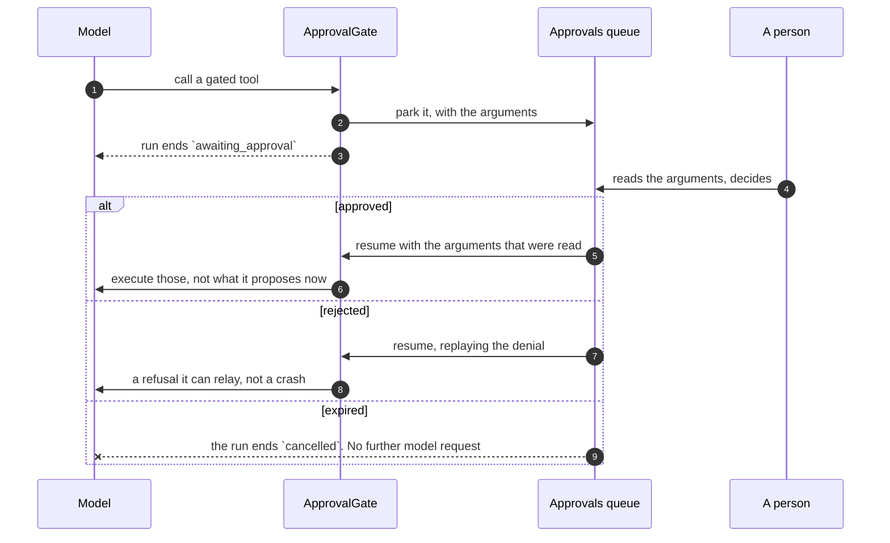

# Governance

Budgets, approvals, alerts and the audit trail. The four things that make an
agent platform something you can put a credit card behind.

All of them apply identically on every surface, because every surface goes through
one runner.

The newest of those surfaces is a **trigger**: an agent running itself on a schedule
or on an incoming event — a GitHub issue, an inbound email (see
[Concepts](concepts.md#trigger)).

It uses the same spending ledger, approval queue and audit trail. The
[unattended action policy](#routine-action-consent) tightens which calls need
approval; explicit standing consent names individual actions and one version.

Unattended work also has defined outcomes for a **refusal**:

- A fired run the budget stops ends `budget_exceeded` and **waits for the next
  fire** rather than being retried.
- A fired run the creator may no longer make — they left the organization, or lost
  their grant on the agent — **disables the trigger** and writes an audit entry
  saying why.
- A fired run that fails on the model itself — a provider outage, a revoked key —
  is recorded `failed` and left for the next fire, rather than failing the
  heartbeat into retrying the same wall. The trigger's `last_run_id` is left
  pointing at it, so its history stays honest.

A refusal a heartbeat retried every minute would be a bill, or an alert, that never
stops.

!!! warning "What is not swallowed is a failure that never became a record"

    If the run reached a terminal state but the write recording it did not commit —
    a transcript or conversation-state write that raised after the answer was in
    hand — the fire **fails the flow** rather than reporting success. The
    half-written run rolls back instead of being committed as complete with nothing
    behind it.

An event trigger adds one more refusal at its edge: a webhook whose signature does
not verify against the trigger's own secret is a 403 that never reaches the runner
at all.

## Routine delivery

A routine created from a private chat through the platform MCP answers in that
chat unless you choose another destination. Its card in the conversation shows
current state, the next activation and the existing edit, pause and remove controls.
The run log remains available under Routines.

Before posting a completed answer, the platform rechecks the creator’s active membership and current write access to the chosen conversation. A removed or inaccessible destination leaves the answer in the run log and shows **Last answer unavailable in chat** on the routine. A database failure during message delivery is isolated so it does not undo the completed fire or run the agent again.

Completion notifications link to the conversation only after successful delivery.

`last_delivery_status` distinguishes delivery, log-only, no answer and an incomplete run; historical rows stay unknown until another fire. Migration `0265_trigger_delivery_status.py` adds this status without inferring past success.

Set `ends_at` with a UTC offset for time-bounded work, and `monthly_budget_usd`
for a tighter monthly limit. The MCP update tool can clear either setting.
An ordinary API key cannot authorize a routine to use its issuer's personal accounts. Background runs, impersonation and resumed group or public turns cannot grant that personal authority either.

Use the version policy to follow the default published version or pin one immutable version. A pin does not move on publication. Clear it to follow again. A named environment and a version pin are mutually exclusive; current access, budgets and approvals still apply.

The routine form can set or clear its end. The date uses the device time zone shown beside the field, independently of the cron schedule zone, and is sent to the API as an offset-aware instant. Editing another field leaves the existing end unchanged.

A routine rechecks its creator, active membership, role and run grants before each tool, including delegates and calls released after approval. Pausing, deleting or expiring the routine, withdrawing personal consent, or changing that authority refuses subsequent tools. An effect already sent to an external service cannot be recalled by this check. Migration `0260_routine_run_origin` retains the origin when the routine is deleted; an old parked schedule whose origin was already lost is refused rather than borrowing the approver’s authority.

The minute sweeps settle elapsed ends independently of the next activation, including paused routines and watches. They disable active work, resolve outstanding routine blockers and cancel their pending notifications without running a model. A stopped worker catches up after restart; cleanup can wait for a worker or a batch, while tool and answer-delivery deadline checks still refuse expired work immediately.

Migration `0269_routine_end_cleanup.py` adds a deadline marker and partial pending-end indexes. It creates no replacement routines, grants or findings. Moving the end rearms cleanup; a repeated sweep does not repeat the settled effects. Downgrading drops only this cleanup bookkeeping, not the configured end or routine identity.

A watched MCP connection also records its authorization generation. A completed OAuth re-consent or an explicit token/endpoint replacement invalidates the watch's old source consent even when its connection ID stays the same. Normal token refresh, labels and default-account changes do not replace this identity. A re-reviewed source is available to later runs; an old parked run cannot borrow the new consent.

After migration `0270_mcp_authorization_generation.py`, review existing watches' sources explicitly (`review_sources=true` or **Approve attached sources again** in the watch editor). Older policies remain readable but cannot guess the account behind a historical authorization. No provider credential is read to resolve an account outside the admitted generation. Drain old workers and upgrade API and workers together. Pause watches before downgrading; resume only with generation-aware code and reviewed sources. Replacing credentials clears the old account’s cached tool list until another successful check.

Routine runs retain the MCP accounts and tool aliases admitted for that execution. Resuming a call reuses those aliases: renaming an account or choosing a different default does not redirect an existing approval. Delegates remain within the admitted accounts. Current account ownership, endpoint, authorization generation and tool allowlists are checked again before calls; new or changed accounts are filtered before credentials are resolved.

A parked routine without this admission state cannot continue managed-account MCP calls. Start a new run after reviewing its access. Ordinary interactive agent defaults and explicit approval policies are unchanged; account-specific routine approval exceptions are still separate from this source check.

The built-in AgenticOS platform MCP server requires **Act as creator**, including when a published delegate binds it. Without a person-backed identity, source review and routine creation refuse this configuration with an explicit explanation. Enable Act as creator or remove the platform binding from the agent and its delegates. The platform never borrows the creator’s identity automatically.

Routine history also lists blocked or failed attempts that ended before an agent run existed. Each shows its time, stage and a repair direction. They incur no model charges and never contain prompts, provider errors or credentials. Records remain until their routine or organization is deleted. Notification delivery failure does not remove this history. The fire-trigger worker job records a separate blocked or failed outcome; completing the queue job does not imply an agent ran successfully.

## Budgets

!!! abstract "Three levels, and they are not variations on one number"

    An agent's cap measured against the organization's total is exhausted by its
    neighbours' runs; the organization's measured against one agent is no ceiling
    at all. See [why they cannot be collapsed](#why-they-cannot-be-collapsed).

| Level                    | Set in                    | Meters                                        | Raised by                                           |
| ------------------------ | ------------------------- | --------------------------------------------- | --------------------------------------------------- |
| **Agent monthly**        | the agent's spec          | that agent's own runs                         | whoever may edit the agent                          |
| **Department monthly**   | the department's settings | runs its members started, on any agent        | whoever holds `members:manage` and `budgets:manage` |
| **Organization monthly** | organization settings     | every run _and_ ingestion in the organization | whoever holds `budgets:manage`                      |

Each monthly cap counts a run's whole cost in the month the run started, as the
spend reports do. A run that spans a month boundary - parked on an approval on the
last evening and approved on the first - appears entirely in the earlier month, and
when it resumes it is checked against that month's spend, not the new month's.

A **new organization starts with the organization ceiling already set** — the
deployment's `DEFAULT_ORG_MONTHLY_BUDGET_USD` ([configuration](configuration.md),
$100 out of the box) — so a fresh tenant is not one runaway agent away from a
surprise bill. It is an ordinary cap from that point on: editable on the org's
row, and enforced exactly like a hand-set one. A deployment that would rather
start uncapped leaves that setting empty; either way an existing organization's
cap is never changed for it.

### Why they cannot be collapsed

They used to be, with `min()`, and the result was wrong. An agent's cap measured
against the organization's total is exhausted by its neighbours' runs, which is
precisely what makes it not a cap. An organization's cap measured against one
agent's spend would never bind.

So each cap meters its own quantity, and the lookup travels with the limit. A $5
agent under a $50 ceiling now binds when _it_ has spent $5, and the refusal names
the cap that actually bound rather than inferring it from which of two numbers was
smaller.

An agent still cannot loosen the organization's ceiling: the organization's entry
is present at its own number whatever the spec asks for, and an agent's spend is
part of the organization's - so a $100 agent under a $10 organization is stopped
at $10.

Both caps are readable where their spend is: the organization's on its own row
(`GET /orgs/{org_id}`), and each agent's as `budget_monthly_usd` on the agent
listing - the _published_ version's number, since that is the one the runner
enforces, not whatever the draft currently promises. The dashboard's headroom
card joins these against `GET /spend`, so a cap can be seen approaching before
`budget_exceeded` starts appearing in run history.

That published number binds every run of the agent, including a run of an older
version: a routine, an environment or a workflow step pinned to one, or a run
resumed on the version it was parked on. A pin decides how the agent behaves, not
what it may spend.

### A department's cap

A [department](departments.md#a-departments-budget) can carry its own monthly
cap. It sits between the other two: a run is checked against the agent's cap,
then each capped department of the person who started it, then the
organization's. Each department meters its own members' month, so a person in
Finance and Sales is stopped by whichever of the two runs out first, and the
refusal names it - _Sales department monthly budget exhausted_.

The department's lead and the administrators hear when it passes 80% of its
month, once, and again when its cap stops a run. A run nobody started - a
schedule, a channel visitor - belongs to no department and is not counted.

### Enforcement is before the request

!!! danger "Before, not after"

    Checking afterwards means the request that broke the budget was already paid
    for - and a loop can overshoot by one expensive call every time.

!!! important "A failed run still records what it spent"

    A budget that ignores failures is not a budget. Accounting happens in a
    `finally` block on every surface, and the commit is explicit rather than left
    to the session context - which rolls back on any exception and is never
    reached at all on cancellation.

!!! important "A baseline is what _other_ runs have spent"

    Both lookups leave the asking run's own row out. A resumed run keeps its
    row, and by then `finish_run` has committed what it spent — while the
    ledger is re-seeded with the same figure, which it must be, or finishing
    the continuation would overwrite the cost with only what the continuation
    cost. Counted in both places, an agent capped at $10 that spent $6 and
    parked came back to `6 + 6 = 12` on its first model request and was
    refused with $4 of headroom, telling its owner it had reached a cap it was
    at 60% of. The organization's cap double-counted identically.

The guard is a hard stop for a run that _sees_ the spend, and a run's own cost only
lands on its row when it finishes.

So the baseline a run reads is the sum of runs that have already finished, and
**concurrent runs are invisible to one another**. Fifty runs starting together
against an organization one call short of its cap each read the same under-cap
baseline, each proceed, and overshoot by up to their combined cost.

That is a property of an aggregate with no single row to lock — unlike the per-run
and per-loop overshoot above, which the before-the-request check does bound. It is
why the cap is a ceiling on **committed** spend rather than a gate that serialises
simultaneous runs.

A deployment that needs a strict cap runs its agents through one queue rather than
in parallel.

### Evals spend from the same budgets { #evals-spend-from-the-same-budgets }

An [eval run](evals.md) is made of ordinary runs, so every case is checked
against the agent's and the organization's caps before each model request, and
what it spends counts against both - there is no separate eval budget. A large
dataset can therefore use up the month's budget that production traffic needs.
Starting a run shows what each cap keeps once it has spent its estimate, and is
refused before anything runs when the estimate is more than either has left;
see [The budget it leaves](evals.md#the-budget-it-leaves).

### A run costs more than its model requests

A knowledge search embeds the question before it can search it, and that embedding
is billed to the run that asked for it. The embedding service is process-global -
it serves every run and every ingestion job at once - so it books against whichever
run is _currently metered_ rather than taking a budget as an argument.

Which makes the meter something a surface can forget, and forgetting it is silent:
no exception and no warning, just a run that reports less than it spent and an
organization's month that never sees it. So the meter belongs to the prepared run
rather than to the surface. Opening one is not a step a new surface has to know
about, because there is no way to execute a prepared agent without it.

[Long conversations](reference/capabilities.md#context-management) is the other
one. Its summarizing strategy writes the summary through an agent it builds
itself, so that request passes no budget guard; the capability books what it cost
against the same meter. Being _outside_ the guard has one consequence worth
knowing: the spend is recorded rather than refused, so a compaction that crosses a
cap stops the run on the request after it.

### A cost that could not be measured says so

Stav's billed cost takes precedence over the snapshot: `usage.cost` with
`cost_currency`, or the `x-stav-cost` and `x-stav-cost-currency` headers. Both
Chat Completions and Responses include streamed requests. USD is used directly;
NOK requires `STAV_NOK_PER_USD` ([configuration](configuration.md)), maintained
by the operator. It is NOK per dollar: a value of `10` would divide NOK by 10,
not a current exchange-rate recommendation. No rate is fetched automatically.
Usage retains the billed amount, currency, rate and USD cost, and the ledger
marks the source as provider-reported. Invalid costs, unsupported currencies or
missing conversion leave the catalog fallback in place.

Without a usable provider-reported cost, pricing falls back to `genai-prices`.
It does not know every model. When a run reaches one it has no entry
for, that request is booked at zero and the run is marked `cost_is_partial` — the
total is short by exactly what those requests cost, and the honest reading of it
is a **floor**.

That flag now travels the whole way down. It is on the run row, on the message
row a turn writes, and on the total a conversation reports; every surface that
draws money draws `≥` in front of it rather than a figure that reads as exact.
Null on a message written before the column existed means _not recorded_, which
is not the same claim as "exact" — a client marks only what it knows.

**Every surface records it now, and each turn records its own share.** A message
written by a channel, the API or the widget carried no cost at all until
recently, so a Slack thread could not be totalled. The number written is the
_difference_ from what that run's earlier turns already claim, not the run row's
figure: a run row is cumulative, and a run that parked and was resumed writes two
assistant turns — stamping both with the row would count the parked half twice.
The messages of a run therefore sum to exactly what the run says it spent.

**A turn the run was stopped part-way through says so.** A cancelled run leaves
whatever the agent had written when the socket closed or `stop` was pressed, and
that reads exactly like a finished answer — so a reader takes a truncated one as
everything the agent had to say, and the money it spent looks like it bought that.
The transcript carries the run's status per turn, and the chat marks it.

### How full the context window is

The third ceiling, and the one nobody sees coming. A budget refuses with a
message somebody can act on. A workspace refuses a write. A **context window** is
refused by the provider, mid-answer, and the run simply fails.

Every agent therefore carries a gauge — not only one with
[Long conversations](reference/capabilities.md#context-management) bound, because
the warning matters most to the agent that will _not_ compact. It reports how
many tokens the last request of a turn carried, _after_ any compaction: the
reading falls when compaction works, because it measures what went out rather
than what the conversation holds.

The number is the provider's own `input_tokens`, not an estimate of the history.
A character count cannot see the tool definitions, and those are billed on every
request — thousands of tokens on an agent with knowledge, a sandbox and
delegation, which is a third of the real figure missing at exactly the moment the
figure matters.

**The count is stored on the turn; the share is not.**

How much history there is survives a model change. What fraction of a window that
is does not — and the chat lets somebody switch model between turns.

A 500,000-token history is half of a 1M-context model and **390%** of a 128K one,
and the second is a request the provider refuses outright. A share frozen with the
reading would still read "50%".

So the denominator is resolved where the selection is known, from the model
profile's own recorded window and the pricing registry behind it. Where neither can
say, **no share is drawn at all** — a percentage against an assumed window is a
guess presented as a measurement.

That switch is also what compaction is for. Its trigger is a **fraction resolved
per request** against the model the request is going to, so a history that sat
comfortably in the old window is compacted on the very next turn under the new
one — before the request leaves, not after the provider has refused it. An agent
with no compaction bound has the gauge instead, and nothing else.

**The trigger measures what the provider measured.** It anchors on the most recent
answer carrying provider usage — that request's `input_tokens` counted the
instructions, every tool schema and every prior message — and estimates only what
came after it. This is why a replayed conversation carries what each answer cost:
without an anchor the trigger counts characters, and a real agent here read 9
tokens where the provider had charged for 3,859. The gauge said 77%; the trigger
saw nothing to do.

**A summary is kept.** Compaction rewrites the messages of one run; the thread
between turns is rebuilt from the transcript, so a summary used to be thrown away
at the turn boundary and the next turn bought another one over a history one turn
longer — two consecutive turns of a real conversation here each paid for a summary
of the same five messages, and the second announced itself as summarising nine. So
the compacted history is written to the conversation, along with how far it
reaches, and the next turn starts from it and replays only what has been said
since. Reopening the thread finds the same thing the model does.

Only a summary is kept. Dropping the oldest messages and clearing tool results
cost nothing to redo, and writing them down would make permanent a loss that is
currently reconsidered against the window on every turn.

One setting cannot work, and says so instead of running. When the instructions and
tool schemas alone are past the trigger, no summary can get under it — they are
not in the history to summarise. Every request would then buy a summary that
changes nothing. Compaction is skipped, the chat says why, and the fix is an
author's: a larger window, or a higher fraction.

That refusal rests on a number a _response_ produces, so a turn cannot measure
its own before it has to decide — and a chat turn is usually one request. The
conversation carries the last reading, and a run starts from it. The first turn
of a thread therefore has nothing to go on and compacts as configured; from the
second, the refusal is available. Only the strategies that buy something are
refused: dropping the oldest messages and clearing tool results call no model, so
they run whatever the window is.

### Delegation spends the parent's budget

A run can contain another agent's whole conversation - see
[delegate vs inline specialist](concepts.md#delegate-vs-inline-specialist). One run
has **one spend ledger**, and every delegate records into it. That is what makes
the parent's cap see a delegation's spend before its next model request, at
precisely the moment delegation multiplies what a turn can cost. Each entry is
stamped with the delegation that booked it, which is how one ledger still answers
"what did _this_ delegate cost" - see below.

It follows that **the caps that bind inside a delegation are the parent's**. A
delegate's own `budget.monthly_usd` is not enforced mid-parent-run: two guards
metering one ledger would double-count every request, and the ceiling that matters
is the one on the run somebody started. The delegate's own cap still governs runs
_of the delegate itself_.

Each delegate prices its own requests, though, because a guard prices what it
records: a delegate on Anthropic metered through a guard built for OpenAI would be
priced against the wrong catalog - silently, and usually as unpriced.

Three further ceilings exist because a budget is a poor way to stop a fan-out - it
only notices after the money is gone. `max_depth` bounds nesting, `max_fanout`
bounds how many delegations run at once, and each delegate's own `max_steps` bounds
its loop. See the
[`subagents` capability](reference/capabilities.md#delegation).

Two of those three are the delegate's own, which is the line the budget does not
cross: `max_steps` is read off the delegate's spec, and its `max_depth` caps how
deep _it_ may go however much room its caller had left. A cap on spend is a cap on
the run somebody started; a cap on nesting is a decision the delegate's author made
and its reviewers read, so a caller cannot widen it.

### What a delegated run is recorded as

A delegation to a **published** agent gets an `agent_runs` row of its own, carrying
`parent_run_id` and the delegation's task id. An **inline specialist** gets none: it
has no agent to attribute one to, so its cost is the _run's_ and the tool call in
the transcript is the record.

Which run's, though, is the question
[#228](https://github.com/vstorm-co/agenticos/issues/228) answered.

- A specialist directly under the run's own agent bills to the **top-level row**,
  which is the whole ledger anyway.
- A specialist under a **published delegate** bills to _that delegate's_ row, not
  the top-level one — so the delegate's month includes what its specialist spent,
  which is the only place it could honestly land.

Each ledger entry therefore carries two attributions: the delegation that made it,
for the panel, and the nearest agent-row it bills to, for the month.

The two are equal for every request a published delegate makes on its own account,
and diverge only under an inline specialist — whose panel keeps its own share while
its spend reaches its ancestor's row.

!!! important "The parent's row is the authority; a child's row is its share of it"

    A delegate spends into the shared ledger, and **every entry in that ledger
    carries the delegation that made it**. A delegation's cost is the sum of its own
    entries - the requests its own agent issued, priced once, by the same lookup the
    run's total uses. It is exact in both modes and at every depth, and it does not
    depend on when the delegation happened to be settled.

    It used to depend on exactly that, and it was two defects. The number was the
    *growth* of the shared total across the delegation, so a background delegation -
    settled when it is next polled, which may be after the parent has answered -
    absorbed everything the parent spent in between: a delegate that spent $0.01 was
    recorded at $0.51 if the parent then spent $0.50. And a delegate that delegates
    further had its own delegates' spend inside its window, which their rows record
    again, so its monthly total counted its grandchildren.

    Splitting it with a ledger *per agent* is still the design to avoid - that is
    what stops the parent's cap binding at all. One ledger, attributed, keeps both
    properties: the parent's cap sees every request before the next one, and each
    delegated row says what that one agent spent, its own inline specialists
    included and its published delegates excluded.

    The parent's row remains the authority for the run. Its `cost_usd` is the whole
    ledger, delegates included, which is what the organization is billed; the child
    rows divide that same money by agent and never add to it. `cost_is_partial` is
    per row too: a parent on a model `genai-prices` does not know makes the parent's
    total a floor, and says nothing about a delegate that ran on a priced one.

    A delegated row's `started_at` and `ended_at` are the delegation's **own** span,
    read off the task handle the library stamps when the delegate starts and when it
    ends - not the moment the row was settled. Off the settlement, a background
    delegation read as a zero-duration run at the wrong time, ordered after work that
    finished before it; two that genuinely overlapped were recorded at the same
    instant with nothing to say they had. A terminal handle with an end but no start -
    a delegate cancelled or failed before it began executing - records a zero-length
    span at that end, never a null; and where the library refuses before a handle
    exists at all - an unknown `chat_trace_id` - no delegated row is written. A
    delegation that parked on an approval spans every turn it ran in: its earliest
    start is carried across the park the way its cost is (below), so the row begins
    when the delegate first began and ends when it finally did - not at the resume
    that settled it. The two are not summed the way the cost is; the honest answer
    is the first segment's start and the last segment's end.

**A delegation that parked on an approval is more than one share.** Its turns ran
in different processes against different ledgers, and a resumed turn's ledger is a
fresh object holding nothing from before the park - so what the child row records is
every segment added together: the parked state keeps what the delegation had cost
when it stopped, and the turn that finishes it adds its own share. One row is
written, once, by the turn where the delegation ends - a delegate that parked twice
leaves three segments and one row.

`cost_is_partial` is carried the same way, and for a reason the money does not
share: it is per row now rather than per run, so a delegate that made an unpriced
request _before_ the approval and resumed onto a priced model would otherwise have
its row claim an exact cost. The flag is true if it was true of any segment.

That is worth stating because the failure it replaces was invisible. The row used to
hold only what the delegate spent _after_ the last resume, which on the ordinary
shape - do the work, then ask permission to act on the result - is the small half.
Nothing failed to add up, because the money was in the parent's row all along; what
was wrong was every number that answers "what did this delegate cost".

The child row is what makes two different questions answerable, and they want
opposite arithmetic:

| The question                               | Child rows                                                                                                                                                                                                                                                                         |
| ------------------------------------------ | ---------------------------------------------------------------------------------------------------------------------------------------------------------------------------------------------------------------------------------------------------------------------------------- |
| **What does the organization owe?**        | **excluded** - the parent's row already contains these tokens, so counting both bills the organization twice for one request                                                                                                                                                       |
| **What did _this agent_ cost this month?** | **included** - a delegate's rows are the only place its own spend is recorded, and each one holds that agent's own requests and its inline specialists' ([#228](https://github.com/vstorm-co/agenticos/issues/228)) but not its published delegates', which have rows of their own |

The second is what makes "the researcher cost $40 this month" answerable, and it is
what a per-agent usage report or a budget alert on that agent fires on. The
organization's monthly number also carries ingestion spend, which the per-agent
number does not: indexing a shared knowledge base is nobody's agent's spend.

A failed child row is also held to the parent's rule about what `error` may say.
What raises under a delegate is a model client whose message can carry the failing
request URL — key included, on a custom endpoint — so the row and the delegation's
closing frame store the same controlled sentence the parent's row does, and the
provider's own text goes to the server log. A delegate stopped by its usage limit
or by a budget ceiling keeps the limit's message whole: that is a ceiling doing
its job, not a failure to diagnose.

The rule reaches the _parent's_ transcript too. When an agent delegates in the
background it polls `check_task` and `wait_tasks` for the outcome, and what those
answer becomes a tool-call row in the conversation — stored whole, because a tool
return is the tool's own answer rather than something this platform composed. So
they name the exception's class rather than repeating the provider's message,
which is `subagents-pydantic-ai` 0.2.20 and the reason the floor is there.

**The dashboard's windowed figure carries it too.** `GET /stats/usage` answers a
`cost` block for whatever period the filter chose, and that block is runs _plus_
ingestion — the same arithmetic the monthly cap is measured with — with
`model_usd` and `ingestion_usd` beside it so a reader can see where the money
went without subtracting. It reported the model half alone until 0.0.152, which
put two different definitions of cost on one card: the headline moved with the
period filter and counted runs, while the month-to-date line under it counted
the whole bill, and nothing said they were answering different questions. On a
deployment that indexes documents they simply disagreed.

At `scope=own` the ingestion half is zero rather than a share: a document is
indexed by a worker and `ingestion_spend` records no user, so charging one
person's window for a collection somebody else synced would be inventing their
spend.

**Every query has to say which of the two it is answering**, and the first column
is the default. The month-to-date figure and the per-agent breakdown behind it
exclude child rows, so they add up to the total printed above them — and the
organization's usage email reports that same total rather than a sum of one of
them. Only a question asked _about one agent_ includes them. Three of these five
queries shipped without the distinction and each reported $1.40 for $1.00 of work;
if a new one is added, the default is the safe one.

#### The two vendor questions need a third answer

**By provider** and **by key** cannot use either column, and getting that wrong is
invisible on screen. Excluding child rows totals correctly and then attributes the
delegate's money to the _parent's_ vendor, because that is the provider on the row
being summed: an orchestrator on OpenAI delegating $0.40 of work to an agent on
Anthropic reported `openai $1.00`and no Anthropic row at all. Including them
reported`openai $1.00` + `anthropic $0.40` — more than the bill.

So these two sum each run's **own** spend: its cost with its direct delegations'
costs subtracted. `openai $0.60` + `anthropic $0.40`, which is both the right
attribution and the right total. It nests — a delegate that delegated further has
its grandchildren taken out by it, once — and summed over every row it still comes
to the bill, because each child's cost is added by its own row and removed by its
parent's. A key works the same way, and matters more: a key is what somebody
rotates when a bill looks wrong.

### A voice call's budget

A [voice call](voice.md) is a run, and its spend counts against the agent's and
the organization's budgets like any other. Three things differ, because a call
cannot be checked before each request the way a text run is:

- **Before it starts**, the call's longest possible length times the model's
  worst-case price per minute is checked against the budget left. A call that
  could not be afforded is refused rather than started and cut short.
- **While it runs**, each response is booked on the run as it finishes, and the
  month's spend is re-read every 15 seconds, so other runs spending meanwhile
  are seen. A budget that runs out mid-call gets one spoken sentence and ends
  the call, recorded `budget_exceeded`.
- **Its length is the agent's.** A call runs at most the agent's longest call,
  10 minutes by default and 50 at most; there is no separate allowance of call
  minutes, so the budgets are the one limit on what calls spend.

A call whose process died is closed by the voice sweep at the cost its last
heartbeat recorded, unlike a text run, whose spend dies with its process.

### Proactive work { #proactive-work }

Nightly suggestion and briefing runs are recorded under the organization's published **AgenticOS**
starter agent (`agenticos` slug) so each has a row, a cost and a trace, but the
starter does not run and does not choose the model: every such run carries the
[system role](#system-agents) that did the work. Choose the separate proactivity
model and limits on **Organizations → Members → Proactivity**.

Activity shows the
**Proactive** icon and filter, the model requests and their costs, and the
recorded exchange including tool results and the final structured answer. Failed
checks retain the exchange available before the failure. These records require
`runs:view`, like other Activity records, and do not create conversations in Chat.
Older runs cannot recover exchanges that were never recorded; oversized records
explicitly say they were trimmed.

The model field uses the same provider, model and vault-key picker as the Agent
Builder. With `connections:manage`, a member can create a model profile there;
without it, they choose an existing profile. Creating a profile stores it
immediately. **Save** applies the selection to the organization's nightly
suggestions. The briefing lists existing findings without a model call. Selected-agent watches share the per-person limit.

The platform can do a little on its own initiative, and does nothing of the kind
until an organization turns it on: the **Proactivity** card on its members page
(`budgets:manage`). Turned on, a background job looks at each person's recent
requests on the days and at the hour the organization chose - in each person's
time zone, or an hour before the working hours their profile states - and
proposes a routine for a request they keep repeating, a profile, or the first
messages their empty chat offers ([Console](console.md#chat)).

Each is one model
call, on the model the organization chose when it turned this on (there is no
default: `proactive_model_profile_id` is required), recorded in run history as a
run from the **proactive** surface and counted against the organization's budget
like any other. A person can leave themselves out under **Settings → Assistant**.

Every model request such a run makes - the first and any retry - is checked
against the person's proactivity spending limit, the attributed agent's monthly
budget and the organization's. A run that reaches one midway stops there, ends
`budget_exceeded` and keeps what it spent. These runs count towards no
department.

The nightly look becomes due 20 hours after its own last attempt. Watches and
memory maintenance do not move that clock. Watches still count toward the
person's proactivity spending limit.

A successful look records the person and a digest of each prompt it read,
without copying the text. Finishing a previously read approval or question wait
therefore does not buy another model call. A deferred prompt remains unread
until a later look includes it; changed text is unread again. Failed model
calls do not mark prompts as read.

After upgrading, unclassified legacy background runs do not postpone the next
look. Existing messages have no read receipt, so eligible recent prompts may
be included in one catch-up look under the usual switches and budgets.

The nightly job reads only a prompt that passed the input
[guardrail](reference/capabilities.md#guardrails) of the agent it was sent to,
because the proactivity model has no guardrails of its own:

- A prompt a guardrail refused is left out.
- A prompt no run took is left out: one sent to an archived agent, one refused
  before its run opened, and a chat prompt passed to a workflow.
- A prompt whose run is still going waits. The job reads it on a later night,
  once the run has ended.
- If a run stopped before its first model request, for example on a budget, the
  job runs that run's input guardrail on the prompt and leaves out what it blocks.
  If the agent version is gone, the prompt is left out.
- If run retention deleted the run, the job reads the prompt only when a model's
  answer follows it. A prompt from before version 1.36.0 is read the same way, so
  an input guardrail's refusal, which left no answer, stays out. A spoken turn
  records no model, so it is left out once its run is gone.

Routine prompts are screened with the pinned agent version, the named environment’s
version or the agent’s current version, as the routine would run. A missing target
or unreadable spec is left out, as is a routine whose latest fire was refused.
A routine that fired but whose last run was pruned is also omitted: an unknown
verdict cannot clear a refusal.

A prompt a guardrail redacted passes, and the job reads it as stored, unredacted
([#2655](https://github.com/vstorm-co/agenticos/issues/2655)).

On top of that, each person's proactive runs in a calendar month are capped by
the organization's **proactive limit** - $1 by default, set on the same card
(`proactive_limit_usd`). A person nothing new happened to costs nothing: the job
only calls the model when there is something to read.

**Watches** run through the published agent the person selects, using the same
runner as chat and routines and the agent's own instructions and model. Enable
watches separately (`proactive_watches_enabled`); they share the organization's
per-person proactivity spending limit, not its suggestions model. Create one under
**Routines**, beside an agent's schedules with **Watch and inform**, beside a
personal account, or by asking in a private chat. Select the agent, personal
account, cadence and optional end time. Follow publications, select a named
environment, or pin an immutable published version. The organization still sets
the minimum cadence (`proactive_watch_min_minutes`).

The selected publication must already bind that personal catalog service. A watch
never enables a missing binding or substitutes another agent. Custom servers
without a personal catalog binding are not supported here. Creating the watch
approves that concrete account and endpoint, the intersection of account and
agent tool allowlists, and the currently attached knowledge bases/context files.
Later publications can remove this access but cannot add accounts, tools or
attached sources. **Approve current sources again** explicitly refreshes that
approval. A newly selected primary account does not replace the approved account.

Each look is an ordinary **proactive** run attributed to the actual selected
agent and version. Its source tools must carry `readOnlyHint`, and a read the
agent's MCP binding asks before is left out of the check. The watch preset
permits only its approved account, knowledge/context, guardrails, planning and
system reminders; web access, sandbox, executable skills, memory writes and
delegation are unavailable. Required interactive approvals are refused at setup
rather than silently waived. Current membership, run permission, source consent,
pause and expiry are checked again before tools and before results are written.

New findings keep their stable watch/item identity in the person's Inbox and
return to the source conversation; creation outside chat uses their primary
conversation. Only a requested urgent finding also sends an immediate
notification. The default **Only when something relevant changes** mode creates
no chat message or completion notification for an unchanged reading. Missing conversation access retains the Inbox finding and records
`delivery_unavailable` instead of posting elsewhere.

The latest attempt is separate from the last successful reading. A completed
model answer without a successful source read, or with an unresolved failed
source request, is `not_completed`. Source unavailability and revoked access are
explicit; `budget_paused` reports exhausted spending. These failures do not
advance the successful-reading timestamp. Unexpected errors still fail the job.

`0261_watch_attempt_status.py` starts attempt history without inventing older
successes. `0262_watch_agent_sources.py` preserves existing watch IDs, findings,
cadence and active settings, but assigns no guessed agent. Existing watches show
`needs_agent` and make no model calls until their owner selects a published agent
and approves its sources. Deleting a watch does not erase the origin or approved
source policy retained by an in-flight or parked run.

Creating or changing a watch requires the person's signed-in session or trusted
private human chat. Ordinary API keys, publisher fallback, background routines
and impersonation cannot grant this standing access. The platform MCP tools
`list_watches`, `create_watch`, `update_watch` and `delete_watch` use the same
service and identifiers. Complete private-chat requests create or edit immediately;
publishing, inviting, deletion and run-now retain their normal approval policies.

A watch can instead select **After every check, including no changes**
(`report_mode: every_check`). Each successful reading then delivers an agreed
report to its source chat, even when nothing new was found, and uses the shared
notification system. A failed or unavailable read never becomes a no-change
report. The scheduled activation travels with the queued job; its report marker
commits with the result writes, so retrying a completed activation cannot replay
the report or pay for another read. No second classification call is needed.

Schedules and watches inherit your notification preferences. **Notifications for
this routine** can select any combination of e-mail, device push, Slack, Telegram,
Mattermost, Microsoft Teams and SMS, or the app alone. `notification_channels:
null` inherits; an empty list disables external delivery. A routine cannot enable
a channel disabled in your preferences. Pending sends recheck the live policy;
pausing or deleting the routine stops them. Mandatory security/configuration
alerts remain mandatory. Provider-accepted messages cannot be recalled.

In **Settings → Notifications**, explicitly choose one linked private chat per
platform for the current organization. Linking an account alone never enables
notifications. Group chats, another person's account and another organization's
bots are excluded. E-mail and push keep their existing setup. The chat selector
in the event preferences changes which platform's switches you edit.

Destinations bind the particular account link and bot authorization. Unlinking,
relinking, replacing the bot's token/server or changing the destination requires
another choice. Previously queued deliveries are not redirected. Sending rechecks
membership, account activity, bot access policy, SMS link expiry, event preferences,
resource access and shared outcome state. A reader who can no longer decide an
approval receives only the waiting fact, without a decision link.

Chat platforms have no shared idempotent-send contract. An unconfirmed submission
has one persisted attempt: a timeout, provider failure or worker loss leaves a
visible failed/unconfirmed delivery. A Slack HTTP 429 explicitly refusing the
submission may retry after `Retry-After`, up to five total claims. Before each
send, the claim clears retry permission; a crash on that attempt cannot replay
it. The old handoff token is retired on deferral. Other chat failures remain
terminal. E-mail and push keep their existing retry rules.

Slack notifications use bounded plain-text blocks and an **Open in AgenticOS**
button leading to the same authorized case in the console. Names and summaries
cannot create mentions or automatic previews. A degraded approval notice keeps
only its waiting fact and has no decision link. Delivery records platform
acceptance; acknowledgement remains an explicit decision on the shared case.
Migration `0273_notification_safe_retries.py` defaults existing rows to no retry
authority. Downgrade returns to one-attempt chat delivery.

Migration `0271_notification_routes.py` adds explicit routes and authorization
identities. Drain workers and update API/workers together before selecting the
new channels. No existing account opts in on upgrade. Downgrade removes chat
routes, chat delivery history and chat preferences, and narrows routine selections
to e-mail/push; it cannot undo external sends. Migration
`0263_routine_notification_policy.py` introduced the original routine controls.

### Budget pauses { #routine-budget-pauses }

When a routine reaches its own monthly limit, its owner receives one budget
notice per period and configured limit. A watch reports the person's shared
proactive-work cap and points them to an administrator to review it. The check
stops before opening a run or calling a model; the notice reports monthly spend.
Existing budget-alert preferences and the routine's channel limits still apply.

The notice opens one actionable case for that responsibility and month. Repeated
checks reuse it. Acknowledging or muting cancels pending deliveries. When the
next activation has budget again, or the responsibility is removed, its open
budget cases resolve and pending sends are cancelled. Changing the configured
limit allows a new breach notice; a muted case stays muted for that month.

### Action consent { #routine-action-consent }

Actions are grouped by capability or concrete MCP account and can be searched.
Select or clear a group, or the entire eligible inventory; bulk controls also cover
items hidden by the search. Individual exclusions remain available. A review supports
up to 1,000 selected actions; a larger selection is shown and cannot be saved until
reduced, never silently truncated.

Changing only the title or cadence retains consent. When the version, work, instructions
or an account changes, the dialog explains which boundary changed. **Reselect previously
reviewed actions** is an explicit new choice over matching eligible identities; it grants
nothing until you save the current review. New actions and changed accounts are not
selected automatically. Mandatory approvals, revocation and stale-review checks still apply.

An unattended routine asks before capability actions, local file changes and
delegation. External MCP calls ask unless their server marks them read-only;
a connection's stronger approval policy still applies. Ordinary interactive
agent defaults are unchanged. Code mode is disabled for routine runs so bundled
scripts cannot skip the individual action gates.

Writes to AgenticOS Virtual Tables run within their live table and operation grants without a routine exception. An explicit agent approval policy still applies to these internal writes.

The creator can open **Action consent** on their routine and select capability actions and individual MCP actions on a named account. This requires `approvals:decide` and the organization's `chat_may_waive_approvals` switch. An API key, agent, impersonated session or administrator acting for another owner cannot grant it. Explicit required approvals from the agent or an MCP binding cannot be waived here.

An MCP exception names the concrete account, endpoint hash, authorization generation and original action name. Sending mail does not authorize deletion or another account's writes. Personal accounts are offered only when the routine acts as its creator. The picker uses the connection's recorded tool list; check the connection, or ask its administrator, when that list is unavailable. Revoking all consent remains available without a working tool list.

Saving requires the version and configuration the person reviewed to remain
current. Consent names the immutable published version, stable capability/tool IDs and
routine configuration. Changing the work or destination invalidates it. Each run
retains its admitted consent IDs; adding consent later cannot release a parked
run, and revoking then regranting creates a new identity. Current membership,
permissions, organization policy and consent are checked again at each tool.
Every waived call records an approved row naming its consenting person and
arguments. Delegates require their own decisions; a parent's waiver is not lent.

Standing action consent also records the current revisions of bound skills, skill resources, context files and project instructions. Editing any of them invalidates the exception, even if the published agent version stays the same or the old text is later restored. Review actions again to grant a new exception. Existing exceptions without a revision fingerprint remain valid only for agents without these mutable instruction sources.

`0267_routine_action_consents.py` creates no exceptions for existing routines.
This changes unattended execution: an existing action may now wait for approval.
Drain old workers and upgrade the API and workers together before resuming duties,
as an old worker does not enforce this gate. Downgrade removes stored exceptions;
existing approval audit rows and already performed effects remain.

### Resumed routine answers { #resumed-routine-answers }

A routine that completes after approval or an answered question queues its
console answer in the same transaction as its terminal state. The handoff stores
the final text and identifiers, so a restart never needs another model call.
The receipt, chat message and completion notice settle in one transaction;
concurrent attempts and retries cannot append a second answer. An authorized
conversation event refreshes an open source chat in place after commit; legacy
event subscribers keep their prior vocabulary.

The worker checks the routine's current state, deadline, creator and destination.
Chat delivery also rechecks active membership, agent run access and current write
access to the creator's private conversation. Archived conversations are closed
to new messages. An unavailable destination retains the result in Activity and
records unavailable delivery. Database failures leave the receipt pending for up
to three job attempts; Admin → Background jobs shows an exhausted handoff. A
completion notice links to a chat only after successful delivery. External-channel
continuation remains separate acceptance work.

`0268_routine_answer_delivery.py` creates no historical replays. Upgrade API and
workers together. Drain or cancel pending `deliver-routine-answer` jobs before a
downgrade, which removes their stored handoffs; it does not recall messages
already delivered.

### Failure incidents { #routine-failure-incidents }

A failed routine run, unavailable watch source or missing console destination
opens one case for its owner. Continuing failures update the case's latest reason
and run without another alert. Acknowledging keeps it actionable and quiet;
muting keeps that cause muted, including after recovery. A new failure after a
confirmed recovery reopens the same case and sends one new notice.

The shared runner reports initial, resumed and crash-reaped runs. Among terminal
results, only the latest admitted root run changes a routine's health; delegated
children and late completion of older runs cannot override it. A watch recovers after a verified source
reading; model completion alone is insufficient. Late checks retain the newest
attempt and last successful reading independently. An expiry check or removal closes
outstanding blockers and cancels pending sends. Paused, expired or deleted
routines do not post a completed answer into their chosen chat.

Observation and recovery clocks keep callback retries and older results from
undoing a person's decision. A failed notification write leaves a new incident
retryable. Agent and run limits share the owner’s incident instead of creating a second
failure email. Organization and department budget notices remain independent
financial alerts, including for an owner who is also an administrator. Their
routine incident stays in the app when the financial notice already tells them.
Budget preferences still apply.

`0266_routine_activation_clock.py` adds these clocks without guessing historical
attempts. Existing watch-failure case IDs are retained. Deploy the API and
workers together: the delivery worker must understand the new budget-notice
metadata. Downgrade removes the clocks and retains the existing cases,
notifications and decisions.

### System agents { #system-agents }

Some work is the platform's own and still needs a model. A **system role** gives it
an owner an operator can see: one configuration per organization and role, never
an agent row, never one per job, and never attributed to the starter agent or any
agent whose instructions did not run (#2575). **Organizations → AI & services → Background services** (`budgets:manage`) lists each role with what it runs on, this month's
spend and its recent executions.

| Role                 | What it does                                                                                                                                             | Configured                                                             |
| -------------------- | -------------------------------------------------------------------------------------------------------------------------------------------------------- | ---------------------------------------------------------------------- |
| `daily_briefing`     | The nightly look at each person's week and the briefing built from it                                                                                    | In the Proactivity tab: the same model and limit, shown here read-only |
| `memory_maintenance` | Reads a completed admitted turn once and records the durable facts, preferences and decisions in it as [claims](reference/capabilities.md#memory-claims) | Here: a switch, a model and a monthly budget of its own                |

Memory maintenance does not require the AgenticOS starter. Its run retains the originating agent as a storage reference and is accounted as `memory_maintenance`; only platform extraction instructions and the role-selected model execute. Removing or unpublishing the starter does not disable extraction for other published agents.

A role is disabled, not deleted. **Memory maintenance** needs an explicitly chosen
model and respects its monthly budget and the organization's cap. It reads completed
turns only when the runner admitted a real person with memory writes enabled: private
chat, linked channel messages, and that person's own scheduled or workflow work.
Embeds, API keys, impersonation, outsider-supplied events and delegations are excluded.

The queued job retains the original audience. A private turn records claims in the
person's profile or relationship with the agent; a group turn records only in the
source room, even when the model calls a fact general. Current membership and erasure
are rechecked under the write lock after the model answers. Older jobs without an
audience remain limited to private web chat. Maintenance cannot share or correct a
claim. Deterministic consolidation needs no model or role.

### What run history shows

**`GET /runs` lists top-level runs only, and its `total` counts those.** The same
default as the organization's monthly sum, and for the same reason: interleaved,
the two kinds of row cannot be read down one cost column. A fan-out of three
delegations is one run costing $1.00 on the page and $1.00 on the bill; listed
together it was four rows reading $1.00 + $0.40 + $0.40 + $0.40 next to a
month-to-date figure of $1.00, and both halves were right about a different
question.

The list takes the same two-sided arithmetic as the sums above, for the same
reason — so a surface narrowed to one agent shows what _that agent_ did, delegate
work included:

| Ask                                                | Answer                                                                                                                                                          |
| -------------------------------------------------- | --------------------------------------------------------------------------------------------------------------------------------------------------------------- |
| `GET /runs`                                        | Runs somebody started. `parent_run_id IS NULL`                                                                                                                  |
| `GET /runs?agent_id=<id>&include_delegations=true` | One agent's own history. What the Builder's Recent runs panel and Activity's `?agent=` ask, because a delegate's rows are the only record of what it itself did |
| `GET /runs?parent_run_id=<id>`                     | What that run delegated — the query `agent_runs_parent_run_id_idx` exists for. Takes precedence over `include_delegations`                                      |
| `GET /runs/<id>`                                   | One run, delegated or not. Where a link from a transcript lands                                                                                                 |
| `GET /runs/<id>/transcript`                        | That run's turns, in order - what a run detail view renders as steps. Authorized, not owned (below)                                                             |

**Reading a run is authorized, not owned.**

A colleague holding `runs:view` reads a run somebody else started. Authority over a
run is the organization's, because a run is what the organization is billed and
held accountable for — not the private property of whoever pressed go.

So the decision lives in the service rather than in a route gate: it resolves the
run against the caller's organization first, then checks `runs:view`.

Three consequences:

- A run in **another tenant reads as absent** — the same 404 an id that never
  existed answers with, down to its body — so the response cannot be used to
  discover that a run exists.
- A run that ran with **no conversation** (an API call that passed no
  `conversation_id`) has no transcript to read, and says so with a null
  `conversation_id` rather than an empty list that would read as "it did nothing".
- None of this widens `GET /conversations/{id}/messages`, which stays **scoped to
  the owner**. A run's transcript being readable by a colleague must not make the
  private thread it sits in readable too.

**Each turn the transcript serves carries the ratings people left on it** — the
reading caller's own thumb, the organization's likes and dislikes, and the most
recent down rating's comment.

A plain message row holds none of these, so they are read from `message_ratings` in
one batch and attached to the turns. A turn nobody rated carries them empty and
reads exactly as a plain message does.

This is what lets the run detail view show the answers that were rated down and the
words left with them — the conversations behind the dashboard's quality number
(#209) — read where the run is read, rather than only in the app-admin ratings
export.

The comment shown is a **down** rating's, never an up rating's, and the most recent
when a turn drew more than one objection.

### What the dashboard's aggregates show

`GET /stats/usage` takes the same two sides, and the same default. The composed
response is the organization's question, so every block in it counts top-level
rows only: the period cost and its split by provider (the double bill above),
but also the run total, the day series, the outcomes split, the surfaces, the
latency percentiles, the active-people count and the per-person table. Beyond
cost, a delegated row _copies_ its parent's `user_id` and `surface`, so counting
it would additionally invent a second person and a second arrival on a channel
somebody used once.

Two aggregates take the other side, and both are asked about one agent:

| Ask                                            | Child rows                                                                                                                                                                                                                                                                    |
| ---------------------------------------------- | ----------------------------------------------------------------------------------------------------------------------------------------------------------------------------------------------------------------------------------------------------------------------------- |
| `by_agent` — the adoption card                 | **included.** Excluded, an agent that runs four hundred times a day as somebody's delegate has no row, and the card names every published agent without one as forgotten and offers to archive it. Its bars can therefore exceed the run total beside them; nothing sums them |
| `?group_by=version` — the version-compare card | **included.** A specialist that only ever executes as a delegate would otherwise have nothing to compare across its versions                                                                                                                                                  |

The invariant that survives either way: the outcomes donut's segments still sum
to `total_runs`, and its `awaiting_approval` segment still counts the same
parked runs as the approvals card, because those three come from the same side
of the switch.

The one query with no delegation filter at all is the count of the caller's
runs parked on a decision. A parked child is a stuck parent, and that card
answers "why is my agent not finishing"; today it changes nothing, because a
delegation is written to the database already finished and so never parks.

The last two are `?run=<id>` on the Activity page: one run, the delegations under
it each badged with the task id its `subagent_*` frames carried, and a link up to
the run a delegation was charged to. A delegation panel in a chat links there with
the `run_id` its terminal frame carries — which is why the frame carries one.
Nesting delegated rows inside the top-level table is deliberately _not_ done here;
a table primitive shared by the whole product is
[proposed separately](https://github.com/vstorm-co/agenticos/issues/139), and
nesting belongs in that rather than in one bespoke run table.

### What the cost screen shows

`GET /spend` takes its window two ways, because the page asks for both kinds:
`days` for the _last N days_ presets, and `from`/`to` for _this month_, _last
month_ and a calendar range. `from` wins when both arrive — an explicit range is a
more specific request than a default nobody changed — and `period_days` comes back
null in that case rather than repeating a number the range contradicts.

**Every panel on the screen reads the same window.** The per-agent rows, By
provider and By key all take the resolved `since`/`until` rather than a day count
of their own, so two figures beside each other cannot end up describing different
runs. That is the same defect #198 names one panel further up.

**Month-to-date ignores the window entirely**, and so does every per-agent cap
measured against it. A monthly ceiling compared with a rolling seven days reads as
20% used on the day the cap was actually reached.

Each per-agent row carries **two cost figures under two different names**, which is
this page's rule throughout:

|                     |                                                                                                                                                                                  |
| ------------------- | -------------------------------------------------------------------------------------------------------------------------------------------------------------------------------- |
| `cost_usd`          | Its share of the window, **top-level runs only**, so the column sums to the total above it                                                                                       |
| `month_to_date_usd` | Its **own** calendar month, delegated rows **included** — the spend its `monthly_cap_usd` is a cap on. It does not sum to the organization's month and is not drawn as if it did |

`partial_run_count` says how much of any of it is a fact: how many **top-level
runs** in the window could not be fully priced, so the cost is a floor by exactly
that many. _"3 of 40 runs could not be priced"_ is something a reader can act on;
a figure wearing a plus sign is not.

A run counts when any model in its tree had no price, **its delegates' included** —
the tree shares one spend ledger, so an unpriced delegate makes the parent's row a
floor as well. That is what lets one figure govern all three breakdowns: By
provider and By key sum every row's own spend, delegated rows included, and a floor
in either of them is marked by a count that never looked at the row causing it. It
**measures** By agent, which counts the same top-level rows, and only **marks** the
other two — it counts trees, so one parent with three unpriced delegates reads `1`
while three figures below it are a floor.

A tree that **straddles the start of the window** — the delegate's row inside it,
its parent's row before it — is counted through the delegate: the parent row that
would otherwise carry the mark is outside every aggregate on the page, while the
delegate's own spend is inside both splits. It lands on the agent the delegate ran
as, once per straddling tree however many delegations crossed the edge, and only
when the delegate's own requests went unpriced — a priced delegation under an
unpriced out-of-window parent raises no caveat, because the window's own money is
exact ([#620](https://github.com/vstorm-co/agenticos/issues/620)).

A row is **one per agent**, with `agent_name` on it. It used to be one per agent
_and model_, carrying only `model_label` — so the tab listed model names where a
reader expects an agent, and split one agent across two rows for having answered on
two models. The per-model shape survives where it is the question being asked: the
usage email still groups that way.

**Who spent it is a fourth breakdown**, beneath By provider, By key and By agent —
the one that answers with people rather than vendors or agents.

It reads the same `group_by=user` rows the dashboard's adoption table does — top-level
runs only, busiest first — so a delegate's cost lands once, inside the run that
started it. And it covers the window the rest of the tab shows, rather than a rolling
default of its own.

**When it was spent** is a bar per UTC day over the same window, from `by_day` -
each run's own spend, so the days sum to the bill the breakdowns split. A day with no
runs is drawn at zero rather than skipped. Every breakdown carries each row's share of
its own total, and an agent with a monthly cap shows the month so far against it.

Naming the organization's people is the same call the dashboard card makes, so it
takes the same gate: `runs:view`, held by builder and operator as well as the two
stewards, and it says so in its own copy.

A caller without `runs:view` does not see it. The card is absent and its question is
never asked, rather than a request that comes back refused.

### Narrowing the approvals queue

`GET /approvals` serves two views of the same rows. Pending only by default, which
is the queue somebody acts on; `?status=approved&status=rejected` is the record of
what was decided, and it carries the decider's name and note because a bare UUID is
not an accountability trail. There are deliberately no controls on a decided row.

| Parameter                    |                                                                                                                                                                                                                                                                                                                      |
| ---------------------------- | -------------------------------------------------------------------------------------------------------------------------------------------------------------------------------------------------------------------------------------------------------------------------------------------------------------------- |
| `status`                     | Repeats. Absent means pending — the queue                                                                                                                                                                                                                                                                            |
| `triggered_by_user_id`       | Whose runs parked the call. Read off `agent_runs`: an approval belongs to a run and a run belongs to a person. It leaves out runs where the publisher stood in for a chat account that is not linked; those rows carry `asked_in_chat` (platform, name and bot) instead, and their `triggered_by_*` fields are empty |
| `created_from`, `created_to` | When the call was parked, inclusive both ends                                                                                                                                                                                                                                                                        |
| `oldest_first`               | Defaults to true, and the default is load-bearing — see above: nothing ages a call out, so newest-first would bury the row that most needs seeing                                                                                                                                                                    |

Each row names three things that live in other tables — the agent, the person whose
run parked the call, and the person who decided. The agent and the run are inner
joins because both foreign keys cascade, so an approval cannot outlive either; the
two people are outer joins, because a decision has to survive its decider's account
being deleted and a widget's visitor is anonymous to begin with.

### Narrowing run history

| Parameter                    |                                                                                                                                                                                                                                                                                                               |
| ---------------------------- | ------------------------------------------------------------------------------------------------------------------------------------------------------------------------------------------------------------------------------------------------------------------------------------------------------------- |
| `status`                     | Repeats. `?status=failed&status=budget_exceeded` is the show-me-the-problems query, and the two are separate statuses precisely so that asking for one is not asking for the other                                                                                                                            |
| `surface`                    | Where the run came from                                                                                                                                                                                                                                                                                       |
| `user_id`                    | Who the run ran **as**, which is not always who asked — a widget's runs carry the widget owner's identity, because the visitor is anonymous                                                                                                                                                                   |
| `model_label`                | The model **as the run recorded it**, matched exactly. Not resolved through the model catalog: the column is what answered, and a profile it came from may since have been renamed or deleted. The dashboard's model card counts these same strings, so "the runs behind this bar" is one set on both screens |
| `started_from`, `started_to` | Inclusive both ends, because a range picker hands over whole days                                                                                                                                                                                                                                             |
| `environment_id`             | Runs on the version that environment pins. **Never a delegated run:** a delegate's version comes from a pin, so the column is deliberately never written on one, and narrowing to `production` drops every delegation. A surface that includes delegations has to say so                                      |
| `exposure_id`                | Runs admitted through one binding. Null for the dashboard and the API                                                                                                                                                                                                                                         |
| `agent_version_id`           | Runs that executed one frozen spec — the version strip's "show me the rows behind this number"                                                                                                                                                                                                                |
| `rated`                      | `down` or `up` — runs where somebody rated a message the run produced                                                                                                                                                                                                                                         |
| `order_by`, `descending`     | `started_at` (the default, newest first), `duration`, `cost` or `tokens`                                                                                                                                                                                                                                      |

**Every filter narrows the count as well as the page**, so `total` always
describes the rows under it. The list and the count are two queries, and a filter
reaching only one of them reads as a paging bug rather than as a missing clause.

`started_from` is also what makes that count reconcilable with the money beside
it. Unwindowed it reads _all time_ while a spend figure reads one calendar month,
so an organization three years old showed "8,412 runs" next to "$31.20" and the
obvious reading of the pair was wrong by three years. A figure and a spend figure
on one screen share one window, or they say which window each is.

A value outside its type is refused with a 422 rather than matched against
nothing: `status` and `surface` are string columns, so `?status=complete` would
otherwise answer with an empty page — and an empty page reads as _nothing went
wrong this week_. `order_by` takes one of four orders rather than a column name,
for the same reason plus one more: an `ORDER BY` assembled from a query string is
an injection surface.

**Every one of these travels in the URL**, which is what makes a dashboard card
able to hand over to its own rows: `/runs?surface=mattermost&period=30d` opens
Activity with the facet already set and the count matching the card that linked
it. They were local state until #768, so the p95 figure was the only number on
the dashboard that could reach the runs behind it and three cards carried no link
at all — there was nothing honest to point them at.

**Including which tab is open.** `?tab=approvals` and `?tab=spend` open the queue
and the cost screen; the run history is the default and is never written.

That is the address a link to a _decision_ needs, and the reason the parameter
exists: the approvals card's "See all" and the alert that says a run is parked both
had to point at the run history, where nothing can be decided (#934).

A tab named by a link is **resolved against what the reader may open**. `approvals`
is gated on `approvals:decide`, so a link carrying it that reaches somebody without
the permission opens the run history rather than a strip whose selected tab has no
content.

Switching tabs closes an open run detail and takes `?run=` with it. A panel that
outlives the tab that opened it sits beside a queue it has nothing to do with — and
below `lg` it replaces the list, so the strip stayed live while every tab's content
was hidden.

**Duration is computed in SQL, over the whole narrowed set.**

That is what gets from _"p95 is 14.8s"_ on the dashboard to **those runs**. Sorting
one page of twenty-five sorts the wrong set, because the slowest run of a month is
not in whichever rows a newest-first page happened to return. `cost` and `tokens`
are the same arrangement for money and context weight.

A run with no `ended_at` sorts **last in both directions under all three**. It has
no duration, it is not the fastest run either, and its cost and token figures are
written only when it finishes — sorted as stored, a run still going would read as
the cheapest and lightest in the organization.

How long a _still-running_ run has been going is a different question, and none of
these orders answers it.

Activity surfaces that duration three ways, and all three lead to the same query:

- The **Took** column header is a sort control — like the Started header beside it,
  and like every sortable header in the product — so a click reorders history by
  `duration` rather than by the twenty-five rows on screen.
- The dashboard's **p95 figure links here**, sorted by duration over the same
  window: `?sort=duration` with the period's `started_from` / `started_to`.

So the number and the runs behind it are one click apart — the rule the rest of
these two pages already follow, and the one dimension where they did not (#210).

**`rated=down` is the highest-signal queue here** — the answers real people said
were wrong, in their own words. A rating hangs off a message, so this join runs
through `messages.run_id`: two runs in one conversation keep their own ratings,
which is why that column exists rather than a time window over the thread. It is
an `EXISTS`, so a run three people disliked is one row and not three; and a run
one person liked while another disliked matches **both** `up` and `down`, because
both are true of it. Reducing that to one verdict per run would invent a consensus
the rows do not record.

The same fact rides the row without the filter. `AgentRunRead.down_rated` is `true`
when anybody rated an answer the run produced below zero, computed for a page in one
query, and it is what run history draws a 👎 on. It is bounded to the caller's
organization like every read here — a neighbour's run, rated down, is never marked
for another tenant.

The **comment** that thumb was left with is read in the run detail (`?run=<id>`),
not on the row. It is user-written text about one conversation, and putting it
behind the detail is the deliberate line between a marker anybody with `runs:view`
sees and the words that explain it.

That is the join `rated=down` was built for: the dashboard says quality fell four
points, and this is where the conversations that did it are read.

The trend the dashboard reads is `GET /api/v1/ratings/summary` (a headline split
plus a per-day series): `scope=org` under `runs:view`, `scope=own` for a member's
own conversations, the same scope rule and window vocabulary as `GET /stats/usage`
(see [Permissions](permissions.md)). Counts only — the comments stay behind the
run detail above.

Activity's three figures above the tabs stay the organization's, including the run
count, even when the table below is narrowed to one agent. A per-agent count beside
the organization's month would be two questions under one label — and the per-agent
count is the one that includes delegations.

**An orphaned delegation is reported without its handle.** `parent_run_id` is
`ON DELETE SET NULL`, so deleting the parent leaves a row that correctly starts
counting toward the bill - but a foreign key can only null its own column, and the
stored `subagent_task_id` then names a transcript that went with the parent.
`AgentRunRead` withholds it whenever `parent_run_id` is null, so no surface offers
a delegation handle that reaches nothing.

### Exporting to CSV

Everything the three tabs show can be taken off the screen as CSV: the rows
somebody reconciles against an invoice, hands to a finance team, or attaches to an
audit. A page that can answer the question on screen and not off it sends people to
the database.

| Ask                     | Answer                                                                                        |
| ----------------------- | --------------------------------------------------------------------------------------------- |
| `GET /runs/export`      | Run history, the same filters as `GET /runs` and the same top-level-only default. `runs:view` |
| `GET /approvals/export` | The approvals record, the same filters as `GET /approvals`. `approvals:decide`                |
| `GET /spend/export`     | The per-agent spend breakdown, the same window as `GET /spend`. `runs:view`                   |
| `GET /audit/export`     | The audit trail over a window, CSV or JSONL (`?fmt=`). `audit:read`                           |

The audit export is the one that also offers **JSONL** (`?fmt=jsonl`), one JSON
object per line, because an audit trail is as often ingested by a log pipeline as
opened in a spreadsheet; the two describe the same entries, with `details`
flattened to a JSON string in the CSV cell and kept as a nested object in the
lines. It ships exactly the fields the `GET /audit` read model exposes — the stored
`ip_address` is not on that tab, so it is not in the export either — and, like every
export here, it records its own read in the trail (`audit.export`, naming the window,
the format and the row count).

The spend export carries only the window figures — `cost_usd`, `run_count` and
`partial_run_count`. The Spend tab's `month_to_date_usd` and `monthly_cap_usd` are
left off it: they read the calendar month while `cost_usd` reads the export's
window, and two dollar columns on two time bases in one downloaded file get summed
across by a reader who cannot see the difference. A downloaded file carries one
time base, the window it was asked for.

An export is a bulk read, not a button, and it answers six questions the list
routes do not have to:

- **Tenancy.** Each export carries the gate of the tab it comes from, and every
  read is scoped to the caller's organization - a neighbour's rows never reach it,
  including a row the caller owns in an organization that is not the one they are
  asking from. The two on `runs:view` also apply a **`Scope.OWN` floor in the
  query**: a caller whose `runs:view` reaches less than the whole organization
  exports only their own rows, `WHERE user_id = <them>`, and a `user_id` they pass
  is overwritten with their own rather than widening it. No built-in role holds
  `runs:view` below `all` yet; the floor is in place for when the member/viewer
  scope decision lands.
- **Size.** An export has no ceiling by nature, so it is given one by design. The
  **date range is mandatory** - a request without both ends is refused - and the
  match is **capped at 10,000 rows**, above which the request is refused with a
  message naming the count and telling the caller to narrow the range. Never a
  silent truncation: a trimmed CSV is worse than a refused one, because a
  spreadsheet sums whatever arrives. The cap is what lets the body be built in one
  pass and the audit entry committed before the response leaves, rather than
  streamed down a held connection.
- **Partial cost.** `cost_is_partial` is its own column on the runs export and
  `partial_run_count` its own column on the spend export, so a floor survives a
  spreadsheet sum. A run whose only model was unpriced exports its real `cost_usd`
  of `0` beside `cost_is_partial=true` - never a bare `0` a reader takes for free.
- **Delegated runs.** The runs export defaults to top-level rows only, exactly as
  the list does, so summing `cost_usd` gives the bill and not double it. The stance
  is in the file, not only here: every row carries a `parent_run_id` column, blank
  for a run somebody started and set for a delegation, so a reader who opts into
  `include_delegations` can see which rows would double-count if summed whole.
- **PII.** Each export ships exactly the identity its tab already shows. The runs
  table shows a `user_id` and no name, so the runs export ships the id alone - a
  CSV of who-ran-what with names resolved is the per-person table decision 3 of the
  activity design refused, arriving as a download. The approvals queue already
  resolves the triggering and deciding emails on screen, so the approvals export
  keeps them. It also carries a chat stranger's display name or handle, as the
  queue shows it, in three columns: `asked_in_chat_platform`,
  `asked_in_chat_account` and `asked_in_chat_bot`. For such a row the two email
  columns are empty, because the publisher did not ask.
- **Audit.** Every export writes one `audit_log` entry - a privileged bulk read,
  cheap to record now and impossible to reconstruct later. It names the window, the
  filters that were applied and the row count, never the request body.

### A pinned delegate does not move on its own

A delegate is pinned to a version, so its author shipping a fix changes nothing for
its callers until somebody republishes the parent against the new pin. That is the
same guarantee publishing gives everywhere else here, and it cuts both ways: a bug
fixed in a delegate is a bug still live in every parent that has not moved.

The Builder is where that is surfaced - it compares each pin against what the
delegate publishes now and offers to move it - because staleness nothing surfaces is
a bug frozen in place. A pin whose version no longer exists **fails the run** and
names the delegate; never a quiet fall back to the current version.

**Archiving a delegate stops it answering, including as somebody's delegate.** A
pin to an already archived agent is refused at publish, and an agent archived after
it was pinned fails its caller's run by name - otherwise taking an agent out of
service would leave it running indefinitely in the one place nobody looks, and the
author who retired it would never be told.

### Step limits

The other kind of runaway is a tool loop: cheap per call, and it never finishes. A
budget only bills for that. `max_steps` caps how many model requests one run may
make and is what actually stops it.

The loop guard stops most loops sooner, and says why. Every agent has it, on by
default. When a run calls one tool with the same arguments four times in a row,
or goes round a cycle of two or three calls three times, the model is told it is
looping and to change approach. If the calls after that warning loop again, the
run ends as `loop_stopped`, with a reason naming the tools - never their
arguments. Calls with different arguments are never a loop, and only the run's
own calls count. The Builder sets both thresholds, or switches the guard off,
beside `max_steps` (`loop_guard` in the spec).

### Run reviewers { #run-reviewers }

A long run drifts: instructions fade, claims pile up without a source, the agent
wanders off the request. An agent can carry up to five reviewers (`reviewers` in
the spec, _Run reviewers_ in the Builder beside the limits), each a second,
usually cheaper model with one concern. Every `every` model requests a reviewer
reads the most recent `window` tokens of the run and either lets it be or sends
one short correction, which the run's model receives on its next request with the
reviewer's name on it. The run view lists each correction and who sent it.

A reviewer's calls are checked against the agent's and the organization's budget
before they are made and booked on the run, priced as the reviewer's model. One
refused for budget is skipped, and a reviewer that fails is logged; neither fails
the run. An agent without a reviewer makes no extra model calls.

### Code mode { #code-mode }

An agent that works through records - update ten rows, then summarise them - pays
a model turn per dependent call, and every turn re-sends the whole context. With
_Code mode_ on (`code_mode` in the spec, beside the limits in the Builder) the
agent's tools are folded into one `run_code` tool: the model writes a short Python
script that runs in the Monty sandbox and calls the tools in loops and in
parallel, up to `max_tool_calls` per script.

At most four of a script's calls run at once, and the rest wait, so a script
fanning out over hundreds of sandboxed calls cannot open them all together.

Each call from a script goes through the same guardrails, budget and permission
checks as a direct call. When a tool needs approval, the run parks on that call.
Calls already started finish before the server saves the interpreter, completed
results, manifest and call counter. After the decision, any worker can continue
the script without another model request or repeating completed operations.
Rejecting the call raises a `RuntimeError` inside the script; its handler never
runs. Approving `run_code` itself does not approve any nested operation.

The checkpoint is server-owned and bounded. A raw interpreter snapshot may be
at most 512 kB; all code checkpoints in one run may occupy at most 1 MB of JSON.
Atomic database reservations cap retained checkpoints at 8 MB per initiating
user (across organizations) and 32 MB per organization, including running
resumptions. If capacity is exhausted, the run fails without saving pending
approvals; terminal cleanup releases its reservation.

If it is damaged, the tool identity
changed, or a harness/Monty upgrade makes it incompatible, the call fails clearly
before executing a pending tool. It never restarts the script from source.

Questions, delegations and tools whose call is what the person sees (drafts,
charts, drawings) stay native. Sessions that ask before every tool and routine
runs keep their native-tool policy. The run view lists each script once, with
its calls and their approval/execution status across resumptions.

### Reporting

A run that could not be priced - a model `genai-prices` does not know - is
recorded at zero with a warning and the total is flagged as a **floor** rather
than guessed at. The UI shows that as a `+` next to the figure.

**Cache reads and writes are kept apart.** A run's input tokens include the ones
the provider served from its prompt cache and the ones it wrote to it, and the
three are priced apart - on Claude Sonnet 5.5 a cache read costs 5% of the input
rate and a write 125%. Each run and each answer stores `cache_read_tokens` and
`cache_write_tokens` beside the total, the cost is priced from that split, and the
run view and the cost under each answer show it - which is what reconciles a run
with the provider's console.

**A run's cost includes its delegations.** The run somebody started carries the
whole ledger, delegates included; a delegation's own row divides the same money by
agent, and the run view says its delegations are already inside the figure above
them. Adding the two counts the delegations twice.

**A prompt cache that stops hitting is flagged.** Caching pays only while the
start of each request stays identical; a reordered tool list or a timestamp in
the instructions makes the provider charge full price for tokens it had cached.
Every agent reads the provider's own cache figures on each response, and a
request whose cached prefix collapsed is marked in the run's request waterfall -
_cache bust_ while the provider should still have held it, _cache expired_ once
its retention passed - with how many cached tokens it did not read back, and logged with
the agent and model. The first request of a turn is compared with what the
previous turn cached, when the same API worker serves both.

The counts are kept on each run, so **Runs → Spend** adds up where the cache did
not hold: a _Prompt cache_ card, one row per agent and model, with its busts,
expiries and the cached tokens they did not read back over the window - a
measure of the miss, not of what was billed again, since a compaction can also
shrink the prompt the cache held. The card is not shown while every cache held.

## Approvals

A gated tool parks the run and waits for a person. The Builder offers **Always ask**
and **Never ask** for a capability; individual tools can also **Follow the capability**.
New capabilities added in the Builder start with **Always ask**. Existing bindings,
including omitted approval and stored `default`, keep their previous policy.

Required approvals can pause routines and channels as well as chat. For unattended
work, deliberately choose which actions may run without approval. Mandatory approvals
and stricter organization policies still apply. Provider-executed tools need a locally
executed method to support approval; publication refuses an unenforceable gate.

Resolution is most-specific-first:

1. the tool's own override, if it has one
2. the capability's `approval` mode (`required` | `never` | `default`)
3. no approval, when both say `default`

`side_effecting` no longer decides anything here. The Builder shows it beside the
choice, so the tools that act on the world are the ones an author sees first.

The Builder states the outcome in words rather than describing the rule, because a
rule the reader has to run in their head is a setting nobody dares touch.

Five properties worth knowing:

- **A parked run is resumable.** Its message history is stored, so the decision is
  applied to the conversation it belongs to rather than starting again.
- **A parked run survives a reload saying so.** The transcript stores the call the
  run stopped on as `awaiting_approval` rather than `running`, so reopening the
  conversation still shows the step waiting — and `GET /runs/{id}/parked` answers
  with the pending calls (the approval to decide, the tool, its arguments), which
  is how the chat rebuilds the approval panel the live
  `tool_approval_required` frame gave to whoever was watching. It answers empty
  for a run that is not parked, and it is gated on `approvals:decide` like the
  queue, because its rows are offered to be decided
  ([#601](https://github.com/vstorm-co/agenticos/issues/601)). The step does not
  read as waiting for ever: a resume settles it with what the call returned, an
  expiry settles it with the timeout notice.
- **A continuation says what it did.** `POST /runs/{id}/resume` answers with the
  tool calls the continuation made, in order, each with what came back — and the
  transcript records them whether or not it reached an answer. Both halves used to
  be missing, and one approval could hide an unbounded amount of work: the agent
  ran inside the resume request rather than on the socket the conversation
  streams, so nothing announced its calls, and the transcript write was skipped
  for a segment with no answer. A run that read a file, then asked to run a second
  command, showed nothing between the two approvals and recorded nothing either.
- **And what the approved call itself returned lands on the step that was
  approved.** It arrives separately from the continuation's own calls (`settled`,
  not `steps`), because it was made by the execution that parked: the resume
  produces its return without the call it belongs to, so it closes a row already
  written rather than opening a new one. Recording it as a step would put the same
  command in the turn twice; not recording it at all — which is what happened
  until it did — made the one call somebody deliberately reviewed the one call with
  no output anywhere.
- **It stays resumable if continuing it fails.** A run is continued on the version
  it parked on, and that version's spec may have stopped building since - a secret
  a binding names deleted, a model profile removed, a capability dropped in a
  deploy, an MCP connection unshared. The spec is assembled before the run leaves
  the approval queue, so a refusal there refuses the _attempt_: the decision
  stands and resuming works again once the spec does. A run asked in a chat that
  nobody continued is ended by the safety net about an hour after its last
  decision.
- **Who continues a run asked in a chat.** A person's decision in the console, the
  web chat or over the API continues the run in its chat, as them, and the answer
  is posted there; a key's decision is recorded and continues nothing. A
  continuation can be lost or refused, and then the run waits in
  `awaiting_approval` with nothing pending. The hourly safety net ends such a
  channel run `STRANDED_AFTER` (one hour) after its last decision, and tells the
  chat once - not when the decision is more than 7 days old, and not when the chat
  was already told. It looks at channel runs only. See
  [Decided outside the chat](channels.md#decided-outside-the-chat).
- **A decided approval cannot be decided twice.** The second decision is refused —
  including a decision arriving a second after the expiry sweep took the call.
- **A parked call is denied by timeout once it passes `APPROVAL_EXPIRY_HOURS`**, and
  the run behind it is settled rather than left parked for ever. The status is
  `expired` with a null `decided_by_user_id`, which is what tells an expiry from a
  rejection in the accountability trail. A run asked in a chat also tells that
  chat once that the request expired. The Activity page still surfaces the **age**
  of the oldest wait, because a queue under its expiry window is the one somebody can
  still act on.
- **`required` works on any capability**, not only side-effecting ones. "This only
  reads, but in my organization somebody approves it anyway" is a real decision
  and is expressible.
- **Except on a tool the model provider runs, where it is refused at publish.**
  The gate wraps _tool execution_, which is the only place a call can be held, so
  a native fetch or a native search — executed on the provider's side — never
  reaches it, and gating one would leave the queue empty while the agent acted
  unapproved. Which configurations hand which tools over is declared by the
  capability itself (`provider_executed` in its `register(...)`), so the refusal
  covers every capability that grows a provider-executed method rather than the
  ones a validator happened to know about
  ([#857](https://github.com/vstorm-co/agenticos/issues/857)). Choose a method
  this deployment runs itself, or drop the approval requirement; both are
  legitimate agents, and which one is wanted is not a decision to make on the
  author's behalf.
- **And a version published before that refusal existed does not run.** Nothing
  re-validates a frozen version — a run loads its stored spec and assembles it —
  so the same check runs again when the agent is built, and refuses rather than
  quietly swapping the method to make the gate work. The cost is real and
  deliberate: an agent that has been running like this stops, with a message
  saying what to change. What stops is an agent whose operator asked for an
  approval nobody was ever being asked for.
- **A parked call can name what its ids stand for.** A tool may describe its own
  call: the table writes give the table's name. A record is never named, because a record's label is the text of
  one of its cells, and the approval keeps it. The names are resolved as the run's
  person when the call parks, so nothing that person may not see is named, and
  are stored on the approval as `context`. The chat card and the Approvals page
  lead with a sentence built from them, such as "Share the view Closed tickets of
  Support with everyone who may read the table", above the arguments, which stay
  what runs. The sentence is found by the tool's stable id, so a tool that a
  binding renamed keeps it. A failed or slow description parks the call without
  one, and a call that a resumed run already decided is not described again.
- **One model step can park several calls.** A model that answers with two
  side-effecting calls at once - "email the customer and the account manager" -
  parks both, each its own approval row decided on its own. The rows are written
  when the run parks rather than as each call is gated, because the calls run
  concurrently and the run's database session is not concurrency-safe
  ([#169](https://github.com/vstorm-co/agenticos/issues/169)).

### How much one conversation wants to be asked

The approval card also offers **Allow this tool in this chat** and **Always allow this tool for this agent**. These remember only the named tool and account, for the consenting person and the published agent version. They require the same permission and organization switch as **Approve everything**. They never authorize a delegate or an unattended run. Changing the agent version requires a new choice. A tool that asks every time, such as `share_memory`, is never remembered and is not answered by **Approve everything**: its card offers neither option, and the server refuses to remember it.

Remembered choices are stored on the server. **Chat controls → Preferences → Remembered tool approvals → Ask again** withdraws one without erasing the original approval. Current membership, approval permission and organization policy are checked again before each remembered grant. **Ask about everything** overrides remembered choices. Each automatic grant still records who consented and the actual call arguments.

The approvals queue is the organization's, but some calls quote what their run's person reads - the fact `share_memory` would share. That quote reaches only somebody who may see the run: the person it ran for, or a member who reads every run and may view the agent. Everyone else sees the tool and the audience, and a note that the content is hidden. A call that asks every time is approved only by somebody who can read what it quotes: anyone else may reject it, and an approval from them is refused.

The rule above is the agent's, decided at publish time and per tool, and that is
the right place for it: it is a statement about what the agent _is_. What it
cannot express is the mood of one session — somebody working through twenty turns
with an agent that gates three tools answers the same three questions every turn,
and their only way out was to republish the agent and change it for everybody,
permanently, to fix an afternoon
([#925](https://github.com/vstorm-co/agenticos/issues/925)).

So a chat session carries an **approval mode**, on the send frame beside the model
override and read into the run:

| Mode                           | What it does                                                                                                            |
| ------------------------------ | ----------------------------------------------------------------------------------------------------------------------- |
| **Follow the agent** (default) | The spec decides. Exactly the behaviour that existed before the control did, and what a client that sends nothing gets  |
| **Approve everything**         | Standing consent for this conversation: every gated call is granted without parking — and each one still writes its row |
| **Ask about everything**       | Gate every tool the agent can reach, including the ones the spec left ungated and the ones no capability owns           |

Four things make it a session setting rather than a hole in the model:

- **It is refused, never downgraded.** A caller who may not waive is told so; the
  turn does not quietly run following the spec, because somebody who believes they
  turned the questions off and then finds a parked run has been told the opposite
  of what happened. The check lives in `AgentRunnerService.prepare`, the one funnel
  a fresh run and a resumed one share, rather than at the socket a caller could
  forget.
- **Waiving needs `approvals:decide`, and the organization's leave.** A standing
  consent _is_ the decision the approval queue exists to record, and `member` and
  `builder` run agents without holding it — so without the permission check the
  everyday chat user grants themselves, in one click, the authority the API
  refuses them one endpoint over. The organization's own switch
  (`chat_may_waive_approvals`, on by default for new organizations, changed by somebody holding
  `approvals:decide`) is the ceiling: without one, a Builder's deliberate gate on
  `send_email` is one click from nothing in every conversation and the per-tool
  model is advisory.
- **No channel still means no.** Only a web chat session may waive. A schedule, a
  webhook, an embed and a channel are all refused, because `ApprovalGate` already
  refuses a run with nobody to ask and standing consent must not become the way
  round that.
- **Every waived call is still recorded.** The row is written `approved`, naming
  the account that consented, with `decided_via = "standing"` — and the approvals
  record says so in words beside the name. Skipping the row would make a waived
  run indistinguishable from an agent that was never gated, which is this whole
  trail quietly ceasing to be one. Nobody read those arguments before they ran;
  the row is where somebody reads them afterwards.

**Ask about everything tightens the session's policy.** Selecting this stricter
mode needs no special permission. It includes MCP calls handled by the runner, even though those
tools are not declared by capabilities. Connection and binding allowlists control
which MCP tools are exposed; what holds them for a person is the binding's own
`approval` policy - `writes` or `all` - which the default **Follow the agent**
mode applies like a capability's (see
[which calls wait for a person](mcp.md#which-calls-wait-for-a-person)).

### An approval inside a voice call

A [voice call](voice.md#approvals-in-a-call) cannot pause and wait for the
queue, so its approvals are decided in the call, by the person on it:

- The request is written to the queue at once, and the call shows the tool,
  the exact arguments it will run with, and what the caller was heard to say.
  Approving runs those arguments, once.
- It is decided **only through the call**, and only by a caller holding
  `approvals:decide`. `POST /approvals/{id}` refuses a request that belongs to a
  live call, and the stale-approval sweep below skips voice runs.
- **60 seconds** without a decision expires it, with no decider - the same null
  the sweep writes. A call that ends for any reason expires whatever it was
  still waiting on.
- A member without `approvals:decide` is told plainly, and the tool is refused.
  A visitor on a widget or a hosted page never sees a tool that needs an
  approval: it is left out of their call.

`approval_mode` follows the agent's spec, as in text chat, and every decision
reaches the audit trail like any other.

### A decision nobody makes

An approval waits on a person, and some of them wait for ever: the reviewer left,
the tool was asked for on a Friday, nobody knew it was theirs to decide. Nothing in
a request path can end one — the whole premise is that no request is coming — so an
hourly sweep denies by timeout anything still pending past `APPROVAL_EXPIRY_HOURS`
(three days by default, which spans a weekend).

!!! warning "It is the run that matters, not the row"

    A pending approval keeps its run in `awaiting_approval` indefinitely:
    work that is neither finished nor going to be.

Such a run sits in history and in the oldest-waiting age on the dashboard, so the
sweep follows each expired call down to the run behind it and ends it, `cancelled` —
nobody came back, and what it spent before it parked stands.

Three things it deliberately does not do:

- **It does not continue the run.** A _rejected_ call is settled by resuming: the
  denial is replayed and the agent carries on to an answer. That is a model request
  against the organization's own keys, and making one on a schedule, for a run
  nobody is waiting on, is not a cost to incur unasked.
- **It does not end a run with a call still inside its window.** A run parks on all
  of its outstanding calls at once, so it is ended only when none of them is pending.
- **It does not name a decider.** `decided_by_user_id` stays null and so does the
  audit entry's actor, because that is the fact being recorded. Null there means the
  platform on a schedule, and nothing else can produce one.

This is the only read in the codebase that crosses every organization, for the
reason a schedule has no tenant to be scoped to. Every write it makes is still in
the row's own organization.

### A run whose process died

The other state nothing in-process will ever resolve.

A run's row is committed `running` before its model is called ([#12][12-issue]), so a
worker killed mid-run — OOM, a deploy that does not drain — leaves a durable row with
nothing left to finish it: in Activity for ever, and blocking any schedule whose
trigger it was the linked run of.

While its model works, the process executing a run stamps it alive every
`RUN_HEARTBEAT_SECONDS`. A sweep every minute ends anything still `running` with no
sign of life for `STALE_RUN_REAPED_AFTER_SECONDS` — two minutes by default, zero
switches it off — as **`failed`**, and tells open consoles, so a chat stops saying
"Working" over a turn nobody is answering and offers to ask again. A voice call's
run is left to the voice reaper, which hangs the call up. Nobody stopped this
run, the infrastructure did, and an operator filtering run history for problems is
exactly who should see it.

The error on the row is the sweep's own sentence. The process that knew more died.

A run's age here is its **last transition**, not its first start. A resume keeps the
original `started_at` — the run spans both segments — so a run approved days after
it parked ages from the moment its replay began, rather than from a start that would
have it reaped mid-replay.

The ceiling does not have to be exact either way, because a live run the sweep flips
anyway flips itself back: its own terminal write lands later and wins.

What a reaped run cannot recover is its **spend**. The ledger died with the process,
so the row keeps the zeros it was opened with rather than being given a number
somebody would reconcile against a bill.

And nobody is mailed. The failure notification rides `finish`, which has the agent
and its spec in hand; a sweep has neither.

[12-issue]: https://github.com/vstorm-co/agenticos/issues/12

### An approval inside a delegation

A delegate's tools are gated by the delegate's own spec, and it reaches the same
queue the parent's caller is already waiting on — a specialist that needs a person
needs the person who is standing there.

The entry names the **delegate's** tool and the arguments it proposed, because the
delegate's own gate is what wrote it. And it names **which delegate is calling it**.

Without that last part the queue says `send_email` without saying whether the agent
somebody is talking to, or a specialist called `researcher`, is sending it. That is a
queue people approve blind — and in a delegation the thing being approved is often
more consequential than the agent the reviewer thinks they are dealing with.

Deleting that delegate does not erase the record of what it was authorised to do:
the row keeps the delegate's name and drops only the link to its now-gone agent.
This holds even when the delete lands while the run is still parked, before the
approval row has been written - the deferred write ([#169](https://github.com/vstorm-co/agenticos/issues/169))
resolves the delegates still present and writes a null id for one that vanished,
exactly what deleting it after the row existed would have done.

What the parent's run does is park, rather than be handed something that looks like
a finished delegation. That is worth stating because it used to be otherwise: every
agent built here declares an output type that lets a run end with its parked calls
as _output_ instead of raising, and the delegation library used to serialise that
object and hand the parent's model `{"calls": [], "approvals": [...]}` as the
specialist's report, task marked completed. It was the default path rather than an
edge case, and it is fixed in the pinned version.

Approving it **continues the delegate**, rather than delegating again. The parked
state is a tree - one level per agent, each with its own conversation and its own
parked calls - so granting the approval resumes the suspended delegate from where it
stopped, with the verdict attached to the call the reviewer actually saw. The
parent's `task` call is replayed, and the delegation finds the place it left. A
specialist inside a delegate behaves the same way, one level further down.

That matters because the alternative is not a slower resume, it is a different
answer. Re-running the delegation would start the delegate's conversation from
nothing and let its model call a different tool the second time round, so what a
reviewer approved would not be what executed.

What the delegate had already spent travels with its place, so the row written when
the delegation finally ends covers all of it - see
[what a delegated run is recorded as](#what-a-delegated-run-is-recorded-as). Both
halves of the tree are kept per delegation rather than per run, which is what lets a
specialist three levels down park and still be accounted to its own agent. The spend
is kept even when the delegate's _place_ could not be - the library's message history
is best-effort telemetry, and a delegation re-run from the start has still spent what
it spent.

!!! warning "MCP approval is set on the binding"

    A capability's approval setting does not cover MCP tools; the binding's
    `approval` policy does, on every surface the agent runs on. `writes` holds
    the tools the server does not mark read-only - the server's own claim, so
    choose `all` for one you do not control. In web chat, **Ask about
    everything** (`ask_all`) also gates the rest; do not assume a chat session's
    stricter setting applies to a schedule or another entry point. Tools
    executed inside a model provider do not pass through the local approval gate.

### A workflow step that asks a person { #workflow-step-approvals }

A workflow asks with a [`human.approval`](reference/workflow-nodes.md#human-approval)
step rather than a gated tool: the step writes its own request - a title, the
details it was given, who may decide and until when - and its run waits on it.
The **Approvals** tab lists these above the tool calls, and deciding one wakes the
run, which goes on by the answer. A decision is final and is recorded in the audit
trail with what was asked, and stays listed under **Decided** with the tool calls'
own record. A step that names its approvers can be decided only by
them. One nobody decides in time expires, and a cancelled run cancels its requests.

A step that is `editable` also shows the approver a proposal, such as a drafted
reply, which they may change before approving it. The audit entry records whether
the step was editable, whether the approver edited it (`edited`) and the length of
the proposal and of the approved text (`proposal_length`, `final_length`), never
the text itself. The text is kept on the request, in plaintext, until the run's
history is deleted.

The requests are also counted. A workflow's Stats card and its stats API report, per
step and per day, how many were approved as proposed, edited, rejected or expired,
how long people took to decide and how much their edits changed, each edit as a
ratio from `0` to `1` (`edit_ratio`, also in the audit entry); see
[Running a workflow](workflows.md#running-a-workflow). The organization-wide
summary, `GET /api/v1/workflow-approvals/stats`, needs `workflows:view` and covers
only the workflows the member may view. It holds no proposal or approved text and no
figure for any one approver: it counts requests, not people.

### Artifact entries

A page that reads table data is shared on its owner's consent, and each step of that
leaves an entry with the person who took it. None of them carries a record, a filter
value or a row: they hold versions, fingerprints, request ids and the words a person
confirmed.

| Action                                                                  | Recorded when                                                                                                                                                                                                                                                                                               |
| ----------------------------------------------------------------------- | ----------------------------------------------------------------------------------------------------------------------------------------------------------------------------------------------------------------------------------------------------------------------------------------------------------- |
| `artifact.published`                                                    | A version was published, with its number, the fingerprint of its page queries and `actions`, the ids of the workflows it declares                                                                                                                                                                           |
| `artifact.data_consented`                                               | The owner confirmed a version's data, or it was consented to automatically (`automatic`). Names the version and the fingerprint, `for_owner` when an Owner or Admin confirmed for them, and `via_grant` when an `edit_data` grant gave it                                                                   |
| `artifact.data_withdrawn`                                               | An editor stopped the page sharing its data; names the version the audience was served and whether auto-consent was on, and how many `edit_data` grants it lowered to `edit`                                                                                                                                |
| `artifact.auto_consent_changed`                                         | The owner turned "Share new versions automatically" on or off, with the text they confirmed                                                                                                                                                                                                                 |
| `artifact.edit_data_granted`                                            | The owner, or an Owner or Admin, gave a person or a group "Can edit, including data", with the text they confirmed                                                                                                                                                                                          |
| `artifact.owner_changed`                                                | A page changed hands: the old and the new owner, who did it, and any `edit_data` grants it dropped                                                                                                                                                                                                          |
| `artifact.share_requested`                                              | A request was filed - an `audience`, `access` or `version` request - by a person, or by their agent's run                                                                                                                                                                                                   |
| `artifact.share_request_approved` and `artifact.share_request_declined` | A request was decided, and by whom                                                                                                                                                                                                                                                                          |
| `organization.public_live_data_changed`                                 | An Owner or Admin switched **Public pages with live data** on or off for the organization, with the old and the new value                                                                                                                                                                                   |
| `artifact.public_data_consented`                                        | The owner, or an Owner or Admin for them, confirmed that anyone with the page's public link, and the sites that embed it, may read its data. Names the version, the fingerprint, the tables and columns, the embedding sites and whether a password is set, and `for_owner` when someone confirmed for them |
| `artifact.public_data_withdrawn`                                        | An editor took that consent back, signed in as themselves (not impersonating), with the fingerprint it held                                                                                                                                                                                                 |
| `artifact.public_data_voided`                                           | The consent was cleared because something under it changed, with a `reason`: `link_off`, `password_removed`, `origin_added`, `owner_changed`, `consent_withdrawn` or `archived`                                                                                                                             |
| `artifact.action_started`                                               | A member confirmed and started a workflow from a page's action. Names the page, the version, the workflow and the run, never the input values, which are on the run                                                                                                                                         |

**Public pages with live data** is an organization setting, off by default, in the
organization's settings beside the approval waiver. It decides whether a page's data may
reach people with no account through a public link or an embed. Unlike the waiver, it needs
`org:settings` - Owner or Admin - and must be changed signed in as themselves: an impersonating
session is refused. The page still needs its owner's
[public data consent](artifacts.md#live-data-on-a-public-link). Turning the switch off is a
kill switch: public pages lose their data at the next load and keep their consent, which
holds again when it is switched back on.

Widening a page's visibility or grants is recorded as `resource.share`, `resource.unshare` and
`resource.visibility_changed` entries, as for any other resource. The tool `share_view` is gone, and with it the approval that gated it.

## Alerts

Every alert here is about a run nobody is looking at. A chat run that stops on its
budget says so on screen; the same run started by a Slack mention, a schedule or
an API call stops silently, and the first anyone hears of it is somebody asking
why the agent went quiet.

### In-app, alongside email

Every alert in this section writes two things: the email described below, and a
row at **the bell** in [Console](console.md#the-bell) - the console's own inbox,
not a copy of the mail. The row _is_ the in-app delivery; nothing further has to
succeed for it to show up. Email is a second, independently retried channel off
the same write, which is why one can fail - a bounced address, a down SMTP relay

- without the other ever knowing.

Both channels are switched independently, per event, at **Settings →
Notifications** - a person can keep the in-app row for approvals and turn its
email off, or the other way round.

An `eval` run is one of many reported together by the eval; it sends no individual completion or failure notification.

Page-sharing requests and page ownership changes name the page and person, never its data.

The same page also carries every other
event the inbox delivers: a run finishing or failing unattended - a routine's
finish named after the routine and opening with the start of its answer, told to
whoever set it up - an ask to switch a capability on, for the agent's owner,
proposals the [proactive work](#proactive-work) made for a person, a
document's ingestion **failing**, a connector sync's own whole-attempt figure, and an app
admin's own broadcast - `POST /admin/announcements`, not yet a console page -
addressed by organization and, optionally, role, and restricted to one or both
channels.

A document that indexed cleanly writes nothing, and that is deliberate. It used
to write a row each, which in the ordinary case - a folder of files added at
once - meant a notification per file saying nothing had gone wrong, burying the
ones that needed reading. Where an ordinary ingestion is reported now is the
document's own status in its collection, and, for a connector run, the single
line `sync_completed` writes when the whole attempt finishes. Failure still
reaches whoever uploaded the file, or the organization's administrators when
nobody did.

The one exception is the weekly and monthly usage reports configured on the
agent, below: both share a single legacy email preference, so turning one
report's email off turns off the other's too - the in-app row for each still
switches on its own.

Unlike everything above, a security event or a configuration change cannot be
turned off on either channel. It reaches that organization's own owners and
admins - not the wider `admins` audience above, and never the deployment's app
admins unless the action itself has no organization to attribute it to, in which
case every app admin gets it instead. None of this widens what this page
documents: it is the same inbox the agent-configured alerts above land in, and
the opt-out rule below still applies to everything that can be turned off.

Not unbounded, though: each is capped at twenty writes a minute per actor and
event type, so one account making rapid changes cannot flood every admin - the
audit entry behind each one is recorded regardless, on the trail itself
([Audit](#audit)), whether or not the notification survived the limit.

Past that cap the inbox does not simply go quiet. One notice per actor per
minute takes the place of the rest, saying the minute was busier than the inbox
lists and that every one of those events is on the trail. That matters because
these two cannot be turned off: an actor could otherwise spend the allowance on
twenty harmless edits and then do the one thing worth watching for, and nothing
would say so. The notice carries no count - counting would mean rewriting it on
every further event, which is the flood the cap exists to prevent.

A row is dropped from the inbox ninety days after it was written if it was
_read_, and a year after regardless of whether it ever was - both counted from
when the row was written, never from when it was read, so a row opened the day
before its outer bound ages out with every other row that old. A background
sweep, not something a person triggers. The email sweep will not send a row it
has already passed, so a worker recovering from a long outage cannot mail out a
notification on its way to being deleted.

[Clearing](console.md#the-bell) is the other thing, and not the same one: a
person takes a row out of their own list immediately, and the row itself is kept
until this sweep reaches it.

What survives past that depends on what the notice was about. A security event,
a configuration change and an admin's own broadcast begin as an audit entry, and
that entry outlives the row the inbox showed ([Audit](#audit)). A run's outcome,
an ingestion result and a usage report write no audit entry of their own: the
run, the document and the spend they describe are the record, and the notice is
only how somebody heard about it - a periodic report's own computed figures,
which live nowhere but the notification, are the one thing an expired row takes
with it.

### One outcome, settled once { #one-outcome }

An approval waiting, a failed run and a finding from a watch are things somebody has to act
on, so each is an **outcome**: one item per person and cause, whatever number of places tell them
(#2575). The card above the chat it came from, the row at the bell, the push and the e-mail are
deliveries of that one outcome, not four items.

An outcome is acknowledged, resolved or muted once, from the chat card or the bell, and every place
follows. Acknowledging marks it read and cancels the push and e-mail still waiting to go out; resolving
and muting also clear it. A delivery a worker already holds is re-checked just before sending, so one
settled in between does not go out. `POST /outcomes/{id}/settle` takes the action, and
`GET /outcomes` lists the caller's own, optionally for one chat.

Deciding the last pending approval of a run resolves its outcome. A muted cause stays muted. For other notifications, a resolved or acknowledged cause can reopen when it returns; a repeated watch finding keeps its existing state.

Every watch finding, including a nonurgent one without a bell notification, shares a case with its Inbox row and source-chat card. **Done** resolves that case; dismissing the finding mutes it. Either action cancels pending external deliveries. Acknowledging stops notifications and future briefing announcements, but keeps the finding actionable in the Inbox with an **Acknowledged** label. Removing the watch resolves its remaining cases before deleting its findings. These decisions affect only the owning person in the same organization.

Only an explicit **Restore** of a dismissed finding reopens that same case. It does not replay old notifications or deliveries. Migration `0264_finding_outcome_state.py` links existing findings to their cases, creates cases for nonurgent findings, preserves IDs and past Inbox decisions, and cancels obsolete pending deliveries. A downgrade removes the link, but cannot reverse decisions or recall a message already accepted by its provider; keep a pre-upgrade backup.

### Configured on the agent

Who hears about an agent is part of the agent's spec, under **Limits → Alerts**.
A deployment-wide audience made the noisy agent and the one nobody may miss the
same setting, so the only way to quieten the first was to go deaf to the second.

| Alert         | Fires when                                | Default audience                         |
| ------------- | ----------------------------------------- | ---------------------------------------- |
| **Budget**    | this agent reached its own monthly cap    | the admins and the agent's owner         |
| **Approvals** | a tool call parked                        | whoever started the run, plus the admins |
| **Usage**     | weekly and monthly, what this agent spent | off                                      |

A workflow's log has alerts of its own, set on the workflow's Logs page rather than in
a spec; see [Alerts](workflows.md#log-alerts). They fire when a rule's matching lines
reach its threshold within its window, and go to the workflow's owner unless the rule
says otherwise. They follow the same bell and email preferences as the rest of this
section, under **Workflow log alerts**.

An audience is a list of roles, not addresses:

| Audience    | Resolves to                                                                |
| ----------- | -------------------------------------------------------------------------- |
| `admins`    | the organization's owners and admins, **plus the deployment's app admins** |
| `owner`     | the agent's owner                                                          |
| `initiator` | whoever started the run; nobody, for a run a schedule began                |
| `chosen`    | exactly the members named alongside it                                     |

Roles rather than addresses because a spec is exported to a client's repository
and outlives the people in it: `admins` still means the right people after a
reorganisation, and it means them in whichever organization the spec is imported
into. A named member who has left contributes nothing rather than raising - an
approval queue must not go silent because one id no longer resolves.

### An alert links to where the decision is

**Approvals mail opens the queue** — `/runs?tab=approvals`, Activity's Approvals
tab, which is the only surface carrying Approve and Reject. It used to open
`/agents/{id}`, the Builder: one sentence of prose about tool calls reaching a
queue, and no queue. So the one email whose whole purpose is _somebody has to
decide, now_ landed a search away from the decision, while the parked run aged
towards `ApprovalService.expire_stale` (#935). There was no URL for the tab
until #934 put it in `?tab=`.

It deliberately does **not** name the run with `&run=`, though the alert holds
one: the decide controls are on the queue row, and below `lg` a focused run
replaces the list — which would hide them from the reader most likely to be on a
phone.

Budget mail opens the agent, and that is the right destination for it: the cap
it reports is edited there.

### The approval alert is two emails

`approvals:decide` belongs to `owner`, `admin` and `operator`. The default
audience for a parked call includes whoever started the run, and a builder
starting their own agent from the chat is the ordinary initiator - so the alert
routinely reached somebody the platform would refuse. They got **"waiting on
your approval"** with a **Review the request** button, followed it, and Activity
drew no Approvals tab at all: the refusal arriving as an absent tab rather than a
sentence.

So the audience is split by the permission rather than trimmed to it:

| Recipient holds    | Gets                                                                                                                      |
| ------------------ | ------------------------------------------------------------------------------------------------------------------------- |
| `approvals:decide` | the request, with the link to the queue                                                                                   |
| anything less      | the _fact_: the run is held not failed, approving it belongs to an owner, admin or operator, and nothing is asked of them |

Trimming instead would leave the one person definitely waiting on the run - the
person who started it - hearing nothing about why it stopped.

The second email carries **no link**, and that is deliberate rather than
unfinished. `agents:view` being a role permission does not make one agent
reachable: agent access is resolved per resource, so a `chosen` recipient with no
grant to a private agent would get a second call to action the platform refuses -
the same defect in a new place. Nothing is asked of that reader, so nothing is
offered. Nor does it claim anybody else has been told: an audience of one
non-decider means nobody who can decide was mailed at all, and a sentence
promising otherwise would leave them waiting on somebody who never heard.

Which roles decide is read off the permission catalog, not listed beside it: a
role gaining or losing `approvals:decide` must not leave the routing behind,
which is the same defect one level up.

### Every link says which organization it is about

The console acts on whichever organization the reader last used: `apiClient`
stamps `X-Organization-Id` from a selection persisted per browser. Every alert
URL used to carry none, so somebody in two organizations who was last working in
Globex opened the approval alert for a run in Acme and read **Globex's** queue —
very likely empty, and reading as _nothing is waiting_ about a run that is parked
and ageing towards `ApprovalService.expire_stale`. The agent links were wrong
more quietly: `/agents/{id}` under the wrong organization is a refusal for an
agent the reader can genuinely see, one switch away.

So every link carries `org=<id>`, built in one place — `NotificationService._link`,
which picks the separator from the path because the approvals link already
carries `?tab=approvals` — rather than at each of the four call sites, and the console adopts it exactly
as it adopts the id in `/orgs/{id}`: a page that names an organization _is_ that
organization. The adoption is a layout effect in `ActiveOrgGuard`, before the
tenant cache reset and before the page's own queries, so the first request the
page makes already carries the right tenant. The path outranks the parameter — a
link says which organization an alert was about, and cannot move somebody off the
page they are standing on.

A reader who has since left that organization is told so, rather than moved
quietly: the refusal names the link as the reason, because being switched in
silence is how another organization's page becomes the answer to the alert. It
cannot name the organization — they are not a member, so it is not in their
list.

### Two rules that are not negotiable

**A per-person opt-out only ever subtracts.** Each recipient's own switches at
**Settings → Notifications** are applied last. An agent can decide the admins
should hear about it; an admin can still decide they do not want budget mail.
Nothing an agent's author writes conscripts somebody into an inbox.

**The organization's cap ignores the spec entirely.** That limit stops every agent
in the organization and an agent's author cannot raise it, so its alert goes to
the administrators whatever any agent asks for. An agent cannot silence a limit it
does not control.

### Silence is meaningful

An organization that ran nothing gets no report. A weekly "0 runs, $0.00" is the
report people filter into a folder, and then the one that mattered goes there too.

The figure in that report is the organization's spend over the window - the same
arithmetic the cap is enforced with, ingestion included and delegated runs counted
once. A report whose total disagrees with the limit the platform enforces is worse
than no report, because both numbers look authoritative.

Sending never blocks and never raises into the caller: a run that has already
ended must not fail again because SMTP was down.

## Paid evaluation work { #ai-assistance }

Grading, case generation and improvement are explicit paid actions. The dataset owns their model and instructions: **Grading** configures the grader; **Settings** configures generation and improvement. The console shows an estimate before starting paid work.

There is no organization-wide AI-assistance switch and no organization-wide grading-model override. Price does not select a supposedly stronger model. An automatically created agent test set starts on that agent's model; choosing an independent grader is an explicit dataset setting.

The existing caller permissions, model credentials, organization budgets and run limits still apply. Each call is metered and recorded in Activity. Queued work keeps the model and instructions admitted at its start; later settings changes affect later work. Existing historical helper rows remain for attribution and budget enforcement.

## Promotion overrides { #promotion-overrides }

An environment [guarded by eval suites](environments.md#guarding-a-promotion-with-evals)
takes a version only once they pass on it. Promoting past them is an
**override**: it needs `promotions:override` - held by owners and admins, and
grantable to a custom role - from a person signed in as themselves, not an API
key or an administrator impersonating them, and a reason of at least ten
characters. It is recorded in the [audit trail](#audit) as
`agent.environment_promotion_overridden`, with the reason and each guard's
result, shown on the version in the history, and sent to the owner of each
guard that had not passed.

Changing which suites guard an environment, moving
a guard's pin or weakening what a guarding suite checks needs the same
permission; each, and a stricter threshold, is recorded as
`agent.environment_guards_changed`. Changing a dataset's grading is recorded as
`dataset.scoring_changed`, naming the parts that changed rather than their
contents, and creating a dataset's judge as `dataset.judge_created`.

## Audit

Actions that change access or spend money are recorded with an actor, and a context
with no subject **raises** rather than letting the absence travel. So an entry
naming nobody means exactly two things, and the `action` says which: the approval
expiry sweep, and an operator command at the deployment's shell.

Binding a credential to a collection is one of those actions. `sync_source` entries
record creating, cloning, repointing and deleting a source, because the row decides
who ends up able to read what it ingests
([File processing](file-processing.md#who-ends-up-able-to-read-what-a-source-ingested)).

A privileged **bulk read** is recorded too. Each CSV export writes a `runs.export`,
`approvals.export` or `spend.export` entry naming the window and the row count —
who took the whole table off the screen is a question that is cheap to answer now
and impossible to reconstruct later.

The write shares the acting request's transaction, so it fails closed: an entry
that cannot be recorded rolls back the action it describes rather than letting a
privileged mutation land unaudited.

`audit:read` gates reading it. An app admin's bypass is exactly what the trail
exists to hold to account.

The trail keeps itself honest, too. Every entry joins a per-organization hash
chain — each carries a hash over its own contents with the previous entry's hash
folded in — so editing, reordering or inserting an entry, or deleting one from the
middle, diverges every hash after it.

`agenticos cmd audit-verify` walks each chain, recomputes the hashes, and names
the first entry that no longer matches; with no argument it checks every chain,
including the deployment-wide one that holds tenant-less actions — a deployment
settings change, an impersonation, app-admin user management — and exits non-zero
if any chain fails. This is **detection, not
prevention** — an operator with the database can still rewrite a row and recompute
every hash after it — so a clean run is evidence of no tampering by anyone who did
not also re-forge the chain, not proof the rows are immutable.

Two deletions the chain cannot catch on its own, because the surviving rows stay
internally consistent: dropping the newest entries from a chain, and deleting an
organization's chain outright. These are caught instead by a **checkpoint** — a
per-organization high-water mark `record_audit` advances beside every entry, under
a database trigger that refuses it moving backwards or being deleted.
`audit-verify` flags a chain whose head is behind its checkpoint, or a checkpoint
whose chain is gone.

Be precise about what that trigger covers, because it is easy to read as more. It
closes the ordinary write path — an app admin acting through the product, and a bug
in this codebase — which is the threat model the trail is written against.

It is not a control against anybody holding the database's own credentials. The
application and its migrations connect as the same role, and that role owns the
checkpoint table: it can drop the trigger, and a `TRUNCATE` empties the table
without firing a row-level delete trigger at all. A superuser can do both. Closing
that needs the high-water mark kept where this database's roles cannot reach it —
an append-only or object-locked store outside it — which remains a planned
follow-up.

Two audited writes for one organization cannot fork the chain: each appends under
a per-organization lock, so they serialize into a single line rather than both
extending the same head.

An **impersonated** action names both. When an app admin acts as another account,
the access token carries the administrator as an `act` claim; every entry that
request records keeps `actor_user_id` as the account being acted as and adds
`impersonator_user_id` — the administrator behind it. So "who read this customer's
conversation" resolves to a person even when the action was recorded as the
customer's own. It is null on an ordinary request, where nobody is acting as
anybody else, and nothing is backfilled: whether a past action was impersonated
cannot be known after the fact, and inventing an answer would be a false
accusation rather than a missing one.

The impersonation itself is recorded at both ends. `admin.user.impersonate` names
the account, the session row the impersonation is, and when it expires;
`admin.user.impersonation_ended` names the same session when the administrator
ends it, with the administrator as the actor. An expiry writes nothing, because
nobody acted — and neither does the person signing out everywhere, which ends an
impersonation through `DELETE /sessions` the way it ends any other session.
Whether the person is _told_ is the deployment's `notify_impersonated_users`
setting ([The deployment](deployment.md#acting-as-another-account)); off, which
is the default, this trail is the only record.

An impersonation cannot **bind an external identity** to the account it acts as.
Confirming a chat-account link and completing an integration's OAuth both fasten
an identity to whoever the request is, and under an impersonation that is the
target — so the administrator's own Telegram account or OAuth grant would attach
to somebody else's account and outlive the hour the impersonation is bounded to.
Both are refused with a 403 while impersonating, because an administrator
repairing a member's connection is not a flow this platform has. The member
links their own accounts, as themselves.

The line is any credential fastened to the member, not only an identity: beyond
the chat account and the OAuth grant above, a bearer token typed onto the
member's connection is refused too. Such a token is not the administrator's own
identity, but sealed under the member's vault scope it speaks as whoever's
account it belongs to for every one of the member's agents, outlives the hour
the impersonation is bounded to, and stands recorded against the member. What an
administrator still does on the member's behalf is configuration that stores no
secret — a name, a URL, a tool allowlist — and clearing a stored token, which
keeps nothing.

An **organization's** shared connection is the same, though it is meant to be
admin-entered: a bearer token typed onto one under an impersonation is refused
too, because sealed under the organization's vault scope it speaks as the
administrator's own account for every agent the organization binds, past the
hour the impersonation ends. Creating an org connection already recorded the
administrator behind it; updating one recorded nothing at all, so a token
rotated onto an existing connection now leaves the same trail (#1521).

## Retention

Nothing was deleted on a schedule until #1420. Conversations, their files, run
rows and manifests, workspaces, agent memory, uploaded documents and audit
entries lived until somebody deleted the organization. That is a
data-protection problem in one direction and, for audit, a compliance problem
in the other: HIPAA §164.316(b)(2) wants an audit record kept six years, and
GDPR wants everything else minimised. So the period is **per class**, and both
obligations get a setting.

Set it at **Organizations → a workspace → Members → Retention**, gated on
`org:settings`. A sweep runs once a day and **hard-deletes**: a policy that kept
the rows would not be a policy.

[Virtual Tables](virtual-tables.md#limits-and-retention) data joins the same sweep, on
deployment-wide periods that no organization sets: idempotency receipts after 24 hours,
dispatched outbox rows after 3 days and record history after 365 days, which is also what
removes the history of a deleted record. The entry it writes names `table_receipts`,
`table_outbox` or `table_history` and a count.

The deployment's own three numbers - `retention_defaults`, `retention_max_days`
and `audit_retention_floor_days` - are fields on the deployment settings, written
by an app admin through `PATCH /admin/deployment-settings` like every other
setting there. There is no console form for them yet; the organization's page is
where the per-tenant periods are set.

### The classes

| Class              | What leaves with it                                                                                                                                                                                        | Measured from                                                                |
| ------------------ | ---------------------------------------------------------------------------------------------------------------------------------------------------------------------------------------------------------- | ---------------------------------------------------------------------------- |
| Conversations      | Messages, tool calls and attached files; a locked batch excludes conversations with unfinished runs, and file cleanup is committed as a durable job with the row deletion                                  | The thread's last activity, so one somebody is still returning to is not old |
| Runs               | The run row, its manifest and its tool approvals                                                                                                                                                           | When the run started                                                         |
| Workspaces         | The platform's record of an agent's files. For the `state` backend the row _is_ the storage; a sandbox backend's files are reaped by the sandbox's own TTL. A project's are kept as long as the project is | Last use                                                                     |
| Apps               | A [published page](artifacts.md), every version, grants and public link; file cleanup is queued in the same transaction                                                                                    | The last publication, so a report a schedule republishes is not old          |
| Memory             | An agent's memory files                                                                                                                                                                                    | Last write, because a note is written once and read for months               |
| Uploaded documents | The row, its vectors and the uploaded file                                                                                                                                                                 | When it was uploaded                                                         |
| Audit              | Entries on this organization's trail                                                                                                                                                                       | When the entry was recorded                                                  |

**A document still being ingested is not swept either.** A worker is holding
it, and taking its row and its stored original out from under an ingestion that
then writes vectors leaves searchable content no later sweep can name. Only
finished and failed rows are retired.

**A document a connector synced is not swept.** Its lifetime belongs to the
source that put it there: purging it here would delete a row the next `new_only`
sync recreates from the same unchanged file, burning embedding spend to no
effect. What is swept is what somebody uploaded, whose lifetime nothing else
owns.

### Which number wins

Three layers, resolved in `app/core/retention.py` and nowhere else:

1. **The deployment's default**, for an organization that has said nothing.
   Absent means for ever - a platform that started deleting an existing
   installation's history on upgrade would be one nobody could trust with the
   next upgrade either.
2. **The organization's own period**, shorter or longer.
3. **The deployment's ceiling**: nothing of this class lives longer than N days
   here, and an organization cannot raise it.

Audit runs the other way. The deployment sets a **floor** - the shortest an
entry may live, six years unless an operator changes it - and an organization
may lengthen it and never shorten it. **Nothing sweeps audit yet**: the period
resolves and is reported and an organization is held to the floor, but no entry
is deleted, because the hash chain and its append-only checkpoint are built on
entries not going anywhere and a bare delete makes `audit-verify` report the
retirement as tampering. Retiring a chain and still being able to prove the rest
intact is a mechanism nothing here has yet, so the floor holds and the sweep
leaves audit alone.

A ceiling still applies to audit where the two do not contradict each other. Where
they do, the floor wins and the contradiction is reported. A trail an administrator can shorten is
not a trail, so a period below the floor is **refused** rather than quietly
raised to it: silently keeping entries longer than the number on the screen is
its own kind of wrong.

A floor above a ceiling is a contradiction, and it is reported rather than
resolved. The settings page names the class; an administrator settles which
applies. Picking one would leave a deployment behaving unlike its own settings
page.

### What survives a purge

**The bill.** A month's spend is a sum over `agent_runs`, so hard-deleting them
would drop an organization's month-to-date figure to zero as the window passed
and a cap metered on that figure would stop enforcing for the rest of the month.
The sweep reads what the expiring runs cost before it deletes them and keeps a
total per organization per month on `purged_run_spend` - a number and a count,
no agent, no model, nobody's name. `app/services/spend.py` adds it to the live
sum, which is the only place the two meet.

**The trail of the sweep itself.** One entry per organization per sweep, naming
the class and the count and nothing else: an audit entry that quoted what it
deleted would keep the content past the retention that removed it.

### When it fails

Per class, not per sweep. A vector store that is down must not stop
conversations being purged, so each class is attempted, its failure logged and
named in the audit entry, and the sweep goes on. The next pass retries it,
because a batch that removed nothing simply comes round again.

Deletes go in batches of 500, up to forty passes per class per sweep. An
organization arriving at a ninety-day policy after two years works its backlog
off over several days rather than in one sweep that holds a lock for an hour
with every other periodic flow queued behind it.

Each class runs in a savepoint, so a SQL error rolls back that class and its
cleanup intents without aborting later classes. Files are removed only after
the delete commits, by durable jobs whose storage failures are visible and
retryable in Background jobs. A rolled-back deletion leaves its files intact.

### What this does not reach

- **Backups.** A purge removes rows and files from the live deployment. Whatever
  your backup schedule holds is yours to expire, and a restore brings back
  whatever the snapshot contained.
- **What you sent elsewhere.** Logs shipped to an external collector, traces in
  a hosted observability project, and anything a model provider retains are
  governed by those services' own settings, not by this one.
- **Per-entry memory controls**, which are [#1594](https://github.com/vstorm-co/agenticos/issues/1594),
  and erasing one person across an organization, which is
  [#1421](https://github.com/vstorm-co/agenticos/issues/1421). This page is
  about age; those are about a subject.

## What none of this covers

Worth stating, because a governance page implies otherwise:

- **No rate limiting per agent.** The limits that exist sit on the public
  surfaces — the embed widget meters messages per visitor, a channel bot meters
  each sender ([Channels](channels.md)) — not on the deployment: there is no
  per-agent request budget, and the console's own routes are not metered.
- **No content filtering.** What an agent says is what the model said.
- **No egress control on MCP.** A bound server is reached over the network from
  the worker; restricting where that can go is deployment configuration, not a
  setting here.

## Recap

- **Two caps, and they cannot be collapsed.** A budget bounds money; a step limit
  bounds a loop that is cheap per call and never finishes.
- The budget is checked **before** each model request, and a failed run still
  records what it spent.
- The cap is a ceiling on **committed** spend. Concurrent runs cannot see each
  other, so a strict cap means one queue.
- An **approval is decided once**, and a second decision on a decided approval is
  refused.
- Reading a run is **authorized, not owned** — `runs:view` reads a colleague's run,
  and another tenant's reads as absent.
- **Silence is meaningful.** An alert that did not arrive means the thing did not
  happen, which is only true because nothing is best-effort here.
- **A promotion past its evals is an override**, with a reason, a permission of
  its own and a record on the version.

## Reference

- [Concepts](concepts.md) - spec, version, exposure, run.
- [Permissions](permissions.md) - who may set any of this.
- [Configuration](configuration.md) - the deployment-level settings.

## Automatic pause after repeated failures { #routine-health }

Routines and watches pause after **three consecutive unsuccessful checks** by default. Set a limit from 1 to 20, or disable this limit, in the routine's form. Provider/runtime failures, invalid watch readings and inaccessible sources count. Waiting for approval, waiting for an offline computer, delivery failures and budget stops do not count: a check a budget refused waits for the next one, and neither adds to the streak nor resets it. An empty but verified successful check resets the streak. Other permission and budget stops still apply when this limit is disabled.

Each activation has one durable health observation. Retries cannot increase the count, and late completions are evaluated in activation order. Automatic pause stops future activations; a model request already in flight may finish.

The existing owner incident records the pause, and its notification uses shared preferences and opted-in routes. An unacknowledged case gets one pause notice replacing its earlier Inbox entry. Resuming or changing the policy invalidates queued pause notices. Acknowledging that incident does not reset execution health or resume the routine. After correcting the problem, explicitly resume to start a new failure window. Changing the failure limit also starts a new window.

The list shows when a routine was paused automatically and its failure count. Health metadata retains at most 50 observations per routine, contains no source bodies or provider errors, is included in the owner's bounded personal-data export and cascades away with the owner or routine. Migration `0275_routine_health.py` enables the default for existing routines too: update API and workers together. Downgrade removes this metadata and policy while retaining the paused state.

## Reviewed routine sources { #routine-sources }

A routine freezes its published source configuration, exact MCP accounts, credential consent generations and known tool names when it is created. The review includes pinned delegates, knowledge collections, skills, context and capability configuration; remote A2A registrations also retain their endpoint/card/credential binding. Changing instructions or model settings alone can follow publication. Adding sources, changing an account or granting it renewed consent requires the owner to review the Sources panel in the routine's consent dialog. This review does not waive action approvals or grant access to resources. Current resource permissions still apply.

Queued activations, offline waits and parked runs keep their original review identity. A later review never lends new authority to old work. The mailbox poll checks the input account before reading, and its events retain the review admitted before that read. MCP calls use reviewed aliases and exclude unreviewed tools; unavailable reviewed sources produce an explicit refusal. A review needed before an execution appears in the owner's existing attention case and does not count as a model failure.

Migration `0276_routine_sources.py` leaves existing routines without consent. Drain old workers, update API and workers together, then explicitly review legacy routines before running them. Only the console owner may replace a review; API keys, impersonation and unattended agents cannot do so.

Budgeted routine fires share a queue concurrency key, so simultaneous events cannot all admit a model call against the same completed-spend balance. Memory extraction likewise serializes per organization’s maintenance role. Each admitted job rechecks the current budget; a single admitted call can still finish across the ceiling.

Deployment-wide paused-job alerts retain ordinary notification read/dismiss state; they do not claim to be organization outcomes.

### Routines, working conversations and Inbox

**Routines** lists scheduled tasks, event-triggered tasks and read-only monitoring
presets together. A trigger decides _when_ a routine runs; a monitoring preset
restricts _what_ it can do. Use one routine for a responsibility, rather than
creating a watch and a scheduled agent for the same mailbox.

Choose **After every completed run** (`result_mode: report`, the existing default)
for regular reports, or **Only when something needs attention** (`result_mode:
inbox`) for checks that should stay quiet. In Inbox mode, the agent returns relevant
source items with stable item and revision identifiers, context and any requested
full draft. An empty result creates no working conversation or completion notice.
Each item gets one private working conversation and one Inbox case. Repeated source
revisions are deduplicated durably, including after a case is resolved. A new revision
updates the same conversation and reopens its case; a muted item stays muted.

Open the conversation from Inbox to edit the draft or request the next action.
Reading or editing a draft does not send it or complete the case. Normal tool
permissions and approval still apply. The platform MCP tools `list_inbox_cases`
and `settle_inbox_case` let an agent find the current case and resolve it after
successful requested work or an explicit confirmation that it is done. Inbox and
chat share its state and cancel pending notifications on settlement. Read-only
monitoring can prepare draft text in a working conversation but cannot save or
send a draft through the connected service.

Conversation-based nightly suggestions remain optional and independent: they
propose improvements from recent requests and memory, not another mailbox scan.
Monitoring uses its selected agent's model and does not require a suggestions
model to be configured. The organization still controls monitoring availability,
cadence and its shared per-person background budget. Ordinary routines retain
their own agent, organization and optional routine budget limits. Days and time
also control the digest of nonurgent monitoring findings.

The morning digest lists previously recorded nonurgent findings without another
model call or source scan. It is notification delivery, not a second routine.
The Inbox MCP tools are for signed-in sessions and trusted private-chat run
credentials; the latter are restricted to cases belonging to that chat. Ordinary
API keys, unattended runs and publisher fallback identities cannot read or settle
private Inbox cases.
