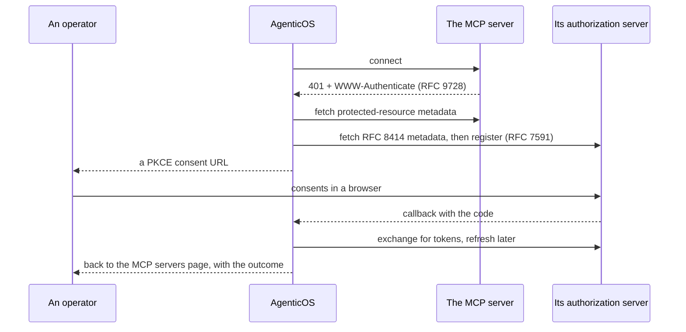

# MCP — las herramientas que aquí nadie tiene que escribir { #mcp-the-tools-nobody-here-has-to-write }

Los servidores [Model Context Protocol](https://modelcontextprotocol.io) son la
respuesta de esta plataforma a «no puedes escribir un conector para todo».

Una organización apunta a un servidor, sus herramientas aparecen en el Builder, y
no cambia ni una línea de código de nuestro lado.

Todo lo que hay en el [catálogo de capabilities](reference/capabilities.md) es
código que escribimos nosotros y que mantenemos al 100% de cobertura. Todo lo que
hay aquí es una URL que alguien pegó.

!!! info "Las dos cosas no son alternativas"

    Una **capability** es la forma correcta para algo que la plataforma tiene que
    garantizar — un guardián de budget, una sandbox, una recuperación que cita sus
    fuentes.

    **MCP** es la forma correcta para las decenas de productos SaaS que una empresa
    usa por casualidad, donde la única garantía que importa es «las herramientas son
    las que publicó el proveedor».

## Una conexión { #a-connection }

Una fila que apunta a un servidor remoto. El transporte — HTTP en streaming o
server-sent events — se deduce de la URL, así que un servidor solo de SSE como
Atlassian funciona junto a uno de HTTP en streaming sin nada que configurar.

| | |
|---|---|
| `name` | También el prefijo de las herramientas. Ver [Colisiones de nombres](#name-collisions) |
| `url` | Validada contra SSRF antes de que lleguemos a pedirla |
| `auth_token` | Sellado en el [vault](secrets.md), nunca devuelto por ningún endpoint |
| `allowed_tools` | Una lista de permitidos, o null para «todo lo que ofrezca el servidor». Una vinculación estrecha dentro de ella — ver más abajo |
| `is_enabled` | Apagarla sin perder la credencial |
| `include_instructions` | Añade las instrucciones propias del servidor en `initialize` a las del agent. Apagado por defecto - es texto del operador del servidor, leído como instrucciones del agent - y se enciende en el diálogo Edit de la conexión |
| `last_status` | Qué encontró el último sondeo, y cuándo |

!!! warning "Una dirección que este despliegue no debe alcanzar se rechaza, y el rechazo lo dice"

    Una URL que resuelve a una dirección de loopback, privada, link-local o de
    CGNAT compartido, una que no resuelve en absoluto, una que lleva credenciales
    en su userinfo, una con un esquema distinto de `http`/`https`, o una
    simplemente malformada, vuelve como un **400** que nombra `url` como el campo
    culpable — al crear, al editar y al iniciar un flujo OAuth, tanto personal como
    de toda la organización.

    Más allá de eso, lo que nombra es el **host**, nunca la URL: una URL lleva una
    clave en su query string, y la frase que explica el rechazo está escrita en este
    repositorio, no es lo que el parser de URL tuviera que decir sobre el texto que
    enviaste.

    Antes era un 500 sin detalles y con un traceback en el log, que se lee como que
    la plataforma se rompe y no como una dirección que corregir
    ([#861](https://github.com/vstorm-co/agenticos/issues/861)) — auto-alojar y
    pegar una URL de `localhost` es el caso ordinario, no el exótico.

    Un operador puede dejar que una conexión alcance un servidor de la propia
    red del despliegue, como un servicio de compose o un servidor en una VPN o
    una tailnet. Para ello, lista su host en
    [`MCP_ALLOWED_HOSTS`](configuration.md#project-settings). Un host de la
    lista solo se salta la comprobación de dirección. La URL sigue necesitando
    `http` o `https`.

    También se puede iniciar sesión con OAuth en un servidor de la lista. Un
    servidor así suele llevar su propio inicio de sesión, así que su
    descubrimiento, el registro del cliente y las peticiones de token pueden
    alcanzar los hosts de la lista, y ninguna otra dirección privada. Cada
    petición sigue fijada a la dirección que se comprobó, y un nombre de la
    lista que responda con una dirección de loopback, link-local o de metadatos
    de la nube se rechaza. El inicio de sesión de un servidor público nunca
    alcanza un host de la lista, aunque sus metadatos lo nombren.

    Toda cuenta del despliegue puede entonces alcanzar cualquier puerto de ese
    host. Así que lista solo un servidor que compruebe un token, y nunca
    `localhost` ni un servicio de este stack, como `app`, `db` o `redis`. La
    lista se lee al guardar una conexión y en cada inicio de sesión y
    renovación de token. Quitar un host no desconecta una conexión guardada,
    pero una conexión OAuth a él deja de renovar su token.

### Personal o de toda la organización { #personal-or-organization-wide }

Dos tipos, y la diferencia es lo importante. El diálogo de conexión lo pregunta
como una sola elección en palabras sencillas: **One shared account** (una cuenta
compartida) - configurada una vez, normalmente por un admin con una cuenta de
servicio, y usada por todos los agents - o **My own account** (tu propia cuenta),
usada por ti y por los agents configurados para actuar como cada persona. Un
servidor del catálogo con inicio de sesión (Notion, Linear, Gmail) recomienda la
cuenta de cada persona; uno que pide una clave recomienda la compartida.

**Personal** (MCP servers → You) está limitada a un miembro y la alcanza su propio
asistente, y también un agent vinculado a la cuenta propia de cada persona cuando
es ella quien habla con él.

Su credencial se sella para el *miembro*, no para una organización — una conexión
personal no tiene ninguna, y su dueño puede pertenecer a varias, así que atarla a
la que estuviera activa cuando la añadió haría el token ilegible en el momento en
que cambiara de una a otra.

**Organización** está limitada a la organización, protegida por `mcp:manage`, y
es el único tipo que el spec de un agent publicado puede nombrar *por id*.

Un servidor de la organización puede pertenecer a un departamento. En **Who can
use it** el diálogo de conexión ofrece **Everyone**, por defecto, o **Some
people**, que se encuentran escribiendo; el servidor pasa entonces a ser
privado y compartido con cada uno a nivel `use`. Ellos y quien lo conectó lo ven y
lo vinculan; owners y admins ven todos los servidores. Su botón **Who can use it**
lo cambia después.

Un agent que ya lo usa sigue funcionando para todos los que
pueden ejecutarlo: la elección decide quién puede escoger el servidor, no quién
recibe respuestas a través de él, por eso el Builder lo marca en
[de dónde viene el conocimiento de un agent](departments.md#where-an-agents-knowledge-comes-from).

Un agent publicado que alcanzara herramientas distintas según la sesión de quien
lo construyó no podría revisarse ni razonarse, que es toda la razón de la
restricción. Una conexión personal todavía alcanza a un agent, de una manera: una
vinculación a [la cuenta propia de cada persona](#whose-account-a-binding-speaks-through)
nombra el servicio, y quien habla con el agent aporta su propia conexión a él.

```
GET  /api/v1/me/mcp-connections     personal
GET  /api/v1/mcp-connections        organization, requires mcp:manage; each server
                                    narrowed to groups only for them
POST /api/v1/mcp-connections/{id}/test   probe it, list its tools, store the status
GET  /api/v1/mcp-connections/{id}/sharing   who it is narrowed to, and the same
                                            grant routes as an agent's
```

### Dos nombres, y responden a preguntas distintas { #two-names-and-they-answer-different-questions }

Una conexión lleva un **nombre** y un **prefijo de herramientas**, y solo el
segundo está restringido. El prefijo son letras minúsculas, dígitos y guiones,
único entre los servidores de la organización, porque eso es lo que puede llevar
el nombre de una herramienta y lo que el modelo lee antes de llamar a una. El
nombre es texto libre, opcional, y es lo que ve una persona.

La distinción se gana su sitio en cuanto una organización conecta un servicio dos
veces. Dos cuentas de Notion tienen que ser `notion` y `notion-2`, y ninguna de
las dos dice a qué workspace llega cada una; `Marketing workspace` y `Engineering
handbook` sí.

!!! info "El prefijo nunca desaparece"

    Dondequiera que se muestre un nombre, el prefijo se muestra a su lado. Las
    llamadas a herramientas de un run se registran bajo el prefijo, así que un
    nombre que lo sustituyera dejaría «¿por qué hizo esta llamada a
    `notion-2_search`?» sin respuesta desde la página que nombra la cuenta. Borra
    el nombre y la conexión vuelve a leerse como su prefijo, que es lo que hacía
    antes de que le pusieras uno.

Un spec nombra las conexiones de organización en `mcp_servers`, una entrada por
vinculación. Borrar una conexión que un agent todavía nombra le hace perder ese
servidor al agent, no al run.

### Qué herramientas, y quién decide { #which-tools-and-who-decides }

Dos listas de permitidos, y ninguna anula a la otra.

**En la conexión**, `allowed_tools` es la decisión de un administrador para todo
el que esté vinculado a ella — las herramientas que esta organización está
dispuesta a alcanzar en ese servidor, para empezar. **En la vinculación**, se
estrecha dentro de eso, por agent. Así que un mismo servidor puede servir a un
agent de solo lectura y a otro que edita sin conectarlo dos veces.

Se intersecan en tiempo de ejecución. Un agent no puede alcanzar una herramienta
que la conexión excluye, incluida una excluida después de publicar el agent — la
vinculación pierde esa herramienta en lugar de que el agent pierda el servidor.
Null en cualquiera de los dos lados significa que desde ahí no se estrecha nada,
así que una vinculación que no nombra nada obtiene lo que la conexión permita, que
es lo que hacía toda vinculación antes de que esto existiera.

El Builder lista las herramientas de un servidor a partir de su **último sondeo
con éxito**, registrado en la conexión. Sondear marca hacia un tercero y está
protegido por `connections:manage`; el autor de un agent tiene `agents:edit` y
necesita la lista para elegir, así que la lista se lee en lugar de pedirse.

Una conexión que nadie ha sondeado todavía no tiene catálogo que ofrecer, y el
selector lo dice y apunta a la página de servidores, que es donde se comprueba una
conexión. Una vinculación que ya nombra herramientas muestra esas, así que aquello
a lo que está vinculada sigue visible y todavía se puede estrechar.

### Qué llamadas esperan a una persona { #which-calls-wait-for-a-person }

Cada vinculación tiene una política `approval` para las herramientas de su
servidor. La predeterminada, `none`, deja pasar todas las llamadas, igual que las
herramientas de una capability se ejecutan hasta que alguien las pone tras una
puerta. `writes` retiene toda herramienta que el servidor no marque como de solo
lectura (el `readOnlyHint` de MCP) hasta que una persona apruebe la llamada: la
tarjeta muestra los argumentos exactos y se ejecutan los aprobados. `all` retiene
todas las llamadas. La marca de solo lectura la declara el propio servidor, así que
`writes` es tan estricta como honesto sea el servidor: elige `all` para un servidor
que no controlas.

La propia plantilla del Architect pide `writes` para el servidor
de la plataforma, así que no crea nada sin la persona en cuyo nombre actúa. La
vinculación de cualquier agent a ese servidor queda en al menos `writes`, también
con `none`: sus herramientas actúan con la autoridad de quien pregunta, la de un
Admin incluida. Una lectura espera como un cambio: `read_conversation`, que entrega
al modelo una conversación pasada entera - una página que el agent leyó podría si
no hacer que la pida y la envíe fuera.

En el Builder, los ajustes de un servidor lo dicen por
grupos: sus **lecturas** y las herramientas que **cambian cosas** se ejecutan sin
preguntar o preguntan primero.

### A través de qué cuenta habla una vinculación { #whose-account-a-binding-speaks-through }

Una vinculación es de uno de dos tipos, y el Builder pregunta cuál en los ajustes
del servidor, que también muestran tus propias cuentas en el servicio.

**La cuenta de la organización** (`account: organization`) nombra una de las
conexiones de la organización y responde por todo el mundo, en cualquier
superficie. Es la opción por defecto y la respuesta contra la que se revisa un
agent.

**La cuenta propia de cada persona** (`account: personal`) nombra en su lugar el
servicio del catálogo — `catalog_key: notion` — y ninguna conexión. Quien habla
con el agent conecta su propio Notion, en MCP servers → You, y el agent le habla a
Notion como esa persona: en el dashboard, en un mensaje directo y en un canal por
igual. El rastro de auditoría en Notion dice entonces quién hizo qué, cosa que una
cuenta de servicio compartida nunca puede.

La cuenta es la del autor de *este mensaje*, nunca la del hilo. Ania pregunta en
`#ops` y obtiene una respuesta de su Notion; Bartek hace la misma pregunta en el
mismo hilo y obtiene la suya, o se le dice que conecte una. Un hilo no es una
frontera que las credenciales de nadie deban cruzar — si la primera persona en
conectar respondiera por todas las que vinieran después, enlazar un Notion en un
canal sería entregárselo al canal.

!!! info "Donde no habla nadie, las herramientas están ausentes — y el agent lo dice"

    Una clave de API, el widget embebido, una programación, un trigger y un
    remitente de canal que no ha enlazado su cuenta de chat no tienen cuenta a
    través de la cual hablar. El run continúa sin ese servidor, con todas las demás
    vinculaciones intactas, y se añade una línea a sus instrucciones que dice qué
    servicio falta y por qué — así que cuando alguien pide Notion el agent responde
    con el enlace que lo conecta (`/mcp-servers?connect=notion`), o con «envía
    `/link` a este bot primero» cuando lo que falta es la cuenta de chat.


    El chat del dashboard pregunta cuando el agent necesita el servicio, no antes.
    Un servicio que la persona no ha conectado o que debe autorizar de nuevo se
    ofrece al modelo como `connect_account`: cuando
    una pregunta necesita Notion, el run se detiene en una tarjeta con el botón para
    conectar y, en cuanto la cuenta está conectada, el mismo run sigue con las
    herramientas de Notion. Si se omite, sigue sin ellas. Los controles del chat
    también listan los servicios personales del agent con su estado, así que un
    miembro nuevo ve qué conectar antes de preguntar. Ver
    [la página de la consola](console.md#chat).

El prefijo de herramientas de una vinculación personal es la clave del catálogo,
se llame como se llame la conexión de cada persona, así que el agent presenta
`notion_search` a todo el mundo. `allowed_tools` en la vinculación es el techo del
administrador; la conexión propia de la persona puede estrechar más, y las dos se
intersecan.

!!! warning "Tres cosas que publicar rechaza"

    Una vinculación personal a una clave que el catálogo no tiene — nada podría
    casar nunca la conexión de un miembro con ella. Dos vinculaciones personales a
    un mismo servicio — las mismas herramientas dos veces bajo un nombre. Y una
    vinculación personal cuya clave es además el nombre de una conexión de
    organización vinculada al mismo agent, lo que pondría dos servidores bajo un
    prefijo; Pydantic AI rechaza los nombres de herramienta duplicados y el turno
    se aborta.

!!! note "Una colisión que llega a un run se estrecha, no se pierde"

    Publicar es un momento en el tiempo y el nombre de una conexión es editable
    después, así que un agent publicado antes de esta comprobación, o uno cuya
    conexión se renombró a un nombre que colisiona, todavía puede llegar a un run
    con dos servidores bajo un prefijo. Ese run se queda con el primero de ellos
    que responda a su sondeo, descarta el resto, y le dice al modelo qué servidor
    no está disponible en este turno - y, cuando ambos llevan un mismo nombre, a
    través de qué vinculación está hablando - en lugar de perderlo en una línea de
    log que nadie lee. Renombrar una de las dos conexiones es el arreglo del autor.

Un agent puede vincular un servicio de las dos maneras — el Notion del manual de
la organización *y* el propio de cada persona — siempre que la conexión de la
organización no se llame como la clave del catálogo, que es el prefijo que toma
la cuenta propia de cada persona.

### Varias cuentas de un mismo servidor { #several-accounts-of-one-server }

Un agent puede leer a la vez el buzón de la empresa e `info@`. A una persona con
varias cuentas propias en un servicio se la alcanza a través de **cada una de
ellas**: la que marca como su cuenta principal en MCP servers → You (si no, la
primera que conectó) conserva el prefijo simple, `outlook_send`, y cada cuenta
más añade su etiqueta, `outlook_info_send` (dos etiquetas que se leen igual
como nombre de herramienta, `Sales US` y `Sales-US`, se distinguen por el id
corto de la cuenta en la segunda). Qué cuentas son las decide la
persona con lo que conecta; la vinculación no lo limita.

Las cuentas de la organización se vinculan una junto a otra del mismo modo: cada
una de sus conexiones a un servidor es su propia vinculación, con su propio
nombre y sus propias herramientas. En el Builder, los ajustes de un servidor
listan sus cuentas vinculadas con **Add another account**. Cuando un run alcanza
un servicio a través de más de una cuenta, una línea de sus instrucciones nombra
cada cuenta junto a su prefijo y le pide al modelo que pregunte cuando no esté
claro a cuál se refiere la persona.

Una segunda cuenta en un servicio tiene que llevar nombre: su etiqueta es lo que
distingue las dos en cada selector y cada aprobación, así que el formulario lo pide
antes de conectar, y la API rechaza una segunda cuenta sin nombre en `label`.

La aprobación dice entonces qué cuenta actúa. Una llamada a través de una
conexión con etiqueta, o de una de varias cuentas en un mismo servicio, lleva el
nombre de esa cuenta: el chat, Activity y el dashboard lo muestran junto a la
acción, un mensaje de Slack o Telegram pregunta «to *send in Gmail* as *Work*», y
el correo de aprobación lo indica tras la herramienta. Una sola cuenta sin
etiqueta no tiene de qué distinguirse, así que no se añade nada.

## Autenticación { #authentication }

Tres modos, que es lo único que varía de verdad entre servidores.

=== "Ninguna"

    Servidores de documentación pública, sobre todo — el servidor de documentación
    de Cloudflare no necesita credencial alguna.

=== "Token"

    Un bearer token pegado una vez y sellado.

    Cada entrada del catálogo lleva su propia pista sobre dónde conseguir uno,
    porque las instrucciones genéricas son la razón principal de que falle la
    configuración de un token.

    `PATCH` con `auth_token: ""` lo borra.

=== "OAuth 2.1"

    La mayoría de los servidores de negocio — Notion, Linear, Atlassian, Asana —
    devuelven `401` con una cabecera `WWW-Authenticate` que apunta a los metadatos
    de recurso protegido de RFC 9728, y el flujo arranca desde ahí.

    1. **Descubrir** — sondear el servidor, resolver su servidor de autorización,
       obtener los metadatos RFC 8414.
    2. **Registrar** — registro dinámico de cliente, RFC 7591. Un servidor que no
       publica endpoint de registro — el de HubSpot es uno — rechaza aquí, y la
       única salida es un cliente que registraste a mano en el proveedor: el
       diálogo de conexión acepta su client ID y su secret bajo *Tu propio
       cliente*, y muestra la redirect URL que el proveedor tiene que guardar
       exactamente así.
    3. **Consentir** — una URL de autorización PKCE con `state` y un indicador de
       recurso RFC 8707; el navegador va allí.
    4. **Intercambiar** — el callback cambia el código por tokens, y luego redirige
       el navegador de vuelta a la página de MCP servers, que dice si funcionó. Ese
       es el único sitio donde se puede contar el resultado: la persona está
       mirando una página a la que no navegó ella misma.
    5. **Refrescar** — cuando el access token caduca.



### Se comprueba cada URL de ese flujo, no solo la que escribiste { #every-url-in-that-flow-is-checked-not-just-the-one-you-typed }

!!! danger "Descubrir significa que el servidor remoto elige la mayoría de las direcciones que llamamos"

    Conectar un solo servidor hostil bastaba antes: un nombre podía responder con
    una dirección pública a la comprobación y con una privada a la petición que
    venía después
    ([#860](https://github.com/vstorm-co/agenticos/issues/860)).

    La dirección que pasó la comprobación es ahora la dirección a la que se
    conecta.

La petición va a la IP resuelta con el host original en la cabecera `Host` y en el
SNI de TLS, así que el certificado se sigue verificando contra el nombre y nada lo
resuelve una segunda vez.

Esa segunda mitad importa aquí más que en ningún otro sitio del producto. La
dirección que escribe un operador es solo el primer salto — el servidor de
autorización, el endpoint de token, el endpoint de registro y cada redirección
posterior los nombran los propios documentos de descubrimiento del servidor
remoto. Nadie de tu organización tenía que ser el atacante.

Las redirecciones se siguen de salto en salto, con un límite de cinco, cada una
con su propia comprobación. Un `302` a un host nuevo se vuelve a resolver, no se
confía en él.

Cuando un nombre responde con varias direcciones, se comprueban y se guardan
todas, y a una dirección que rechaza la conexión le sigue la siguiente — lo que un
cliente ordinario obtiene del resolver, sin preguntar a DNS una segunda vez. Un
nombre que responde con una dirección pública y otra privada se rechaza **entero**
en lugar de estrecharse a su mitad pública.

Quedan dos bordes, ambos estrechos y ambos deliberados:

- La **URL de consentimiento** se comprueba y luego se entrega al navegador de
  alguien, que la resuelve por su cuenta. No hay nada que fijar.
- La **URL propia de la conexión** se comprueba al guardar y se resuelve otra vez
  cuando un agent se ejecuta — la escribe un operador, así que volver a apuntarla
  significa ser el operador. Un host de `MCP_ALLOWED_HOSTS` se salta la
  comprobación de dirección, y las peticiones OAuth de una conexión cuyo propio
  host está en la lista pueden alcanzar los hosts de la lista, fijadas como
  cualquier otro paso.

Nada que elija un *modelo* llega a esta comprobación, y nada debería: una URL
elegida por un agent quiere el `safe_download` de Pydantic AI.

!!! info "Detrás de un proxy de salida, quien conecta es el proxy"

    `HTTP_PROXY` y `HTTPS_PROXY` se respetan, porque un despliegue que obliga a un
    proxy de salida perdería si no el OAuth de MCP por completo — y ese proxy es un
    control de salida por derecho propio.

    En ese camino la dirección fijada es la que se le *pide* alcanzar al proxy
    (`CONNECT 93.184.216.34:443`, o una línea de petición en forma absoluta para
    HTTP plano) y no aquella a la que se conecta este proceso, así que la garantía
    termina en el proxy. TLS sigue siendo de extremo a extremo, así que el
    certificado se sigue verificando contra el nombre original.

    Un proxy de políticas que rechace una dirección desnuda rechazará estas
    peticiones; la línea de log que se escribe cuando hay un proxy configurado está
    ahí para que ese fallo sea legible.

### Cuando falla un paso { #when-a-step-fails }

Un paso que falla dice **qué paso se rindió y qué clase de cosa lanzó el error**,
nunca lo que escribió el cliente de arriba.

`httpx2` pone la petición fallida en su mensaje, y las dos peticiones de aquí son
un registro de cliente y una concesión de token — así que citarlo llevaría al
navegador un endpoint de token, alcanzado con credenciales. Un error de pydantic
sobre una respuesta de token ilegible repite el payload que rechazó, que son los
tokens. Los dos se quedan en el log del servidor, que es donde un operador ya
mira.

**Un documento de descubrimiento que nombra una URL que no se puede pedir en
absoluto es la misma clase de respuesta**: un **400** que dice qué endpoint era
inutilizable, y que está malformado.

Ese es un rechazo distinto de «este servidor apuntó el flujo a una dirección
bloqueada». Uno dice que el servidor nos apuntó a un sitio al que este despliegue
no va, el otro que escribió una dirección que nada puede marcar, y contar
cualquiera de los dos como el otro sería una afirmación rotunda sobre de quién fue
la culpa de un fallo.

Una pista `WWW-Authenticate` inutilizable termina ese *candidato* de
descubrimiento, no el flujo, porque las URI well-known que vienen después se
derivan de la URL que escribió un operador y bien pueden responder.

Esto era un 500 con el cuerpo vacío hasta
[#889](https://github.com/vstorm-co/agenticos/issues/889): `httpx2.InvalidURL` no
deriva de `httpx2.HTTPError`, así que ninguno de los catch del flujo lo veía — y
ninguna comprobación de aquí habría podido verlo, porque la URL se rechaza
mientras se construye la petición, por encima tanto de la comprobación de SSRF
como del cliente fijado. Lo que el parser no pudo leer (`Invalid port:
'client_secret=…'`) es el texto del propio servidor remoto y se queda en el log
con todo lo demás.

!!! warning "La conexión OAuth de una organización sigue siendo la concesión de alguien"

    `POST /mcp-connections/oauth/start` produce una conexión que posee la
    organización, que es para lo que sirve una cuenta de servicio compartida. Pero
    la concesión sigue siendo la de la *persona que consintió* en el provider:
    revocarle el acceso allí deja de hacer funcionar el servidor de la organización
    hasta que se autorice de nuevo.

    Consiente con una cuenta que controle la organización.

### Tres reglas sobre los tokens { #three-rules-about-tokens }

**Un token nunca sigue a una URL que se movió.** Editar la URL de una conexión
descarta su payload de OAuth, su flujo pendiente y sus scopes replicados — tanto
en conexiones personales como de organización — así que la conexión se lee como
«necesita volver a autorizarse» en lugar de enviar a otro host un token emitido
para uno.

En una fila de organización esto es además una frontera entre administradores: un
poseedor de `mcp:manage` que reapunta una conexión que autorizó otro no debe hacer
que la plataforma entregue ese token al host nuevo.

**Una conexión deshabilitada no reparte tokens en ninguna parte.** El camino de
herramientas del agent la salta, y los portales de triggers también — quien
conservara el `connection_id` de un trigger no puede seguir enumerando
repositorios ni registrando hooks con una credencial que un administrador apagó.

**Borrar una conexión libera lo que se registró a través de ella.** Cualquier
[trigger de eventos](triggers.md) cuyo webhook en el provider se registró
automáticamente con el token de esta cuenta ve ese hook dado de baja — en la
medida de lo posible, mientras el token todavía existe — y cae de vuelta a la
entrega manual. La URL y el secreto del trigger siguen en pie, así que volver a
apuntar un provider hacia él a mano sigue funcionando.

El flujo de conexión del portal de GitHub también es consciente de las
actualizaciones en el otro sentido: una organización que conectó la entrada de
catálogo de GitHub como una conexión bearer simple antes de que existiera el flujo
OAuth ve esa misma fila reautorizada en su sitio — encontrada por su clave de
catálogo, se llamara como se llamara — en lugar de rechazada o duplicada, y el
bearer token sigue funcionando hasta que llega el nuevo consentimiento.

## Qué pasa en un turno { #what-happens-on-a-turn }

Cada servidor se sondea con un intercambio corto de `tools/list` antes de que
empiece el turno, y los sondeos corren a la vez. Un servidor tiene 3 segundos para
aceptar la conexión y 10 segundos para todo el intercambio, porque uno que
comprueba el token de cada petición en su proveedor de identidad es lento sin
estar caído. Un servidor que
respondió a su sondeo en los últimos dos minutos, con la misma credencial, no se
vuelve a sondear: el siguiente turno de la conversación lo conecta directamente. Si
ha caído entretanto, ese turno sigue sin sus herramientas y el siguiente lo sondea
de nuevo.

El nombre de una herramienta llega al modelo como el prefijo unido al nombre propio
del servidor, y los proveedores rechazan un nombre de más de 64 caracteres, o con
algo que no sean letras, dígitos, `_` y `-`, rechazando la petición entera. Ese
nombre se ajusta: los caracteres rechazados se sustituyen, el final se recorta y se
añaden ocho dígitos hexadecimales de un hash, así que dos nombres largos siguen
siendo dos herramientas. Al servidor se le sigue llamando por su nombre real.

!!! warning "Un servidor inalcanzable se salta con un aviso, no lanza un error"

    Pydantic AI entra en todos los toolsets cuando arranca un run, así que un
    servidor muerto abortaría si no el turno entero: un token caducado en una
    conexión tumbaría todos los agents que la nombran, incluidos los que nunca la
    necesitaron.

    El modelo responde entonces **sin** esas herramientas, y lo sabe: las
    instrucciones del turno nombran el servidor, dicen que no respondió o rechazó
    la conexión, y piden al modelo que diga que no se pudo contactar en vez de
    informar de un resultado vacío. Vale también para un servidor que respondió
    hace un momento y falla cuando el turno se conecta. Lo correcto para un turno
    de chat, lo incorrecto si dabas por hecho que una herramienta siempre estaba
    ahí.

Es un intercambio deliberado. El endpoint `/test` y `last_status` son cómo te
enteras, y el [rastro de auditoría](governance.md#audit) registra lo que se
ejecutó de verdad.

### Conectar uno desde el Builder { #connecting-one-from-the-builder }

La pestaña **MCP servers** de un agent lista el catálogo entero, no solo lo que
tiene credenciales. Un servidor que no tiene ninguna no es una casilla — no hay id
de conexión que el spec pueda guardar — así que la tarjeta abre el diálogo de
conexión **ahí mismo**.

Un servidor de token o sin credenciales se conecta sin salir de la página, y la
nueva conexión queda marcada para el agent en cuanto existe. Conectar comprueba el
servidor, y sus herramientas aparecen enseguida a partir de esa comprobación, así
que elegir un servidor, conectarlo y decidir qué puede llamar el agent es un solo
camino. Una comprobación fallida dice por qué en el aviso, y la conexión se queda
para corregirla.

!!! info "OAuth abre una pestaña"

    La pantalla de consentimiento es la del provider, así que no hay dónde quedarse
    — pero sí hay una forma de no perder el agent que estabas editando. Termina en
    la pestaña que se abre y vuelve; el servidor aparece en la lista en cuanto está
    autorizado.

### Un servidor, conectado varias veces { #one-server-connected-several-times }

Una organización puede conectar el mismo servidor más de una vez — un Notion con
acceso de solo lectura a un workspace, otro limitado a una única base de datos, un
tercero con una credencial de administrador. Esa es una forma soportada, no un
apaño: los nombres son únicos por organización y no por entrada de catálogo, y el
nombre es el prefijo de herramientas, así que el modelo ve
`notion_readonly_search` y `notion_admin_search` como herramientas distintas.

Vincula la que deba tener el agent, o varias una junto a otra — ver
[varias cuentas de un mismo servidor](#several-accounts-of-one-server). El
Builder muestra una tarjeta por servidor y lista sus cuentas en los ajustes del
servidor, cada una con su etiqueta y su nombre.

!!! tip "El nombre es toda la distinción"

    `notion` y `notion-2` no le dicen nada a nadie. Nombra una conexión por lo que
    puede alcanzar — `notion-handbook`, `notion-admin` — porque esa cadena es lo
    que lee el modelo cuando decide a qué herramienta llamar.

### Colisiones de nombres { #name-collisions }

!!! note "Las herramientas llevan como prefijo el nombre de la conexión"

    `github-work` se convierte en `github_work_*`, porque dos servidores que
    exponen el mismo nombre de herramienta hacen que Pydantic AI lance un error por
    duplicados, lo que aborta el turno.

    Una lista de permitidos filtra *antes* de poner el prefijo, así que compara
    contra los nombres sin prefijo elegidos en la UI.

Dos conexiones cuyos nombres se reducen al mismo prefijo se deduplican — gana la
primera, con un aviso que nombra a la perdedora. Los servidores gestionados por el
despliegue van ordenados primero, así que ganan a una conexión de usuario que dé
la casualidad de elegir el mismo nombre.

### Estado, uso y llamadas { #health-users-and-calls }

La tarjeta de un servidor en la página MCP servers dice cuándo una de sus cuentas
no respondió en la última comprobación, y la lista de sus cuentas dice cuál y qué
dijo; quien gestiona los servidores MCP puede volver a comprobarlo ahí.
Una cuenta OAuth cuyo inicio de sesión no se pudo renovar se muestra como
pendiente de autorización y no como inalcanzable, con **Autorizar** para volver
a iniciar sesión.

Cada quince minutos el despliegue comprueba cada servidor de la organización, y
cada run comprueba antes del turno los servidores a los que está vinculado su
agent. Cuando un servidor deja de responder, los administradores y los
propietarios de los agents vinculados a él reciben una notificación **MCP server
not answering** por esa caída, por muchas comprobaciones o runs que la detecten,
y **MCP server answering again** cuando vuelve. La siguiente caída vuelve a
avisar. Ambas llegan en la aplicación y por correo, y cada persona puede
desactivar cualquiera en **Settings → Notifications**. La conexión propia de un
miembro no envía ninguna, y un inicio de sesión que hay que renovar no cuenta
como caída.

En la página MCP, cada cuenta de la organización nombra los agents vinculados a
ella, y **What agents asked it** lista las últimas llamadas a sus herramientas:
qué herramienta, qué agent, cómo fue y en qué run. Lo que se preguntó y se
respondió no se muestra: se queda en la conversación. Cada llamada registra la conexión que
la atendió, así que la conexión propia de un miembro con el mismo nombre no
aparece, y las llamadas anteriores a ese registro no aparecen en absoluto. API: `used_by` en
`GET /api/v1/mcp-connections` y `GET /api/v1/mcp-connections/{id}/calls`.

**Añadir a un agent** vincula una cuenta al borrador del agent elegido, y
conectar una con una clave, o terminar su inicio de sesión, ofrece lo mismo.

## El catálogo { #the-catalog }

Un selector que empieza vacío y pide una URL es un selector que nadie usa, así que
los servidores comunes vienen con los metadatos necesarios para conectarlos: la
URL, cómo se autentica, qué decirle a quien vaya a pegar una credencial.

Esta es una lista mantenida a mano, **no** un espejo del registro público. Cada
entrada es una pequeña promesa — que alguien miró el servidor, que el flujo de
autenticación funciona, que la descripción es honesta — y un registro replicado no
puede hacer esa promesa.

!!! info "Qué añadiría de verdad replicarlo"

    El registro oficial se leyó entero en agosto de 2026: 20.100 registros, 7.127
    de ellos la versión actual de un servidor activo, 5.824 con un endpoint HTTPS
    alojado, repartidos en 5.141 hosts distintos. Así que los «miles de servidores»
    que anuncia un registro son reales.

    Cruzado con este catálogo, **cuatro** de esos hosts pertenecían a una empresa
    que la mayoría de los lectores reconocería y faltaban aquí — CircleCI, New
    Relic, Statsig y Lusha, los cuatro ya listados. El resto de los hosts
    sin cubrir son servidores de un solo proyecto, proxies en `workers.dev`,
    herramientas de SEO y juegos: alfabéticamente, los primeros son una consulta de
    precios del suelo, una herramienta de licitación para contratistas y un
    servicio húngaro de presupuestos de ventanas.

    Los dos hechos merecen sostenerse a la vez. Al catálogo no le faltan entradas
    porque nadie haya mirado; tiene la longitud que tiene porque una lista
    comprobada a mano de cosas que una empresa usa de verdad converge alrededor del
    centenar.

### El registro está en la misma lista, y en la base de datos { #the-registry-is-in-the-same-list-and-in-the-database }

Así que el espejo también se envía, y **/mcp es una sola lista con todos ellos** —
el catálogo curado primero, y luego el registro replicado, paginados: más de
4.700 servidores, la cifra que muestra la galería. No una
rejilla curada con una búsqueda que llega más lejos: una lista, un paginador, un
recuento.

Eso necesitaba una tabla. `mcp_registry_servers` es de todo el despliegue y no
tiene `organization_id`, que es toda la razón de que sea una tabla en lugar de
cinco mil filas por tenant — la galería de skills resolvió la cuestión vecina al
revés, y la diferencia es que un catálogo no son datos de un tenant. La llena
`agenticos cmd mcp-registry-sync`, desde la instantánea empaquetada o, con
`--fetch`, desde el registro en vivo.

Guardado en la base de datos porque un archivo no se puede paginar. Miles de
entradas en memoria podrían responder a «servidores que casan con
'linear'» y no podrían responder a «la cuarta página de todos ellos» sin cargarlo
todo y cortarlo. El ranking se movió a SQL con ello, por la misma razón: ordenar
una página es ordenar lo que esa página haya contenido. Tres bandas — el servidor
que se *llama* Linear, luego los nombres que meramente lo contienen, luego las
descripciones que lo mencionan — nombre más corto primero dentro de una banda, así
que `Stripe` gana a `Sweden Payments (Stripe)`.

Es una lista con un dato en algunas filas, no dos listas. Una fila del registro
lleva una insignia **Registry** donde una curada lleva su tipo de autenticación,
porque la diferencia merece conocerse antes de que alguien pegue una credencial:
aquí nadie la revisó, la descripción es la de quien publica, y no hay pista sobre
el token — el registro no tiene un campo así que replicar.

Del tamaño se siguen tres cosas, y cada una es la razón de que sea una búsqueda y
no un listado:

- **Paginado por el servidor, no filtrado por el navegador.** Cincuenta por
  página, y la consulta, la categoría y la página son todas peticiones. Un límite
  de página cae dentro del join — 99 filas curadas contra un tamaño de página de
  50 — así que la aritmética vive en `mcp_listing.page` con un test sobre ese
  límite, porque un error de uno ahí se salta un servidor o lo muestra dos veces en
  una lista donde nadie notaría cuál.
- **Una categoría también llega al espejo.** El registro no tiene categorías,
  así que cada entrada recibe una al sincronizar a partir de su propio nombre y
  descripción, contando las palabras por las que se reconoce cada categoría; una
  entrada que no nombra ninguna se archiva en *other* en lugar de adivinarle un
  encabezado. El filtro **Sign-in** pregunta por lo que pide un servidor - OAuth,
  un token, nada -, y para una entrada replicada es lo que encontró la
  comprobación del catálogo.
- **Sin logo empaquetado.** La consola incrusta un favicon por host curado para
  que una insignia se dibuje sin conexión; a 1,9 KB cada uno, hacer eso para el
  espejo serían 10,5 MB de base64 en un módulo que carga el navegador. Las filas
  del registro caen al servicio de favicons en tiempo de ejecución, que es para lo
  que se escribió.
- **Una instantánea, no un proxy.** Una instalación no debe dejar de funcionar
  porque el registro de otra persona esté caído, y un nombre que ayer resolvía y
  hoy no resuelve a nada es peor que uno que nunca estuvo.

    `make platform-bootstrap` la carga, así que un despliegue nuevo la tiene sin
    que nadie lea esto. `agenticos cmd mcp-registry-sync` la refresca, y `--fetch`
    lee el registro en vivo en lugar de la instantánea empaquetada. En un
    despliegue anterior a la tabla, la lista es el centenar curado hasta que se
    ejecuta la sincronización — que es lo que era antes de todo esto, así que nada
    empeora mientras alguien encuentra el momento.

Un servidor que no está en ninguna de las dos listas sigue siendo alcanzable:
**Custom server** acepta cualquier URL y no necesita entrada de catálogo alguna.

!!! info "Cuatro de estos son pasarelas, y son una promesa distinta"

    Composio, Pipedream, Activepieces y Smithery no son la API de un producto -
    cada uno es un endpoint hacia cientos o miles de otras, con las credenciales
    guardadas de su lado. Así que la entrada del catálogo responde por la
    *pasarela*, y lo que el agent puede alcanzar de verdad se decide en la consola
    de esa pasarela, por quien la configurara allí.

    Merece saberse antes de comparar tamaños de catálogo con un proveedor que
    anuncia miles de integraciones: ese número casi siempre es un endpoint de este
    tipo, no miles de servidores que alguien revisó. Las dos formas son útiles, y no
    son la misma afirmación.

### Cómo se mantiene el catálogo { #how-the-catalog-is-kept }

La promesa se degrada. El servidor de referencia oficial de Postgres se archivó
fuera de `modelcontextprotocol/servers` en 2025 y este catálogo siguió enlazándolo,
así que lo único que la entrada le ofrecía a un lector era un 404. En octubre de
2026 Linear había dejado `/sse`, Pipedrive se había mudado a otro host y doce
entradas curadas tenían un servidor alojado que nadie había anotado. Por eso ahora
se llama a cada servidor listado, como lo llama una primera conexión, con un
comando:

```bash
uv run agenticos cmd mcp-catalog-check --report catalog-check.md
```

Envía a cada servidor el handshake de MCP sin credenciales y registra lo que pasó:
respondió y listó sus herramientas (**open**, con cuántas solo leen), rechazó y
publica metadatos OAuth (**sign in**), rechazó sin esos metadatos (**token**), o
no respondió como un servidor MCP en absoluto (**unreachable**, **broken**, o
**refused** para una dirección dentro de una red). Dos entradas del registro en
una misma dirección son un solo servidor, y se queda el nombre más corto. No se
inicia sesión en ningún sitio: si las herramientas funcionan una vez conectado es
la prueba propia de la conexión.

Lo que encontró se ve en las tarjetas. Un servidor que respondió dice **Checked**
con la fecha, y sus recuentos de herramientas donde las listó. Un servidor curado
que no respondió lo dice en rojo y sigue listado, porque alguien lo eligió; una
entrada replicada que no respondió, o que repite otra, deja de ofrecerse. Una
entrada curada que promete OAuth y no publicó los metadatos para ello no se marca
como comprobada, porque su **Connect** es el botón que fallaría.

La comprobación se ejecuta antes de cada versión con `--snapshot`, que escribe
`app/core/catalog/mcp_checks.json`; `make platform-bootstrap` la carga, así que un
despliegue nuevo empieza con aquello contra lo que se comprobó la versión. Ejecuta
el comando en un despliegue para comprobar de nuevo; sus propios resultados se
conservan por encima de los incluidos. `--source catalog` comprueba solo la lista
curada en unos diez segundos; el registro entero tarda unos minutos. El informe
lista cada entrada curada con lo que declara, lo que se encontró y por qué alguna
no pasó.

`(self-hosted)` más abajo significa que la entrada describe el servidor pero la
URL la pones tú: o bien porque corre en tu propia infraestructura, o bien porque
el proveedor emite un endpoint por cuenta.

### Desarrollo { #development }

| Servidor | Auth | URL |
|---|---|---|
| GitHub | token | `https://api.githubcopilot.com/mcp/` |
| Cloudflare docs | none | `https://docs.mcp.cloudflare.com/mcp` |
| GitLab | token | self-hosted |
| Postman | token | `https://mcp.postman.com/mcp` |
| Vercel | oauth | `https://mcp.vercel.com/` |
| Netlify | oauth | `https://mcp.netlify.com/mcp` |
| Railway | token | `https://mcp.railway.app/mcp` |
| Replit | oauth | `https://mcp.replit.com/server/mcp` |
| Hugging Face | token | `https://huggingface.co/mcp` |
| Buildkite | oauth | `https://mcp.buildkite.com/mcp` |
| Semgrep | token | `https://mcp.semgrep.ai/mcp` |
| Clerk | oauth | `https://mcp.clerk.com/mcp` |
| WorkOS | oauth | `https://mcp.workos.com/mcp` |
| Render | token | `https://mcp.render.com/mcp` |
| CircleCI | oauth | `https://mcp.circleci.com/v1/mcp` |

### Gestión de proyectos { #project-management }

| Servidor | Auth | URL |
|---|---|---|
| Linear | oauth | `https://mcp.linear.app/mcp` |
| Jira & Confluence | oauth | `https://mcp.atlassian.com/v1/sse` |
| Asana | oauth | `https://mcp.asana.com/sse` |
| ClickUp | oauth | `https://mcp.clickup.com/mcp` |
| Trello | oauth | `https://mcp.trello.com/v1` |
| Todoist | oauth | `https://ai.todoist.net/mcp` |
| monday.com | oauth | `https://mcp.monday.com/mcp` |

### Datos y analítica { #data-and-analytics }

| Servidor | Auth | URL |
|---|---|---|
| PostgreSQL | token | self-hosted |
| Supabase | token | `https://mcp.supabase.com/mcp` |
| Elasticsearch | token | self-hosted |
| Airtable | token | `https://mcp.airtable.com/mcp` |
| Snowflake | token | self-hosted |
| Databricks | token | self-hosted |
| Google BigQuery | oauth | self-hosted |
| PostHog | token | `https://mcp.posthog.com/mcp` |
| Mixpanel | token | `https://mcp.mixpanel.com/mcp` |
| Google Analytics 4 | token | self-hosted |
| Neon | oauth | `https://mcp.neon.tech/mcp` |
| Amplitude | token | `https://mcp.amplitude.com/mcp` |
| Firecrawl | token | `https://mcp.firecrawl.dev/mcp` |
| Exa | token | `https://mcp.exa.ai/mcp` |
| Tavily | token | `https://mcp.tavily.com/mcp` |
| Bright Data | token | `https://mcp.brightdata.com/mcp` |
| Qdrant | none | `https://mcp.qdrant.tech/mcp` |
| Statsig | token | `https://api.statsig.com/v1/mcp` |

### Comunicación, soporte, conocimiento { #communication-support-knowledge }

| Servidor | Auth | URL |
|---|---|---|
| Slack | oauth | `https://mcp.slack.com/mcp` |
| Microsoft Work IQ | oauth | `https://workiq.svc.cloud.microsoft/mcp` |
| Outlook Mail (Work IQ) | oauth | `https://agent365.svc.cloud.microsoft/agents/servers/mcp_MailTools` |
| Microsoft Teams (Work IQ) | oauth | `https://agent365.svc.cloud.microsoft/agents/servers/mcp_TeamsServer` |
| Zoom | oauth | self-hosted |
| Intercom | oauth | `https://mcp.intercom.com/sse` |
| Notion | oauth | `https://mcp.notion.com/mcp` |
| GitBook | token | `https://mcp.gitbook.com/mcp` |
| Sanity | token | `https://mcp.sanity.io/mcp` |
| DeepWiki | none | `https://mcp.deepwiki.com/mcp` |
| Supermemory | token | `https://mcp.supermemory.ai/mcp` |
| Contentful | token | `https://mcp.contentful.com/mcp` |
| Storyblok | token | `https://mcp.storyblok.com/mcp` |
| Vapi | token | `https://mcp.vapi.ai/mcp` |

### Finanzas, ventas, comercio { #finance-sales-commerce }

| Servidor | Auth | URL |
|---|---|---|
| Stripe | token | `https://mcp.stripe.com` |
| PayPal | oauth | `https://mcp.paypal.com/sse` |
| Xero | oauth | `https://mcp.xero.com/mcp` |
| HubSpot | oauth | `https://mcp.hubspot.com/` |
| Shopify | oauth | self-hosted |
| Attio | oauth | `https://mcp.attio.com/mcp` |
| Pipedrive | oauth | `https://mcp.pipedrive.ai/mcp` |
| Lusha | oauth | `https://mcp.lusha.com` |

### Observabilidad { #observability }

| Servidor | Auth | URL |
|---|---|---|
| Sentry | oauth | `https://mcp.sentry.dev/mcp` |
| Grafana | token | `https://mcp.grafana.com/mcp` |
| PagerDuty | oauth | `https://mcp.pagerduty.com/mcp` |
| Datadog | token | `https://mcp.datadoghq.com/api/unstable/mcp-server/mcp` |
| Pydantic Logfire | token | `https://logfire-us.pydantic.dev/mcp` |
| LangSmith | token | `https://api.smith.langchain.com/mcp` |
| Honeycomb | token | `https://mcp.honeycomb.io/mcp` |
| New Relic | token | `https://mcp.newrelic.com/mcp` |

### Marketing y diseño { #marketing-and-design }

| Servidor | Auth | URL |
|---|---|---|
| Mailchimp | oauth | `https://ai-inc.mailchimp.com/claude/mcp/v2` |
| Resend | token | `https://mcp.resend.com/mcp` |
| Webflow | oauth | `https://mcp.webflow.com/mcp` |
| Wix | oauth | `https://mcp.wix.com/mcp` |
| WordPress.com | oauth | `https://public-api.wordpress.com/wpcom/v2/mcp/v1` |
| Semrush | oauth | `https://mcp.semrush.com/v1/mcp` |
| Meta Ads | oauth | `https://mcp.facebook.com/ads` |
| Google Ads | token | self-hosted |
| Similarweb | token | `https://mcp.similarweb.com/mcp` |
| Figma | oauth | `https://mcp.figma.com/mcp` |
| Miro | oauth | `https://mcp.miro.com/mcp` |
| Lucid | oauth | `https://mcp.lucid.app/mcp` |
| Excalidraw | none | `https://mcp.excalidraw.com/mcp` |
| Canva | oauth | `https://mcp.canva.com/mcp` |
| Klaviyo | oauth | `https://mcp.klaviyo.com/mcp` |

### Automatización, almacenamiento, productividad, medios { #automation-storage-productivity-media }

| Servidor | Auth | URL |
|---|---|---|
| Zapier | oauth | `https://mcp.zapier.com/api/mcp/mcp` |
| Make | token | self-hosted |
| n8n | token | self-hosted |
| Box | oauth | `https://mcp.box.com/mcp` |
| Dropbox | oauth | `https://mcp.dropbox.com/mcp` |
| Calendly | oauth | `https://mcp.calendly.com/` |
| Typeform | oauth | `https://api.typeform.com/mcp` |
| SurveyMonkey | oauth | `https://mcp.surveymonkey.com/mcp` |
| DeepL | oauth | `https://mcp.deepl.com/v1/mcp` |
| ElevenLabs | oauth | `https://api.elevenlabs.io/v1/mcp` |
| Fireflies | token | `https://mcp.fireflies.ai/mcp` |
| Egnyte | oauth | `https://mcp-server.egnyte.com/mcp` |
| Apify | token | `https://mcp.apify.com` |
| Tally | token | `https://api.tally.so/mcp` |
| Pipedream | oauth | `https://mcp.pipedream.net/v2` |
| Composio | token | self-hosted |
| Activepieces | token | `https://mcp.activepieces.com/mcp` |
| Cal.com | token | `https://mcp.cal.com/mcp` |
| Outlook Calendar (Work IQ) | oauth | `https://agent365.svc.cloud.microsoft/agents/servers/mcp_CalendarTools` |
| Word (Work IQ) | oauth | `https://agent365.svc.cloud.microsoft/agents/servers/mcp_WordServer` |
| SharePoint (Work IQ) | oauth | `https://agent365.svc.cloud.microsoft/agents/servers/mcp_SharePointRemoteServer` |
| OneDrive (Work IQ) | oauth | `https://agent365.svc.cloud.microsoft/agents/servers/mcp_OneDriveRemoteServer` |

### Cualquier otra cosa { #anything-else }

**Smithery** — token — `https://mcp.smithery.ai/mcp`. Una pasarela de registro:
los servidores que se alcanzan a través de ella son los que esa cuenta tenga
instalados en Smithery, así que lo que el agent puede hacer se decide allí y no
aquí.

**Custom server** — cualquier servidor MCP alcanzable por URL. Sus herramientas se
introspeccionan al conectar, y nada de él necesita estar antes en el catálogo. El
catálogo le ahorra a alguien buscar una URL; no es una puerta.

Escribir la dirección de un servidor propio le pregunta si se puede iniciar sesión:
el mismo descubrimiento que hace un flujo OAuth (RFC 9728, luego RFC 8414), sin
registrar nada, mediante `POST /api/v1/me/mcp-connections/probe`. Si se puede,
**OAuth** queda elegido y Conectar abre el inicio de sesión; si el servidor no
registra aplicaciones por sí mismo, el diálogo pide un client ID y un secreto
creados en el proveedor; si no publica metadatos OAuth, queda un token o ninguna
credencial.

Para añadir una entrada a la lista, ver
[Añadir un servidor al catálogo de MCP](howto/add-mcp-server.md).

<a id="outlook-setup"></a>

### Microsoft 365 y Outlook { #microsoft-365-and-outlook }

Microsoft publica sus propios servidores MCP para Microsoft 365, y el catálogo los
lista: **Work IQ** - un endpoint para correo, reuniones, chats y archivos - y los
servidores por aplicación de Mail, Calendar, Teams, SharePoint, OneDrive y Word.
Cada uno necesita una licencia de Microsoft 365 Copilot y una aplicación
registrada en Microsoft Entra: añade el permiso de Work IQ del servidor (para el
correo, `WorkIQ-MailServer`) y la URL de redirección de esta consola, que muestra
el diálogo de conexión, y escribe el client ID de la aplicación al conectar.

Entra no registra un cliente en el acto, así que el client ID no es opcional. Microsoft
marca los servidores por aplicación como mantenidos por compatibilidad y dirige
los proyectos nuevos a Work IQ.

Outlook también está disponible mediante servicios MCP de terceros. El registro
incluido contiene entradas de MintMCP para correo y calendario:

| Entrada del registro | URL del servidor |
|---|---|
| `com.mintmcp/outlook-email` | `https://outlook-email.mintmcp.com/mcp` |
| `com.mintmcp/outlook-calendar` | `https://outlook-calendar.mintmcp.com/mcp` |

Busca la entrada en el catálogo MCP o añade su URL como servidor personalizado.
Sigue las [instrucciones del proveedor](https://www.mintmcp.com/servers), configura
la cuenta y la autorización, prueba la conexión y selecciona las herramientas
del agente. La disponibilidad, los permisos y los posibles cargos dependen del
proveedor. Una entrada del registro no equivale a una prueba completa de la
integración con AgenticOS. Revisa los modos de aprobación descritos abajo antes
de activar herramientas de escritura.

## AgenticOS como servidor MCP { #agenticos-as-an-mcp-server }

Todo lo anterior es la plataforma llamando a otros servidores. También es uno:
**`/mcp`** en el host de la API habla MCP sobre streamable HTTP, así que Claude
Code, Claude Desktop o cualquier cliente MCP puede operar la organización —
listar y crear agents, ejecutarlos, leer los runs y su coste, llenar y buscar
bases de conocimiento, invitar a miembros.

El servidor está construido sobre [FastMCP](https://gofastmcp.com): sirve el
protocolo y los endpoints de OAuth 2.1, y AgenticOS aporta las herramientas y cada
decisión detrás de un inicio de sesión.

El cliente inicia sesión por el navegador: se registra, abre la página de
consentimiento de la consola, donde eliges la organización y lo que puede hacer, y
recibe un token que dura una hora y se renueva solo. No se pega ninguna clave.

El registro no necesita credenciales, así que se limita por dirección como el
inicio de sesión, y un cliente con el que nadie completó el inicio de sesión se
olvida al cabo de un día.

En la consola, **Settings → MCP clients** muestra la URL de este servidor y el comando o la configuración exactos para Claude Code, Codex, Claude Desktop, Cursor y VS Code, para las dos formas de iniciar sesión.

```bash
claude mcp add --transport http agenticos https://<your-deployment>/mcp
```

O conéctate con una [clave de API de la organización](api.md#organization-api-keys),
para un cliente que no puede abrir un navegador:

```bash
claude mcp add --transport http agenticos https://<your-deployment>/mcp \
  --header "Authorization: Bearer $AGENTICOS_KEY"
```

La conexión actúa como el miembro que emitió la clave, dentro de los permisos de
la clave. Cada herramienta es una llamada a la [API pública](api.md) con esa
clave, así que se rechaza, se limita y se audita exactamente igual que la misma
petición por HTTP; un rechazo vuelve como error de la herramienta nombrando el
permiso que faltaba.

| Herramienta | Necesita |
|---|---|
| `whoami` | — |
| `list_agents`, `get_agent`, `list_capabilities`, `list_models`, `search_mcp_servers` | `agents:view` |
| `create_agent_draft`, `update_agent_draft`, `test_agent_draft` | `agents:edit` |
| `list_sandbox_connections`, `list_sandbox_runtimes`, `get_sandbox_policy` | `connections:view` |
| `list_org_connections` | `mcp:manage` |
| `publish_agent` | `agents:publish` sobre ese agent |
| `discard_agent_draft` | `agents:edit`, sobre un borrador tuyo que nunca se publicó |
| `run_agent` | `agents:run` |
| `list_routines` | `agents:view` |
| `create_routine`, `run_routine_now` | `agents:run` sobre el agent |
| `update_routine`, `delete_routine` | quien creó la rutina, o `agents:edit` sobre su agent |
| `list_runs`, `get_run`, `read_conversation`, `get_spend` | `runs:view` |
| `list_knowledge_bases`, `search_knowledge` | `collections:view` |
| `list_embedding_models` | — |
| `create_knowledge_base`, `add_document` | `collections:edit` |
| `list_skills` | `skills:view` |
| `create_skill` | `skills:edit` |
| `list_members` | `members:view` |
| `invite_member` | `members:manage` y `roles:manage` |
| `list_my_connections`, `set_my_language`, `set_my_profile` | — (los de quien llama) |

Aquí se puede construir un agent de principio a fin: esbozarlo, editarlo, probarlo
como borrador sin publicar con `test_agent_draft` - un run de prueba, con
presupuesto y registrado, rechazado con el motivo cuando el borrador no se
publicaría - y publicarlo con `publish_agent`, que hace las mismas comprobaciones
que el botón **Publish** de la consola. El `cron_expression` de una rutina se
evalúa en UTC. `set_my_language` cambia el idioma de la consola de quien llama
(`en`, `pl` o `de`) en cada dispositivo en el que inicia sesión, y
`set_my_profile` guarda su rol y en qué trabaja, lo que desde entonces se le dice
a cada agent.

`create_skill` guarda como [skill](skills.md) un procedimiento que funcionó,
para «haz un skill de esto».

A propósito no hay: tocar credenciales ni borrar nada salvo un borrador de agent
que quien llama creó y nunca publicó - deshacer un borrador creado por error - o
una rutina. Las aplicaciones conectadas
aparecen en **Settings → MCP clients**, donde desconectar una termina su acceso y
el de cada token que tiene. Las llamadas que cambian
algo esperan aprobación, como explica [la sección de arriba](#which-calls-wait-for-a-person).

Las herramientas de borradores aceptan vínculos de capacidades configurados e IDs.
Por ejemplo, `capabilities: [{id: sandbox, config: {backend: service,
include_execute: true}}]` da al agent programador una shell en el host de sandbox
predeterminado de la organización. `list_capabilities` devuelve cada `config_schema`;
`list_sandbox_connections`, `list_sandbox_runtimes` y `get_sandbox_policy`
muestran hosts disponibles, alias de entornos y límites antes de configurarlos.
Un sandbox de solo archivos (`state`) no ejecuta comandos.

`update_agent_draft.add_capabilities` añade o actualiza vínculos: los campos
omitidos conservan sus valores, pero un `config` explícito reemplaza toda la
configuración. Lee primero el borrador para conservar los ajustes necesarios.
Ambas herramientas aceptan `mcp_servers`: IDs de conexiones de organización de
`list_org_connections` o claves de catálogo personales de `search_mcp_servers`.
Un ID de conexión personal nunca pertenece a una especificación compartida.
La lista MCP se reemplaza por completo; `[]` desconecta todo. La creación también
acepta `skill_ids` y `collection_ids`. Pruebas y publicación mantienen las mismas
reglas de validación y aprobación.

### Dárselo a un agent { #giving-it-to-an-agent }

El mismo servidor es también un enlace MCP que cualquier agent puede tener, así que
un agent responde a «qué falló ayer» o «qué agents usan esta base de conocimiento»
con los propios registros de la plataforma. En el Builder es la primera tarjeta de
**Servidores MCP**, con el nombre de este despliegue; activarla lo enlaza como
`mcp_servers: [{account: platform, approval: writes}]`.

- **Actúa como la persona para la que corre el agent.** Un run crea una credencial
  de corta duración con los permisos de esa persona, así que el agent de un Viewer
  lee lo que el Viewer puede leer y no crea nada. No se concede nada nuevo, y donde
  nadie está detrás del run - un widget público, una programación que no actúa por
  nadie - el enlace no está.
- **Los cambios esperan aprobación.** `writes`, el valor predeterminado, retiene
  cada herramienta que cambia algo (`create_agent_draft`, `publish_agent`,
  `create_routine`, `run_agent`, `invite_member` y las demás) hasta que la persona
  la apruebe; `all` retiene también la lectura. `none` no se ofrece: estas
  herramientas actúan con la autoridad de una persona. La única escritura que nunca
  espera es `set_my_language`: cambia el idioma de la consola de quien pregunta,
  por su palabra, y una tarjeta de aprobación para «cambia a inglés» sería toda la
  conversación. `set_my_profile` espera como las demás, porque lo que guarda se le
  dice a cada agente que la persona ejecuta, y una página que un agente leyó no
  debe poder escribirlo sin que se vea.
- **Las herramientas se pueden acotar** en los ajustes de la tarjeta, que listan
  cada herramienta y marcan las que cambian algo.

La plantilla **AgenticOS** lo enlaza así, igual que cada agent creado desde cero,
de modo que un agent consulta la plataforma desde el principio - y configura una
rutina o cambia el idioma de la consola cuando se lo piden.

## Lo que MCP no te da { #what-mcp-does-not-get-you }

- **Una garantía de cobertura.** Las entradas del catálogo son metadatos. Las
  herramientas son del proveedor, y pueden cambiar bajo tus pies de un turno al
  siguiente.
- **Aprobaciones que saben qué hace una herramienta.** La política `writes` confía
  en que el servidor marque sus herramientas de solo lectura; una herramienta así
  marcada que cambia algo se ejecuta sin preguntar. Usa `all` para un servidor que
  no controlas y acota `allowed_tools`. Consulta [qué llamadas esperan](#which-calls-wait-for-a-person).
- **Atribución de coste.** Lo que un servidor hace de su lado no está en el
  [budget](governance.md#budgets) de esta plataforma. Solo lo están los tokens del
  modelo.

## Resumen { #recap }

- Un servidor MCP es **una URL que alguien pegó**, y sus herramientas aparecen sin
  un despliegue de código.
- Las conexiones **personales** llegan al asistente de un miembro; solo las
  conexiones de **organización** puede nombrarlas un spec publicado.
- Cada dirección de un flujo OAuth se **comprueba y se fija**, incluidas las que
  eligió el servidor remoto.
- Un token nunca sigue a una URL que se movió, una conexión deshabilitada no
  reparte ninguno, y borrar una da de baja lo que registró.
- Un servidor inalcanzable se **salta**, no lanza un error — el turno responde sin
  esas herramientas.

Cada comprobación programada incluye como máximo 64 servidores activos de la organización, empezando por los comprobados hace más tiempo, y ejecuta hasta ocho sondeos simultáneos. Las credenciales inutilizables también actualizan la fecha de comprobación sin declarar una caída. Las instalaciones más grandes cubren así todos los servidores en ciclos sucesivos.

La renovación OAuth tiene una transacción breve e independiente: bloquea y comprueba de nuevo la cuenta, rota la credencial y confirma su almacenamiento antes de devolver el token. La cancelación espera a que termine; un rollback posterior de la ejecución no la deshace. Si falla la persistencia después de la rotación del proveedor, la solicitud falla explícitamente y puede ser necesario autorizar la cuenta otra vez. El sondeo de buzones utiliza un bloqueo asesor separado por cuenta; el cursor y los trabajos encolados se confirman juntos, y una respuesta incorrecta revierte solo el trabajo de ese buzón.

La cola de comprobaciones de estado utiliza su propia fecha indexada. La renovación OAuth y el sondeo de buzones no retrasan la siguiente comprobación del servidor. Tras la migración, los servidores existentes entran en la cola como no comprobados.
