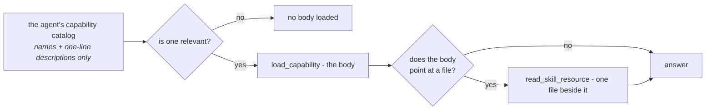

# Skills { #skills }

Ein Skill ist Wissen, das einmal geschrieben und an viele Agents gebunden wird:
wie Rückerstattungen behandelt werden, was der Hausstil ist, welche Prüfungen ein
Bericht bestehen muss, bevor er herausgeht.

Ersetzt wird damit ein Instruktionsfeld, das immer weiter wächst.

Zwanzig Verfahren in einem Prompt bedeuten, dass jeder Run für alle zwanzig
bezahlt, und das einundzwanzigste schiebt die Unterhaltung aus dem Fenster.
Skills drehen das um:



Zwanzig Skills kosten ungefähr zwanzig _Beschreibungen_ statt zwanzig
_Verfahren_.

!!! note "Discovery ist günstig, nicht kostenlos"

    Jeder gebundene Skill steht mit Name und einzeiliger Beschreibung im
    Capability-Katalog, den das Modell in jeder Runde liest — einen Skill zu binden
    kostet also Tokens, ganz gleich ob das Modell ihn jemals öffnet.

    Es ist eine Zeile pro Skill gegen einen Textkörper pro Skill, und deshalb geht
    die Rechnung auf. Es ist kein Grund, einen unbegrenzten Katalog zu binden.

Die andere Hälfte des Punktes ist, **wer sie schreibt**. Ein Skill ist eine Zeile
in der Datenbank, in der UI bearbeitbar, sodass eine Support-Leitung die
Rückerstattungsregel an einem Dienstagnachmittag korrigieren kann. Kein Deploy,
kein Pull Request, kein Entwickler.

!!! info "Skill, Context-Datei oder Knowledge-Collection?"

    Ein **Skill** ist ein Verfahren, das das Modell lädt, wenn es entscheidet, dass
    die Aufgabe angekommen ist. Eine [Context-Datei](context.md) ist ständiges
    Wissen — kurz, immer relevant, eingefügt oder bei Bedarf gelesen. Eine
    [Knowledge-Collection](file-processing.md) ist ein Korpus, der zu groß zum
    Lesen ist und über Suche erreicht wird.

Im Agent Builder öffnet **Skills → New skill** die Erstellung direkt im Fähigkeitspanel. Beim Speichern entsteht ein Bibliothekseintrag, der dem aktuellen Entwurf zugeordnet wird; zugleich wird die Fähigkeit Skills aktiviert. Das Veröffentlichen bleibt ein eigener Schritt. Die Aktion erfordert Bearbeitungsrechte für den Agenten und Skills.

## Die Form { #the-shape }

```markdown
---
name: refund-policy
description: When a refund is given without asking, when it needs approval, and how to say no.
category: support
---

# Refunds

Most refund questions are decided by the order date and one exception. Check
those before escalating anything.

Die Seite **Skills** zeigt auf jeder Karte den Anfang des Inhalts — ohne Front
Matter, ein paar Zeilen — und dahinter ein Blatt für jede Datei, die der Skill
mitbringt. `GET /api/v1/skills` liefert diesen Anfang als `excerpt`; den Inhalt
selbst lädt erst das Öffnen des Skills.

## Decide without asking

...
```

!!! tip "`description` ist das Feld, das darüber entscheidet, ob der Skill je geladen wird"

    Es ist der einzige Teil, den das Modell umsonst sieht. Schreiben Sie es als
    **wann man danach greift**, nicht als Titel.

Ein Skill kann **Ressourcen** mitbringen — weitere Dateien daneben, die bei
Bedarf geladen werden. `refund-policy` liefert eine `exceptions.md` mit, und der
Textkörper sagt, wann sie zu konsultieren ist.

Das ist dieselbe schrittweise Offenlegung eine Ebene tiefer: Details, die nur
manche Unterhaltungen brauchen, müssen nicht in dem Textkörper stehen, den jede
relevante Unterhaltung lädt.

`category` ist einer von zwanzig Vorschlägen (`support`, `engineering`,
`finance`, `legal`, `security`, `marketing`, …) und steuert den Filter in der
Skill-Liste. Auf das, was der Agent sieht, hat sie keine Wirkung — das Modell
wählt über `description`, nie über die Kategorie.

## Wie ein Agent einen liest { #how-an-agent-reads-one }

Über die [Capability `skills`](reference/capabilities.md#skills). Jeder Skill, den
ein Agent bekommt, wird zu einer **eigenen Capability** — dem Modell mit Name und
Beschreibung aufgelistet und bei Bedarf geöffnet:

| Wie                    | Was es tut                                                                      |
| ---------------------- | ------------------------------------------------------------------------------- |
| Der Capability-Katalog | Namen und einzeilige Beschreibungen von allem, was an diesen Agent gebunden ist |
| `load_capability`      | Der vollständige Textkörper eines Skills, in die Unterhaltung geholt            |
| `read_skill_resource`  | Eine Datei neben einem Skill                                                    |

`load_capability` ist das Tool des Agent-Frameworks selbst und keines, das diese
Plattform veröffentlicht — ein Spec kann es also weder gewähren noch umbenennen.
**Absichern** kann es das sehr wohl, denn dieser Aufruf öffnet einen Skill:
`tool_approval` darauf ist, wie ein Agent einen Menschen fragt, bevor ein Skill das
Modell erreicht, und ein Spec, der das frühere `load_skill` abgesichert hatte, wird
darauf migriert statt ungesichert zu bleiben. Als eigenes Tool steuert die
Capability `read_skill_resource` bei, und das auch nur, wenn mindestens einer der
gebundenen Skills eine Datei zum Lesen mitbringt.

Ein Spec bindet Skills über ihre Id in `skill_ids`, sodass ein Agent genau die
sieht, die ihm gegeben wurden, und sonst nichts.

**Direkt vom Skill aus.** Jede Karte auf der Skills-Seite hat **Zu einem
Agenten hinzufügen**: Agent wählen, und der Skill landet in dessen Entwurf, mit
eingeschalteter Skills-Capability, bereit zum Veröffentlichen im Builder. Die
Karte sagt auch, welche Agents den Skill nutzen - oder dass es noch keiner tut.
Kontextdateien und Wissensdatenbanken bieten dasselbe.

**Der Name eines Skills ist die id, unter der ein Modell ihn lädt**, also hat
er die Form, in der Modelle ids schreiben: Kleinbuchstaben und Ziffern, verbunden
durch einzelne Bindestriche, etwa `refund-policy`. Ein Name mit Leerzeichen oder
Großbuchstaben wird beim Anlegen des Skills abgelehnt. Einen Namen, den das Modell
exakt wiedergeben müsste, wie `Refund policy`, lud es stattdessen als
`refund-policy`, und zwei falsche Vermutungen beenden die Runde
([#1911](https://github.com/vstorm-co/agenticos/issues/1911)).

**Ein Skill darf nicht heißen wie eine Capability.** Jeder liegt unter seinem
eigenen Namen im selben Namensraum wie `knowledge`, `planning` und der Rest - ein
Skill namens `planning` auf einem Agent, der auch die Planning-Capability hat, ist
also ein Duplikat, das das Framework vor dem ersten Token ablehnt. Einen solchen
anzulegen wird abgewiesen, und einen Agent zu veröffentlichen, der an einen so
benannten Skill gebunden ist, ebenfalls.

Die Capability ohne gebundene Skills zu aktivieren ist nutzlos — geben Sie dem
Agent Skills, oder lassen Sie die Capability aus.

### Welche Skills eine Antwort verwendet hat { #which-skills-an-answer-used }

Einen Skill zu binden heißt nicht, dass das Modell ihn gelesen hat. Jeder Run
zeichnet die Skills auf, die er tatsächlich verwendet hat, nach der ID des Skills:
ob das Modell einen mit `load_capability` geöffnet hat und wie viele seiner
Dateien es mit `read_skill_resource` gelesen hat. Ein Run zeichnet das auf, wie
auch immer er endet, auch wenn er nach dem Öffnen des Skills fehlgeschlagen ist.
Ein Skill, den ein Delegate verwendet hat, wird beim delegierenden Run unter dem
Agent des Delegates aufgezeichnet, weil die bewertete Antwort die dieses Runs ist.

Ein Tool-Aufruf, der einen Pfad im Workspace-Ordner eines Skills nennt, etwa
`cat /workspace/skills/refund-policy/SKILL.md`, zählt getrennt als
wahrscheinliche Verwendung. Den Ordner aufzulisten zählt nicht. Ein Pfad, den eine
Shell zusammensetzt, ein Glob über mehrere Skills oder ein Skript, das die Datei
selbst liest, wird nicht erkannt.

`GET /api/v1/skills/{id}/usage?days=30` liefert pro Agent, wie viele Runs den
Skill in diesem Zeitraum verwendet haben, mit der Version, die jeder bekam. Runs
von Evals und vom Testbereich des Builders werden nicht gezählt. Die Zahlen werden
aus Runs gelesen und brauchen daher `runs:view`; ein Agent, den der Aufrufer nicht
sehen darf, wird gezählt, aber nie genannt.

Runs aus der Zeit vor dieser Aufzeichnung melden „Verwendung unbekannt“, und das
ist nicht dasselbe wie „nicht verwendet“. Wird ein Skill verbessert, stammen seine
Belege nur aus Runs, die ihn verwendet haben; negativ bewertete oder
fehlgeschlagene Runs, die ihn verwendet haben könnten, zählen getrennt als
unbekannt.

## In einem Workspace ist ein Skill auch Dateien { #in-a-workspace-a-skill-is-also-files }

Ein Agent, der sowohl Skills als auch einen
[Workspace](reference/capabilities.md#files-shell) hat, bekommt jeden Skill
zusätzlich dort hineingeschrieben:

```
/workspace/skills/<name>/SKILL.md      the body, with its name and description
/workspace/skills/<name>/<resource>    each resource, beside it
```

Das ist es, was das Skript eines Skills nützlich macht. Ein Skill, dessen
Ressource `reconcile.py` ist, wurde dem Modell bisher als Text übergeben, den es
zitieren, aber nicht ausführen konnte, während derselbe Agent `execute` einen
einzigen Tool-Aufruf entfernt hatte. Auf der Platte läuft es.

!!! note "Es gibt kein `run_skill_script`"

    Das `execute` des Sandbox trägt die Berechtigungsregeln des Workspace und die
    Obergrenzen des Betreibers bereits mit sich. Ein zweiter Weg, Dinge
    auszuführen, wäre ein zweiter Satz Regeln, den man falsch machen kann.

## Ein Agent kann eine Änderung vorschlagen; vornehmen tut sie ein Mensch { #an-agent-can-propose-a-change-a-person-makes-it }

Diese Dateien sind beschreibbar, und was der Agent schreibt, wird **nicht**
übernommen.

Ein Skill ist eine Anweisung, der jeder daran gebundene Agent in jedem Run folgt.
Ein Agent, der einen direkt bearbeiten könnte, könnte umschreiben, was ein
anderer Agent tut, innerhalb einer Unterhaltung, die niemand prüft, und der
nächste Leser hätte keine Möglichkeit, eine durchdachte Verbesserung von einer
halluzinierten zu unterscheiden.

Ein Schreibvorgang wird deshalb zu einem **Vorschlag**, und dieser erscheint über
der Liste auf der Seite Skills für alle, die diesen Skill bearbeiten dürfen - seinen
Besitzer oder wer eine Bearbeitungsfreigabe darauf hat - und bei einem Skill, den
es noch nicht gibt, für alle, die Skills anlegen dürfen. Sonst sieht ihn niemand:

- **Apply** speichert die Änderung als nächste Version der Linie, für die sie
  geschrieben wurde, und erreicht deren Agents bei ihrem nächsten Run.
- **Discard** behält den Eintrag. Ein Agent, der wiederholt dieselbe Änderung
  vorschlägt, sagt jemandem etwas über den Skill, und eine gelöschte Zeile macht
  das unsichtbar.

!!! warning "Eine Entscheidung über einen Vorschlag ist endgültig"

    Zweimal anzuwenden würde eine zweite Version eines bereits gespeicherten
    Textkörpers speichern, und etwas Angewendetes zu verwerfen würde einem Leser
    sagen, es sei nie gelandet.

Der Vorschlag trägt den **ganzen Textkörper** statt eines Diffs, sodass jemand,
der Wochen später prüft, zwei vollständige Versionen vergleicht, statt einen
Patch dort anzuwenden, wohin er nie gehörte.

Zwei Dinge werden abgelehnt statt geraten: ein vom Agent angelegtes Verzeichnis
ohne `SKILL.md` darin, und eines, dessen Frontmatter er verstümmelt hat. Und eine
_gelöschte_ Ressource ist bewusst keine Änderung, denn eine Datei, die das Modell
nie angefasst hat, und eine, die es löschen wollte, hinterlassen dieselbe
Abwesenheit.

Drei Runden einer Unterhaltung, die denselben Skill verfeinern, hinterlassen
**einen** Vorschlag, nicht drei. Wer dreimal dieselbe Frage gestellt bekommt, hat
mehr Arbeit bekommen statt mehr Information.
Vorschläge aus dem Workspace haben dieselben Metadatenlimits wie gespeicherte
Skills: 1–64 Zeichen für den Namen und höchstens 500 für die Beschreibung.
Änderungen außerhalb dieser Grenzen werden mit einer Warnung übersprungen;
die ursprünglichen Dateien bleiben erhalten. Ein Savepoint schützt den Lauf:
ein abgelehnter Vorschlag verhindert weder Status- noch Kostenaufzeichnung.

Eine Änderung hält fest, für welche Version des Skills sie geschrieben wurde:
bei einem Run die Version, die dieser Run bekommen hat, und ein späterer Turn,
der die Änderung überschreibt, hält seine eigene fest. Apply lehnt sie ab, sobald
jemand den Skill seitdem geändert hat, sodass eine Bearbeitung, die während des
Wartens entstand, nicht überschrieben wird. Vergleiche beide und bearbeite den
Skill von Hand, oder frage erneut.

Der [Authoring-Assistent](authoring.md#skills) schlägt Skill-Änderungen auf
dieselbe Weise vor, mit seiner Begründung und den Runs, auf die sie sich stützt,
und Apply lehnt sie auf dieselbe Weise ab.

Jede Änderung sagt neben **Apply**, welche veröffentlichten Agent-Versionen den
Skill lesen, welche Eval-Suites ihr Anwenden in die Warteschlange stellt und
welche Wächter sie erst bei der nächsten Promotion prüfen, und
**Check with evals** kommt zuerst. Das Anwenden benachrichtigt die Besitzer
dieser Agents. Eine Entscheidung nennt die Version der Änderung, die Sie gelesen
haben: Eine seitdem umgeschriebene Änderung - durch eine spätere Runde oder eine
neue Anfrage - wird mit „The proposal changed since you opened it“ abgelehnt,
und von zwei gleichzeitig getroffenen Entscheidungen zählt nur eine.

## Versionen und Forks { #versions-and-forks }

Jede gespeicherte Änderung an einem Skill erzeugt eine neue Version, und eine
Version wird danach nie mehr geändert. Eine Version entsteht beim Bearbeiten des
Textes oder der Beschreibung, beim Hinzufügen, Ändern oder Entfernen einer Datei,
bei einer Aktualisierung aus der Bibliothek und bei einer angewendeten Änderung aus
dem Workspace eines Agents oder vom [Authoring-Assistenten](authoring.md#skills).
Eine neue Kategorie allein erzeugt keine, weil kein Agent sie liest.

**History** auf der Skill-Seite listet die Versionen, die neueste zuerst. Jede sagt,
was sie erzeugt hat (`backfill`, `created`, `edit`, `resources`, `library`,
`workspace`, `improve` oder `restore`) und wann, und wer sie gespeichert hat, für
alle, die die Mitglieder der Organisation sehen dürfen. Eine Version behält ihre
Dateien, wie sie waren; eine spätere Änderung an einer Datei ändert keine frühere
Version.

Ein Skill, der schon vor den Versionen existierte, hat eine Version, v1: Text und
Dateien zu dem Zeitpunkt, als die Versionierung begann. Davor wurde nichts
festgehalten.

**Restore** holt eine frühere Version als neue Version zurück. So bleibt die
History vollständig, und die neue Version sagt, aus welcher sie stammt.

Eine Bearbeitung wird gegen die Version gespeichert, die die bearbeitende Person
gelesen hat. Hat inzwischen jemand eine neuere Version gespeichert, wird die
Bearbeitung abgelehnt, statt sie zu überschreiben.

### Forks { #forks }

Ein Fork ist eine benannte Linie eines Skills, die von einer Main-Version ausgeht.
Er hat eigene Versionen und eine eigene neueste Version, sodass sich ein Skill für
manche Agents ändern kann, während main bleibt, wie es ist. Solange ein Fork keine
eigene Version hat, liefert er die Main-Version aus, von der er ausging.

- Ein Fork geht nur von main aus. Ein Fork eines Forks wird abgelehnt, der Baum hat
  also eine Ebene.
- Der Name eines Forks ist innerhalb seines Skills eindeutig, archivierte Forks
  eingeschlossen.
- Die Dateien eines Forks sind die der Version, aus der er entstand. Dateien werden
  nur auf main bearbeitet.
- **Archive** sorgt dafür, dass ein Fork keine neuen Versionen mehr annimmt. Er
  behält seine Versionen und wird nie gelöscht. Ein Fork, den 30 Tage lang kein Run
  gelesen hat, wird zum Archivieren vorgeschlagen; nichts wird automatisch
  archiviert. Eine ältere Version eines Agents, die noch einen archivierten Fork
  liest, wird in keine Umgebung befördert: Verschieben Sie den Agent auf eine
  andere Version und befördern Sie die Version, die dabei veröffentlicht wird.

### Welche Version ein Agent liest { #which-version-an-agent-reads }

Jeder Agent liest einen gebundenen Skill auf eine von drei Arten:

| Zustand | Was er liest |
|---|---|
| Main | Die neueste Main-Version. So liest jeder Agent, der keine andere nennt |
| Festgesetzt | Eine Main-Version, bis jemand ihn verschiebt |
| Fork | Die neueste Version eines Forks |

Die Wahl gehört zum Spec des Agents, in `skill_bindings`, und wird daher
veröffentlicht, zwischen Umgebungen befördert und mit dem Rest des Agents
exportiert. Ein Spec ohne das Feld liest bei jedem Skill main, wie es jeder Agent
vor den Skill-Versionen tat. Das Veröffentlichen lehnt eine Version ab, die die
Main-Linie des Skills nicht hat, einen Fork eines anderen Skills, einen
archivierten Fork und alles einer anderen Organisation. Jeder Run hält die
Skill-Versionen fest, die er ausgeliefert hat, die seiner Inline-Spezialisten
eingeschlossen.

Eine neue Version erreicht nur die Agents ihrer Linie. Eine neue Main-Version
erreicht die Agents auf main, eine neue Fork-Version die Agents dieses Forks: Ihre
Eval-Suites laufen, die Änderung nennt die Umgebungen, in denen sie live geht, und
ihre Besitzer werden benachrichtigt. Ein festgesetzter Agent wird von keiner
erreicht.

**Die Agents eines Skills** sind die, die ihn ausführen: Eine Version, die eine
ihrer Umgebungen ausliefert, bindet ihn, selbst oder über einen Inline-Spezialisten.
Ein Agent und jeder seiner Spezialisten lesen den Skill auf ihre eigene Art, daher
ist jeder eine eigene Zeile: Die Skill-Seite listet ihn mit der Version, die er
liest, wie viele Main-Versionen er zurückliegt und jeder Umgebung, die ihn anders
liest. Ein Agent, der den Skill nur im Entwurf bindet, ist als solcher
gekennzeichnet. Agents, die Sie nicht sehen, werden gezählt, nicht genannt.

**Change version** verschiebt einen Agent auf main, eine Main-Version oder einen
Fork, und das ist eine Änderung am Agent. Ob der Agent den Skill selbst nutzt,
ergibt sich aus seinem Entwurf, wie der Builder ihn zeigt; einen Skill, den nur
einer seiner Spezialisten bindet, ändert man im Builder. Mit dem Recht, ihn zu
veröffentlichen, geht der neueste veröffentlichte Spec des Agents, in dem sich nur
diese Bindung ändert, als seine nächste Version live, und die Umgebungen folgen
ihren üblichen Follow- und Beförderungsregeln. Der Entwurf übernimmt dieselbe
Änderung und behält seine übrigen unfertigen Bearbeitungen, die nicht live gehen.
Mit dem Recht, den Agent nur zu bearbeiten, bei einem nie veröffentlichten Agent
oder bei einem, dessen veröffentlichte Version den Skill noch nicht bindet, wartet
die Änderung im Entwurf, und nur die neue Bindung wird geprüft. Ein bereits auf dem
Agent geöffneter Builder sieht die Änderung erst nach dem Neuladen, und ein
Speichern davor stellt die alte Bindung wieder her.

### Einen Skill löschen { #deleting-a-skill }

Ein Skill, den ein Agent verwendet, lässt sich nicht löschen. Das ist ein Skill,
den der Entwurf eines aktiven Agents bindet oder eine Version, die eine seiner
Umgebungen ausliefert, beim Agent selbst oder bei einem Inline-Spezialisten. Die
Ablehnung nennt die Agents, die Sie sehen können, und zählt die übrigen. Ein Skill,
den niemand verwendet, wird mit seinen Versionen und Forks gelöscht.

| Pfad | Was er tut |
|---|---|
| `GET /api/v1/skills/{id}/versions` | Die Versionen von main oder mit `?fork_id=` eines Forks, die neueste zuerst |
| `GET /api/v1/skills/{id}/versions/{version_id}` | Eine Version mit Text und Liste ihrer Dateien, jede mit SHA-256 |
| `GET /api/v1/skills/{id}/versions/{version_id}/resources/{name}` | Eine Datei, wie diese Version sie hatte |
| `POST /api/v1/skills/{id}/versions` | Speichert eine Bearbeitung auf main oder einem Fork, gegen `base_version_id` |
| `POST /api/v1/skills/{id}/versions/{version_id}/restore` | Stellt eine Version auf ihrer eigenen Linie wieder her |
| `GET`, `POST /api/v1/skills/{id}/forks` | Listet Forks oder legt einen von einer Main-Version an |
| `PATCH /api/v1/skills/{id}/forks/{fork_id}`, `POST …/archive` | Benennt einen Fork um oder archiviert ihn |
| `GET /api/v1/skills/{id}/agents` | Die Agents des Skills, die Version, die jeder liest, und wie viele verborgen sind |
| `PUT /api/v1/skills/{id}/agents/{agent_id}/binding` | Verschiebt einen Agent auf main, eine Main-Version oder einen Fork |

## Skills in eine Organisation bekommen { #getting-skills-into-an-organization }

**Schreiben Sie einen.** Skills → New, in der UI. Das ist der normale Weg.

**Die mitgelieferten sind schon da.** Das Repository liefert vier: drei
ausgearbeitete Beispiele — `refund-policy`, `code-review` und `incident-report` —
und `artifact-pages`, das einem Agent beibringt, eine Seite für die Capability
[Apps](artifacts.md#the-library-set) zu bauen. Jede Organisation startet mit
ihnen. Das Anlegen einer Organisation kopiert
die gesamte mitgelieferte Bibliothek als gewöhnliche Skills hinein, im Besitz des
Owners der Organisation und für die Organisation sichtbar.

Die Skill-Seite zeigt eine Liste, mit einem `built-in`-Abzeichen an allem, dessen
Name zur mitgelieferten Bibliothek passt. Diese vier werden nicht gewählt — sie
kommen an, einmal, beim Anlegen.

**Und von da an gehören sie Ihnen.** Ein geseedeter Skill ist eine gewöhnliche
Zeile: bearbeiten oder löschen. Nichts holt einen gelöschten
zurück.

Das ist eine Änderung. Die Liste füllte sich früher selbst auf — sie kopierte
jeden mitgelieferten Namen hinein, den die Organisation nicht hatte, bei jedem
Öffnen der Seite —, sodass ein gelöschter Built-in beim nächsten Besuch
zurückkam und Deaktivieren der einzige Weg war, einen außer Dienst zu stellen.
Es bedeutete außerdem eine Seite, die beim Lesen Zeilen schreibt. Die Galerie ist
der Ort, an dem ein Skill gewählt wird, und der Seed-Befehl unten ist der Weg,
auf dem ein Deployment einen neuen mitgelieferten Skill absichtlich ausrollt.

!!! info "Eine vor einem neuen mitgelieferten Skill angelegte Organisation bekommt ihn nicht von selbst"

    Führen Sie `seed-skills` für sie aus oder installieren Sie den Skill aus der
    Galerie. Beides ist eine Entscheidung, und genau darum geht es: nichts kommt
    beim Laden einer Seite an.

Der Seed-Befehl tut dasselbe vom Terminal aus, für skriptgesteuerte Installationen:

```bash
uv run agenticos cmd seed-skills                    # every organization
uv run agenticos cmd seed-skills --org <org-id>     # one
uv run agenticos cmd seed-skills --dry-run          # say what would happen, do nothing
uv run agenticos cmd seed-skills --replace          # also overwrite copies edited here
```

Er installiert, was fehlt, und **aktualisiert, was niemand bearbeitet hat**. Jede
Kopie hält fest, aus welcher mitgelieferten Version sie geschrieben wurde;
verbessert ein Release einen mitgelieferten Skill, wird die unberührte Kopie einer
Organisation durch die neue ersetzt — samt Dateien, als neue Version und mit einem
Audit-Eintrag `skill.refreshed`.

Eine hier bearbeitete Kopie bleibt genau so, wie sie ist, sodass eine bearbeitete
Rückerstattungsregel ein erneutes Seeding überlebt; `--replace` ist der einzige
Weg, die mitgelieferte Version über solche Bearbeitungen zu legen, und der
Audit-Eintrag hält fest, dass es geschah. Eine Kopie von vor der
Versionserfassung, die von der mitgelieferten abweicht, wird ebenfalls gemeldet
und in Ruhe gelassen, denn nichts kann sagen, ob sie bearbeitet wurde.

Der Befehl gibt für jeden Skill aus, was er getan hat, und `--dry-run` gibt
denselben Plan aus, ohne zu schreiben.

`e2e/seed.setup.ts` legt ebenfalls einen über die UI an, und genau dagegen prüft
die E2E-Suite.

### Die Gallery — siebzig weitere, und keiner kommt ungebeten { #the-gallery-seventy-more-and-none-of-them-arrive-uninvited }

**Skills → Skill gallery** öffnet einen Katalog fertiger Skills, gruppiert nach
Branche: Gesundheitswesen, Finanzen und Versicherung, E-Commerce und Print on
Demand, Softwareteams, öffentlicher Sektor und Versorger, Recht und
professionelle Dienstleistungen, Fertigung und Logistik. Jeweils zehn.

Wählen Sie eine Branche, dann installieren Sie einen Skill oder das ganze Regal.
Von diesem Moment an ist es ein gewöhnlicher Skill, den die Organisation besitzt
und bearbeitet, genau wie ein mitgelieferter.

!!! info "Die Gallery ist opt-in, und das ist der ganze Unterschied"

    Die mitgelieferten vier liegen in `app/core/catalog/skills/` und werden
    automatisch in **jede** Organisation kopiert. Die Gallery liegt in
    `app/core/catalog/skill_gallery/` und wird in **keine** kopiert — sie wird vom
    selben Parser gelesen, aus einem zweiten Verzeichnis, und nie geseedet.

    Siebzig Branchen-Skills im ersten Verzeichnis wären siebzig Zeilen gewesen, um
    die niemand gebeten hat, in jedem Tenant, beim nächsten Deploy.

Ein Regal zu installieren, von dem Sie einen Skill bereits haben, installiert den
Rest und lässt diesen einen in Ruhe: ein vorhandener Name wird übersprungen statt
überschrieben, und die Anfrage antwortet damit, was sie installiert hat, was sie
übersprungen hat, und welchen Schlüssel dieses Deployment nicht mitliefert.

Etwas zur Gallery hinzuzufügen ist dasselbe wie einen mitgelieferten Skill
hinzuzufügen — ein Ordner mit einer `SKILL.md`, unter der Branche, zu der er
gehört — mit einer zusätzlichen Regel: **sein Name darf weder mit einem
mitgelieferten Skill noch mit einem anderen Gallery-Skill kollidieren,** und er
ist der Name seines Ordners. Die Installation gleicht über den Namen ab, eine
Kollision würde also für immer stillschweigend übersprungen. Ein Test liest alle
siebzig und schlägt bei einem der beiden Fehler fehl.

### Kopien beim Seeding { #seeding-copies }

Ein geseedeter Skill ist ein gewöhnlicher Skill im Besitz der Organisation, vom
Moment ihrer Existenz an bearbeitbar. Er ist eine **Kopie**, keine Verknüpfung.

Das ist Absicht. Der Sinn eines Skills ist, dass eine Support-Leitung die
Rückerstattungsregel ohne Deploy korrigieren kann, und eine lebende Verknüpfung
zurück zur Kopie im Repository würde genau das wegnehmen — die Organisation würde
eine Datei lesen, die nur ein Entwickler ändern kann.

Bearbeiten und Löschen sind beide auf gewöhnliche Weise endgültig. Deaktivieren
gibt es weiter für einen Skill, den eine Organisation behalten, aber nicht
ausführen will — jeder Agent respektiert es —, es ist nur nicht mehr der einzige
Weg, einen Built-in loszuwerden.

### Warum die Bibliothek mitgeliefert und nicht geholt wird { #why-the-library-is-bundled-and-not-fetched }

Einen Skill zur mitgelieferten Bibliothek oder zur Gallery hinzuzufügen ist ein
Deploy.

Die Alternative — der Import von einer Git-URL — kostet ausgehenden
Netzwerkverkehr vom Backend, einen Parser, der auf fremde Repositories gerichtet
ist, und ein Versprechen über Inhalte, die hier niemand gelesen hat. Jeder Ordner
in `app/core/catalog/skills/` und `app/core/catalog/skill_gallery/` ist dasselbe
kleine Versprechen, das auch der [MCP-Katalog](mcp.md#the-catalog) gibt: jemand
hat es sich angesehen.

## Die Seite eines Skills { #a-skills-page }

Öffnen Sie einen Skill in der Liste, um seine Seite zu sehen. Sie hat drei Tabs.

**Agents** listet jeden Agent, der den Skill nutzt, mit der Version, die er bekommt:

- `v12 · main` - der Agent folgt main und bekommt jede neue Version sofort.
- `v9 · festgesetzt · 3 hinter main` - der Agent bleibt auf einer älteren main-Version.
- `Fork „Returns“ · ab v7 · 2 Änderungen` - der Agent nutzt einen Fork: eine Linie
  von Versionen mit eigenen Änderungen, gestartet von einer main-Version.

Eine Umgebung, die eine andere Version ausliefert, steht unter dem Agent. Ein
[Inline-Spezialist](concepts.md#delegate-vs-inline-specialist), der den Skill selbst
bindet, liest seine eigene Version und hat deshalb eine eigene Zeile unter dem Namen
seines Agents; seine Version wird im Builder des Agents geändert. Ein Agent,
der den Skill nur in seinem Entwurf bindet, ist mit **Nur im Entwurf** markiert und
zählt zu keiner Linie. Agents, die Sie nicht sehen, werden gezählt, nicht genannt.
Die Chips über der Tabelle zeigen alle, die Agents auf main, die festgesetzten oder
einen Fork. Ein dort gewählter Fork ist auch die Linie, die der Verlauf zeigt und in
die Bearbeiten speichert.

**Version ändern** setzt einen Agent auf main, auf eine festgesetzte main-Version oder
auf einen Fork. Es veröffentlicht eine neue Version des Agents aus seiner
veröffentlichten Version, in der sich nur die Bindung dieses Skills ändert, und
macht dieselbe Änderung im Entwurf des Agents. Andere unfertige Änderungen im
Entwurf bleiben im Entwurf. Eine Version, auf der der Agent nicht ist, wurde auf ihm
nicht geprüft, deshalb bestätigen Sie das zuerst. Das Steuerelement sehen Personen,
die den Agent bearbeiten dürfen. Ohne das Recht zum Veröffentlichen wird die
Änderung im Entwurf des Agents gespeichert, und wer veröffentlichen darf, tut das
im Builder.

**Verlauf** listet die Versionen der gewählten Linie, die neueste zuerst: woher jede
kam (eine Bearbeitung, eine Dateiänderung, die Bibliothek, der Workspace eines
Agents, Improve oder eine Wiederherstellung), wer sie gemacht hat und wann.
**Änderungen zeigen** vergleicht Beschreibung und Anweisungen mit der Version davor -
bei der ersten Version eines Forks mit seiner Basis auf main - und nennt die
hinzugefügten, entfernten oder geänderten Dateien. **Wiederherstellen** holt eine
frühere Version als neueste auf ihre eigene Linie zurück, und die Agents, die dieser
Linie folgen, bekommen sie sofort.

**Versionsbaum** zeichnet main von der neuesten Version abwärts, jeden Fork von der
Version, bei der er begann, und die Agents bei der Version, die sie nutzen.
Abschnitte, die kein Agent nutzt, werden zu einer Zeile zusammengefaltet.

**Bearbeiten** speichert eine neue Version auf der angezeigten Linie. Auf main
bekommen die Agents, die main folgen, sie sofort; festgesetzte Agents und Forks behalten
ihre Version. Dateien und Kategorie gehören zu main, deshalb ändert das Bearbeiten
eines Forks nur seine Beschreibung und Anweisungen. Wiederherstellen und Version ändern
sehen nur Personen, die diese Änderung vornehmen dürfen; alle anderen öffnen den
Skill nur lesend.

## Skills oder Knowledge? { #skills-or-knowledge }

Sie beantworten verschiedene Fragen, und der Unterschied zählt, wenn ein Agent
das Falsche bekommt.

|                 | Skills                            | [Knowledge](file-processing.md) |
| --------------- | --------------------------------- | ------------------------------- |
| Enthält         | Verfahren — wie wir das machen    | Dokumente — was wir wissen      |
| Geschrieben von | Einem Menschen, absichtlich       | In großer Zahl eingelesen       |
| Gefunden über   | Das Modell, das einen Namen wählt | Semantische Suche über Chunks   |
| Zitiert         | Nichts; er _ist_ die Anweisung    | Die Passage und ihre Quelle     |
| Größenordnung   | Zehner                            | Tausende von Dokumenten         |

!!! example "Was ist was"

    "Rückerstattungen über 500 £ brauchen eine Freigabe durch die Leitung" ist ein
    **Skill**. Der unterschriebene Vertrag, der das sagt, ist **Knowledge**.

    Ein Agent, der Rückerstattungen bearbeitet, will meist beides, und die zwei
    Capabilities lassen sich kombinieren — `skills` für das Verfahren, `knowledge`
    für den Beleg.

## Zugriff { #access }

Skills sind Ressourcen im Umfang einer Organisation und werden wie Agents und
Collections geregelt: Sichtbarkeit plus zeilenweise Grants über der Rolle hinaus.
Siehe [Berechtigungen](permissions.md#layer-3-visibility-and-grants).

!!! important "Einen Skill zu binden heißt, ihn zu verleihen"

    Jeder Run des Agents liest den Textkörper und die Dateien, wer ihn auch
    gestartet hat — deshalb verlangt das Veröffentlichen, dass die **Person, die
    veröffentlicht**, `skills:view` auf dieser Zeile hält.

Diese Prüfung geht durch `resolve_access`, ein Grant zählt also: ein Mitglied,
dem ein Skill geteilt wurde, kann ihn binden, ohne befördert zu werden.

Ein Skill, den sie nicht erreichen können, wird als `Skill not found: <id>`
abgelehnt, wortgleich mit einer Id, die es nicht gibt. Skills werden über UUID
gebunden, aus der API und aus einem handbearbeiteten Entwurf, nicht nur aus der
Liste des Builders gewählt, und eine Ablehnung, die sich anders liest, würde die
privaten Skills der Organisation Rateversuch für Rateversuch kartieren.

Dieselbe Prüfung läuft auf den `skill_ids` eines
[Inline-Spezialisten](concepts.md#delegate-vs-inline-specialist) und wird mit dem
Namen des Spezialisten gemeldet.

Zur Laufzeit wird nichts erneut geprüft. Die Skills des eingefrorenen Specs
werden innerhalb der Organisation des Runs aufgelöst und dem Agent übergeben —
nach der Regel, der Collections und Delegates bereits folgen, dass
[die Referenz einmal geprüft wird, beim Veröffentlichen](permissions.md#delegation-is-not-a-privilege-boundary).

Die Alternative ist auf zwei konkrete Weisen schlechter:

- Jeder Kontext ohne Subjekt — ein API-Key, ein eingebettetes Widget, eine
  Kanalnachricht — wird von `resolve_access` konstruktionsbedingt abgelehnt, eine
  Prüfung pro Runner würde also genau diesen Oberflächen jeden Skill entziehen.
- Wo es _doch_ ein Subjekt gibt, würde ein und dieselbe veröffentlichte Version
  einem Mitglied — dessen Rolle nur geteilte Skills erreicht — dünnere Anweisungen
  geben als einer bauenden Person, und der Unterschied wäre nirgends sichtbar.

Skills haben keinen eigenen Aktivierungsschalter: Ein Agent kann seine gebundenen
Skills verwenden. Entfernen Sie die Bindung und veröffentlichen Sie den Agenten,
um einen Skill nicht mehr zu verwenden. Ein nach der Veröffentlichung gelöschter
Skill wird mit einer Warnung übersprungen, ohne den Run abzubrechen.

## Zusammenfassung { #recap }

- Ein Skill ist ein **Verfahren**, von einem Menschen geschrieben, und wird nur
  geladen, wenn das Modell entscheidet, dass seine _description_ relevant ist —
  Discovery kostet eine Zeile pro Skill, und der Textkörper kostet nichts, bis er
  geöffnet wird.
- In einem Workspace ist ein Skill auch **Dateien**, und das macht seine Skripte
  ausführbar.
- Ein Agent **schlägt** eine Änderung vor; ein Mensch wendet sie an, einmal, und
  die Entscheidung ist endgültig.
- Einen Skill zu binden heißt, ihn zu **verleihen**, die veröffentlichende Person
  muss ihn also sehen können — und zur Laufzeit wird nichts erneut geprüft.
- Die **Gallery** sind siebzig fertige Skills nach Branche, auf Anfrage
  installiert — anders als die mitgelieferten drei, die von allein ankommen.

### Einen neuen Skill vorschlagen { #proposing-a-new-skill }

Der Assistent kann **Ein Skill wäre sinnvoll** vorschlagen, wenn ein wiederverwendbarer Ablauf in mindestens drei verschiedenen Quellantworten vorkommt. Jede Textstelle muss in der Antwort selbst stehen; Kommentare allein belegen keinen wiederholten Ablauf. Die Karte zeigt Name, Beschreibung, vollständigen Inhalt, Begründung und geprüfte Belege. Eine Evaluation bindet einen temporären Skill nur an den Kandidaten: Sie erstellt weder einen Skill-Datensatz noch eine veröffentlichte Version.

**Accept** erstellt den privaten Skill und bindet ihn in derselben Transaktion an den Draft des Agenten. Dafür sind `skills:edit` und Bearbeitungszugriff auf den Agenten nötig. Ohne Erstellungsrecht bleibt der Vorschlag lesbar und prüfbar; die deaktivierte Annahme erklärt den Grund. **Dismiss** erstellt nichts. **Undo** entfernt die Bindung und behält den unabhängigen Skill. Erneutes Annehmen verwendet ihn nur bei unverändertem Namen und Inhalt. Skills enthalten Anweisungen und gewähren keine Tools. Zusätzlicher Tool-Zugriff benötigt eigene Richtlinienprüfungen; schreibende Tools erfordern eine Freigabe.

Ein Ablauf aus weniger als drei verschiedenen Antworten wird nicht als Vorschlag aufgenommen. Er steht mit vollständigem Text unter **weitere Ideen warten auf Ihre Entscheidung**. **Create skill** öffnet eine Vorschau: Name, Beschreibung und Inhalt lassen sich bearbeiten, und ein Hinweis nennt, auf wie vielen Antworten er beruht. **Create skill** in der Vorschau legt den Skill in der Bibliothek an und bindet ihn an den Entwurf des Agenten, nie an eine veröffentlichte Version. Dafür gelten dieselben Berechtigungen wie für Accept, und es gibt keinen Modellaufruf. Ein zweiter Klick liefert den bereits erstellten Skill.

Die Kostenschätzung berücksichtigt den vollständigen vorgeschlagenen Inhalt für jede Kandidatenantwort und bestätigende Wiederholungen zusätzlich zum historischen Antwortpreis.
