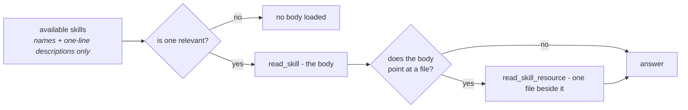

# Skills { #skills }

Al abrir un skill del catálogo aparece un modal con sus instrucciones, descripción y archivos sin perder la búsqueda, los filtros ni la página de la lista. **Abrir vista completa**, junto a **Compartir** en el pie del modal, abre la pestaña Contenido en su página propia, junto a Agents e Historial. Al salir con cambios sin guardar se pregunta qué conservar. Sin comentarios disponibles, Improve indica el siguiente paso en lugar de un formulario de gasto que no puede iniciarse.


Un skill es saber hacer algo, escrito una vez y adjuntado a muchos agents: cómo
se gestionan los reembolsos, cuál es el estilo de la casa, qué comprobaciones
tiene que pasar un informe antes de salir.

Lo que sustituye es un campo de instrucciones que no para de crecer.

Veinte procedimientos en un solo prompt significa que cada run paga por los
veinte, y el vigesimoprimero empuja la conversación fuera de la ventana. Los
skills le dan la vuelta a eso:



Veinte skills cuestan aproximadamente veinte _descripciones_ en lugar de veinte
_procedimientos_.

!!! note "Descubrir es barato, no gratis"

    Cada skill vinculado está en el catálogo de capabilities que el modelo lee en
    cada turno, con su nombre y su descripción de una línea — así que vincular un
    skill cuesta tokens tanto si el modelo llega a abrirlo como si no.

    Es una línea por skill frente a un cuerpo por skill, y por eso salen las
    cuentas. No es motivo para vincular un catálogo sin límite.

La otra mitad de la cuestión es **quién los escribe**. Un skill es una fila en
la base de datos, editable en la UI, así que un responsable de soporte puede
arreglar la política de reembolsos un martes por la tarde. Sin deploy, sin pull
request, sin ingeniero.

!!! info "¿Skill, archivo de contexto o colección de conocimiento?"

    Un **skill** es un procedimiento que el modelo carga cuando decide que la
    tarea ha llegado. Un [archivo de contexto](context.md) es conocimiento
    permanente — corto, siempre relevante, inyectado o leído bajo demanda. Una
    [colección de conocimiento](file-processing.md) es un corpus demasiado
    grande para leerlo, al que se llega por búsqueda.

En Agent Builder, **Skills → New skill** permite escribir un skill sin salir del panel de capacidades. Al guardar se crea la entrada de biblioteca, se vincula al borrador actual y se activa la capacidad Skills. La publicación sigue siendo un paso separado. La acción requiere permisos para editar tanto el agente como los skills.

## La forma { #the-shape }

```markdown
---
name: refund-policy
description: When a refund is given without asking, when it needs approval, and how to say no.
category: support
---

# Refunds

Most refund questions are decided by the order date and one exception. Check
those before escalating anything.

La página **Skills** muestra en cada tarjeta el comienzo del cuerpo — sin front
matter, unas pocas líneas — con una hoja apilada detrás por cada archivo que
lleva el skill. `GET /api/v1/skills` devuelve ese comienzo como `excerpt`; el
cuerpo en sí se carga al abrir el skill.

## Decide without asking

...
```

!!! tip "`description` es el campo que decide si el skill llega a cargarse alguna vez"

    Es la única parte que el modelo ve gratis. Escríbela como **cuándo recurrir
    a esto**, no como un título.

Un skill puede llevar **recursos** — más archivos a su lado, cargados bajo
demanda. `refund-policy` incluye un `exceptions.md`, y el cuerpo dice cuándo
consultarlo.

Eso es la misma revelación progresiva un nivel más abajo: el detalle que solo
algunas conversaciones necesitan no tiene por qué estar en el cuerpo que carga
cada conversación relevante.

`category` es una de veinte sugerencias (`support`, `engineering`, `finance`,
`legal`, `security`, `marketing`, …) y alimenta el filtro del listado de skills.
No tiene ningún efecto sobre lo que ve el agent — el modelo elige por
`description`, nunca por categoría.

Los recursos de texto largos se paginan para no incluir manuales completos en cada solicitud al modelo: 8.000 caracteres por defecto y un máximo de 20.000. Pasa `args` con `offset` y `limit` a `read_skill_resource`; la respuesta indica el siguiente desplazamiento. Lee solo los fragmentos pertinentes y reutiliza el material ya cargado.

## Cómo lee uno un agent { #how-an-agent-reads-one }

A través de la [capability `skills`](reference/capabilities.md#skills). Cada skill
que recibe un agent se convierte en una **capability propia**, listada para el
modelo con su nombre y su descripción y abierta cuando hace falta:

| Cómo | Qué hace |
| --- | --- |
| Skills disponibles | Nombres y descripciones de una línea de todo lo vinculado a este agent |
| `read_skill` | El cuerpo completo de un skill, traído a la conversación |
| `read_skill_resource` | Un archivo al lado de un skill |

`read_skill` presenta el cargador diferido nativo del framework con nombres de
skills. Las políticas de aprobación conservan la clave estable `load_capability`,
por lo que los specs publicados y las aprobaciones pendientes siguen funcionando.
La antigua clave de aprobación `load_skill` sigue migrándose a ella. No hay una
herramienta separada para listar. `read_skill_resource` lee archivos auxiliares
solo después de abrir el skill.

Un spec vincula skills por id en `skill_ids`, así que un agent ve los que se le
dieron y nada más.

**Desde el propio skill.** Cada tarjeta de la página de Skills tiene **Add to an
agent**: eliges el agent y el skill se añade a su borrador, con la capability
Skills activada, listo para publicar en el Builder. La tarjeta dice también qué
agents usan el skill, o que todavía ninguno. Los archivos de contexto y las bases
de conocimiento ofrecen lo mismo.

**El nombre de un skill es el id con el que un modelo lo carga**, así que
tiene la forma en que los modelos escriben ids: minúsculas y dígitos unidos por
guiones simples, como `refund-policy`. La consola formatea automáticamente mayúsculas,
espacios, puntuación y acentos latinos al salir del campo o guardar: `Refund Policy`
pasa a `refund-policy`. La API sigue exigiendo el formato canónico. Las colisiones con
nombres existentes y los nombres de capabilities se rechazan sin perder el borrador.

Un nombre que el modelo tuviera que reproducir
exactamente, como `Refund policy`, lo cargaba como `refund-policy`, y dos
suposiciones erróneas terminan el turno ([#1911](https://github.com/vstorm-co/agenticos/issues/1911)).

**Un skill no puede llamarse como una capability.** Cada uno se archiva bajo su
propio nombre en el mismo espacio que `knowledge`, `planning` y los demás, así que
un skill llamado `planning` en un agent que también tiene la capability de planning
es un duplicado que el framework rechaza antes del primer token. Crearlo se rechaza,
y publicar un agent vinculado a un skill con ese nombre, también.

Habilitar la capability sin ningún skill vinculado no sirve de nada — dale skills
al agent, o deja la capability apagada.

### Qué skills usó una respuesta { #which-skills-an-answer-used }

Vincular un skill no significa que el modelo lo haya leído. Cada run registra los
skills que de verdad usó, por el id del skill: si el modelo abrió uno con
`read_skill` y cuántos de sus archivos leyó con `read_skill_resource`. Un run
lo registra termine como termine, también si falló después de abrir el skill. Un
skill que usó un delegado se registra en el run que delegó, bajo el agent del
delegado, porque la respuesta que alguien valoró es la de ese run.

Una llamada a una herramienta que nombra una ruta en la carpeta del skill dentro
del workspace, como `cat /workspace/skills/refund-policy/SKILL.md`, cuenta aparte
como uso probable. Listar la carpeta no cuenta. No se reconoce una ruta que arma
una shell, un glob sobre varios skills ni un script que lee el archivo por su
cuenta.

`GET /api/v1/skills/{id}/usage?days=30` devuelve, por agent, cuántos runs usaron
el skill en ese intervalo, con la versión que recibió cada uno y la cifra de cada
día del intervalo en UTC, también cuando es cero. Los runs de evals
y del panel de pruebas del Builder no cuentan. Las cifras salen de los runs, así
que necesitan `runs:view`; un agent que quien llama no puede ver se cuenta, pero
nunca se nombra.

Los runs anteriores a este registro dicen «uso desconocido», que no es lo mismo
que «no usado». Cuando se mejora un skill, sus evidencias salen solo de los runs
que lo usaron, y los runs valorados negativamente o fallidos que podrían haberlo
usado cuentan aparte como desconocidos.

## En un workspace, un skill también son archivos { #in-a-workspace-a-skill-is-also-files }

Un agent que tiene a la vez skills y un
[workspace](reference/capabilities.md#files-shell) recibe además cada skill
escrito dentro de él:

```
/workspace/skills/<name>/SKILL.md      the body, with its name and description
/workspace/skills/<name>/<resource>    each resource, beside it
```

Esto es lo que hace útil el script de un skill. Un skill cuyo recurso era
`reconcile.py` antes se le entregaba al modelo como texto que podía citar y no
ejecutar, mientras el mismo agent tenía `execute` a una llamada de herramienta
de distancia. En disco, se ejecuta.

!!! note "No existe `run_skill_script`"

    El propio `execute` de la sandbox ya lleva las reglas de permisos del
    workspace y los techos que fija el operador. Una segunda forma de ejecutar
    cosas sería un segundo conjunto de reglas que equivocar.

## Un agent puede proponer un cambio; una persona lo hace { #an-agent-can-propose-a-change-a-person-makes-it }

Esos archivos se pueden escribir, y lo que el agent escribe **no** se aplica.

Un skill son instrucciones que sigue en cada run todo agent vinculado a él. Un
agent que pudiera editar uno directamente podría reescribir lo que hace otro
agent, dentro de una conversación que nadie está revisando, y el siguiente
lector no tendría forma de distinguir una mejora meditada de una alucinada.

Así que una escritura se convierte en una **propuesta**, y aparece encima de la
lista en la página Skills para cualquiera que pueda editar esa skill. Una propuesta
de una skill nueva aparece para cualquiera que tenga `skills:edit`. Nadie más puede
verla en la lista ni abrirla:

- **Check on agents** ejecuta el cambio en cada agent de la línea para la que se
  escribió, y aplicarlo - la siguiente versión de esa línea, que esos agents leen
  en su siguiente run - se hace desde el resultado de esa comprobación. Ver
  [Comprobar un cambio en cada agent](#checking-a-change-on-every-agent).
- **Discard** conserva el registro. Un agent que propone la misma edición una y
  otra vez le está diciendo algo a alguien sobre ese skill, y una fila borrada
  lo vuelve invisible.

!!! warning "Una decisión sobre una propuesta es definitiva"

    Aplicar dos veces guardaría una segunda versión de un cuerpo ya almacenado, y
    descartar algo aplicado le diría a un lector que nunca llegó a entrar.

La propuesta lleva el **cuerpo entero** en lugar de un diff, así que un revisor
semanas después está comparando dos versiones completas en vez de aplicando un
parche en un sitio al que nunca estuvo destinado.

Dos cosas se rechazan en lugar de adivinarse: un directorio que el agent creó
sin ningún `SKILL.md` dentro, y uno cuyo frontmatter destrozó. Y un recurso
_borrado_ deliberadamente no es un cambio, porque un archivo que el modelo nunca
tocó y uno que quiso borrar dejan la misma ausencia.

Tres turnos de una conversación refinando el mismo skill dejan **una** propuesta,
no tres. A un revisor al que se le hace la misma pregunta tres veces se le ha
dado más trabajo, no más información.
Las propuestas del workspace respetan los mismos límites que los skills
almacenados: nombre de 1 a 64 caracteres y descripción de hasta 500. Una
propuesta fuera de estos límites se omite con una advertencia; sus archivos
originales permanecen intactos. Un savepoint aísla la escritura para que una
propuesta rechazada no impida guardar el estado y el coste del turno.

Un cambio registra la versión del skill para la que se escribió: en un run, la
versión que ese run recibió, y un turno posterior que reescribe el cambio
registra la suya. Apply lo rechaza si alguien ha cambiado el skill desde
entonces, así que una edición hecha mientras el cambio esperaba no se
sobrescribe. Compara los dos y edita el skill a mano, o vuelve a pedirlo.

El [asistente de autoría](authoring.md#skills) propone cambios a skills de la
misma manera, con su justificación y los runs en los que se apoya, y aplicarlos
los rechaza de la misma manera.

Cada cambio dice qué versiones publicadas de agents leen el skill, qué suites de
evals pone en cola aplicarlo y qué guardianas lo comprueban solo en la siguiente
promoción. Aplicarlo avisa a los propietarios de esos agents. Una decisión nombra
la versión del cambio que leíste: un cambio reescrito desde entonces - por un
turno posterior o una petición nueva - se rechaza con «The proposal changed since
you opened it», y de dos decisiones tomadas a la vez solo cuenta una. Un skill que
el agent escribió desde cero aún no tiene agents, así que **Apply** lo crea al
momento.

## Comprobar un cambio en cada agent { #checking-a-change-on-every-agent }

Un skill se comparte, así que un cambio se juzga en cada agent que lo leería: en
main, los agents que siguen la versión más reciente de main; en un fork, los
agents de ese fork. Los agents fijados a una versión anterior y los de otros
forks no se ejecutan - el cambio no les llega. La versión publicada de cada agent
responde sus preguntas dos veces, con el skill tal como está y con el cambio, y
nada más cambia.

Un cambio que escribió el workspace de un agent, uno que propuso el asistente y
una [actualización de la biblioteca](#getting-skills-into-an-organization) de un
skill que siguen agents solo pasan a producción a través de esta comprobación.
Quien edita el skill a mano guarda una versión nueva al momento, y esa edición no
se comprueba.

### Qué pregunta { #what-a-check-asks }

Primero las **preguntas de prueba** propias del skill, el mismo conjunto en cada
agent. Cada skill tiene un conjunto, empezado en la página del skill en **Test
questions** - a partir de respuestas recientes que cargaron el skill, o vacío - o a
través de la API, `POST /api/v1/skills/{id}/test-set`, o con **Añadir preguntas de
prueba** junto a un agent que [Improve](#improving-a-skill) no pudo comprobar, y
editado como cualquier otro [dataset](datasets.md), que Datasets marca como el del
skill.

Un juez califica el conjunto, comparando cada respuesta con la que las personas
valoraron bien. Creado a partir de respuestas recientes, cada pregunta se hace una
vez: una respuesta que alguien valoró gana a una que solo falló, así que una
pregunta nunca pide una respuesta y a la vez la prohíbe.

Después, las preguntas del propio agent:

- **Quick**, por defecto: cuatro preguntas del dataset del agent - más cuando las
  preguntas held-out del propio skill no llegan a las cinco que necesita un
  resultado - cuya
  respuesta más reciente cargó el skill - las que comparten más palabras con las
  líneas que toca el cambio. Un agent sin ninguna se comprueba solo con el
  conjunto del skill, y su fila lo dice. A un agent que las preguntas del skill
  muestran peor no se le hacen las suyas, y su fila dice que no se hicieron.
- **Thorough**: el dataset entero del agent, preguntado aunque las preguntas del
  skill mostraran al agent peor, para que su fila diga dónde lo rompió el cambio.
  Un cambio en la descripción del
  skill se comprueba siempre así, porque la descripción decide cuándo un agent
  abre el skill.

!!! note "Las preguntas del skill dicen lo que el skill debe hacer"

    Se califican igual en cada agent, así que detectan un cambio que rompe la
    regla del propio skill. Un cambio que perjudica a un agent por su propia
    situación se ve en sus propias preguntas. Y un cambio de regla deliberado
    falla en cada pregunta que aún espera la respuesta antigua: actualiza antes
    las preguntas de prueba.

Un conjunto de preguntas que nada puede calificar, o cuyas preguntas vienen todas
de las conversaciones de las que aprendió el cambio, se omite para ese agent, y el
resto se pregunta igualmente. Un agent al que no le queda nada que preguntar es
desconocido, con ese motivo. Cada conjunto cuenta solo las preguntas que hace, y
una muestra rápida nunca elige una pregunta de esas conversaciones. Cuando en una
sesión de Improve ningún agent tiene una pregunta fuera de sus propias evidencias,
el paso se rechaza antes de empezar, con el dataset al que añadir otras preguntas.

### La regla { #the-rule }

- Ningún agent puede quedar **peor**, por una regresión que las repreguntas
  confirmaron.
- Al menos un agent tiene que quedar **mejor**.
- Una diferencia que la comprobación no pudo confirmar está **dentro del
  ruido**: un aviso, no un bloqueo.
- Un agent que no se pudo comprobar - sin preguntas, con preguntas que nada
  califica o tomadas todas de las conversaciones del propio cambio, sin acceso,
  sin budget, sin versión publicada, con un run fallido, con la comprobación
  detenida - es **desconocido**, y una persona lo reconoce antes de aplicar.

Una comprobación en la que no se puede comprobar ningún agent empieza igualmente
y termina enseguida, con todos los agents desconocidos, para que una persona lo
reconozca. El diálogo lo dice antes de empezar y ofrece las preguntas de prueba del skill, o la calificación que les falta.
Un cambio en una línea que ningún agent lee pasa enseguida: no llega a
nadie, y la comprobación dice que no había a quién comprobar.

Un agent se juzga una vez, sobre las preguntas held-out de todas sus etapas
juntas: un resultado necesita cinco para el agent, no cinco por etapa, y una
regresión que una etapa confirmó por sí sola cuenta, sea lo que sea que halló la
otra. Todas las
preguntas del conjunto del skill son held-out, y una comprobación rápida solo
toma preguntas held-out del agent.

Una comprobación envía sus regresiones confirmadas, y las respuestas que el juez
no pudo calificar, a la [cola de revisión](datasets.md#review), cada una marcada
como respuesta dada con el cambio propuesto, y nunca en lugar de una respuesta que
ya espera en esa pregunta. El veredicto de una persona allí
sobre una respuesta que una comprobación calificó vuelve a juzgar a ese agent: sus
recuentos, el veredicto de la comprobación y el resultado del intento de Improve
que la comprobación midió siguen ese veredicto.

El veredicto es sobre esa única
respuesta; las repreguntas conservan sus propias calificaciones, así que una
regresión que confirmaron se mantiene. Un agent al que una comprobación rápida no
hizo sus propias preguntas, porque las del skill lo mostraron peor, es desconocido
cuando esa regresión se retira. Una comprobación decidida conserva su decisión, y
un agent que la comprobación no pudo ejecutar sigue desconocido.

La parte de cada agent son sus propios runs de evals, cargados a su budget. La
estimación da un precio, lo más probable y como mucho, y nombra antes de empezar
a los agents cuyo budget no lo cubre. Empezar otra vez la misma comprobación
mientras se ejecuta devuelve esa comprobación, así que nunca se paga dos veces.
Empezar requiere `runs:view` y acceso de
edición al skill. Un agent que no puedes ejecutar no se ejecuta, y uno que no
puedes ver es un número, nunca un nombre.

### Cuando un agent quedó peor { #when-an-agent-got-worse }

**Check on agents** en Skills calcula el precio de la comprobación, la ejecuta,
muestra el resultado de cada agent y luego ofrece exactamente lo que la
comprobación permite. Mientras se ejecuta, una barra cuenta los agents terminados.
Después cada agent se abre a lo que arregló y rompió, etapa por etapa, con un enlace
al run de cada etapa; la página de ese run dice que es una etapa de la comprobación
y enlaza de vuelta a ella. Puedes cerrar el diálogo: la página del skill muestra
entonces **Comprobación en curso**, y **Mostrar** vuelve a abrir la comprobación
hasta que la decidas. El Historial del skill lista las comprobaciones de la línea,
la más nueva primero, con lo que halló cada una y lo que se hizo con ella, y
**Detalles** abre una. Una comprobación que inició una
[sesión de Improve](#improving-a-skill) se decide en esa sesión, y Check on agents
lleva a ella.

**Volver a editar** devuelve el texto comprobado al editor - aquel en el que se
escribió, o uno nuevo abierto desde Mostrar o Detalles en la línea de la propia
comprobación -, así que no se pierde nada de lo escrito, y guardarlo se rechaza si la
línea ya tiene una versión más nueva que la comprobada; la comprobación de una propuesta ofrece en su lugar **Seguir
mejorando**, que inicia una sesión. En main una persona aún puede:

- **aplicarlo y dejar a los agents peores donde están** - cada uno se fija, como
  versión publicada nueva, a la versión que lee ahora, antes de que el cambio
  pase a producción, así que ninguno lo sirve ni una vez. Fijarlos requiere poder
  publicar cada uno, y un entorno que espera una promoción debe recibir antes la
  versión fijada;
- **crear un fork**, dejando main como está - se ofrece sea cual sea el
  resultado, en el diálogo de la comprobación, en el paso Aceptar de
  [Improve](#improving-a-skill) o a través de la
  API, `POST /api/v1/skills/{id}/checks/{check_id}/fork`. Pasan al fork los agents
  a los que ayudó, salvo que elijas otros con `agent_ids`; una lista vacía no mueve
  a ninguno, y un agent que lee el skill a través de un especialista se mueve en su
  Builder;
- **descartarlo**, tras una confirmación: una comprobación descartada ya no se
  puede decidir, y su registro queda en el Historial.

En un fork solo quedan seguir mejorando y descartar: fijar nombra una versión de
main, y un fork nunca parte de otro fork. Una comprobación se niega a aplicar si
la línea ya tiene una versión más nueva o un agent empezó a seguirla, porque no
midió ninguna de las dos cosas.

## Versiones y forks { #versions-and-forks }

Cada cambio guardado en un skill crea una versión nueva, y una versión no se
modifica nunca después. La crea editar el texto o la descripción, y también añadir,
cambiar o quitar un archivo, una actualización desde la biblioteca y un cambio
aplicado desde el workspace de un agent o desde el
[asistente de authoring](authoring.md#skills). Una categoría nueva por sí sola no
la crea, porque ningún agent la lee.

**History**, en la página del skill, lista las versiones de la más nueva a la más
antigua. Cada una dice qué la creó (`backfill`, `created`, `edit`, `resources`,
`library`, `workspace`, `improve`, `restore`, `catch_up` o `from_fork`) y cuándo, y quién la guardó a quien
puede ver a los miembros de la organización. Una versión conserva sus archivos tal
como estaban, así que cambiar un archivo después no cambia una versión anterior.

Un skill que existía antes de las versiones tiene una versión, la v1: el texto y los
archivos que tenía cuando empezó el versionado. No se registró nada anterior.

**Restore** recupera una versión anterior como versión nueva, así que el historial
queda completo, y la versión nueva dice de cuál procede.

Una edición se guarda frente a la versión que leyó quien edita. Si alguien guardó
una versión más nueva entretanto, la edición se rechaza en lugar de sobrescribirla.

### Forks { #forks }

Un fork es una línea con nombre de un skill que parte de una versión de main. Tiene
sus propias versiones y su propia versión más reciente, así que un skill puede
cambiar para algunos agents mientras main sigue igual. Mientras no tenga una
versión propia, un fork sirve la versión de main de la que partió.

- Un fork parte solo de main. Un fork de un fork se rechaza, así que el árbol tiene
  un solo nivel.
- El nombre de un fork es único dentro de su skill, incluidos los forks archivados.
- Los archivos de un fork son los de la versión de la que se creó. Los archivos se
  editan solo en main y llegan a un fork cuando se pone al día.
- **Archive** hace que un fork no acepte versiones nuevas. Conserva sus versiones y
  nunca se borra. Un fork que ningún run ha leído en 30 días se propone para
  archivar; nada se archiva automáticamente. Una versión anterior de un agent que
  aún lee un fork archivado no se promueve a ningún entorno: mueve el agent a otra
  versión y promueve la versión que se publica.

### Qué versión lee un agent { #which-version-an-agent-reads }

Cada agent lee un skill vinculado de una de tres maneras:

| Estado | Qué lee |
|---|---|
| Main | La versión más nueva de main. Así lee todo agent que no nombra otra |
| Fijado | Una versión de main, hasta que alguien lo mueva |
| Fork | La versión más nueva de un fork |

La elección forma parte de la spec del agent, en `skill_bindings`, así que se
publica, se promueve entre entornos y se exporta con el resto del agent. Una spec
sin el campo lee main para cada skill, como hacía todo agent antes de que los
skills tuvieran versiones. Publicar rechaza una versión que la línea main del skill
no tiene, un fork de otro skill, un fork archivado y cualquier cosa de otra
organización. Cada run registra las versiones de skill que sirvió, incluidas las de
sus especialistas inline.

Una versión nueva alcanza solo a los agents de su línea. Una versión nueva de main
alcanza a los agents en main, y una versión nueva de un fork a los agents de ese
fork: se ejecutan sus suites de evals, el cambio indica los entornos en los que
entra y se avisa a sus propietarios. Un agent fijado no recibe ninguna.

**Los agents de un skill** son los que lo ejecutan: lo vincula una versión que sirve
uno de sus entornos, el propio agent o un especialista inline suyo. Un agent y cada
uno de sus especialistas leen el skill a su manera, así que cada uno es una fila: la
página del skill lo muestra con la versión que lee, cuántas versiones de main lleva
de retraso y cualquier entorno que lo lea de otra forma. Un agent que vincula el
skill solo en su borrador aparece marcado como tal. Los agents que no puedes ver se
cuentan, no se nombran. «Por detrás de main» cuenta las versiones de main
posteriores que cambiaron lo que dice el skill: restaurar de nuevo el mismo texto no
es un cambio, y si main vuelve al texto que lee, no lleva ningún retraso.

**Change version** mueve un agent a main, a una versión de main o a un fork, y es un
cambio del agent. Si el agent usa el skill por sí mismo se lee de su borrador, tal
como lo muestra el Builder; un skill que solo vincula uno de sus especialistas se
cambia en el Builder. Con permiso para publicarlo, la spec publicada más reciente
del agent con solo ese vínculo cambiado entra como su siguiente versión, y los
entornos se mueven según sus reglas habituales de seguimiento y promoción. El
borrador recibe el mismo cambio y conserva sus demás ediciones sin terminar, que no
entran. Con permiso solo para editar el agent, para un agent nunca publicado o para
uno cuya versión publicada aún no vincula el skill, el cambio espera en el borrador
y solo se comprueba el vínculo nuevo. Un Builder ya abierto en el agent no ve el
cambio hasta que se recarga, y guardar antes vuelve a poner el vínculo anterior.

**Por detrás de main.** Que main avance no mueve a un agent fijado ni a un fork:
nada se pone al día solo, porque ponerse al día cuesta una comprobación en los
agents que mueve. `GET /api/v1/skills/behind-main` lista los agents fijados y los
forks que main ha dejado atrás, en toda la organización, primero los que están más
atrás. Un agent fijado cuenta por lo que sirve su entorno por defecto, y un fork
solo mientras algún agent lo lee. Los skills que no puedes ver se omiten, y los
agents fijados que no ves se cuentan, sin nombrarlos.

**Volver a main** mueve los agents de un fork de vuelta a la versión más reciente de
main, todos o los que elijas, cada uno como lo mueve Change version. El que no se
puede mover se queda en el fork con el motivo. Cuando nadie lee ya el fork, se
archiva. Un agent cuyo entorno espera una promoción sigue leyendo el fork hasta que
se promueve, así que hasta entonces el fork se queda. En la página del skill, un fork
sin versión propia lo ofrece y dice después quién se movió y quién se quedó.

**Actualizar a main.** Un agent fijado que va por detrás de main se sube tras una
comprobación: `POST /api/v1/skills/{id}/agents/{agent_id}/update-check` pregunta solo a
ese agent, con sus propias preguntas y las del skill, con la versión en la que está y
con la versión más reciente de main y sus archivos, con cargo a su presupuesto;
`…/update-check/estimate` da antes el precio. La comprobación necesita permiso para
editar el skill y para leer runs. Se acepta moviendo al agent:
`PUT …/agents/{agent_id}/binding` con `state: main` y su `check_id`. El movimiento se
rechaza cuando la versión nueva empeoró al agent, cuando no se confirma un resultado
que no se pudo medir (`acknowledge_unknown`) y cuando el agent se publicó de nuevo o
main avanzó desde la comprobación; cierra la comprobación y marca al agent como
comprobado en esa versión. Mover un agent sin comprobación sigue siendo posible, como
cualquier cambio de versión: el agent queda entonces como «desconocido» en su nueva
versión, y responde de ello quien lo movió. En la página del skill, **Cambiar
versión** ofrece **Check first** para exactamente este movimiento: lanza la
comprobación y vuelve con su resultado, que el movimiento lleva después.

**Poner al día un fork.** Los cambios de main llegan a un fork en una sesión. En la
página del skill, un fork mostrado ofrece ponerse al día mientras main lo ha dejado
atrás y llevarlo a main en cuanto tiene una versión propia, y la tarjeta del
dashboard lista los forks que main ha dejado atrás. Por la API:
`POST /api/v1/skills/{id}/forks/{fork_id}/catch-up`, con el precio antes en
`…/catch-up/estimate`. La sesión combina tres versiones: la versión de main en la que
se basa el fork, la más reciente del fork y la más reciente de main. Una parte que
solo cambió un lado toma el texto de ese lado, y una parte que ambos cambiaron igual
se toma una vez. Una parte que cambiaron de forma distinta es un conflicto, y el
modelo propone un texto para ella. En **Changes** una persona puede reescribir
cualquier parte, también la del modelo (`GET …/improvements/{run_id}/merge`, y luego
`PATCH …/merge/description` o `…/merge/parts/{index}`). En un archivo que ambos lados
cambiaron de forma distinta, una persona se queda con un lado
(`PATCH …/merge/files`); el modelo nunca escribe un archivo. La comprobación empieza
solo cuando no queda nada sin resolver. Pregunta a los agents del fork por la
combinación y, salvo que se desactive `main_alone` al poner precio a la
comprobación en Changes, por la versión más reciente de main sola. Esa segunda
comprobación dice si el fork sigue haciendo falta, y la estimación da su precio en
una línea propia (`main_alone_usd`). Se omite cuando la combinación ya es la versión
más reciente de main. Aceptar crea una versión del fork (`catch_up`)
que nombra la versión de main que tomó. Desde entonces el fork se basa en esa versión
de main, así que ya no va por detrás. Si main sola no empeoró a ningún agent, el
resultado también ofrece abandonar el fork y devolver sus agents a main; los agents en
los que main sola no se pudo comprobar vuelven solo tras confirmarlo
(`acknowledge_unknown`).

**Llevar un fork a main.** La misma combinación en el otro sentido, por
`…/forks/{fork_id}/to-main`. La comprobación pregunta a los agents de main con la
[regla](#the-rule) de cualquier cambio en main. Aceptar crea una versión de main
(`from_fork`) que nombra la versión del fork que tomó, archivos incluidos. Después
los agents del fork pueden volver a main.

Ambos se rechazan (400) cuando el fork está archivado, y (409) cuando no tiene versión
propia (sus agents vuelven entonces a main) o cuando la combinación no cambiaría nada.
También se rechazan (422) cuando un texto es demasiado largo o repite sus líneas
demasiado para combinarlo línea a línea en un tiempo razonable; los cambios se llevan
entonces a mano.
Aceptar se rechaza en cuanto main o el fork tienen una versión más nueva que la que
leyó la combinación, y una sesión cuyas líneas avanzaron mientras esperaba termina
como obsoleta: empieza otra para incluir la versión más nueva.

### Borrar un skill { #deleting-a-skill }

Un skill que usa un agent no se puede borrar. Es un skill vinculado por el borrador
de un agent activo, o por una versión que sirve uno de sus entornos, del propio
agent o de un especialista inline. El rechazo nombra los agents que puedes ver y
cuenta los demás. Un skill que nadie usa se borra con sus versiones y sus forks.

También puedes quitarlo de esos agents y borrarlo en un solo paso
(`DELETE /api/v1/skills/{id}?remove_from_agents=true`). Cada agent pierde el skill
en su borrador, el propio agent y cada especialista inline. Donde un entorno que
sigue las publicaciones sirve una versión que lo usa, la versión publicada más
reciente del agent se publica de nuevo sin él, como hace Cambiar versión.

O todos los agents lo pierden y el skill se borra, o no cambia nada. Toda la
petición se rechaza, nombrando los agents, cuando:

- un agent que lo usa está oculto para ti;
- no puedes editar alguno de ellos, o publicar uno que hay que publicar;
- un entorno que espera una promoción sirve una versión que lo usa. Solo una
  promoción mueve ese entorno, y eso lo decide su responsable.

Una [clave de API de la organización](api.md#organization-api-keys) llega a las
versiones, los forks y los agents de un skill, como recoge la tabla de abajo.

Los checks (`…/checks…` y `…/update-check`), las preguntas de prueba (`…/test-set`) y las
sesiones de Improve, las puestas al día con main y los pasos a main con sus merges
solo responden a una persona con la sesión iniciada, o al Architect o a un cliente
MCP que actúa por ella; las propuestas de cambio (`/api/v1/skill-changes`) solo
responden a una persona en la consola. Una clave recibe `403` "API keys are not
accepted on this endpoint": cada una gasta en nombre de alguien o termina en una
decisión que le corresponde a esa persona.

| Ruta | Qué hace |
|---|---|
| `GET /api/v1/skills/{id}/versions` | Las versiones de main, o de un fork con `?fork_id=`, de la más nueva a la más antigua |
| `GET /api/v1/skills/{id}/versions/{version_id}` | Una versión, con su texto y la lista de sus archivos, cada uno con su SHA-256 |
| `GET /api/v1/skills/{id}/versions/{version_id}/resources/{name}` | Un archivo tal como lo tenía esa versión |
| `POST /api/v1/skills/{id}/versions` | Guarda una edición en main o en un fork, frente a `base_version_id` |
| `POST /api/v1/skills/{id}/versions/{version_id}/restore` | Restaura una versión en su propia línea |
| `GET`, `POST /api/v1/skills/{id}/forks` | Lista los forks o crea uno desde una versión de main |
| `PATCH /api/v1/skills/{id}/forks/{fork_id}`, `POST …/archive` | Cambia el nombre de un fork o lo archiva |
| `GET /api/v1/skills/{id}/agents` | Los agents del skill, la versión que lee cada uno y cuántos están ocultos |
| `PUT /api/v1/skills/{id}/agents/{agent_id}/binding` | Mueve un agent a main, a una versión de main o a un fork |
| `GET /api/v1/skills/behind-main` | Los agents fijados y los forks que main ha dejado atrás, en toda la organización |
| `POST /api/v1/skills/{id}/forks/{fork_id}/return-to-main` | Mueve los agents de un fork de vuelta a main y archiva el fork cuando nadie lo lee |
| `POST /api/v1/skills/{id}/agents/{agent_id}/update-check`, `…/estimate` | Comprueba la versión más reciente de main en un agent fijado, o da el precio de esa comprobación |
| `POST /api/v1/skills/{id}/improvements/estimate`, `POST /api/v1/skills/{id}/improvements` | Calcula el precio de una sesión Improve en main o en un fork y la inicia |
| `POST /api/v1/skills/{id}/improvements/{session_id}/apply`, `…/fork`, `…/discard` | Aplica el resultado de una sesión, fijando o no los agents que empeoraron, lo convierte en un fork para los agents elegidos, o lo descarta |
| `POST /api/v1/skills/{id}/improvements/{session_id}/recheck` | Comprueba un resultado de nuevo en la línea tal como está ahora |
| `GET /api/v1/skill-improvements/awaiting` | Las sesiones de skills que esperan a una persona |
| `GET /api/v1/skill-checks/awaiting` | Las comprobaciones que inició una persona y que siguen en curso o esperan una decisión, en skills que quien llama puede editar |

## Cómo llegan los skills a una organización { #getting-skills-into-an-organization }

**Escribe uno.** Skills → New, en la UI. Este es el camino normal.

**La biblioteca incluida se instala automáticamente.** Las organizaciones
nuevas reciben procedimientos de construcción de plataforma, trabajo prolongado,
investigación, visualización, Apps y presentaciones. Skills marca las copias como
`built-in`: son skills normales de la organización, no enlaces a un registro.

La etiqueta `built-in` también identifica las copias instaladas de la galería incluida, entre ellas los skills añadidos por los agentes iniciales. Indica su origen en la plataforma, no una instalación automática. La galería sigue siendo opcional y las personalizaciones existentes se pueden editar.

Las instalaciones existentes reciben nuevos skills al actualizar sus agentes
incluidos después de abrir la consola. Crear un agente desde la plantilla
predeterminada también sincroniza la biblioteca. No hace falta un seed manual.
Las copias intactas se actualizan con sus recursos; se conservan las editadas o
las distintas sin historial. Los recibos de instalación identifican una retirada
voluntaria: la actualización automática no restaura esos skills. El comando seed
explícito puede restaurarlos. El listado de skills sigue siendo de solo lectura.

La página de skills marca además los skills que vincula el [AI Architect](console.md)
con una insignia `Architect`, porque editar uno cambia cómo trabaja el Architect.

AgenticOS, Architect y los nuevos agentes predeterminados incluyen:
`platform-agents`, `platform-workflows`, `platform-automation`, `durable-work`, `document-production`, `research-and-evidence`.

Los opcionales `platform-tables`, `platform-context`, `platform-skills` y las guías de API de la galería siguen disponibles en la biblioteca, pero ya no se vinculan por defecto. Las lecturas y ediciones habituales por MCP no requieren cargar un skill. Las descripciones actuales de las herramientas definen operaciones, parámetros y permisos; los skills aportan criterios de diseño y verificación. Las recetas visuales detalladas se cargan como recursos solo cuando hacen falta.

También incluyen procedimientos de Apps, visualización y presentaciones, con
narrativa y revisión. Primero se cargan nombres y descripciones; los cuerpos y
recursos solo cuando hacen falta. Los skills no conceden herramientas, cuentas
ni compiladores. Architect también recibe Apps y Charts.

La actualización protege por separado los campos personalizados de prompt,
herramientas y skills. Cambiar solo el modelo no impide actualizar las otras
opciones intactas. Los nuevos valores se aplican a agentes nuevos; no se
reescriben los agentes existentes creados por el usuario.

El MCP de plataforma permite buscar, crear y editar Context, vincular
`context_ids` a un borrador y leer/editar skills o añadir recursos de texto.
Context admite `inject` para material permanente y `link` para lectura bajo
demanda. Editar un archivo vinculado afecta al siguiente uso; cambiar el vínculo
del borrador requiere publicación. Se mantienen permisos y aprobaciones.

El skill documental incluye fuentes iniciales LaTeX y un proceso de compilación,
renderizado y revisión. Apps HTML y diapositivas web no equivalen a PDF compilado
ni PPTX editable. El agente verifica compilador, generador y renderizador reales
y declara cualquier compilación o revisión visual pendiente.

El comando de seed hace lo mismo desde un terminal, para instalaciones con
scripts:

```bash
uv run agenticos cmd seed-skills                    # every organization
uv run agenticos cmd seed-skills --org <org-id>     # one
uv run agenticos cmd seed-skills --dry-run          # say what would happen, do nothing
uv run agenticos cmd seed-skills --replace          # also overwrite copies edited here
```

Instala lo que falta y **actualiza lo que nadie ha editado**. Cada copia registra
de qué versión incluida se escribió, así que cuando una versión mejora un skill
incluido, la copia intacta de una organización se sustituye por la nueva — con sus
archivos, como una versión nueva y con una entrada de auditoría
`skill.refreshed`. Salvo que la sigan agents: entonces la versión incluida espera
en Skills como un cambio, y pasa a producción cuando una
[comprobación en esos agents](#checking-a-change-on-every-agent) lo permite.

Una copia editada aquí se deja exactamente como está, así que una política de
reembolsos editada sobrevive a un reseed; `--replace` es la única forma de tomar
la versión incluida por encima de esas ediciones, y la entrada de auditoría lo
dice. Una copia hecha antes de que se registraran las versiones y distinta de la
incluida también se informa y se deja, porque nada puede decir si se editó.

El comando imprime qué hizo con cada skill, y `--dry-run` imprime el mismo plan
sin escribir.

`e2e/seed.setup.ts` también crea uno a través de la UI, que es contra lo que
afirma la suite E2E.

### La galería — setenta más, y ninguno llega sin invitación { #the-gallery-seventy-more-and-none-of-them-arrive-uninvited }

**Skills → Skill gallery** abre un catálogo de skills listos para usar agrupados
por sector: sanidad, finanzas y seguros, comercio electrónico e impresión bajo
demanda, equipos de software, sector público y utilities, servicios jurídicos y
profesionales, fabricación y logística. Diez de cada.

Elige un sector y luego instala un skill o el estante entero. Desde ese momento
es un skill normal que la organización posee y edita, exactamente igual que uno
incluido. **Preview** muestra las instrucciones de un skill y los archivos que trae
antes de instalarlo, e **Installed** abre la copia propia de la organización.

!!! info "La galería es opcional, y esa es toda la diferencia"

    La biblioteca incluida vive en `app/core/catalog/skills/` y se copia
    automáticamente en **todas** las organizaciones. La galería vive en
    `app/core/catalog/skill_gallery/` y no se copia en **ninguna** — la lee el
    mismo parser, desde un segundo directorio, y nunca se siembra.

    Setenta skills sectoriales en el primer directorio habrían sido setenta filas
    que nadie pidió, en cada tenant, en el siguiente deploy.

Instalar un estante del que ya tienes uno de sus skills instala el resto y deja
ese en paz: un nombre existente se omite en lugar de sobrescribirse, y la
petición responde con lo que instaló, lo que omitió y cualquier clave que este
deployment no incluya.

Añadir a la galería es igual que añadir un skill incluido — una carpeta con un
`SKILL.md`, bajo el sector al que pertenece — con una regla extra: **su nombre no
puede chocar con el de un skill incluido ni con el de otro skill de la galería,**
y es el nombre de su carpeta. La instalación empareja por nombre, así que una
colisión se saltaría en silencio para siempre. Un test lee los setenta y falla
con cualquiera de los dos errores.

### Sembrar crea copias { #seeding-copies }

Un skill sembrado es un skill normal propiedad de la organización, editable desde
el momento en que la organización existe. Es una **copia**, no un enlace.

Eso es deliberado. La gracia de un skill es que un responsable de soporte pueda
arreglar la política de reembolsos sin un deploy, y un enlace vivo a la copia del
repositorio le quitaría exactamente eso — la organización estaría leyendo un
archivo que solo un ingeniero puede cambiar.

Editar y borrar son los dos definitivos, como siempre. Deshabilitar sigue ahí
para un skill que la organización quiere conservar pero no ejecutar — cada agent
lo respeta —, pero ha dejado de ser la única forma de deshacerse de un
built-in.

### Por qué la biblioteca se distribuye y no se descarga { #why-the-library-is-bundled-and-not-fetched }

Añadir un skill a la biblioteca distribuida o a la galería es un deploy.

La alternativa — importar desde una URL de git — cuesta red saliente desde el
backend, un parser apuntando al repositorio de otra persona y una promesa sobre
un contenido que nadie aquí ha leído. Cada carpeta de
`app/core/catalog/skills/` y `app/core/catalog/skill_gallery/` es la misma
pequeña promesa que hace el [catálogo MCP](mcp.md#the-catalog): alguien lo miró.

## La página de un skill { #a-skills-page }

Abre un skill desde la lista para ver su página. Tiene cuatro pestañas.

**Agentes** lista cada agent que usa el skill y la versión que recibe:

- `v12 · main` - el agent sigue main y recibe cada versión nueva de inmediato.
- `v9 · fijado · 3 por detrás de main` - el agent se queda en una versión anterior de main.
- `Fork "Returns" · desde v7 · 2 cambios` - el agent usa un fork: una línea de
  versiones con cambios propios, iniciada desde una versión de main.

Un entorno que sirve una versión distinta aparece debajo del agent, y un
especialista inline que vincula el skill tiene una fila propia - ver
[Qué versión lee un agent](#which-version-an-agent-reads). Un agent que vincula el
skill solo en su borrador lleva la marca **Solo en el borrador** y no sigue ninguna
línea. Los agents que no puedes ver se cuentan, sin nombrarlos. Los chips sobre la
tabla muestran a todos, los agents en main, los fijados, un fork o los agents solo en
borrador, así que sus cuentas suman a todos. El fork que elijas ahí es también la
línea que muestra el Historial y en la que guarda Editar.

Cada fila dice si una
[comprobación](#checking-a-change-on-every-agent) midió la versión que sirve el agent y
con qué resultado. Una versión que ninguna comprobación midió es **desconocida** donde
un cambio llegó al agent sin comprobar - sus respuestas usaron una versión anterior -
y **todavía sin comprobar** donde el agent nunca respondió con otra.

Debajo, **Test questions** cuenta las [preguntas de prueba](#what-a-check-asks)
propias del skill y enlaza a su dataset, o las empieza. Un skill que ningún agent usa
ofrece **Add to an agent** en lugar de la tabla.

Debajo de la tabla, quien puede ver runs ve con qué frecuencia cada agent abrió el
skill en los últimos 30 días: un gráfico por día con los agents que eliges en la
lista de encima, cada uno en su color, y debajo una tabla con
las cargas de cada agent, los archivos que leyó y cuándo usó el skill por última vez.
Los runs de evals y del panel de pruebas del Builder no cuentan.

**Cambiar versión** mueve un agent a main, a una versión fijada de main o a un fork,
como describe [Qué versión lee un agent](#which-version-an-agent-reads): qué se
publica, qué espera en el borrador y qué se cambia en el Builder. Una versión distinta
de la que el agent sirve ahora, que ninguna comprobación midió en él y con la que no
ha respondido antes, no se ha comprobado ahí, así que primero lo confirmas o pulsas
**Check first** cuando es el movimiento de un agent fijado a la versión más nueva de
main; en una medida, el diálogo da el resultado. El diálogo también dice cuándo el agent dejaría de recibir versiones nuevas
de main, y fecha cada versión de main que ofrece fijar, con un enlace a sus cambios.
El control lo ve quien puede editar el agent.

**Contenido** muestra lo que sirve ahora la línea elegida - descripción,
instrucciones y archivos - para leerlo sin abrir el editor.

**Historial** lista las versiones de la línea elegida, de la más nueva a la más
antigua: de dónde vino cada una (una edición, un cambio de archivos, la biblioteca,
el workspace de un agent, Improve o una restauración), quién la hizo y cuándo.
**Mostrar cambios** compara la descripción y las instrucciones con la versión
anterior - para la primera versión de un fork, con su base en main - y nombra los
archivos añadidos, eliminados o cambiados. **Restaurar** devuelve una versión
anterior como la más nueva de su propia línea, y los agents que siguen esa línea la
reciben de inmediato. Un fork numera sus versiones desde 1 como main, así que llevan
su nombre - "Returns v2" - y el historial de main marca la versión desde la que
empieza cada fork.

Debajo de las versiones, quien puede ver runs ve las **sesiones de Improve** de la
línea: cuándo se hizo cada una y quién la empezó, cómo terminó - aplicada como
versión, un fork, descartada, caducada - y cuánto costó. **Continuar** abre una
sesión que aún te espera; **Abrir** muestra una terminada. Una versión que aplicó
una sesión enlaza con ella.

**Editar** guarda una versión nueva en la línea en pantalla. En main, los agents que
siguen main la reciben de inmediato; los agents fijados y los forks conservan su
versión. Un texto cambiado no se guarda al primer clic: el diálogo nombra los agents a
los que llega en su siguiente run y ofrece, junto a guardar ahora, **Comprobar en
agents primero**, que comprueba el texto sin guardar en ellos y lo aplica según el
resultado. Si alguien guarda la línea mientras tanto, la comprobación se rechaza y tu
texto se queda en el editor. Los archivos y la categoría son de main, así que editar un fork cambia solo
su descripción e instrucciones. Restaurar y Cambiar versión solo se muestran a
quien puede hacer ese cambio; los demás abren el skill en modo de solo lectura.

**Nuevo fork** empieza un fork desde la versión más nueva de main, con el nombre que le
des, y puede mover agents a él de inmediato, cada uno como un Cambiar versión. El fork
se lee igual que su base hasta que se edita.

**Eliminar**, junto a Editar en la cabecera de la página, elimina el skill con sus
versiones y forks. Mientras haya agents que lo usan, el diálogo los nombra. Si puedes
cambiar cada uno de ellos, ofrece **Quitar de N agents y eliminar**, que los vuelve a
listar para una segunda confirmación. Luego quita el skill de cada agent y lo
elimina. Si entre ellos hay agents que no puedes cambiar o no ves, el diálogo lo dice
y no ofrece eliminar: quita primero el skill de esos agents en el Builder, o pídeselo
a alguien que pueda. También nombra un entorno que espera una promoción y todavía
sirve el skill, porque solo una promoción lo mueve.

### Mejorar un skill { #improving-a-skill }

**Mejorar** en la página de un skill abre una sesión para la línea en pantalla -
main, o el fork elegido en los chips - con los mismos cinco pasos que [mejorar un
agent](authoring.md#the-improve-wizard): Entender, Cambios, Comprobación, Resultado y Aceptar. Se
detiene para ti después de Entender, después de Cambios y en el resultado, y no
cambia nada hasta que aceptas.

Al empezar dice cuántas respuestas valoradas a la baja o fallidas lee, y a cuántos
agents sirve la línea. También dice cuánto
cuesta llegar a la primera propuesta y cada intento posterior. El límite de gasto
viene rellenado para cubrir la primera propuesta y cada intento que la sesión puede
hacer, y limita toda la sesión.

Antes de comprobar los cambios, el siguiente paso nombra cada agent de la línea en el que se ejecuta la
comprobación, y los que no puede comprobar, con el motivo - sin preguntas de
prueba, sin permiso para ejecutarlo, sin budget, sin versión publicada o un run
que no pudo calificar todas las respuestas. Los agents que no puedes ver se
cuentan.

El resultado empieza con una barra que cuenta los agents que salieron mejor, sin
cambios, peor o desconocidos. Debajo hay una fila por agent: mejor, sin cambios,
dentro del ruido, peor o desconocido, con los que hay que mirar primero arriba. Cada
fila tiene una pequeña barra de las preguntas que arregló frente a las que estropeó.

Una fila entera se abre a sus detalles con un clic en cualquier parte o con Intro
o Espacio: para cada conjunto de preguntas que recibió - las del skill, su propio
conjunto o una muestra de él - cuántas salieron mejor, igual, peor o desconocidas,
con un enlace a ese run, y si se comprobó solo con las preguntas del skill. Una
fila que has abierto queda marcada como **Vista**.

Encima de las filas, **Por revisar** cuenta los agents peores y desconocidos que
aún no has abierto. Cada recuento de la barra filtra las filas a sus agents, un
cuadro de búsqueda encuentra un agent por su nombre, y **Solo las no vistas** oculta
las que ya abriste.

Las filas se agrupan según el resultado: primero los peores,
con los más estropeados arriba, luego los desconocidos según el motivo por el que
no se pudieron comprobar - con una forma de añadir preguntas de prueba cuando ese es
el motivo - luego los que se están comprobando, sin cambios y mejores. A partir de
ocho agents, sin cambios y mejores empiezan plegados y solo contados hasta que los
abras.

Lo que ofrece Aceptar depende del resultado:

- **Nadie peor** y alguien mejor: aplícalo como la siguiente versión de la línea.
- **Alguien peor:** aplícalo y deja a esos agents fijados en su versión, sigue
  mejorándolo o descártalo. En un fork solo quedan seguir mejorando y descartar,
  porque un fork no se puede fijar.
- **Nadie mejor:** el resultado igualmente espera tu decisión y ofrece **Seguir
  mejorando** y **Descartar**, y en main **Guardar como fork**.
- **Sea cual sea el resultado**, en main, **Guardar como fork** crea un fork con
  el cambio: le pones nombre y eliges los agents que pasan a él - de entrada los
  que ayudó, otros o ninguno. Un fork nunca se bifurca de nuevo.
- **Los agents desconocidos** hay que confirmarlos antes de aplicar nada. **Añadir
  preguntas de prueba**, al lado, escribe las preguntas propias del skill a partir
  de respuestas en las que los agents lo cargaron, para poder comprobarlos la
  próxima vez.

Cuando la línea recibe una versión nueva, o cambian sus agents, después de la
comprobación, el resultado deja de valer y ofrece **Check again** en lugar de
aplicar: los mismos cambios elegidos, medidos en la línea tal como está ahora, a
un precio que se muestra primero. Descartar sigue
disponible; seguir mejorando exige comprobar de nuevo los cambios primero. Si la línea cambia mientras la sesión espera en Changes, se vuelve a
calcular el precio: el siguiente paso comprueba los cambios en la versión más
reciente.

El [Architect](console.md#the-assistant) lee los agents, las versiones y las
sesiones de un skill, y los agents fijados y los forks que main ha dejado atrás.
Inicia una sesión, ejecuta o reintenta un paso, acepta un resultado, termina una
sesión, mueve un agent a otra versión o pone al día un agent fijado o un fork con
main solo cuando se lo pides, cada vez mediante una tarjeta de aprobación.

## ¿Skills o conocimiento? { #skills-or-knowledge }

Responden a preguntas distintas, y la diferencia importa cuando un agent recibe
la equivocada.

|  | Skills | [Conocimiento](file-processing.md) |
| --- | --- | --- |
| Contiene | Procedimiento — cómo hacemos esto | Documentos — lo que sabemos |
| Lo escribe | Una persona, deliberadamente | Se ingiere en bloque |
| Se recupera por | El modelo eligiendo un nombre | Búsqueda semántica sobre fragmentos |
| Cita | Nada; _es_ la instrucción | El pasaje y su fuente |
| Escala | Decenas | Miles de documentos |

!!! example "Cuál es cuál"

    "Los reembolsos de más de 500 £ necesitan un manager" es un **skill**. El
    contrato firmado que lo dice es **conocimiento**.

    Un agent que gestiona reembolsos normalmente quiere las dos cosas, y las dos
    capabilities se componen — `skills` para el procedimiento, `knowledge` para
    la evidencia.

## Acceso { #access }

Los skills son recursos con ámbito de organización, gobernados igual que los
agents y las colecciones: visibilidad más grants por fila encima del rol.
Consulta [Permisos](permissions.md#layer-3-visibility-and-grants).

!!! important "Vincular un skill lo presta"

    Cada run del agent lee el cuerpo y los archivos, lo haya ejecutado quien lo
    haya ejecutado — así que publicar exige que el **publicador** tenga
    `skills:view` sobre esa fila.

Esa comprobación pasa por `resolve_access`, así que un grant cuenta: un miembro
con quien se compartió un skill puede vincularlo sin ser promovido.

Un skill al que no pueden llegar se rechaza como `Skill not found: <id>`,
redactado exactamente igual que un id que no existe. Los skills se vinculan por
UUID desde la API y desde un borrador editado a mano, no solo se eligen de la
lista del Builder, y un rechazo que se leyera distinto iría cartografiando los
skills privados de la organización a golpe de conjetura.

La misma comprobación se ejecuta sobre los `skill_ids` de un
[especialista inline](concepts.md#delegate-vs-inline-specialist), y se informa
con el nombre del especialista.

En tiempo de ejecución no se vuelve a comprobar nada. Los skills del spec
congelado se resuelven dentro de la organización del run y se le entregan al
agent — la regla que ya siguen las colecciones y los delegados, la de que
[la referencia se comprueba una vez, al publicar](permissions.md#delegation-is-not-a-privilege-boundary).

La alternativa es peor de dos maneras concretas:

- Todo contexto sin sujeto — una clave de API, un widget embebido, un mensaje de
  canal — es rechazado por `resolve_access` por diseño, así que una comprobación
  por runner despojaría de todos sus skills precisamente a esas superficies.
- Donde _sí_ hay un sujeto, una misma versión publicada le daría a un miembro
  —cuyo rol solo alcanza los skills compartidos— instrucciones más pobres que las
  que le da a un builder, con la diferencia visible en ninguna parte.

Los skills no tienen un interruptor de activación propio: un agente puede usar
los skills que tiene vinculados. Elimina el vínculo y publica el agente para
dejar de usar ese skill. Un skill borrado después de publicar se omite con un
aviso en lugar de interrumpir el run.

## Recapitulación { #recap }

- Un skill es **procedimiento**, escrito por una persona, y solo se carga cuando
  el modelo decide que su _description_ es relevante — descubrir cuesta una línea
  por skill, y el cuerpo no cuesta nada hasta que se abre.
- En un workspace un skill también son **archivos**, que es lo que hace
  ejecutables sus scripts.
- Un agent **propone** una edición; una persona la aplica, una sola vez, y la
  decisión es definitiva.
- Vincular un skill lo **presta**, así que el publicador tiene que poder verlo — y
  no se vuelve a comprobar nada en tiempo de ejecución.
- La **galería** son setenta skills listos para usar por sector, instalados a
  petición — a diferencia de la biblioteca incluida, que llega sola.

### Proponer un skill nuevo { #proposing-a-new-skill }

El asistente puede proponer **Worth creating a skill** cuando un procedimiento reutilizable aparece en al menos tres respuestas distintas de las evidencias. Cada cita debe figurar en la respuesta misma; los comentarios no demuestran por sí solos un procedimiento repetido. La tarjeta muestra nombre, descripción, contenido completo, motivo y citas verificadas. Una evaluación vincula un skill temporal solo al candidato: no crea ningún registro ni versión publicada.

**Accept** crea el skill privado y lo vincula al borrador del agente en la misma transacción. Requiere `skills:edit` y acceso de edición al agente. Sin permiso de creación se puede leer y comprobar la propuesta, pero Accept queda deshabilitado y explica el motivo. **Dismiss** no crea nada. **Undo** elimina el vínculo y conserva el skill independiente; una nueva aceptación lo reutiliza solo si conserva su nombre y contenido. Los skills contienen instrucciones y no conceden herramientas. El acceso adicional necesita propuestas independientes verificadas por la política; las herramientas de escritura requieren aprobación.

Un procedimiento que procede de menos de tres respuestas distintas no se propone como sugerencia. Aparece con su texto completo bajo **more ideas need your decision**. **Create skill** abre una vista previa: el nombre, la descripción y el contenido se pueden editar, y un aviso indica en cuántas respuestas se basa. **Create skill** en la vista previa crea el skill en la biblioteca y lo vincula al borrador del agente, nunca a una versión publicada. Requiere los mismos permisos que Accept y no llama a ningún modelo. Un segundo clic devuelve el skill ya creado.

La estimación reserva el contenido completo propuesto para cada respuesta candidata y sus repeticiones de confirmación, además del precio histórico por respuesta.
