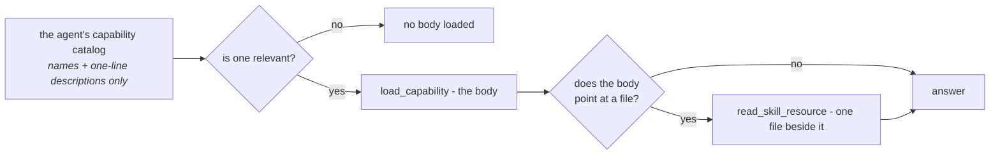

# Skills

A skill is know-how written once and attached to many agents: how refunds are
handled, what the house style is, which checks a report must pass before it goes
out.

The thing it replaces is an instructions field that grows.

Twenty procedures in one prompt means every run pays for all twenty, and the
twenty-first pushes the conversation out of the window. Skills invert that:



Twenty skills cost roughly twenty *descriptions* instead of twenty *procedures*.

!!! note "Discovery is cheap, not free"

    Every skill an agent is bound to sits in the catalog the model reads on every
    turn, as its name and its one-line description — so binding a skill does cost
    tokens whether or not the model ever opens it.

    It is a line per skill against a body per skill, which is why the numbers work.
    It is not grounds for binding an unbounded catalogue.

The other half of the point is **who writes them**. A skill is a row in the
database, editable in the UI, so a support lead can fix the refund policy on a
Tuesday afternoon. No deploy, no pull request, no engineer.

!!! info "Skill, context file or knowledge collection?"

    A **skill** is a procedure the model loads when it decides the task has
    arrived. A [context file](context.md) is standing knowledge — short, always
    relevant, injected or read on demand. A
    [knowledge collection](file-processing.md) is a corpus too large to read,
    reached by search.

In the Agent Builder, open **Skills → New skill** to write a skill without leaving the capability panel. Saving creates the library entry, attaches it to the current draft and enables the Skills capability. Publishing remains a separate step. The action requires permission to edit both the agent and skills.

## The shape

```markdown
---
name: refund-policy
description: When a refund is given without asking, when it needs approval, and how to say no.
category: support
---

# Refunds

Most refund questions are decided by the order date and one exception. Check
those before escalating anything.

The **Skills** page shows the opening of each body on its card — front matter
dropped, a few lines — with a sheet stacked behind it for each file the skill
carries. `GET /api/v1/skills` returns that opening as `excerpt`; the body itself
loads when a skill is opened.

## Decide without asking
...
```

!!! tip "`description` is the field that decides whether the skill is ever loaded"

    It is the only part the model sees for free. Write it as **when to reach for
    this**, not as a title.

A skill may carry **resources** — further files beside it, loaded on demand.
`refund-policy` ships an `exceptions.md`, and the body says when to consult it.

That is the same progressive disclosure one level down: detail only some
conversations need does not have to sit in the body every relevant conversation
loads.

`category` is one of twenty suggestions (`support`, `engineering`, `finance`,
`legal`, `security`, `marketing`, …) and drives the filter on the skills listing.
It has no effect on what the agent sees — the model chooses by `description`, never
by category.

## How an agent reads one

Through the [`skills` capability](reference/capabilities.md#skills). Each skill
an agent is given becomes a **capability of its own**, listed for the model by
name and description and opened on demand:

| How | What it does |
|---|---|
| The capability catalog | Names and one-line descriptions of everything bound to this agent |
| `load_capability` | The full body of one skill, pulled into the conversation |
| `read_skill_resource` | One file beside a skill |

`load_capability` is the agent framework's own tool, not one this platform
publishes, so it is not something a spec grants or renames — but it **can** be
gated, because it is the call that opens a skill: `tool_approval` on it is how an
agent asks a person before a skill reaches the model, and a spec that gated the
old `load_skill` is migrated onto it rather than left ungated. What the capability
contributes as a tool of its own is `read_skill_resource`, and only when at least
one of the bound skills ships a file to read.

A spec binds skills by id in `skill_ids`, so an agent sees the ones it was given
and nothing else.

**From the skill itself.** Each card on the Skills page has **Add to an agent**:
pick the agent and the skill is added to its draft, with the Skills capability
switched on, ready to publish in the Builder. The card also says which agents use
the skill - or that none does yet. Context files and knowledge bases offer the same.

**A skill's name is the id a model loads it by**, so it takes the form models
write ids in: lowercase letters and digits joined by single hyphens, such as
`refund-policy`. A name with spaces or capitals is refused when the skill is
created. A name the model has to reproduce exactly, like `Refund policy`, was
loaded as `refund-policy` instead, and two wrong guesses end the turn
([#1911](https://github.com/vstorm-co/agenticos/issues/1911)).

**A skill cannot be named after a capability.** Each one is filed under its own
name in the same namespace as `knowledge`, `planning` and the rest, so a skill
called `planning` on an agent that also has the planning capability is a duplicate
the framework refuses before the first token. Creating one is refused, and so is
publishing an agent bound to a skill named that way.

Enabling the capability with no skills bound is not useful — give the agent skills,
or leave the capability off.

### Which skills an answer used { #which-skills-an-answer-used }

Binding a skill does not mean the model read it. Each run records the skills it
actually used, by the skill's id: whether the model opened one with
`load_capability`, and how many of its files it read with `read_skill_resource`.
A run records this however it ends, including one that failed after opening the
skill. A skill a delegate used is recorded on the run that delegated, under the
delegate's own agent, because the answer a person rated is that run's.

A tool call that names a path in a skill's workspace folder, such as
`cat /workspace/skills/refund-policy/SKILL.md`, is counted apart as probable use.
Listing the folder is not counted. A path a shell assembles, a glob over several
skills, or a script that reads the file itself is not recognised.

`GET /api/v1/skills/{id}/usage?days=30` returns, per agent, how many runs used the
skill in that window, with the version each was served. Runs of evals and of the
Builder's test panel are left out. The figures are read off runs, so they need
`runs:view`; an agent the caller may not see is counted, never named.

Runs from before this was recorded say "usage unknown", which is not the same as
"not used". When a skill is improved, its evidence comes only from runs that used
it, and the rated-down or failed runs that may have used it count apart as unknown.

## In a workspace, a skill is also files

An agent that has both skills and a
[workspace](reference/capabilities.md#files-shell) gets each skill written into it
as well:

```
/workspace/skills/<name>/SKILL.md      the body, with its name and description
/workspace/skills/<name>/<resource>    each resource, beside it
```

This is what makes a skill's script useful. A skill whose resource is
`reconcile.py` was previously handed to the model as text it could quote and not
run, while the same agent had `execute` one tool call away. On disk, it runs.

!!! note "There is no `run_skill_script`"

    The sandbox's own `execute` already carries the workspace's permission rules
    and the operator's ceilings. A second way to run things would be a second set
    of rules to get wrong.

## An agent can propose a change; a person makes it

Those files are writable, and what the agent writes is **not** applied.

A skill is instructions every agent bound to it follows on every run. An agent that
could edit one directly could rewrite what another agent does, inside a
conversation nobody is reviewing, and the next reader would have no way to tell a
considered improvement from a hallucinated one.

So a write becomes a **proposal**, and it appears above the list on the Skills page
for whoever may edit that skill - its owner, or anybody granted edit on it - and,
for a skill not written yet, for anyone who may create skills. Nobody else sees it:

- **Check on agents** runs the change on every agent of the line it was written
  for, and applying it - the next version of that line, which those agents read
  on their next run - happens from the check's result. See
  [Checking a change on every agent](#checking-a-change-on-every-agent).
- **Discard** keeps the record. An agent proposing the same edit repeatedly is
  telling somebody something about the skill, and a deleted row makes that
  invisible.

!!! warning "A decision on a proposal is final"

    Applying twice would save a second version of a body already stored, and
    discarding something applied would tell a reader it never landed.

The proposal carries the **whole body** rather than a diff, so a reviewer weeks
later is comparing two complete versions instead of applying a patch somewhere it
was never meant to go.

Two things are refused rather than guessed at: a directory the agent created with
no `SKILL.md` in it, and one whose frontmatter it mangled. And a *deleted* resource
is deliberately not a change, because a file the model never touched and one it
meant to delete leave the same absence.

Three turns of one conversation refining the same skill leave **one** proposal, not
three. A reviewer asked the same question three times has been given more work
rather than more information.

A change records the version of the skill it was written against: for a run, the
version that run was given, and a later turn that rewrites the change records its
own. Apply refuses it once somebody has changed the skill since, so an edit made
while the change waited is not overwritten. Compare the two and edit the skill by
hand, or ask again.

The [authoring assistant](authoring.md#skills) proposes skill changes the same way,
with its rationale and the runs behind it, and applying refuses them the same way.

Each change says which agents' published versions read the skill, which eval
suites applying it queues and which guards check it only at the next promotion.
Applying tells those agents' owners. A decision names the version of the change
you read: a change rewritten since - by a later turn or a new request - is
refused with "The proposal changed since you opened it", and of two decisions
made at once only one counts. A skill the agent wrote from nothing has no agents
yet, so **Apply** creates it at once.

Workspace proposals use the same metadata limits as stored skills: a name of
1–64 characters and a description up to 500 characters. A change outside these
limits is skipped with a warning; its original workspace files stay intact.
Proposal writes run in a savepoint, so a refused proposal cannot roll back the
turn or prevent its status and spend from being recorded.

## Checking a change on every agent { #checking-a-change-on-every-agent }

A skill is shared, so a change is judged on every agent that would read it: on
main, the agents following main's newest version; on a fork, that fork's agents.
Agents pinned to an older version and the agents of other forks are not run - the
change does not reach them. Each agent's published version answers its questions
twice, with the skill as it is and with the change, and nothing else differs.

A change an agent's workspace wrote, one the assistant proposed and a
[library update](#getting-skills-into-an-organization) of a skill agents follow go live only through
this check. A person editing the skill by hand saves a new version at once, and
that edit is not checked.

### What it asks { #what-a-check-asks }

First the skill's own **test questions**, the same set on every agent. Each skill
has one set, created through the API - `POST /api/v1/skills/{id}/test-set`, empty
or from recent answers that loaded the skill - and edited like any other
[dataset](datasets.md). Then the agent's own questions:

- **Quick**, the default: at most four questions of the agent's dataset whose
  newest answer loaded the skill - the ones sharing most words with the lines the
  change touches. An agent with none is checked on the skill's set alone, and its
  row says so.
- **Thorough**: the agent's whole dataset. A change to the skill's description
  is always thorough, because the description decides when every agent opens
  the skill at all.

!!! note "The skill's questions say what the skill should do"

    They are graded the same way on every agent, so they catch a change that
    breaks the skill's own rule. A change that hurts one agent because of that
    agent's own situation shows on its own questions. And a deliberate change of
    rule fails every question still expecting the old answer: update the test
    questions first.

### The rule { #the-rule }

- No agent may get **worse**, by a regression its re-asks confirmed.
- At least one agent must get **better**.
- A difference the check could not confirm is **within noise**: a warning, not a
  block.
- An agent that could not be checked - no questions, no access, no budget left,
  no published version, a run that failed - is **unknown**, and a person
  acknowledges it before applying.

Each agent's share is its own eval runs, billed to that agent. The estimate gives
one price, most likely and at most, and names before the start the agents whose
budget cannot cover it. Starting needs `runs:view` and edit access to the skill.
An agent you may not run is not run, and one you may not see is a count, never a
name.

### When an agent got worse { #when-an-agent-got-worse }

**Check on agents** under Skills prices the check, runs it, shows each agent's
result and then applies or discards the change. On main a person may still:

- **apply it and keep the worse agents where they are** - each is pinned, as a new
  published version, to the version it reads now, before the change goes live, so
  none of them serves it even once. Pinning needs publishing each of them, and an
  environment that waits for promotion must take the pinned version first;
- **make a fork for the agents it helped**, leaving main as it is - through the
  API, `POST /api/v1/skills/{id}/checks/{check_id}/fork`;
- **discard** it.

On a fork only improving further and discarding remain: a pin names a main
version, and a fork never starts from another fork. A check refuses to apply
once the line has a newer version, or an agent started following it, since it
measured neither.

## Versions and forks

Every saved change to a skill makes a new version, and a version is never changed
afterwards. Editing the text or the description makes one, and so do adding,
changing or removing a file, a library refresh, and an applied change from an
agent's workspace or from the [authoring assistant](authoring.md#skills). A new
category alone does not, because no agent reads it.

**History** on the skill page lists the versions, newest first. Each one says what
made it (`backfill`, `created`, `edit`, `resources`, `library`, `workspace`,
`improve`, `restore`, `catch_up` or `from_fork`) and when, and who saved it to a reader who may see the
organization's members. A version keeps its files as they were, so changing a file
later does not change an earlier version.

A skill that existed before versions has one version, v1: the text and files it
had when versioning began. Nothing before that was recorded.

**Restore** brings an earlier version back as a new version, so the history stays
complete, and the new version says which one it came from.

An edit is saved against the version the editor read. If somebody saved a newer
version in the meantime, the edit is refused instead of overwriting it.

### Forks

A fork is a named line of a skill that starts from a main version. It has its own
versions and its own latest version, so a skill can change for some agents while
main stays as it is. Until it has a version of its own, a fork serves the main
version it started from.

- A fork starts only from main. A fork of a fork is refused, so the tree is one
  level deep.
- A fork's name is unique within its skill, archived forks included.
- A fork's files are the files of the version it was made from. Files are edited
  on main only, and reach a fork when it catches up.
- **Archive** stops a fork from taking new versions. It keeps its versions and is
  never deleted. A fork that no run has read for 30 days is offered for archiving;
  nothing is archived automatically. An older version of an agent that still reads
  an archived fork is not promoted to an environment: move the agent to another
  version, and promote the version that publishes.

### Which version an agent reads

Each agent reads a bound skill in one of three ways:

| State | What it reads |
|---|---|
| Main | The newest main version. This is every agent that names no other |
| Pinned | One main version, until somebody moves it |
| Fork | The newest version of one fork |

The choice is part of the agent's spec, in `skill_bindings`, so it is published,
promoted between environments and exported with the rest of the agent. A spec
without the field reads main for every skill, which is what every agent did before
skills had versions. Publish refuses a version the skill's main line does not have,
a fork of another skill, an archived fork and anything of another organization.
Each run records the skill versions it served, its inline specialists' included.

A new version reaches only the agents on its line. A new main version reaches the
agents on main, and a new fork version that fork's agents: their eval suites run,
the change lists the environments it goes live in, and their owners are told. A
pinned agent is reached by neither.

**The skill's agents** are those that run it: a version one of their environments
serves binds it, itself or through an inline specialist. An agent and each of its
specialists read the skill their own way, so each is a row: the page lists it with
the version it reads, how many main versions it is behind, and any environment that
reads it differently. An agent that binds the skill only in its draft is listed as
such. Agents you cannot see are counted, not named. Behind main counts the main
versions after it that changed what the skill says: restoring the same text again is
no change, and main back at the text it reads is behind by none.

**Change version** moves one agent to main, a main version or a fork, and it is a
change to the agent. Whether the agent uses the skill itself is read from its draft,
as the Builder shows it; a skill only one of its specialists binds is changed in the
Builder. With permission to publish it, the agent's newest published spec with only
that binding changed goes live as its next version, and environments move by their
usual follow and promotion rules. The draft takes the same change and keeps its
other unfinished edits, which do not go live. With permission to edit the agent
only, for an agent never published, or for one whose published version does not bind
the skill yet, the change waits in the draft, and only the new binding is checked. A
Builder already open on the agent does not see the change until it is reloaded, and
saving it before then puts the old binding back.

**Behind main.** Main moving on does not move a pinned agent or a fork: nothing
catches up by itself, because catching up costs a check on the agents it moves.
`GET /api/v1/skills/behind-main` lists the pinned agents and the forks that main has
moved past, across the organization, furthest behind first. A pinned agent is
listed by what its default environment serves, and a fork only while an agent
reads it. Skills you cannot view are left out, and pinned agents you cannot see
are counted, not named.

**Return to main** moves a fork's agents back to main's newest version, all of them
or the ones you pick, each as Change version moves it. One that cannot be moved
stays on the fork with the reason. Once nobody reads the fork, it is archived. An
agent whose environment waits for a promotion still reads the fork until it is
promoted, so the fork stays until then.

**Update to main.** A pinned agent behind main is moved up with a check first:
`POST /api/v1/skills/{id}/agents/{agent_id}/update-check` asks that one agent, on its
own questions and the skill's, with the version it stays on and with main's newest
version and its files, billed to the agent; `…/update-check/estimate` prices it
first. The check needs permission to edit the skill and to read runs. It is accepted
by moving the agent: `PUT …/agents/{agent_id}/binding` with `state: main` and its
`check_id`. That move is refused when the newer version made the agent worse, when a
result that could not be measured is not acknowledged (`acknowledge_unknown`), and
when the agent was published again or main moved on since the check; it closes the
check and marks the agent checked on that version. Moving an agent without a check
stays possible, as any change of version is: the agent then reads "unknown" on its
new version, and the person who moved it answers for that.

**Catch up a fork.** Main's changes reach a fork in a session:
`POST /api/v1/skills/{id}/forks/{fork_id}/catch-up`, priced first by
`…/catch-up/estimate`. The session merges three versions: the main version the fork
is based on, the fork's newest and main's newest. A part only one side changed
takes that side's text, and a part both changed the same way is taken once. A part
they changed differently is a conflict, and the model proposes one text for it. At
**Changes** a person can rewrite any part, the model's included
(`GET …/improvements/{run_id}/merge`, then `PATCH …/merge/description` or
`…/merge/parts/{index}`). For a file both sides changed differently, a person keeps
one side (`PATCH …/merge/files`); the model never writes a file. The check starts
only when nothing is left unsettled. It asks the fork's agents about the merge and,
unless that is turned off before the start, about main's newest alone. That second
check says whether the fork is still needed, and the estimate prices it separately.
Accepting makes a fork version (`catch_up`) that names the main version it took in.
From then on the fork is based on that main version, so it is no longer behind.
When main alone made no agent worse, the result also offers to drop the fork and
return its agents to main.

**Move a fork to main.** The same merge goes the other way at
`…/forks/{fork_id}/to-main`. The check asks main's agents, by the
[rule](#the-rule) for every change to main. Accepting makes a main version
(`from_fork`) that names the fork version it took in, files included. The fork's
agents can then return to main.

Both are refused (409) when the fork is archived, when it has no version of its own
(its agents return to main instead), and when the merge would change nothing.
Accepting is refused once main or the fork has a newer version than the merge
read.

### Deleting a skill

A skill that an agent uses cannot be deleted. That is a skill bound by a live
agent's draft, or by a version that one of its environments serves, the agent's own
or an inline specialist's. The refusal names the agents you can see and counts the
others. A skill that nobody uses is deleted with its versions and forks.

| Route | What it does |
|---|---|
| `GET /api/v1/skills/{id}/versions` | The versions of main, or of a fork with `?fork_id=`, newest first |
| `GET /api/v1/skills/{id}/versions/{version_id}` | One version, with its text and its list of files, each with its SHA-256 |
| `GET /api/v1/skills/{id}/versions/{version_id}/resources/{name}` | One file as that version had it |
| `POST /api/v1/skills/{id}/versions` | Saves an edit on main or on a fork, against `base_version_id` |
| `POST /api/v1/skills/{id}/versions/{version_id}/restore` | Restores a version onto its own line |
| `GET`, `POST /api/v1/skills/{id}/forks` | Lists forks, or starts one from a main version |
| `PATCH /api/v1/skills/{id}/forks/{fork_id}`, `POST …/archive` | Renames a fork, or archives it |
| `GET /api/v1/skills/{id}/agents` | The skill's agents, the version each reads, and how many are hidden |
| `PUT /api/v1/skills/{id}/agents/{agent_id}/binding` | Moves an agent to main, a main version or a fork |
| `GET /api/v1/skills/behind-main` | Pinned agents and forks that main has moved past, across the organization |
| `POST /api/v1/skills/{id}/forks/{fork_id}/return-to-main` | Moves a fork's agents back to main, and archives the fork once nobody reads it |
| `POST /api/v1/skills/{id}/agents/{agent_id}/update-check`, `…/estimate` | Checks main's newest version on one pinned agent, or prices that check |

## Getting skills into an organization

**Write one.** Skills → New, in the UI. This is the normal path.

**The bundled ones are already there.** The repository ships four: three worked
examples — `refund-policy`, `code-review` and `incident-report` — and
`artifact-pages`, which teaches an agent to build a page for the
[Apps](artifacts.md#the-library-set) capability. Every organization starts
with them. Creating an organization copies the whole shipped library in as
ordinary skills, owned by the organization's owner and visible to the
organization.

The skills page shows one list, with a `built-in` badge on anything whose name
matches the shipped library. Those four are not chosen — they arrive once, at
creation.

**And they are yours from then on.** A seeded skill is an ordinary row: edit it or delete it. Nothing puts a deleted one back.

That is a change. The listing used to top itself up — copying in any bundled name
the organization did not have, every time anyone opened the page — so a deleted
built-in returned on the next visit and disabling was the only way to retire one.
It also meant a page that wrote rows while it read. The gallery is where a skill
is chosen, and the seed command below is how a deployment pushes a new bundled
one out on purpose.

!!! info "An organization created before a new bundled skill does not get it by itself"

    Run `seed-skills` for that organization, or install the skill from the
    gallery. Both are deliberate, which is the point: nothing arrives on a page
    load.

The seed command does the same from a terminal, for scripted setups:

```bash
uv run agenticos cmd seed-skills                    # every organization
uv run agenticos cmd seed-skills --org <org-id>     # one
uv run agenticos cmd seed-skills --dry-run          # say what would happen, do nothing
uv run agenticos cmd seed-skills --replace          # also overwrite copies edited here
```

It installs what is missing and **refreshes what nobody has edited**. Every copy
records which bundled version it was written from, so when a release improves a
bundled skill, an organization's untouched copy is replaced with the new one —
files and all, as a new version, with a `skill.refreshed` audit entry. Unless
agents follow it: then the bundled version waits under Skills as a change, and
goes live once a [check on those agents](#checking-a-change-on-every-agent)
allows it.

A copy edited here is left exactly as it is, so an edited refund policy survives a
reseed; `--replace` is the one way to take the bundled version over such edits,
and the audit entry says it did. A copy made before versions were recorded and
different from the bundled one is reported and left alone too, since nothing can
tell whether it was edited.

The command prints what it did with each skill, and `--dry-run` prints the same
plan without writing.

`e2e/seed.setup.ts` also creates one through the UI, which is what the E2E suite
asserts against.

### The gallery — seventy more, and none of them arrive uninvited

**Skills → Skill gallery** opens a catalog of ready-made skills grouped by
industry: healthcare, finance and insurance, e-commerce and print on demand,
software teams, public sector and utilities, legal and professional services,
manufacturing and logistics. Ten each.

Pick an industry, then install one skill or the whole shelf. From that moment it
is an ordinary skill the organization owns and edits, exactly like a bundled one.

!!! info "The gallery is opt-in, and that is the whole difference"

    The bundled four live in `app/core/catalog/skills/` and are copied into
    **every** organization automatically. The gallery lives in
    `app/core/catalog/skill_gallery/` and is copied into **none** — it is read by
    the same parser, from a second directory, and never seeded.

    Seventy industry skills in the first directory would have been seventy rows
    nobody asked for, in every tenant, on the next deploy.

Installing a shelf where you already have one of its skills installs the rest and
leaves that one alone: an existing name is skipped rather than overwritten, and
the request answers with what it installed, what it skipped, and any key this
deployment does not ship.

Adding to the gallery is the same as adding a bundled skill — a folder with a
`SKILL.md`, under the industry it belongs to — with one extra rule: **its name
must not collide with a bundled skill or another gallery skill,** and it is the
folder's own name. Installing matches on name, so a collision would silently skip
forever. A test reads all seventy and fails on either.

### Seeding copies

A seeded skill is an ordinary skill owned by the organization, editable from the
moment the organization exists. It is a **copy**, not a link.

That is deliberate. The point of a skill is that a support lead can fix the refund
policy without a deploy, and a live link back to the repository's copy would take
exactly that away — the organization would be reading a file only an engineer can
change.

Editing and deleting are both final in the ordinary way. Disabling is still there
for a skill an organization wants to keep but not run — every agent respects it —
but it is no longer the only way to be rid of a built-in.

### Why the library is bundled and not fetched

Adding a skill to the shipped library or the gallery is a deploy.

The alternative — importing from a git URL — costs outbound network from the
backend, a parser pointed at somebody else's repository, and a promise about content
nobody here has read. Each folder in `app/core/catalog/skills/` and
`app/core/catalog/skill_gallery/` is the same small promise the
[MCP catalog](mcp.md#the-catalog) makes: somebody looked at it.

## A skill's page

Open a skill from the list to see its page. It has three tabs.

**Agents** lists every agent that uses the skill, and the version it is served:

- `v12 · main` - the agent follows main and gets each new version at once.
- `v9 · pinned · 3 behind main` - the agent stays on an older main version.
- `Fork "Returns" · from v7 · 2 changes` - the agent uses a fork: a line of
  versions with changes of its own, started from one main version.

An environment that serves a different version is named under the agent, and an
inline specialist that binds the skill has a row of its own - see
[Which version an agent reads](#which-version-an-agent-reads). An agent that binds
the skill only in its draft is marked **Only in the draft** and follows no line.
Agents you cannot see are counted, not named. The chips above the table show
everyone, the agents on main, the pinned ones, one fork, or the agents only in a
draft, so their counts add up to everyone. A fork you pick there is also the line
that History lists and Edit saves to.

Under the table, a reader who may view runs sees how often each agent opened the
skill in the last 30 days and how many of its files it read. Runs of evals and of
the Builder's test panel are not counted.

**Change version** moves one agent to main, to a pinned main version, or to a fork,
as [Which version an agent reads](#which-version-an-agent-reads) describes: what goes
live, what waits in the draft, and what is changed in the Builder. A version other
than the one the agent serves now has not been checked on it, so you confirm that
first. The dialog also says when the agent would stop getting new main versions, and
dates each main version it offers to pin, with a link to what it changed. The control
is shown to people who may edit the agent.

**History** lists the chosen line's versions, newest first: where each came from
(an edit, a file change, the library, an agent's workspace, Improve or a restore),
who made it and when. **Show changes** compares the description and instructions
with the version before - for a fork's first version, its base on main - and names
the files added, removed or changed. **Restore** brings an earlier version back as
the newest on its own line, and the agents following that line get it at once. A
fork numbers its versions from 1 like main, so they carry its name - "Returns v2" -
and main's history marks the version each fork starts from.

**Version tree** draws main from its newest version down, each fork off the version
it started from, and agents at the version they use. On a line of eight versions or
more, stretches that no agent uses fold into one row.

**Edit** saves a new version on the line on screen. On main, the agents following
main get it at once; pinned agents and forks keep their version. Files and the
category belong to main, so editing a fork changes only its description and
instructions. Restore and Change version are shown only to people who may make
that change; anybody else opens the skill read-only.

**New fork** starts a fork from main's newest version, under a name you give it,
and can move agents onto it at once, each as a Change version. The fork reads the
same as its base until it is edited.

**Delete**, in the editor's menu, deletes a skill nobody uses, with its versions and
forks. While agents use it, the dialog names them and offers no delete: move each
to another skill, or remove the skill from it in the Builder, first.

## Skills or knowledge?

They answer different questions, and the difference matters when an agent gets the
wrong one.

|  | Skills | [Knowledge](file-processing.md) |
|---|---|---|
| Contains | Procedure — how we do this | Documents — what we know |
| Written by | A person, deliberately | Ingested in bulk |
| Retrieved by | The model choosing a name | Semantic search over chunks |
| Cites | Nothing; it *is* the instruction | The passage and its source |
| Scale | Tens | Thousands of documents |

!!! example "Which is which"

    "Refunds over £500 need a manager" is a **skill**. The signed contract that
    says so is **knowledge**.

    An agent handling refunds usually wants both, and the two capabilities compose
    — `skills` for the procedure, `knowledge` for the evidence.

## Access

Skills are organization-scoped resources, governed like agents and collections:
visibility plus per-row grants on top of the role. See
[Permissions](permissions.md#layer-3-visibility-and-grants).

!!! important "Binding a skill lends it"

    Every run of the agent reads the body and the files, whoever ran it — so
    publishing requires the **publisher** to hold `skills:view` on that row.

That check goes through `resolve_access`, so a grant counts: a member who was
shared one skill can bind it without being promoted.

A skill they cannot reach is refused as `Skill not found: <id>`, worded identically
to an id that does not exist. Skills are bound by UUID from the API and from a
hand-edited draft, not only picked from the Builder's list, and a refusal that read
differently would map the organization's private skills one guess at a time.

The same check runs on an
[inline specialist's](concepts.md#delegate-vs-inline-specialist) `skill_ids`,
reported with the specialist's name.

At run time nothing is re-checked. The frozen spec's skills are resolved inside the
run's organization and handed to the agent — the rule collections and delegates
already follow, that
[the reference is checked once, at publish](permissions.md#delegation-is-not-a-privilege-boundary).

The alternative is worse in two specific ways:

- Every context with no subject — an API key, an embedded widget, a channel message
  — is refused by `resolve_access` by design, so a per-runner check would strip
  every skill from exactly those surfaces.
- Where there *is* a subject, one published version would give a member — whose
  role reaches shared skills only — thinner instructions than it gives a builder,
  with the difference visible nowhere.

Skills have no separate enabled switch: an agent can use the skills bound to it.
Remove a binding and publish the agent to stop using that skill. A skill deleted
after publish is skipped with a warning rather than failing the run.

## Recap

- A skill is **procedure**, written by a person, and loaded only when the model
  decides its *description* is relevant — discovery costs a line per skill, and
  the body costs nothing until it is opened.
- In a workspace a skill is also **files**, which is what makes its scripts runnable.
- An agent **proposes** an edit; a person applies it, once, and the decision is
  final.
- Binding a skill **lends** it, so the publisher must be able to see it — and
  nothing is re-checked at run time.
- The **gallery** is seventy ready-made skills by industry, installed on request —
  unlike the bundled three, which arrive on their own.

### Proposing a new skill { #proposing-a-new-skill }

The assistant can propose **Worth creating a skill** when a reusable procedure appears in at least three distinct evidence answers. Each supporting passage must occur in the answer itself; reader comments alone do not establish a repeated procedure. The card shows its name, description, full body, rationale and verified evidence. A check binds a temporary skill to the candidate only: no skill row or published version is created.

**Accept** creates the private skill and binds it to the agent's draft in the same transaction. It requires `skills:edit` as well as edit access to the agent. Without creation permission the proposal remains readable and testable, but Accept explains why it is disabled. **Dismiss** creates nothing. **Undo** removes the binding and keeps the independent skill; accepting again reuses it only while its name and body still match. Skills contain written know-how and grant no tools. Additional tool access needs separate policy-checked proposals, with writing tools requiring approval.

A procedure drawn from fewer than three distinct answers is not proposed as a suggestion. It is listed with its full text under **more ideas need your decision**. **Create skill** opens a preview: the name, description and body can be edited, and a warning says how many answers it is based on. **Create skill** in the preview creates the skill in the library and binds it to the agent's draft, never to a published version. It needs the same permissions as Accept and makes no model call. A second click returns the skill already created.

The estimate reserves the full proposed body for each candidate answer and its confirming reruns, in addition to the historical per-answer price.
