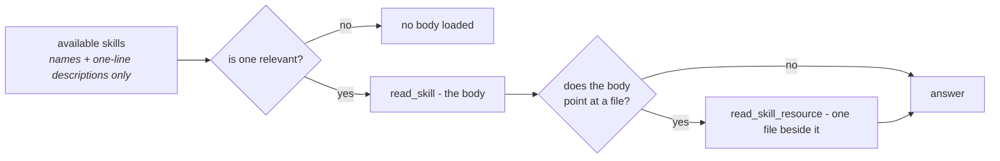

# Skille { #skills }

Kliknięcie skilla w katalogu otwiera modal z instrukcjami, opisem i plikami bez utraty wyszukiwania, filtrów ani strony listy. **Otwórz pełny widok** obok **Udostępnij** w dolnym pasku modalu otwiera zakładkę Treść na osobnej stronie, z dostępnymi zakładkami Agenci i Historia. Wyjście z niezapisanymi zmianami wymaga decyzji, co zachować. Gdy brakuje opinii, Improve wskazuje następny krok zamiast formularza limitu, którego nie można uruchomić.


Skill to wiedza praktyczna zapisana raz i podpięta do wielu agentów: jak
obsługuje się zwroty pieniędzy, jaki jest styl firmowy, jakie sprawdzenia musi
przejść raport, zanim pójdzie na zewnątrz.

Zastępuje pole z instrukcjami, które rośnie.

Dwadzieścia procedur w jednym prompcie oznacza, że każdy run płaci za wszystkie
dwadzieścia, a dwudziesta pierwsza wypycha rozmowę poza okno kontekstu. Skille
odwracają tę zależność:



Dwadzieścia skilli kosztuje mniej więcej dwadzieścia _opisów_ zamiast dwudziestu
_procedur_.

!!! note "Wykrywanie jest tanie, ale nie darmowe"

    Każdy podpięty skill siedzi w katalogu capability, który model czyta w każdej
    turze — jako nazwa i jednolinijkowy opis. Podpięcie skilla kosztuje więc
    tokeny niezależnie od tego, czy model kiedykolwiek go otworzy.

    To linijka na skilla zamiast całej treści na skilla i dlatego rachunek się spina.
    Nie jest to jednak powód, żeby podpinać nieograniczony katalog.

Druga połowa sensu to **kto je pisze**. Skill jest wierszem w bazie danych,
edytowalnym w UI, więc szef wsparcia może poprawić politykę zwrotów we wtorek po
południu. Bez deployu, bez pull requesta, bez inżyniera.

!!! info "Skill, plik kontekstowy czy kolekcja wiedzy?"

    **Skill** to procedura, którą model wczytuje, kiedy uzna, że przyszło na nią
    zadanie. [Plik kontekstowy](context.md) to wiedza stała — krótka, zawsze
    istotna, wstrzykiwana albo czytana na żądanie.
    [Kolekcja wiedzy](file-processing.md) to korpus zbyt duży, żeby go przeczytać,
    dostępny przez wyszukiwanie.

W kreatorze agenta wybierz **Skills → New skill**, aby napisać skill bez opuszczania panelu zdolności. Zapis tworzy wpis w bibliotece, dołącza go do bieżącego szkicu i włącza zdolność Skills. Publikacja pozostaje osobnym krokiem. Akcja wymaga uprawnień do edycji agenta i skilli.

## Kształt { #the-shape }

```markdown
---
name: refund-policy
description: When a refund is given without asking, when it needs approval, and how to say no.
category: support
---

# Refunds

Most refund questions are decided by the order date and one exception. Check
those before escalating anything.

Strona **Skills** pokazuje na karcie początek treści każdego skilla — bez front
matter, kilka linii — a za nim po jednym arkuszu na każdy plik, który skill ze
sobą niesie. `GET /api/v1/skills` zwraca ten początek jako `excerpt`; samą treść
wczytuje dopiero otwarcie skilla.

## Decide without asking

...
```

!!! tip "`description` to pole, które decyduje, czy skill kiedykolwiek zostanie wczytany"

    To jedyna część, którą model widzi za darmo. Napisz je jako **kiedy po to
    sięgnąć**, a nie jako tytuł.

Skill może nieść **zasoby** — kolejne pliki obok niego, wczytywane na żądanie.
`refund-policy` ma przy sobie `exceptions.md`, a treść mówi, kiedy do niego
zajrzeć.

To to samo stopniowe odsłanianie, tylko poziom niżej: szczegół potrzebny tylko
części rozmów nie musi siedzieć w treści, którą wczytuje każda istotna rozmowa.

`category` to jedna z dwudziestu sugestii (`support`, `engineering`, `finance`,
`legal`, `security`, `marketing`, …) i steruje filtrem na liście skilli. Nie ma
wpływu na to, co widzi agent — model wybiera po `description`, nigdy po
kategorii.

Długie zasoby tekstowe są stronicowane, aby całe podręczniki nie trafiały do każdego żądania modelu: domyślna strona ma 8 000 znaków, maksymalnie 20 000. Przekaż `args` z `offset` i `limit` do `read_skill_resource`; odpowiedź podaje kolejny offset. Czytaj potrzebne fragmenty i wykorzystuj już wczytany materiał.

## Jak agent go czyta { #how-an-agent-reads-one }

Przez [capability `skills`](reference/capabilities.md#skills). Każdy skill, który
agent dostaje, staje się **osobną capability** — wypisaną modelowi z nazwy i opisu,
a otwieraną na żądanie:

| Jak | Co robi |
| --- | --- |
| Dostępne skille | Nazwy i jednolinijkowe opisy wszystkiego, co jest podpięte do tego agenta |
| `read_skill` | Pełna treść jednego skilla, wciągnięta do rozmowy |
| `read_skill_resource` | Jeden plik obok skilla |

`read_skill` nadaje natywnemu loaderowi frameworka nazwy dotyczące skilli.
Polityki zgód zachowują stały klucz `load_capability`, dzięki czemu opublikowane
specy i oczekujące zgody nadal działają. Dawny klucz zgody `load_skill` nadal jest
na niego migrowany. Nie ma osobnego narzędzia listującego. `read_skill_resource`
czyta pliki pomocnicze dopiero po otwarciu skilla.

Spec podpina skille po id w `skill_ids`, więc agent widzi te, które dostał, i nic
poza tym.

**Prosto ze skilla.** Każda karta na stronie Skille ma **Dodaj do agenta**:
wybierasz agenta, a skill trafia do jego szkicu razem z włączoną capability
Skille, gotowy do opublikowania w Builderze. Karta mówi też, którzy agenci
używają skilla - albo że jeszcze żaden. Pliki kontekstu i bazy wiedzy mają to samo.

**Nazwa skilla to id, pod którym model go ładuje**, więc ma formę, w jakiej
modele piszą id: małe litery i cyfry połączone pojedynczymi myślnikami, na przykład
`refund-policy`. Konsola automatycznie formatuje wielkie litery, spacje, interpunkcję
i łacińskie znaki diakrytyczne po opuszczeniu pola lub przy zapisie: `Refund Policy`
zmienia się w `refund-policy`. API nadal wymaga formatu kanonicznego. Kolizje z
istniejącą nazwą i nazwy capabilities są odrzucane bez utraty formularza.

Nazwę, którą model musiałby odtworzyć dokładnie, jak
`Refund policy`, ładował jako `refund-policy`, a dwie błędne próby kończą turę
([#1911](https://github.com/vstorm-co/agenticos/issues/1911)).

**Skill nie może nazywać się tak jak capability.** Każdy jest zapisany pod własną
nazwą w tej samej przestrzeni co `knowledge`, `planning` i reszta, więc skill o
nazwie `planning` na agencie, który ma też capability planning, to duplikat, który
framework odrzuca przed pierwszym tokenem. Utworzenie takiego jest odrzucane, tak
samo jak publikacja agenta podpiętego do skilla o takiej nazwie.

Włączenie capability bez podpiętych skilli nie ma sensu — albo daj agentowi
skille, albo zostaw capability wyłączoną.

### Których skilli użyła odpowiedź { #which-skills-an-answer-used }

Podpięcie skilla nie znaczy, że model go przeczytał. Każdy run zapisuje skille,
których naprawdę użył, po id skilla: czy model otworzył skill przez
`read_skill` i ile jego plików przeczytał przez `read_skill_resource`. Run
zapisuje to bez względu na to, jak się skończył, także wtedy, gdy zakończył się
błędem po otwarciu skilla. Skill użyty przez delegata zapisuje się w runie, który
delegował, pod agentem delegata, bo ocenę dostała odpowiedź tego runa.

Wywołanie narzędzia, które podaje ścieżkę w folderze skilla w workspace, na
przykład `cat /workspace/skills/refund-policy/SKILL.md`, liczy się osobno jako
prawdopodobne użycie. Wylistowanie folderu się nie liczy. Ścieżka złożona przez
shella, glob obejmujący kilka skilli ani skrypt, który sam czyta plik, nie są
rozpoznawane.

`GET /api/v1/skills/{id}/usage?days=30` zwraca dla każdego agenta liczbę runów,
które użyły skilla w tym oknie, z wersją, którą każdy dostał, i liczbą na każdy
dzień okna w UTC, także zerową. Runy ewaluacji i
panelu testowego w Builderze są pominięte. Liczby pochodzą z runów, więc wymagają
`runs:view`; agent, którego wywołujący nie widzi, jest policzony, ale nie nazwany.

Runy sprzed wprowadzenia zapisu mówią „użycie nieznane”, co nie jest tym samym co
„nieużyty”. Gdy skill jest ulepszany, dowody pochodzą tylko z runów, które go
użyły, a ocenione negatywnie lub zakończone błędem runy, które mogły go użyć,
liczą się osobno jako nieznane.

## W workspace skill to także pliki { #in-a-workspace-a-skill-is-also-files }

Agent, który ma jednocześnie skille i
[workspace](reference/capabilities.md#files-shell), dostaje każdy skill zapisany
również w nim:

```
/workspace/skills/<name>/SKILL.md      the body, with its name and description
/workspace/skills/<name>/<resource>    each resource, beside it
```

To właśnie sprawia, że skrypt w skillu jest do czegokolwiek. Skill, którego
zasobem jest `reconcile.py`, był wcześniej podawany modelowi jako tekst, który
mógł zacytować, ale nie uruchomić, podczas gdy ten sam agent miał `execute` w
odległości jednego wywołania narzędzia. Na dysku — działa.

!!! note "Nie ma `run_skill_script`"

    Własne `execute` sandboksa niesie już reguły uprawnień workspace'u i limity
    operatora. Drugi sposób uruchamiania rzeczy byłby drugim zestawem reguł do
    pomylenia.

## Agent może zaproponować zmianę; wprowadza ją człowiek { #an-agent-can-propose-a-change-a-person-makes-it }

Te pliki są zapisywalne, a to, co agent zapisze, **nie** zostaje zastosowane.

Skill to instrukcje, którymi w każdym runie kieruje się każdy podpięty do niego
agent. Agent, który mógłby go edytować bezpośrednio, mógłby przepisać to, co robi
inny agent, wewnątrz rozmowy, której nikt nie przegląda, a kolejny czytelnik nie
miałby jak odróżnić przemyślanego ulepszenia od zahalucynowanego.

Dlatego zapis staje się **propozycją** i pojawia się nad listą na stronie Skills
każdemu, kto może edytować ten skill. Propozycja nowego skilla pojawia się każdemu,
kto ma `skills:edit`. Nikt inny nie może jej zobaczyć na liście ani otworzyć:

- **Check on agents** uruchamia zmianę na każdym agencie linii, dla której
  powstała, a jej zastosowanie - następna wersja tej linii, którą ci agenci
  przeczytają przy następnym runie - odbywa się z wyniku sprawdzenia. Zobacz
  [Sprawdzanie zmiany na każdym agencie](#checking-a-change-on-every-agent).
- **Discard** zachowuje zapis. Agent proponujący w kółko tę samą zmianę mówi
  komuś coś o skillu, a usunięty wiersz czyni to niewidocznym.

!!! warning "Decyzja o propozycji jest ostateczna"

    Zastosowanie dwa razy zapisałoby drugą wersję treści już zapisanej, a
    odrzucenie czegoś zastosowanego mówiłoby czytelnikowi, że nigdy nie weszło.

Propozycja niesie **całą treść**, a nie diff, więc recenzent kilka tygodni
później porównuje dwie kompletne wersje, zamiast nakładać łatkę w miejscu, do
którego nigdy nie była przeznaczona.

Dwie rzeczy zostają odrzucone, zamiast być zgadywane: katalog utworzony przez
agenta bez `SKILL.md` w środku oraz taki, któremu agent zepsuł frontmatter. A
_usunięty_ zasób celowo nie jest zmianą, bo plik, którego model nigdy nie
dotknął, i taki, który zamierzał usunąć, zostawiają po sobie ten sam brak.

Trzy tury jednej rozmowy dopracowujące ten sam skill zostawiają **jedną**
propozycję, nie trzy. Recenzent zapytany trzy razy o to samo dostał więcej pracy,
a nie więcej informacji.
Propozycje z workspace mają te same limity metadanych co zapisane skille: nazwa
od 1 do 64 znaków i opis do 500 znaków. Zmiana poza limitem jest pomijana z
ostrzeżeniem; oryginalne pliki pozostają bez zmian. Zapis propozycji używa
savepointu, więc odrzucona propozycja nie wycofa tury ani nie zablokuje zapisania
jej statusu i kosztu.

Zmiana zapisuje wersję skilla, dla której powstała: przy runie jest to wersja,
którą ten run dostał, a późniejsza tura, która ją nadpisuje, zapisuje swoją. Apply
ją odrzuca, jeśli ktoś w międzyczasie zmienił skill, więc edycja zrobiona, gdy
zmiana czekała, nie zostaje nadpisana. Porównaj obie wersje i popraw skill
ręcznie albo poproś jeszcze raz.

[Asystent tworzenia](authoring.md#skills) proponuje zmiany skilli w ten sam
sposób, razem z uzasadnieniem i runami, na których się opiera, a zastosowanie
odrzuca je tak samo.

Każda zmiana mówi, opublikowane wersje których agentów czytają skill, które
suity evali ustawi w kolejce jej zastosowanie i którzy strażnicy sprawdzą ją
dopiero przy następnej promocji. Zastosowanie powiadamia właścicieli tych
agentów. Decyzja wskazuje wersję zmiany, którą przeczytałeś: zmiana przepisana
od tego czasu - przez późniejszą turę albo nową prośbę - jest odrzucana z
komunikatem „The proposal changed since you opened it”, a z dwóch decyzji
podjętych naraz liczy się tylko jedna. Skill, który agent napisał od zera, nie ma
jeszcze agentów, więc **Apply** tworzy go od razu.

## Sprawdzanie zmiany na każdym agencie { #checking-a-change-on-every-agent }

Skill jest współdzielony, więc zmianę ocenia się na każdym agencie, który by ją
przeczytał: na main - na agentach podążających za najnowszą wersją main; na
forku - na agentach tego forka. Agenci przypięci do starszej wersji i agenci
innych forków nie są uruchamiani - zmiana do nich nie dociera. Opublikowana
wersja każdego agenta odpowiada na swoje pytania dwa razy, ze skillem takim, jaki
jest, i ze zmianą, a poza tym nic się nie różni.

Zmiana zapisana przez workspace agenta, zmiana zaproponowana przez asystenta i
[aktualizacja z biblioteki](#getting-skills-into-an-organization) skilla, którego
używają agenci, trafiają na żywo tylko przez to sprawdzenie. Osoba edytująca
skill ręcznie od razu zapisuje nową wersję, a ta edycja nie jest sprawdzana.

### O co pyta { #what-a-check-asks }

Najpierw o własne **pytania testowe** skilla, ten sam zestaw na każdym agencie.
Każdy skill ma jeden zestaw, zaczynany na stronie skilla w sekcji **Pytania testowe**
- z ostatnich odpowiedzi, które otworzyły skill, albo pusty - albo przez API,
`POST /api/v1/skills/{id}/test-set`, albo przyciskiem **Dodaj pytania testowe** przy
agencie, którego [Popraw](#improving-a-skill) nie mogło sprawdzić, i edytowany jak
każdy inny [dataset](datasets.md), który Datasets oznacza jako należący do skilla.

Zestaw ocenia sędzia, porównując każdą odpowiedź z tą, którą ludzie ocenili w
górę. Zestaw z ostatnich odpowiedzi zadaje każde pytanie raz: odpowiedź, którą
ktoś ocenił, wygrywa z taką, która tylko się nie udała, więc jedno pytanie nigdy
nie wymaga odpowiedzi i jednocześnie jej nie zabrania.

Potem o pytania samego agenta:

- **Quick**, domyślnie: cztery pytania z datasetu agenta - więcej, gdy pytań
  held-out samego skilla jest za mało do pięciu, których wymaga wynik - których
  najnowsza odpowiedź otworzyła skill - te, które mają najwięcej wspólnych słów
  ze zmienianymi liniami. Agent bez takich pytań jest sprawdzany tylko na
  zestawie skilla, a jego wiersz to mówi. Agent, którego pytania skilla pokazały
  jako gorszego, nie jest pytany o własne, a jego wiersz mówi, że nie zostały
  zadane.
- **Thorough**: cały dataset agenta, zadawany nawet wtedy, gdy pytania skilla
  pokazały agenta jako gorszego, żeby jego wiersz mówił, gdzie zmiana go zepsuła.
  Zmiana opisu skilla jest zawsze sprawdzana
  w ten sposób, bo opis decyduje, kiedy każdy agent w ogóle otwiera skill.

!!! note "Pytania skilla mówią, co skill powinien robić"

    Są oceniane tak samo na każdym agencie, więc łapią zmianę, która psuje
    regułę samego skilla. Zmiana, która szkodzi jednemu agentowi z powodu jego
    własnej sytuacji, wychodzi na jego własnych pytaniach. A celowa zmiana
    reguły nie przejdzie żadnego pytania, które wciąż oczekuje starej
    odpowiedzi: najpierw zaktualizuj pytania testowe.

Zestaw pytań, którego nic nie potrafi ocenić albo którego wszystkie pytania
pochodzą z rozmów, z których zmiana się nauczyła, jest dla tego agenta pomijany,
a reszta i tak jest zadawana. Agent, któremu nie zostało nic do zadania, jest
nieznany, z tym powodem. Każdy zestaw liczy tylko pytania, które zadaje, a
szybka próbka nigdy nie wybiera pytań z tych rozmów. Gdy w sesji Improve żaden
agent nie ma pytania spoza jej własnych dowodów, krok jest odrzucany przed
startem, ze wskazaniem datasetu, do którego trzeba dodać inne pytania.

### Reguła { #the-rule }

- Żaden agent nie może być **gorszy** o regresję potwierdzoną ponownymi
  pytaniami.
- Co najmniej jeden agent musi być **lepszy**.
- Różnica, której sprawdzenie nie potwierdziło, jest **w granicach szumu**: to
  ostrzeżenie, nie blokada.
- Agent, którego nie dało się sprawdzić - brak pytań, pytania, których nic nie
  ocenia albo wzięte w całości z rozmów samej zmiany, brak dostępu, brak
  budżetu, brak opublikowanej wersji, nieudany run, zatrzymane sprawdzenie - jest
  **nieznany**, a osoba potwierdza to przed zastosowaniem.

Sprawdzenie, w którym nie da się sprawdzić żadnego agenta, i tak startuje i od
razu się kończy, ze wszystkimi agentami nieznanymi, do potwierdzenia przez osobę. Okno mówi to przed startem i proponuje pytania testowe skilla albo ocenianie, którego brakuje jego pytaniom.
Zmiana linii, której nie czyta żaden agent, przechodzi od razu: do nikogo nie
trafia, a sprawdzenie mówi, że nie było kogo sprawdzić.

Agent jest oceniany raz, na pytaniach held-out ze wszystkich swoich etapów
razem: wynik wymaga pięciu takich pytań na agenta, a nie pięciu na etap, a
regresja potwierdzona przez jeden etap sam się liczy, cokolwiek pokazał drugi. Każde
pytanie zestawu skilla jest held-out, a szybkie sprawdzenie losuje tylko pytania
held-out agenta.

Sprawdzenie wysyła swoje potwierdzone regresje i odpowiedzi, których sędzia nie
umiał ocenić, do [kolejki przeglądu](datasets.md#review), każdą oznaczoną jako
odpowiedź udzieloną z proponowaną zmianą, i nigdy w miejsce odpowiedzi, która
już czeka na tym pytaniu. Werdykt osoby na odpowiedź ocenioną
przez sprawdzenie ocenia tego agenta od nowa: jego liczby, werdykt sprawdzenia i
wynik próby Improve, którą sprawdzenie mierzyło, idą za tym werdyktem.

Werdykt
dotyczy tej jednej odpowiedzi; ponowne pytania zachowują własne oceny, więc
regresja, którą potwierdziły, zostaje. Agent, którego szybkie sprawdzenie nie
zapytało o własne pytania, bo pytania skilla pokazały go jako gorszego, jest
nieznany, gdy ta regresja zostanie cofnięta. Rozstrzygnięte sprawdzenie
zachowuje swoją decyzję, a agent, którego sprawdzenie nie mogło uruchomić,
zostaje nieznany.

Część każdego agenta to jego własne runy evali, rozliczane z jego budżetu.
Estymacja podaje jedną cenę, najpewniej i najwyżej, i przed startem wymienia
agentów, których budżet jej nie pokryje. Ponowny start tego samego sprawdzenia,
gdy wciąż trwa, zwraca to sprawdzenie, więc nigdy nie płaci się za nie dwa razy.
Start wymaga `runs:view` i prawa edycji
skilla. Agent, którego nie możesz uruchomić, nie jest uruchamiany, a ten, którego
nie widzisz, jest liczbą, nigdy nazwą.

### Gdy agent wypadł gorzej { #when-an-agent-got-worse }

**Check on agents** w zakładce Skille wycenia sprawdzenie, uruchamia je, pokazuje
wynik każdego agenta, a potem proponuje dokładnie to, na co sprawdzenie pozwala. W
trakcie pasek liczy sprawdzonych agentów. Potem każdy agent rozwija się do tego, co
naprawił i zepsuł, etap po etapie, z linkiem do runu każdego etapu; strona tego runu
mówi, że jest jednym etapem sprawdzenia, i prowadzi z powrotem do niego. Okno można
zamknąć: strona skilla pokazuje wtedy **Sprawdzanie trwa**, a **Pokaż** otwiera
sprawdzenie ponownie, dopóki o nim nie zdecydujesz. Historia skilla wymienia
sprawdzenia linii, od najnowszego, z tym, co każde znalazło i co z nim zrobiono, a
**Szczegóły** otwierają jedno z nich. Sprawdzenie, które uruchomiła
[sesja Popraw](#improving-a-skill), rozstrzyga się w tej sesji, a Check on agents
prowadzi do niej.

**Wróć do edycji** zabiera sprawdzony tekst z powrotem do edytora - tego, w którym
go napisano, albo nowego, otwartego z Pokaż lub Szczegóły na linii samego
sprawdzenia - więc nic, co wpisano, nie przepada, a zapis jest odrzucany, gdy linia
ma już wersję nowszą niż ta, na której sprawdzano; sprawdzenie propozycji daje zamiast tego **Popraw dalej**, które
zaczyna sesję. Na main osoba może nadal:

- **zastosować zmianę i zostawić gorszych agentów tam, gdzie są** - każdy jest
  przypinany, jako nowa opublikowana wersja, do wersji, którą czyta teraz, zanim
  zmiana trafi na żywo, więc żaden z nich nie obsłuży jej ani razu. Przypięcie
  wymaga prawa publikacji każdego z nich, a środowisko czekające na promocję musi
  najpierw dostać przypiętą wersję;
- **zrobić fork**, zostawiając main bez zmian - dostępny niezależnie od wyniku,
  w oknie sprawdzenia, w kroku Akceptacja w [Popraw](#improving-a-skill) albo przez API,
  `POST /api/v1/skills/{id}/checks/{check_id}/fork`. Na fork przechodzą agenci,
  którym zmiana pomogła, chyba że wybierzesz innych w `agent_ids`; pusta lista nie
  przenosi nikogo, a agenta czytającego skill przez specjalistę przenosi się w jego
  Builderze;
- **odrzucić** ją, po potwierdzeniu: o odrzuconym sprawdzeniu nie da się już
  zdecydować, a jego zapis zostaje w Historii.

Na forku zostają tylko dalsze ulepszanie i odrzucenie: przypięcie wskazuje
wersję main, a fork nigdy nie zaczyna się od innego forka. Sprawdzenie odmawia
zastosowania, gdy linia ma już nowszą wersję albo zaczął za nią podążać nowy
agent, bo nie zmierzyło żadnego z nich.

## Wersje i forki { #versions-and-forks }

Każda zapisana zmiana skilla tworzy nową wersję, a wersji nie zmienia się już
potem. Tworzy ją edycja treści albo opisu, a także dodanie, zmiana lub usunięcie
pliku, odświeżenie z biblioteki oraz zastosowana zmiana z workspace agenta albo od
[asystenta authoringu](authoring.md#skills). Sama nowa kategoria jej nie tworzy, bo
żaden agent jej nie czyta.

**History** na stronie skilla pokazuje wersje od najnowszej. Przy każdej widać, co
ją utworzyło (`backfill`, `created`, `edit`, `resources`, `library`, `workspace`,
`improve`, `restore`, `catch_up` albo `from_fork`) i kiedy, a temu, kto może widzieć członków organizacji,
także kto ją zapisał. Wersja zachowuje swoje pliki takie, jakie były, więc
późniejsza zmiana pliku nie zmienia wcześniejszej wersji.

Skill, który istniał przed wersjami, ma jedną wersję, v1: treść i pliki z chwili,
gdy wersjonowanie się zaczęło. Nic wcześniejszego nie zostało zapisane.

**Restore** przywraca wcześniejszą wersję jako nową wersję, więc historia zostaje
kompletna, a nowa wersja mówi, z której pochodzi.

Edycja zapisuje się względem wersji, którą edytujący przeczytał. Jeśli ktoś w tym
czasie zapisał nowszą wersję, edycja jest odrzucana, zamiast ją nadpisać.

### Forki { #forks }

Fork to nazwana linia skilla, która startuje z wersji main. Ma własne wersje i
własną najnowszą wersję, więc skill może się zmienić dla części agentów, a main
zostaje bez zmian. Dopóki fork nie ma własnej wersji, serwuje wersję main, z której
wystartował.

- Fork startuje tylko z main. Fork forka jest odrzucany, więc drzewo ma jeden
  poziom.
- Nazwa forka jest unikalna w obrębie skilla, łącznie z forkami zarchiwizowanymi.
- Pliki forka to pliki wersji, z której powstał. Pliki edytuje się tylko na main,
  a do forka trafiają, gdy dogania main.
- **Archive** sprawia, że fork nie przyjmuje nowych wersji. Zachowuje swoje wersje
  i nigdy nie jest usuwany. Fork, którego żaden run nie czytał od 30 dni, jest
  proponowany do archiwizacji; nic nie archiwizuje się samo. Starsza wersja agenta,
  która wciąż czyta zarchiwizowany fork, nie zostanie promowana do środowiska:
  przesuń agenta na inną wersję i promuj wersję, która się opublikuje.

### Którą wersję czyta agent { #which-version-an-agent-reads }

Każdy agent czyta związany skill na jeden z trzech sposobów:

| Stan | Co czyta |
|---|---|
| Main | Najnowszą wersję main. Tak czyta każdy agent, który nie wskazuje innej |
| Przypięty | Jedną wersję main, dopóki ktoś go nie przesunie |
| Fork | Najnowszą wersję jednego forka |

Ten wybór jest częścią specu agenta, w `skill_bindings`, więc jest publikowany,
promowany między środowiskami i eksportowany razem z resztą agenta. Spec bez tego
pola czyta main dla każdego skilla, tak jak każdy agent przed wersjami skilli.
Publikacja odrzuca wersję, której nie ma na linii main skilla, fork innego skilla,
fork zarchiwizowany i wszystko z innej organizacji. Każdy run zapisuje wersje
skilli, które serwował, łącznie z wersjami swoich specjalistów inline.

Nowa wersja dociera tylko do agentów na swojej linii. Nowa wersja main dociera do
agentów na main, a nowa wersja forka do agentów tego forka: uruchamiają się ich
suite'y evali, zmiana wymienia środowiska, w których wchodzi, a właściciele
dostają powiadomienie. Przypięty agent nie dostaje żadnej z nich.

**Agenci skilla** to ci, którzy go uruchamiają: wiąże go wersja serwowana przez
jedno z ich środowisk, sam agent albo jego specjalista inline. Agent i każdy z jego
specjalistów czytają skill po swojemu, więc każdy jest osobnym wierszem: strona
skilla pokazuje go z wersją, którą czyta, liczbą wersji main, o które jest w tyle, i
środowiskami, które czytają go inaczej. Agent, który wiąże skill tylko w wersji
roboczej, jest oznaczony osobno. Agentów, których nie widzisz, strona tylko liczy.
„W tyle za main” liczy wersje main po niej, które zmieniły treść skilla: ponowne
przywrócenie tego samego tekstu nie jest zmianą, a gdy main wróci do treści, którą
agent czyta, agent nie jest w tyle wcale.

**Change version** przesuwa jednego agenta na main, wersję main albo fork, i jest to
zmiana agenta. To, czy agent używa skilla sam, wynika z jego wersji roboczej, tak
jak pokazuje ją Builder; skill, który wiąże tylko jeden z jego specjalistów, zmienia
się w Builderze. Z prawem publikacji najnowszy opublikowany spec agenta, w którym
zmienia się tylko to wiązanie, wchodzi jako jego następna wersja, a środowiska
przesuwają się według zwykłych reguł follow i promocji. Wersja robocza dostaje tę
samą zmianę i zachowuje pozostałe niedokończone edycje, które nie wchodzą. Z samym
prawem edycji agenta, dla agenta nigdy nieopublikowanego albo takiego, którego
opublikowana wersja jeszcze nie wiąże skilla, zmiana czeka w wersji roboczej i
sprawdzane jest tylko nowe wiązanie. Builder otwarty już na tym agencie nie widzi
zmiany do odświeżenia, a zapis przed odświeżeniem przywraca stare wiązanie.

**W tyle za main.** To, że main idzie dalej, nie przesuwa przypiętego agenta ani
forka: nic nie nadgania samo, bo nadganianie kosztuje sprawdzenie na agentach, które
przesuwa. `GET /api/v1/skills/behind-main` wypisuje przypiętych agentów i forki, które
main wyprzedził, w całej organizacji, od najdalej w tyle. Przypięty agent jest
liczony według tego, co serwuje jego domyślne środowisko, a fork tylko wtedy, gdy
czyta go jakiś agent. Skille, których nie możesz zobaczyć, są pominięte, a
przypięci agenci, których nie widzisz, są policzeni, a nie nazwani.

**Powrót do main** przesuwa agentów forka z powrotem na najnowszą wersję main,
wszystkich albo wybranych, każdego tak, jak robi to Change version. Agent, którego
nie da się przesunąć, zostaje na forku z podanym powodem. Gdy nikt już nie czyta
forka, fork jest archiwizowany. Agent, którego środowisko czeka na promocję, czyta
fork do czasu promocji, więc do tego czasu fork zostaje. Na stronie skilla fork bez
własnej wersji ma ten przycisk i potem mówi, kto przeszedł, a kto został.

**Aktualizacja do main.** Przypiętego agenta, który jest za main, przenosi się
w górę po sprawdzeniu: `POST /api/v1/skills/{id}/agents/{agent_id}/update-check`
pyta tylko tego agenta, na jego własnych pytaniach i pytaniach skilla, z wersją, na
której stoi, i z najnowszą wersją main razem z jej plikami, a koszt idzie z budżetu
agenta; `…/update-check/estimate` najpierw podaje cenę. Sprawdzenie wymaga prawa
edycji skilla i czytania runów. Akceptuje się je, przenosząc agenta:
`PUT …/agents/{agent_id}/binding` ze `state: main` i jego `check_id`. To przeniesienie
jest odrzucane, gdy nowsza wersja pogorszyła agenta, gdy wynik, którego nie dało się
zmierzyć, nie został potwierdzony (`acknowledge_unknown`), i gdy agent został
opublikowany ponownie albo main poszedł dalej od czasu sprawdzenia; zamyka ono
sprawdzenie i oznacza agenta jako sprawdzonego na tej wersji. Przeniesienie bez
sprawdzenia pozostaje możliwe, jak każda zmiana wersji: agent ma wtedy na nowej
wersji stan „nie wiadomo”, a odpowiada za to osoba, która go przeniosła. Na stronie
skilla **Zmień wersję** oferuje dla dokładnie tego przeniesienia **Najpierw sprawdź**:
uruchamia sprawdzenie i wraca z jego wynikiem, który przeniesienie potem niesie.

**Doganianie main przez fork.** Zmiany z main trafiają do forka w sesji. Na stronie
skilla pokazany fork ma przycisk doganiania, gdy main go wyprzedził, i przycisk
przeniesienia do main, gdy ma własną wersję, a karta na pulpicie wymienia forki,
które main zostawił w tyle. Przez API:
`POST /api/v1/skills/{id}/forks/{fork_id}/catch-up`, z ceną podaną najpierw przez
`…/catch-up/estimate`. Sesja scala trzy wersje: wersję main, na której fork się
opiera, najnowszą wersję forka i najnowszą wersję main. Fragment zmieniony tylko po
jednej stronie bierze tekst tej strony, a fragment zmieniony po obu stronach tak samo
jest brany raz. Fragment zmieniony po obu stronach różnie to konflikt, dla którego
model proponuje jeden tekst. Na kroku **Changes** osoba może przepisać każdy
fragment, także propozycję modelu (`GET …/improvements/{run_id}/merge`, a potem
`PATCH …/merge/description` albo `…/merge/parts/{index}`). Dla pliku zmienionego po
obu stronach różnie osoba wybiera jedną stronę (`PATCH …/merge/files`); model nigdy
nie pisze pliku. Sprawdzenie startuje dopiero, gdy nic nie zostało nierozstrzygnięte.
Pyta agentów forka o wynik scalenia i, jeśli nie wyłączy się `main_alone` przy
wycenie sprawdzenia na kroku Changes, o samą najnowszą wersję main. To drugie
sprawdzenie mówi, czy fork jest jeszcze potrzebny, a wycena podaje jego cenę
w osobnej pozycji (`main_alone_usd`). Jest pomijane, gdy scalenie i tak jest
najnowszą wersją main. Akceptacja tworzy wersję forka
(`catch_up`), która wskazuje wersję main, którą przyjęła. Od tej chwili fork opiera
się na tej wersji main, więc nie jest już za main. Gdy sama main nie pogorszyła
żadnego agenta, wynik proponuje też porzucenie forka i powrót jego agentów do main;
agenci, na których samej main nie dało się sprawdzić, wracają dopiero po
potwierdzeniu (`acknowledge_unknown`).

**Przeniesienie forka do main.** To samo scalenie w drugą stronę, przez
`…/forks/{fork_id}/to-main`. Sprawdzenie pyta agentów main według
[reguły](#the-rule) obowiązującej każdą zmianę main. Akceptacja tworzy wersję main
(`from_fork`), która wskazuje przyjętą wersję forka, razem z plikami. Agenci forka
mogą potem wrócić do main.

Oba są odrzucane (400), gdy fork jest zarchiwizowany, oraz (409), gdy nie ma własnej
wersji (jego agenci wracają wtedy do main) albo gdy scalenie niczego by nie zmieniło. Są też
odrzucane (422), gdy tekst jest zbyt długi albo zbyt często powtarza linie, żeby
scalić go linia po linii w rozsądnym czasie; zmiany przenosi się wtedy ręcznie. Akceptacja jest
odrzucana, gdy main albo fork ma nowszą wersję niż ta, którą odczytało scalenie,
a sesja, której linie poszły dalej, gdy czekała, kończy się jako nieaktualna: zacznij
nową, żeby objąć nowszą wersję.

### Usuwanie skilla { #deleting-a-skill }

Skilla, którego używa agent, nie można usunąć. Chodzi o skill związany przez
wersję roboczą żywego agenta albo przez wersję, którą serwuje jedno z jego
środowisk, samego agenta albo specjalisty inline. Odmowa wymienia agentów, których
widzisz, i liczy pozostałych. Skill, którego nikt nie używa, usuwa się razem z
jego wersjami i forkami.

Możesz też w jednym kroku usunąć go z tych agentów i skasować
(`DELETE /api/v1/skills/{id}?remove_from_agents=true`). Każdy agent traci skill w
swojej wersji roboczej, sam i w każdym specjaliście inline. Tam, gdzie środowisko,
które podąża za publikacjami, serwuje wersję używającą skilla, najnowsza
opublikowana wersja agenta jest publikowana ponownie bez niego, tak jak robi to
Zmień wersję.

Albo każdy agent go traci i skill zostaje usunięty, albo nic się nie zmienia. Całe
żądanie zostaje odrzucone, z nazwami agentów, gdy:

- agent, który go używa, jest przed tobą ukryty;
- nie możesz edytować któregoś z nich albo opublikować tego, którego trzeba
  opublikować;
- środowisko czekające na promocję serwuje wersję używającą skilla. Takie
  środowisko przesuwa tylko promocja, a to decyzja jego właściciela.

[Klucz API organizacji](api.md#organization-api-keys) sięga wersji, forków i agentów
skilla, jak wymienia tabela poniżej.

Checki (`…/checks…` i `…/update-check`),
pytania testowe (`…/test-set`) oraz sesje Improve, doganianie main i przenoszenie
forka na main razem z ich scaleniami odpowiadają tylko zalogowanej osobie albo
Architectowi lub klientowi MCP działającemu w jej imieniu; propozycje zmian
(`/api/v1/skill-changes`) odpowiadają tylko osobie w konsoli. Klucz dostaje `403`
"API keys are not accepted on this endpoint": każda z nich wydaje pieniądze w
czyimś imieniu albo kończy się decyzją, którą ta osoba podejmuje sama.

| Ścieżka | Co robi |
|---|---|
| `GET /api/v1/skills/{id}/versions` | Wersje main albo forka z `?fork_id=`, od najnowszej |
| `GET /api/v1/skills/{id}/versions/{version_id}` | Jedna wersja, z treścią i listą plików, każdy z SHA-256 |
| `GET /api/v1/skills/{id}/versions/{version_id}/resources/{name}` | Jeden plik w postaci z tej wersji |
| `POST /api/v1/skills/{id}/versions` | Zapisuje edycję na main albo na forku, względem `base_version_id` |
| `POST /api/v1/skills/{id}/versions/{version_id}/restore` | Przywraca wersję na jej własną linię |
| `GET`, `POST /api/v1/skills/{id}/forks` | Wymienia forki albo zakłada fork z wersji main |
| `PATCH /api/v1/skills/{id}/forks/{fork_id}`, `POST …/archive` | Zmienia nazwę forka albo go archiwizuje |
| `GET /api/v1/skills/{id}/agents` | Agenci skilla, wersja, którą czyta każdy z nich, i liczba ukrytych |
| `PUT /api/v1/skills/{id}/agents/{agent_id}/binding` | Przesuwa agenta na main, wersję main albo fork |
| `GET /api/v1/skills/behind-main` | Przypięci agenci i forki, które main wyprzedził, w całej organizacji |
| `POST /api/v1/skills/{id}/forks/{fork_id}/return-to-main` | Przesuwa agentów forka z powrotem na main i archiwizuje fork, gdy nikt go już nie czyta |
| `POST /api/v1/skills/{id}/agents/{agent_id}/update-check`, `…/estimate` | Sprawdza najnowszą wersję main na jednym przypiętym agencie albo wycenia to sprawdzenie |
| `POST /api/v1/skills/{id}/improvements/estimate`, `POST /api/v1/skills/{id}/improvements` | Wycenia i zaczyna sesję Popraw na main albo na forku |
| `POST /api/v1/skills/{id}/improvements/{session_id}/apply`, `…/fork`, `…/discard` | Stosuje wynik sesji, z przypięciem gorszych agentów albo bez, robi z niego fork dla wybranych agentów albo go odrzuca |
| `POST /api/v1/skills/{id}/improvements/{session_id}/recheck` | Sprawdza wynik ponownie na linii w obecnym stanie |
| `GET /api/v1/skill-improvements/awaiting` | Sesje skilli czekające na człowieka |
| `GET /api/v1/skill-checks/awaiting` | Sprawdzenia uruchomione przez osobę, które trwają albo czekają na decyzję, na skillach, które wywołujący może edytować |

## Jak skille trafiają do organizacji { #getting-skills-into-an-organization }

**Napisz go.** Skills → New, w UI. To zwykła droga.

**Wbudowana biblioteka instaluje się automatycznie.** Nowe organizacje dostają
procedury budowania platformy, długiej pracy, researchu, wizualizacji, Apps i
prezentacji. Lista Skills oznacza te kopie jako `built-in`. To zwykłe skille
organizacji, a nie odwołania do zewnętrznego rejestru.

Etykieta `built-in` obejmuje też zainstalowane kopie z galerii dostarczanej z platformą, w tym skille przypinane przez agentów startowych. Oznacza pochodzenie z platformy, a nie automatyczny sposób instalacji. Galeria nadal wymaga wyboru skilla, a istniejące modyfikacje można edytować.

Istniejące instalacje dostają nowe skille przy odświeżaniu dostarczonych agentów
po otwarciu konsoli; tworzenie agenta z domyślnego wzorca również uruchamia
synchronizację. Nie trzeba ręcznie wywoływać seed. Niezmienione kopie aktualizują
się wraz z zasobami; edytowane i różniące się kopie bez historii zostają zachowane.
Potwierdzenia instalacji pozwalają rozpoznać celowe usunięcie: automatyczna
aktualizacja nie przywraca wycofanego skilla. Jawna komenda seed może go przywrócić.
Sama lista skilli nie zapisuje danych.

Strona skilli oznacza też skille, które przypina [Architekt AI](console.md),
odznaką `Architekt`, bo zmiana któregoś z nich zmienia sposób pracy Architekta.

AgenticOS, Architect i nowi domyślni agenci mają podpięte:
`platform-agents`, `platform-workflows`, `platform-automation`, `durable-work`, `document-production`, `research-and-evidence`.

Opcjonalne `platform-tables`, `platform-context`, `platform-skills` i poradniki API z galerii pozostają w bibliotece, ale nie są już podpięte domyślnie. Zwykły odczyt lub edycja przez MCP nie wymaga ładowania skilla. Aktualne opisy narzędzi określają operacje, parametry i uprawnienia; skille dodają zasady projektowania i weryfikacji. Szczegółowe przepisy wizualne są zasobami ładowanymi na żądanie.

Dostają też procedury Apps, wizualizacji i prezentacji, w tym planowanie narracji
i review. Skille ładują się stopniowo: najpierw nazwy i opisy, następnie potrzebne
treści i zasoby. Nie nadają narzędzi, kont ani kompilatora. Architect ma też
capabilities Apps i Charts.

Odświeżanie domyślnych agentów chroni osobno zmienione pola promptu, narzędzi i
powiązań skilli. Zmiana samego modelu nie blokuje aktualizacji pozostałych
niezmienionych ustawień. Nowe domyślne ustawienia dotyczą nowo tworzonych agentów;
istniejący agenci napisani przez użytkownika nie są przepisywani.

Platform MCP pozwala wyszukiwać, tworzyć i edytować Context, podpinać `context_ids`
do draftu oraz czytać i edytować skille i dodawać zasoby tekstowe. Context ma tryb
`inject` dla stałego kontekstu i `link` dla odczytu na żądanie. Edycja podpiętego
pliku działa od kolejnego uruchomienia; zmiana powiązania draftu wymaga publikacji.
Zapisy nadal podlegają uprawnieniom i zatwierdzeniom.

Skill dokumentowy zawiera źródła startowe LaTeX oraz procedurę budowania i oceny
renderów. HTML Apps i prezentacje przeglądarkowe różnią się od skompilowanego PDF
czy edytowalnego PPTX. Agent sprawdza dostępny kompilator, generator i renderer;
brak wykonanej kompilacji lub oceny wizualnej musi jasno wskazać.

Komenda seed robi to samo z terminala, na potrzeby skryptowanych instalacji:

```bash
uv run agenticos cmd seed-skills                    # every organization
uv run agenticos cmd seed-skills --org <org-id>     # one
uv run agenticos cmd seed-skills --dry-run          # say what would happen, do nothing
uv run agenticos cmd seed-skills --replace          # also overwrite copies edited here
```

Instaluje to, czego brakuje, i **odświeża to, czego nikt nie edytował**. Każda
kopia zapamiętuje, z której wersji dołączonego skilla została zapisana, więc gdy
wydanie ulepsza dołączony skill, nieruszana kopia w organizacji jest zastępowana
nową — razem z plikami, jako nowa wersja, z wpisem audytu `skill.refreshed`.
Chyba że podążają za nią agenci: wtedy dołączona wersja czeka w zakładce Skille
jako zmiana i trafia na żywo, gdy pozwoli na to
[sprawdzenie na tych agentach](#checking-a-change-on-every-agent).

Kopia edytowana na miejscu zostaje dokładnie taka, jaka jest, więc edytowana
polityka zwrotów przeżywa ponowny seed; `--replace` to jedyny sposób, żeby wziąć
dołączoną wersję zamiast takich edycji, a wpis audytu to odnotowuje. Kopia
zrobiona, zanim wersje były zapisywane, i różna od dołączonej też jest zgłaszana i
zostawiana, bo nic nie powie, czy ktoś ją edytował.

Komenda wypisuje, co zrobiła z każdym skillem, a `--dry-run` wypisuje ten sam plan
bez zapisywania.

`e2e/seed.setup.ts` tworzy jednego również przez UI i to na nim opiera swoje
asercje zestaw E2E.

### Galeria — siedemdziesiąt kolejnych i żaden nie przychodzi nieproszony { #the-gallery-seventy-more-and-none-of-them-arrive-uninvited }

**Skills → Skill gallery** otwiera katalog gotowych skilli pogrupowanych według
branż: ochrona zdrowia, finanse i ubezpieczenia, e-commerce i print on demand,
zespoły software'owe, sektor publiczny i usługi komunalne, usługi prawne i
profesjonalne, produkcja i logistyka. Po dziesięć w każdej.

Wybierz branżę, a potem zainstaluj jeden skill albo całą półkę. Od tej chwili to
zwykły skill, który organizacja posiada i edytuje, dokładnie jak dołączony.
**Podgląd** pokazuje instrukcje skilla i pliki, z którymi przychodzi, zanim go
zainstalujesz, a **Zainstalowany** otwiera własną kopię organizacji.

!!! info "Galeria działa na zaproszenie i na tym polega cała różnica"

    Wbudowana biblioteka mieszka w `app/core/catalog/skills/` i jest kopiowana
    automatycznie do **każdej** organizacji. Galeria mieszka w
    `app/core/catalog/skill_gallery/` i nie jest kopiowana do **żadnej** — czyta
    ją ten sam parser, z drugiego katalogu, i nigdy nie jest seedowana.

    Siedemdziesiąt branżowych skilli w pierwszym katalogu byłoby siedemdziesięcioma
    wierszami, o które nikt nie prosił, w każdym tenancie, przy następnym deployu.

Instalacja półki, z której masz już jeden skill, instaluje resztę i zostawia
tamten w spokoju: istniejąca nazwa jest pomijana, a nie nadpisywana, a odpowiedź
na żądanie mówi, co zainstalowano, co pominięto i jakiego klucza ten deployment
nie dostarcza.

Dodanie do galerii wygląda tak samo jak dodanie dołączonego skilla — katalog z
`SKILL.md`, pod branżą, do której należy — z jedną dodatkową regułą: **jego nazwa
nie może kolidować z dołączonym skillem ani z innym skillem z galerii,** i jest
nazwą jego katalogu. Instalacja dopasowuje po nazwie, więc kolizja oznaczałaby
ciche pomijanie na zawsze. Test czyta całą siedemdziesiątkę i wywala się na
każdym z tych błędów.

### Seed tworzy kopie { #seeding-copies }

Zaseedowany skill to zwykły skill należący do organizacji, edytowalny od chwili,
w której organizacja istnieje. To **kopia**, nie link.

To celowe. Sens skilla polega na tym, że szef wsparcia może poprawić politykę
zwrotów bez deployu, a żywy link do kopii z repozytorium odebrałby dokładnie to —
organizacja czytałaby plik, który może zmienić tylko inżynier.

Edycja i usunięcie są ostateczne w zwykły sposób. Wyłączanie nadal istnieje dla
skilla, który organizacja chce zachować, ale nie uruchamiać — respektuje je każdy
agent — przestało jednak być jedynym sposobem na pozbycie się built-ina.

### Dlaczego biblioteka jest dołączona, a nie pobierana { #why-the-library-is-bundled-and-not-fetched }

Dodanie skilla do dostarczanej biblioteki albo do galerii to deploy.

Alternatywa — import z URL-a gita — kosztuje ruch wychodzący z backendu, parser
wycelowany w czyjeś repozytorium i obietnicę dotyczącą treści, której nikt tutaj
nie przeczytał. Każdy katalog w `app/core/catalog/skills/` i
`app/core/catalog/skill_gallery/` jest tą samą małą obietnicą, którą składa
[katalog MCP](mcp.md#the-catalog): ktoś na to spojrzał.

## Strona skilla { #a-skills-page }

Otwórz skill z listy, żeby zobaczyć jego stronę. Ma cztery zakładki.

**Agenci** to lista każdego agenta, który używa skilla, z wersją, którą dostaje:

- `v12 · main` - agent podąża za main i od razu dostaje każdą nową wersję.
- `v9 · przypięty · 3 za main` - agent zostaje na starszej wersji main.
- `Fork „Returns” · od v7 · 2 zmiany` - agent używa forka: linii wersji z
  własnymi zmianami, zaczętej od jednej wersji main.

Środowisko, które serwuje inną wersję, jest podane pod agentem, a specjalista inline,
który wiąże skill, ma osobny wiersz - zobacz
[Którą wersję czyta agent](#which-version-an-agent-reads). Agent, który wiąże skill
tylko w drafcie, ma oznaczenie **Tylko w drafcie** i nie podąża za żadną linią.
Agentów, których nie widzisz, strona liczy, ale nie nazywa. Chipy nad tabelą
pokazują wszystkich, agentów na main, przypiętych, jeden fork albo agentów tylko w
drafcie, więc ich liczby sumują się do wszystkich. Fork wybrany tam jest też linią,
którą pokazuje Historia i do której zapisuje Edycja.

Każdy wiersz mówi, czy
[sprawdzenie](#checking-a-change-on-every-agent) zmierzyło wersję, którą agent
serwuje, i z jakim wynikiem. Wersja, której żadne sprawdzenie nie zmierzyło, jest
**nieznana** tam, gdzie zmiana trafiła do agenta bez sprawdzenia - jego odpowiedzi
korzystały z wcześniejszej wersji - i **jeszcze niesprawdzona** tam, gdzie agent nie
odpowiadał z żadną inną.

Pod tabelą **Pytania testowe** podają liczbę [pytań testowych](#what-a-check-asks)
skilla i linkują do ich datasetu albo pozwalają je zacząć. Skill, którego nie używa
żaden agent, w miejscu tabeli oferuje **Dodaj do agenta**.

Pod tabelą osoba, która może przeglądać runy, widzi, jak często każdy agent
otwierał skill w ostatnich 30 dniach: jeden wykres dzień po dniu z agentami
wybranymi z listy nad nim, każdy w swoim kolorze, a pod nim tabelę z wczytaniami każdego agenta, przeczytanymi plikami i tym, kiedy ostatnio
użył skilla. Runy ewaluacji i panelu testowego Buildera się nie liczą.

**Zmień wersję** przenosi jednego agenta na main, na przypiętą wersję main albo na
fork, tak jak opisuje [Którą wersję czyta agent](#which-version-an-agent-reads): co
trafia na produkcję, co czeka w drafcie, a co zmienia się w Builderze. Wersja inna
niż ta, którą agent serwuje teraz, której żadne sprawdzenie na nim nie zmierzyło i z
którą wcześniej nie odpowiadał, nie była tam sprawdzona, więc najpierw to
potwierdzasz albo naciskasz **Najpierw sprawdź**, gdy to przeniesienie przypiętego
agenta na najnowszą wersję main; przy wersji zmierzonej okno podaje wynik. Okno mówi też, kiedy agent przestałby dostawać nowe wersje main, i
podaje datę każdej wersji main do przypięcia, z linkiem do jej zmian. Kontrolkę
widzą osoby, które mogą edytować agenta.

**Treść** pokazuje, co wybrana linia serwuje teraz - opis, instrukcje i pliki - do
przeczytania bez otwierania edytora.

**Historia** wymienia wersje wybranej linii od najnowszej: skąd się wzięła każda
(edycja, zmiana plików, biblioteka, workspace agenta, Improve albo przywrócenie),
kto ją zrobił i kiedy. **Pokaż zmiany** porównuje opis i instrukcje z poprzednią
wersją - dla pierwszej wersji forka z jego bazą na main - i podaje pliki dodane,
usunięte albo zmienione. **Przywróć** sprowadza wcześniejszą wersję jako najnowszą
na jej własnej linii, a agenci podążający za tą linią dostają ją od razu. Fork
numeruje wersje od 1 tak jak main, więc noszą jego nazwę - „Returns v2” - a
historia main zaznacza wersję, od której startuje każdy fork.

Pod wersjami osoba, która może przeglądać runy, widzi **sesje Improve** tej linii:
kiedy każda trwała i kto ją zaczął, jak się skończyła - zastosowana jako wersja,
fork, odrzucona, wygasła - i ile kosztowała. **Kontynuuj** otwiera sesję, która
wciąż na Ciebie czeka; **Otwórz** pokazuje zakończoną. Wersja, którą sesja
zastosowała, linkuje do niej.

**Edytuj** zapisuje nową wersję na widocznej linii. Na main agenci podążający za
main dostają ją od razu; przypięci agenci i forki zostają przy swojej wersji.
Zmieniony tekst nie zapisuje się przy pierwszym kliknięciu: okno wymienia agentów,
do których trafi przy ich następnym runie, i obok zapisu teraz proponuje **Najpierw
sprawdź na agentach**, które sprawdza niezapisany tekst na nich i stosuje go na
podstawie wyniku. Jeśli ktoś w międzyczasie zapisze linię, sprawdzenie zostaje
odrzucone, a twój tekst zostaje w edytorze. Pliki i kategoria należą do main, więc edycja forka zmienia tylko
jego opis i instrukcje. Przywróć i Zmień wersję widzą tylko osoby, które mogą tę
zmianę zrobić; pozostali otwierają skill tylko do odczytu.

**Nowy fork** zaczyna fork od najnowszej wersji main, pod nadaną przez ciebie
nazwą, i może od razu przenieść na niego agentów, każdego przez Zmień wersję. Fork
czyta się tak samo jak jego baza, dopóki ktoś go nie edytuje.

**Usuń**, obok Edytuj w nagłówku strony, usuwa skill razem z jego wersjami i
forkami. Dopóki agenci go używają, okno ich wymienia. Jeśli możesz zmieniać każdego
z nich, proponuje **Odepnij od N agentów i usuń**, które wymienia ich jeszcze raz do
drugiego potwierdzenia. Potem odpina skill od każdego agenta i go usuwa. Jeśli
wśród agentów są tacy, których nie możesz zmieniać albo nie widzisz, okno o tym
mówi i nie proponuje usunięcia: najpierw odepnij skill od tych agentów w Builderze
albo poproś kogoś, kto może. Okno wymienia też środowisko czekające na promocję,
które wciąż serwuje skill, bo przenosi je tylko promocja.

### Poprawianie skilla { #improving-a-skill }

**Popraw** na stronie skilla otwiera sesję dla widocznej linii - main albo forka
wybranego w chipach - w tych samych pięciu krokach co [poprawianie
agenta](authoring.md#the-improve-wizard): Zrozumienie, Zmiany, Sprawdzenie, Wynik i Akceptacja. Zatrzymuje
się dla Ciebie po Zrozumieniu, po Zmianach i przy wyniku, a niczego nie zmienia, dopóki
nie zaakceptujesz.

Start mówi, ile ocenionych w dół albo nieudanych odpowiedzi przeczyta i ilu agentom
służy linia. Mówi też, ile kosztuje
dojście do pierwszej propozycji i każda kolejna próba. Limit wydatków jest wypełniony
tak, żeby pokrył pierwszą propozycję i każdą próbę, jaką sesja może zrobić, i
obejmuje całą sesję. Zanim zmiany zostaną
sprawdzone, następny krok wymienia każdego agenta linii, na którym ruszy
sprawdzenie, i tych, których nie da się sprawdzić, z powodem - brak pytań
testowych, brak prawa do uruchomienia, wyczerpany budget, brak opublikowanej wersji
albo run, który nie ocenił wszystkich odpowiedzi. Agentów, których nie widzisz,
liczy.

Wynik zaczyna się od paska, który liczy agentów lepszych, bez zmian, gorszych i
tych, o których nie wiadomo. Pod nim jest wiersz dla każdego agenta: lepiej, bez
zmian, w granicach szumu, gorzej albo nie wiadomo, z agentami do obejrzenia na
górze. Każdy wiersz ma mały pasek pytań naprawionych wobec zepsutych.

Cały wiersz rozwija się do szczegółów kliknięciem w dowolnym miejscu albo
klawiszem Enter lub Spacją: dla każdego zestawu pytań, który dostał - pytań
skilla, własnego zestawu albo jego próbki - ile wyszło lepiej, bez zmian, gorzej
albo nie wiadomo, z linkiem do runu, i czy sprawdzono go tylko na pytaniach
skilla. Otwarty wiersz dostaje znacznik **Obejrzany**.

Nad wierszami **Do obejrzenia** liczy gorszych i nieznanych agentów, których
jeszcze nie otworzyłeś. Każda liczba na pasku filtruje wiersze do swoich agentów,
pole wyszukiwania znajduje agenta po nazwie, a **Tylko nieobejrzane** ukrywa tych,
których już otworzyłeś.

Wiersze są pogrupowane według wyniku: najpierw gorsi, z
najbardziej zepsutymi na górze, potem nieznani według powodu, dla którego nie dało
się ich sprawdzić - z możliwością dodania pytań testowych, gdy to jest powodem -
potem ci w trakcie, bez zmian i lepsi. Od ośmiu agentów grupy bez zmian i lepsi są
zwinięte i tylko policzone, dopóki ich nie otworzysz.

To, co proponuje Akceptacja, wynika z wyniku:

- **Nikt gorzej**, a ktoś lepiej: zastosuj jako następną wersję linii.
- **Ktoś gorzej:** zastosuj i zostaw tych agentów przypiętych do ich wersji,
  popraw dalej albo odrzuć. Na forku zostają tylko poprawianie dalej i odrzucenie,
  bo forka nie da się przypiąć.
- **Nikt lepiej:** wynik i tak czeka na twoją decyzję i oferuje **Popraw dalej** i
  **Odrzuć**, a na main także **Zapisz jako fork**.
- **Niezależnie od wyniku**, na main, **Zapisz jako fork** robi fork ze zmianą:
  nadajesz mu nazwę i wybierasz agentów, którzy na niego przejdą - na początek
  tych, którym pomogła, innych albo nikogo. Forka nie da się rozwidlić ponownie.
- **Agentów „nie wiadomo”** trzeba potwierdzić, zanim cokolwiek zostanie
  zastosowane. **Dodaj pytania testowe** obok zapisuje własne pytania skilla z
  odpowiedzi, w których agenci go wczytali, żeby następnym razem dało się ich
  sprawdzić.

Gdy po sprawdzeniu linia dostanie nową wersję albo zmienią się jej agenci, wynik
przestaje obowiązywać i zamiast zastosowania proponuje **Sprawdź ponownie**: te
same wybrane zmiany, zmierzone na linii w obecnym stanie, w cenie pokazanej
najpierw. Odrzucenie zostaje dostępne; dalsze poprawianie wymaga najpierw ponownego sprawdzenia
zmian. Gdy linia zmieni się,
kiedy sesja czeka na Changes, krok jest wyceniany ponownie: Następny krok sprawdza
zmiany na najnowszej wersji.

[Architekt](console.md#the-assistant) czyta agentów skilla, jego wersje i sesje.
Widzi też agentów przypiętych i forki, które main wyprzedził. Zaczyna sesję,
uruchamia albo ponawia krok, akceptuje wynik, kończy sesję, przesuwa agenta na
inną wersję albo nadgania przypiętego agenta lub fork do main tylko na Twoją
prośbę, każde przez kartę akceptacji.

## Skille czy wiedza? { #skills-or-knowledge }

Odpowiadają na różne pytania, a różnica ma znaczenie, kiedy agent dostanie nie
to, co trzeba.

|  | Skille | [Wiedza](file-processing.md) |
| --- | --- | --- |
| Zawiera | Procedurę — jak to robimy | Dokumenty — co wiemy |
| Pisane przez | Człowieka, świadomie | Wciągane hurtowo |
| Pobierane przez | Model wybierający nazwę | Wyszukiwanie semantyczne po chunkach |
| Cytuje | Nic; _jest_ instrukcją | Fragment i jego źródło |
| Skala | Dziesiątki | Tysiące dokumentów |

!!! example "Co jest czym"

    „Zwroty powyżej 500 £ wymagają zgody menedżera” to **skill**. Podpisana
    umowa, która tak stanowi, to **wiedza**.

    Agent obsługujący zwroty zwykle chce obu naraz, a te dwie capabilities
    składają się w całość — `skills` na procedurę, `knowledge` na dowód.

## Dostęp { #access }

Skille są zasobami w zakresie organizacji, rządzonymi tak jak agenty i kolekcje:
widoczność plus granty na poszczególnych wierszach na wierzchu roli. Zobacz
[Uprawnienia](permissions.md#layer-3-visibility-and-grants).

!!! important "Podpięcie skilla wypożycza go"

    Każdy run agenta czyta treść i pliki, niezależnie od tego, kto go uruchomił —
    więc publikacja wymaga, żeby to **publikujący** miał `skills:view` na tym
    wierszu.

To sprawdzenie idzie przez `resolve_access`, więc grant się liczy: członek, z
którym udostępniono jeden skill, może go podpiąć bez awansu roli.

Skill, do którego nie sięga, zostaje odrzucony jako `Skill not found: <id>`,
sformułowane identycznie jak dla id, które nie istnieje. Skille podpina się po
UUID z API i z ręcznie edytowanego draftu, a nie tylko wybiera z listy w
Builderze, a odrzucenie brzmiące inaczej mapowałoby prywatne skille organizacji,
zgadywanie po zgadywaniu.

To samo sprawdzenie działa na `skill_ids`
[specjalisty inline](concepts.md#delegate-vs-inline-specialist) i jest
raportowane wraz z nazwą specjalisty.

W czasie runa nic nie jest sprawdzane ponownie. Skille z zamrożonego speca są
rozwiązywane wewnątrz organizacji runa i wręczane agentowi — zgodnie z regułą,
którą kolekcje i delegaci już stosują, że
[referencja jest sprawdzana raz, przy publikacji](permissions.md#delegation-is-not-a-privilege-boundary).

Alternatywa jest gorsza na dwa konkretne sposoby:

- Każdy kontekst bez podmiotu — klucz API, osadzony widget, wiadomość z kanału —
  zostaje z założenia odrzucony przez `resolve_access`, więc sprawdzanie przy
  każdym uruchomieniu zdarłoby każdy skill dokładnie z tych powierzchni.
- Tam, gdzie podmiot _jest_, jedna opublikowana wersja dawałaby członkowi —
  którego rola sięga wyłącznie udostępnionych skilli — chudsze instrukcje niż
  daje budującemu, a różnica nie byłaby widoczna nigdzie.

Skille nie mają osobnego przełącznika aktywności: agent może używać przypisanych
mu skilli. Aby przestał używać skilla, usuń przypisanie i opublikuj agenta. Skill
usunięty po publikacji jest pomijany z ostrzeżeniem, zamiast przerywać run.

## Podsumowanie { #recap }

- Skill to **procedura**, napisana przez człowieka i wczytywana tylko wtedy, gdy
  model uzna jego _description_ za istotny — wykrywanie kosztuje linijkę na
  skilla, a treść nie kosztuje nic, dopóki nie zostanie otwarta.
- W workspace'ie skill to także **pliki** i to właśnie czyni jego skrypty
  uruchamialnymi.
- Agent **proponuje** zmianę; człowiek ją stosuje, raz, a decyzja jest ostateczna.
- Podpięcie skilla **wypożycza** go, więc publikujący musi móc go zobaczyć — a w
  czasie runa nic nie jest sprawdzane ponownie.
- **Galeria** to siedemdziesiąt gotowych skilli według branż, instalowanych na
  życzenie — w odróżnieniu od wbudowanej biblioteki, która przychodzi sama.

### Propozycja nowego skilla { #proposing-a-new-skill }

Asystent może zaproponować **Warto utworzyć skill**, gdy procedura występuje w co najmniej trzech różnych odpowiedziach stanowiących materiał źródłowy. Każdy cytat musi występować w samej odpowiedzi; komentarze czytelników nie dowodzą powtarzającej się procedury. Karta pokazuje nazwę, opis, pełną treść, uzasadnienie i zweryfikowane cytaty. Ewaluacja przypina tymczasowy skill tylko do kandydata: nie tworzy rekordu skilla ani opublikowanej wersji.

**Accept** tworzy prywatny skill i przypina go do draftu agenta w jednej transakcji. Wymaga `skills:edit` oraz edycji agenta. Bez uprawnienia tworzenia można czytać i sprawdzać propozycję, ale wyłączone Accept wyjaśnia powód. **Dismiss** niczego nie tworzy. **Undo** usuwa przypięcie i zachowuje niezależny skill; kolejna akceptacja wykorzystuje go ponownie tylko wtedy, gdy nazwa i treść nadal pasują. Skill zawiera instrukcje i nie nadaje dostępu do narzędzi. Dodatkowy dostęp wymaga osobnych propozycji sprawdzanych przez politykę, z zatwierdzaniem narzędzi zapisujących.

Procedura z mniej niż trzech różnych odpowiedzi nie trafia do sugestii. Pojawia się z pełną treścią na liście **pomysły czekają na Twoją decyzję**. **Create skill** otwiera podgląd: nazwę, opis i treść można edytować, a ostrzeżenie mówi, na ilu odpowiedziach się opiera. **Create skill** w podglądzie tworzy skill w bibliotece i przypina go do wersji roboczej agenta, nigdy do opublikowanej wersji. Wymaga tych samych uprawnień co Accept i nie wywołuje modelu. Drugie kliknięcie zwraca już utworzony skill.

Szacowany koszt uwzględnia pełną proponowaną treść dla każdej odpowiedzi kandydata i jej powtórzeń potwierdzających, oprócz historycznego kosztu odpowiedzi.
