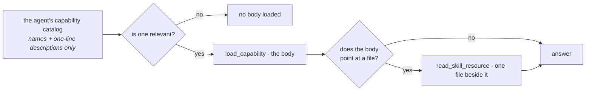

# Skille { #skills }

Skill to wiedza praktyczna zapisana raz i podpięta do wielu agentów: jak
obsługuje się zwroty pieniędzy, jaki jest styl firmowy, jakie sprawdzenia musi
przejść raport, zanim pójdzie na zewnątrz.

Zastępuje pole z instrukcjami, które rośnie.

Dwadzieścia procedur w jednym prompcie oznacza, że każdy run płaci za wszystkie
dwadzieścia, a dwudziesta pierwsza wypycha rozmowę poza okno kontekstu. Skille
odwracają tę zależność:



Dwadzieścia skilli kosztuje mniej więcej dwadzieścia _opisów_ zamiast dwudziestu
_procedur_.

!!! note "Wykrywanie jest tanie, ale nie darmowe"

    Każdy podpięty skill siedzi w katalogu capability, który model czyta w każdej
    turze — jako nazwa i jednolinijkowy opis. Podpięcie skilla kosztuje więc
    tokeny niezależnie od tego, czy model kiedykolwiek go otworzy.

    To linijka na skilla zamiast całej treści na skilla i dlatego rachunek się spina.
    Nie jest to jednak powód, żeby podpinać nieograniczony katalog.

Druga połowa sensu to **kto je pisze**. Skill jest wierszem w bazie danych,
edytowalnym w UI, więc szef wsparcia może poprawić politykę zwrotów we wtorek po
południu. Bez deployu, bez pull requesta, bez inżyniera.

!!! info "Skill, plik kontekstowy czy kolekcja wiedzy?"

    **Skill** to procedura, którą model wczytuje, kiedy uzna, że przyszło na nią
    zadanie. [Plik kontekstowy](context.md) to wiedza stała — krótka, zawsze
    istotna, wstrzykiwana albo czytana na żądanie.
    [Kolekcja wiedzy](file-processing.md) to korpus zbyt duży, żeby go przeczytać,
    dostępny przez wyszukiwanie.

W kreatorze agenta wybierz **Skills → New skill**, aby napisać skill bez opuszczania panelu zdolności. Zapis tworzy wpis w bibliotece, dołącza go do bieżącego szkicu i włącza zdolność Skills. Publikacja pozostaje osobnym krokiem. Akcja wymaga uprawnień do edycji agenta i skilli.

## Kształt { #the-shape }

```markdown
---
name: refund-policy
description: When a refund is given without asking, when it needs approval, and how to say no.
category: support
---

# Refunds

Most refund questions are decided by the order date and one exception. Check
those before escalating anything.

Strona **Skills** pokazuje na karcie początek treści każdego skilla — bez front
matter, kilka linii — a za nim po jednym arkuszu na każdy plik, który skill ze
sobą niesie. `GET /api/v1/skills` zwraca ten początek jako `excerpt`; samą treść
wczytuje dopiero otwarcie skilla.

## Decide without asking

...
```

!!! tip "`description` to pole, które decyduje, czy skill kiedykolwiek zostanie wczytany"

    To jedyna część, którą model widzi za darmo. Napisz je jako **kiedy po to
    sięgnąć**, a nie jako tytuł.

Skill może nieść **zasoby** — kolejne pliki obok niego, wczytywane na żądanie.
`refund-policy` ma przy sobie `exceptions.md`, a treść mówi, kiedy do niego
zajrzeć.

To to samo stopniowe odsłanianie, tylko poziom niżej: szczegół potrzebny tylko
części rozmów nie musi siedzieć w treści, którą wczytuje każda istotna rozmowa.

`category` to jedna z dwudziestu sugestii (`support`, `engineering`, `finance`,
`legal`, `security`, `marketing`, …) i steruje filtrem na liście skilli. Nie ma
wpływu na to, co widzi agent — model wybiera po `description`, nigdy po
kategorii.

## Jak agent go czyta { #how-an-agent-reads-one }

Przez [capability `skills`](reference/capabilities.md#skills). Każdy skill, który
agent dostaje, staje się **osobną capability** — wypisaną modelowi z nazwy i opisu,
a otwieraną na żądanie:

| Jak                   | Co robi                                                                   |
| --------------------- | ------------------------------------------------------------------------- |
| Katalog capability    | Nazwy i jednolinijkowe opisy wszystkiego, co jest podpięte do tego agenta |
| `load_capability`     | Pełna treść jednego skilla, wciągnięta do rozmowy                         |
| `read_skill_resource` | Jeden plik obok skilla                                                    |

`load_capability` jest narzędziem samego frameworka agentowego, a nie czymś, co
publikuje ta platforma — spec go więc nie przyznaje i nie zmienia mu nazwy. Może go
natomiast **bramkować**, bo to wywołanie otwiera skilla: `tool_approval` na nim jest
sposobem, w jaki agent pyta człowieka, zanim skill trafi do modelu, a spec, który
bramkował dawne `load_skill`, jest na nie migrowany, zamiast zostać bez bramki. Jako
własne narzędzie ta capability wnosi `read_skill_resource`, i tylko wtedy, gdy
przynajmniej jeden z podpiętych skilli wiezie ze sobą plik do odczytania.

Spec podpina skille po id w `skill_ids`, więc agent widzi te, które dostał, i nic
poza tym.

**Prosto ze skilla.** Każda karta na stronie Skille ma **Dodaj do agenta**:
wybierasz agenta, a skill trafia do jego szkicu razem z włączoną capability
Skille, gotowy do opublikowania w Builderze. Karta mówi też, którzy agenci
używają skilla - albo że jeszcze żaden. Pliki kontekstu i bazy wiedzy mają to samo.

**Nazwa skilla to id, pod którym model go ładuje**, więc ma formę, w jakiej
modele piszą id: małe litery i cyfry połączone pojedynczymi myślnikami, na przykład
`refund-policy`. Nazwa ze spacjami lub wielkimi literami jest odrzucana przy
tworzeniu skilla. Nazwę, którą model musiałby odtworzyć dokładnie, jak
`Refund policy`, ładował jako `refund-policy`, a dwie błędne próby kończą turę
([#1911](https://github.com/vstorm-co/agenticos/issues/1911)).

**Skill nie może nazywać się tak jak capability.** Każdy jest zapisany pod własną
nazwą w tej samej przestrzeni co `knowledge`, `planning` i reszta, więc skill o
nazwie `planning` na agencie, który ma też capability planning, to duplikat, który
framework odrzuca przed pierwszym tokenem. Utworzenie takiego jest odrzucane, tak
samo jak publikacja agenta podpiętego do skilla o takiej nazwie.

Włączenie capability bez podpiętych skilli nie ma sensu — albo daj agentowi
skille, albo zostaw capability wyłączoną.

### Których skilli użyła odpowiedź { #which-skills-an-answer-used }

Podpięcie skilla nie znaczy, że model go przeczytał. Każdy run zapisuje skille,
których naprawdę użył, po id skilla: czy model otworzył skill przez
`load_capability` i ile jego plików przeczytał przez `read_skill_resource`. Run
zapisuje to bez względu na to, jak się skończył, także wtedy, gdy zakończył się
błędem po otwarciu skilla. Skill użyty przez delegata zapisuje się w runie, który
delegował, pod agentem delegata, bo ocenę dostała odpowiedź tego runa.

Wywołanie narzędzia, które podaje ścieżkę w folderze skilla w workspace, na
przykład `cat /workspace/skills/refund-policy/SKILL.md`, liczy się osobno jako
prawdopodobne użycie. Wylistowanie folderu się nie liczy. Ścieżka złożona przez
shella, glob obejmujący kilka skilli ani skrypt, który sam czyta plik, nie są
rozpoznawane.

`GET /api/v1/skills/{id}/usage?days=30` zwraca dla każdego agenta liczbę runów,
które użyły skilla w tym oknie, z wersją, którą każdy dostał. Runy ewaluacji i
panelu testowego w Builderze są pominięte. Liczby pochodzą z runów, więc wymagają
`runs:view`; agent, którego wywołujący nie widzi, jest policzony, ale nie nazwany.

Runy sprzed wprowadzenia zapisu mówią „użycie nieznane”, co nie jest tym samym co
„nieużyty”. Gdy skill jest ulepszany, dowody pochodzą tylko z runów, które go
użyły, a ocenione negatywnie lub zakończone błędem runy, które mogły go użyć,
liczą się osobno jako nieznane.

## W workspace skill to także pliki { #in-a-workspace-a-skill-is-also-files }

Agent, który ma jednocześnie skille i
[workspace](reference/capabilities.md#files-shell), dostaje każdy skill zapisany
również w nim:

```
/workspace/skills/<name>/SKILL.md      the body, with its name and description
/workspace/skills/<name>/<resource>    each resource, beside it
```

To właśnie sprawia, że skrypt w skillu jest do czegokolwiek. Skill, którego
zasobem jest `reconcile.py`, był wcześniej podawany modelowi jako tekst, który
mógł zacytować, ale nie uruchomić, podczas gdy ten sam agent miał `execute` w
odległości jednego wywołania narzędzia. Na dysku — działa.

!!! note "Nie ma `run_skill_script`"

    Własne `execute` sandboksa niesie już reguły uprawnień workspace'u i limity
    operatora. Drugi sposób uruchamiania rzeczy byłby drugim zestawem reguł do
    pomylenia.

## Agent może zaproponować zmianę; wprowadza ją człowiek { #an-agent-can-propose-a-change-a-person-makes-it }

Te pliki są zapisywalne, a to, co agent zapisze, **nie** zostaje zastosowane.

Skill to instrukcje, którymi w każdym runie kieruje się każdy podpięty do niego
agent. Agent, który mógłby go edytować bezpośrednio, mógłby przepisać to, co robi
inny agent, wewnątrz rozmowy, której nikt nie przegląda, a kolejny czytelnik nie
miałby jak odróżnić przemyślanego ulepszenia od zahalucynowanego.

Dlatego zapis staje się **propozycją** i pojawia się nad listą na stronie Skills
temu, kto może edytować ten skill - jego właścicielowi albo komuś z grantem edycji
na nim - a dla skilla, którego jeszcze nie ma, każdemu, kto może tworzyć skille.
Nikt inny jej nie widzi:

- **Check on agents** uruchamia zmianę na każdym agencie linii, dla której
  powstała, a jej zastosowanie - następna wersja tej linii, którą ci agenci
  przeczytają przy następnym runie - odbywa się z wyniku sprawdzenia. Zobacz
  [Sprawdzanie zmiany na każdym agencie](#checking-a-change-on-every-agent).
- **Discard** zachowuje zapis. Agent proponujący w kółko tę samą zmianę mówi
  komuś coś o skillu, a usunięty wiersz czyni to niewidocznym.

!!! warning "Decyzja o propozycji jest ostateczna"

    Zastosowanie dwa razy zapisałoby drugą wersję treści już zapisanej, a
    odrzucenie czegoś zastosowanego mówiłoby czytelnikowi, że nigdy nie weszło.

Propozycja niesie **całą treść**, a nie diff, więc recenzent kilka tygodni
później porównuje dwie kompletne wersje, zamiast nakładać łatkę w miejscu, do
którego nigdy nie była przeznaczona.

Dwie rzeczy zostają odrzucone, zamiast być zgadywane: katalog utworzony przez
agenta bez `SKILL.md` w środku oraz taki, któremu agent zepsuł frontmatter. A
_usunięty_ zasób celowo nie jest zmianą, bo plik, którego model nigdy nie
dotknął, i taki, który zamierzał usunąć, zostawiają po sobie ten sam brak.

Trzy tury jednej rozmowy dopracowujące ten sam skill zostawiają **jedną**
propozycję, nie trzy. Recenzent zapytany trzy razy o to samo dostał więcej pracy,
a nie więcej informacji.
Propozycje z workspace mają te same limity metadanych co zapisane skille: nazwa
od 1 do 64 znaków i opis do 500 znaków. Zmiana poza limitem jest pomijana z
ostrzeżeniem; oryginalne pliki pozostają bez zmian. Zapis propozycji używa
savepointu, więc odrzucona propozycja nie wycofa tury ani nie zablokuje zapisania
jej statusu i kosztu.

Zmiana zapisuje wersję skilla, dla której powstała: przy runie jest to wersja,
którą ten run dostał, a późniejsza tura, która ją nadpisuje, zapisuje swoją. Apply
ją odrzuca, jeśli ktoś w międzyczasie zmienił skill, więc edycja zrobiona, gdy
zmiana czekała, nie zostaje nadpisana. Porównaj obie wersje i popraw skill
ręcznie albo poproś jeszcze raz.

[Asystent tworzenia](authoring.md#skills) proponuje zmiany skilli w ten sam
sposób, razem z uzasadnieniem i runami, na których się opiera, a zastosowanie
odrzuca je tak samo.

Każda zmiana mówi, opublikowane wersje których agentów czytają skill, które
suity evali ustawi w kolejce jej zastosowanie i którzy strażnicy sprawdzą ją
dopiero przy następnej promocji. Zastosowanie powiadamia właścicieli tych
agentów. Decyzja wskazuje wersję zmiany, którą przeczytałeś: zmiana przepisana
od tego czasu - przez późniejszą turę albo nową prośbę - jest odrzucana z
komunikatem „The proposal changed since you opened it”, a z dwóch decyzji
podjętych naraz liczy się tylko jedna. Skill, który agent napisał od zera, nie ma
jeszcze agentów, więc **Apply** tworzy go od razu.

## Sprawdzanie zmiany na każdym agencie { #checking-a-change-on-every-agent }

Skill jest współdzielony, więc zmianę ocenia się na każdym agencie, który by ją
przeczytał: na main - na agentach podążających za najnowszą wersją main; na
forku - na agentach tego forka. Agenci przypięci do starszej wersji i agenci
innych forków nie są uruchamiani - zmiana do nich nie dociera. Opublikowana
wersja każdego agenta odpowiada na swoje pytania dwa razy, ze skillem takim, jaki
jest, i ze zmianą, a poza tym nic się nie różni.

Zmiana zapisana przez workspace agenta, zmiana zaproponowana przez asystenta i
[aktualizacja z biblioteki](#getting-skills-into-an-organization) skilla, którego
używają agenci, trafiają na żywo tylko przez to sprawdzenie. Osoba edytująca
skill ręcznie od razu zapisuje nową wersję, a ta edycja nie jest sprawdzana.

### O co pyta { #what-a-check-asks }

Najpierw o własne **pytania testowe** skilla, ten sam zestaw na każdym agencie.
Każdy skill ma jeden zestaw, tworzony przez API - `POST /api/v1/skills/{id}/test-set`,
pusty albo z ostatnich odpowiedzi, które otworzyły skill - i edytowany jak każdy
inny [dataset](datasets.md). Potem o pytania samego agenta:

- **Quick**, domyślnie: najwyżej cztery pytania z datasetu agenta, których
  najnowsza odpowiedź otworzyła skill - te, które mają najwięcej wspólnych słów
  ze zmienianymi liniami. Agent bez takich pytań jest sprawdzany tylko na
  zestawie skilla, a jego wiersz to mówi.
- **Thorough**: cały dataset agenta. Zmiana opisu skilla jest zawsze sprawdzana
  w ten sposób, bo opis decyduje, kiedy każdy agent w ogóle otwiera skill.

!!! note "Pytania skilla mówią, co skill powinien robić"

    Są oceniane tak samo na każdym agencie, więc łapią zmianę, która psuje
    regułę samego skilla. Zmiana, która szkodzi jednemu agentowi z powodu jego
    własnej sytuacji, wychodzi na jego własnych pytaniach. A celowa zmiana
    reguły nie przejdzie żadnego pytania, które wciąż oczekuje starej
    odpowiedzi: najpierw zaktualizuj pytania testowe.

### Reguła { #the-rule }

- Żaden agent nie może być **gorszy** o regresję potwierdzoną ponownymi
  pytaniami.
- Co najmniej jeden agent musi być **lepszy**.
- Różnica, której sprawdzenie nie potwierdziło, jest **w granicach szumu**: to
  ostrzeżenie, nie blokada.
- Agent, którego nie dało się sprawdzić - brak pytań, brak dostępu, brak
  budżetu, brak opublikowanej wersji, nieudany run - jest **nieznany**, a
  osoba potwierdza to przed zastosowaniem.

Agent jest oceniany raz, na pytaniach held-out ze wszystkich swoich etapów
razem: wynik wymaga pięciu takich pytań na agenta, a nie pięciu na etap, a
regresja potwierdzona przez jeden etap sam się liczy, cokolwiek pokazał drugi. Każde
pytanie zestawu skilla jest held-out, a szybkie sprawdzenie losuje tylko pytania
held-out agenta.

Część każdego agenta to jego własne runy evali, rozliczane z jego budżetu.
Estymacja podaje jedną cenę, najpewniej i najwyżej, i przed startem wymienia
agentów, których budżet jej nie pokryje. Start wymaga `runs:view` i prawa edycji
skilla. Agent, którego nie możesz uruchomić, nie jest uruchamiany, a ten, którego
nie widzisz, jest liczbą, nigdy nazwą.

### Gdy agent wypadł gorzej { #when-an-agent-got-worse }

**Check on agents** w zakładce Skille wycenia sprawdzenie, uruchamia je, pokazuje
wynik każdego agenta, a potem stosuje albo odrzuca zmianę. Na main osoba może
nadal:

- **zastosować zmianę i zostawić gorszych agentów tam, gdzie są** - każdy jest
  przypinany, jako nowa opublikowana wersja, do wersji, którą czyta teraz, zanim
  zmiana trafi na żywo, więc żaden z nich nie obsłuży jej ani razu. Przypięcie
  wymaga prawa publikacji każdego z nich, a środowisko czekające na promocję musi
  najpierw dostać przypiętą wersję;
- **zrobić fork dla agentów, którym pomogła**, zostawiając main bez zmian - przez
  API, `POST /api/v1/skills/{id}/checks/{check_id}/fork`;
- **odrzucić** ją.

Na forku zostają tylko dalsze ulepszanie i odrzucenie: przypięcie wskazuje
wersję main, a fork nigdy nie zaczyna się od innego forka. Sprawdzenie odmawia
zastosowania, gdy linia ma już nowszą wersję albo zaczął za nią podążać nowy
agent, bo nie zmierzyło żadnego z nich.

## Wersje i forki { #versions-and-forks }

Każda zapisana zmiana skilla tworzy nową wersję, a wersji nie zmienia się już
potem. Tworzy ją edycja treści albo opisu, a także dodanie, zmiana lub usunięcie
pliku, odświeżenie z biblioteki oraz zastosowana zmiana z workspace agenta albo od
[asystenta authoringu](authoring.md#skills). Sama nowa kategoria jej nie tworzy, bo
żaden agent jej nie czyta.

**History** na stronie skilla pokazuje wersje od najnowszej. Przy każdej widać, co
ją utworzyło (`backfill`, `created`, `edit`, `resources`, `library`, `workspace`,
`improve` albo `restore`) i kiedy, a temu, kto może widzieć członków organizacji,
także kto ją zapisał. Wersja zachowuje swoje pliki takie, jakie były, więc
późniejsza zmiana pliku nie zmienia wcześniejszej wersji.

Skill, który istniał przed wersjami, ma jedną wersję, v1: treść i pliki z chwili,
gdy wersjonowanie się zaczęło. Nic wcześniejszego nie zostało zapisane.

**Restore** przywraca wcześniejszą wersję jako nową wersję, więc historia zostaje
kompletna, a nowa wersja mówi, z której pochodzi.

Edycja zapisuje się względem wersji, którą edytujący przeczytał. Jeśli ktoś w tym
czasie zapisał nowszą wersję, edycja jest odrzucana, zamiast ją nadpisać.

### Forki { #forks }

Fork to nazwana linia skilla, która startuje z wersji main. Ma własne wersje i
własną najnowszą wersję, więc skill może się zmienić dla części agentów, a main
zostaje bez zmian. Dopóki fork nie ma własnej wersji, serwuje wersję main, z której
wystartował.

- Fork startuje tylko z main. Fork forka jest odrzucany, więc drzewo ma jeden
  poziom.
- Nazwa forka jest unikalna w obrębie skilla, łącznie z forkami zarchiwizowanymi.
- Pliki forka to pliki wersji, z której powstał. Pliki edytuje się tylko na main.
- **Archive** sprawia, że fork nie przyjmuje nowych wersji. Zachowuje swoje wersje
  i nigdy nie jest usuwany. Fork, którego żaden run nie czytał od 30 dni, jest
  proponowany do archiwizacji; nic nie archiwizuje się samo. Starsza wersja agenta,
  która wciąż czyta zarchiwizowany fork, nie zostanie promowana do środowiska:
  przesuń agenta na inną wersję i promuj wersję, która się opublikuje.

### Którą wersję czyta agent { #which-version-an-agent-reads }

Każdy agent czyta związany skill na jeden z trzech sposobów:

| Stan | Co czyta |
|---|---|
| Main | Najnowszą wersję main. Tak czyta każdy agent, który nie wskazuje innej |
| Przypięty | Jedną wersję main, dopóki ktoś go nie przesunie |
| Fork | Najnowszą wersję jednego forka |

Ten wybór jest częścią specu agenta, w `skill_bindings`, więc jest publikowany,
promowany między środowiskami i eksportowany razem z resztą agenta. Spec bez tego
pola czyta main dla każdego skilla, tak jak każdy agent przed wersjami skilli.
Publikacja odrzuca wersję, której nie ma na linii main skilla, fork innego skilla,
fork zarchiwizowany i wszystko z innej organizacji. Każdy run zapisuje wersje
skilli, które serwował, łącznie z wersjami swoich specjalistów inline.

Nowa wersja dociera tylko do agentów na swojej linii. Nowa wersja main dociera do
agentów na main, a nowa wersja forka do agentów tego forka: uruchamiają się ich
suite'y evali, zmiana wymienia środowiska, w których wchodzi, a właściciele
dostają powiadomienie. Przypięty agent nie dostaje żadnej z nich.

**Agenci skilla** to ci, którzy go uruchamiają: wiąże go wersja serwowana przez
jedno z ich środowisk, sam agent albo jego specjalista inline. Agent i każdy z jego
specjalistów czytają skill po swojemu, więc każdy jest osobnym wierszem: strona
skilla pokazuje go z wersją, którą czyta, liczbą wersji main, o które jest w tyle, i
środowiskami, które czytają go inaczej. Agent, który wiąże skill tylko w wersji
roboczej, jest oznaczony osobno. Agentów, których nie widzisz, strona tylko liczy.

**Change version** przesuwa jednego agenta na main, wersję main albo fork, i jest to
zmiana agenta. To, czy agent używa skilla sam, wynika z jego wersji roboczej, tak
jak pokazuje ją Builder; skill, który wiąże tylko jeden z jego specjalistów, zmienia
się w Builderze. Z prawem publikacji najnowszy opublikowany spec agenta, w którym
zmienia się tylko to wiązanie, wchodzi jako jego następna wersja, a środowiska
przesuwają się według zwykłych reguł follow i promocji. Wersja robocza dostaje tę
samą zmianę i zachowuje pozostałe niedokończone edycje, które nie wchodzą. Z samym
prawem edycji agenta, dla agenta nigdy nieopublikowanego albo takiego, którego
opublikowana wersja jeszcze nie wiąże skilla, zmiana czeka w wersji roboczej i
sprawdzane jest tylko nowe wiązanie. Builder otwarty już na tym agencie nie widzi
zmiany do odświeżenia, a zapis przed odświeżeniem przywraca stare wiązanie.

### Usuwanie skilla { #deleting-a-skill }

Skilla, którego używa agent, nie można usunąć. Chodzi o skill związany przez
wersję roboczą żywego agenta albo przez wersję, którą serwuje jedno z jego
środowisk, samego agenta albo specjalisty inline. Odmowa wymienia agentów, których
widzisz, i liczy pozostałych. Skill, którego nikt nie używa, usuwa się razem z
jego wersjami i forkami.

| Ścieżka | Co robi |
|---|---|
| `GET /api/v1/skills/{id}/versions` | Wersje main albo forka z `?fork_id=`, od najnowszej |
| `GET /api/v1/skills/{id}/versions/{version_id}` | Jedna wersja, z treścią i listą plików, każdy z SHA-256 |
| `GET /api/v1/skills/{id}/versions/{version_id}/resources/{name}` | Jeden plik w postaci z tej wersji |
| `POST /api/v1/skills/{id}/versions` | Zapisuje edycję na main albo na forku, względem `base_version_id` |
| `POST /api/v1/skills/{id}/versions/{version_id}/restore` | Przywraca wersję na jej własną linię |
| `GET`, `POST /api/v1/skills/{id}/forks` | Wymienia forki albo zakłada fork z wersji main |
| `PATCH /api/v1/skills/{id}/forks/{fork_id}`, `POST …/archive` | Zmienia nazwę forka albo go archiwizuje |
| `GET /api/v1/skills/{id}/agents` | Agenci skilla, wersja, którą czyta każdy z nich, i liczba ukrytych |
| `PUT /api/v1/skills/{id}/agents/{agent_id}/binding` | Przesuwa agenta na main, wersję main albo fork |

## Jak skille trafiają do organizacji { #getting-skills-into-an-organization }

**Napisz go.** Skills → New, w UI. To zwykła droga.

**Te dołączone już tam są.** Repozytorium dostarcza cztery: trzy przykłady z
rozwiązaniem — `refund-policy`, `code-review` i `incident-report` — oraz
`artifact-pages`, który uczy agenta budować stronę dla capability
[Aplikacje](artifacts.md#the-library-set). Każda organizacja zaczyna z nimi. Utworzenie organizacji kopiuje całą dostarczoną
bibliotekę jako zwykłe skille, należące do właściciela (owner) organizacji i
widoczne dla organizacji.

Strona skilli pokazuje jedną listę, z odznaką `built-in` przy wszystkim, czego
nazwa pasuje do dostarczonej biblioteki. Tych czterech się nie wybiera — one po
prostu przychodzą, raz, przy tworzeniu organizacji.

**I od tej chwili są wasze.** Zaseedowany skill to zwykły wiersz: można go
edytować albo usunąć. Nic nie przywraca usuniętego.

To jest zmiana. Lista wcześniej sama się uzupełniała — dokopiowywała każdą
dołączoną nazwę, której organizacja nie miała, przy każdym otwarciu strony —
więc usunięty built-in wracał przy następnej wizycie, a wyłączenie było jedynym
sposobem na jego wycofanie. Oznaczało to też stronę, która zapisuje wiersze
w trakcie czytania. Galeria jest miejscem, w którym wybiera się skill, a komenda
seed poniżej jest sposobem, w jaki deployment rozsyła nowy dołączony skill
świadomie.

!!! info "Organizacja utworzona przed nowym dołączonym skillem nie dostanie go sama"

    Uruchom dla niej `seed-skills` albo zainstaluj skill z galerii. Obie drogi są
    świadome i o to chodzi: nic nie pojawia się przy wczytaniu strony.

Komenda seed robi to samo z terminala, na potrzeby skryptowanych instalacji:

```bash
uv run agenticos cmd seed-skills                    # every organization
uv run agenticos cmd seed-skills --org <org-id>     # one
uv run agenticos cmd seed-skills --dry-run          # say what would happen, do nothing
uv run agenticos cmd seed-skills --replace          # also overwrite copies edited here
```

Instaluje to, czego brakuje, i **odświeża to, czego nikt nie edytował**. Każda
kopia zapamiętuje, z której wersji dołączonego skilla została zapisana, więc gdy
wydanie ulepsza dołączony skill, nieruszana kopia w organizacji jest zastępowana
nową — razem z plikami, jako nowa wersja, z wpisem audytu `skill.refreshed`.
Chyba że podążają za nią agenci: wtedy dołączona wersja czeka w zakładce Skille
jako zmiana i trafia na żywo, gdy pozwoli na to
[sprawdzenie na tych agentach](#checking-a-change-on-every-agent).

Kopia edytowana na miejscu zostaje dokładnie taka, jaka jest, więc edytowana
polityka zwrotów przeżywa ponowny seed; `--replace` to jedyny sposób, żeby wziąć
dołączoną wersję zamiast takich edycji, a wpis audytu to odnotowuje. Kopia
zrobiona, zanim wersje były zapisywane, i różna od dołączonej też jest zgłaszana i
zostawiana, bo nic nie powie, czy ktoś ją edytował.

Komenda wypisuje, co zrobiła z każdym skillem, a `--dry-run` wypisuje ten sam plan
bez zapisywania.

`e2e/seed.setup.ts` tworzy jednego również przez UI i to na nim opiera swoje
asercje zestaw E2E.

### Galeria — siedemdziesiąt kolejnych i żaden nie przychodzi nieproszony { #the-gallery-seventy-more-and-none-of-them-arrive-uninvited }

**Skills → Skill gallery** otwiera katalog gotowych skilli pogrupowanych według
branż: ochrona zdrowia, finanse i ubezpieczenia, e-commerce i print on demand,
zespoły software'owe, sektor publiczny i usługi komunalne, usługi prawne i
profesjonalne, produkcja i logistyka. Po dziesięć w każdej.

Wybierz branżę, a potem zainstaluj jeden skill albo całą półkę. Od tej chwili to
zwykły skill, który organizacja posiada i edytuje, dokładnie jak dołączony.

!!! info "Galeria działa na zaproszenie i na tym polega cała różnica"

    Dołączona czwórka mieszka w `app/core/catalog/skills/` i jest kopiowana
    automatycznie do **każdej** organizacji. Galeria mieszka w
    `app/core/catalog/skill_gallery/` i nie jest kopiowana do **żadnej** — czyta
    ją ten sam parser, z drugiego katalogu, i nigdy nie jest seedowana.

    Siedemdziesiąt branżowych skilli w pierwszym katalogu byłoby siedemdziesięcioma
    wierszami, o które nikt nie prosił, w każdym tenancie, przy następnym deployu.

Instalacja półki, z której masz już jeden skill, instaluje resztę i zostawia
tamten w spokoju: istniejąca nazwa jest pomijana, a nie nadpisywana, a odpowiedź
na żądanie mówi, co zainstalowano, co pominięto i jakiego klucza ten deployment
nie dostarcza.

Dodanie do galerii wygląda tak samo jak dodanie dołączonego skilla — katalog z
`SKILL.md`, pod branżą, do której należy — z jedną dodatkową regułą: **jego nazwa
nie może kolidować z dołączonym skillem ani z innym skillem z galerii,** i jest
nazwą jego katalogu. Instalacja dopasowuje po nazwie, więc kolizja oznaczałaby
ciche pomijanie na zawsze. Test czyta całą siedemdziesiątkę i wywala się na
każdym z tych błędów.

### Seed tworzy kopie { #seeding-copies }

Zaseedowany skill to zwykły skill należący do organizacji, edytowalny od chwili,
w której organizacja istnieje. To **kopia**, nie link.

To celowe. Sens skilla polega na tym, że szef wsparcia może poprawić politykę
zwrotów bez deployu, a żywy link do kopii z repozytorium odebrałby dokładnie to —
organizacja czytałaby plik, który może zmienić tylko inżynier.

Edycja i usunięcie są ostateczne w zwykły sposób. Wyłączanie nadal istnieje dla
skilla, który organizacja chce zachować, ale nie uruchamiać — respektuje je każdy
agent — przestało jednak być jedynym sposobem na pozbycie się built-ina.

### Dlaczego biblioteka jest dołączona, a nie pobierana { #why-the-library-is-bundled-and-not-fetched }

Dodanie skilla do dostarczanej biblioteki albo do galerii to deploy.

Alternatywa — import z URL-a gita — kosztuje ruch wychodzący z backendu, parser
wycelowany w czyjeś repozytorium i obietnicę dotyczącą treści, której nikt tutaj
nie przeczytał. Każdy katalog w `app/core/catalog/skills/` i
`app/core/catalog/skill_gallery/` jest tą samą małą obietnicą, którą składa
[katalog MCP](mcp.md#the-catalog): ktoś na to spojrzał.

## Strona skilla { #a-skills-page }

Otwórz skill z listy, żeby zobaczyć jego stronę. Ma trzy zakładki.

**Agenci** to lista każdego agenta, który używa skilla, z wersją, którą dostaje:

- `v12 · main` - agent podąża za main i od razu dostaje każdą nową wersję.
- `v9 · przypięty · 3 za main` - agent zostaje na starszej wersji main.
- `Fork „Returns” · od v7 · 2 zmiany` - agent używa forka: linii wersji z
  własnymi zmianami, zaczętej od jednej wersji main.

Środowisko, które serwuje inną wersję, jest podane pod agentem, a specjalista inline,
który wiąże skill, ma osobny wiersz - zobacz
[Którą wersję czyta agent](#which-version-an-agent-reads). Agent, który wiąże skill
tylko w drafcie, ma oznaczenie **Tylko w drafcie** i nie podąża za żadną linią.
Agentów, których nie widzisz, strona liczy, ale nie nazywa. Chipy nad tabelą
pokazują wszystkich, agentów na main, przypiętych, jeden fork albo agentów tylko w
drafcie, więc ich liczby sumują się do wszystkich. Fork wybrany tam jest też linią,
którą pokazuje Historia i do której zapisuje Edycja.

Pod tabelą osoba, która może przeglądać runy, widzi, jak często każdy agent
otwierał skill w ostatnich 30 dniach i ile jego plików przeczytał. Runy ewaluacji i
panelu testowego Buildera się nie liczą.

**Zmień wersję** przenosi jednego agenta na main, na przypiętą wersję main albo na
fork, tak jak opisuje [Którą wersję czyta agent](#which-version-an-agent-reads): co
trafia na produkcję, co czeka w drafcie, a co zmienia się w Builderze. Wersja inna
niż ta, którą agent serwuje teraz, nie była na nim sprawdzona, więc najpierw to
potwierdzasz. Okno mówi też, kiedy agent przestałby dostawać nowe wersje main, i
podaje datę każdej wersji main do przypięcia, z linkiem do jej zmian. Kontrolkę
widzą osoby, które mogą edytować agenta.

**Historia** wymienia wersje wybranej linii od najnowszej: skąd się wzięła każda
(edycja, zmiana plików, biblioteka, workspace agenta, Improve albo przywrócenie),
kto ją zrobił i kiedy. **Pokaż zmiany** porównuje opis i instrukcje z poprzednią
wersją - dla pierwszej wersji forka z jego bazą na main - i podaje pliki dodane,
usunięte albo zmienione. **Przywróć** sprowadza wcześniejszą wersję jako najnowszą
na jej własnej linii, a agenci podążający za tą linią dostają ją od razu. Fork
numeruje wersje od 1 tak jak main, więc noszą jego nazwę - „Returns v2” - a
historia main zaznacza wersję, od której startuje każdy fork.

**Drzewo wersji** rysuje main od najnowszej wersji w dół, każdy fork odchodzący od
wersji, od której wystartował, i agentów przy wersji, której używają. Na linii z
co najmniej ośmioma wersjami odcinki, których nie używa żaden agent, zwijają się do
jednego wiersza.

**Edytuj** zapisuje nową wersję na widocznej linii. Na main agenci podążający za
main dostają ją od razu; przypięci agenci i forki zostają przy swojej wersji. Pliki
i kategoria należą do main, więc edycja forka zmienia tylko jego opis i instrukcje.
Przywróć i Zmień wersję widzą tylko osoby, które mogą tę zmianę zrobić; pozostali
otwierają skill tylko do odczytu.

**Nowy fork** zaczyna fork od najnowszej wersji main, pod nadaną przez ciebie
nazwą, i może od razu przenieść na niego agentów, każdego przez Zmień wersję. Fork
czyta się tak samo jak jego baza, dopóki ktoś go nie edytuje.

**Usuń**, w menu edytora, usuwa skill, którego nikt nie używa, razem z jego
wersjami i forkami. Dopóki agenci go używają, okno ich wymienia i nie oferuje
usunięcia: najpierw przenieś każdego na inny skill albo usuń z niego skill w
Builderze.

## Skille czy wiedza? { #skills-or-knowledge }

Odpowiadają na różne pytania, a różnica ma znaczenie, kiedy agent dostanie nie
to, co trzeba.

|                 | Skille                    | [Wiedza](file-processing.md)         |
| --------------- | ------------------------- | ------------------------------------ |
| Zawiera         | Procedurę — jak to robimy | Dokumenty — co wiemy                 |
| Pisane przez    | Człowieka, świadomie      | Wciągane hurtowo                     |
| Pobierane przez | Model wybierający nazwę   | Wyszukiwanie semantyczne po chunkach |
| Cytuje          | Nic; _jest_ instrukcją    | Fragment i jego źródło               |
| Skala           | Dziesiątki                | Tysiące dokumentów                   |

!!! example "Co jest czym"

    „Zwroty powyżej 500 £ wymagają zgody menedżera” to **skill**. Podpisana
    umowa, która tak stanowi, to **wiedza**.

    Agent obsługujący zwroty zwykle chce obu naraz, a te dwie capabilities
    składają się w całość — `skills` na procedurę, `knowledge` na dowód.

## Dostęp { #access }

Skille są zasobami w zakresie organizacji, rządzonymi tak jak agenty i kolekcje:
widoczność plus granty na poszczególnych wierszach na wierzchu roli. Zobacz
[Uprawnienia](permissions.md#layer-3-visibility-and-grants).

!!! important "Podpięcie skilla wypożycza go"

    Każdy run agenta czyta treść i pliki, niezależnie od tego, kto go uruchomił —
    więc publikacja wymaga, żeby to **publikujący** miał `skills:view` na tym
    wierszu.

To sprawdzenie idzie przez `resolve_access`, więc grant się liczy: członek, z
którym udostępniono jeden skill, może go podpiąć bez awansu roli.

Skill, do którego nie sięga, zostaje odrzucony jako `Skill not found: <id>`,
sformułowane identycznie jak dla id, które nie istnieje. Skille podpina się po
UUID z API i z ręcznie edytowanego draftu, a nie tylko wybiera z listy w
Builderze, a odrzucenie brzmiące inaczej mapowałoby prywatne skille organizacji,
zgadywanie po zgadywaniu.

To samo sprawdzenie działa na `skill_ids`
[specjalisty inline](concepts.md#delegate-vs-inline-specialist) i jest
raportowane wraz z nazwą specjalisty.

W czasie runa nic nie jest sprawdzane ponownie. Skille z zamrożonego speca są
rozwiązywane wewnątrz organizacji runa i wręczane agentowi — zgodnie z regułą,
którą kolekcje i delegaci już stosują, że
[referencja jest sprawdzana raz, przy publikacji](permissions.md#delegation-is-not-a-privilege-boundary).

Alternatywa jest gorsza na dwa konkretne sposoby:

- Każdy kontekst bez podmiotu — klucz API, osadzony widget, wiadomość z kanału —
  zostaje z założenia odrzucony przez `resolve_access`, więc sprawdzanie przy
  każdym uruchomieniu zdarłoby każdy skill dokładnie z tych powierzchni.
- Tam, gdzie podmiot _jest_, jedna opublikowana wersja dawałaby członkowi —
  którego rola sięga wyłącznie udostępnionych skilli — chudsze instrukcje niż
  daje budującemu, a różnica nie byłaby widoczna nigdzie.

Skille nie mają osobnego przełącznika aktywności: agent może używać przypisanych
mu skilli. Aby przestał używać skilla, usuń przypisanie i opublikuj agenta. Skill
usunięty po publikacji jest pomijany z ostrzeżeniem, zamiast przerywać run.

## Podsumowanie { #recap }

- Skill to **procedura**, napisana przez człowieka i wczytywana tylko wtedy, gdy
  model uzna jego _description_ za istotny — wykrywanie kosztuje linijkę na
  skilla, a treść nie kosztuje nic, dopóki nie zostanie otwarta.
- W workspace'ie skill to także **pliki** i to właśnie czyni jego skrypty
  uruchamialnymi.
- Agent **proponuje** zmianę; człowiek ją stosuje, raz, a decyzja jest ostateczna.
- Podpięcie skilla **wypożycza** go, więc publikujący musi móc go zobaczyć — a w
  czasie runa nic nie jest sprawdzane ponownie.
- **Galeria** to siedemdziesiąt gotowych skilli według branż, instalowanych na
  życzenie — w odróżnieniu od dołączonej trójki, która przychodzi sama.

### Propozycja nowego skilla { #proposing-a-new-skill }

Asystent może zaproponować **Warto utworzyć skill**, gdy procedura występuje w co najmniej trzech różnych odpowiedziach stanowiących materiał źródłowy. Każdy cytat musi występować w samej odpowiedzi; komentarze czytelników nie dowodzą powtarzającej się procedury. Karta pokazuje nazwę, opis, pełną treść, uzasadnienie i zweryfikowane cytaty. Ewaluacja przypina tymczasowy skill tylko do kandydata: nie tworzy rekordu skilla ani opublikowanej wersji.

**Accept** tworzy prywatny skill i przypina go do draftu agenta w jednej transakcji. Wymaga `skills:edit` oraz edycji agenta. Bez uprawnienia tworzenia można czytać i sprawdzać propozycję, ale wyłączone Accept wyjaśnia powód. **Dismiss** niczego nie tworzy. **Undo** usuwa przypięcie i zachowuje niezależny skill; kolejna akceptacja wykorzystuje go ponownie tylko wtedy, gdy nazwa i treść nadal pasują. Skill zawiera instrukcje i nie nadaje dostępu do narzędzi. Dodatkowy dostęp wymaga osobnych propozycji sprawdzanych przez politykę, z zatwierdzaniem narzędzi zapisujących.

Procedura z mniej niż trzech różnych odpowiedzi nie trafia do sugestii. Pojawia się z pełną treścią na liście **pomysły czekają na Twoją decyzję**. **Create skill** otwiera podgląd: nazwę, opis i treść można edytować, a ostrzeżenie mówi, na ilu odpowiedziach się opiera. **Create skill** w podglądzie tworzy skill w bibliotece i przypina go do wersji roboczej agenta, nigdy do opublikowanej wersji. Wymaga tych samych uprawnień co Accept i nie wywołuje modelu. Drugie kliknięcie zwraca już utworzony skill.

Szacowany koszt uwzględnia pełną proponowaną treść dla każdej odpowiedzi kandydata i jej powtórzeń potwierdzających, oprócz historycznego kosztu odpowiedzi.
