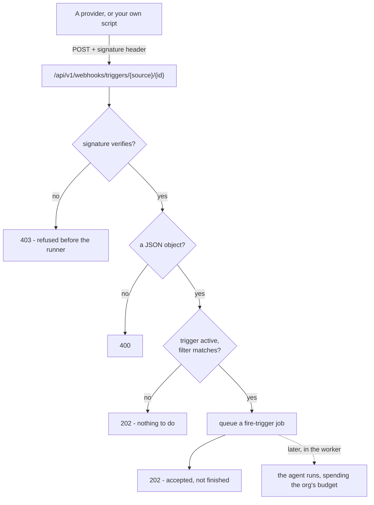

# Einen Event-Trigger einrichten { #setting-up-an-event-trigger }

Ein **Event-Trigger** löst einen Agent aus, wenn woanders etwas passiert.

Es gibt zwei Wege, auf denen das bei uns ankommt, und welchen eine Quelle nutzt,
ist die Sache der Quelle und nicht Ihre:

- **Geschoben.** Ein Provider schickt per POST eine signierte Payload: **GitHub**,
  **HubSpot**, **Zendesk**, oder alles, was signiertes JSON senden kann (die
  Quelle **API**).
- **Abgefragt.** Die Plattform liest ein verbundenes Konto nach einem Zeitplan: die
  Postfächer (**Gmail**, **Outlook**), die Dateien (**Google Drive**, **OneDrive &
  SharePoint**) und die Kalender (**Google Calendar**, **Outlook Calendar**). Es
  wird nichts an uns gepostet, es gibt also keine URL zu konfigurieren und kein
  Secret zu verwahren. Sie verbinden das Konto, und das ist die gesamte
  Einrichtung.

[Konzepte](concepts.md#trigger) behandelt, was ein Trigger *ist* und wie sich ein
ausgelöster Run verhält; [Governance](governance.md) behandelt, was er ausgibt
und wie eine Ablehnung behandelt wird.

Diese Seite ist das, was Sie als Nächstes tun: wie Sie einen echten Provider auf
den Webhook zeigen lassen, was die Zustellung enthalten muss und wie Sie das
Ganze von einem Laptop aus testen.

!!! tip "Wenn Sie nur die Uhr brauchen, wollen Sie einen Schedule"

    Kein Webhook, kein Secret, kein zu konfigurierender Provider.

    Beide Arten können von einem vorbereiteten **Template** ausgehen
    (`GET /trigger-templates`). Ein Schedule-Template — "fasse jeden Werktagmorgen
    meine offenen Pull Requests zusammen" — füllt den Prompt und einen vernünftigen
    Takt vor. Ein Event-Template — "triagiere das neue Issue", "entwirf eine Antwort
    auf die E-Mail" — füllt den Prompt am Nachrichtenschritt seiner eigenen Quelle
    vor. Keines beginnt bei einem leeren Feld.

## Die Zeitzone eines Zeitplans { #a-schedules-time-zone }

Ein Zeitplan auf eine Uhrzeit - täglich um 09:00, werktags um 08:30 - wird in
einer **Zeitzone** gelesen, einem IANA-Namen wie `Europe/Warsaw`. Ein neuer
übernimmt Ihre, aus der Zeitzone Ihres Kontos, sofern das Formular oder die API
keine andere nennt (`time_zone`). Er behält seine Stunde über die Zeitumstellung:
"täglich um 09:00" in Warschau ist im Winter 08:00 UTC und im Sommer 07:00 UTC,
und der Run wandert mit. Ein Zeitplan, der gespeichert wurde, bevor Zeitpläne
Zeitzonen hatten, wird wie immer in UTC gelesen, bis jemand ihm eine Zone wählt.
Ein Intervall-Zeitplan hat keine Uhrzeit und keine Zone.

## Ein Zeitplan, dessen letzter Run noch läuft { #a-schedule-whose-last-run-is-still-going }

Ein Zeitplan kann fällig werden, während der Run, den er beim letzten Mal
ausgelöst hat, noch läuft - ein nächtlicher Sync, der länger dauert als eine
Nacht, oder einer, der an einer Freigabe hängt, über die niemand entschieden
hat. **If the previous run is still going** im Formular des Zeitplans,
`overlap` in der API, entscheidet, was geschieht:

| Option | `overlap` | Was es tut |
|---|---|---|
| Skip this run | `skip` (Standard) | Das Vorkommen verfällt, und der Zeitplan wartet auf seinen nächsten Termin. Ein langsamer Agent läuft so oft, wie er fertig wird |
| Run when it finishes | `queue` | Er löst einmal aus, sobald der vorige Run endet, egal wie viele Vorkommen vergangen sind |
| Run anyway | `allow` | Er löst pünktlich aus, in dasselbe Run-Log, zwei Runs überlappen sich also, und beide werden bezahlt |

Ein Event-Trigger hat keine solche Einstellung: Jede Zustellung ist ein eigenes
Auslösen.

Alles Weitere unten gilt dem Event-Fall.

## Wo sie im Produkt liegen, und wie man sie nennt { #where-they-live-in-the-product-and-what-to-call-them }

**Routines** ist der Oberbegriff - die Navigation, die Seite, das eigene Panel des
Agents, die Chat-Seitenleiste und die Dashboard-Karte verwenden alle dieses eine
Wort, eine Person trifft also überall auf dasselbe Substantiv, wo immer sie
ankommt. Die beiden Familien darunter bleiben unterschieden, weil sie sich
unterschiedlich verhalten: ein **Schedule** löst nach der Uhr aus, ein **Trigger**
löst bei einer Ankunft aus. Was sich nicht unterscheiden durfte, war der
Oberbegriff, und so kam es, dass die Navigation "Routines" über einem Panel mit
der Überschrift "Schedules & triggers" sagte (#594).

Vier Oberflächen, eine Liste:

| Wo | Wofür es da ist |
|---|---|
| **Routines** (`/routines`) | Jede Routine der Organisation, und die beiden Wege, eine zu beginnen |
| Der Tab **Availability** eines Agents | Nur die dieses Agents, neben der Stelle, an der seine Exposure konfiguriert wird |
| Der Abschnitt Routines in der **Chat**-Seitenleiste | Was der Agent, mit dem Sie sprechen, von sich aus tut |
| Die Dashboard-Karte **Routines** | Die nächsten zuerst, mit dem Ausgang der letzten Auslösung - eine Routine, die stündlich fehlschlägt, ist sonst nirgends auf dieser Seite sichtbar |

Die Dashboard-Karte lässt sich über `Customize` hinzufügen und liegt in der
Standardanordnung unter **Needs attention**. Sie liest dieselbe organisationsweite
Liste, wer also die Agents sehen darf, sieht ihre Routinen; Ausgang und Kosten in
jeder Zeile brauchen `runs:view` und fehlen ohne es schlicht.

## Die Mechanik, einmal { #the-mechanism-once }

Ein Event-Trigger gibt Ihnen zwei Dinge: eine **Webhook-URL** und ein
**Signatur-Secret**. Ein Provider schickt seine Payload per POST an die URL und
signiert die Anfrage; die Plattform berechnet die Signatur neu und löst den Agent
nur aus, wenn beide übereinstimmen.



- **Die URL** wird auf der einen öffentlichen Adresse des Deployments
  (`PUBLIC_BASE_URL`) gebaut, nicht auf dem Origin des Dashboards - der Webhook
  wird vom API-Host ausgeliefert, der meist ein anderer Origin als die UI ist. Ihre
  Form ist:

  ```
  {PUBLIC_BASE_URL}/api/v1/webhooks/triggers/{source}/{trigger_id}
  ```

  `source` ist `github`, `hubspot`, `zendesk` oder `webhook` (der Leitungsname der
  Quelle API); `trigger_id` ist eine nicht erratbare UUID. Der Dialog füllt das für
  Sie aus - kopieren Sie sie, bauen Sie sie nicht von Hand. **Eine abgefragte
  Quelle hat keine URL**: sie hat keine Eingangstür, und ein POST, der sie nennt,
  wird wie jede Zustellung beantwortet, bei der nichts zu tun ist.

- **Die Signatur** ist ein `HMAC-SHA256` mit dem Signatur-Secret als Schlüssel,
  im Schema des jeweiligen Providers:

  | Quelle | Header | Was signiert wird |
  |---|---|---|
  | `github` | `X-Hub-Signature-256` | Der rohe Body, `sha256=<hex>` |
  | `webhook` | `X-Signature-256` | Der rohe Body, `sha256=<hex>` - oder Zeit und Body, siehe [unten](#signing-a-delivery-yourself) |
  | `hubspot` | `X-HubSpot-Signature-v3` | Methode, URL, Body und `X-HubSpot-Request-Timestamp`, base64 |
  | `zendesk` | `X-Zendesk-Webhook-Signature` | `X-Zendesk-Webhook-Signature-Timestamp` und der Body, base64 |

  GitHub, HubSpot und Zendesk signieren ihre Zustellungen selbst, Sie geben dem
  Provider also das Secret - oder übernehmen bei HubSpot und Zendesk das, das er
  ausgestellt hat - und er signiert. Die Quelle API verwendet das Schema von
  GitHub unter `X-Signature-256`, das setzen muss, was immer Sie auf die URL
  richten. Eine **abgefragte** Quelle signiert nichts und hält kein Secret: sie
  wurde nicht adressiert, sondern gelesen, und die eigene OAuth-Zustimmung des
  Kontos hat das Lesen autorisiert.

!!! danger "Die Signatur ist keine Zierde"

    Ohne sie ist die URL das Einzige zwischen einer fremden Person und dem
    Modellbudget Ihrer Organisation - und URLs sickern durch: in Logs, in die
    Zustellhistorie eines Providers, in einen Screenshot in einem Support-Ticket.
    Wer die URL hat, könnte den Agent nach Belieben auslösen und gegen Ihre
    Obergrenzen ausgeben. Das Secret ist das, was eine Zustellung *authentisch*
    macht statt bloß *korrekt adressiert*.

Eine Anfrage, deren Signatur sich nicht verifizieren lässt, wird mit einer `403`
abgelehnt, bevor der Runner überhaupt erreicht wird; das Secret ist im
[Vault](secrets.md) versiegelt und taucht in keinem Read, keiner Auflistung und
nicht in der URL auf.

!!! info "Die `202` bedeutet angenommen, nicht fertig"

    Eine passende Zustellung wird in der eigenen Transaktion der Anfrage als
    `fire-trigger`-Job eingereiht, und der Agent läuft im Worker, der Provider
    bekommt seine Antwort also nach einem Insert, statt ein Modell abzuwarten. Lesen Sie
    eine `202` nicht als "der Agent hat geantwortet" - lesen Sie dafür den Run in
    Activity.

Eine verifizierte Zustellung, für die es nichts zu tun gibt - ein inaktiver
Trigger, oder eine Payload, auf die der Filter nicht passt - antwortet genauso mit
`202` wie eine auslösende, das Secret zu halten sagt Ihnen also nichts darüber,
welche Trigger es gibt. Ein Body, der kein JSON-Objekt ist, ist eine `400`.

**Ein Trigger löst höchstens 60 Mal pro Minute aus.** Eine verifizierte
Zustellung darüber wird mit `429` und `Retry-After` abgelehnt, und der erneute
Versuch des Providers löst sie aus, sobald die Minute vorbei ist. Gezählt wird
erst, wenn die Signatur stimmt, niemand ohne das Secret kann das Kontingent also
aufbrauchen - und es ist das, was ein geleaktes Secret oder ein Relay in einer
Schleife davon abhält, das Budget an einem Nachmittag auszugeben.

**Was ankam, sind Daten, nie Anweisungen.** Die Nachricht des Runs ist Ihr
Prompt, danach das Ereignis in einem `<event_content>`-Block, der dem Modell sagt,
es als Daten zu lesen. Ein Issue, eine E-Mail oder ein Dateiname stammt von dem,
der sie geschickt hat, und ein Satz darin, der wie ein Befehl klingt, ist trotzdem
Teil des Ereignisses.

## Das Secret rotieren und den Filter bearbeiten { #rotating-the-secret-and-editing-the-filter }

Die URL ist die **Identität** des Triggers und ändert sich nie. Das Secret ist
eine **Zugangsinformation**, und wie jeder andere Key in diesem Produkt kann es
rotiert werden — ein erneutes Versiegeln und ein frischer Klartext, der genau
einmal gezeigt wird.

```
POST /agents/{agent_id}/triggers/{trigger_id}/rotate-secret
```

Es erzeugt ein neues Secret, versiegelt es und gibt den Trigger mit einmal
gesetztem `reveal_secret` zurück — dasselbe Feld, das auch das Anlegen verwendet.
Rotieren Sie in dem Moment, in dem ein Secret durchgesickert sein könnte; das alte
verifiziert sofort nicht mehr.

Bei einem Hook, den die Plattform selbst registriert hat (`auto_webhook`),
registriert die Rotation ihn mit dem neuen Secret neu, seine Zustellungen
verifizieren also weiterhin und es gibt nichts zu enthüllen. Es sei denn, das
Konto kann ihn nicht mehr registrieren, dann fällt der Trigger auf `manual` zurück
und das enthüllte Secret ist das, was Sie neu einfügen.

Ein Schedule hat kein Secret, einen zu rotieren wird also abgelehnt.

**Welche Issue-Aktionen auslösen, ist ein Filter und kein anderer Trigger**, es ist
also an Ort und Stelle bearbeitbar. Schicken Sie dem Trigger ein `PATCH` mit einer
neuen `event_config`, und sie wird gegen die Regeln der Quelle genauso neu
validiert, wie das Anlegen sie validiert — ein unbekannter Schlüssel wird
abgelehnt, statt gespeichert zu werden und auf nichts zu passen.

Die Quelle und das Secret sind auf diesem Weg nicht bearbeitbar. Einen
Event-Trigger auf eine andere Quelle umzuhängen ist ein neuer Trigger: löschen Sie
diesen, legen Sie jenen an.

## Gmail (~1 Minute, und nirgends ein Secret) { #gmail-1-minute-and-no-secret-anywhere }

Gmail wird abgefragt, die Einrichtung ist also ein Zustimmungsbildschirm und sonst
nichts.

1. **Verbinden Sie das Konto.** *Routines → New event trigger → Gmail → Connect
   account*. Das braucht `mcp:manage`, dieselbe Berechtigung, die jedes andere
   verbundene Konto braucht.
2. **Wählen Sie, was auslöst**: jede neue Nachricht, nur der Posteingang, oder als
   wichtig markiert. Grenzen Sie weiter ein mit einem Teilstring in Absender oder
   Betreff, oder mit einem Gmail-Label. Ein Absenderfilter löst nur bei E-Mails
   aus, die die Domain des Absenders signiert hat - siehe
   [Wer sie geschickt hat](#who-sent-it-a-sender-filter-is-a-trust-decision).
3. **Schreiben Sie den Prompt**, oder gehen Sie vom Template "draft a reply" aus.

Es gibt keine URL zum Einfügen und kein Secret zum Speichern, weil nichts an uns
postet. Was Sie darüber wissen sollten, wie es liest:

- **Einmal pro Minute.** Der Heartbeat fragt Gmail, was seit dem letzten Blick
  angekommen ist, die schlimmstenfalls auftretende Latenz ist also eine Minute.
  Das ist Absicht: die Alternative - `users.watch` in ein Google-Cloud-Pub/Sub-Topic -
  ist echtzeitfähig und kostet ein Topic und ein Abonnement als *Deployment*-
  Voraussetzungen, dazu eine Registrierung, die alle sieben Tage abläuft und etwas
  braucht, das sie erneuert.
- **Das Verbinden löst nichts aus - und verliert nichts.** Die Position des
  Postfachs wird in dem Moment genommen, in dem die Zustimmung abgeschlossen ist,
  das Verbinden löst den Agent also nicht einmal pro bereits dort liegender
  Nachricht aus, und Post, die zwischen der Zustimmung und dem ersten Heartbeat
  eintrifft, landet trotzdem nach dieser Position und löst aus.
- **Ein Schwall wird eingereiht.** Ein Tick liest höchstens 25 Nachrichten
  vollständig. Ungelesene Nachrichten-IDs bleiben im Cursor und werden in späteren
  Ticks von der ältesten an verarbeitet, auch ohne neue Verlaufseinträge.
  Gesendete Nachrichten und Spam verdrängen eingehende Nachrichten nicht dauerhaft.
- **Eine Nachricht kann mehrere Trigger auslösen.** Anders als bei einem Webhook,
  dessen URL genau einen benennt - "jede Nachricht" und "als wichtig markiert" auf
  demselben Postfach lösen beide aus.
- **Nur, was ankam.** Die Historie von Gmail meldet auch die eigenen gesendeten
  Nachrichten des Kontos, Entwürfe, Spam und Papierkorb als hinzugefügt. Keine
  davon löst einen Trigger aus - ein Agent, der per E-Mail antwortet, würde sich
  sonst selbst auslösen, und Spam gäbe jedem mit einer Adresse einen Run - es sei
  denn, das `label` des Triggers nennt eine davon (`SENT`, `DRAFT`, `SPAM` oder
  `TRASH`).
- **Eine verpasste Woche repariert sich selbst.** Google hält etwa eine Woche
  Historie vor. Ein Cursor, der älter ist als das, synchronisiert sich auf jetzt,
  statt das Postfach für immer stillzulegen.
- **Der Prompt nennt die Nachricht und ihren Thread.** Neben Absender, Betreff und
  Text bekommt der Agent eine Zeile `Message-ID:` und eine Zeile `Thread:`, jeweils
  nur, wenn die Post eine trug. Ein Wert über 998 Zeichen wird weggelassen, nie
  abgeschnitten, und HTML-Inhalt, Referenzen und Anhänge stehen nicht im Prompt.
- **Eine zurückgezogene Zustimmung stoppt die Trigger.** Verweigert Google den
  Grant endgültig - das Refresh-Token wurde widerrufen oder das Konto hat die App
  entfernt -, werden die Trigger des Postfachs ausgeschaltet, die Karte bittet um
  eine neue Verbindung, und das Audit-Log hält den Grund fest
  (`mailbox_access_revoked`). Verbinden Sie neu und schalten Sie sie dann wieder
  ein. Ein Ausfall bei Google ist etwas anderes: die Abfrage wird eine Minute
  später wiederholt.

Die Organisation braucht einen eigenen Google-OAuth-Client, in Vault als Secret
**Google OAuth client** (`google_oauth_app`) gespeichert, mit aktivierter
Gmail-API in ihrem Google-Projekt. Ohne einen sagt die Karte das, statt eine
Connect-Schaltfläche anzubieten, die nur scheitern könnte. Es ist nicht die
`GOOGLE_CLIENT_ID` des Deployments, die der Anmeldung dient.

## Outlook (~1 Minute, und nirgends ein Secret) { #outlook-1-minute-and-no-secret-anywhere }

Ein Outlook-Postfach - Microsoft 365 oder Exchange Online - wird abgefragt wie
Gmail, die Einrichtung ist also wieder ein Zustimmungsbildschirm.

1. **Registrieren Sie eine App** im Microsoft Entra Admin Center: eine
   Web-Redirect-URI `{FRONTEND_URL}/api/me/mcp-connections/oauth/callback`, ein
   Client-Secret und die delegierten Microsoft-Graph-Berechtigungen `Mail.Read`,
   `Mail.Read.Shared` und `offline_access`. Keine davon braucht die Zustimmung
   eines Administrators.
2. **Speichern Sie sie in Vault** als Secret **Microsoft OAuth app**
   (`microsoft_oauth_app`): die Tenant-ID oder -Domain, die Client-ID und den Wert
   des Secrets. `organizations` als Tenant nur für eine als mehrinstanzenfähig
   registrierte App. Es muss für die Organisation sichtbar sein, und es darf genau
   eines geben.
3. **Verbinden Sie das Konto.** *Routines → New event trigger → Outlook →
   Connect account*, mit `mcp:manage`. Microsoft fragt, welches Konto verwendet
   werden soll, damit ein bei einem privaten Konto angemeldeter Browser nicht das
   falsche Postfach verbindet.
4. **Wählen Sie, was ihn auslöst**: jede neue Nachricht, nur eine mit Anhängen
   oder nur eine mit hoher Wichtigkeit. Grenzen Sie mit einem Absender- oder
   Betreff-Teilstring ein.

Was anders ist als bei Gmail:

- **Er liest Ordner, nicht ein Postfach.** Microsoft Graph meldet neue Mail
  ordnerweise, also benennt ein Trigger den Ordner, den er beobachtet - den
  Posteingang, sofern er nichts anderes sagt -, und der Poller liest genau die
  Ordner, die die Outlook-Trigger der Organisation benennen. `folder` ist ein
  bekannter Name (`inbox`, `archive`, `junkemail`) oder ein Pfad aus Ordnernamen,
  etwa `Inbox/Invoices` für den Ordner, in den eine Mailregel Rechnungen ablegt.
  `mailbox` liest statt des eigenen ein freigegebenes Postfach, das das verbundene
  Konto öffnen kann; es zu benennen erfordert `mcp:manage`, die Berechtigung, mit
  der das Konto verbunden wurde, weil es dessen Reichweite nutzt.
- **Der Filter hat Outlooks eigene Felder**: `has_attachments`, `importance`
  (`low`, `normal`, `high`) und `category`, neben `subject_contains` und
  `sender_contains`, die Gmail hat. Sie werden in der `event_config` des Triggers
  gesetzt; der Dialog bietet die Presets und die beiden Teilstrings an.
- **Ein neuer Trigger sieht, was seit seiner Erstellung ankam.** Ein Ordner wird
  zum ersten Mal ab dem Zeitpunkt gelesen, an dem sein ältester Trigger erstellt
  wurde, nie von vor der Verbindung des Postfachs - weder das Verbinden noch ein
  neuer Trigger löst also bei Mail aus, die schon da war.
- **Eine Änderung ist kein Eingang.** Graph meldet eine Nachricht, die jemand als
  gelesen markiert hat, genauso bereitwillig wie eine, die gerade ankam; nur Mail,
  die seit dem letzten Lesen des Ordners empfangen wurde, löst aus.
- **Der Run liest Text.** Der Inhalt kommt als reiner Text - Exchange wandelt eine
  HTML-Nachricht selbst um -, und der Prompt nennt die Anhänge in einer Zeile
  `Attachments:`, nur die Namen. Aufgeführt werden nur Datei-Anhänge: eine angehängte
  E-Mail oder ein Cloud-Link nicht. Die Dateien selbst werden nicht heruntergeladen.
  Wie bei Gmail hat der Prompt außerdem eine Zeile `Message-ID:` und `Thread:`,
  jeweils nur, wenn die Nachricht eine trug.
- **Ein Ordner, der nicht gelesen werden kann, stoppt seine Trigger.** Ein
  Ordner, der gelöscht und unter demselben Pfad neu angelegt wurde, wird erneut
  gesucht und weitergelesen. Ein endgültig verschwundener Ordner oder ein
  freigegebenes Postfach, das nicht mehr freigegeben ist, schaltet die Trigger aus,
  die ihn beobachten, mit `mailbox_folder_unreadable` im Audit-Log, während der
  Rest des Postfachs wie gewohnt gelesen wird. Eine zurückgezogene Zustimmung
  stoppt sie alle, wie bei Gmail.
- **Ein verlorener Synchronisationsstand beginnt beim letzten Lesen neu.** Graph
  hält die Änderungsverfolgung eines Ordners ohne feste Frist und beantwortet eine
  verworfene mit `syncStateNotFound`; der Ordner wird dann ab kurz vor dem letzten
  Lesen erneut gelesen, sodass nichts doppelt auslöst und nichts verloren geht.
- **Ein Schub wird eingereiht.** Ein Tick liest höchstens 25 Nachrichten vollständig,
  die älteste zuerst. Der Rest bleibt im Cursor und wird in späteren Ticks gelesen,
  sodass ein im Block verschobener Ordner oder der Rückstau nach einem Ausfall nichts
  verliert.

Zustellungs-IDs sind Outlooks unveränderliche Nachrichten-IDs, eine zweimal
gelesene Nachricht - ein wiederholter Tick, eine langsame Abfrage, die sich mit
der nächsten überschneidet - löst also jeden Trigger einmal aus.

## Wer sie geschickt hat: ein Absenderfilter ist eine Vertrauensentscheidung { #who-sent-it-a-sender-filter-is-a-trust-decision }

`sender_contains` liest den Header `From`, den der Absender schreibt: eine
Nachricht, die angeblich von `ceo@acme.com` kommt, kostet nichts. Ein Gmail- oder
Outlook-Trigger, der nach dem Absender filtert, löst deshalb nur bei E-Mails aus,
für die die Domain des Absenders **gebürgt** hat: DMARC hat bestanden, oder eine
DKIM-Signatur hat für diese Domain oder eine übergeordnete bestanden.

Das Urteil
ist das, das Ihr Mail-Provider beim Eintreffen geschrieben hat - der oberste
Header `Authentication-Results` -, eine Kopie, die der Absender in die Nachricht
eingefügt hat, zählt also nichts. SPF allein genügt nicht: es prüft den
Umschlag-Absender, den niemand sieht. In Outlook gilt E-Mail zwischen zwei
Postfächern Ihres eigenen Tenants als verbürgt, weil Exchange sie als intern
kennzeichnet.

| `authenticated_only` | Was auslöst |
|---|---|
| nicht gesetzt (Standard) | Nur verbürgte E-Mails, wenn der Trigger nach dem Absender filtert; alles, wenn nicht |
| `true` | Nur verbürgte E-Mails, mit oder ohne Absenderfilter |
| `false` | Alles, was die anderen Filter durchlassen |

Ein eigenes Relay, das nichts signiert - ein interner Scanner, ein altes
Mail-Gateway - wird von einem Absenderfilter abgelehnt. Die Ablehnung wird
protokolliert (`trigger_mail_unauthenticated`, mit der Domain des Absenders), und
`authenticated_only` auf `false` in der `event_config` des Triggers lässt diesen
Absender durch.

Ein Absenderfilter prüft die geparste Adresse, niemals den Anzeigenamen.
Eine vollständige Adresse oder ein `@domain`-Filter muss exakt passen; anderer
Text wird als Teil der Adresse gesucht. DMARC authentifiziert keinen Anzeigenamen.

## HubSpot { #hubspot }

HubSpot verschickt Webhooks aus einer App - eine Private App in Ihrem
HubSpot-Konto genügt - und signiert sie mit dem **Client Secret** dieser App.

1. **Legen Sie den Trigger an** mit der Quelle **Ein HubSpot-Webhook** und fügen
   Sie das Client Secret der App ein (*Settings → Integrations → Private Apps →
   Ihre App → Auth*). Es gibt keinen Generate-Button: HubSpot signiert mit seinem
   eigenen Secret, nicht mit einem, das wir erzeugen könnten.
2. **Abonnieren Sie die Webhooks der App** für die gewünschten Ereignisse -
   `contact.creation`, `deal.propertyChange`, `ticket.creation` - mit der URL des
   Triggers als Ziel.

HubSpot schickt bis zu hundert Ereignisse in einer Zustellung, und der Trigger
löst dafür einmal aus, wenn irgendein Ereignis den Filter passiert:
`subscription_types` behält die genannten Ereignistypen, `property_names` eine
Eigenschaftsänderung an den genannten Eigenschaften. Der Run erfährt jedes
Ereignis des Stapels, bis zu zwanzig.

Eine Zustellung wird mit der v3-Signatur von HubSpot verifiziert, über die
Methode, die von HubSpot aufgerufene URL, den Body und einen Zeitstempel, der
innerhalb von fünf Minuten liegen muss. Abonnements von CRM-Objekten signiert
HubSpot noch mit dem älteren v1-Schema, ohne Zeit, und auch diese werden
angenommen: ein Stapel wird an seinen Ereignissen erkannt, eine später
wiedergegebene v1-Zustellung löst also nichts aus. Die URL in der Signatur ist die,
die Ihnen der Dialog gegeben hat, ein Deployment hinter einem Proxy verifiziert
also trotzdem.

## Zendesk { #zendesk }

Zendesk stellt jedem Webhook sein eigenes **Signatur-Secret** aus.

1. **Legen Sie in Zendesk einen Webhook an** (*Admin Center → Apps and
   integrations → Webhooks*), der auf die URL eines Triggers zeigt - legen Sie
   zuerst den Trigger mit der Quelle **Ein Zendesk-Webhook** an, setzen Sie ein
   vorläufiges Secret ein und kommen Sie zurück.
2. **Zeigen Sie das Secret des Webhooks an** auf seiner Seite und fügen Sie es als
   Signatur-Secret in den Trigger ein.
3. **Entscheiden Sie, wann er aufgerufen wird.** Ein Webhook, der Zendesk-Ereignisse
   abonniert - `zen:event-type:ticket.created` und ähnliche -, trägt den Typ
   seines Ereignisses, und `event_types` des Triggers behält die genannten. Ein
   Webhook, den ein Zendesk-Trigger oder eine Automation aufruft, trägt das JSON,
   das sein Admin geschrieben hat, und keinen Typ, er löst also einen Trigger aus,
   der keinen nennt: wann, hat die Zendesk-Regel schon entschieden.

Eine Zustellung wird über ihren Zeitstempel und ihren Body verifiziert und muss
innerhalb von fünf Minuten unserer Uhr liegen; die Aufruf-ID von Zendesk erkennt
eine wiederholte.

## Dateien: Google Drive, OneDrive und SharePoint { #files-google-drive-onedrive-and-sharepoint }

Zwei abgefragte Portale, jedes eine eigene Zustimmung, damit keines um mehr bittet
als Dateien:

| | Google Drive | OneDrive & SharePoint |
|---|---|---|
| Secret im Vault | Der Google-OAuth-Client von Gmail, mit aktivierter Drive API | Die Microsoft-OAuth-App von Outlook |
| Berechtigung | `drive.metadata.readonly` | `Files.Read.All`, `Sites.Read.All`, `User.Read`, `offline_access` (ohne Administratorzustimmung) |
| Wo es schaut | Jede Datei, die das Konto sieht, geteilte Ablagen eingeschlossen | Das eigene OneDrive des Kontos, oder die Dokumentbibliothek einer SharePoint-Website je `site_url` |
| Grenzt ein nach | `folder_id` (Link oder ID des Ordners), `name_contains` | `folder_path` (ein Ordner und alles darunter), `name_contains` |

Beide lösen bei `change` aus: `created`, `modified` oder `any` (Standard); die
Presets bieten **New files** und **New or changed files**.

- **Eine Datei in Bearbeitung ist ein Run, nicht einer pro Minute.** Google Docs
  speichert beim Tippen, und OneDrive meldet jedes Speichern, eine Änderung an
  einer Datei, die schon ausgelöst hat, wird also eine halbe Stunde zurückgehalten.
- **Die eigenen Bearbeitungen des Kontos lösen nichts aus**, sofern
  `include_own_changes` nicht gesetzt ist: ein Agent, der über dieselbe Zustimmung
  schreibt, würde sich sonst selbst auslösen.
- **Verbinden löst nichts aus.** Beide lesen ab jetzt - eine neue
  SharePoint-Bibliothek ab dem Moment ihres ersten Triggers -, nie aus der
  Historie des Laufwerks. Ein Schwall - ein in einem Rutsch synchronisierter
  Ordner - ist auf die 25 zuletzt geänderten Dateien pro Tick begrenzt.
- **Der Run erfährt, welche Datei, nicht was darin steht.** Gelesen werden nur
  Metadaten: Name, Typ, Link, wer sie geändert hat und wo sie liegt. Ein Agent,
  der die Datei lesen soll, tut das mit seinen eigenen Werkzeugen.
- **Eine Website, die nicht gelesen werden kann, stoppt ihre Trigger**, mit dem
  Grund im Audit-Log, während die anderen Orte des Kontos weiter gelesen werden.

Die Auswahl oder Änderung einer SharePoint-`site_url` erfordert `mcp:manage`,
auch über die API. Der Zugriff des verbundenen Kontos berechtigt den Ersteller
nicht zur Auswahl einer neuen Website. Dasselbe gilt für freigegebene Postfächer.
Die Identitätsabfrage verwendet `User.Read`; SharePoint benötigt kein persönliches
OneDrive. Verbinden Sie bestehende Microsoft-Files- und Google-Calendar-Konten
erneut, um die zusätzlichen Leseberechtigungen zu erteilen.

Im Trigger-Editor können Sie Datei- und Kalenderfilter ändern, eigene Änderungen
einschließen und den Vorlauf auf 5 bis 120 Minuten setzen. GitHub-Vorlagen lassen
Erwähnungstext und kommagetrennte Branches ändern. Abgefragte Trigger haben keine
Signatur-Secret-Rotation. Die Wiederholungssperre gilt je passendem Trigger:
Eine ignorierte eigene Änderung blockiert keine spätere fremde Änderung.
Beide Kalender folgen Folgeseiten bis zu einem festen Limit; dessen Überschreitung
meldet einen Providerfehler statt unvollständige Ergebnisse zu akzeptieren.

## Termine: Google Calendar und Outlook Calendar { #meetings-google-calendar-and-outlook-calendar }

Ein Kalender-Trigger löst **vor** einem Termin aus statt dann, wenn sich etwas
geändert hat: standardmäßig 15 Minuten vorher, irgendwo zwischen 5 und 120
(`minutes_before`). Die Presets sind **Before each meeting**, **Before meetings
with outsiders** und **An hour before**; der Run erhält Betreff, Zeit, Organisator,
wer kommt, wer davon von außerhalb Ihrer Domain ist, den Teilnahmelink und die
Beschreibung - genug, um ein Briefing vorzubereiten.

| | Google Calendar | Outlook Calendar |
|---|---|---|
| Secret im Vault | Der Google-OAuth-Client, mit aktivierter Calendar API | Die Microsoft-OAuth-App |
| Berechtigung | `calendar.events.readonly`, `calendar.calendars.readonly` | `Calendars.Read`, `offline_access` |
| Gelesener Kalender | Der Hauptkalender des Kontos | Der Standardkalender des Kontos |

- **Nur ein Termin.** Einer ohne sonst jemanden, einer, den Sie abgelehnt haben,
  ein abgesagter und ein ganztägiger lösen nie aus. Räume zählen nicht als
  Menschen.
- **Einmal pro Termin.** Jeder Termin wird für jede Vorlaufzeit, die ein Trigger
  beobachtet, einmal angekündigt, und die Ankündigung wird mit der Position des
  Kontos gespeichert, ein langsamer Tick oder ein Neustart löst ihn also nicht
  doppelt aus. Ein Termin, der innerhalb der Vorlaufzeit gebucht wird - um 10:50
  für 11:00, bei einem 15-Minuten-Trigger -, löst sofort aus; einer, der auf eine
  andere Zeit verschoben wird, löst für die neue Zeit erneut aus.
- **`external_only`** behält die Termine mit jemandem von außerhalb der eigenen
  Domain des Kontos; `subject_contains` und `attendee_contains` grenzen nach Betreff
  und nach der Adresse eines Teilnehmers ein (`@client.com`).

## Zwei Wege, GitHub anzubinden, und woran Sie erkennen, welcher läuft { #two-ways-to-connect-github-and-how-to-tell-which-you-are-running }

Es gibt zwei, und ein Deployment kann einen oder beide anbieten. Die Auswahl
zeigt **GitHub** und **GitHub (App)** als eigene Quellen, und welchen ein Trigger
nutzt, entscheidet sich beim Anlegen (#1072).

| | GitHub (OAuth App) | GitHub (App) |
|---|---|---|
| Was es hält | Ein Zugriffstoken der **Person**, die zugestimmt hat | Eine Installations-ID plus den privaten Schlüssel der App im Vault |
| Worauf es reicht | Jedes Repository, das dieses Konto verwalten kann - `repo` plus `admin:repo_hook`, lesend und schreibend | Die Repositories, auf denen die App installiert wurde, mit den Rechten, die die App deklariert |
| Wie lange es gilt | Für immer. Ein klassisches OAuth-App-Token hat weder Refresh noch Ablauf, ein geleaktes gilt also, bis es jemand von Hand widerruft | Eine Stunde. Auf Anforderung aus dem Schlüssel erzeugt, der den Vault nie verlässt |
| Hooks | Einer je Repository, angelegt mit dem Trigger und mit ihm entfernt | Keine. Die App liefert bereits |
| Rate Limit | Die 5000/Stunde der Person, geteilt mit allem anderen, was dieses Konto autorisiert hat | Das eigene der App |
| Wohin geliefert wird | `/api/v1/webhooks/triggers/github/<Trigger-ID>` - eine URL je Trigger | `/api/v1/webhooks/github-app` - eine URL für alle Installationen |

**Woran Sie erkennen, worauf ein Trigger läuft:** an seiner Quelle. Ein unter
**GitHub (App)** angelegter Trigger hat in den Repository-Einstellungen keinen
Webhook zu finden, weil es keinen gibt; einer unter **GitHub** hat genau einen,
von der Plattform beim Anlegen hinzugefügt.

### Die App einrichten (einmal je Organisation) { #setting-up-the-app-once-per-organization }

1. **App registrieren** unter [github.com/settings/apps](https://github.com/settings/apps)
   (oder dem Pendant Ihrer Organisation).
   - **Webhook-URL**: `https://<Ihr Deployment>/api/v1/webhooks/github-app`. Eine
     URL für alle Installationen - weshalb die öffentliche Adresse des Deployments
     hier eine Voraussetzung der Einrichtung ist und kein Laufzeitwert.
   - **Webhook-Secret**: erzeugen. Es signiert jede Lieferung jeder Installation
     dieser App.
   - **Berechtigungen**: `Metadata: Read-only`, dazu Lesezugriff auf das, worauf
     Ihre Trigger auslösen - `Issues` für Issues und ihre Kommentare,
     `Pull requests`, `Actions` für Workflow-Runs, `Contents` für Releases und
     Pushes. Mehr wird nicht gelesen.
   - **Events abonnieren**: die, die Ihre Trigger verwenden - `Issues`,
     `Issue comment`, `Pull request`, `Workflow run`, `Release`, `Push`.
2. **Privaten Schlüssel erzeugen** auf derselben Seite und das PEM herunterladen.
3. **Alle drei im Vault ablegen** als **GitHub App**-Secret - App-ID, privater
   Schlüssel und Webhook-Secret. Eines je Organisation, organisationsweit
   sichtbar: der Lieferpfad liest es je Organisation und weigert sich, zwischen
   zweien zu raten.
4. **App installieren** auf den gewünschten Repositories, über den Reiter
   *Install App*. Das, und nur das, ist was das Deployment erreichen kann.
5. **Verbinden** — über die Schaltfläche *Connect* des Portals, die nach der
   **Installations-ID** fragt. GitHub setzt sie ans Ende der URL der
   Einstellungsseite der Installation selbst
   (`…/settings/installations/<Installations-ID>`). Sie ist kein Geheimnis: sie
   reist in jeder Lieferung mit und ist es, was der Plattform sagt, zu welchem
   Grant eine Lieferung gehört.

Schritt 5 hat auf dem OAuth-Pfad keine Entsprechung, weil eine App keinen
Zustimmungsfluss zu starten hat. Das Verbinden prägt sofort ein Installationstoken
— nicht um es zu behalten, sondern um zu beweisen, dass App-ID, privater Schlüssel
und Installations-ID zusammenpassen. Eine vertippte ID oder ein PEM, das auf dem
Weg ins Formular seine Zeilenumbrüche verloren hat, wird dort abgelehnt statt
später als Lieferungen entdeckt, die still zu nichts passen. Es ist außerdem der
einzige Moment, in dem der Schlüssel überhaupt geprüft werden kann: der Vault
zeigt ein gespeichertes Geheimnis nie wieder.

Einen Trigger anzulegen wählt dann ein Repository aus der Installation und
registriert nichts.

!!! tip "Abschalten"

    Die Verbindung zu deaktivieren sorgt dafür, dass Lieferungen gar nicht mehr
    zugeordnet werden — abgeschaltete Grants sind keine Kandidaten. Das ist der
    Notschalter für die ganze Installation, ohne GitHub anzufassen.

### Wenn eine Lieferung eintrifft { #when-a-delivery-arrives }

Eine URL, der Pfad benennt also nichts. Die Installations-ID im Payload wählt die
Grants aus, zu denen sie gehören könnte, das Webhook-Secret der App für diese
Organisation prüft die Signatur, und Repository und Event wählen die Trigger -
**alle**, nicht einen. Zwei Trigger auf demselben Repository feuern beide, was die
Presets nahelegen und was eine URL je Trigger bauartbedingt nicht kann.

Eine Lieferung, die auf nichts passt, antwortet mit `202`, genau wie eine, die
alles gefeuert hat. Eine Signatur, die zu keinem Kandidaten passt, ist ein `403`,
sodass GitHubs **Recent Deliveries** demjenigen, der die App falsch konfiguriert
hat, zeigt, was nicht stimmt.

### Welchen wählen { #which-to-choose }

Die App, sofern Sie eine registrieren können. Der OAuth-App-Weg ist der Rückfall
für ein Deployment, dessen GitHub-Organisation niemandem erlaubt, eine App
anzulegen, und er bleibt - aber ein Token, das in jedes Repository schreiben kann,
das eine Administratorin erreicht, und nie abläuft, ist ein großes Credential
dafür, Issues zu lesen.

## Ein GitHub-Rezept (~5 Minuten) { #a-github-recipe-5-minutes }

GitHub signiert seine Zustellungen selbst, das ist also die Quelle, die sich am
schnellsten verdrahten lässt. Legen Sie zuerst den Trigger mit der Quelle
**GitHub** an, kopieren Sie seine Webhook-URL und sein Signatur-Secret, dann:

1. Gehen Sie im Repository, das Sie beobachten wollen, zu
   **Settings → Webhooks → Add webhook**.
2. **Payload URL** - fügen Sie die Webhook-URL aus dem Trigger-Dialog ein.
3. **Content type** - wählen Sie `application/json`. Nicht
   `application/x-www-form-urlencoded`: die Signatur deckt genau die Bytes ab, die
   GitHub sendet, und die Formularkodierung ändert sie, eine formularkodierte
   Zustellung verifiziert also gegen nichts und kommt mit `403` zurück.
4. **Secret** - fügen Sie das Signatur-Secret ein.
5. **Which events?** - wählen Sie *Let me select individual events* und kreuzen Sie
   das an, das `event` des Triggers nennt; eine Zustellung jedes anderen Events
   (aus dem Header `X-GitHub-Event` gelesen) wird verworfen. Grenzen Sie mit dem
   Filter des Triggers ein, *welche* Aktionen auslösen.
6. **Add webhook.** GitHub sendet ein `ping`, was das Event keines Triggers ist, es
   wird den Agent also nicht auslösen - das ist erwartet.

**Worauf ein GitHub-Trigger auslösen kann**, sein `event`, mit dem, was standardmäßig auslöst:

| `event` | Löst aus bei, sofern `actions` nichts anderes sagt | Grenzt außerdem ein nach |
|---|---|---|
| `issues` (Standard) | Ein neues Issue (`opened`) | |
| `pull_request` | `opened`, `ready_for_review`, `review_requested` | `branches` (die Basis) |
| `issue_comment` | Ein neuer Kommentar (`created`) | `mention`, eine Phrase, die er enthalten muss, etwa `@agent` |
| `workflow_run` | Ein beendeter Run (`completed`), der fehlschlug | `conclusions`, `branches` |
| `release` | Ein veröffentlichtes Release | |
| `push` | Ein Push auf einen Branch | `branches` |

**Wessen Issues auslösen.** In einem öffentlichen Repository kann jeder ein Issue
eröffnen, und jedes wäre ein Run und eine Seite fremden Texts im Prompt. Ein Issue,
ein Pull Request oder ein Kommentar löst deshalb nur aus, wenn GitHub seinen Autor
als `OWNER`, `MEMBER` oder `COLLABORATOR` des Repositorys führt - setzen Sie
`authors` auf `anyone`, um alle durchzulassen. Ein Bot löst nie aus, ebenso wenig
das Konto, über das der Trigger verbunden wurde, ein Agent, der darüber
kommentiert, kann sich also nicht selbst auslösen.

Wird eine Zustellung abgelehnt, diagnostizieren Sie das im Tab **Recent
Deliveries** des Webhooks bei GitHub: er zeigt die genaue Anfrage und die Antwort.
Eine `403` dort ist eine nicht passende Signatur - fast immer ist das Secret
falsch oder der Content Type ist nicht `application/json`.

## Der Payload-Vertrag für über ein Relay zugestellte Quellen { #the-payload-contract-for-relay-delivered-sources }

GitHub besitzt die Form seiner Payload, und die einer abgefragten Quelle wird von
dem Adapter gelesen, der sie liest - die Filter eines Gmail- oder Outlook-Triggers
werden gegen die Nachricht selbst abgeglichen, es gibt also keinen Vertrag, den Sie erfüllen
müssten.

Der, der Ihnen gehört, ist die Auffangquelle `webhook` - **API** in den Dialogen.
Sie hat **keinen Filter**: eine verifizierte Zustellung löst aus, und der gesamte
JSON-Body wird an den Prompt angehängt. Nutzen Sie sie für alles, was kein Portal
abdeckt - das Beobachten eines Feeds, für den kein Provider eine API anbietet
(eine LinkedIn-Seite, ein Marktplatz-Inserat), oder irgendein Werkzeug, das POSTen
kann - wobei das von Ihnen geschriebene Relay das Beobachten übernimmt.

Früher gab es hier eine Quelle `email`, und sie war genau diese unter einem
anderen Namen: sie benannte zwei Filterfelder um und verlangte von Ihnen, ein
Relay zu betreiben - einen Code-Schritt in Zapier oder Make, ein kleines Skript -,
das JSON signierte und an uns postete, weil nichts in diesem Produkt Post
empfangen konnte. Sie wurde aus demselben Grund entfernt wie `linkedin`: ein
Dropdown-Eintrag, dessen Name eine Integration verspricht, die es nicht gibt.
Gmail hat sie als echtes verbundenes Konto ersetzt (oben), und ein per Relay
gespeistes Postfach ist die Quelle API mit einem dokumentierten Beispiel.

**Eine per Relay gespeiste E-Mail, als Quelle API:**

```json
{ "from": "billing@acme.com", "subject": "Invoice #4021", "body": "…" }
```

Auf diese Namen filtert nichts mehr, der gesamte Body erreicht also den Prompt und
der Agent liest ihn. Wenn Sie das *Filtern* wollen, verbinden Sie stattdessen das
Postfach.

## Eine Zustellung selbst signieren { #signing-a-delivery-yourself }

Für die generische Quelle `webhook` (und um die GitHub-Quelle von Hand zu testen)
signieren Sie die Anfrage selbst. Zwei Fußangeln entscheiden darüber, ob die
Signatur verifiziert, denn beide verändern die Bytes:

- **Signieren Sie die Bytes, die Sie senden, und nur diese.** `echo` hängt einen
  abschließenden Zeilenumbruch an, der mitsigniert, aber vielleicht nicht
  mitgesendet wird, oder gesendet, aber nicht signiert; nutzen Sie `printf '%s'`
  und übergeben Sie den Body mit `curl --data-raw`, damit nichts hinzugefügt oder
  interpretiert wird.
- **Serialisieren Sie nicht neu.** Ein Dict zu signieren und es dann von Ihrem
  HTTP-Client neu kodieren zu lassen erzeugt andere Bytes (umsortierte Schlüssel,
  andere Abstände). Signieren Sie eine Zeichenkette und senden Sie *dieselbe*
  Zeichenkette.

=== "curl"

    ```bash
    SECRET='your-signing-secret'
    URL='https://api.example.com/api/v1/webhooks/triggers/webhook/<trigger_id>'
    BODY='{"hello":"world"}'

    SIG="sha256=$(printf '%s' "$BODY" | openssl dgst -sha256 -hmac "$SECRET" | sed 's/^.* //')"

    curl -sS -X POST "$URL" \
      -H 'Content-Type: application/json' \
      -H "X-Signature-256: $SIG" \
      --data-raw "$BODY"
    ```

=== "Python (httpx)"

    ```python
    import hashlib
    import hmac

    import httpx

    secret = b"your-signing-secret"
    url = "https://api.example.com/api/v1/webhooks/triggers/webhook/<trigger_id>"
    body = b'{"hello":"world"}'

    signature = "sha256=" + hmac.new(secret, body, hashlib.sha256).hexdigest()

    # content=body sends these exact bytes. json=... would re-serialize and sign nothing.
    httpx.post(
        url,
        content=body,
        headers={"Content-Type": "application/json", "X-Signature-256": signature},
    )
    ```

Für die Quelle `github` ist der Algorithmus identisch; nur der Headername wechselt
zu `X-Hub-Signature-256`.

**Signieren Sie auch die Zeit, gegen Wiederholungen.** Eine Signatur nur über den
Body trägt keine Zeit, eine abgefangene Zustellung könnte also für immer erneut
geschickt werden. Senden Sie `X-Signature-Timestamp` (Unix-Sekunden) und signieren
Sie stattdessen `{timestamp}.{body}`: eine Zustellung, die mehr als fünf Minuten
von unserer Uhr abweicht, wird abgelehnt, und den Header wegzulassen, um sie
wiederzugeben, scheitert ebenfalls, weil die Signatur den bloßen Body nicht mehr
abdeckt. Ein Absender, der keinen Zeitstempel schickt, wird wie bisher verifiziert.

```bash
TS="$(date +%s)"
SIG="sha256=$(printf '%s.%s' "$TS" "$BODY" | openssl dgst -sha256 -hmac "$SECRET" | sed 's/^.* //')"
curl -sS -X POST "$URL" -H 'Content-Type: application/json' \
  -H "X-Signature-Timestamp: $TS" -H "X-Signature-256: $SIG" --data-raw "$BODY"
```

## Zapier und Make können das ohne einen Code-Schritt nicht { #zapier-and-make-cannot-do-this-without-a-code-step }

!!! warning "Keines von beiden hat eine HMAC-Aktion"

    Ihre üblichen "POST an einen Webhook"-Schritte senden den Body, können ihn aber
    nicht signieren, jede Zustellung kommt also unsigniert an und wird mit `403`
    abgelehnt. Planen Sie eine Stunde mit einem Code-Schritt ein, nicht fünf Minuten
    Klicken.

Es ist verlockend, in Zapier oder Make nach einer No-Code-Webhook-Aktion zu
greifen. Sie müssen deren **Code-Schritt** hinzufügen (Zapiers *Code by Zapier*,
Makes Modul *Custom JS / functions*), den HMAC als `sha256=<hex>` über genau den
Body berechnen, den Sie senden werden, und daraus den Header `X-Signature-256`
setzen.

Das funktioniert, aber seien Sie ehrlich über den Aufwand: es ist grob eine Stunde
mit einem Code-Schritt, nicht fünf Minuten Klicken. Wenn Sie nur den Trigger von
Anfang bis Ende nachweisen wollen, signieren Sie zuerst eine Anfrage von Hand mit
dem Schnipsel oben.

## Lokal testen { #testing-locally }

!!! tip "Probieren Sie *Run now*, bevor Sie einen Provider einrichten"

    Es löst jede Art von Trigger einmal auf Anforderung aus, ohne Signatur und ohne
    beteiligten Webhook - der schnellste Weg, sich zu vergewissern, dass der Agent,
    sein Prompt und sein Budget sich wie erwartet verhalten.

Auf einem Laptop ist `PUBLIC_BASE_URL` standardmäßig `http://localhost:8000`, die
URL, die der Dialog Ihnen gibt, ist von GitHub oder einem gehosteten Relay aus
also nicht erreichbar - sie können Ihre Maschine nicht sehen. Zwei Wege
hindurch:

- **Nutzen Sie einfach Run now.** *Run now* löst jede Art von Trigger einmal auf
  Anforderung aus - ein Schedule löst ein zusätzliches Mal aus, ohne dass sein Takt
  berührt wird, und ein **Event-Trigger löst ebenfalls aus**, als manuelle
  Testauslösung: der Agent läuft mit seinem Basis-Prompt, **ohne Zustellkontext,
  ohne Signatur und ohne beteiligten Webhook**. Es ist der schnellste Weg, sich zu
  vergewissern, dass der Agent, sein Prompt und sein Budget sich wie erwartet
  verhalten, ganz ohne eingerichteten Provider. Ein inaktiver (pausierter) Trigger
  wird respektiert - *Run now* tut einem solchen nichts. Seine eine Lücke ist, dass
  es weder den Signaturpfad noch eine echte Payload ausübt, es wird also weder ein
  falsches Secret noch ein falsch benanntes Feld aufdecken.

- **Legen Sie den Port über einen Tunnel frei**, wenn Sie doch den echten
  Webhook-Pfad testen wollen. Richten Sie einen Tunnel auf die API, setzen Sie
  `PUBLIC_BASE_URL` auf die öffentliche Adresse des Tunnels und **legen Sie den
  Trigger danach an** - die URL wird zum Lesezeitpunkt aus `PUBLIC_BASE_URL`
  gebaut, ein vor der Änderung angelegter Trigger würde also weiterhin eine
  `localhost`-URL herausgeben.

  ```bash
  cloudflared tunnel --url http://localhost:8000
  # then set PUBLIC_BASE_URL to the printed https URL, restart the API,
  # and create the trigger
  ```

  Richten Sie den Provider (oder Ihr Signierskript) auf die Tunnel-URL, und die
  Zustellung erreicht Ihre Maschine wie jede gehostete.

## Zusammenfassung { #recap }

- Ein Trigger gibt Ihnen eine **URL** und ein **Signatur-Secret**. Die URL ist
  seine Identität und ändert sich nie; das Secret ist eine Zugangsinformation und
  kann rotiert werden.
- Die Signatur ist ein `HMAC-SHA256` über die **exakten rohen Bytes**, im Schema
  des jeweiligen Providers, und sie ist das, was eine Zustellung authentisch macht
  statt bloß korrekt adressiert. Die Secrets von HubSpot und Zendesk stellt der
  Provider aus.
- Eine `202` bedeutet **angenommen**, nicht fertig. Lesen Sie den Run in Activity.
- **Postfächer, Dateien und Kalender werden abgefragt**, sie haben also überhaupt
  keine URL und kein Secret - verbinden Sie das Konto, und das ist die Einrichtung.
- Ein Absenderfilter löst nur bei E-Mails aus, die die Domain des Absenders
  signiert hat.
- Die Uhrzeit eines Zeitplans wird in seiner Zeitzone gelesen, standardmäßig Ihrer.
- Greifen Sie auf einem Laptop nach **Run now**, bevor Sie nach einem Tunnel
  greifen.
