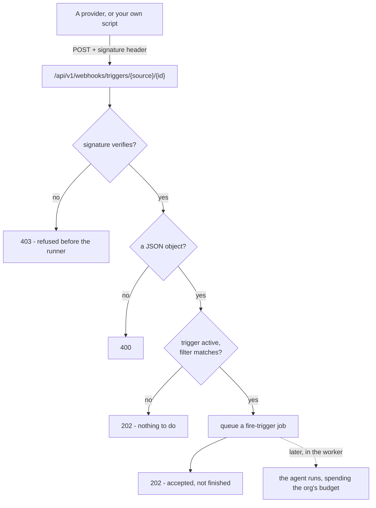

# Configurar un trigger de evento { #setting-up-an-event-trigger }

Un **trigger de evento** dispara un agent cuando pasa algo en otro sitio.

Hay dos maneras de que eso nos llegue, y cuál usa una fuente es asunto de la
fuente y no tuyo:

- **Por envío (push).** Un provider hace POST de una carga firmada: **GitHub**,
  **HubSpot**, **Zendesk**, o cualquier cosa que pueda enviar JSON firmado (la
  fuente **API**).
- **Por sondeo (polling).** La plataforma lee una cuenta conectada con una
  cadencia: los buzones (**Gmail**, **Outlook**), los archivos (**Google Drive**,
  **OneDrive & SharePoint**) y los calendarios (**Google Calendar**, **Outlook
  Calendar**). No se nos envía nada, así que no hay URL que configurar ni secreto
  que guardar. Conectas la cuenta y ese es todo el montaje.

[Conceptos](concepts.md#trigger) cuenta qué *es* un trigger y cómo se comporta un
run disparado; [Gobernanza](governance.md) cuenta lo que gasta y cómo se trata un
rechazo.

Esta página es lo que haces después: cómo apuntar un provider real al webhook,
qué tiene que contener la entrega, y cómo probarlo todo desde un portátil.

!!! tip "Si solo necesitas el reloj, lo que quieres es un horario"

    Sin webhook, sin secreto, sin provider que configurar.

    Cualquiera de los dos tipos puede partir de una **plantilla** sembrada
    (`GET /trigger-templates`). Una plantilla de horario — «resume mis pull
    requests abiertas cada mañana de entre semana» — rellena de antemano el
    prompt y una cadencia sensata. Una plantilla de evento — «clasifica la nueva
    issue», «redacta una respuesta al correo» — rellena de antemano el prompt en
    el paso de mensaje de su propia fuente. Ninguna de las dos parte de una caja
    en blanco.

## La zona horaria de una programación { #a-schedules-time-zone }

Una programación a una hora del día - cada día a las 09:00, los laborables a las
08:30 - se lee en una **zona horaria**, un nombre IANA como `Europe/Warsaw`. Una
nueva toma la tuya, la zona horaria de tu cuenta, salvo que el formulario o la API
indiquen otra (`time_zone`).

Mantiene su hora con el cambio de horario: «cada día a
las 09:00» en Varsovia son las 08:00 UTC en invierno y las 07:00 UTC en verano, y
el run se mueve con ella. Una programación guardada antes de que las
programaciones tuvieran zona se lee en UTC, como siempre, hasta que alguien le
elija una. Una programación por intervalo no tiene hora del día ni zona.

## Una programación cuyo último run sigue en marcha { #a-schedule-whose-last-run-is-still-going }

Una programación puede vencer mientras el run que disparó la vez anterior sigue
en marcha: una sincronización nocturna que dura más que una noche, o un run
aparcado en una aprobación que nadie ha decidido. **If the previous run is still
going** en el formulario de la programación, `overlap` en la API, decide qué
pasa:

| Opción | `overlap` | Qué hace |
|---|---|---|
| Skip this run | `skip` (por defecto) | La ocurrencia se pierde y la programación espera a su siguiente hora. Un agent lento se ejecuta tan a menudo como alcanza a terminar |
| Run when it finishes | `queue` | Dispara una vez cuando termina el run anterior, por muchas ocurrencias que hayan pasado |
| Run anyway | `allow` | Dispara a su hora, en el mismo registro de runs, así que dos runs se solapan y se pagan los dos |

Un trigger de evento no tiene este ajuste: cada entrega es su propio disparo.

Todo lo de abajo es para el caso de los eventos.

## Dónde viven en el producto, y cómo llamarlos { #where-they-live-in-the-product-and-what-to-call-them }

**Routines** es el paraguas - la navegación, la página, el panel propio del
agent, la barra lateral del chat y la tarjeta del dashboard usan esa única
palabra, así que una persona se encuentra el mismo nombre llegue por donde
llegue. Las dos familias que hay debajo siguen siendo distintas porque se
comportan de forma distinta: un **horario** dispara con el reloj, un **trigger**
dispara con una llegada. Lo que no podía diferir era el paraguas, que es como la
navegación acabó diciendo «Routines» sobre un panel titulado «Schedules &
triggers» (#594).

Cuatro superficies, una lista:

| Dónde | Para qué sirve |
|---|---|
| **Routines** (`/routines`) | Todas las rutinas de la organización, y las dos maneras de empezar una |
| La pestaña **Availability** de un agent | Solo las de ese agent, al lado de donde se configura su exposición |
| La sección Routines de la barra lateral del **chat** | Lo que hace por su cuenta el agent con el que estás hablando |
| La tarjeta **Routines** del dashboard | Lo más próximo primero, con cómo fue el último disparo - una rutina que falla cada hora es invisible en cualquier otro sitio de esa página |

La tarjeta del dashboard se añade desde `Customize` y está en la disposición por
defecto bajo **Needs attention**. Lee esa misma lista de toda la organización,
así que quien puede ver los agents ve sus rutinas; el resultado y el coste de
cada fila necesitan `runs:view` y sin ese permiso sencillamente no aparecen.

## El mecanismo, una vez { #the-mechanism-once }

Un trigger de evento te entrega dos cosas: una **URL de webhook** y un **secreto
de firma**. Un provider hace POST de su carga a la URL y firma la petición; la
plataforma recalcula la firma y dispara el agent solo si las dos coinciden.



- **La URL** se construye sobre la única dirección pública del despliegue
  (`PUBLIC_BASE_URL`), no sobre el origen del dashboard - el webhook lo sirve el
  host de la API, que suele ser un origen distinto del de la UI. Su forma es:

  ```
  {PUBLIC_BASE_URL}/api/v1/webhooks/triggers/{source}/{trigger_id}
  ```

  `source` es `github`, `hubspot`, `zendesk` o `webhook` (el nombre en el cable de
  la fuente API); `trigger_id` es un UUID imposible de adivinar. El diálogo la
  rellena por ti - cópiala, no la construyas a mano. **Una fuente por sondeo no
  tiene URL**: no tiene puerta de entrada, y un POST que la nombre recibe la
  respuesta de cualquier entrega sin nada que hacer.

- **La firma** es un `HMAC-SHA256` con el secreto de firma como clave, en el
  esquema de cada provider:

  | Fuente | Cabecera | Qué se firma |
  |---|---|---|
  | `github` | `X-Hub-Signature-256` | El cuerpo crudo, `sha256=<hex>` |
  | `webhook` | `X-Signature-256` | El cuerpo crudo, `sha256=<hex>` - o la hora y el cuerpo, ver [abajo](#signing-a-delivery-yourself) |
  | `hubspot` | `X-HubSpot-Signature-v3` | El método, la URL, el cuerpo y `X-HubSpot-Request-Timestamp`, base64 |
  | `zendesk` | `X-Zendesk-Webhook-Signature` | `X-Zendesk-Webhook-Signature-Timestamp` y el cuerpo, base64 |

  GitHub, HubSpot y Zendesk firman sus propias entregas, así que le das al
  provider el secreto - o, en HubSpot y Zendesk, tomas el que él emitió - y él
  firma. La fuente API reutiliza el esquema de GitHub bajo `X-Signature-256`, que
  tiene que poner por sí mismo lo que apuntes a la URL. Una fuente **por sondeo**
  no firma nada ni guarda secreto: no se le envió nada, se leyó, y lo que autorizó
  leerla es el consentimiento OAuth de la propia cuenta.

!!! danger "La firma no es un adorno"

    Sin ella, la URL es lo único que hay entre un desconocido y el budget de
    modelo de tu organización - y las URL se filtran: a los logs, al historial de
    entregas de un provider, a una captura de pantalla en un ticket de soporte.
    Cualquiera que tenga la URL podría disparar el agent a voluntad y gastar
    contra tus topes. El secreto es lo que hace que una entrega sea *auténtica* y
    no solo esté *bien dirigida*.

Una petición cuya firma no se verifica se rechaza con un `403` antes de llegar
siquiera al runner; el secreto está sellado en el [vault](secrets.md) y nunca
aparece en una lectura, en un listado ni en la URL.

!!! info "El `202` significa aceptado, no terminado"

    Una entrega que coincide se encola como un job `fire-trigger` en la propia
    transacción de la petición y el agent se ejecuta en el worker, así que el
    provider recibe su respuesta tras un insert en vez de esperar a un modelo. No leas un `202` como «el agent ya ha respondido» - para
    eso lee el run en Activity.

Una entrega verificada que no tiene nada que hacer - un trigger inactivo, o una
carga que el filtro no hace coincidir - responde `202` exactamente igual que una
que dispara, así que tener el secreto no te dice nada sobre qué triggers existen.
Un cuerpo que no es un objeto JSON es un `400`.

**Un trigger se dispara como mucho 60 veces por minuto.** Una entrega verificada
por encima de eso se rechaza con `429` y `Retry-After`, y el reintento del
provider la dispara cuando pasa el minuto. Solo cuenta cuando la firma es
correcta, así que nadie sin el secreto puede agotarlo - y es lo que impide que un
secreto filtrado o un relé en bucle gaste el budget en una tarde.

**Lo que llegó son datos, nunca instrucciones.** El mensaje del run es tu prompt,
y después el evento dentro de un bloque `<event_content>` que le dice al modelo
que lo lea como datos. Una issue, un correo o un nombre de archivo lo escribe
quien lo envió, y una frase dentro que suene a orden sigue siendo parte del
evento.

## Rotar el secreto y editar el filtro { #rotating-the-secret-and-editing-the-filter }

La URL es la **identidad** del trigger y nunca cambia. El secreto es una
**credencial**, y como cualquier otra clave de este producto se puede rotar — un
resellado y un texto plano nuevo que se muestra exactamente una vez.

```
POST /agents/{agent_id}/triggers/{trigger_id}/rotate-secret
```

Acuña un secreto nuevo, lo sella y devuelve el trigger con `reveal_secret` puesto
una vez — el mismo campo que usa la creación. Rota en cuanto un secreto pueda
haberse filtrado; el antiguo deja de verificar inmediatamente.

Para un hook que registró la propia plataforma (`auto_webhook`), la rotación lo
vuelve a registrar con el secreto nuevo, así que sus entregas siguen verificando
y no hay nada que revelar. Salvo que la cuenta ya no pueda registrarlo, en cuyo
caso el trigger cae a `manual` y el secreto revelado es lo que vuelves a pegar.

Un horario no tiene secreto, así que rotar uno se rechaza.

**Qué acciones de una issue disparan es un filtro, no un trigger distinto**, así
que se edita en el sitio. Haz `PATCH` del trigger con un `event_config` nuevo y
se vuelve a validar contra las reglas de la fuente exactamente igual que lo
valida la creación — una clave desconocida se rechaza en vez de guardarse para no
coincidir con nada.

La fuente y el secreto no se editan así. Reapuntar un trigger de evento a otra
fuente es un trigger nuevo: borra este, crea aquel.

## Gmail (~1 minuto, y sin ningún secreto) { #gmail-1-minute-and-no-secret-anywhere }

Gmail se sondea, así que el montaje es una pantalla de consentimiento y nada más.

1. **Conecta la cuenta.** *Routines → New event trigger → Gmail → Connect
   account*. Eso necesita `mcp:manage`, el mismo permiso que necesita cualquier
   otra cuenta conectada.
2. **Elige qué lo dispara**: cualquier mensaje nuevo, solo la bandeja de entrada,
   o marcado como importante. Afina más con un remitente o un fragmento del
   asunto, o con una etiqueta de Gmail. Un filtro de remitente solo se dispara con
   correo que firmó el dominio del remitente - ver
   [Quién lo envió](#who-sent-it-a-sender-filter-is-a-trust-decision).
3. **Escribe el prompt**, o parte de la plantilla «redacta una respuesta».

No hay URL que pegar ni secreto que guardar, porque nadie nos envía nada. Lo que
conviene saber sobre cómo lee:

- **Una vez por minuto.** El latido le pregunta a Gmail qué ha llegado desde que
  miró por última vez, así que la latencia en el peor caso es un minuto. Es
  deliberado: la alternativa - `users.watch` hacia un topic de Google Cloud
  Pub/Sub - es en tiempo real y cuesta un topic y una suscripción como requisitos
  del *despliegue*, más un registro que caduca cada siete días y necesita algo
  que lo renueve.
- **Conectar no dispara nada - y no pierde nada.** La posición del buzón se toma
  en el momento en que se completa el consentimiento, así que conectar no dispara
  el agent una vez por cada mensaje que ya estuviera ahí, y el correo que llegue
  entre el consentimiento y el primer latido aterriza igualmente después de esa
  posición y dispara.
- **Una ráfaga está acotada.** Un tic lee como mucho 25 mensajes nuevos enteros.
  El volcado de una lista de correo no se convierte en 400 runs de agent; la
  posición avanza igualmente, así que el atasco no se relee para siempre.
- **Un mensaje puede disparar varios triggers.** A diferencia de un webhook, cuya
  URL nombra exactamente uno - «cualquier mensaje» y «marcado como importante»
  sobre el mismo buzón disparan los dos.
- **Solo lo que llegó.** El historial de Gmail también informa como añadidos los
  mensajes enviados por la cuenta, los borradores, el spam y la papelera. Ninguno
  dispara un trigger - un agent que responde por correo se dispararía a sí mismo,
  y el spam le daría un run a cualquiera con una dirección - salvo que el `label`
  del trigger nombre uno de ellos (`SENT`, `DRAFT`, `SPAM` o `TRASH`).
- **Una semana perdida se repara sola.** Google guarda alrededor de una semana de
  historial. Un cursor más antiguo que eso se resincroniza con el ahora en vez de
  dejar el buzón aparcado para siempre.
- **Un consentimiento retirado detiene los triggers.** Cuando Google rechaza el
  grant para siempre - el refresh token se revocó o la cuenta quitó la
  aplicación -, los triggers del buzón se apagan, la tarjeta pide volver a
  conectar y el registro de auditoría anota el motivo (`mailbox_access_revoked`).
  Vuelve a conectar y luego enciéndelos otra vez. Una caída de Google no es esto:
  el sondeo se repite un minuto después.

La organización necesita su propio cliente OAuth de Google, guardado en Vault como
secreto **Google OAuth client** (`google_oauth_app`), con la API de Gmail
habilitada en su proyecto de Google. Sin él la tarjeta lo dice en vez de ofrecer
un botón Connect que solo podría fallar. No es el `GOOGLE_CLIENT_ID` del
despliegue, que sirve para iniciar sesión.

## Outlook (~1 minuto, y sin ningún secreto) { #outlook-1-minute-and-no-secret-anywhere }

Un buzón de Outlook - Microsoft 365 o Exchange Online - se sondea como Gmail, así
que el montaje vuelve a ser una pantalla de consentimiento.

1. **Registra una aplicación** en el centro de administración de Microsoft Entra:
   un URI de redirección web `{FRONTEND_URL}/api/me/mcp-connections/oauth/callback`,
   un secreto de cliente y los permisos delegados de Microsoft Graph `Mail.Read`,
   `Mail.Read.Shared` y `offline_access`. Ninguno necesita el consentimiento de un
   administrador.
2. **Guárdala en Vault** como secreto **Microsoft OAuth app**
   (`microsoft_oauth_app`): el id o dominio del inquilino, el client id y el valor
   del secreto. Usa `organizations` como inquilino solo para una aplicación
   registrada como multiinquilino. Debe ser visible para la organización y debe
   haber exactamente uno.
3. **Conecta la cuenta.** *Routines → New event trigger → Outlook → Connect
   account*, con `mcp:manage`. Microsoft pregunta qué cuenta usar, para que un
   navegador con una cuenta personal abierta no conecte el buzón equivocado.
4. **Elige qué lo dispara**: cualquier mensaje nuevo, solo uno con adjuntos o solo
   uno marcado con importancia alta. Acótalo con un fragmento del remitente o del
   asunto.

En qué se diferencia de Gmail:

- **Lee carpetas, no un buzón.** Microsoft Graph informa del correo nuevo carpeta
  a carpeta, así que un trigger nombra la carpeta que vigila - la bandeja de
  entrada salvo que diga otra - y el sondeador lee exactamente las carpetas que
  nombran los triggers de Outlook de la organización. `folder` es un nombre
  conocido (`inbox`, `archive`, `junkemail`) o una ruta de nombres de carpeta, como
  `Inbox/Invoices` para la carpeta donde una regla de correo archiva las facturas.
  `mailbox` lee, en lugar del propio, un buzón compartido que la cuenta conectada
  puede abrir; nombrarlo requiere `mcp:manage`, el permiso con el que se conectó
  la cuenta, porque usa el alcance de esa cuenta.
- **El filtro tiene los campos propios de Outlook**: `has_attachments`,
  `importance` (`low`, `normal`, `high`) y `category`, junto a `subject_contains` y
  `sender_contains`, que tiene Gmail. Se fijan en el `event_config` del trigger; el
  diálogo ofrece los presets y los dos fragmentos.
- **Un trigger nuevo ve lo que llegó desde que se creó.** Una carpeta se lee por
  primera vez desde el momento en que se creó su trigger más antiguo, nunca desde
  antes de conectar el buzón, así que ni conectar ni añadir un trigger dispara con
  correo que ya estaba ahí.
- **Un cambio no es una llegada.** Graph informa de un mensaje que alguien marcó
  como leído con la misma facilidad que de uno que acaba de llegar; solo dispara el
  correo recibido desde la última lectura de la carpeta.
- **El run lee texto.** El cuerpo llega como texto plano - Exchange convierte él
  mismo un mensaje HTML - con los nombres, tipos y tamaños de los adjuntos. Los
  adjuntos en sí no se descargan.
- **Una carpeta que no se puede leer detiene sus triggers.** Una carpeta borrada y
  creada de nuevo en la misma ruta se vuelve a buscar y se sigue leyendo. Una que
  ya no existe, o un buzón compartido que dejó de estarlo, apaga los triggers que
  la vigilan, con `mailbox_folder_unreadable` en el registro de auditoría, mientras
  el resto del buzón se lee como siempre. Un consentimiento retirado los detiene
  todos, como con Gmail.
- **Un estado de sincronización perdido empieza de nuevo desde la última
  lectura.** Graph conserva el seguimiento de cambios de una carpeta sin un plazo
  fijo y responde a uno descartado con `syncStateNotFound`; la carpeta se vuelve a
  leer desde justo antes de su última lectura, así que nada se dispara dos veces y
  nada se pierde.

Los ids de entrega son los ids de mensaje inmutables de Outlook, así que un
mensaje leído dos veces - un tick repetido, un sondeo lento que se solapa con el
siguiente - dispara cada trigger una vez.

## Quién lo envió: un filtro de remitente es una decisión de confianza { #who-sent-it-a-sender-filter-is-a-trust-decision }

`sender_contains` lee la cabecera `From`, que escribe el remitente: un mensaje que
dice venir de `ceo@acme.com` no cuesta nada. Por eso un trigger de Gmail o de
Outlook que filtra por remitente solo se dispara con correo **avalado** por el
dominio del remitente: DMARC pasó, o una firma DKIM pasó para ese dominio o uno
superior.

El veredicto es el que escribió tu proveedor de correo cuando llegó el
mensaje - la cabecera `Authentication-Results` más alta -, así que una copia que
el remitente pegó en el mensaje no cuenta. SPF solo no basta: comprueba el
remitente del sobre, que nadie ve. En Outlook, el correo entre dos buzones de tu
propio tenant cuenta como avalado, porque Exchange lo marca como interno.

| `authenticated_only` | Qué dispara |
|---|---|
| sin definir (por defecto) | Solo correo avalado cuando el trigger filtra por remitente; cualquiera cuando no |
| `true` | Solo correo avalado, con o sin filtro de remitente |
| `false` | Lo que dejen pasar los demás filtros |

Un relé propio que no firma nada - un escáner interno, una pasarela de correo
antigua - queda rechazado por un filtro de remitente. El rechazo se registra
(`trigger_mail_unauthenticated`, con el dominio del remitente), y poner
`authenticated_only` a `false` en el `event_config` del trigger deja pasar a ese
remitente.

## HubSpot { #hubspot }

HubSpot envía webhooks desde una app - basta una private app en tu cuenta de
HubSpot - y los firma con el **client secret** de esa app.

1. **Crea el trigger** con la fuente **Webhook de HubSpot** y pega el client
   secret de la app (*Settings → Integrations → Private Apps → tu app → Auth*). No
   hay botón Generate: HubSpot firma con su propio secreto, no con uno que
   podamos crear.
2. **Suscribe los webhooks de la app** a los eventos que quieras -
   `contact.creation`, `deal.propertyChange`, `ticket.creation` - con la URL del
   trigger como destino.

HubSpot envía hasta cien eventos en una entrega, y el trigger se dispara una vez
por ella cuando algún evento pasa el filtro: `subscription_types` se queda con los
tipos de evento nombrados, `property_names` con un cambio de propiedad en las
propiedades nombradas. El run recibe cada evento del lote, hasta veinte.

Una entrega se verifica con la firma v3 de HubSpot, sobre el método, la URL que
llamó HubSpot, el cuerpo y una marca de tiempo que tiene que estar dentro de cinco
minutos. HubSpot sigue firmando las suscripciones a objetos del CRM con su
esquema v1, sin hora, y también se aceptan: un lote se reconoce por sus eventos,
así que una entrega v1 repetida más tarde no dispara nada. La URL de la firma es
la que te dio el diálogo, así que un despliegue detrás de un proxy también
verifica.

## Zendesk { #zendesk }

Zendesk emite para cada webhook su propio **secreto de firma**.

1. **Crea un webhook en Zendesk** (*Admin Center → Apps and integrations →
   Webhooks*) que apunte a la URL de un trigger - crea primero el trigger con la
   fuente **Webhook de Zendesk**, pega un secreto provisional y vuelve.
2. **Revela el secreto del webhook** en su página y pégalo en el trigger como su
   secreto de firma.
3. **Decide cuándo se llama.** Un webhook suscrito a eventos de Zendesk -
   `zen:event-type:ticket.created` y similares - lleva el tipo de su evento, y el
   `event_types` del trigger se queda con los nombrados. Un webhook que llama un
   trigger o una automatización de Zendesk lleva el JSON que escribió su admin y
   ningún tipo, así que dispara un trigger que no nombra ninguno: cuándo, ya lo
   decidió la regla de Zendesk.

Una entrega se verifica sobre su marca de tiempo y su cuerpo y tiene que estar a
menos de cinco minutos de nuestro reloj; el id de invocación de Zendesk reconoce
una repetida.

## Archivos: Google Drive, OneDrive y SharePoint { #files-google-drive-onedrive-and-sharepoint }

Dos portales por sondeo, cada uno con su propio consentimiento para que ninguno
pida más que archivos:

| | Google Drive | OneDrive & SharePoint |
|---|---|---|
| Secreto en el vault | El cliente Google OAuth que usa Gmail, con la Drive API activada | La app Microsoft OAuth que usa Outlook |
| Permiso | `drive.metadata.readonly` | `Files.Read.All`, `Sites.Read.All`, `offline_access` (sin consentimiento de administrador) |
| Dónde mira | Cada archivo que ve la cuenta, unidades compartidas incluidas | El OneDrive propio de la cuenta, o la biblioteca de documentos de un sitio de SharePoint por `site_url` |
| Afina por | `folder_id` (el enlace o el id de la carpeta), `name_contains` | `folder_path` (una carpeta y todo lo que hay debajo), `name_contains` |

Ambos se disparan con `change`: `created`, `modified` o `any` (por defecto); los
presets ofrecen **New files** y **New or changed files**.

- **Un archivo en edición es un run, no uno por minuto.** Google Docs guarda
  mientras alguien escribe y OneDrive informa de cada guardado, así que un cambio
  en un archivo que ya se disparó queda retenido media hora.
- **Las ediciones de la propia cuenta no disparan nada** salvo que se defina
  `include_own_changes`: un agent que escribe con el mismo consentimiento se
  dispararía a sí mismo.
- **Conectar no dispara nada.** Ambos leen desde ahora - una biblioteca de
  SharePoint nueva, desde el momento de su primer trigger -, nunca desde el
  historial de la unidad. Una ráfaga - una carpeta sincronizada en bloque - se
  limita a los 25 archivos cambiados más recientes por tick.
- **El run sabe qué archivo, no lo que contiene.** Solo se leen metadatos: el
  nombre, el tipo, el enlace, quién lo cambió y dónde está. Un agent que deba leer
  el archivo lo hace con sus propias herramientas.
- **Un sitio que no se puede leer detiene sus triggers**, con el motivo en el log
  de auditoría, mientras los demás lugares de la cuenta se siguen leyendo.

## Reuniones: Google Calendar y Outlook Calendar { #meetings-google-calendar-and-outlook-calendar }

Un trigger de calendario se dispara **antes** de una reunión, no cuando algo
cambió: 15 minutos antes por defecto, entre 5 y 120 (`minutes_before`). Los
presets son **Before each meeting**, **Before meetings with outsiders** y **An
hour before**; el run recibe el asunto, la hora, el organizador, quién viene,
quiénes son de fuera de tu dominio, el enlace para unirse y la descripción -
suficiente para preparar un brief.

| | Google Calendar | Outlook Calendar |
|---|---|---|
| Secreto en el vault | El cliente Google OAuth, con la Calendar API activada | La app Microsoft OAuth |
| Permiso | `calendar.events.readonly` | `Calendars.Read`, `offline_access` |
| Calendario que lee | El calendario principal de la cuenta | El calendario predeterminado de la cuenta |

- **Solo una reunión.** Una sin nadie más, una que rechazaste, una cancelada y un
  evento de todo el día nunca se disparan. Las salas no cuentan como personas.
- **Una vez por reunión.** Cada reunión se anuncia una vez por cada antelación que
  vigila algún trigger, y el anuncio se guarda con la posición de la cuenta, así
  que un tick lento o un reinicio no la disparan dos veces. Una reunión reservada
  dentro de la antelación - a las 10:50 para las 11:00, con un trigger de 15
  minutos - se dispara al momento; una movida a otra hora se dispara de nuevo para
  su nueva hora.
- **`external_only`** se queda con las reuniones con alguien de fuera del dominio
  de la cuenta; `subject_contains` y `attendee_contains` afinan por asunto y por la
  dirección de un asistente (`@client.com`).

## Dos maneras de conectar GitHub, y cómo saber cuál tienes { #two-ways-to-connect-github-and-how-to-tell-which-you-are-running }

Hay dos, y un despliegue puede ofrecer una o ambas. El selector muestra **GitHub**
y **GitHub (App)** como fuentes distintas, y cuál usa un trigger se decide al
crearlo (#1072).

| | GitHub (OAuth App) | GitHub (App) |
|---|---|---|
| Qué guarda | Un token de acceso de la **persona** que dio el consentimiento | Un id de instalación más la clave privada de la App en el vault |
| Qué alcanza | Todo repositorio que esa cuenta pueda administrar —`repo` más `admin:repo_hook`, lectura y escritura | Los repositorios en los que se instaló la App, con los permisos que la App declara |
| Cuánto dura | Para siempre. Un token clásico de OAuth App no tiene refresco ni caducidad, así que uno filtrado vale hasta que alguien lo revoque a mano | Una hora. Acuñado a demanda desde la clave, que nunca sale del vault |
| Hooks | Uno por repositorio, creado con el trigger y borrado con él | Ninguno. La App ya está entregando |
| Límite de peticiones | Los 5000/hora de la persona, compartidos con todo lo demás que esa cuenta autorizó | El propio de la App |
| Dónde entrega | `/api/v1/webhooks/triggers/github/<id del trigger>` —una URL por trigger | `/api/v1/webhooks/github-app` —una URL para todas las instalaciones |

**Cómo saber en cuál está un trigger:** por su fuente. Un trigger creado bajo
**GitHub (App)** no tiene webhook que encontrar en los ajustes del repositorio,
porque no existe; uno bajo **GitHub** tiene exactamente uno, añadido por la
plataforma al crearlo.

### Configurar la App (una vez por organización) { #setting-up-the-app-once-per-organization }

1. **Registra la App** en [github.com/settings/apps](https://github.com/settings/apps)
   (o el equivalente de tu organización).
   - **Webhook URL**: `https://<tu despliegue>/api/v1/webhooks/github-app`. Una
     URL para todas las instalaciones, y por eso la dirección pública del
     despliegue es aquí un requisito de configuración y no un valor de ejecución.
   - **Webhook secret**: genéralo. Firma cada entrega de cada instalación de esta
     App.
   - **Permisos**: `Metadata: Read-only`, más acceso de solo lectura a lo que
     disparan tus triggers - `Issues` para las issues y sus comentarios,
     `Pull requests`, `Actions` para los runs de workflow, `Contents` para las
     releases y los pushes. No se lee nada más.
   - **Suscríbete a eventos**: los que usan tus triggers - `Issues`,
     `Issue comment`, `Pull request`, `Workflow run`, `Release`, `Push`.
2. **Genera una clave privada** en la misma página y descarga el PEM.
3. **Guarda las tres en el vault** como un secreto **GitHub App**: el App ID, la
   clave privada y el webhook secret. Uno por organización y visible para la
   organización: la ruta de entrega lo lee por organización y se niega a adivinar
   entre dos.
4. **Instala la App** en los repositorios que quieras, desde la pestaña *Install
   App*. Eso, y solo eso, es lo que el despliegue puede alcanzar.
5. **Conéctala** — con el botón *Connect* del portal, que pide el **id de
   instalación**. GitHub lo pone al final de la URL de la página de ajustes de la
   propia instalación (`…/settings/installations/<id de instalación>`). No es un
   secreto: viaja en cada entrega y es lo que le dice a la plataforma a qué grant
   pertenece una entrega.

El paso 5 no tiene equivalente en la ruta OAuth, porque una App no tiene ningún
flujo de consentimiento que arrancar. Conectarla acuña de inmediato un token de
instalación —no para guardarlo, sino para demostrar que el App ID, la clave
privada y el id de instalación concuerdan. Un id mal tecleado, o un PEM que perdió
sus saltos de línea camino del formulario, se rechaza ahí en lugar de descubrirse
más tarde como entregas que en silencio no encajan con nada. Es además el único
momento en que la clave puede comprobarse: el vault no vuelve a mostrar un secreto
guardado.

Crear un trigger elige entonces un repositorio de la instalación y no registra
nada.

!!! tip "Apagarlo"

    Desactivar la conexión hace que las entregas dejen de emparejarse del todo —
    los grants desactivados no son candidatos. Ese es el interruptor de toda la
    instalación, sin tocar GitHub.

### Cuando llega una entrega { #when-a-delivery-arrives }

Una URL, así que la ruta no nombra nada. El id de instalación del payload
selecciona los grants a los que podría pertenecer, el webhook secret de la App
para esa organización verifica la firma, y el repositorio y el evento eligen los
triggers —**todos**, no uno—. Dos triggers sobre el mismo repositorio disparan los
dos, que es lo que los presets invitan y lo que una URL por trigger no puede hacer
por construcción.

Una entrega que no coincide con nada responde `202` igual que una que lo disparó
todo. Una firma que no verifica contra ningún candidato es un `403`, así que
**Recent Deliveries** de GitHub le muestra a quien configuró mal la App qué falla.

### Cuál elegir { #which-to-choose }

La App, salvo que no puedas registrar una. La vía de OAuth App es el recurso para
un despliegue cuya organización de GitHub no deja a nadie crear una App, y no se
va a ninguna parte —pero un token que puede escribir en todos los repositorios que
alcance una administradora, y que nunca caduca, es una credencial muy grande para
leer issues.

## Una receta con GitHub (~5 minutos) { #a-github-recipe-5-minutes }

GitHub firma sus propias entregas, así que es la fuente más rápida de conectar.
Crea primero el trigger con la fuente **GitHub**, copia su URL de webhook y su
secreto de firma, y después:

1. En el repositorio que quieras vigilar, ve a **Settings → Webhooks → Add
   webhook**.
2. **Payload URL** - pega la URL de webhook del diálogo del trigger.
3. **Content type** - elige `application/json`. No
   `application/x-www-form-urlencoded`: la firma cubre los bytes exactos que
   envía GitHub, y la codificación de formulario los cambia, así que una entrega
   codificada como formulario no verifica contra nada y vuelve como `403`.
4. **Secret** - pega el secreto de firma.
5. **Which events?** - elige *Let me select individual events* y marca el que nombra
   el `event` del trigger; la entrega de cualquier otro evento (leído de la
   cabecera `X-GitHub-Event`) se descarta. Afina *qué* acciones disparan con el
   filtro del trigger.
6. **Add webhook.** GitHub envía un `ping`, que no es el evento de ningún trigger,
   así que no disparará el agent - eso es lo esperado.

**Con qué puede dispararse un trigger de GitHub**, su `event`, con lo que dispara por defecto:

| `event` | Se dispara con, salvo que `actions` diga otra cosa | Afina también por |
|---|---|---|
| `issues` (por defecto) | Una issue nueva (`opened`) | |
| `pull_request` | `opened`, `ready_for_review`, `review_requested` | `branches` (la base) |
| `issue_comment` | Un comentario nuevo (`created`) | `mention`, una frase que debe contener, como `@agent` |
| `workflow_run` | Un run terminado (`completed`) que falló | `conclusions`, `branches` |
| `release` | Una release publicada | |
| `push` | Un push a una rama | `branches` |

**De quién son las issues que lo disparan.** En un repositorio público cualquiera
puede abrir una issue, y cada una sería un run y una página de texto ajeno en el
prompt. Por eso una issue, una pull request o un comentario solo dispara cuando
GitHub considera a su autor `OWNER`, `MEMBER` o `COLLABORATOR` del repositorio -
pon `authors` en `anyone` para dejar pasar a todos. Un bot nunca lo dispara, ni
tampoco la cuenta con la que se conectó el trigger, así que un agent que comenta
a través de ella no puede dispararse a sí mismo.

Cuando una entrega se rechaza, diagnostícala en la pestaña **Recent Deliveries**
del webhook en GitHub: muestra la petición exacta y la respuesta. Un `403` ahí es
una firma que no cuadra - casi siempre el secreto está mal o el content type no
es `application/json`.

## El contrato de la carga para las fuentes entregadas por relé { #the-payload-contract-for-relay-delivered-sources }

GitHub es el dueño de la forma de su carga, y la de una fuente sondeada la lee el
adaptador que la lee - los filtros de un trigger de Gmail o de Outlook se
contrastan con el propio mensaje, así que no hay contrato que tú tengas que cumplir.

El que sí es tuyo es la fuente comodín `webhook` - **API** en los diálogos. **No
tiene filtro**: una entrega verificada dispara, y todo el cuerpo JSON se añade al
prompt. Úsala para cualquier cosa que ningún portal cubra - vigilar un feed para
el que ningún provider expone una API (una página de LinkedIn, un anuncio de un
marketplace), o cualquier herramienta que sepa hacer POST - siendo el relé que tú
escribas el que vigila.

Aquí había antes una fuente `email`, y era esta misma con otro nombre: renombraba
dos campos del filtro y te pedía ejecutar un relé - un code step de Zapier o de
Make, un script pequeño - que firmara y nos enviara JSON, porque nada en este
producto podía recibir correo. Se quitó por la misma razón que `linkedin`: una
entrada de un desplegable cuyo nombre promete una integración que no existe.
Gmail la sustituyó como cuenta conectada de verdad (más arriba), y un buzón
alimentado por un relé es la fuente API con un ejemplo documentado.

**Un correo alimentado por un relé, como fuente API:**

```json
{ "from": "billing@acme.com", "subject": "Invoice #4021", "body": "…" }
```

Ya nada filtra por esos nombres, así que todo el cuerpo llega al prompt y el
agent lo lee. Si lo que quieres es el *filtrado*, conecta el buzón en su lugar.

## Firmar una entrega tú mismo { #signing-a-delivery-yourself }

Para la fuente genérica `webhook` (y para probar a mano la fuente de GitHub), la
petición la firmas tú. Dos trampas deciden si la firma verifica, porque las dos
cambian los bytes:

- **Firma los bytes que envías, y solo esos.** `echo` añade un salto de línea
  final que se firma pero puede no enviarse, o enviarse sin haberse firmado; usa
  `printf '%s'` y pasa el cuerpo con `curl --data-raw` para que no se añada ni se
  interprete nada.
- **No vuelvas a serializar.** Firmar un dict y dejar después que tu cliente HTTP
  lo recodifique produce bytes distintos (claves reordenadas, espaciado
  distinto). Firma una cadena y envía *esa misma* cadena.

=== "curl"

    ```bash
    SECRET='your-signing-secret'
    URL='https://api.example.com/api/v1/webhooks/triggers/webhook/<trigger_id>'
    BODY='{"hello":"world"}'

    SIG="sha256=$(printf '%s' "$BODY" | openssl dgst -sha256 -hmac "$SECRET" | sed 's/^.* //')"

    curl -sS -X POST "$URL" \
      -H 'Content-Type: application/json' \
      -H "X-Signature-256: $SIG" \
      --data-raw "$BODY"
    ```

=== "Python (httpx)"

    ```python
    import hashlib
    import hmac

    import httpx

    secret = b"your-signing-secret"
    url = "https://api.example.com/api/v1/webhooks/triggers/webhook/<trigger_id>"
    body = b'{"hello":"world"}'

    signature = "sha256=" + hmac.new(secret, body, hashlib.sha256).hexdigest()

    # content=body sends these exact bytes. json=... would re-serialize and sign nothing.
    httpx.post(
        url,
        content=body,
        headers={"Content-Type": "application/json", "X-Signature-256": signature},
    )
    ```

Para la fuente `github` el algoritmo es idéntico; solo cambia el nombre de la
cabecera, que pasa a ser `X-Hub-Signature-256`.

**Firma también la hora, contra repeticiones.** Una firma solo del cuerpo no lleva
hora, así que una entrega capturada se podría reenviar para siempre. Envía
`X-Signature-Timestamp` (segundos Unix) y firma en su lugar
`{timestamp}.{body}`: una entrega a más de cinco minutos de nuestro reloj se
rechaza, y quitar la cabecera para repetirla también falla, porque la firma ya no
cubre el cuerpo solo. Un remitente que no envía marca de tiempo se verifica como
antes.

```bash
TS="$(date +%s)"
SIG="sha256=$(printf '%s.%s' "$TS" "$BODY" | openssl dgst -sha256 -hmac "$SECRET" | sed 's/^.* //')"
curl -sS -X POST "$URL" -H 'Content-Type: application/json' \
  -H "X-Signature-Timestamp: $TS" -H "X-Signature-256: $SIG" --data-raw "$BODY"
```

## Zapier y Make no pueden hacer esto sin un code step { #zapier-and-make-cannot-do-this-without-a-code-step }

!!! warning "Ninguno de los dos tiene una acción HMAC"

    Sus pasos estándar de «POST a un webhook» envían el cuerpo pero no pueden
    firmarlo, así que cada entrega llega sin firmar y se rechaza con `403`.
    Cuenta con una hora con un code step, no con cinco minutos de clics.

Es tentador echar mano de una acción de webhook sin código en Zapier o en Make.
Tienes que añadir su **code step** (el *Code by Zapier* de Zapier, el módulo
*Custom JS / functions* de Make), calcular el HMAC `sha256=<hex>` sobre el cuerpo
exacto que vas a enviar, y poner con él la cabecera `X-Signature-256`.

Eso funciona, pero sé honesto sobre el coste: es más o menos una hora con un code
step, no cinco minutos de clics. Si lo único que quieres es comprobar el trigger
de principio a fin, firma antes una petición a mano con el fragmento de arriba.

## Probar en local { #testing-locally }

!!! tip "Prueba *Run now* antes de configurar un provider"

    Dispara cualquiera de los dos tipos de trigger una vez, bajo demanda, sin
    firma y sin webhook de por medio - la forma más rápida de confirmar que el
    agent, su prompt y su budget se comportan.

En un portátil `PUBLIC_BASE_URL` vale por defecto `http://localhost:8000`, así
que la URL que te entrega el diálogo es inalcanzable desde GitHub o desde
cualquier relé alojado - no pueden ver tu máquina. Dos maneras de salvarlo:

- **Usa simplemente Run now.** *Run now* dispara cualquiera de los dos tipos de
  trigger una vez y bajo demanda - un horario dispara una vez de más con su
  cadencia intacta, y un **trigger de evento dispara también**, como disparo
  manual de prueba: el agent ejecuta su prompt base **sin contexto de entrega,
  sin firma y sin webhook de por medio**. Es la forma más rápida de confirmar que
  el agent, su prompt y su budget se comportan sin ningún provider configurado.
  Un trigger inactivo (en pausa) se respeta - *Run now* no le hace nada. Su única
  laguna es que no recorre el camino de la firma ni una carga real, así que no
  pillará un secreto equivocado ni un campo mal nombrado.

- **Expón el puerto con un túnel** cuando sí quieras probar el camino real del
  webhook. Apunta un túnel a la API, pon `PUBLIC_BASE_URL` a la dirección pública
  del túnel, y **crea el trigger después de eso** - la URL se construye a partir
  de `PUBLIC_BASE_URL` en el momento de leerla, así que un trigger creado antes
  del cambio seguiría entregando una URL de `localhost`.

  ```bash
  cloudflared tunnel --url http://localhost:8000
  # then set PUBLIC_BASE_URL to the printed https URL, restart the API,
  # and create the trigger
  ```

  Apunta el provider (o tu script de firma) a la URL del túnel y la entrega llega
  a tu máquina como cualquiera alojada.

## Resumen { #recap }

- Un trigger te entrega una **URL** y un **secreto de firma**. La URL es su
  identidad y nunca cambia; el secreto es una credencial y se puede rotar.
- La firma es un `HMAC-SHA256` sobre los **bytes crudos exactos**, en el esquema
  de cada provider, y es lo que hace que una entrega sea auténtica y no solo esté
  bien dirigida. Los secretos de HubSpot y Zendesk los emite el provider.
- Un `202` significa **aceptado**, no terminado. Lee el run en Activity.
- **Los buzones, los archivos y los calendarios se sondean**, así que no tienen
  URL ni secreto alguno - conecta la cuenta y ese es todo el montaje.
- Un filtro de remitente solo se dispara con correo que firmó el dominio del
  remitente.
- La hora de una programación se lee en su zona horaria, la tuya por defecto.
- En un portátil, echa mano de **Run now** antes que de un túnel.
