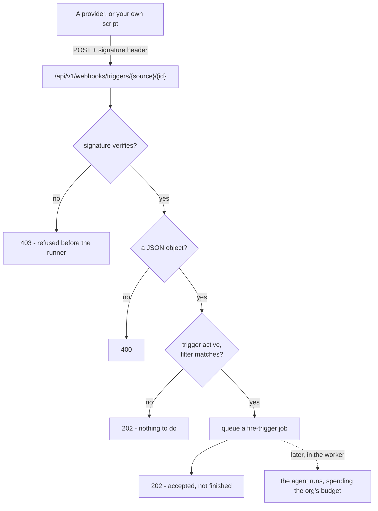

# Setting up an event trigger

An **event trigger** fires an agent when something happens somewhere else.

There are two ways that reaches us, and which one a source uses is the source's own
business rather than yours:

- **Pushed.** A provider POSTs a signed payload: **GitHub**, **HubSpot**,
  **Zendesk**, or anything that can send signed JSON (the **API** source).
- **Polled.** The platform reads a connected account on a schedule: the mailboxes
  (**Gmail**, **Outlook**), the files (**Google Drive**, **OneDrive & SharePoint**)
  and the calendars (**Google Calendar**, **Outlook Calendar**). Nothing is posted
  to us, so there is no URL to configure and no secret to keep. You connect the
  account and that is the whole setup.

[Concepts](concepts.md#trigger) covers what a trigger *is* and how a fired run
behaves; [Governance](governance.md) covers what it spends and how a refusal is
handled.

This page is what you do next: how to point a real provider at the webhook, what
the delivery has to contain, and how to test the whole thing from a laptop.

!!! tip "If you only need the clock, you want a schedule"

    No webhook, no secret, no provider to configure.

    Either kind can start from a seeded **template** (`GET /trigger-templates`). A
    schedule template — "summarise my open pull requests every weekday morning" —
    pre-fills the prompt and a sane cadence. An event template — "triage the new
    issue", "draft a reply to the email" — pre-fills the prompt on its own source's
    message step. Neither starts from a blank box.

## A schedule's time zone

A schedule set to run at a time of day - daily at 09:00, weekdays at 08:30 - is
read in a **time zone**, an IANA name such as `Europe/Warsaw`. A new one takes
yours, from the time zone on your account, unless the form or the API names
another (`time_zone`). It keeps its hour through daylight saving: "daily at
09:00" in Warsaw is 08:00 UTC in winter and 07:00 UTC in summer, and the run
moves with it. A schedule saved before schedules had zones is read in UTC, as it
always was, until somebody picks a zone for it. An interval schedule has no time
of day and no zone.

## A schedule whose last run is still going

A schedule can come due while the run it fired last time is still going - a
nightly sync that takes longer than a night, or one parked on an approval
nobody has decided. **If the previous run is still going** on the schedule's
form, `overlap` in the API, decides what happens:

| Option | `overlap` | What it does |
|---|---|---|
| Skip this run | `skip` (the default) | The occurrence passes, and the schedule waits for its next time. A slow agent runs as often as it can finish |
| Run when it finishes | `queue` | It fires once the previous run ends, however many occurrences went by |
| Run anyway | `allow` | It fires on time, into the same run log, so two runs overlap and both are paid for |

An event trigger has no such setting: each delivery is its own fire.

Everything below is for the event case.

## Where the answer goes, and when a routine ends { #answers-and-ends }

Every fire is recorded in the trigger's run log. `answer_to` says where the answer is also delivered
to the person who made it (#2575): `primary`, the default, is their own conversation with the agent, so
everything it tells them is in one place; `conversation` is one of their other chats
(`delivery_conversation_id`), for a routine made in that chat; `run_log` posts nowhere else.

Only a
completed fire with an answer is delivered, and a delivery that cannot land - the chat was deleted -
leaves the fire in the log instead of failing it. A chat that is not the caller's own is a 404, and
changing where an answer goes ends the trigger's acting as its creator when someone else made the
change, since it decides who reads what the creator's connections returned.

`ends_at` stops a routine by itself, for "keep an eye on this until Friday". The first fire due after
it pauses the trigger instead of running it and records `ended` in the audit trail; an end that is already
past is refused. Resuming it needs a later `ends_at` or none.

`monthly_budget_usd` gives a routine a limit of its own: what the runs it started may cost in a calendar
month. Once that is spent its fires are skipped before a run is opened, the routine shows as paused for
its budget, and it starts again on the first with nothing to resume by hand. It only narrows the agent's
and the organization's limits. A fire already running when the limit is crossed finishes, because the
limit is on what has been spent, not on a forecast.

## Where they live in the product, and what to call them

**Routines** is the umbrella - the nav, the page, the agent's own panel, the chat
sidebar and the dashboard card all use that one word, so a person meets the same
noun wherever they arrive. The two families under it stay distinct because they
behave differently: a **schedule** fires on the clock, a **trigger** fires on an
arrival. What was not allowed to differ was the umbrella, which is how the nav
came to say "Routines" over a panel headed "Schedules & triggers" (#594).

Four surfaces, one list:

| Where | What it is for |
|---|---|
| **Routines** (`/routines`) | Every routine in the organization, and the two ways to start one |
| An agent's **Availability** tab | Only that agent's, beside where its exposure is configured |
| The **chat** sidebar's Routines section | What the agent you are talking to does on its own |
| The **Routines** dashboard card | Soonest first, with how the last fire went - a routine failing every hour is invisible anywhere else on that page |

The dashboard card is addable from `Customize` and is on the default arrangement
under **Needs attention**. It reads the same org-wide list, so a reader who may
see the agents sees their routines; the outcome and cost on each row need
`runs:view` and are simply absent without it.

## The mechanism, once

An event trigger hands you two things: a **webhook URL** and a **signing secret**. A
provider POSTs its payload to the URL and signs the request; the platform recomputes
the signature and fires the agent only if the two match.



- **The URL** is built on the deployment's one public address (`PUBLIC_BASE_URL`), not
  on the dashboard's origin - the webhook is served by the API host, which is usually a
  different origin from the UI. Its shape is:

  ```
  {PUBLIC_BASE_URL}/api/v1/webhooks/triggers/{source}/{trigger_id}
  ```

  `source` is one of `github`, `hubspot`, `zendesk` or `webhook` (the API source's
  wire name); `trigger_id` is an unguessable UUID. The dialog fills this in for you -
  copy it, do not build it by hand. **A polled source has no URL**: it has no
  inbound door, and a POST naming one is answered like any delivery with nothing to
  do.

- **The signature** is an `HMAC-SHA256` keyed with the signing secret, in each
  provider's own scheme:

  | Source | Header | What is signed |
  |---|---|---|
  | `github` | `X-Hub-Signature-256` | The raw body, `sha256=<hex>` |
  | `webhook` | `X-Signature-256` | The raw body, `sha256=<hex>` - or the time and the body, see [below](#signing-a-delivery-yourself) |
  | `hubspot` | `X-HubSpot-Signature-v3` | The method, the URL, the body and `X-HubSpot-Request-Timestamp`, base64 |
  | `zendesk` | `X-Zendesk-Webhook-Signature` | `X-Zendesk-Webhook-Signature-Timestamp` and the body, base64 |

  GitHub, HubSpot and Zendesk sign their own deliveries, so you give the provider
  the secret - or, for HubSpot and Zendesk, take the one it issued - and it does the
  signing. The API source reuses GitHub's scheme under `X-Signature-256`, which
  whatever you point at the URL has to set itself. A **polled** source signs
  nothing and holds no secret: it was not addressed, it was read, and the account's
  own OAuth grant is what authorized reading it.

!!! danger "The signature is not decoration"

    Without it, the URL is the only thing between a stranger and your
    organization's model budget - and URLs leak: into logs, into a provider's
    delivery history, into a screenshot in a support ticket. Anyone who has the
    URL could fire the agent at will and spend against your caps. The secret is
    what makes a delivery *authentic* rather than merely *addressed correctly*.

A request whose signature does not verify is refused with a `403` before the runner
is ever reached; the secret is sealed in the [vault](secrets.md) and never appears
in a read, a listing, or the URL.

!!! info "The `202` means accepted, not finished"

    A matched delivery is queued as a `fire-trigger` job in the request's own
    transaction and the agent runs in the worker, so the provider gets its
    answer after one insert rather than waiting out a model. Do not read a `202`
    as "the agent has replied" - read the run in Activity for that.

A verified delivery that has nothing to do - an inactive trigger, or a payload the
filter does not match - answers `202` exactly as a fired one does, so holding the secret
tells you nothing about which triggers exist. A body that is not a JSON object is a
`400` (HubSpot's array of events is the one exception the door expects).

**One trigger fires at most 60 times a minute.** A verified delivery past that is
refused with `429` and a `Retry-After`, and the provider's retry fires it once the
minute has passed. It is counted only once the signature holds, so nobody without
the secret can use it up, and it is what stops a leaked secret or a relay stuck in
a loop from spending the budget in an afternoon.

**What arrived is data, never instructions.** The run's message is your prompt,
then the event inside an `<event_content>` block that tells the model to read it
as data. An issue, an email or a file name is written by whoever sent it, and a
sentence in it that sounds like an order is still part of the event.

## Rotating the secret, and editing the filter

The URL is the trigger's **identity** and never changes. The secret is a
**credential**, and like every other key in this product it can be rotated — a
re-seal and a fresh plaintext shown exactly once.

```
POST /agents/{agent_id}/triggers/{trigger_id}/rotate-secret
```

It mints a new secret, seals it, and returns the trigger with `reveal_secret` set
once — the same field create uses. Rotate the moment a secret might have leaked;
the old one stops verifying immediately.

For a hook the platform registered itself (`auto_webhook`) the rotation
re-registers it with the new secret, so its deliveries keep verifying and there is
nothing to reveal. Unless the account can no longer register it, in which case the
trigger falls back to `manual` and the revealed secret is what you re-paste.

A schedule has no secret, so rotating one is refused.

**Which issue actions fire is a filter, not a different trigger**, so it is
editable in place. `PATCH` the trigger with a new `event_config` and it is
re-validated against the source's rules exactly as create validates it — an unknown
key is refused rather than stored to match nothing.

The source and the secret are not editable this way. Repointing an event trigger at
a different source is a new trigger: delete this one, create that.

## Gmail (~1 minute, and no secret anywhere)

Gmail is polled, so the setup is a consent screen and nothing else.

1. **Connect the account.** *Routines → New event trigger → Gmail → Connect account*.
   That needs `mcp:manage`, the same permission every other connected account needs.
2. **Pick what fires it**: any new message, inbox only, or marked important. Narrow
   further with a sender or subject substring, or a Gmail label. A sender filter
   fires only on mail the sender's domain signed - see
   [Who sent it](#who-sent-it-a-sender-filter-is-a-trust-decision).
3. **Write the prompt**, or start from the "draft a reply" template.

There is no URL to paste and no secret to store, because nothing posts to us. What
you should know about how it reads:

- **Every minute, or as often as you choose.** The heartbeat asks Gmail what arrived
  since it last looked, so the worst-case latency is the interval - a minute unless
  changed. **Check for new mail every** (1, 5, 15, 30 or 60 minutes) is a setting of
  the mailbox, on its portal card and on a Gmail trigger step, and it applies to
  every trigger on that mailbox; changing it needs `mcp:manage`. Polling is
  deliberate: the alternative - `users.watch` into a Google Cloud Pub/Sub topic - is
  real-time and costs a topic and a subscription as *deployment* prerequisites, plus
  a registration that expires every seven days and needs something to renew it.
- **Connecting fires nothing - and loses nothing.** The mailbox's position is taken
  the moment consent completes, so connecting does not fire the agent once per
  message already sitting there, and mail arriving between the consent and the
  first heartbeat still lands after that position and fires.
- **A burst is queued.** One tick reads at most 25 messages in full. Unread message
  IDs stay in the cursor and are processed oldest first on later ticks, including
  when the next history read reports nothing new. Sent mail and spam cannot
  permanently displace an incoming message.
- **One message can fire several triggers.** Unlike a webhook, whose URL names
  exactly one - "any message" and "marked important" on the same mailbox both fire.
- **Only mail that arrived.** Gmail's history reports the account's own sends,
  drafts, spam and bin as added messages too. None of them fires a trigger -
  an agent that replies by email would otherwise set itself off, and spam would
  hand anyone with an address a run - unless the trigger's `label` names one
  (`SENT`, `DRAFT`, `SPAM` or `TRASH`).
- **A missed week repairs itself.** Google keeps about a week of history. A cursor
  older than that resynchronises to now rather than parking the mailbox for ever.
- **The prompt names the message and its thread.** Beside the sender, subject and
  text, the agent gets a `Message-ID:` line and a `Thread:` line, each only when
  the mail carried one. A value over 998 characters is left out, never cut, and the
  HTML body, the references and the attachments are not in the prompt.
- **A withdrawn consent stops the triggers.** When Google refuses the grant for
  good - the refresh token was revoked, or the account removed the app - the
  mailbox's triggers are turned off, the card asks you to reconnect, and the audit
  log records why (`mailbox_access_revoked`). Reconnect, then turn them back on. A
  Google outage is not this: the poll is tried again at its next check.

The organization needs its own Google OAuth client, stored in Vault as a
**Google OAuth client** secret (`google_oauth_app`), with the Gmail API enabled in
its Google project. Without one the card says so instead of offering a Connect
button that could only fail. It is not the deployment's `GOOGLE_CLIENT_ID`, which
is sign-in.

## Outlook (~1 minute, and no secret anywhere)

An Outlook mailbox - Microsoft 365 or Exchange Online - is polled the way Gmail
is, so the setup is again a consent screen.

1. **Register an app** in the Microsoft Entra admin center: a web redirect URI of
   `{FRONTEND_URL}/api/me/mcp-connections/oauth/callback`, a client secret, and
   the delegated Microsoft Graph permissions `Mail.Read`, `Mail.Read.Shared` and
   `offline_access`. None of them needs an administrator's consent.
2. **Store it in Vault** as a **Microsoft OAuth app** secret
   (`microsoft_oauth_app`): the tenant id or domain, the client id and the secret's
   value. Use `organizations` as the tenant only for an app registered as
   multitenant. It must be org-visible, and there must be exactly one.
3. **Connect the account.** *Routines → New event trigger → Outlook → Connect
   account*, with `mcp:manage`. Microsoft asks which account to use, so a browser
   signed in to a personal account does not connect the wrong mailbox.
4. **Pick what fires it**: any new message, only one with attachments, or only one
   marked high importance. Narrow it with a sender or subject substring.

What differs from Gmail:

- **The same check interval.** **Check for new mail every** applies to an Outlook
  mailbox as it does to Gmail: one setting for the connected mailbox, shared by
  every trigger on it.
- **It reads folders, not a mailbox.** Microsoft Graph reports new mail one folder
  at a time, so a trigger names the folder it watches - the inbox unless it says
  otherwise - and the poller reads exactly the folders the organization's Outlook
  triggers name. `folder` is a well-known name (`inbox`, `archive`, `junkemail`) or
  a path of folder names, such as `Inbox/Invoices` for the folder a mail rule files
  invoices into. `mailbox` reads a shared mailbox the connected account can open
  instead of its own; naming one takes `mcp:manage`, the permission that connected
  the account, because it spends that account's reach.
- **The filter has Outlook's own fields**: `has_attachments`, `importance` (`low`,
  `normal`, `high`) and `category`, beside the `subject_contains` and
  `sender_contains` Gmail has. Set them in the trigger's `event_config`; the dialog
  offers the presets and the two substrings.
- **A new trigger sees what arrived since it was made.** A folder is first read
  from the moment its earliest trigger was created, never from before the mailbox
  was connected, so neither connecting nor adding a trigger fires on mail that was
  already there.
- **A change is not an arrival.** Graph reports a message somebody marked read as
  readily as one that just landed; only mail received since the folder was last
  read fires.
- **The run reads text.** The body arrives as plain text - Exchange converts an HTML
  message - and the prompt names the attachments on an `Attachments:` line, names
  only. Only file attachments are listed: an attached email or a cloud link is not.
  The files themselves are not downloaded. As for Gmail, the prompt also has a
  `Message-ID:` and a `Thread:` line, each only when the message carried one.
- **A folder that cannot be read stops its triggers.** A folder deleted and made
  again under the same path is looked up again and read on. One that is gone for
  good, or a shared mailbox that is no longer shared, turns off the triggers
  watching it, with `mailbox_folder_unreadable` in the audit log, while the rest of
  the mailbox is read as usual. A withdrawn consent stops them all, as for Gmail.
- **A lost sync state starts over from the last read.** Graph keeps a folder's
  change tracking for no fixed time and answers a dropped one with
  `syncStateNotFound`; the folder is then read again from just before its last
  read, so nothing fires twice and nothing is missed.
- **A burst is queued.** One tick reads at most 25 messages in full, oldest first. The
  rest stay in the cursor and are read on later ticks, so a folder moved in bulk or an
  outage backlog loses nothing.

Delivery ids are Outlook's immutable message ids, so a message read twice - a
retried tick, a slow poll overlapping the next - fires each trigger once.

## Who sent it: a sender filter is a trust decision

`sender_contains` reads the `From` header, which the sender writes: a message
claiming to come from `ceo@acme.com` costs nothing to send. So a Gmail or Outlook
trigger that filters on the sender fires only on mail the sender's domain
**vouched for**: DMARC passed, or a DKIM signature passed for that domain or a
parent of it.

The verdict is the one your mail provider wrote when the message
arrived - the topmost `Authentication-Results` header - so a copy the sender pasted
into the message counts for nothing. SPF alone is not enough: it checks the
envelope sender, which nobody sees. In Outlook, mail between two mailboxes of your
own tenant counts as vouched for, because Exchange marks it internal.

| `authenticated_only` | What fires |
|---|---|
| unset (the default) | Vouched-for mail only when the trigger filters on the sender; anything when it does not |
| `true` | Vouched-for mail only, with or without a sender filter |
| `false` | Anything the other filters let through |

A relay of your own that signs nothing - an internal scanner, an old mail
gateway - is refused by a sender filter. The refusal is logged
(`trigger_mail_unauthenticated`, with the sender's domain), and setting
`authenticated_only` to `false` in the trigger's `event_config` lets that sender
through.

A sender filter matches the parsed address, never the display name. A complete
address or an `@domain` filter is an exact match; other text is a substring of the
address. DMARC does not authenticate a person's display name.

## HubSpot

HubSpot posts webhooks from an app - a private app in your HubSpot account is
enough - and signs them with that app's **client secret**.

1. **Create the trigger** with source **A HubSpot webhook** and paste the app's
   client secret (*Settings → Integrations → Private Apps → your app → Auth*).
   There is no Generate button: HubSpot signs with its own secret, not one we
   could make.
2. **Subscribe the app's webhooks** to the events you want - `contact.creation`,
   `deal.propertyChange`, `ticket.creation` - with the trigger's URL as the
   target.

HubSpot sends up to a hundred events in one delivery, and the trigger fires once
for it when any event passes the filter: `subscription_types` keeps the named
event types, `property_names` a property change to the named properties. The
run is told every event in the batch, up to twenty.

A delivery is verified by HubSpot's v3 signature, over the method, the URL HubSpot
called, the body and a timestamp that has to be within five minutes. HubSpot
still signs CRM object subscriptions with its older v1 scheme, which has no time
in it, and those are accepted too: a batch is recognised by its events, so a v1
delivery replayed later fires nothing. The URL in the signature is the one the
dialog gave you, so a deployment behind a proxy still verifies.

## Zendesk

Zendesk issues each webhook its own **signing secret**.

1. **Create a webhook in Zendesk** (*Admin Center → Apps and integrations →
   Webhooks*) pointing at a trigger's URL - create the trigger with source **A
   Zendesk webhook** first and paste any placeholder, then come back.
2. **Reveal the webhook's secret** on its page and paste it into the trigger as its
   signing secret.
3. **Decide when it is called.** A webhook subscribed to Zendesk events -
   `zen:event-type:ticket.created` and the like - carries its event's type, and
   the trigger's `event_types` keeps the ones named. A webhook a Zendesk trigger
   or automation calls carries whatever JSON its admin wrote and no type, so it
   fires a trigger that names none: the Zendesk rule already decided when.

A delivery is verified over its timestamp and its body and has to be within five
minutes of our clock; Zendesk's invocation id recognises a retried one.

## Files: Google Drive, OneDrive and SharePoint

Two polled portals, each a separate consent so neither asks for more than files:

| | Google Drive | OneDrive & SharePoint |
|---|---|---|
| Vault secret | The Google OAuth client Gmail uses, with the Drive API enabled | The Microsoft OAuth app Outlook uses |
| Permission | `drive.metadata.readonly` | `Files.Read.All`, `Sites.Read.All`, `User.Read`, `offline_access` (no admin consent) |
| Where it looks | Every file the account can see, shared drives included | The account's own OneDrive, or one SharePoint site's document library per `site_url` |
| Narrows by | `folder_id` (the folder's link or id), `name_contains` | `folder_path` (a folder and everything under it), `name_contains` |

Both fire on `change`: `created`, `modified`, or `any` (the default); the presets
offer **New files** and **New or changed files**.

- **A file being edited is one run, not one a minute.** Google Docs saves as
  somebody types and OneDrive reports every save, so a change to a file that
  already fired is held back for half an hour.
- **The account's own edits fire nothing** unless `include_own_changes` is set: an
  agent writing through the same grant would otherwise set itself off.
- **Connecting fires nothing.** Both start reading from now - a new SharePoint
  library is read from the moment its first trigger is - never from the drive's
  history. A burst - a folder synced in bulk - is bounded to the 25 most recently
  changed files a tick.
- **The run is told which file, not what is in it.** Only metadata is read: the
  name, type, link, who changed it and where it sits. An agent that should read the
  file does so with its own tools.
- **A site that cannot be read stops its triggers**, with the reason in the audit
  log, while the account's other places are read on.

Choosing or changing a SharePoint `site_url` requires `mcp:manage`, including
through the API. The granting account's access is not the trigger creator's
permission to select a new site. Shared mailbox selection follows the same rule.
The identity request uses `User.Read`; SharePoint does not require a personal
OneDrive. Reconnect existing Microsoft Files and Google Calendar accounts to
approve their additional read scopes.

In the trigger editor you can change file and calendar filters, include your own
file changes, and choose the meeting lead from 5 to 120 minutes. GitHub presets
let you change the mention phrase and comma-separated branches. Polled triggers
have no signing-secret rotation. File debounce is per matching trigger: an
ignored own edit does not suppress somebody else's later edit. Both calendar
adapters follow all result pages up to a bounded limit; exceeding it reports a
provider error instead of accepting an incomplete result.

## Meetings: Google Calendar and Outlook Calendar

A calendar trigger fires **before** a meeting rather than when something
changed: 15 minutes ahead by default, anywhere from 5 to 120 (`minutes_before`).
The presets are **Before each meeting**, **Before meetings with outsiders** and
**An hour before**; the run gets the subject, the time, the organizer, who is
coming, who of them is from outside your domain, the join link and the
description - enough to prepare a brief.

| | Google Calendar | Outlook Calendar |
|---|---|---|
| Vault secret | The Google OAuth client, with the Calendar API enabled | The Microsoft OAuth app |
| Permission | `calendar.events.readonly`, `calendar.calendars.readonly` | `Calendars.Read`, `offline_access` |
| Calendar read | The account's primary calendar | The account's default calendar |

- **Only a meeting.** One with nobody else on it, one you declined, one that was
  cancelled and an all-day event never fire. Rooms do not count as people.
- **Once per meeting.** Each meeting is announced once for each lead a trigger
  watches, and the announcement is recorded with the account's position, so a
  slow tick or a restart does not fire it twice. A meeting booked inside the lead
  - at 10:50 for 11:00, on a 15-minute trigger - fires at once; one moved to
  another time fires again for its new time.
- **`external_only`** keeps the meetings with somebody from outside the
  account's own domain; `subject_contains` and `attendee_contains` narrow by
  subject and by an attendee's address (`@client.com`).

## Two ways to connect GitHub, and how to tell which you are running

There are two, and a deployment can offer either or both. The picker shows
**GitHub** and **GitHub (App)** as separate sources, and which one a trigger uses
is decided when it is created (#1072).

| | GitHub (OAuth App) | GitHub (App) |
|---|---|---|
| What it holds | An access token for the **person** who consented | An installation id, plus the App's private key in the vault |
| What it can reach | Every repository that account can administer - `repo` plus `admin:repo_hook`, read and write | The repositories the App was installed on, with the permissions the App declares |
| How long it lasts | For ever. A classic OAuth App token has no refresh and no expiry, so a leaked one is valid until somebody revokes it by hand | An hour. Minted on demand from the key, which never leaves the vault |
| Hooks | One per repository, created when the trigger is and deleted when it goes | None. The App is already delivering |
| Rate limit | The person's 5000/hour, shared with everything else that account authorised | The App's own |
| Where it delivers | `/api/v1/webhooks/triggers/github/<trigger id>` - a URL per trigger | `/api/v1/webhooks/github-app` - one URL for every installation |

**How to tell which a trigger is on:** its source. A trigger created under
**GitHub (App)** has no webhook to find in the repository's settings, because
there is not one; a trigger under **GitHub** has exactly one, added by the
platform when the trigger was created.

### Setting up the App (once per organization)

1. **Register the App** at [github.com/settings/apps](https://github.com/settings/apps)
   (or your organization's equivalent).
   - **Webhook URL**: `https://<your deployment>/api/v1/webhooks/github-app`. One
     URL for every installation, which is why the deployment's public address is
     a setup prerequisite here rather than something read at runtime.
   - **Webhook secret**: generate one. It signs every delivery from every
     installation of this App.
   - **Permissions**: `Metadata: Read-only`, plus read-only access to what your
     triggers fire on - `Issues` for issues and their comments, `Pull requests`,
     `Actions` for workflow runs, `Contents` for releases and pushes. Nothing
     else is read.
   - **Subscribe to events**: the ones your triggers use - `Issues`,
     `Issue comment`, `Pull request`, `Workflow run`, `Release`, `Push`.
2. **Generate a private key** on the same page and download the PEM.
3. **Store all three in the vault** as a **GitHub App** secret - the App ID, the
   private key and the webhook secret. One per organization, org-visible: the
   delivery path reads it by organization and refuses to guess between two.
4. **Install the App** on the repositories you want, from the App's *Install App*
   tab. That, and only that, is what the deployment can reach.
5. **Connect it** — the portal's *Connect* button, which asks for the
   **installation id**. GitHub puts it at the end of the URL of the
   installation's own settings page
   (`…/settings/installations/<installation id>`). It is not a secret: it travels
   in every delivery, and it is what tells the platform which grant a delivery
   belongs to.

Step 5 is the one with no equivalent on the OAuth path, because an App has no
consent flow to run. Connecting mints one installation token straight away — not
to keep, but to prove the App ID, the private key and the installation id agree.
A mistyped id, or a PEM that lost its line breaks on the way into the form, is
refused there rather than discovered later as deliveries that quietly match
nothing. It is also the only moment the key can be checked at all: the vault
never shows a stored secret again.

Creating a trigger then picks a repository from the installation and registers
nothing.

!!! tip "Turning it off"

    Disabling the connection stops deliveries being matched at all — grants that
    are switched off are not candidates. That is the kill switch for the whole
    installation, without touching GitHub.

### When a delivery arrives

One URL, so the path names nothing. The installation id in the payload selects
the grants it could belong to, the App's webhook secret for that organization
verifies the signature, and the repository and event choose the triggers - **all
of them**, not one. Two triggers on the same repository both fire, which is what
the presets invite and what a per-trigger URL cannot do.

A delivery that matches nothing answers `202` exactly as one that fired
everything. A signature that verifies against no candidate is a `403`, so
GitHub's **Recent Deliveries** shows whoever misconfigured the App what is wrong.

### Which to choose

The App, unless you cannot register one. The OAuth App path is the fallback for a
deployment whose GitHub organization will not let somebody create an App, and it
is not going anywhere - but a token that can push to every repository an
administrator can reach, and never expires, is a large credential to hold for the
sake of reading issues.

## A GitHub recipe (~5 minutes)

The **GitHub (OAuth App)** path, where the platform adds a hook per repository.
On the App path there is nothing to wire: skip to
[Setting up the App](#setting-up-the-app-once-per-organization).

GitHub signs its own deliveries, so this is the quickest source to wire up by
hand. A preset registers the hook itself; by hand, create the trigger with source
**GitHub** first, copy its webhook URL and signing secret, then:

1. In the repository you want to watch, go to **Settings → Webhooks → Add webhook**.
2. **Payload URL** - paste the webhook URL from the trigger dialog.
3. **Content type** - choose `application/json`. Not `application/x-www-form-urlencoded`:
   the signature covers the exact bytes GitHub sends, and the form encoding changes them,
   so a form-encoded delivery verifies against nothing and comes back `403`.
4. **Secret** - paste the signing secret.
5. **Which events?** - choose *Let me select individual events* and tick the one the
   trigger's `event` names; a delivery of any other event (read from the
   `X-GitHub-Event` header) is discarded. Narrow *which* actions fire with the
   trigger's filter.
6. **Add webhook.** GitHub sends a `ping`, which is no trigger's event, so it will not
   fire the agent - that is expected.

**What a GitHub trigger can fire on**, its `event`, with what fires by default:

| `event` | Fires on, unless `actions` says otherwise | Also narrows by |
|---|---|---|
| `issues` (the default) | A new issue (`opened`) | |
| `pull_request` | `opened`, `ready_for_review`, `review_requested` | `branches` (the base) |
| `issue_comment` | A new comment (`created`) | `mention`, a phrase it must contain such as `@agent` |
| `workflow_run` | A finished run (`completed`) that failed | `conclusions`, `branches` |
| `release` | A published release | |
| `push` | A push to a branch | `branches` |

**Whose issues fire it.** On a public repository anyone can open an issue, and
every one would be a run and a page of a stranger's text in the prompt. So an
issue, a pull request or a comment fires only when GitHub calls its author the
repository's `OWNER`, `MEMBER` or `COLLABORATOR` - set `authors` to `anyone` to
let everybody through. A bot never fires one, and neither does the account the
trigger was connected with, so an agent commenting through it cannot set itself
off.

When a delivery is refused, diagnose it in GitHub's **Recent Deliveries** tab on the
webhook: it shows the exact request and the response. A `403` there is a signature
mismatch - almost always the secret is wrong or the content type is not
`application/json`.

## The payload contract for relay-delivered sources

GitHub owns its payload shape, and a polled source's is read by the adapter that
reads it - a Gmail or Outlook trigger's filters are matched against the message
itself, so there is no contract for you to satisfy.

The one that is yours is the catch-all `webhook` source - **API** in the dialogs.
It has **no filter**: a verified delivery fires, and the whole JSON body is appended
to the prompt. Use it for anything no portal covers - watching a feed no provider
exposes an API for (a LinkedIn page, a marketplace listing), or any tool that can
POST - with whatever relay you write doing the watching.

There used to be an `email` source here, and it was this one wearing a different
name: it renamed two filter fields and asked you to run a relay - a Zapier or Make
code step, a small script - that signed and posted JSON at us, because nothing in
this product could receive mail. It was removed for the same reason `linkedin` was:
a dropdown entry whose name promises an integration that does not exist. Gmail
replaced it as a real connected account (above), and a relay-fed mailbox is the API
source with a documented example.

**A relay-fed email, as the API source:**

```json
{ "from": "billing@acme.com", "subject": "Invoice #4021", "body": "…" }
```

Nothing filters on those names any more, so the whole body reaches the prompt and
the agent reads it. If you want the *filtering*, connect the mailbox instead.

## Signing a delivery yourself

For the generic `webhook` source (and to test the GitHub one by hand), you sign the
request yourself. Two footguns decide whether the signature verifies, because both
change the bytes:

- **Sign the bytes you send, and only those.** `echo` appends a trailing newline that
  gets signed but may not be sent, or sent but not signed; use `printf '%s'` and pass the
  body with `curl --data-raw` so nothing is added or interpreted.
- **Do not re-serialize.** Signing a dict and then letting your HTTP client re-encode it
  produces different bytes (reordered keys, different spacing). Sign a string and send
  that *same* string.

=== "curl"

    ```bash
    SECRET='your-signing-secret'
    URL='https://api.example.com/api/v1/webhooks/triggers/webhook/<trigger_id>'
    BODY='{"hello":"world"}'

    SIG="sha256=$(printf '%s' "$BODY" | openssl dgst -sha256 -hmac "$SECRET" | sed 's/^.* //')"

    curl -sS -X POST "$URL" \
      -H 'Content-Type: application/json' \
      -H "X-Signature-256: $SIG" \
      --data-raw "$BODY"
    ```

=== "Python (httpx)"

    ```python
    import hashlib
    import hmac

    import httpx

    secret = b"your-signing-secret"
    url = "https://api.example.com/api/v1/webhooks/triggers/webhook/<trigger_id>"
    body = b'{"hello":"world"}'

    signature = "sha256=" + hmac.new(secret, body, hashlib.sha256).hexdigest()

    # content=body sends these exact bytes. json=... would re-serialize and sign nothing.
    httpx.post(
        url,
        content=body,
        headers={"Content-Type": "application/json", "X-Signature-256": signature},
    )
    ```

For the `github` source the algorithm is identical; only the header name changes to
`X-Hub-Signature-256`.

**Sign the time too, against replays.** A body-only signature carries no time, so a
captured delivery could be sent again for ever. Send `X-Signature-Timestamp` (Unix
seconds) and sign `{timestamp}.{body}` instead: a delivery more than five minutes
from our clock is refused, and dropping the header to replay it fails too, since
the signature no longer covers the bare body. A sender that sends no timestamp is
verified as before.

```bash
TS="$(date +%s)"
SIG="sha256=$(printf '%s.%s' "$TS" "$BODY" | openssl dgst -sha256 -hmac "$SECRET" | sed 's/^.* //')"
curl -sS -X POST "$URL" -H 'Content-Type: application/json' \
  -H "X-Signature-Timestamp: $TS" -H "X-Signature-256: $SIG" --data-raw "$BODY"
```

## Zapier and Make cannot do this without a code step

!!! warning "Neither has an HMAC action"

    Their standard "POST to a webhook" steps send the body but cannot sign it, so
    every delivery arrives unsigned and is refused `403`. Budget an hour with a
    code step, not five minutes of clicking.

It is tempting to reach for a no-code webhook action in Zapier or Make. You have
to add their **code step** (Zapier's *Code by Zapier*, Make's *Custom JS / functions* module), compute the
`sha256=<hex>` HMAC over the exact body you are about to send, and set the
`X-Signature-256` header from it.

That works, but be honest about the cost: it is roughly an hour with a code step, not
five minutes of clicking. If you are only proving the trigger end to end, sign a request
by hand with the snippet above first.

## Testing locally

!!! tip "Try *Run now* before setting up a provider"

    It fires either kind of trigger once, on demand, with no signature and no
    webhook involved - the fastest way to confirm the agent, its prompt and its
    budget behave.

On a laptop `PUBLIC_BASE_URL` defaults to `http://localhost:8000`, so the URL the dialog
hands you is unreachable from GitHub or any hosted relay - they cannot see your machine.
Two ways through it:

- **Just use Run now.** *Run now* fires either kind of trigger once on demand - a
  schedule fires one extra time with its cadence untouched, and an **event trigger fires
  too**, as a manual test-fire: the agent runs its base prompt with **no delivery context,
  no signature and no webhook involved**. It is the fastest way to confirm the agent, its
  prompt and its budget behave without any provider set up at all. An inactive (paused)
  trigger is respected - *Run now* does nothing to one. Its one gap is that it does not
  exercise the signature path or a real payload, so it will not catch a wrong secret or a
  mis-named field.

- **Expose the port with a tunnel** when you do want to test the real webhook path. Point
  a tunnel at the API, set `PUBLIC_BASE_URL` to the tunnel's public address, and **create
  the trigger after that** - the URL is built from `PUBLIC_BASE_URL` at read time, so a
  trigger created before the change would still hand out a `localhost` URL.

  ```bash
  cloudflared tunnel --url http://localhost:8000
  # then set PUBLIC_BASE_URL to the printed https URL, restart the API,
  # and create the trigger
  ```

  Point the provider (or your signing script) at the tunnel URL and the delivery reaches
  your machine like any hosted one.

## Recap

- A trigger hands you a **URL** and a **signing secret**. The URL is its identity
  and never changes; the secret is a credential and can be rotated.
- The signature is an `HMAC-SHA256` over the **exact raw bytes**, in each provider's
  scheme, and it is what makes a delivery authentic rather than merely addressed
  correctly. HubSpot's and Zendesk's secrets are the provider's to issue.
- A `202` means **accepted**, not finished. Read the run in Activity.
- **The mailboxes, files and calendars are polled**, so they have no URL and no
  secret at all - connect the account and that is the setup.
- A sender filter fires only on mail the sender's domain signed.
- A schedule's time of day is read in its time zone, yours by default.
- On a laptop, reach for **Run now** before you reach for a tunnel.
