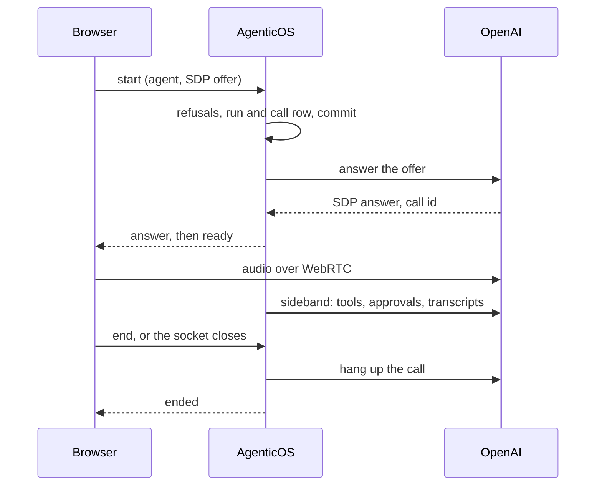

# Sprachgespräche { #voice-conversations }

Ein **Sprachanruf** ist ein gesprochenes Gespräch mit einem veröffentlichten
Agent. Sie sprechen, der Agent antwortet laut, und Sie können ihn mitten im Satz
unterbrechen. Der Agent behält, was er im Text-Chat hat: seine Tools, sein
Wissen, seine Freigaben und seine Budgets. Jeder Zug des Anrufs wird als Text in
derselben Unterhaltung gespeichert, sodass Sie ihn nachlesen oder tippend
fortsetzen können. Audio wird nirgendwo gespeichert.

Anrufe werden aus `/chat` in der Konsole geführt, und aus einem Widget oder von
einer gehosteten Seite, wenn der eigene Schalter eines Embeds an ist. Jeder
Anruf ist ein [Run](concepts.md) mit dem Namen des Realtime-Modells darauf, also
sehen Aktivität (Activity), der Kostenbildschirm und der Audit-Trail ihn wie
jeden anderen Run.

In `/chat` ist der Anruf eine Pille, die über dem Eingabefeld schwebt, das sich
nicht ändert: Status, Zeit, eine Wellenform, Stummschalten, Push-to-Talk und
Beenden. Der Anruf findet in der Unterhaltung statt, jeder Turn als die
Nachricht gezeichnet, die er wird, mit Tool-Ausführungen und Freigabekarten
dazwischen. Ein Entwurf und seine Anhänge stehen noch im Eingabefeld, wenn der
Anruf endet. Eine gehostete Seite verwendet eine Anrufleiste ohne
Freigabe-Bedienelemente, und das Widget lädt eine eigene, schlankere. Siehe
[Konsole](console.md#voice-calls) und
[Kanäle](channels.md#voice-calls-on-a-widget-or-a-hosted-page).

Ein Organisations- oder Kontowechsel beendet den Konsolenanruf und bricht
laufenden Aufbau sowie Wiederverbindungen ab. Wird die Mikrofonfreigabe erst
danach erteilt, werden die Spuren gestoppt, ohne einen Anruf der vorherigen
Organisation zu öffnen. Öffentliche Einbettungen behalten ihren eigenen Besucherbereich.

## Einschalten { #turn-it-on }

**Anrufe werden im Agent eingeschaltet.** Die Organisation hat keine
Anrufeinstellungen: Ein veröffentlichter Agent mit einer Stimme nimmt Anrufe an,
begrenzt durch seinen eigenen längsten Anruf und durch die Budgets, wie jeder
Run.

**Der Agent.** Seine Karte Stimme (Voice) im Builder hat einen Reiter
**Sprachanrufe**, geschrieben in das [Feld `voice`](reference/spec.md#voice) der
Spec. Er nennt den Provider, das Modell (oder, für Azure, den Deployment-Namen
und das Basismodell, das es betreibt), den Vault-Schlüssel, mit dem Anrufe
geführt werden, die Stimme, optional eine Sprache, optional einen längsten
Anruf (10 Minuten, wenn nicht gesetzt, höchstens 50) und optional eine
Sprachnotiz. Die Notiz wird nur in Anrufen an die Anweisungen des Agents
angehängt. Der Abschnitt wirkt, sobald der Agent veröffentlicht ist.

**Erst die Stimme hören.** Die Abspieltaste neben der Stimmauswahl spielt die
Stimme des Entwurfs mit einem Satz ab, in der Sprache des Abschnitts oder der
Konsole, bevor irgendetwas veröffentlicht ist. Das ist eine kurze
kostenpflichtige Sitzung auf dem Schlüssel des Abschnitts, außerhalb der Budgets
wie ein Diktat, also ist sie pro Person begrenzt
(`RATE_LIMIT_VOICE_PREVIEW_PER_MINUTE`) und eine Woche lang pro Stimme und
Sprache im Cache.

**Jeder Agent bietet die Taste an.** In `/chat` steht die Anruftaste bei jedem
Agent an der Stelle von Senden, solange das Feld leer ist; sobald etwas getippt
ist, kommt Senden zurück. Für einen ohne Stimme, oder mit einem Schlüssel, der
keinen Anruf mehr halten kann, ist sie durchgestrichen, und ihr Grund verlinkt
für alle, die den Agent bearbeiten dürfen, den Reiter Anrufe seiner Karte Stimme
(Voice). Das Fenster des Architect und das Testpanel des Builders bieten sie
genauso an; im Testpanel führt der Anruf die veröffentlichte Version aus, nicht
den getesteten Entwurf, und die Taste sagt das.

**Das Embed.** Ein Widget oder eine gehostete Seite bietet Anrufe nur an, wenn
sein eigener Schalter „Sprachanrufe“ (Voice calls) an ist. Den Schalter
eingeschaltet zu speichern wird abgelehnt, solange der Agent keine
veröffentlichte Stimme hat, mit der sich anrufen lässt. Siehe
[Kanäle](channels.md#voice-calls-on-a-widget-or-a-hosted-page).

## Modelle und Schlüssel { #models-and-keys }

Die Modelle, die ein Anruf verwenden kann, kommen aus einer Katalogdatei,
`backend/app/core/catalog/realtime_models.json`, beschrieben unter
[Modelle](models.md#realtime-models). Es gibt kein Model Profile für Sprache und
keinen Standard der Organisation: Der Abschnitt Sprachgespräche des Agents ist
der einzige Ort, an dem ein Realtime-Modell benannt wird.

| Provider | Modelle | Transport | Verifiziert |
|---|---|---|---|
| OpenAI | `gpt-realtime`, `gpt-realtime-2.1`, `gpt-realtime-2.1-mini` | WebRTC | Live getestet |
| Azure OpenAI | ein Deployment von `gpt-realtime` | Relay | **Nicht live verifiziert** |
| Google | Gemini Live: `gemini-2.5-flash-native-audio-latest`, `gemini-3.1-flash-live-preview` | Relay | **Nicht live verifiziert** |
| xAI | `grok-voice-latest`, pro Minute abgerechnet | Relay | **Nicht live verifiziert** |

Nur OpenAI ließ sich gegen ein echtes Konto testen. Azure, Gemini und xAI sind
nach der Dokumentation der Provider und von Pydantic AI gebaut und mit Fakes
getestet. Rechnen Sie damit, dass sie funktionieren, und prüfen Sie sie mit
Ihrem eigenen Konto, bevor Sie sich auf sie verlassen.

**Der Schlüssel ist ein ausdrückliches Vault-Secret.** Sein Zweck muss der
Provider sein und seine Art muss passen: ein `api_key`, oder für Azure ein
`azure_openai`-Secret, das auch den Endpunkt und die API-Version trägt. Der
Veröffentlichende muss den Schlüssel sehen können, wie bei jeder Bindung. Siehe
[Secrets](secrets.md#where-they-are-used).

**GPT-Live wird nicht angeboten.** Es nimmt den Verlauf der Unterhaltung nur
beim Start einer Sitzung auf und lässt sich nicht neu konfigurieren, also könnte
eine Wiederverbindung den Anruf, den sie fortsetzt, nicht weiterführen.

## Wie ein Anruf läuft { #how-a-call-runs }

Der Browser öffnet ein Socket zu diesem Deployment, `/api/v1/ws/voice`, und
sendet einen `start`-Frame, der den Agent und optional die Unterhaltung benennt.
Alles am Anruf läuft über dieses Socket: Die Frames sind auf
[der API-Seite](api.md#voice-calls) aufgelistet.

**OpenAI, über WebRTC.** Der Browser baut mit seinem Mikrofon eine
Peer-Verbindung auf und sendet das SDP-Angebot innerhalb von `start`. Der Server
beantwortet es beim Provider, schickt die Antwort zurück und hält dann eine
*Sideband*-Verbindung zum selben Anruf, solange das Socket offen ist. Das Audio
fließt zwischen dem Browser und OpenAI; die Tools, die Freigaben, die
Transkripte und die Messung laufen auf dem Server. Während der Einrichtung
liest der Server das Socket mit, sodass ein `end` oder ein geschlossener Tab
die Einrichtung stoppt, bevor die Provider-Session geöffnet wird. Ein Angebot,
das schon beim Provider liegt, darf zuerst zu Ende laufen; den Anruf, den es
angelegt hat, legt der Server danach auf, damit er nicht bis zum eigenen Limit
des Providers weiterläuft.

Zwei Dinge werden bewusst abgelehnt. Ein Angebot, das einen **Datenkanal**
öffnet (einen `m=application`-Abschnitt), wird abgelehnt: Der Browser braucht
nie einen, und ein Datenkanal ließe die Seite am Server vorbei Ereignisse an den
Provider schicken. Und **es wird nie ein Client-Secret ausgestellt**, sodass der
Browser nie ein Credential hält, mit dem sich ein eigener Anruf öffnen ließe.

**Azure, Gemini und xAI, über das Relay.** Der Browser streamt 16-Bit-PCM-Audio
über dasselbe Socket, mit der Eingaberate des Modells, und spielt ab, was mit
dessen Ausgaberate zurückkommt. Wenn Sie dem Agent ins Wort fallen, schneidet der
Server seine Antwort ab und sagt dem Browser, dass er verwerfen soll, was er in
der Warteschlange hat. Audio, das viel schneller ankommt, als irgendjemand
spricht, wird verworfen, und eine anhaltende Flut beendet den Anruf.

## Was ein Anruf nutzen kann { #what-a-call-can-use }

Ein Anruf führt den Agent aus, den sein veröffentlichter Spec beschreibt, gebaut
von derselben Factory wie ein Text-Run. Die Unterschiede kommen von der
Realtime-Sitzung: Ihre Tools stehen fest, sobald der Anruf verbunden ist, sie
kann nicht für eine Freigabe pausieren, und sie trägt keinen Workspace, keinen
Browser und keine Delegates. Diese übergibt der Anruf stattdessen dem eigenen
Textmodell des Agenten.

| Per Sprache | Capabilities |
|---|---|
| Unverändert | clock (die Uhrzeit in den Anweisungen steht fest, sobald der Anruf verbunden ist), context, knowledge, web research, web fetch, charts, artifacts, code execution, conversation search, memory files, mem0 memory, planning, tool output limits, image generation, text to speech |
| Auf dem Bildschirm | ask the user: In `/chat` erscheint die Fragekarte in der Anrufansicht und wird auch vorgelesen; der Anrufer tippt eine Antwort an oder sagt sie. Ein Anruf aus einem Widget oder einer gehosteten Seite bekommt sie nicht |
| Angepasst | skills: bei Bedarf als Anweisungen geladen, ohne die Tools, mit denen ein Text-Run sie liest |
| Weggelassen | tool search: Die MCP-Tools, die sie zurückgestellt hätte, werden dem Anruf direkt übergeben |
| Abgebildet | thinking: wird zur eigenen Reasoning-Einstellung des Realtime-Modells, wo das Modell eine hat |
| Übergeben | sandbox, browser use, subagents, der Coding Agent, Videoerzeugung, Arbeiten während Tools laufen: erledigt das Textmodell des Agenten, siehe [Arbeit übergeben](#handing-work-off) |

Die Karte Stimme im Builder listet die Capabilities auf, die dieser Agent in
Anrufen übergibt.

### Arbeit übergeben { #handing-work-off }

Hat der Agent eine Capability, die ein Anruf nicht trägt, bekommt sein Anruf ein
weiteres Tool, `hand_off`. Das Modell des Anrufs beschreibt die Aufgabe, und
derselbe Agent führt sie auf seinem eigenen Textmodell aus, dem aus seinem
Build-Tab: mit Sandbox, Browser und Subagents, im selben Workspace, unter
demselben Budget. Er antwortet mit dem, was er getan hat, und das Modell des
Anrufs sagt es laut.

- **Der Anruf läuft währenddessen weiter.** Der Agent sagt zuerst, dass er daran
  arbeitet, und die Anrufleiste zeigt jeden Schritt, während er läuft.
- **Jeder Schritt bleibt erhalten.** Die Schritte werden am Turn gespeichert, der
  die Arbeit übergeben hat, und die Unterhaltung zeigt sie danach wie die eines
  Chats.
- **Freigaben gehören dem Anruf.** Ein freigabepflichtiges Tool, das das
  Textmodell oder einer seiner Subagents aufruft, zeigt dieselbe Freigabekarte
  wie eines, das der Anruf aufruft. Auch hier trägt der Anruf eines Besuchers
  kein freigabepflichtiges Tool.
- **Eine Übergabe nach der anderen.** Jede setzt fort, was die letzte in diesem
  Anruf getan hat, sodass „jetzt schick die Datei“ nach „schreib es auf“
  funktioniert.
- **Ein Fehlschlag wird gesagt, nicht verborgen.** Eine Übergabe, der Budget
  oder Schritte ausgehen oder deren Modell versagt, kommt als Satz zurück, den
  der Agent sagt; der Anruf läuft weiter.

Eine Übergabe dauert so lange wie die Arbeit, oft eine Minute oder länger, und
verbraucht zusätzlich zum Modell des Anrufs auch das Textmodell.

**Eingebauter Sprechstil.** Jeder Anruf hängt dieselbe Anleitung an die
Anweisungen des Agents an: kurze Sätze; kein Markdown, keine Listen, Tabellen
oder Links, die laut vorgelesen werden; Zahlen und Daten so gesagt, wie ein
Mensch sie sagt; Namen, Beträge, Adressen und Daten zur Bestätigung
wiederholt, bevor danach gehandelt wird; und es zu sagen, wenn er auf eine
Freigabe wartet, statt zuerst ein Ergebnis zu behaupten. Im Anruf eines
Besuchers ist von Freigaben keine Rede; stattdessen soll der Agent klar sagen,
was er in diesem Anruf nicht kann. Der eigene Hinweis zur Stimme des Agents
folgt darauf.

Über WebRTC wird der Agent zweimal aufgelöst, einmal, um das Angebot zu
beantworten, und einmal für die Sideband-Verbindung. MCP-Server werden zweimal
verbunden und dynamische Anweisungen laufen zweimal, also wird ein
mem0-Memory-Lookup zweimal bezahlt; beides wird auf dem Run gemessen.

## Freigaben in einem Anruf { #approvals-in-a-call }

Eine Realtime-Sitzung kann nicht pausieren, also wird eine Freigabe innerhalb des
Anrufs entschieden.

Wenn der Agent ein Tool aufruft, das eine Freigabe braucht, schreibt der Server
sofort die Freigabezeile und zeigt der Person im Anruf eine Karte: das Tool,
**die exakten Argumente, mit denen es laufen wird**, und was vom Anrufer
verstanden wurde. Ein falsch verstandener Name ist hier das Risiko („Acme“
verstanden als „Ahmad“), und die Karte ist die Prüfung dagegen. Freigeben führt
genau diese Argumente aus, einmal; dasselbe Tool, erneut aufgerufen, braucht
eine neue Freigabe. Eine zweite Entscheidung auf derselben Karte, gesendet,
bevor die erste ankommt, ändert nichts: Die erste gilt.

- **60 Sekunden** ohne Entscheidung lassen die Anfrage ablaufen, ohne
  entscheidende Person, und der Agent sagt das.
- Nur **die Person im Anruf** entscheidet, und nur mit `approvals:decide`. Die
  Freigabe-Queue weist eine Anfrage ab, die zu einem laufenden Anruf gehört, und
  der Sweep für liegengebliebene Freigaben lässt sie in Ruhe.
- Ein Mitglied **ohne** `approvals:decide` behält das Tool. Wenn der Agent danach
  greift, zeigt der Anruf einen Hinweis, das Tool wird abgelehnt, und der Agent
  sagt, dass dafür eine Freigabe nötig ist, die der Anrufer per Sprache nicht
  erteilen kann, und schlägt den Text-Chat vor.
- Ein **anonymer Besucher** auf einem Widget oder einer gehosteten Seite sieht nie
  ein Tool, das eine Freigabe braucht: Diese Tools werden ganz aus dem Anruf
  weggelassen.

Ruft das Modell ein Tool auf, das der Anruf nicht hat, ob für einen Besucher
weggelassen oder frei erfunden, läuft das Tool nicht. Das Modell erfährt, dass
das Tool in diesem Anruf nicht verfügbar ist, der Agent sagt, dass er das nicht
kann, und der Anruf geht weiter.

Endet ein Anruf, aus welchem Grund auch immer, läuft alles ab, worauf er noch
gewartet hat.

## Limits und Kosten { #limits-and-cost }

**Zeit.** Ein Anruf läuft höchstens so lange wie der längste Anruf des Agents:
10 Minuten, wenn der Abschnitt „Stimme“ keinen nennt, und nie mehr als 50. Seine
Uhr startet, sobald der Anruf bereit ist, zusammen mit dem Timer der
Anrufansicht, die Einrichtungszeit zählt also nicht. Eine Minute vor dem Ende
wird die Anrufansicht gewarnt. Am Ende sagt der Agent einen kurzen Satz dazu,
warum, und der Anruf endet, als `time_limit`.

**Minuten.** Anrufminuten werden aus den Anrufzeilen (`voice_calls`) gezählt:
jeder Anruf bis zu seinem Ende oder, solange er noch läuft, bis zu seinem
letzten Heartbeat. Ein monatliches Minutenlimit gibt es nicht; was Anrufe
ausgeben, begrenzen die Budgets unten. Die Dashboard-Karte „Anrufminuten“
(Voice minutes) und `GET /api/v1/voice/usage` lesen dieselben Zeilen.

**Geld.** Anrufe zählen gegen die Budgets des Agents und der Organisation, wie
Text-Runs:

- Bevor ein Anruf beginnt, wird seine längstmögliche Dauer mal der
  Worst-Case-Minutenpreis des Modells gegen das verbleibende Budget geprüft. Ein
  Anruf, der sich nicht bezahlen ließe, wird abgelehnt, statt begonnen und
  abgeschnitten zu werden.
- Während des Anrufs wird jede Antwort beim Abschluss erfasst, und das Budget
  wird bei jedem Heartbeat neu gelesen. Das Kostenlimit der Sitzung kann um
  höchstens eine Antwort überschritten werden (zwei bei Azure, dessen
  Deployment hier wie sein Basismodell bepreist wird).
- Jeder Heartbeat schreibt außerdem die bisherigen Kosten des Anrufs auf seinen
  Run, sodass die Budgetprüfungen anderer Runs und Anrufe die Ausgaben eines
  laufenden Anrufs innerhalb von 15 Sekunden sehen, nicht erst nach seinem Ende.
- Eine Antwort, die die Realtime-Sitzung nicht bepreist, wird hier anhand ihrer
  Token-Zahlen bepreist, und das Kostenlimit der Sitzung zählt sie mit. Eine,
  die sich auf keinem Weg bepreisen lässt, wird als unbepreist erfasst.
- xAI wird pro verbundener Minute abgerechnet, zum Satz des Katalogs.
- Ein Modell, dessen Preis sich nicht berechnen lässt, wird bei der Einrichtung
  abgelehnt, sodass ein Budget nie stillschweigend nicht durchgesetzt wird.
- Das Transkribieren der Sprache des Anrufers wird nicht bepreist, die
  erfassten Kosten eines Anrufs liegen also etwas unter dem, was der Provider
  abrechnet.

**Gleichzeitigkeit.** Eine Person führt einen Anruf zur Zeit
(`VOICE_MAX_CALLS_PER_USER`, Standard 1). Ein gerade aufgelegter Anruf zählt
noch, bis sein Ende festgehalten ist, also wartet ein neuer Anruf derselben
Person bis zu vier Sekunden auf ihn, bevor er als `busy` ablehnt: „Erneut
anrufen“ direkt nach Beenden startet einen Anruf. Ein Embed hält höchstens drei
offene Anrufe, von allen Besuchern zusammen (`VOICE_MAX_CALLS_PER_EMBED`); ein
vierter Anrufer wird als `line_busy` abgelehnt. Siehe
[Konfiguration](configuration.md#voice-calls).

## Einen Anruf beenden, und was einen verlorenen begrenzt { #ending-a-call-and-what-bounds-a-lost-one }

Das Schließen des Sockets beendet einen WebRTC-Anruf von OpenAI nicht: Das Audio
gehört dem Browser und dem Provider, und der Anruf spricht und rechnet weiter ab,
bis er aufgelegt wird oder das eigene Ein-Stunden-Limit des Providers erreicht.
Das Auflegen ist also Aufgabe des Servers, auf jedem Pfad:

1. **Ein `finally` bei jedem Ausgang.** Auflegen, ein Limit, ein verlorenes
   Socket, ein Fehler, ein entzogener Zugriff oder ein Herunterfahren enden alle
   im selben Teardown. Er hält das Ende des Anrufs fest, damit eine
   Wiederverbindung, die darauf wartet, nicht auch noch das Auflegen abwartet,
   legt dann den Anruf beim Provider auf (der Auflege-Endpunkt von OpenAI; ein
   Relay-Anruf endet, wenn der Server sein Upstream-Socket schließt) und
   schließt dann den Run mit seinen Kosten ab.
2. **Heartbeats.** Der Prozess, der einen Anruf hält, schreibt alle 15 Sekunden
   dessen Kosten und Sekunden, schon ab Beginn der Einrichtung, damit ein
   langsamer Start nicht für einen verlorenen Anruf gehalten wird. Jeder
   Heartbeat prüft außerdem erneut die Sitzung des Anrufers, seine
   Mitgliedschaft, ihren Zugriff auf den Agent und den veröffentlichten Zustand
   des Agents und beendet den Anruf, wenn eines davon nicht mehr gilt. Der
   Anruf eines Besuchers braucht außerdem sein Embed weiterhin aktiv, mit
   eingeschalteten Anrufen und auf denselben Agent zeigend.
3. **Der Sweep.** Ein geplanter Job, jede Minute und einmal beim Start, legt
   jeden Anruf auf, dessen Heartbeat älter als 45 Sekunden ist oder dessen Ende
   vor mehr als 45 Sekunden festgehalten wurde, dessen Auflegen aber
   fehlschlug. Er braucht nur die ID des Anrufs und den Schlüssel und schließt
   jeden Anruf für sich, sodass einer, der sich nicht schließen lässt, die
   anderen nicht aufhält. Ein Anruf, den er nicht auflegen kann, etwa weil sich
   sein Schlüssel nicht mehr lesen lässt, wird als aufgegeben ausgemustert,
   sobald er eine Stunde alt ist - bis dahin hat der Provider ihn beendet.
4. **Herunterfahren.** Ein Server, der angewiesen wird anzuhalten, legt seine
   eigenen Anrufe auf, bevor er geht.
5. **Der Browser** schließt seine Peer-Verbindung, wenn der Tab endgültig
   verborgen wird (`pagehide`) oder das Socket schließt. Das ist eine
   Bequemlichkeit; die vier oben sind die Garantie.

!!! danger "Der schlimmste Fall für einen verlorenen OpenAI-Anruf"

    Versagte jede Sicherung, kostet ein stiller Anruf fast nichts und ein
    gesprächiger etwa 5–15 $ für seine Stunde. Das größere Risiko ist nicht das
    Geld: Es ist der Schlüssel Ihrer Organisation, offen gehalten ohne Tools,
    ohne Freigaben und ohne Audit. Der Sweep verkürzt dieses Fenster auf etwa
    eine Minute.

## Wiederverbinden { #reconnecting }

Eine abgebrochene Verbindung bekommt **einen automatischen Neuversuch innerhalb
von 10 Sekunden**. Die neue Verbindung wird nur für dieselbe Person, denselben
Agent und dieselbe Unterhaltung angenommen, nur mit dem Fortsetzungs-Token, das
die vorige Verbindung bei ihrer Einrichtung bekommen hat, und nur innerhalb von
10 Sekunden, nachdem die vorige geschlossen wurde. Der Server speichert nur
einen Hash dieses Tokens. Eine Wiederverbindung beendet die vorige, wenn diese
noch halb offen ist, und zählt sie als bei ihrem letzten Heartbeat beendet.

Zeit und Budget werden übernommen: Eine Wiederverbindung setzt die Uhr des Anrufs
fort, statt sie neu zu starten, und die Anrufansicht behält das volle Zeitlimit
des Anrufs. Ein Anruf, der schon aus 20 Verbindungen besteht, wird nicht mehr
fortgesetzt, damit seine Zeit nicht aus der Zählung rutschen kann.

Die neue Sitzung beginnt mit den bisher gespeicherten Zügen, als **Text**, also
wird nichts wiederholt, kein Tool läuft zweimal, und das Audio wird nicht noch
einmal abgerechnet. Wenn diese Züge mehr als die Hälfte des Kontextfensters des
Modells füllen würden, werden die älteren zu einer kurzen Zusammenfassung, die
das Chat-Modell des Agents schreibt (auf den Run abgerechnet), und die jüngeren
folgen Wort für Wort.

Jede Verbindung ist ein eigener Run, verknüpft mit dem, den sie fortgesetzt hat.
Aktivität zeigt die Kette als einen Anruf, mit Zeit und Kosten jeder Verbindung
aufsummiert.

!!! note "Die eigene Fortsetzung von Gemini"

    Gemini beendet seine Verbindungen nach etwa zehn Minuten und setzt sie
    prozessintern fort, innerhalb eines Anrufs. Eine Wiederverbindung aus dem
    Browser ist eine neue Sitzung, mit Text vorbefüllt, wie bei jedem anderen
    Provider.

## Transkripte { #transcripts }

Jeder Zug wird gespeichert, sobald er fertig ist, als gewöhnliche Nachricht in
der Unterhaltung: die Worte des Anrufers aus dem Eingabetranskript, die des
Agents aus dem, was er gesagt hat. Tool-Aufrufe erscheinen inline, wie im
Text-Chat; ein Tool, das das Modell um einen neuen Versuch gebeten hat, wird als
fehlgeschlagen gespeichert, mit einem allgemeinen Hinweis statt des eigenen
Fehlertexts des Tools. Ein Absturz verliert höchstens den laufenden Zug, und eine
Wiederverbindung kann einen Zug nicht zweimal speichern.

Wenn Sie dem Agent ins Wort fallen, wird seine Antwort auf das gekürzt, was Sie
gehört haben, und als unterbrochen markiert. Über das Relay weiß der Server
genau, was abgespielt wurde. Über WebRTC weiß er es nicht, also ist der Schnitt
eine Schätzung, gemacht anhand des Zeitpunkts, zu dem Sie zu sprechen begannen.
Die Live-Untertitel können dem Audio etwas vorauslaufen.

**Guardrails** laufen auf den Transkripten. Ein Treffer bei den Worten des
Agents unterbricht ihn mitten im Satz und zeigt einen Hinweis; ein Treffer bei
den Worten des Anrufers wird nicht gemeldet. In beiden Fällen wird der Treffer
beim Anruf gezählt und der ganze Zug als `[withheld by a guardrail]`
gespeichert, und ein Guardrail, der schwärzt statt zu blockieren, speichert den
geschwärzten Text. Gesprochene Worte lassen sich nicht filtern, bevor sie zu
hören sind - die Karte Stimme sagt das.

Tools werden auf dem Rückweg geprüft: Das Ergebnis eines Tools wird geprüft und
blockiert, bevor der Agent es liest. Die Prüfung, bevor ein Tool läuft, ist die
Freigabe, für Tools, die eine brauchen. Guardrails prüfen die Argumente eines
Tools nicht.

## Häufig gestellte Fragen { #frequently-asked-questions }

### Wird Audio aufgezeichnet? { #is-audio-recorded }

Nein. Der Anruf behält nur Text: Das Transkript jedes Zugs wird als Nachricht in
der Unterhaltung gespeichert, und dieses Deployment speichert kein Audio, weder
in der Datenbank noch auf der Platte noch nach dem Anruf im Speicher. Was der
Provider behält, regelt Ihre Vereinbarung mit diesem Provider.

### Warum kann ein Besucher kein Tool freigeben? { #why-cant-a-visitor-approve-a-tool }

Ein Besucher auf einem Widget oder einer gehosteten Seite ist anonym, und eine
Freigabe ist eine Entscheidung, für die jemand verantwortlich sein muss. Also
werden Tools, die eine Freigabe brauchen, ganz aus dem Anruf eines Besuchers
weggelassen, und der Agent sagt klar, wenn er dort etwas nicht tun kann.

### Was passiert, wenn mein Tab mitten im Anruf schließt? { #what-happens-if-my-tab-closes-mid-call }

Das Socket schließt, und der Server legt den Anruf beim Provider auf und hält
dessen Zeit und Kosten fest. Hat der Server selbst angehalten, legt der Sweep
den Anruf innerhalb von etwa einer Minute nach seinem letzten Heartbeat auf. Die
Züge, die gesprochen wurden, bevor der Tab schloss, sind bereits in der
Unterhaltung gespeichert.
