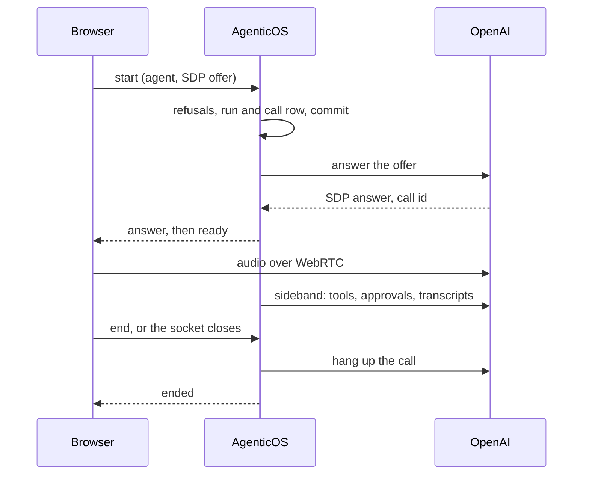

# Conversaciones de voz { #voice-conversations }

Una **llamada de voz** es una conversación hablada con un agent publicado. Tú
hablas, el agent responde en voz alta y puedes interrumpirlo a mitad de frase. El
agent conserva lo que tiene en el chat de texto: sus herramientas, su
conocimiento, sus aprobaciones y sus budgets. Cada turno de la llamada se guarda
como texto en la misma conversación, así que puedes releerlo o continuarlo
escribiendo. No se guarda audio en ningún sitio.

Las llamadas se hacen desde `/chat` en la consola, y desde un widget o una
página alojada cuando el interruptor propio del embed está activado. Cada llamada
es un [run](concepts.md), con el nombre del modelo realtime, así que Activity, la
pantalla de coste y el registro de auditoría la ven como cualquier otro run.

En `/chat` la llamada es una píldora que flota sobre el composer, que no cambia:
estado, tiempo, una forma de onda, silenciar, push-to-talk y End. La llamada
transcurre en la propia conversación, con cada turno dibujado como el mensaje en
que se convertirá y las herramientas que se ejecutan y las tarjetas de
aprobación entre ellos. Un borrador y sus adjuntos siguen en el composer cuando
termina la llamada. Una página alojada usa una barra de llamada sin los
controles de aprobación, y el widget carga una propia, más pequeña. Ver
[Consola](console.md#voice-calls) y
[Canales](channels.md#voice-calls-on-a-widget-or-a-hosted-page).

Cambiar de organización o cuenta finaliza la llamada de la consola y cancela
la preparación y las reconexiones pendientes. Si el permiso del micrófono llega
después, sus pistas se detienen sin abrir la llamada de la organización anterior.
Las inserciones públicas conservan su ámbito independiente de visitante.

## Activarlo { #turn-it-on }

**Las llamadas se activan en el agent.** La organización no tiene ajustes de
llamadas: un agent publicado con una voz atiende llamadas, acotado por su propia
llamada más larga y por los budgets, como cualquier run.

**El agent.** Su tarjeta Voice en el Builder tiene una pestaña **Voice calls**,
que se escribe en el [campo `voice`](reference/spec.md#voice) de la spec. Nombra
el provider, el modelo (o, para Azure, el nombre del deployment y el modelo base
que ejecuta), la clave del vault con la que se mantienen las llamadas, la voz,
un idioma opcional, una llamada más larga opcional (10 minutos si no se fija, 50
como máximo) y una nota de voz opcional. La nota se añade a las instrucciones del
agent solo en las llamadas. La sección entra en vigor cuando se publica el agent.

**Oye la voz antes.** El botón de reproducir junto al selector de voz reproduce
la voz del borrador diciendo una frase, en el idioma de la sección o de la
consola, antes de publicar nada. Es una sesión de pago corta con la clave de la
sección, fuera de los budgets como un dictado, así que se limita por persona
(`RATE_LIMIT_VOICE_PREVIEW_PER_MINUTE`) y queda en caché una semana por voz e
idioma.

**Todo agent ofrece el botón.** En `/chat` el botón de llamada ocupa el lugar
de Enviar mientras el cuadro está vacío, y Enviar vuelve en cuanto se escribe algo,
en cada agent. Para uno sin voz, o con una clave que ya no puede
mantener una llamada, aparece tachado, y su motivo lleva a quien puede editar el
agent a la pestaña de llamadas de su tarjeta Voice. La ventana del Architect y el
panel de pruebas del Builder lo ofrecen igual; en el panel de pruebas la llamada
ejecuta la versión publicada, no el borrador que se prueba, y el botón lo dice.

**El embed.** Un widget o una página alojada ofrecen llamadas solo cuando su
propio interruptor «Voice calls» está activado. Guardar el interruptor activado
se rechaza mientras el agent no tenga una voz publicada con la que pueda llamar.
Ver [Canales](channels.md#voice-calls-on-a-widget-or-a-hosted-page).

## Modelos y claves { #models-and-keys }

Los modelos que puede usar una llamada vienen de un único archivo de catálogo,
`backend/app/core/catalog/realtime_models.json`, descrito en
[Modelos](models.md#realtime-models). No hay perfil de modelo para la voz ni un
valor por defecto de la organización: la sección Voice del agent es el único
sitio donde se nombra un modelo realtime.

| Provider | Modelos | Transporte | Verificado |
|---|---|---|---|
| OpenAI | `gpt-realtime`, `gpt-realtime-2.1`, `gpt-realtime-2.1-mini` | WebRTC | Probado en vivo |
| Azure OpenAI | un deployment de `gpt-realtime` | Relay | **No verificado en vivo** |
| Google | Gemini Live: `gemini-2.5-flash-native-audio-latest`, `gemini-3.1-flash-live-preview` | Relay | **No verificado en vivo** |
| xAI | `grok-voice-latest`, facturado por minuto | Relay | **No verificado en vivo** |

Solo OpenAI se pudo probar contra una cuenta real. Azure, Gemini y xAI están
construidos a partir de la documentación de los providers y de Pydantic AI, y
probados con dobles. Espera que funcionen, y compruébalos en tu propia cuenta
antes de depender de ellos.

**La clave es un secreto explícito del vault.** Su propósito tiene que ser el
provider y su tipo tiene que coincidir: una `api_key`, o un secreto
`azure_openai` para Azure, que además lleva el endpoint y la versión de la API.
Quien publica tiene que poder ver la clave, como en cualquier vinculación. Ver
[Secretos](secrets.md#where-they-are-used).

**GPT-Live no se ofrece.** Solo recibe el historial de la conversación cuando
empieza una sesión y no se puede reconfigurar, así que una reconexión no podría
continuar la llamada que retoma.

## Cómo funciona una llamada { #how-a-call-runs }

El navegador abre un socket hacia este despliegue, `/api/v1/ws/voice`, y envía
una trama `start` que nombra el agent y, opcionalmente, la conversación. Todo lo
relativo a la llamada pasa por ese socket: las tramas están enumeradas en
[la página de la API](api.md#voice-calls).

**OpenAI, sobre WebRTC.** El navegador construye una conexión peer con su
micrófono y envía la oferta SDP dentro de `start`. El servidor la responde con el
provider, devuelve la respuesta y luego mantiene una conexión *sideband* a la
misma llamada mientras el socket siga abierto. El audio fluye entre el navegador
y OpenAI; las herramientas, las aprobaciones, las transcripciones y la medición
corren en el servidor. El servidor lee el socket mientras establece la llamada,
así que un `end` o una pestaña cerrada detienen el establecimiento antes de que
se abra la sesión con el provider. Una oferta ya enviada al provider se deja
terminar primero, y la llamada que creó se cuelga a continuación, para que no
siga hasta el límite propio del provider.

Dos cosas se rechazan a propósito. Una oferta que abre un **canal de datos** (una
sección `m=application`) se rechaza: el navegador nunca lo necesita, y un canal
de datos permitiría a la página enviar eventos al provider a espaldas del
servidor. Y **nunca se emite un client secret**, así que el navegador nunca tiene
una credencial que pudiera abrir una llamada propia.

**Azure, Gemini y xAI, sobre el relay.** El navegador envía audio PCM de 16 bits
por el mismo socket, a la frecuencia de entrada del modelo, y reproduce lo que
vuelve a su frecuencia de salida. Cuando hablas por encima del agent, el servidor
corta su respuesta y le dice al navegador que descarte lo que tiene en cola. El
audio que llega mucho más rápido de lo que nadie habla se descarta, y una
avalancha sostenida termina la llamada.

## Qué puede usar una llamada { #what-a-call-can-use }

Una llamada ejecuta el agent que describe su spec publicado, construido por la
misma factory que un run de texto. Las diferencias vienen de la sesión realtime:
sus herramientas quedan fijadas cuando se conecta la llamada, no puede pausarse
para una aprobación y no puede llevar un workspace, un navegador ni delegados.
Eso la llamada lo pasa al modelo de texto propio del agent.

| Por voz | Capabilities |
|---|---|
| Tal cual | reloj (la hora de las instrucciones queda fijada cuando se conecta la llamada), contexto, conocimiento, investigación web, lectura de páginas web, gráficos, artefactos, ejecución de código, búsqueda de conversaciones, archivos de memoria, memoria mem0, planificación, límites de salida de herramientas, generación de imágenes, texto a voz |
| En pantalla | preguntar al usuario: en `/chat` la tarjeta de preguntas aparece en la vista de la llamada y además se lee en voz alta; quien llama toca una respuesta o la dice. Una llamada desde un widget o una página alojada no la recibe |
| Adaptada | skills: se cargan como instrucciones bajo demanda, sin las herramientas que usa un run de texto para leerlos |
| Eliminada | búsqueda de herramientas: las herramientas MCP que habría diferido se pasan directamente a la llamada |
| Traducida | razonamiento (thinking): se convierte en el ajuste de razonamiento propio del modelo realtime, cuando el modelo lo tiene |
| Delegada | sandbox, automatización del navegador, subagents, el coding agent, generación de vídeo, trabajar mientras corren herramientas: lo hace el modelo de texto del agent, ver [Pasar trabajo](#handing-work-off) |

La tarjeta Voice del Builder enumera las capabilities que este agent pasa a su
modelo de texto en las llamadas.

### Pasar trabajo { #handing-work-off }

Cuando el agent tiene una capability que una llamada no puede llevar, su
llamada recibe una herramienta más, `hand_off`. El modelo de la llamada describe
la tarea y el mismo agent la ejecuta en su propio modelo de texto, el que indica
su pestaña Build: con el sandbox, el navegador y los subagents, en el mismo
workspace y con el mismo presupuesto. Responde con lo que hizo, y el modelo de
la llamada lo dice en voz alta.

- **La llamada sigue mientras tanto.** El agent dice primero que está en ello, y
  la barra de la llamada muestra cada paso mientras se ejecuta.
- **Cada paso se guarda.** Los pasos se guardan en el turno que pasó el trabajo,
  así que la conversación los muestra después como muestra los de un chat.
- **Las aprobaciones son de la llamada.** Una herramienta con aprobación que
  llama el modelo de texto, o uno de sus subagents, muestra la misma tarjeta de
  aprobación que una que llama la llamada. La llamada de un visitante tampoco
  lleva aquí herramientas con aprobación.
- **Un traspaso cada vez.** Cada uno continúa lo que hizo el anterior en esa
  llamada, así que «ahora envía ese archivo» funciona después de «redáctalo».
- **Un fallo se dice, no se oculta.** Un traspaso que se queda sin presupuesto o
  sin pasos, o cuyo modelo falla, vuelve como una frase que dice el agent; la
  llamada sigue.

Un traspaso dura lo que dura el trabajo, a menudo un minuto o más, y gasta en el
modelo de texto además del de la llamada.

**Estilo hablado integrado.** Cada llamada añade la misma guía a las
instrucciones del agent: frases cortas; nada de markdown, listas, tablas ni
enlaces leídos en voz alta; números y fechas dichos como los dice una persona;
nombres, importes, direcciones y fechas repetidos en voz alta antes de actuar
sobre ellos; y decir que está esperando una aprobación, en vez de afirmar antes
un resultado. En la llamada de un visitante no se habla de aprobaciones; en su
lugar, el agent debe decir con claridad lo que no puede hacer en la llamada. La
nota de voz propia del agent va a continuación.

Sobre WebRTC el agent se resuelve dos veces, una para responder a la oferta y
otra para el sideband. Los servidores MCP se conectan dos veces y las
instrucciones dinámicas se ejecutan dos veces, así que una consulta a la memoria
mem0 se paga dos veces; ambas se miden en el run.

## Aprobaciones en una llamada { #approvals-in-a-call }

Una sesión realtime no puede pausarse, así que una aprobación se decide dentro de
la llamada.

Cuando el agent llama a una herramienta que necesita aprobación, el servidor
escribe la fila de aprobación al instante y muestra a la persona que está en la
llamada una tarjeta: la herramienta, **los argumentos exactos con los que se
ejecutará** y lo que se oyó decir a quien llama. El riesgo aquí es un nombre mal
oído («Acme» oído como «Ahmad»), y la tarjeta es la comprobación. Aprobar ejecuta
exactamente esos argumentos, una vez; la misma herramienta llamada de nuevo
necesita una aprobación nueva. Una segunda decisión en la misma tarjeta, enviada
antes de que llegue la primera, no cambia nada: vale la primera.

- **60 segundos** sin decisión caducan la solicitud, sin nadie que decida, y el
  agent lo dice.
- Solo decide **la persona que está en la llamada**, y solo con
  `approvals:decide`. La cola de aprobaciones rechaza una solicitud que pertenece
  a una llamada en curso, y el barrido de caducadas la deja en paz.
- Un miembro **sin** `approvals:decide` conserva la herramienta. Cuando el agent
  recurre a ella, la llamada muestra un aviso, la herramienta se rechaza y el
  agent dice que esto necesita una aprobación que quien llama no puede dar por
  voz y sugiere el chat de texto.
- Un **visitante anónimo** en un widget o una página alojada nunca ve una
  herramienta que necesite aprobación: esas herramientas se dejan fuera de la
  llamada por completo.

Cuando el modelo llama a una herramienta que la llamada no tiene, ya sea una que
se dejó fuera para un visitante o un nombre que se ha inventado, la herramienta
no se ejecuta. Al modelo se le dice que esa herramienta no está disponible en
esta llamada, el agent dice que no puede hacerlo y la llamada sigue.

Una llamada que termina, por el motivo que sea, caduca todo lo que todavía
estuviera esperando.

## Límites y coste { #limits-and-cost }

**Tiempo.** Una llamada dura como mucho la llamada más larga del agent: 10
minutos cuando la sección Voice no nombra ninguna, y nunca más de 50. Su reloj
empieza cuando la llamada está lista, igual que el temporizador de la vista de
llamada, así que el tiempo de establecimiento no cuenta. Un minuto antes del
final se avisa a la vista de llamada. Al final el agent dice una frase corta
sobre el motivo y la llamada se detiene, como `time_limit`.

**Minutos.** Los minutos de llamada se cuentan a partir de las filas de llamada
(`voice_calls`): cada llamada hasta su fin, o hasta su último heartbeat mientras
sigue en curso. No hay un límite mensual de minutos; lo que gastan las llamadas
lo acotan los budgets de abajo. La tarjeta «Voice minutes» del dashboard y
`GET /api/v1/voice/usage` leen las mismas filas.

**Dinero.** Las llamadas cuentan contra los budgets del agent y de la
organización, como los runs de texto:

- Antes de que empiece una llamada, su duración máxima posible multiplicada por
  el precio por minuto del peor caso del modelo se comprueba contra el budget
  restante. Una llamada que no se podría pagar se rechaza, en vez de empezar y
  cortarse a medias.
- Durante la llamada, cada respuesta se mide cuando termina, y el budget se
  vuelve a leer en cada heartbeat. El límite de coste de la sesión puede
  sobrepasarse como mucho en una respuesta (dos en Azure, cuyo deployment se
  tarifa aquí como su modelo base).
- Cada heartbeat escribe además el coste de la llamada hasta ese momento en su
  run, así que las comprobaciones de budget de otros runs y llamadas ven el gasto
  de una llamada en curso en 15 segundos, no solo cuando termina.
- Una respuesta que la sesión realtime deja sin precio se tarifa aquí a partir
  de sus tokens, y el límite de coste de la sesión la cuenta. Una que no se puede
  tarifar de ninguna forma se registra como sin precio.
- xAI se factura por minuto conectado, a la tarifa del catálogo.
- Un modelo cuyo precio no se puede calcular se rechaza al configurarlo, así que
  un budget nunca queda sin aplicar en silencio.
- Transcribir lo que dice quien llama no se tarifa, así que el coste registrado
  de una llamada queda algo por debajo de lo que factura el provider.

**Concurrencia.** Una persona mantiene una llamada a la vez
(`VOICE_MAX_CALLS_PER_USER`, 1 por defecto). Una llamada colgada hace un momento
sigue contando hasta que se registra su fin, así que una llamada nueva de la
misma persona la espera hasta cuatro segundos antes de rechazarse como `busy`:
«Call again» justo después de End inicia una llamada. Un embed mantiene como
mucho tres llamadas abiertas, de todos los visitantes juntos
(`VOICE_MAX_CALLS_PER_EMBED`); un cuarto llamante se rechaza como `line_busy`.
Ver [Configuración](configuration.md#voice-calls).

## Terminar una llamada, y qué acota una perdida { #ending-a-call-and-what-bounds-a-lost-one }

Cerrar el socket no termina una llamada WebRTC de OpenAI: el audio es del
navegador y del provider, y la llamada sigue hablando y facturando hasta que se
cuelga o alcanza el límite de una hora del propio provider. Así que colgar es
trabajo del servidor, en cada camino:

1. **Un `finally` en cada salida.** Colgar, un límite, un socket perdido, un
   error, un acceso revocado o un apagado terminan todos en el mismo teardown.
   Registra el fin de la llamada, para que una reconexión que lo espera no
   espere también al colgado, después cuelga la llamada del provider (el
   endpoint de colgado de OpenAI; una llamada por relay termina cuando el
   servidor cierra su socket hacia el provider) y después termina el run con su
   coste.
2. **Heartbeats.** El proceso que mantiene una llamada escribe su coste y sus
   segundos cada 15 segundos, desde el inicio del establecimiento, para que un
   arranque lento no se tome por una llamada perdida. Cada heartbeat vuelve a
   comprobar además la sesión de quien llama, su membresía, el estado publicado
   del agent y su acceso al agent, y termina la llamada cuando
   falla cualquiera de ellos. La llamada de un visitante necesita además que su
   embed siga activo, con las llamadas activadas y apuntando al mismo agent.
3. **El barrido.** Un trabajo programado, cada minuto y una vez al arrancar,
   cuelga toda llamada cuyo heartbeat tenga más de 45 segundos, o cuyo fin se
   registró hace más de 45 segundos pero cuyo colgado falló. Solo necesita el id
   de la llamada y la clave, y cierra cada llamada por separado, así que una que
   no puede cerrar no retiene a las demás. Una llamada que no puede colgar, como
   una cuya clave ya no se puede leer, se retira como abandonada cuando cumple
   una hora, momento en el que el provider ya la ha terminado.
4. **Apagado.** Un servidor al que se le ordena parar cuelga sus propias llamadas
   antes de irse.
5. **El navegador** cierra su conexión peer cuando la pestaña se oculta
   definitivamente (`pagehide`) o el socket se cierra. Es una comodidad; las
   cuatro de arriba son la garantía.

!!! danger "El peor caso de una llamada de OpenAI perdida"

    Si fallaran todas las redes de seguridad, una llamada en silencio cuesta casi
    nada y una con mucha conversación unos 5–15 $ por su hora. El riesgo mayor no
    es el dinero: es la clave de tu organización mantenida abierta sin
    herramientas, sin aprobaciones y sin auditoría. El barrido reduce esa ventana
    a cerca de un minuto.

## Reconexión { #reconnecting }

Una conexión caída recibe **un reintento automático en 10 segundos**. La conexión
nueva solo se acepta para la misma persona, el mismo agent y la misma
conversación, solo con el token de reanudación que la conexión anterior recibió
al establecerse, y solo dentro de los 10 segundos posteriores al cierre de la
anterior. El servidor guarda solo un hash de ese token. Una reconexión termina
la anterior si sigue medio abierta, y la cuenta como terminada en su último
heartbeat.

El tiempo y el budget se arrastran: una reconexión continúa el reloj de
la llamada en vez de reiniciarlo, y la vista de llamada conserva todo el límite
de tiempo de la llamada. Una llamada que ya consta de 20 conexiones no se
reanuda más, para que su tiempo no pueda escaparse del cómputo.

La sesión nueva empieza desde los turnos guardados hasta ese momento, como
**texto**, así que no se repite nada, ninguna herramienta se ejecuta dos veces y
el audio no se vuelve a facturar. Cuando esos turnos llenarían más de la mitad
del context window del modelo, los más antiguos se convierten en un resumen
breve escrito por el modelo de chat del agent (facturado al run) y los recientes
siguen palabra por palabra.

Cada conexión es su propio run, enlazado con el que retomó. Activity muestra la
cadena como una sola llamada, con el tiempo y el coste de cada conexión sumados.

!!! note "La reanudación propia de Gemini"

    Gemini termina sus conexiones tras unos diez minutos y las reanuda dentro del
    proceso, dentro de una misma llamada. Una reconexión desde el navegador es una
    sesión nueva sembrada con texto, como con cualquier otro provider.

## Transcripciones { #transcripts }

Cada turno se guarda en el momento en que termina, como un mensaje normal de la
conversación: las palabras de quien llama a partir de la transcripción de
entrada, las del agent a partir de lo que dijo. Las llamadas a herramientas
aparecen en línea, como en el chat de texto; una herramienta que pidió al modelo
volver a intentarlo se guarda como fallida, con un aviso genérico en lugar del
texto de error de la propia herramienta. Un fallo pierde como mucho el turno
en curso, y una reconexión no puede guardar un turno dos veces.

Cuando hablas por encima del agent, su respuesta se corta hasta lo que oíste y se
marca como interrumpida. Sobre el relay el servidor sabe exactamente qué se
reprodujo. Sobre WebRTC no lo sabe, así que el corte es una estimación, hecha a
partir de cuándo empezaste a hablar. Los subtítulos en directo pueden ir
ligeramente por delante del audio.

Los **guardrails** se ejecutan sobre las transcripciones. Una activación sobre
las palabras del agent lo corta a mitad de frase y muestra un aviso; una
activación sobre las palabras de quien llama no se anuncia. En ambos casos la
activación se cuenta en la llamada y el turno entero se guarda como
`[withheld by a guardrail]`, y un guardrail que oculta en lugar de bloquear
guarda el texto ocultado. Las palabras habladas no se pueden filtrar antes de
que se oigan - la tarjeta Voice lo dice.

Las herramientas se revisan a la vuelta: el resultado de una herramienta se
revisa, y se bloquea, antes de que el agent lo lea. La comprobación antes de
que una herramienta se ejecute es la aprobación, para las herramientas que la
necesitan. Los guardrails no revisan los argumentos de una herramienta.

## Preguntas frecuentes { #frequently-asked-questions }

### ¿Se graba el audio? { #is-audio-recorded }

No. La llamada solo conserva texto: la transcripción de cada turno se guarda como
un mensaje de la conversación, y este despliegue no guarda audio, ni en la base
de datos, ni en disco, ni en memoria después de la llamada. Lo que conserva el
provider lo rige tu acuerdo con ese provider.

### ¿Por qué un visitante no puede aprobar una herramienta? { #why-cant-a-visitor-approve-a-tool }

Un visitante en un widget o una página alojada es anónimo, y una aprobación es
una decisión de la que alguien tiene que responder. Así que las herramientas que
necesitan aprobación se dejan fuera de la llamada de un visitante por completo, y
el agent dice claramente cuándo no puede hacer algo ahí.

### ¿Qué pasa si mi pestaña se cierra a mitad de llamada? { #what-happens-if-my-tab-closes-mid-call }

El socket se cierra, y el servidor cuelga la llamada del provider y registra su
tiempo y su coste. Si el propio servidor se detuvo, el barrido cuelga la llamada
en cerca de un minuto desde su último heartbeat. Los turnos dichos antes de que
se cerrara la pestaña ya están guardados en la conversación.
