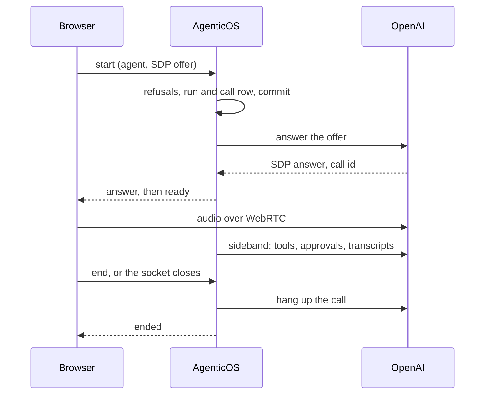

# Voice conversations

A **voice call** is a spoken conversation with a published agent. You talk, the
agent answers aloud, and you can interrupt it mid-sentence. The agent keeps what
it has in text chat: its tools, its knowledge, its approvals and its budgets.
Every turn of the call is saved as text in the same conversation, so you can
read it back or continue it by typing. No audio is stored, anywhere.

Calls are made from `/chat` in the console, and from a widget or a hosted page
when an embed's own switch is on. Each call is one [run](concepts.md), with the
realtime model's name on it, so Activity, the cost screen and the audit trail
see it like any other run.

In `/chat` the call is a pill floating above the composer, which does not
change: state, time, a waveform, mute, push-to-talk and End. The call happens
in the conversation, each turn drawn as the message it becomes, with tool runs
and approval cards between them. A draft and its attachments are still in the
composer when the call ends. A hosted page uses a call bar without approval
controls, and the widget loads a smaller one of its own. See
[Console](console.md#voice-calls) and
[Channels](channels.md#voice-calls-on-a-widget-or-a-hosted-page).

Switching organization or signing into another account ends a console call and
cancels pending setup or reconnects. If microphone permission arrives afterwards,
its tracks are stopped without opening the old organization's call. Public
embeds keep their separate visitor scope.

## Turn it on

**Calls are switched on in the agent.** The organization has no call settings:
a published agent with a voice takes calls, bounded by its own longest call and
by the budgets, as any run is.

**The agent.** Its Voice card in the Builder has a **Voice calls** tab, written
to the spec's [`voice` field](reference/spec.md#voice). It names the provider,
the model (or, for Azure, the deployment name and the base model it runs), the
vault key calls are held with, the voice, an optional language, an optional
longest call (10 minutes when unset, 50 at most) and an optional voice note. The
note is added to the agent's instructions in calls only. The section takes
effect when the agent is published.

**Hear the voice first.** The play button beside the voice picker plays the
draft's voice saying one sentence, in the section's language or the console's,
before anything is published. It is a short paid session on the section's key,
outside the budgets like a dictation, so it is limited per person
(`RATE_LIMIT_VOICE_PREVIEW_PER_MINUTE`) and cached for a week per voice and
language.

**Every agent offers the button.** In `/chat` the call button stands in Send's
place while the box is empty, and Send comes back once something is typed. For one with no voice, or a key that can no longer
hold a call, it is crossed out, and its reason links whoever may edit the agent
to the Calls tab of its Voice card. The Architect's window and the Builder's
test panel offer it the same way; in the test panel the call runs the published
version, not the draft being tested, and the button says so.

**The embed.** A widget or a hosted page offers calls only when its own "Voice
calls" switch is on. Saving the switch on is refused while the agent has no
published voice it can call with. See
[Channels](channels.md#voice-calls-on-a-widget-or-a-hosted-page).

## Models and keys

The models a call can use come from one catalog file,
`backend/app/core/catalog/realtime_models.json`, described in
[Models](models.md#realtime-models). There is no model profile for voice and no
organization default: the agent's Voice section is the only place a realtime
model is named.

| Provider | Models | Transport | Verified |
|---|---|---|---|
| OpenAI | `gpt-realtime`, `gpt-realtime-2.1`, `gpt-realtime-2.1-mini` | WebRTC | Live-tested |
| Azure OpenAI | a deployment of `gpt-realtime` | Relay | **Not verified live** |
| Google | Gemini Live: `gemini-2.5-flash-native-audio-latest`, `gemini-3.1-flash-live-preview` | Relay | **Not verified live** |
| xAI | `grok-voice-latest`, billed per minute | Relay | **Not verified live** |

Only OpenAI could be tested against a real account. Azure, Gemini and xAI are
built from the providers' and Pydantic AI's documentation and tested with fakes.
Expect them to work, and check them on your own account before you rely on them.

**The key is an explicit vault secret.** Its purpose must be the provider and
its kind must match: an `api_key`, or an `azure_openai` secret for Azure, which
also carries the endpoint and API version. The publisher must be able to see the
key, as for any binding. See [Secrets](secrets.md#where-they-are-used).

**GPT-Live is not offered.** It takes the conversation's history only when a
session starts and cannot be reconfigured, so a reconnect could not continue the
call it resumes.

## How a call runs

The browser opens a socket to this deployment, `/api/v1/ws/voice`, and sends a
`start` frame naming the agent and, optionally, the conversation. Everything
about the call passes over that socket: the frames are listed in
[the API page](api.md#voice-calls).

**OpenAI, over WebRTC.** The browser builds a peer connection with its
microphone and sends the SDP offer inside `start`. The server answers it with
the provider, sends the answer back, and then holds a *sideband* connection to
the same call for as long as the socket is open. The audio flows between the
browser and OpenAI; the tools, the approvals, the transcripts and the metering
run on the server. The server reads the socket while it sets the call up, so
an `end` or a closed tab stops the setup before the provider session is opened.
An offer already sent to the provider is allowed to finish first, and the call
it created is then hung up, so it does not run on to the provider's own limit.

Two things are refused on purpose. An offer that opens a **data channel** (an
`m=application` section) is refused: the browser never needs one, and a data
channel would let the page send events to the provider behind the server's back.
And **no client secret is ever minted**, so the browser never holds a credential
that could open a call of its own.

**Azure, Gemini and xAI, over the relay.** The browser streams 16-bit PCM audio
over the same socket, at the model's input rate, and plays what comes back at
its output rate. When you talk over the agent, the server cuts its answer and
tells the browser to drop what it has queued. Audio that arrives much faster
than anyone speaks is dropped, and a sustained flood ends the call.

## What a call can use

A call runs the agent its published spec describes, built by the same factory as
a text run. The differences come from the realtime session: its tools are fixed
when the call connects, it cannot pause for an approval, and it cannot carry a
workspace, a browser or delegates. Those the call hands to the agent's own text
model instead.

| By voice | Capabilities |
|---|---|
| As-is | clock (the time in the instructions is fixed when the call connects), context, knowledge, web research, web fetch, charts, artifacts, code execution, conversation search, memory files, mem0 memory, planning, tool output limits, image generation, text to speech |
| On screen | ask the user: in `/chat` the question card appears in the call view, read aloud as well, and the caller taps an answer or says it; a widget's or hosted page's call is not offered it |
| Adapted | skills: loaded as instructions on demand, without the tools a text run uses to read them |
| Dropped | tool search: the MCP tools it would have deferred are passed to the call directly |
| Mapped | thinking: becomes the realtime model's own reasoning setting, where the model has one |
| Handed off | sandbox, browser use, subagents, the coding agent, video generation, work while tools run: done by the agent's text model, see [Handing work off](#handing-work-off) |

The Builder's Voice card lists the capabilities this agent hands off in calls.

### Handing work off

When the agent has a capability a call cannot carry, its call gets one more
tool, `hand_off`. The call's model describes the task, and the same agent runs
it on its own text model, the one its Build tab names: with the sandbox, the
browser and the subagents, in the same workspace, under the same budget. It
answers with what it did, and the call's model says that aloud.

- **The call goes on meanwhile.** The agent says it is working on it first, and
  the call bar shows each step as it runs.
- **Each step is kept.** The steps are saved on the turn that handed the work
  off, so the conversation shows them afterwards as it shows a chat's.
- **Approvals are the call's.** A gated tool the text model calls, or one of its
  subagents calls, shows the same approval card as one the call makes. A
  visitor's call carries no gated tool here either.
- **One hand-off at a time.** Each continues from what the last one did in that
  call, so "now send that file" works after "write it up".
- **A failure is said, not hidden.** A hand-off that runs out of budget or
  steps, or whose model fails, comes back as a sentence the agent says; the
  call goes on.

A hand-off takes as long as the work does, often a minute or more, and spends on
the text model as well as the call's.

**Built-in spoken style.** Every call adds the same guidance to the agent's
instructions: short sentences; no markdown, lists, tables or links read aloud;
numbers and dates said the way a person says them; names, amounts, addresses and
dates read back before acting on them; and saying so when it is waiting for an
approval, rather than claiming a result first. A visitor's call is told nothing
about approvals; the agent is told instead to say plainly what it cannot do on
the call. The agent's own voice note follows it.

Over WebRTC the agent is resolved twice, once to answer the offer and once for
the sideband. MCP servers are connected twice and dynamic instructions run
twice, so a mem0 memory lookup is paid twice; both are metered on the run.

## Approvals in a call

A realtime session cannot pause, so an approval is decided inside the call.

When the agent calls a tool that needs an approval, the server writes the
approval row at once and shows the person on the call a card: the tool, **the
exact arguments it will run with**, and what the caller was heard to say. A
misheard name is the risk here ("Acme" heard as "Ahmad"), and the card is the
check on it. Approving runs exactly those arguments, once; the same tool called
again needs a new approval. A second decision on the same card, sent before the
first one lands, changes nothing: the first decision stands.

- **60 seconds** without a decision expires the request, with no decider, and
  the agent says so.
- Only **the person on the call** decides, and only with `approvals:decide`. The
  approvals queue refuses a request that belongs to a live call, and the stale
  sweep leaves it alone.
- A member **without** `approvals:decide` keeps the tool. When the agent reaches
  for it, the call shows a notice, the tool is refused, and the agent says that
  this needs an approval the caller cannot give by voice and suggests text chat.
- An **anonymous visitor** on a widget or a hosted page never sees a tool that
  needs an approval: those tools are left out of the call entirely.

When the model calls a tool the call does not have, whether one left out for a
visitor or a name it made up, the tool does not run. The model is told the tool
is not available on this call, the agent says it cannot do that, and the call
goes on.

A call ending, for any reason, expires whatever it was still waiting on.

## Limits and cost

**Time.** A call runs at most the agent's longest call: 10 minutes when the
Voice section names none, and never more than 50. Its clock starts when the call
is ready, as the call view's timer does, so setup time does not count. A minute
before the end the call view is warned. At the end the agent says one short
sentence about why and the call stops, as `time_limit`.

**Minutes.** Call minutes are counted from the call rows (`voice_calls`): each
call to its end, or to its last heartbeat while it is still running. There is no
monthly minute limit; the budgets below bound what calls spend. The dashboard's
"Voice minutes" card and `GET /api/v1/voice/usage` read the same rows.

**Money.** Calls count against the agent's and the organization's budgets, as
text runs do:

- Before a call starts, its longest possible length times the model's
  worst-case price per minute is checked against the budget left. A call that
  could not be afforded is refused, rather than started and cut short.
- During the call, each response is metered as it finishes, and the budget is
  re-read at every heartbeat. The session's cost limit can overshoot by at most
  one response (two on Azure, whose deployment is priced here as its base
  model).
- Every heartbeat also writes the call's cost so far onto its run, so the budget
  checks of other runs and calls see a live call's spend within 15 seconds, not
  only once it ends.
- A response the realtime session leaves unpriced is priced here from its token
  counts, and the session's cost limit counts it. One that cannot be priced
  either way is recorded as unpriced.
- xAI is billed per connected minute, at the catalog's rate.
- A model whose price cannot be computed is refused at setup, so a budget is
  never silently unenforced.
- Transcribing the caller's speech is not priced, so a call's recorded cost is
  slightly under what the provider bills.

**Concurrency.** One person holds one call at a time
(`VOICE_MAX_CALLS_PER_USER`, default 1). A call hung up a moment ago still
counts until its end is recorded, so a new call from the same person waits up to
four seconds for it before refusing as `busy`: "Call again" right after End
starts a call. One embed holds at most three open calls, from every visitor
together (`VOICE_MAX_CALLS_PER_EMBED`); a fourth caller is refused as
`line_busy`. See [Configuration](configuration.md#voice-calls).

## Ending a call, and what bounds a lost one

Closing the socket does not end an OpenAI WebRTC call: the audio is the
browser's and the provider's, and the call goes on talking and billing until it
is hung up or reaches the provider's own one-hour limit. So hanging up is the
server's job, on every path:

1. **A `finally` on every exit.** Hanging up, a limit, a lost socket, an error,
   a revoked access or a shutdown all end in the same teardown. It records the
   call's end, so a reconnect waiting on it does not also wait out the hang-up,
   then hangs the provider call up (OpenAI's hang-up endpoint; a relay call ends
   when the server closes its upstream socket), then finishes the run with its
   cost.
2. **Heartbeats.** The process holding a call writes its cost and seconds every
   15 seconds, from the start of setup, so a slow start is not mistaken for a
   lost call. Each heartbeat also re-checks the caller's session, their
   membership, their access to the agent and the agent's published state, and
   ends the call when any of them fails. A visitor's call also needs its embed
   still active, with calls on and pointed at the same agent.
3. **The sweep.** A scheduled job, every minute and once at start-up, hangs up
   any call whose heartbeat is older than 45 seconds, or whose end was recorded
   more than 45 seconds ago but whose hang-up failed. It needs only the call id
   and the key, and closes each call on its own, so one call it cannot close
   does not hold up the others. A call it cannot hang up, such as one whose key
   can no longer be read, is retired as abandoned once it is an hour old, by
   which time the provider has ended it.
4. **Shutdown.** A server told to stop hangs up its own calls before it goes.
5. **The browser** closes its peer connection when the tab is hidden for good
   (`pagehide`) or the socket closes. That is a convenience; the four above are
   the guarantee.

!!! danger "The worst case for a lost OpenAI call"

    If every safety net failed, a silent call costs close to nothing and a
    chatty one about $5–15 for its hour. The bigger risk is not the money: it is
    your organization's key held open with no tools, no approvals and no audit.
    The sweep closes that window to about a minute.

## Reconnecting

A dropped connection gets **one automatic retry within 10 seconds**. The new
connection is accepted only for the same person, agent and conversation, only
with the resume token the previous connection was given when it was set up, and
only within 10 seconds of the previous one being closed. The server keeps only
a hash of that token. A reconnect ends the previous connection if it is still
half-open, and counts it as ending at its last heartbeat.

Time and budget carry over: a reconnect continues the call's clock rather than
restarting it, and the call view keeps the call's whole time limit. A call
already made of 20 connections is not resumed again, so its time cannot slip
out of the count.

The new session starts from the turns saved so far, as **text**, so nothing is
repeated, no tool runs twice and the audio is not billed again. When those turns
would fill more than half the model's context window, the older ones become a
short summary written by the agent's chat model (billed to the run) and the
recent ones follow word for word.

Each connection is its own run, linked to the one it resumed. Activity shows the
chain as one call, with every connection's time and cost summed.

!!! note "Gemini's own resumption"

    Gemini ends its connections after about ten minutes and resumes them
    in-process, inside one call. A reconnect from the browser is a new session
    seeded with text, as for every other provider.

## Transcripts

Each turn is saved the moment it finishes, as an ordinary message in the
conversation: the caller's words from the input transcript, the agent's from
what it said. Tool calls appear inline, as in text chat; a tool that asked the
model to try again is saved as failed, with a generic notice rather than the
tool's own error text. A crash loses at most the turn in progress, and a
reconnect cannot save a turn twice.

When you talk over the agent, its answer is cut to what you heard and marked as
interrupted. Over the relay the server knows exactly what was played. Over
WebRTC it does not, so the cut is an estimate, made from when you started
speaking. The live captions can run slightly ahead of the audio.

**Guardrails** run on the transcripts. A hit on the agent's words cuts it off
mid-sentence and shows a notice; a hit on the caller's words is not announced.
Either way the hit is counted on the call and the whole turn is saved as
`[withheld by a guardrail]`, and a guardrail that redacts rather than blocks
saves the redacted text. Spoken words cannot be filtered before they are heard -
the Voice card says so.

Tools are screened on their way back: a tool's result is screened, and blocked,
before the agent reads it. The check before a tool runs is the approval, for
tools that need one. Guardrails do not screen a tool's arguments.

## Frequently asked questions { #frequently-asked-questions }

### Is audio recorded?

No. The call keeps text only: each turn's transcript is saved as a message in
the conversation, and no audio is stored by this deployment, in the database,
on disk or in memory after the call. What the provider keeps is governed by
your agreement with that provider.

### Why can't a visitor approve a tool?

A visitor on a widget or a hosted page is anonymous, and an approval is a
decision somebody has to be accountable for. So tools that need an approval are
left out of a visitor's call entirely, and the agent says plainly when it cannot
do something there.

### What happens if my tab closes mid-call?

The socket closes, and the server hangs up the provider call and records its
time and cost. If the server itself stopped, the sweep hangs the call up within
about a minute of its last heartbeat. The turns said before the tab closed are
already saved in the conversation.
