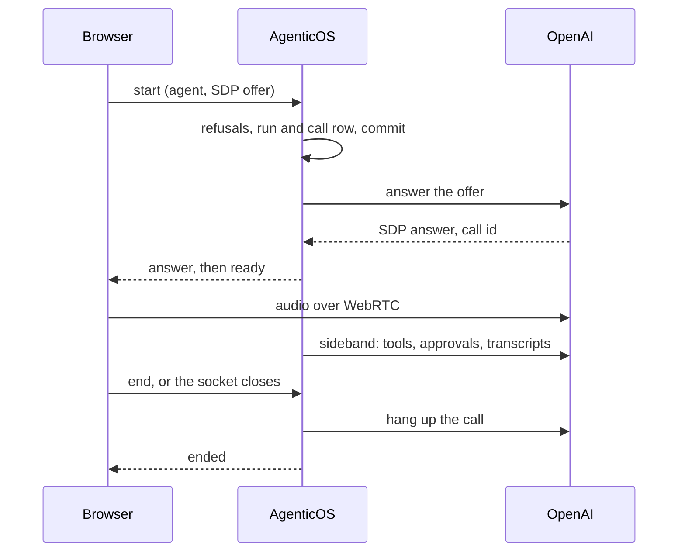

# Rozmowy głosowe { #voice-conversations }

**Rozmowa głosowa** to mówiona rozmowa z opublikowanym agentem. Ty mówisz,
agent odpowiada na głos, a ty możesz mu przerwać w pół zdania. Agent zachowuje
to, co ma w czacie tekstowym: swoje narzędzia, swoją wiedzę, swoje zatwierdzenia
i swoje budżety. Każda tura rozmowy jest zapisywana jako tekst w tej samej
konwersacji, więc możesz ją potem przeczytać albo kontynuować pisaniem. Dźwięk
nie jest przechowywany nigdzie.

Rozmowy prowadzi się z `/chat` w konsoli, a z widgetu albo hostowanej strony -
gdy włączony jest własny przełącznik embeda. Każda rozmowa to jeden
[run](concepts.md) z nazwą modelu realtime, więc Aktywność (Activity), ekran
kosztów i ślad audytowy widzą ją jak każdy inny run.

W `/chat` rozmowa to pigułka unosząca się nad polem wiadomości, które się nie
zmienia: stan, czas, wykres fali dźwiękowej, wyciszenie, „naciśnij, aby mówić” i
Zakończ. Rozmowa toczy się w konwersacji, a każda tura jest rysowana jako
wiadomość, którą się stanie, z uruchomieniami narzędzi i kartami zatwierdzeń
pomiędzy. Wersja robocza i jej załączniki zostają w polu, gdy rozmowa się
skończy. Hostowana strona korzysta z paska rozmowy bez obsługi zatwierdzeń, a
widget wczytuje własny, mniejszy. Zobacz [Konsola](console.md#voice-calls) i
[Kanały](channels.md#voice-calls-on-a-widget-or-a-hosted-page).

Zmiana organizacji lub konta kończy rozmowę w konsoli i anuluje oczekujące
przygotowanie oraz ponowne łączenie. Jeśli zgoda na mikrofon nadejdzie później,
jego ścieżki zostaną zatrzymane bez otwierania rozmowy w poprzedniej organizacji.
Publiczne osadzenia zachowują odrębny zakres odwiedzającego.

## Włączanie { #turn-it-on }

**Rozmowy włącza się w agencie.** Organizacja nie ma ustawień rozmów:
opublikowany agent z głosem odbiera rozmowy, ograniczony własną najdłuższą
rozmową i budżetami, jak każdy run.

**Agent.** Jego karta Głos (Voice) w Builderze ma zakładkę **Rozmowy głosowe**,
zapisywaną w [polu `voice`](reference/spec.md#voice) spec. Wskazuje providera,
model (albo, dla Azure, nazwę deploymentu i model bazowy, na którym działa),
klucz z vaulta, którym prowadzi się rozmowy, głos, opcjonalny język,
opcjonalną najdłuższą rozmowę (10 minut, gdy nieustawiona, najwyżej 50) i
opcjonalną notkę głosową. Notka jest dodawana do instrukcji agenta tylko w
rozmowach. Sekcja zaczyna działać po publikacji agenta.

**Najpierw posłuchaj głosu.** Przycisk odtwarzania obok wyboru głosu odtwarza
głos z wersji roboczej mówiący jedno zdanie, w języku sekcji albo konsoli, zanim
cokolwiek zostanie opublikowane. To krótka płatna sesja na kluczu sekcji, poza
budżetami jak dyktowanie, więc jest limitowana na osobę
(`RATE_LIMIT_VOICE_PREVIEW_PER_MINUTE`) i trzymana w cache przez tydzień per
głos i język.

**Każdy agent ma przycisk.** W `/chat` przycisk rozmowy stoi w miejscu
„Wyślij”, dopóki pole jest puste, a „Wyślij” wraca, gdy coś wpiszesz. Dla agenta bez głosu albo z kluczem, który nie utrzyma już
rozmowy, jest przekreślony, a jego powód prowadzi tego, kto może edytować
agenta, do zakładki Rozmowy na jego karcie Głos (Voice). Okno Architekta i panel
testowy Buildera oferują go tak samo; w panelu testowym rozmowa uruchamia
opublikowaną wersję, nie testowany draft, i przycisk to mówi.

**Embed.** Widget albo hostowana strona proponuje rozmowy tylko wtedy, gdy
włączony jest jego własny przełącznik „Rozmowy głosowe”. Zapisanie włączonego
przełącznika jest odrzucane, póki agent nie ma opublikowanego głosu, którym
można prowadzić rozmowę. Zobacz
[Kanały](channels.md#voice-calls-on-a-widget-or-a-hosted-page).

## Modele i klucze { #models-and-keys }

Modele, których może użyć rozmowa, pochodzą z jednego pliku katalogu,
`backend/app/core/catalog/realtime_models.json`, opisanego w
[Modelach](models.md#realtime-models). Nie ma profilu modelu dla głosu ani
domyślnego modelu organizacji: sekcja Głos agenta to jedyne miejsce, w którym
nazywa się model realtime.

| Provider | Modele | Transport | Zweryfikowane |
|---|---|---|---|
| OpenAI | `gpt-realtime`, `gpt-realtime-2.1`, `gpt-realtime-2.1-mini` | WebRTC | Przetestowane na żywo |
| Azure OpenAI | wdrożenie `gpt-realtime` | Relay | **Nie zweryfikowane na żywo** |
| Google | Gemini Live: `gemini-2.5-flash-native-audio-latest`, `gemini-3.1-flash-live-preview` | Relay | **Nie zweryfikowane na żywo** |
| xAI | `grok-voice-latest`, rozliczany za minutę | Relay | **Nie zweryfikowane na żywo** |

Tylko OpenAI dało się przetestować na prawdziwym koncie. Azure, Gemini i xAI są
zbudowane na podstawie dokumentacji providerów i Pydantic AI i przetestowane z
atrapami. Spodziewaj się, że działają, i sprawdź je na własnym koncie, zanim
zaczniesz na nich polegać.

**Klucz to jawnie wskazany sekret z vaultu.** Jego przeznaczeniem musi być ten
provider, a rodzaj musi pasować: `api_key` albo, dla Azure, sekret
`azure_openai`, który niesie też endpoint i wersję API. Publikujący musi widzieć
klucz, jak przy każdym powiązaniu. Zobacz
[Sekrety](secrets.md#where-they-are-used).

**GPT-Live nie jest oferowany.** Przyjmuje historię konwersacji tylko na starcie
sesji i nie da się go przekonfigurować, więc ponowne połączenie nie mogłoby
kontynuować rozmowy, którą wznawia.

## Jak przebiega rozmowa { #how-a-call-runs }

Przeglądarka otwiera gniazdo do tego wdrożenia, `/api/v1/ws/voice`, i wysyła
ramkę `start`, która nazywa agenta i, opcjonalnie, konwersację. Wszystko, co
dotyczy rozmowy, przechodzi przez to gniazdo: ramki są wymienione na
[stronie API](api.md#voice-calls).

**OpenAI, przez WebRTC.** Przeglądarka buduje połączenie peer ze swoim
mikrofonem i wysyła ofertę SDP wewnątrz `start`. Serwer odpowiada na nią przez
providera, odsyła odpowiedź, a potem trzyma połączenie *sideband* z tą samą
rozmową, dopóki gniazdo jest otwarte. Dźwięk płynie między przeglądarką a
OpenAI; narzędzia, zatwierdzenia, transkrypcje i pomiar działają na serwerze.
Podczas zestawiania rozmowy serwer czyta gniazdo, więc `end` albo zamknięta
karta przerywa zestawianie, zanim sesja u providera zostanie otwarta. Oferta
już wysłana do providera może się najpierw dokończyć, a utworzona przez nią
rozmowa jest potem rozłączana, więc nie trwa aż do własnego limitu providera.

Dwie rzeczy są odrzucane celowo. Oferta, która otwiera **kanał danych** (sekcję
`m=application`), jest odrzucana: przeglądarka nigdy go nie potrzebuje, a kanał
danych pozwoliłby stronie wysyłać zdarzenia do providera za plecami serwera.
I **żaden sekret klienta nigdy nie jest wydawany**, więc przeglądarka nigdy nie
trzyma poświadczenia, którym mogłaby otworzyć własną rozmowę.

**Azure, Gemini i xAI, przez relay.** Przeglądarka strumieniuje 16-bitowy dźwięk
PCM przez to samo gniazdo, z częstotliwością wejściową modelu, i odtwarza to, co
wraca, z jego częstotliwością wyjściową. Gdy wchodzisz agentowi w słowo, serwer
ucina jego odpowiedź i każe przeglądarce porzucić to, co ma w kolejce. Dźwięk,
który przychodzi znacznie szybciej, niż ktokolwiek mówi, jest porzucany, a
utrzymujący się zalew kończy rozmowę.

## Czego może używać rozmowa { #what-a-call-can-use }

Rozmowa uruchamia agenta opisanego przez jego opublikowany spec, zbudowanego
przez tę samą fabrykę co run tekstowy. Różnice wynikają z sesji realtime: jej
narzędzia są ustalane w chwili połączenia, nie może się wstrzymać na
zatwierdzenie i nie udźwignie workspace'u, przeglądarki ani delegatów. Te
rozmowa przekazuje zamiast tego modelowi tekstowemu agenta.

| Głosowo | Capabilities |
|---|---|
| Bez zmian | zegar (czas w instrukcjach jest ustalany w chwili połączenia), kontekst, wiedza, research w sieci, pobieranie stron, wykresy, artefakty, wykonywanie kodu, wyszukiwanie w konwersacjach, pliki pamięci, pamięć mem0, planowanie, limity wyjścia narzędzi, generowanie obrazów, zamiana tekstu na mowę |
| Na ekranie | pytania do użytkownika: w `/chat` karta pytań pojawia się w widoku rozmowy i jest też czytana na głos, a rozmówca stuka odpowiedź albo ją mówi; rozmowa z widgetu ani strony hostowanej ich nie dostaje |
| Dostosowane | skille: ładowane na żądanie jako instrukcje, bez narzędzi, którymi run tekstowy je czyta |
| Pominięte | wyszukiwanie narzędzi: narzędzia MCP, które by odroczyło, są przekazywane rozmowie bezpośrednio |
| Zmapowane | thinking: staje się własnym ustawieniem rozumowania modelu realtime, o ile model je ma |
| Przekazane | sandbox, browser use, subagenty, coding agent, generowanie wideo, praca w trakcie narzędzi: robi to model tekstowy agenta, zob. [Przekazywanie pracy](#handing-work-off) |

Karta Głos w Builderze wymienia capabilities, które ten agent w rozmowach
przekazuje.

### Przekazywanie pracy { #handing-work-off }

Gdy agent ma capability, której rozmowa nie udźwignie, jego rozmowa dostaje
jeszcze jedno narzędzie, `hand_off`. Model rozmowy opisuje zadanie, a ten sam
agent wykonuje je na własnym modelu tekstowym, tym z zakładki Build: z sandboxem,
przeglądarką i subagentami, w tym samym workspace'ie, w ramach tego samego
budżetu. Odpowiada tym, co zrobił, a model rozmowy mówi to na głos.

- **Rozmowa w tym czasie trwa.** Agent najpierw mówi, że nad tym pracuje, a pasek
  rozmowy pokazuje każdy krok w trakcie.
- **Każdy krok zostaje.** Kroki są zapisywane przy turze, która przekazała pracę,
  więc konwersacja pokazuje je potem tak, jak pokazuje kroki czatu.
- **Zatwierdzenia należą do rozmowy.** Narzędzie wymagające zatwierdzenia,
  wywołane przez model tekstowy albo jego subagenta, pokazuje tę samą kartę
  zatwierdzenia co narzędzie wywołane przez rozmowę. Rozmowa gościa i tu nie ma
  narzędzi wymagających zatwierdzenia.
- **Jedno przekazanie naraz.** Każde kontynuuje to, co w tej rozmowie zrobiło
  poprzednie, więc „teraz wyślij ten plik” działa po „spisz to”.
- **Porażka jest mówiona, nie ukrywana.** Przekazanie, któremu skończy się budżet
  albo kroki, albo którego model zawiedzie, wraca jako zdanie wypowiadane przez
  agenta; rozmowa trwa dalej.

Przekazanie trwa tyle, ile sama praca, często minutę lub dłużej, i wydaje na
model tekstowy oprócz modelu rozmowy.

**Wbudowany styl mówiony.** Każda rozmowa dodaje do instrukcji agenta te same
wskazówki: krótkie zdania; żadnego markdownu, list, tabel ani linków czytanych na
głos; liczby i daty wypowiadane tak, jak mówi je człowiek; nazwy, kwoty, adresy i
daty powtarzane rozmówcy przed działaniem na nich; i mówienie, że czeka na
zatwierdzenie, zamiast najpierw ogłaszać wynik. W rozmowie odwiedzającego o
zatwierdzeniach nie ma ani słowa; agent ma za to wprost mówić, czego w tej
rozmowie nie może zrobić. Po nich następują własne uwagi do głosu agenta.

Przez WebRTC agent jest rozwiązywany dwa razy: raz, żeby odpowiedzieć na ofertę,
i raz dla połączenia sideband. Serwery MCP są łączone dwa razy, a dynamiczne
instrukcje wykonują się dwa razy, więc za wyszukiwanie w pamięci mem0 płaci się
podwójnie; oba są mierzone na runie.

## Zatwierdzenia w rozmowie { #approvals-in-a-call }

Sesja realtime nie może się wstrzymać, więc zatwierdzenie rozstrzyga się w
trakcie rozmowy.

Gdy agent wywołuje narzędzie, które wymaga zatwierdzenia, serwer od razu
zapisuje wiersz zatwierdzenia i pokazuje osobie w rozmowie kartę: narzędzie,
**dokładne argumenty, z którymi się wykona**, i to, co według transkrypcji
powiedział rozmówca. Ryzykiem jest tu źle usłyszana nazwa („Acme” usłyszane jako
„Ahmad”), a karta jest jego kontrolą. Zatwierdzenie wykonuje dokładnie te
argumenty, raz; to samo narzędzie wywołane ponownie wymaga nowego zatwierdzenia.
Druga decyzja na tej samej karcie, wysłana, zanim dotrze pierwsza, niczego nie
zmienia: obowiązuje pierwsza.

- **60 sekund** bez decyzji powoduje wygaśnięcie prośby, bez decydenta, a agent
  to mówi.
- Decyduje tylko **osoba w rozmowie** i tylko z `approvals:decide`. Kolejka
  zatwierdzeń odrzuca prośbę, która należy do trwającej rozmowy, a przemiatanie
  nieaktualnych zatwierdzeń zostawia ją w spokoju.
- Członek **bez** `approvals:decide` zachowuje narzędzie. Gdy agent po nie
  sięga, rozmowa pokazuje komunikat, narzędzie jest odrzucane, a agent mówi, że
  to wymaga zatwierdzenia, którego rozmówca nie może udzielić głosowo, i
  proponuje czat tekstowy.
- **Anonimowy odwiedzający** w widgecie albo na hostowanej stronie nigdy nie
  widzi narzędzia, które wymaga zatwierdzenia: takie narzędzia są całkowicie
  pomijane w rozmowie.

Gdy model wywoła narzędzie, którego rozmowa nie ma, czy to pominięte dla
odwiedzającego, czy wymyślone, narzędzie się nie uruchamia. Model dowiaduje się,
że w tej rozmowie to narzędzie nie jest dostępne, agent mówi, że nie może tego
zrobić, a rozmowa toczy się dalej.

Zakończenie rozmowy, z dowolnego powodu, powoduje wygaśnięcie wszystkiego, na co
jeszcze czekała.

## Limity i koszt { #limits-and-cost }

**Czas.** Rozmowa trwa najwyżej tyle, ile najdłuższa rozmowa agenta: 10 minut,
gdy sekcja Voice żadnej nie wskazuje, i nigdy więcej niż 50. Jej zegar rusza,
gdy rozmowa jest gotowa, razem z licznikiem w widoku rozmowy, więc czas
zestawiania się nie liczy. Minutę przed końcem widok rozmowy dostaje
ostrzeżenie. Na końcu agent mówi jedno krótkie zdanie o tym, dlaczego, i rozmowa
się zatrzymuje, jako `time_limit`.

**Minuty.** Minuty rozmów są liczone z wierszy rozmów (`voice_calls`): każda
rozmowa do swojego końca albo, póki jeszcze trwa, do swojego ostatniego
heartbeatu. Nie ma miesięcznego limitu minut; to, co rozmowy wydają, ograniczają
budżety poniżej. Karta „Minuty rozmów (Voice minutes)” na dashboardzie i
`GET /api/v1/voice/usage` czytają te same wiersze.

**Pieniądze.** Rozmowy liczą się do budżetów agenta i organizacji, tak jak runy
tekstowe:

- Zanim rozmowa się zacznie, jej najdłuższy możliwy czas pomnożony przez
  najgorszą cenę modelu za minutę jest porównywany z pozostałym budżetem.
  Rozmowa, na którą nie byłoby stać, jest odrzucana, zamiast zacząć się i zostać
  ucięta.
- W trakcie rozmowy każda odpowiedź jest liczona, gdy się skończy, a budżet jest
  odczytywany na nowo przy każdym heartbeacie. Limit kosztu sesji może zostać
  przekroczony najwyżej o jedną odpowiedź (o dwie na Azure, którego wdrożenie
  jest tu wyceniane jak jego model bazowy).
- Każdy heartbeat zapisuje też dotychczasowy koszt rozmowy na jej runie, więc
  sprawdzenia budżetu innych runów i rozmów widzą wydatki trwającej rozmowy w
  ciągu 15 sekund, a nie dopiero po jej końcu.
- Odpowiedź, której sesja realtime nie wyceniła, jest wyceniana tutaj z liczby
  jej tokenów, a limit kosztu sesji ją uwzględnia. Taka, której nie da się
  wycenić żadnym sposobem, jest zapisywana jako niewyceniona.
- xAI jest rozliczany za każdą minutę połączenia, według stawki z katalogu.
- Model, którego ceny nie da się obliczyć, jest odrzucany przy konfiguracji, więc
  budżet nigdy nie przestaje być po cichu egzekwowany.
- Transkrypcja mowy rozmówcy nie jest wyceniana, więc zapisany koszt rozmowy jest
  nieco niższy niż to, co nalicza provider.

**Współbieżność.** Jedna osoba prowadzi naraz jedną rozmowę
(`VOICE_MAX_CALLS_PER_USER`, domyślnie 1). Rozmowa rozłączona przed chwilą
liczy się, dopóki nie zostanie zapisany jej koniec, więc nowa rozmowa tej samej
osoby czeka na nią do czterech sekund, zanim odmówi jako `busy`: „Zadzwoń
ponownie” zaraz po Zakończ zaczyna rozmowę. Jeden embed ma najwyżej trzy otwarte
rozmowy, od wszystkich odwiedzających razem (`VOICE_MAX_CALLS_PER_EMBED`);
czwarty rozmówca jest odrzucany jako `line_busy`. Zobacz
[Konfigurację](configuration.md#voice-calls).

## Kończenie rozmowy i co ogranicza utraconą { #ending-a-call-and-what-bounds-a-lost-one }

Zamknięcie gniazda nie kończy rozmowy OpenAI przez WebRTC: dźwięk należy do
przeglądarki i providera, a rozmowa dalej mówi i nalicza opłaty, dopóki nie
zostanie rozłączona albo nie osiągnie własnego, godzinnego limitu providera.
Dlatego rozłączanie jest zadaniem serwera, na każdej ścieżce:

1. **`finally` na każdym wyjściu.** Rozłączenie, limit, utracone gniazdo, błąd,
   odebrany dostęp i zamknięcie serwera kończą się tym samym sprzątaniem. Zapisuje
   ono koniec rozmowy, żeby ponowne połączenie, które na niego czeka, nie czekało
   też na rozłączenie, potem rozłącza rozmowę u providera (endpoint rozłączania
   OpenAI; rozmowa przez relay kończy się, gdy serwer zamyka swoje gniazdo do
   providera), a potem kończy run z jego kosztem.
2. **Heartbeaty.** Proces, który trzyma rozmowę, co 15 sekund zapisuje jej koszt
   i sekundy, już od początku zestawiania, więc powolny start nie zostaje wzięty
   za utraconą rozmowę. Każdy heartbeat sprawdza też na nowo sesję rozmówcy, jego
   członkostwo, jego dostęp do agenta i stan publikacji agenta i kończy
   rozmowę, gdy którekolwiek z nich zawiedzie. Rozmowa odwiedzającego wymaga
   ponadto, by jej embed był nadal aktywny, miał włączone rozmowy i wskazywał
   tego samego agenta.
3. **Przemiatanie.** Zaplanowane zadanie, co minutę i raz przy starcie, rozłącza
   każdą rozmowę, której heartbeat jest starszy niż 45 sekund albo której koniec
   został zapisany ponad 45 sekund temu, ale rozłączenie się nie udało.
   Potrzebuje tylko id rozmowy i klucza i zamyka każdą rozmowę osobno, więc
   jedna, której nie da się zamknąć, nie wstrzymuje pozostałych. Rozmowa, której
   nie da się rozłączyć, na przykład taka, której klucza nie można już odczytać,
   jest wycofywana jako porzucona, gdy ma godzinę - do tego czasu provider już
   ją zakończył.
4. **Zamknięcie.** Serwer, któremu kazano się zatrzymać, rozłącza swoje rozmowy,
   zanim odejdzie.
5. **Przeglądarka** zamyka swoje połączenie peer, gdy karta zostaje ukryta na
   dobre (`pagehide`) albo gniazdo się zamyka. To wygoda; gwarancją są cztery
   powyższe.

!!! danger "Najgorszy przypadek utraconej rozmowy OpenAI"

    Gdyby zawiodło każde zabezpieczenie, cicha rozmowa kosztuje prawie nic, a
    gadatliwa około 5–15 $ za swoją godzinę. Większym ryzykiem nie są pieniądze:
    to klucz twojej organizacji trzymany otwarty bez narzędzi, bez zatwierdzeń i
    bez audytu. Przemiatanie zamyka to okno do mniej więcej minuty.

## Ponowne łączenie { #reconnecting }

Zerwane połączenie dostaje **jedną automatyczną ponowną próbę w ciągu 10
sekund**. Nowe połączenie jest przyjmowane tylko dla tej samej osoby, tego samego
agenta i tej samej konwersacji, tylko z tokenem wznowienia, który poprzednie
połączenie dostało przy zestawieniu, i tylko w ciągu 10 sekund od zamknięcia
poprzedniego. Serwer przechowuje tylko skrót tego tokena. Ponowne połączenie
kończy poprzednie, jeśli to jest jeszcze półotwarte, i liczy je jako zakończone
przy jego ostatnim heartbeacie.

Czas i budżet przechodzą dalej: ponowne połączenie kontynuuje zegar rozmowy,
zamiast go restartować, a widok rozmowy zachowuje cały jej limit czasu. Rozmowa złożona już z 20 połączeń nie jest
wznawiana ponownie, więc jej czas nie może wymknąć się z rachunku.

Nowa sesja startuje od zapisanych dotąd tur, jako **tekst**, więc nic nie jest
powtarzane, żadne narzędzie nie wykonuje się dwa razy, a za dźwięk nie płaci się
ponownie. Gdy te tury wypełniłyby ponad połowę okna kontekstu modelu, starsze
stają się krótkim podsumowaniem napisanym przez model czatu agenta (rozliczanym
na runie), a nowsze następują po nim słowo w słowo.

Każde połączenie jest osobnym runem, powiązanym z tym, który wznowiło. Aktywność
pokazuje ten łańcuch jako jedną rozmowę, z zsumowanym czasem i kosztem każdego
połączenia.

!!! note "Własne wznawianie Gemini"

    Gemini kończy swoje połączenia po mniej więcej dziesięciu minutach i wznawia
    je w procesie, w ramach jednej rozmowy. Ponowne połączenie z przeglądarki to
    nowa sesja zasiana tekstem, jak u każdego innego providera.

## Transkrypcje { #transcripts }

Każda tura jest zapisywana w chwili, gdy się kończy, jako zwykła wiadomość w
konwersacji: słowa rozmówcy z transkrypcji wejścia, słowa agenta z tego, co
powiedział. Wywołania narzędzi pojawiają się w treści, jak w czacie tekstowym;
narzędzie, które poprosiło model o ponowną próbę, jest zapisywane jako nieudane,
z ogólnym komunikatem zamiast własnego tekstu błędu narzędzia. Awaria traci najwyżej turę w toku, a ponowne połączenie nie może zapisać tury
dwa razy.

Gdy wchodzisz agentowi w słowo, jego odpowiedź jest ucinana do tego, co
usłyszałeś, i oznaczana jako przerwana. Przez relay serwer wie dokładnie, co
zostało odtworzone. Przez WebRTC nie wie, więc cięcie jest szacunkiem,
opartym na chwili, w której zacząłeś mówić. Napisy na żywo mogą
nieco wyprzedzać dźwięk.

**Guardraile** działają na transkrypcjach. Trafienie w słowa agenta przerywa mu
w pół zdania i pokazuje komunikat; trafienie w słowa rozmówcy nie jest
ogłaszane. W obu przypadkach trafienie jest liczone na rozmowie, a cała tura
jest zapisywana jako `[withheld by a guardrail]`, a guardrail, który redaguje
zamiast blokować, zapisuje zredagowany tekst. Wypowiedzianych słów nie da się
odfiltrować, zanim zostaną usłyszane - karta Głos to mówi.

Narzędzia są sprawdzane w drodze powrotnej: wynik narzędzia jest sprawdzany i
blokowany, zanim agent go przeczyta. Sprawdzeniem przed wykonaniem narzędzia
jest zatwierdzenie, dla narzędzi, które go wymagają. Guardraile nie sprawdzają
argumentów narzędzia.

## Najczęściej zadawane pytania { #frequently-asked-questions }

### Czy dźwięk jest nagrywany? { #is-audio-recorded }

Nie. Rozmowa zachowuje tylko tekst: transkrypcja każdej tury jest zapisywana
jako wiadomość w konwersacji, a to wdrożenie nie przechowuje dźwięku - ani w
bazie danych, ani na dysku, ani w pamięci po rozmowie. To, co zatrzymuje
provider, reguluje twoja umowa z tym providerem.

### Dlaczego odwiedzający nie może zatwierdzić narzędzia? { #why-cant-a-visitor-approve-a-tool }

Odwiedzający w widgecie albo na hostowanej stronie jest anonimowy, a
zatwierdzenie to decyzja, za którą ktoś musi odpowiadać. Dlatego narzędzia, które
wymagają zatwierdzenia, są całkowicie pomijane w rozmowie odwiedzającego, a agent
mówi wprost, gdy czegoś nie może tam zrobić.

### Co się stanie, jeśli moja karta zamknie się w trakcie rozmowy? { #what-happens-if-my-tab-closes-mid-call }

Gniazdo się zamyka, a serwer rozłącza rozmowę u providera i zapisuje jej czas i
koszt. Jeśli zatrzymał się sam serwer, przemiatanie rozłącza rozmowę w ciągu
mniej więcej minuty od jej ostatniego heartbeatu. Tury wypowiedziane przed
zamknięciem karty są już zapisane w konwersacji.
