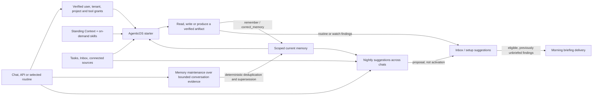

# Starter behavior and measurement

## Runtime paths

The starter provides stable product routing and completion rules. Longer procedures live in relevant skills with references loaded only when useful. Platform MCP and tool descriptions specify the active installation's contract. Organization and project facts come from authorized Context and records rather than a globally seeded file. `platform-context` contains an example of ownership, sources, scope and missing-data behavior suitable for project instructions.

An inline specialist is available on an explicit request or acceptance of a specific conversational offer. The capability's `auto` mode only chooses how a submitted delegation executes. Consent is a model instruction backed by positive and negative trajectory cases. Resource mutations continue through the platform's normal authorization and approval gates.

## Cost, long history and duplicates

1. Keep frequently used instructions short. Retrieve relevant Context, skills, claims and sources per task. Use a full-source reader when the user asks for complete coverage.
2. Memory tools make durable updates during the conversation. Maintenance extracts overlooked claims from bounded transcript slices with source evidence. Keep the existing claim subject for factual changes and inspect cost per useful new claim, duplicate rate, and missed updates separately.
3. Nightly suggestions use bounded request and evidence packets across chats. Check repeat intent against active routines and prior decisions. Morning delivery uses current Inbox findings and a delivery marker. Its cost and correctness belong to the worker/integration layer.
4. Use one production model call path first. Judge only eligible outputs after deterministic checks, and keep the evaluator's token and cost figures separate. Revisit which cases fail before widening model context or changing the threshold for autonomous tool use.

## Prompt research and design choices

- Establish observable success criteria, clear instructions, and just-in-time evidence. Keep the stable starter compact and recover task state after compaction. [Anthropic prompt engineering](https://platform.claude.com/docs/en/build-with-claude/prompt-engineering/overview), [Anthropic context engineering](https://www.anthropic.com/research/effective-context-engineering-for-ai-agents)
- Separate instruction priorities, contextual inputs, tool use and final verification. Keep representative interactions in the dataset, so they assess behavior without repeating a large example bank on every chat. [OpenAI prompt engineering](https://developers.openai.com/api/docs/guides/prompt-engineering?api-mode=responses), [OpenAI model guide](https://developers.openai.com/api/docs/guides/latest-model), [OpenAI prompt-writing practices](https://help.openai.com/en/articles/6654000-best-practices-for-prompt-engineering-with-the-openai-api)
- The public prompt archive provided structural examples for tool-selection rules, dedicated skills and separately scoped memory policies. Its published material is third-party and provenance varies. The shipped text is authored for AgenticOS and its verified tool contracts. [Prompt archive](https://github.com/asgeirtj/system_prompts_leaks), [archived research instructions](https://github.com/asgeirtj/system_prompts_leaks/blob/main/Anthropic/research_instructions.md), [archived memory instructions](https://github.com/asgeirtj/system_prompts_leaks/blob/main/OpenAI/tool-advanced-memory.md)
- The optional judge follows the rubric-and-evidence pattern. The app already depends on Pydantic AI, so the runner uses a structured Boolean and reason on its existing dependency lock. [Pydantic Evals judge guidance](https://pydantic.dev/docs/ai/evals/evaluators/llm-judge/)
