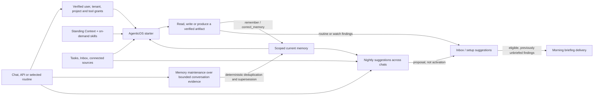

# Starter behavior and measurement

## Runtime paths

The starter provides stable product routing and completion rules. Longer procedures live in relevant skills with references loaded only when useful. Platform MCP and tool descriptions specify the active installation's contract. Organization and project facts come from authorized Context and records rather than a globally seeded file. `platform-context` contains an example of ownership, sources, scope and missing-data behavior suitable for project instructions.

An inline specialist is available on an explicit request or acceptance of a specific conversational offer. The capability's `auto` mode only chooses how a submitted delegation executes. Consent is a model instruction backed by positive and negative trajectory cases. Resource mutations continue through the platform's normal authorization and approval gates.

## Cost, long history and duplicates

1. Keep frequently used instructions short. Retrieve relevant Context, skills, claims and sources per task. Use a full-source reader when the user asks for complete coverage.
2. Memory tools make durable updates during the conversation. Maintenance extracts overlooked claims from bounded transcript slices with source evidence. Keep the existing claim subject for factual changes and inspect cost per useful new claim, duplicate rate, and missed updates separately.
3. Nightly suggestions use bounded request and evidence packets across chats. Check repeat intent against active routines and prior decisions. Morning delivery uses current Inbox findings and a delivery marker. Its cost and correctness belong to the worker/integration layer.
4. Use one production model call path first. Judge only eligible outputs after deterministic checks, and keep the evaluator's token and cost figures separate. Revisit which cases fail before widening model context or changing the threshold for autonomous tool use.

## Prompt research and design choices

- Establish observable success criteria, clear instructions, and just-in-time evidence. Keep the stable starter compact and recover task state after compaction. [Anthropic prompt engineering](https://platform.claude.com/docs/en/build-with-claude/prompt-engineering/overview), [Anthropic context engineering](https://www.anthropic.com/research/effective-context-engineering-for-ai-agents)
- Separate instruction priorities, contextual inputs, tool use and final verification. Keep representative interactions in the dataset, so they assess behavior without repeating a large example bank on every chat. [OpenAI prompt engineering](https://developers.openai.com/api/docs/guides/prompt-engineering?api-mode=responses), [OpenAI model guide](https://developers.openai.com/api/docs/guides/latest-model), [OpenAI prompt-writing practices](https://help.openai.com/en/articles/6654000-best-practices-for-prompt-engineering-with-the-openai-api)
- The public prompt archive provided structural examples for tool-selection rules, dedicated skills and separately scoped memory policies. Its published material is third-party and provenance varies. The shipped text is authored for AgenticOS and its verified tool contracts. [Prompt archive](https://github.com/asgeirtj/system_prompts_leaks), [archived research instructions](https://github.com/asgeirtj/system_prompts_leaks/blob/main/Anthropic/research_instructions.md), [archived memory instructions](https://github.com/asgeirtj/system_prompts_leaks/blob/main/OpenAI/tool-advanced-memory.md)
- The optional judge follows the rubric-and-evidence pattern. The app already depends on Pydantic AI, so the runner uses a structured Boolean and reason on its existing dependency lock. [Pydantic Evals judge guidance](https://pydantic.dev/docs/ai/evals/evaluators/llm-judge/)

## Candidate and cost forecast

Start with the pinned DeepSeek V4 Flash 0731 snapshot for all three suites. It supports tool calling and structured outputs, and the platform has prices for its model ID in the bundled catalog. The newer V4.1 Flash 1017 snapshot produced partial cost in the local runtime probe. Use GLM 5.3 as an optional independent judge. Whether the candidate matches a stronger reference is an empirical question for these cases. OpenRouter lists $0.06 input and $0.18 output per million tokens for DeepSeek, and $0.0699/$1.40 for GLM, checked 2026-11-20. Routing changes the actual rate. The local platform catalog uses $0.14/$0.28 for the candidate, which would book about $0.41 at the same volume. [DeepSeek pricing](https://openrouter.ai/deepseek/deepseek-v4-flash-0731), [GLM pricing](https://openrouter.ai/z-ai/glm-5.3)

| Stage | Assumed input / output tokens across the suite | Listed rate | Higher-rate scenario |
| --- | ---: | ---: | ---: |
| AgenticOS, 50 cases | 2.00M / 0.20M | $0.156 | $0.60 |
| Memory, 50 cases | 0.15M / 0.04M | $0.016 | $0.07 |
| Briefing, 50 cases | 0.20M / 0.06M | $0.023 | $0.10 |
| **Candidate subtotal** | **2.35M / 0.30M** | **$0.195** | **$0.77** |
| Judge, at most 150 cases | 0.525M / 0.075M | $0.142 | $0.67 |

This is a planning estimate based on summed input across model calls, including repeated tool schemas, and billed output including reasoning. It assumes uncached input. The higher-rate scenario uses $0.20/$1.00 for DeepSeek and $0.70/$4.00 for GLM per million tokens. Extra live probes and non-model tool charges are outside the table. Use a dedicated $2 OpenRouter key limit for the first comparison. Replace the token assumptions with measured use after three representative cases per suite.

## Memory research to test against a baseline

- **SoMem.** Keep short facts and decisions versioned. Use linked topic notes for larger context and preserve the exact source turns behind summaries. Test correction, deduplication, multi-hop recall and deletion of a fact linked from a summary. The paper measures memory question answering, and its full comparisons do not establish sustained personalization or task performance. [Can LLM Agents Organize Their Own Memory?](https://arxiv.org/html/2611.11929v1)
- **Route to Remember.** Use the verification idea while keeping personal data editable in text. Compare a bounded overview with a second retrieval pass for corrections, missing evidence and time-sensitive facts. Measure missed updates and extra tokens. The paper's weight-based results use a trained student on HaluMem. Training per-person weights would complicate correction and erasure. [Route to Remember](https://arxiv.org/html/2611.05636v1)
- **MemCredit.** Compare which memories change the final action under the same token budget. Construct matched cases where a plausible but stale note outranks a correct deadline by similarity, then remove each note in turn. Measure action accuracy and cost alongside retrieval quality. The reported results come from ALFWorld and WebShop. [MemCredit](https://arxiv.org/html/2611.15600v1)
- **SIM.** Record failed behaviors, why a prompt or skill changed, the exact cases and model, predicted and observed effects and held-out results alongside eval reports. This is memory for improving the harness. The paired repeated result comes from coding, and harness continuation did not win across every model transition. [Self-Improvement Memory](https://arxiv.org/html/2611.18856v1)
